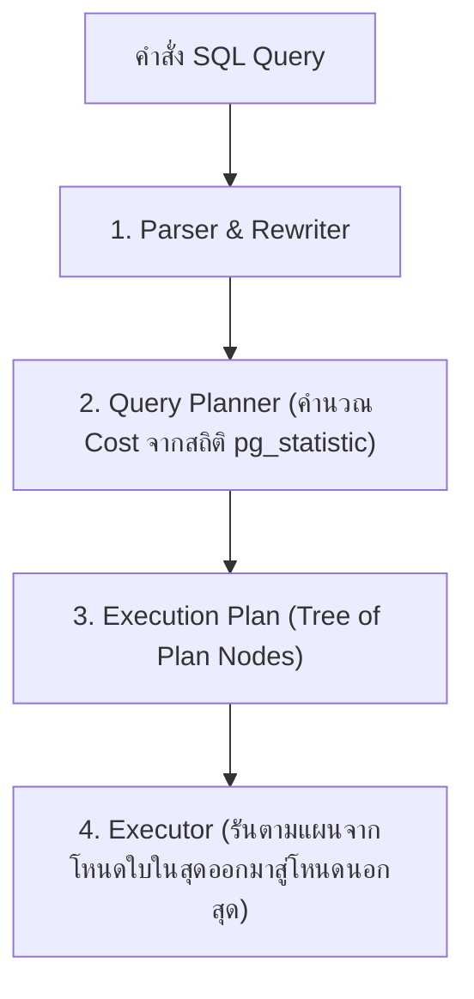

## 1. แนวคิด (Concept)
เวลาเราส่งคำสั่ง SQL ไปยัง PostgreSQL 16 คำสั่งนั้นจะไม่ได้ถูกรันทันที แต่จะถูกส่งให้ **Query Planner (Cost-Based Optimizer)** ประเมินหาเส้นทางการดึงข้อมูลที่มีต้นทุนต่ำที่สุดออกมาก่อน ซึ่งแผนการเดินทางนี้เรียกว่า **Execution Plan** โดยเราสามารถขอดูแผนนี้ได้ด้วย 2 คำสั่งหลัก:
1. **`EXPLAIN <query>`:** ขอให้ Planner แสดง **แผนการที่คาดการณ์ไว้ (Estimated Plan)** โดย **ไม่ได้รันคำสั่งนั้นจริง** ใช้ดูคร่าวๆ ว่า Planner ตั้งใจจะใช้ Index หรือไม่
2. **`EXPLAIN (ANALYZE, BUFFERS) <query>`:** สั่งให้ PostgreSQL **รันคำสั่งนั้นจริงๆ** แล้วนำผลลัพธ์เวลาที่ใช้จริง จำนวนแถวจริง และจำนวนบล็อกหน่วยความจำที่อ่านจริง มาเปรียบเทียบคู่กับค่าที่ Planner คาดการณ์ไว้



## 2. หลักการเบื้องหลัง (Under the Hood)
ในการอ่านผลลัพธ์ของ `EXPLAIN (ANALYZE, BUFFERS)` ให้เข้าใจอย่างถ่องแท้ ต้องอ่านจาก **โหนดที่อยู่ลึกที่สุด (ย่อหน้าเข้าไปด้านในสุด) ย้อนออกมาหาโหนดบนสุด** โดยมีความหมายของตัวเลขสำคัญดังนี้:
- **`cost=0.42..8.44`:** ตัวเลขแรก (`0.42`) คือ Startup Cost (ต้นทุนก่อนจะได้แถวแรกออกมา) และตัวเลขหลัง (`8.44`) คือ Total Cost (ต้นทุนรวมทั้งหมดในหน่วย Arbitrary Cost Units เทียบเท่าการอ่านหน้าดิสก์แบบเรียงลำดับ = 1.0)
- **`rows=10` (ในบล็อกแรก) vs `rows=10` (ในบล็อก `actual`):** เปรียบเทียบจำนวนแถวที่ Planner คาดการณ์ไว้ กับจำนวนแถวที่ดึงออกมาได้จริง หากตัวเลขสองตัวนี้ต่างกันหลายสิบหรือหลายร้อยเท่า แปลว่าสถิติของตารางไม่อัปเดตและทำให้ Planner เลือกวิธี Join ผิด!
- **`loops=1`:** จำนวนรอบที่โหนดนั้นถูกสั่งรันซ้ำ **ข้อควรระวัง:** ค่า `actual time` ที่แสดงในโหนดนั้นคือเวลาเฉลี่ยต่อ 1 loop ดังนั้นเวลาจริงทั้งหมดของโหนดนั้นต้องนำ **`actual time * loops`** เสมอ!
- **`Buffers: shared hit=4 read=0`:**
  - `shared hit`: จำนวนบล็อก (บล็อกละ 8KB) ที่อ่านพบใน RAM (`shared_buffers`) ทันที (เร็วมาก)
  - `shared read`: จำนวนบล็อกที่ไม่มีใน RAM จนต้องไปขออ่านจาก OS Cache หรือ Disk I/O (ช้ากว่ามาก)

### รูปแบบการ Scan และการ Join ที่พบบ่อยใน Execution Plan
- **Scan Nodes:** `Seq Scan` (กวาดทั้งตาราง), `Index Scan` (เปิด Index แล้วกระโดดไปหยิบแถวในตาราง), `Index Only Scan` (อ่านจบใน Index ไม่แตะตาราง), `Bitmap Heap Scan` (รวบรวมตำแหน่งหน้าบล็อกจาก `Bitmap Index Scan` มาเรียงลำดับก่อนเปิดอ่านตาราง)
- **Join Nodes:**
  - `Nested Loop`: วนลูปตารางนอกทีละแถวเพื่อไปค้นหาตารางใน (เร็วมากถ้าตารางนอกมีน้อยแถวและตารางในมี Index)
  - `Hash Join`: นำตารางที่เล็กกว่ามาสร้าง Hash Table ในหน่วยความจำ (`work_mem`) แล้วนำตารางใหญ่มาวิ่งเทียบ (เหมาะกับการ Join ข้อมูลจำนวนมากที่ไม่ได้เรียงลำดับไว้)
  - `Merge Join`: นำข้อมูลสองตารางที่เรียงลำดับตามคีย์ที่ใช้ Join มาแล้ว มาวิ่งประกบคู่กันรวดเดียว (เร็วมากสำหรับข้อมูลขนาดใหญ่ที่มี Index เรียงลำดับไว้แล้ว)

## 3. ตัวอย่างโค้ด (Smart Butcher Marketplace)

### ตัวอย่างที่ 1: การรันและอ่านผล `EXPLAIN (ANALYZE, BUFFERS)` ของคิวรีค้นหาออเดอร์
ตรวจสอบแผนการประมวลผลเมื่อดึงรายการคำสั่งซื้อของลูกค้าพร้อมรายการเนื้อย่อยในออเดอร์นั้น:

```sql filename="sql/01_explain_analyze_buffers_basics.sql"
-- ใช้ EXPLAIN (ANALYZE, BUFFERS) เพื่อดูทั้งเวลาจริงและจำนวนบล็อก 8KB ที่อ่านจาก RAM/Disk
EXPLAIN (ANALYZE, BUFFERS)
SELECT 
    o.id AS order_id,
    o.order_number,
    o.total_amount,
    oi.product_name_snapshot,
    oi.quantity,
    oi.unit_price
FROM orders o
JOIN order_items oi ON oi.order_id = o.id
WHERE o.user_id = 'a1111111-1111-1111-1111-111111111111'
  AND o.status = 'PAID'
ORDER BY o.created_at DESC
LIMIT 10;

/* ตัวอย่างผลลัพธ์ Execution Plan และการตีความ:
Limit  (cost=0.85..16.92 rows=10 width=118) (actual time=0.045..0.082 rows=10 loops=1)
  Buffers: shared hit=14
  ->  Nested Loop  (cost=0.85..32.99 rows=20 width=118) (actual time=0.044..0.079 rows=10 loops=1)
        Buffers: shared hit=14
        ->  Index Scan using idx_orders_user_status_created on orders o  (cost=0.42..8.45 rows=5 width=52) (actual time=0.025..0.031 rows=4 loops=1)
              Index Cond: ((user_id = 'a1111111-...'::uuid) AND ((status)::text = 'PAID'::text))
              Buffers: shared hit=4
        ->  Index Scan using uq_order_items_order_product on order_items oi  (cost=0.42..4.87 rows=4 width=82) (actual time=0.008..0.010 rows=2 loops=4)
              Index Cond: (order_id = o.id)
              Buffers: shared hit=10
Planning Time: 0.215 ms
Execution Time: 0.112 ms
*/
```

### ตัวอย่างที่ 2: การใช้ `EXPLAIN` อย่างปลอดภัยกับคำสั่ง `UPDATE` หรือ `DELETE` โดยหุ้มด้วย `ROLLBACK`
เนื่องจาก `EXPLAIN ANALYZE` จะรันคำสั่ง SQL นั้นจริงๆ หากเราต้องการวัดประสิทธิภาพของคำสั่ง `UPDATE` หรือ `DELETE` โดยไม่ต้องการให้ข้อมูลในฐานข้อมูลเปลี่ยนไปจริงๆ ต้องหุ้มด้วย `BEGIN; ... ROLLBACK;` เสมอ:

```sql filename="sql/02_safe_explain_analyze_write_query.sql"
BEGIN;

-- ทดสอบวัดประสิทธิภาพการอัปเดตสถานะออเดอร์ที่หมดเวลาชำระเงิน
EXPLAIN (ANALYZE, BUFFERS)
UPDATE orders
SET status = 'CANCELLED', updated_at = CURRENT_TIMESTAMP
WHERE status = 'PENDING'
  AND created_at < CURRENT_TIMESTAMP - INTERVAL '24 hours';

-- ยกเลิกการเปลี่ยนแปลงทันทีหลังจากได้ผลลัพธ์ Execution Plan แล้ว
ROLLBACK;
```

## 4. ผิด vs ถูก (Anti-pattern vs Best Practice)

| มิติการเปรียบเทียบ | ❌ ผิด (Anti-pattern) | ✅ ถูก (Best Practice) |
| :--- | :--- | :--- |
| **การรัน `EXPLAIN` ดูผล** | รันแค่ `EXPLAIN` เปล่าๆ แล้วเชื่อทันที หรือรัน `EXPLAIN ANALYZE` โดยไม่ใส่ `BUFFERS` | ใช้ `EXPLAIN (ANALYZE, BUFFERS)` เสมอเพื่อดูทั้งเวลาจริงและปริมาณ I/O (`shared hit` vs `shared read`) |
| **การรัน `EXPLAIN ANALYZE` กับ `DELETE`** | รัน `EXPLAIN ANALYZE DELETE FROM orders WHERE ...` ลอยๆ จนข้อมูลจริงถูกลบหายไปจากตาราง | หุ้มด้วย `BEGIN; EXPLAIN (ANALYZE, BUFFERS) DELETE ...; ROLLBACK;` เสมอ |
| **การดูแต่เวลา Execution Time** | ดูแค่ว่าเวลารวมน้อยกว่า 50ms บนเครื่อง Dev ที่มีข้อมูล 100 แถว แล้วสรุปว่าคิวรีเร็ว | ดูที่โครงสร้าง Plan Node ว่าใช้ Index ที่ถูกต้องหรือไม่ และดูจำนวน `Buffers` ที่ถูกอ่าน |

## 5. ควรใช้เมื่อไหร่ และ ไม่ควรใช้เมื่อไหร่
- **ควรใช้ `EXPLAIN (ANALYZE, BUFFERS)` เมื่อ:** พัฒนาคิวรีใหม่ที่มีความซับซ้อน (มี `JOIN`, `GROUP BY`, Subqueries), เมื่อตรวจสอบพบ Slow Query, หรือหลังการสร้าง Index ใหม่เพื่อยืนยันว่า Planner เลือกใช้ Index นั้นจริง
- **ไม่ควรรัน `EXPLAIN ANALYZE` เปล่าๆ โดยไม่มี `BEGIN ... ROLLBACK` เมื่อ:** คิวรีนั้นเป็นคำสั่งแก้ไขข้อมูล (`INSERT`, `UPDATE`, `DELETE`) หรือการเรียกฟังก์ชันที่มีผลข้างเคียงต่อข้อมูล

## 6. คำถามสัมภาษณ์ (Interview Q&A)
- **Q1: หากในผลลัพธ์ของ `EXPLAIN (ANALYZE, BUFFERS)` คุณเห็นบรรทัด `Sort Method: external merge Disk: 45200kB` มันหมายความว่าอะไร และคุณจะแก้ไขอย่างไร?**
  - **แนวคำตอบ:** หมายความว่าคิวรีนั้นต้องทำการจัดเรียงข้อมูล (`ORDER BY` หรือ `GROUP BY`) ขนาดประมาณ 45MB ซึ่งใหญ่เกินกว่าขนาดหน่วยความจำ `work_mem` ที่ตั้งไว้ (ค่าเริ่มต้นของ PostgreSQL คือ 4MB ต่อ Operation) ทำให้ PostgreSQL ต้องระบายข้อมูลลงไปเขียนและเรียงลำดับบนไฟล์ชั่วคราวในดิสก์ (Disk Spill) ซึ่งช้ากว่าการเรียงใน RAM หลายสิบเท่า วิธีแก้ไขคือ (1) สร้าง B-Tree Index ที่มีลำดับคอลัมน์ตรงกับ `ORDER BY` เพื่อไม่ต้อง Sort เลย หรือ (2) สั่งเพิ่ม `SET LOCAL work_mem = '64MB';` เฉพาะใน Transaction ของคิวรีรายงานตัวนั้น
- **Q2: ทำไมในโหนด `Nested Loop` เมื่อดูค่า `actual time=0.050..0.060 rows=1 loops=5000` โหนดนี้ถึงเป็นสาเหตุที่ทำให้คิวรีใช้เวลาถึง 300 มิลลิวินาที ทั้งที่ตัวเลขเขียนว่า `0.060`?**
  - **แนวคำตอบ:** เพราะค่า `actual time` ที่แสดงใน PostgreSQL Execution Plan คือค่าเฉลี่ยต่อการรัน 1 รอบ (`1 loop`) เมื่อโหนดนั้นมี `loops=5000` เวลาที่ใช้จริงทั้งหมดของโหนดนั้นจึงเท่ากับ `0.060 ms * 5000 loops = 300 ms`

---
