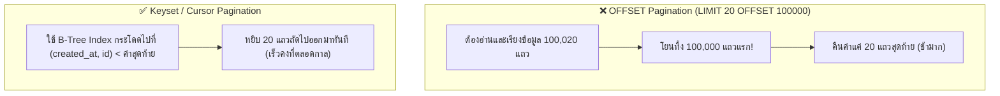

## 1. แนวคิด (Concept)
เมื่อระบบมีรายการสินค้าหรือประวัติคำสั่งซื้อจำนวนมาก เราต้องแบ่งข้อมูลแสดงผลทีละหน้า (**Pagination**) โดยวิธีแบ่งหน้ามี 2 แนวทางหลักที่มีประสิทธิภาพต่างกันราวฟ้ากับเหวเมื่อข้อมูลมีขนาดใหญ่:
1. **OFFSET / LIMIT Pagination:** การระบุจำนวนแถวที่ต้องการข้ามไป เช่น `LIMIT 20 OFFSET 100000` (ขอดูหน้า 5,001 หน้าละ 20 แถว) วิธีนี้เขียนง่ายแต่มีข้อเสียร้ายแรงคือ **ยิ่งเปิดหน้าลึกเท่าไหร่ คิวรียิ่งช้าลงเรื่อยๆ แบบ $O(N)$!**
2. **Keyset / Cursor Pagination (Seek Method):** การใช้ค่าของคอลัมน์สุดท้ายจากหน้าก่อนหน้ามาเป็นจุดอ้างอิงในเงื่อนไข `WHERE` เช่น `WHERE (created_at, id) < ($last_created_at, $last_id) ORDER BY created_at DESC, id DESC LIMIT 20` วิธีนี้จะกระโดดเข้าสู่ตำแหน่งใน B-Tree Index ทันที ทำให้ **การเปิดหน้าที่ 1 หรือหน้าที่ 50,000 ใช้เวลาเร็วเท่ากันที่ระดับ < 1 มิลลิวินาที ($O(\log N)$)!**



## 2. หลักการเบื้องหลัง (Under the Hood)
ทำไมคำสั่ง `OFFSET 100000` ใน PostgreSQL (และ RDBMS ทุกตัว) จึงช้ามาก?
- เพราะในโครงสร้าง B-Tree Index ไม่มีตัวนับลำดับแถวแบบตายตัวเก็บไว้ เนื่องจากกลไก MVCC ทำให้แต่ละ Transaction อาจมองเห็นจำนวนแถวที่มีชีวิตอยู่ไม่เท่ากัน
- ดังนั้น เมื่อสั่ง `LIMIT 20 OFFSET 100000` ตัว PostgreSQL **ไม่มีทางลัดที่จะกระโดดข้าม 100,000 แถวไปได้** มันจำเป็นต้องกวาดอ่านข้อมูลจริงผ่าน Index หรือตารางตั้งแต่แถวที่ 1, 2, 3 เรื่อยไปจนครบ 100,000 แถว เพื่อเช็ค Visibility ว่าแต่ละแถวยังมีชีวิตอยู่หรือไม่ แล้วจึงโยน 100,000 แถวนั้นทิ้งไป เพื่อหยิบแถวที่ 100,001 ถึง 100,020 มาส่งให้เรา!
- ในทางกลับกัน **Keyset Pagination** ใช้การเปรียบเทียบค่า Tuple `(created_at, id) < ('2026-10-17 08:00:00+07', 'uuid-สุดท้าย')` ซึ่งตรงกับโครงสร้างการจัดเรียงของ Composite B-Tree Index พอดี ตัว Engine จึงวิ่งจาก Root ลงมายัง Leaf Page ของตำแหน่งนั้นโดยตรงและอ่านเพียง 20 แถวเท่านั้น

<Callout type="note" title="ทำไม Keyset Pagination ต้องใช้คอลัมน์ Tie-breaker คู่กันเสมอ">
หากเราเรียงลำดับและแบ่งหน้าด้วยคอลัมน์ created_at เพียงตัวเดียว เช่น WHERE created_at &lt; $1 ORDER BY created_at DESC แล้วบังเอิญมีคำสั่งซื้อ 3 ใบถูกสร้างขึ้นในระดับมิลลิวินาทีเดียวกันเป๊ะ การแบ่งหน้าจะเกิดอาการข้อมูลตกหล่นหรือซ้ำได้ ดังนั้นต้องใช้คอลัมน์ที่ไม่ซ้ำกันแน่นอนอย่าง id เป็นตัวตัดสินลำดับรอง (Tie-breaker) คู่กันในรูปแบบ Row Value Comparison เสมอ เช่น (created_at, id) &lt; ($1, $2)
</Callout>

## 3. ตัวอย่างโค้ด (Smart Butcher Marketplace)

### ตัวอย่างที่ 1: เปรียบเทียบคิวรี `OFFSET` แบบเดิม กับการสร้าง Index รองรับ Keyset Pagination
สร้าง Composite Index บน `(created_at DESC, id DESC)` เพื่อให้การเรียงลำดับมีค่า 고유 (Deterministic Order) 100%:

```sql filename="sql/05_keyset_pagination_setup.sql"
-- สร้าง Composite Index ที่เรียงลำดับทั้งเวลาและ id ในทิศทางเดียวกัน (DESC ทั้งคู่)
CREATE INDEX idx_orders_created_id_desc
ON orders (created_at DESC, id DESC);

-- 1. การดึงหน้าแรก (Page 1) ไม่ต้องมีเงื่อนไข Cursor
SELECT id, order_number, status, total_amount, created_at
FROM orders
ORDER BY created_at DESC, id DESC
LIMIT 20;
```

### ตัวอย่างที่ 2: การเขียนคิวรี Keyset Pagination ด้วย Row Constructor `(col1, col2) < ($1, $2)`
เมื่อผู้ใช้เลื่อนลงมาดูหน้าถัดไป (Infinite Scroll หรือปุ่ม Next Page) ให้นำค่า `created_at` และ `id` ของแถวที่ 20 จากหน้าก่อนหน้า มาส่งเป็นพารามิเตอร์:

```sql filename="sql/06_keyset_pagination_next_page.sql"
-- 2. การดึงหน้าถัดไปโดยใช้ค่าสุดท้ายของหน้าก่อนหน้า:
-- สมมติแถวที่ 20 ของหน้าก่อนมี created_at = '2026-10-17 10:30:00+07' และ id = '9b222222-2222-2222-2222-222222222222'
EXPLAIN (ANALYZE, BUFFERS)
SELECT id, order_number, status, total_amount, created_at
FROM orders
WHERE (created_at, id) < ('2026-10-17 10:30:00+07'::timestamptz, '9b222222-2222-2222-2222-222222222222'::uuid)
ORDER BY created_at DESC, id DESC
LIMIT 20;

-- ผลลัพธ์: ใช้ Index Scan Backward/Forward บน idx_orders_created_id_desc อ่านเพียง 20 แถวเป๊ะ ไม่ว่าจะอยู่ลึกแค่ไหน!
```

## 4. ผิด vs ถูก (Anti-pattern vs Best Practice)

| มิติการเปรียบเทียบ | ❌ ผิด (Anti-pattern) | ✅ ถูก (Best Practice) |
| :--- | :--- | :--- |
| **การเปิดให้ใส่ `OFFSET` ไม่จำกัด** | เปิด API `/orders?page=50000&limit=20` โดยไม่มีเพดานกั้น ทำให้บอทหรือผู้ใช้ยิงคิวรี `OFFSET` ลึกๆ จน DB ค้าง | ใช้ Keyset/Cursor Pagination สำหรับหน้า Feed/ประวัติข้อมูล หรือจำกัดค่า `max_offset <= 1000` หากต้องใช้เลขหน้า |
| **การเรียงลำดับโดยไม่มี Tie-breaker** | เขียน `ORDER BY created_at DESC LIMIT 20` โดยไม่ใส่ `, id DESC` ต่อท้าย ทำให้ลำดับแถวที่มีเวลาเท่ากันสลับไปมา | ใส่คอลัมน์ Unique เช่น `id` เป็นตัวเรียงลำดับรองเสมอ: `ORDER BY created_at DESC, id DESC` |
| **การรัน `SELECT COUNT(*)` ทุกหน้า** | รัน `SELECT COUNT(*) FROM orders` ทุกครั้งที่เปลี่ยนหน้าบนตาราง 10 ล้านแถว (ซึ่ง `COUNT(*)` ต้องกวาดนับจริงใน MVCC) | ใช้การดึง `LIMIT 21` (ดึงเกินมา 1 แถวเพื่อเช็คว่า `hasNextPage` หรือไม่) โดยไม่ต้องรัน `COUNT(*)` ทั้งตาราง |

## 5. ควรใช้เมื่อไหร่ และ ไม่ควรใช้เมื่อไหร่
- **ควรใช้ Keyset / Cursor Pagination เมื่อ:** ตารางมีปริมาณข้อมูลขนาดใหญ่ (หลักหมื่นถึงหลายล้านแถว), ระบบเป็นแบบ Infinite Scroll, ประวัติคำสั่งซื้อ, หรือ API สำหรับดึงข้อมูลเป็นชุด (Batch Export)
- **อนุโลมให้ใช้ `OFFSET` Pagination ได้เมื่อ:** ตารางมีขนาดเล็ก (ไม่เกินไม่กี่พันแถว) หรือเป็นหน้าจอ Backoffice ที่ผู้ใช้งานจำเป็นต้องคลิกกระโดดไปยังหมายเลขหน้าแบบสุ่ม (เช่น กระโดดจากหน้า 1 ไปหน้า 8) โดยต้องบังคับเพดานไม่ให้ `OFFSET` เกินกำหนด

## 6. คำถามสัมภาษณ์ (Interview Q&A)
- **Q1: ใน PostgreSQL ทำไมคำสั่ง `SELECT COUNT(*) FROM orders;` บนตารางที่มี 20 ล้านแถวจึงทำงานช้ามาก ต่างจากฐานข้อมูลยุคเก่าบางตัวที่เก็บตัวเลขจำนวนแถวไว้ตายตัว?**
  - **แนวคำตอบ:** เพราะสถาปัตยกรรม **MVCC (Multi-Version Concurrency Control)** ของ PostgreSQL ยอมให้แต่ละ Transaction ที่รันอยู่พร้อมกันมองเห็นแถวข้อมูลในตารางไม่เท่ากัน (ขึ้นอยู่กับเวลาที่แต่ละ Transaction เริ่มต้น) ดังนั้นจึงไม่มีค่าจำนวนแถวเดียวที่ใช้ได้กับทุก Transaction ตัว PostgreSQL จึงต้องทำการกวาดอ่าน (Index-Only Scan หรือ Sequential Scan) เพื่อนับแถวที่มีชีวิตอยู่ในมุมมองของ Transaction นั้นจริงๆ หากต้องการแค่ตัวเลขประมาณการอย่างรวดเร็วสำหรับแสดงบน UI สามารถดึงจากสถิติตารางได้ด้วย `SELECT reltuples::bigint FROM pg_class WHERE relname = 'orders';`
- **Q2: นิพจน์ `WHERE (created_at, id) < ($1, $2)` ใน SQL มีความหมายเทียบเท่ากับการเขียนเงื่อนไข `AND` / `OR` แบบเต็มอย่างไร?**
  - **แนวคำตอบ:** นิพจน์ Row Value Comparison `(created_at, id) < ($1, $2)` มีความหมายทางตรรกศาสตร์เทียบเท่ากับ `WHERE created_at < $1 OR (created_at = $1 AND id < $2)` ทุกประการ แต่การเขียนในรูป `(created_at, id) < ($1, $2)` อ่านเข้าใจง่ายกว่ามากและช่วยให้ Query Planner ของ PostgreSQL จับคู่กับ Composite B-Tree Index `(created_at DESC, id DESC)` ได้โดยตรงอย่างแม่นยำ

---
