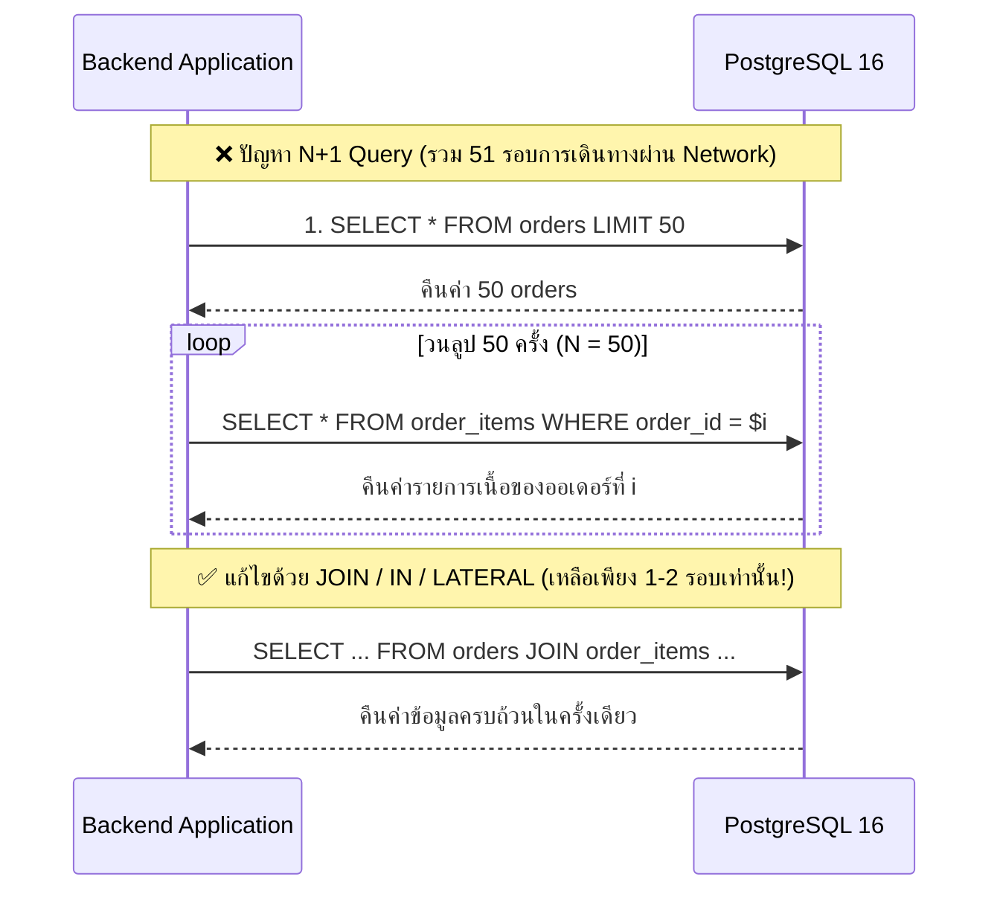

## 1. แนวคิด (Concept)
**ปัญหา N+1 Query** คือหนึ่งในสาเหตุอันดับต้นๆ ที่ทำให้ระบบฐานข้อมูลล่มเมื่อมีผู้ใช้งานพร้อมกันจำนวนมาก โดยเกิดจากรูปแบบการเขียนโปรแกรมที่:
1. ยิงคิวรีแรก (**1 Query**) เพื่อดึงรายการข้อมูลหลักออกมาก่อนจำนวน $N$ แถว (เช่น ดึงรายการหมวดหมู่เนื้อ `categories` ออกมา 20 หมวดหมู่ หรือดึงออเดอร์ `orders` ออกมา 50 ใบ)
2. จากนั้นในโค้ดฝั่ง Application ใช้คำสั่งวนลูป (`for` หรือ `Promise.all`) ยิงคิวรีย่อยเข้าไปถามฐานข้อมูลอีก **$N$ Queries** เพื่อดึงข้อมูลลูกของแต่ละแถว (เช่น ดึง `order_items` ของออเดอร์ทีละใบ จำนวน 50 ครั้ง)

แม้คิวรีย่อยแต่ละครั้งจะใช้เวลาในฐานข้อมูลเพียง 1 มิลลิวินาที แต่การต้องเดินทางผ่านเครือข่ายไป-กลับ (Network Round-trip Latency) ถึง 51 ครั้ง จะทำให้ API ช้าลงหลายสิบเท่า และแย่ง Connection Pool จนหมดอย่างรวดเร็ว



## 2. หลักการเบื้องหลัง (Under the Hood)
ทุกครั้งที่แอปพลิเคชันส่งคิวรี 1 ครั้งไปยัง PostgreSQL 16 จะเกิด Overhead ในแต่ละรอบดังนี้:
1. **Network Round-trip Time (RTT):** เวลาเดินทางของ TCP Packet ไปและกลับระหว่าง App Server กับ DB Server (เช่น 1-3 ms ต่อรอบ)
2. **Protocol Parsing & Binding:** กระบวนการอ่านข้อความโปรโตคอลของ Postgres Backend Process
3. **Planner & Executor Startup:** การเริ่มต้นโครงสร้างหน่วยความจำสำหรับรันคิวรีในแต่ละครั้ง

เมื่อเรายุบรวม $N+1$ คิวรี ให้กลายเป็นคิวรีเดียวด้วย `JOIN`, `WHERE order_id = ANY($1::uuid[])`, หรือ `LEFT JOIN LATERAL` ตัว PostgreSQL จะเสียเวลาผ่านเครือข่ายเพียงรอบเดียว และสามารถใช้ Hash Join หรือ Index Scan กวาดข้อมูลทั้งหมดในหน่วยความจำรวดเดียว

## 3. ตัวอย่างโค้ด (Smart Butcher Marketplace)

### ตัวอย่างที่ 1: การแก้ปัญหา N+1 เมื่อดึงข้อมูลออเดอร์พร้อมรายการสินค้าและผลรวมด้วย `JOIN` และ JSON Aggregation
แทนที่จะดึง `orders` มาวนลูปคิวรี `order_items` ทีละใบ เราสามารถดึงออเดอร์พร้อมรวมรายการสินค้าย่อยออกมาเป็น JSON Array จบในคิวรีเดียว:

```sql filename="sql/03_solve_n_plus_1_with_join_and_json_agg.sql"
-- ดึงรายการคำสั่งซื้อล่าสุด 20 ใบ พร้อมรายชื่อลูกค้า และรายการเนื้อย่อยทั้งหมดในคิวรีเดียว
SELECT 
    o.id,
    o.order_number,
    o.status,
    o.total_amount,
    o.created_at,
    u.full_name AS customer_name,
    COALESCE(
        jsonb_agg(
            jsonb_build_object(
                'item_id', oi.id,
                'product_id', oi.product_id,
                'product_name', oi.product_name_snapshot,
                'quantity', oi.quantity,
                'unit_price', oi.unit_price,
                'subtotal', oi.subtotal
            ) ORDER BY oi.created_at ASC
        ) FILTER (WHERE oi.id IS NOT NULL),
        '[]'::jsonb
    ) AS items
FROM orders o
JOIN users u ON u.id = o.user_id
LEFT JOIN order_items oi ON oi.order_id = o.id
WHERE o.user_id = 'a1111111-1111-1111-1111-111111111111'
GROUP BY o.id, u.full_name
ORDER BY o.created_at DESC
LIMIT 20;
```

### ตัวอย่างที่ 2: การแก้ปัญหา N+1 แบบ "ดึงสินค้าขายดี 3 อันดับแรกของแต่ละหมวดหมู่" ด้วย `LEFT JOIN LATERAL`
โจทย์คลาสสิกที่นักพัฒนามักติดกับดัก N+1 คือ "ต้องการแสดงหมวดหมู่เนื้อทุกหมวด พร้อมสินค้าที่ราคาแพงที่สุดหรือขายดีที่สุดหมวดละ 3 ชิ้น" เพราะใช้ `LIMIT 3` ใน `JOIN` ปกติไม่ได้ แต่ใน PostgreSQL 16 เราสามารถใช้ **`LATERAL JOIN`** แก้ปัญหานี้ในคิวรีเดียวได้อย่างสมบูรณ์แบบ:

```sql filename="sql/04_solve_top_n_per_group_with_lateral_join.sql"
-- ดึงหมวดหมู่เนื้อที่เปิดขายทั้งหมด พร้อมสินค้าเนื้อเกรดพรีเมียมสูงสุด 3 อันดับแรกของแต่ละหมวดหมู่ในคิวรีเดียว!
SELECT 
    c.id AS category_id,
    c.name AS category_name,
    c.slug AS category_slug,
    top_p.id AS product_id,
    top_p.sku,
    top_p.name AS product_name,
    top_p.price_per_kg,
    top_p.marbling_score
FROM categories c
LEFT JOIN LATERAL (
    -- Subquery ด้านในของ LATERAL สามารถอ้างอิง c.id จากตารางด้านนอกได้โดยตรงและใช้ Index + LIMIT ได้ทันที!
    SELECT p.id, p.sku, p.name, p.price_per_kg, p.marbling_score
    FROM products p
    WHERE p.category_id = c.id
      AND p.is_active = TRUE
      AND p.deleted_at IS NULL
    ORDER BY p.price_per_kg DESC
    LIMIT 3
) top_p ON TRUE
WHERE c.is_active = TRUE
ORDER BY c.name ASC, top_p.price_per_kg DESC;
```

## 4. ผิด vs ถูก (Anti-pattern vs Best Practice)

| มิติการเปรียบเทียบ | ❌ ผิด (Anti-pattern) | ✅ ถูก (Best Practice) |
| :--- | :--- | :--- |
| **การดึงข้อมูลลูกในลูป** | รัน `SELECT` ในลูป `for (const order of orders)` หรือใน `orders.map(async ...)` | ใช้ `JOIN`, `WHERE order_id = ANY($1::uuid[])`, หรือใช้ `include` (DataLoader/Batching) ใน Prisma |
| **การดึง Top-N ต่อกลุ่ม** | ดึง `categories` มา 15 หมวด แล้วยิงคิวรี `SELECT ... FROM products WHERE category_id = $1 LIMIT 3` อีก 15 ครั้ง | ใช้ `LEFT JOIN LATERAL (... LIMIT 3)` หรือ Window Function `ROW_NUMBER() OVER (PARTITION BY ...)` ในคิวรีเดียว |
| **การอัปเดตหลายแถวในลูป** | วนลูปยิง `UPDATE products SET ... WHERE id = $1` ทีละชิ้นจำนวน 100 ครั้ง | ใช้ `UPDATE ... FROM (VALUES ...) AS v(...)` เพื่ออัปเดตทั้งหมดภายในคิวรีเดียว |

## 5. ควรใช้เมื่อไหร่ และ ไม่ควรใช้เมื่อไหร่
- **ควรใช้ `JOIN` หรือ `LATERAL JOIN` รวบเป็น 1 คิวรีเมื่อ:** ข้อมูลที่ดึงมีความสัมพันธ์กันชัดเจนและขนาดของข้อมูลที่ถูกทำซ้ำจากตารางแม่ไม่ใหญ่มาก
- **ควรใช้กลยุทธ์ 2 คิวรี (`SELECT ... FROM orders` ตามด้วย `SELECT ... FROM order_items WHERE order_id = ANY(...)` ซึ่งเป็นวิธีค่าเริ่มต้นของ Prisma `include`) เมื่อ:** ตารางแม่มีคอลัมน์ขนาดใหญ่จำนวนมาก และแต่ละแถวแม่มีแถวลูกหลายร้อยแถว การแยกเป็น 2 คิวรี (ไม่ใช่ N+1 แต่เป็น 1+1 = 2 คิวรีคงที่เสมอ) จะช่วยป้องกันไม่ให้ข้อมูลตารางแม่ถูกคัดลอกซ้ำซ้อนส่งผ่าน Network จำนวนมาก (Cartesian Product Duplication)

## 6. คำถามสัมภาษณ์ (Interview Q&A)
- **Q1: การใช้ `Promise.all(orders.map(o => getOrderItems(o.id)))` ใน Node.js/TypeScript ช่วยแก้ปัญหา N+1 Query ได้หรือไม่ เพราะเหตุใด?**
  - **แนวคำตอบ:** **ไม่ได้แก้ปัญหา N+1 เลย และในทางกลับกันยังอันตรายกว่าเดิมด้วยซ้ำ!** เพราะฐานข้อมูลยังคงถูกยิงด้วยจำนวน $N+1$ คิวรีเท่าเดิม แต่การรันผ่าน `Promise.all()` จะสั่งยิงคิวรีทั้ง $N$ คำสั่งออกไปพร้อมกันในเสี้ยววินาทีเดียว หาก $N = 100$ และมีผู้ใช้กดหน้าเว็บนี้พร้อมกัน 5 คน จะเกิดคิวรีพุ่งเข้าแย่ง Connection Pool พร้อมกันถึง 500 คิวรีทันทีจนเกิด Connection Pool Exhaustion
- **Q2: อธิบายการทำงานของ `LATERAL JOIN` ใน PostgreSQL ว่าต่างจาก Subquery ปกติอย่างไร?**
  - **แนวคำตอบ:** ใน Subquery ปกติที่อยู่ใน `FROM` หรือ `JOIN` ด้านในของ Subquery จะไม่สามารถมองเห็นหรืออ้างอิงคอลัมน์ของตารางที่อยู่ข้างนอกในระดับเดียวกันได้ แต่เมื่อเติมคีย์เวิร์ด `LATERAL` จะอนุญาตให้ Subquery ด้านในอ้างอิงคอลัมน์จากตารางทางซ้ายมือได้โดยตรง เสมือนการวนลูป `forEach` แถวของตารางซ้ายมือแล้วรัน Subquery ที่ใช้ Index และ `LIMIT` ภายในตัว Database Engine เองโดยไม่ต้องส่งกลับไปกลับมาผ่าน Network

---
