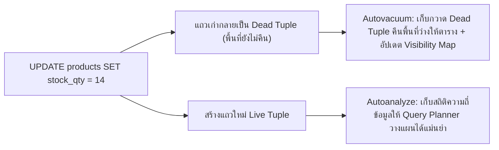

## 1. แนวคิด (Concept)
ใน PostgreSQL 16 เมื่อเราสั่ง `DELETE` แถวข้อมูล หรือสั่ง `UPDATE` แถวข้อมูล (เช่น การตัดสต็อกเนื้อในตาราง `products` หรือการเปลี่ยนสถานะออเดอร์ในตาราง `orders`) ตัวฐานข้อมูล **ไม่ได้ลบข้อมูลเก่าออกจากไฟล์บนดิสก์ทันที** และไม่ได้เขียนทับลงไปที่จุดเดิม แต่จะทำเครื่องหมายว่าแถวเดิมนั้น "ตายแล้ว" (**Dead Tuple**) แล้วเขียนแถวเวอร์ชันใหม่เพิ่มเข้าไป เพื่อให้ Transaction อื่นที่กำลังอ่านข้อมูลอยู่พร้อมกันยังคงมองเห็นข้อมูลเวอร์ชันเก่าได้อย่างถูกต้องตามหลัก MVCC

หากปล่อยทิ้งไว้โดยไม่มีคนเก็บกวาด ตารางจะเต็มไปด้วยซากแถวที่ตายแล้ว (เรียกว่า **Table Bloat**) ทำให้ขนาดตารางบวมขึ้นเรื่อยๆ และการคิวรีช้าลง จึงต้องมี 2 กลไกสำคัญ:
1. **`VACUUM`:** กระบวนการเข้าไปเก็บกวาดพื้นที่ของ **Dead Tuples** ที่ไม่มี Transaction ใดใช้งานแล้ว ให้กลับมาเป็นพื้นที่ว่างที่พร้อมนำกลับมาใช้เขียนข้อมูลแถวใหม่ได้อีกครั้ง (พร้อมอัปเดต Visibility Map)
2. **`ANALYZE`:** กระบวนการสุ่มอ่านข้อมูลในตารางเพื่อคำนวณสถิติการกระจายตัวของข้อมูล (เช่น ค่าที่พบบ่อยที่สุด จำนวนค่าที่ไม่ซ้ำกัน) แล้วนำไปเก็บใน `pg_statistic` เพื่อให้ **Query Planner** ใช้ตัดสินใจเลือก Execution Plan ที่แม่นยำ



## 2. หลักการเบื้องหลัง (Under the Hood)
โดยปกติ PostgreSQL 16 มี Background Process ที่ชื่อว่า **Autovacuum Daemon** คอยรันทั้ง `VACUUM` และ `ANALYZE` ให้อัตโนมัติเมื่อจำนวนแถวที่เปลี่ยนแปลงถึงเกณฑ์ที่กำหนดตามสูตร:
$$\text{Vacuum Threshold} = \text{vacuum\_threshold (50)} + \left(\text{vacuum\_scale\_factor (0.20)} \times \text{จำนวนแถวในตาราง}\right)$$

**จุดบอดของค่าเริ่มต้นบนตารางขนาดใหญ่:**
ค่าเริ่มต้นของ `autovacuum_vacuum_scale_factor` คือ `0.20` (หรือ 20% ของตาราง) สำหรับตารางเล็กๆ ค่านี้อาจทำงานได้ดี แต่ถ้าตาราง `orders` หรือ `products` มีข้อมูล **10 ล้านแถว** การที่ Autovacuum จะเริ่มทำงานได้ ต้องรอให้เกิด Dead Tuples สะสมถึง $50 + (0.20 \times 10,000,000) = 2,000,050$ แถวเสียก่อน! ส่งผลให้ตารางบวมหนักและเมื่อ Autovacuum เริ่มทำงานก็จะกิน I/O ครั้งใหญ่ ดังนั้นสำหรับตารางที่มีการอัปเดตสูงใน Production เราจึงต้องปรับลดค่า Scale Factor เฉพาะตารางนั้นลงให้ทำงานถี่ขึ้นและเบาลง!

## 3. ตัวอย่างโค้ด (Smart Butcher Marketplace)

### ตัวอย่างที่ 1: การตรวจสอบจำนวน Dead Tuples และเวลาที่ Autovacuum ทำงานล่าสุด
ตรวจสอบสุขภาพของตารางในระบบ Smart Butcher ว่ามีซากข้อมูลที่รอการเก็บกวาดสะสมอยู่มากน้อยเพียงใด:

```sql filename="sql/09_monitor_dead_tuples_and_vacuum.sql"
-- ตรวจสอบจำนวน Live Tuples เทียบกับ Dead Tuples และเวลาที่ Vacuum/Analyze ทำงานล่าสุด
SELECT 
    relname AS table_name,
    n_live_tup AS live_rows,
    n_dead_tup AS dead_rows,
    ROUND((n_dead_tup::numeric / NULLIF(n_live_tup + n_dead_tup, 0)) * 100, 2) AS dead_tuple_ratio_pct,
    last_autovacuum,
    last_autoanalyze
FROM pg_stat_user_tables
ORDER BY n_dead_tup DESC;
```

### ตัวอย่างที่ 2: การปรับจูน Autovacuum เฉพาะตารางที่มีการอัปเดตความถี่สูง (`products` และ `orders`)
ปรับตั้งค่าระดับตารางให้ Autovacuum และ Autoanalyze เข้ามาทำงานทันทีที่มีการเปลี่ยนแปลงครบ 2% (แทนที่จะรอถึง 20%) หรือเมื่อมี Dead Tuples ครบจำนวนที่กำหนด:

```sql filename="sql/10_tune_table_autovacuum_settings.sql"
-- ปรับจูน Autovacuum สำหรับตาราง products ที่มีการตัดสต็อกตลอดเวลา:
-- ให้ทำงานเมื่อมีแถวเปลี่ยน 1% (0.01) เพื่อรักษา Visibility Map ให้พร้อมทำ Index-Only Scan เสมอ
ALTER TABLE products SET (
    autovacuum_vacuum_scale_factor = 0.01,
    autovacuum_vacuum_threshold = 100,
    autovacuum_analyze_scale_factor = 0.01,
    autovacuum_analyze_threshold = 100
);

-- ปรับจูน Autovacuum สำหรับตาราง orders ขนาดใหญ่:
ALTER TABLE orders SET (
    autovacuum_vacuum_scale_factor = 0.02,
    autovacuum_vacuum_threshold = 500,
    autovacuum_analyze_scale_factor = 0.01,
    autovacuum_analyze_threshold = 500
);

-- สั่งรัน VACUUM และ ANALYZE ด้วยตนเองพร้อมดูรายงานละเอียดเมื่อเพิ่งนำเข้าข้อมูลชุดใหญ่เสร็จ
VACUUM (VERBOSE, ANALYZE) products;
```

## 4. ผิด vs ถูก (Anti-pattern vs Best Practice)

| มิติการเปรียบเทียบ | ❌ ผิด (Anti-pattern) | ✅ ถูก (Best Practice) |
| :--- | :--- | :--- |
| **การสั่ง `VACUUM FULL` บน Production** | รัน `VACUUM FULL orders;` ในเวลาทำการเพื่อหวังคืนพื้นที่ดิสก์ ทำให้ตารางติด `ACCESS EXCLUSIVE` lock ห้ามอ่านห้ามเขียนทั้งระบบ | ใช้ `VACUUM` ปกติและปรับจูน Autovacuum ให้ทำงานถี่ขึ้น (หากจำเป็นต้องบีบอัดตารางโดยไม่ล็อก ให้ใช้เครื่องมือ `pg_repack`) |
| **การปิด Autovacuum** | ปิด `autovacuum = off` เพราะคิดว่ามันแย่ง CPU ตอนกลางวัน | ห้ามปิด Autovacuum เด็ดขาด! เพราะจะทำให้ตารางบวมและเกิดวิกฤต Transaction ID Wraparound จนฐานข้อมูลหยุดทำงาน |
| **การไม่รัน `ANALYZE` หลัง Bulk Insert** | นำเข้าข้อมูลสินค้าใหม่ 500,000 แถวแล้วเปิดให้ผู้ใช้คิวรีทันทีโดยที่สถิติตารางยังคิดว่ามี 0 แถว | รัน `ANALYZE ชื่อตาราง;` ทันทีหลังจากการทำ Bulk Import หรือ Data Migration ขนาดใหญ่ |

## 5. ควรใช้เมื่อไหร่ และ ไม่ควรใช้เมื่อไหร่
- **ควรปรับลด `autovacuum_vacuum_scale_factor` ลง (เช่น เหลือ `0.01` - `0.05`) เมื่อ:** ตารางนั้นมีขนาดใหญ่ (หลักแสนถึงหลักล้านแถว) หรือมีการ `UPDATE`/`DELETE` ข้อมูลด้วยความถี่สูงอย่างต่อเนื่อง
- **ไม่ควรรัน `VACUUM FULL` เมื่อ:** ระบบกำลังเปิดให้บริการผู้ใช้งานจริง เพราะ `VACUUM FULL` จะทำการสร้างไฟล์ตารางใหม่ทั้งก้อนและล็อกตารางไม่ให้แม้แต่คำสั่ง `SELECT` ทำงานได้จนกว่าจะเสร็จ

## 6. คำถามสัมภาษณ์ (Interview Q&A)
- **Q1: ความแตกต่างระหว่างคำสั่ง `VACUUM` ปกติ กับ `VACUUM FULL` ใน PostgreSQL คืออะไร?**
  - **แนวคำตอบ:** `VACUUM` ปกติจะทำงานควบคู่ไปกับการอ่านและเขียนของแอปพลิเคชันได้โดยไม่บล็อกตาราง โดยมันจะทำเครื่องหมายพื้นที่ของ Dead Tuples ภายในไฟล์ตารางให้กลับมาว่างพร้อมให้แถวใหม่ของตารางนั้นเขียนทับลงไปได้ (แต่ไม่ได้ลดขนาดไฟล์บน OS ลง) ส่วน `VACUUM FULL` จะทำการคัดลอกเฉพาะแถวที่ยังมีชีวิตไปสร้างเป็นไฟล์ตารางใหม่เอี่ยมที่เรียงติดกันแน่นแล้วลบไฟล์เก่าทิ้งเพื่อคืนพื้นที่ให้ OS แต่ต้องแลกกับการล็อกตารางระดับสูงสุด (`ACCESS EXCLUSIVE` lock) ที่บล็อกทั้งการอ่านและการเขียนทั้งหมดตลอดการทำงาน
- **Q2: อะไรคือสาเหตุที่ทำให้ Autovacuum ทำงานแล้วแต่ระบุว่า `dead_tuples cannot be removed yet` (ไม่สามารถลบ Dead Tuples ออกได้)?**
  - **แนวคำตอบ:** เกิดจากมี **Long-running Transaction** (เช่น Transaction ที่เปิด `BEGIN` ค้างไว้แล้วกลายเป็น `idle in transaction`), คิวรีที่รันนานหลายชั่วโมง, หรือมี **Replication Slot / Prepared Transaction ที่ค้างและไม่ได้ใช้งาน** อยู่ในระบบ เพราะตราบใดที่ยังมี Transaction เก่าที่เริ่มต้นก่อนหน้าที่แถวนั้นจะถูกลบเปิดค้างอยู่ PostgreSQL จะต้องเก็บ Dead Tuples เหล่านั้นไว้เผื่อ Transaction เก่านั้นต้องการอ่าน

---
