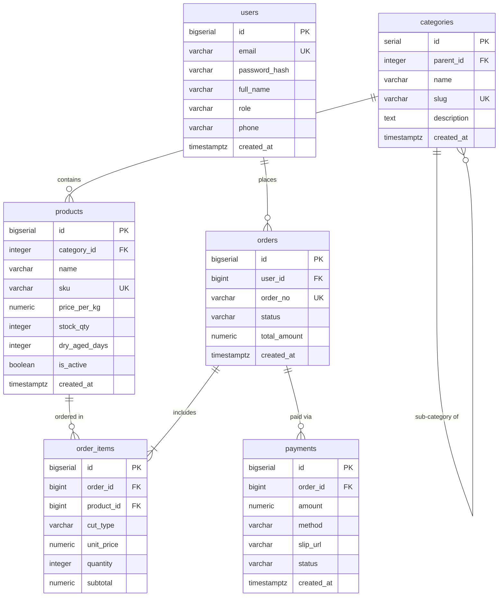

# SQL

(สำหรับฝั่ง Application และการเชื่อมต่อผ่าน ORM สามารถดูเพิ่มเติมที่กลุ่ม BACKEND: [Prisma ORM](/docs/backend/prisma-orm) โดยเอกสารนี้จะเน้นภาษา SQL ฉบับสมบูรณ์บน PostgreSQL 16 พร้อมตัวอย่างเปรียบเทียบสิ่งที่ Prisma สร้างขึ้นเบื้องหลัง)

<Callout type="note" title="ฐานข้อมูลและบริบทของระบบตัวอย่างตลอดทั้งเอกสาร">
เอกสารฉบับนี้ใช้ฐานข้อมูลจำลองของระบบระดับองค์กร **"Smart Butcher Marketplace"** (แพลตฟอร์มตลาดสดเนื้อพรีเมียมและเนื้อดรายเอจออนไลน์) ซึ่งรองรับการค้าเนื้อวัวนำเข้าคุณภาพสูง การบ่มดรายเอจ (Dry-Aging) ตามสั่ง และการชำระเงินแบบหลายช่องทาง
</Callout>

| หัวข้อในบทเรียนนี้ | ขอบเขตเนื้อหาสำคัญ | ลิงก์ข้ามไปยังหัวข้อ |
| :--- | :--- | :--- |
| **1. SELECT & Filtering** | `SELECT`, `WHERE`, `ORDER BY`, `LIMIT`, `OFFSET` และลำดับการรัน | [อ่านหัวข้อที่ 1](#1-การดึงข้อมูลพื้นฐาน-select-where-order-by-limit-offset) |
| **2. DML & RETURNING** | `INSERT`, `UPDATE`, `DELETE` พร้อมการคืนค่าแถวที่แก้ด้วย `RETURNING` | [อ่านหัวข้อที่ 2](#2-การจัดการข้อมูลและการคืนค่า-insert-update-delete-และ-returning) |
| **3. SQL JOINs** | `INNER`, `LEFT`, `RIGHT`, `FULL`, `CROSS` และ `SELF JOIN` | [อ่านหัวข้อที่ 3](#3-join-ทุกแบบพร้อมภาพประกอบและความเข้าใจลึกซึ้ง) |
| **4. GROUP BY & Aggregates** | `COUNT`, `SUM`, `AVG`, `FILTER` และความต่าง `WHERE` vs `HAVING` | [อ่านหัวข้อที่ 4](#4-การจัดกลุ่มและฟังก์ชันคำนวณ-group-by-having-และ-aggregate-functions) |
| **5. Subquery & CTE** | การซ้อน Query และการจัดระเบียบ Query ซับซ้อนด้วย `WITH` (CTE) | [อ่านหัวข้อที่ 5](#5-subquery-และ-common-table-expressions-cte-with) |
| **6. Set Operations** | การรวมและตัดชุดข้อมูลด้วย `UNION`, `UNION ALL`, `INTERSECT`, `EXCEPT` | [อ่านหัวข้อที่ 6](#6-การรวมชุดข้อมูล-union-intersect-except) |
| **7. Window Functions** | `ROW_NUMBER`, `RANK`, `DENSE_RANK`, `LAG/LEAD`, `SUM() OVER` | [อ่านหัวข้อที่ 7](#7-window-functions-ฟังก์ชันหน้าต่างเพื่อการวิเคราะห์ข้อมูลขั้นสูง) |
| **8–11. Advanced SQL** | `CASE`, `NULL`, Date/Time, Full-Text Search และ `UPSERT (ON CONFLICT)` | [อ่านหัวข้อที่ 8](#8-ตรรกะเงื่อนไขและการจัดการค่าว่าง-case-expression-และ-null-handling) |



---

## 1. การดึงข้อมูลพื้นฐาน (SELECT, WHERE, ORDER BY, LIMIT, OFFSET)

### แนวคิด (Concept)
การดึงข้อมูลด้วยคำสั่ง `SELECT` เปรียบเสมือนการเดินเข้าไปในห้องบ่มเนื้อของ **Smart Butcher Marketplace** เพื่อคัดเลือกเนื้อตามสเปกที่ลูกค้าสั่งซื้อ โดยแทนที่จะขนสินค้าทั้งหมดในคลังออกมาวางเกะกะหน้าร้าน เราจะระบุเฉพาะคุณสมบัติที่ต้องการอย่างเจาะจง:
- **`SELECT`**: เลือกว่าต้องการหยิบเฉพาะ "ชื่อชิ้นเนื้อ" และ "ราคาต่อกิโลกรัม" ชนิดใดออกมาดู
- **`WHERE`**: กรองเฉพาะเนื้อดรายเอจที่บ่มเกิน 30 วันและยังมีสต็อกพร้อมขาย
- **`ORDER BY`**: เรียงลำดับเนื้อตามระยะเวลาบ่มจากนานที่สุดไปหาน้อยที่สุด
- **`LIMIT / OFFSET`**: หยิบเนื้อออกมาทีละ 10 ชิ้นต่อหนึ่งถาดเพื่อนำเสนอให้ลูกค้าชมในแต่ละหน้า

### หลักการเบื้องหลัง (Under the Hood)
เมื่อ PostgreSQL ได้รับคำสั่ง SQL จะประมวลผลผ่าน 4 กระบวนการหลัก:
1. **Parser & Analyzer**: ตรวจสอบไวยากรณ์ (Syntax) และความถูกต้องของชื่อตาราง/คอลัมน์ใน Catalog
2. **Rewriter**: ขยาย Views หรือประยุกต์กฎ Rules ต่างๆ
3. **Planner / Optimizer**: วางแผนการเข้าถึงข้อมูลที่ประหยัดต้นทุนที่สุด (Cost-based Optimizer) เลือกระหว่าง **Sequential Scan** (อ่านข้อมูลเรียงแถวจาก Disk) หรือ **Index Scan** (วิ่งผ่าน B-Tree Index)
4. **Executor**: ดึงข้อมูลจริงจาก Buffer Pool (Shared Buffers) หรือ Storage Disk

```text filename="docs/database/sql.txt"
ลำดับการประมวลผลทางตรรกะของ SQL (Logical Query Processing Order):
1. FROM / JOIN      -> ประกอบชุดตารางตั้งต้น
2. WHERE            -> กรองแถวที่ไม่ตรงเงื่อนไขทิ้งในระดับ Tuple
3. GROUP BY         -> จัดกลุ่มแถวที่มีค่าเหมือนกัน
4. HAVING           -> กรองกลุ่มข้อมูลหลังคำนวณ Aggregate
5. SELECT           -> เลือกและคำนวณคอลัมน์ (Projection / Expressions)
6. DISTINCT         -> กำจัดแถวที่มีค่าซ้ำกัน
7. ORDER BY         -> เรียงลำดับผลลัพธ์ (Quicksort / Top-N Heapsort)
8. LIMIT / OFFSET   -> ตัดขอบเขตจำนวนแถวเพื่อส่งกลับให้ Client
```

> [!WARNING] อันตรายของ `SELECT *` ในระบบ Production
> การใช้ `SELECT *` บังคับให้ PostgreSQL ดึงข้อมูลทุกคอลัมน์จากดิสก์ ส่งผลให้:
> 1. ทำลายโอกาสที่ Optimizer จะเลือกใช้ **Index-Only Scan** (การอ่านข้อมูลครบถ้วนจาก B-Tree Index โดยไม่ต้องเปิดอ่าน Table Heap)
> 2. สิ้นเปลืองหน่วยความจำ **Shared Buffers** และ Network I/O มหาศาลเมื่อตารางมีคอลัมน์ประเภท `TEXT` ขนาดใหญ่
> 3. ทำลาย Contract ของระบบเมื่อ Schema มีการเพิ่มหรือสลับตำแหน่งคอลัมน์

#### ปัญหา Deep Pagination ด้วย `OFFSET`
เมื่อระบุ `OFFSET 100000 LIMIT 20` ตัวฐานข้อมูล PostgreSQL **ไม่ได้กระโดดข้ามไปยังแถวที่ 100,001 โดยตรง** แต่ Executor จะต้องสแกนแถวขึ้นมาประมวลผลทั้งสิ้น 100,020 แถว แล้วโยน 100,000 แถวแรกทิ้งไปในหน่วยความจำ ส่งผลให้ค่ายิ่งสูง Query จะยิ่งช้าลงอย่างรวดเร็ว (Time Complexity $O(N)$) ทางออกในระดับ Production สำหรับตารางขนาดใหญ่คือการใช้ **Keyset Pagination (Cursor-based Pagination)**

### ตัวอย่างโค้ด (Smart Butcher Marketplace)

#### ตัวอย่างที่ 1: การค้นหาเนื้อพรีเมียมด้วยเงื่อนไขซับซ้อนและการเรียงลำดับแบบจัดการค่าว่าง
ค้นหาสินค้าเนื้อดรายเอจที่กำลังวางจำหน่าย มีระยะเวลาบ่มระหว่าง 30 ถึง 60 วัน หรือเป็นเนื้อวากิวญี่ปุ่นที่มีราคาต่อกิโลกรัมตั้งแต่ 3,000 บาทขึ้นไป โดยเรียงลำดับตามจำนวนวันบ่มจากมากไปน้อย หากค่าเป็น NULL ให้แสดงไว้ท้ายสุด (`NULLS LAST`):

```sql filename="sql/sql.sql"
-- ค้นหาเนื้อระดับพรีเมียมตามเงื่อนไขทางธุรกิจ
SELECT 
    id,
    sku,
    name,
    price_per_kg,
    stock_qty,
    dry_aged_days
FROM products
WHERE is_active = TRUE
  AND (
        (dry_aged_days BETWEEN 30 AND 60)
        OR (price_per_kg >= 3000.00 AND sku LIKE 'WAGYU%')
      )
ORDER BY dry_aged_days DESC NULLS LAST, price_per_kg ASC
LIMIT 5 OFFSET 0;
```

**ผลลัพธ์ที่ได้ (Expected Output):**

| id | sku | name | price_per_kg | stock_qty | dry_aged_days |
| :--- | :--- | :--- | :--- | :--- | :--- |
| 3 | TOMAHAWK-DA60-PRM | 60-Day Dry-Aged Tomahawk Prime | 3600.00 | 4 | 60 |
| 2 | ANGUS-DA45-TBONE | 45-Day Dry-Aged Black Angus T-Bone | 2800.00 | 8 | 45 |
| 1 | WAGYU-A5-RIB | Miyazaki Wagyu A5 Ribeye | 4500.00 | 15 | 0 |

**โค้ดเทียบเคียงใน Prisma Client:**
```typescript filename="src/sql.ts"
// Prisma Client query เทียบเคียงกับ SQL ด้านบน
const products = await prisma.product.findMany({
  select: {
    id: true,
    sku: true,
    name: true,
    pricePerKg: true,
    stockQty: true,
    dryAgedDays: true,
  },
  where: {
    isActive: true,
    OR: [
      { dryAgedDays: { gte: 30, lte: 60 } },
      { AND: [{ pricePerKg: { gte: 3000 } }, { sku: { startsWith: 'WAGYU' } }] },
    ],
  },
  orderBy: [
    { dryAgedDays: { sort: 'desc', nulls: 'last' } },
    { pricePerKg: 'asc' },
  ],
  take: 5,
  skip: 0,
});
```

#### ตัวอย่างที่ 2: การทำ Keyset (Cursor-based) Pagination เพื่อประสิทธิภาพสูงสุด
แทนที่จะใช้ `OFFSET` ที่ต้องอ่านแถวทิ้ง เราจะใช้ Primary Key (`id`) หรือคีย์ที่เรียงลำดับแน่นอนเป็น Cursor:

```sql filename="sql/sql.sql"
-- ดึงข้อมูลหน้าถัดไปโดยใช้ Cursor ID ของแถวสุดท้ายในหน้าก่อนหน้า (:last_seen_id = 3)
SELECT 
    id,
    sku,
    name,
    price_per_kg,
    stock_qty
FROM products
WHERE is_active = TRUE
  AND id > 3 -- Keyset Filtering: ใช้ B-Tree Index ข้ามไปยังตำแหน่งเป้าหมายได้ทันที (O(log N))
ORDER BY id ASC
LIMIT 3;
```

**ผลลัพธ์ที่ได้ (Expected Output):**

| id | sku | name | price_per_kg | stock_qty |
| :--- | :--- | :--- | :--- | :--- |
| 4 | AUS-WAGYU-MB9-TEND | Australian Wagyu Tenderloin MB9+ | 3900.00 | 0 |
| 5 | GRASS-STRIP-STD | Grass-fed Striploin Standard | 1200.00 | 25 |

**โค้ดเทียบเคียงใน Prisma Client:**
```typescript filename="src/sql.ts"
// Cursor-based Pagination บน Prisma Client
const productsPage = await prisma.product.findMany({
  take: 3,
  skip: 1, // ข้าม cursor ตัวเอง
  cursor: {
    id: lastSeenId, // เช่น id: 3
  },
  where: { isActive: true },
  orderBy: { id: 'asc' },
});
```

### ผิด vs ถูก (Anti-patterns & Best Practices)

#### ❌ โค้ดที่ผิด: ใช้ `SELECT *` และทำ Deep Pagination ด้วย `OFFSET` ขนาดใหญ่
```sql filename="sql/sql.sql"
-- ผิด: อ่านทุกคอลัมน์ และสั่ง OFFSET 50000 บังคับให้ฐานข้อมูลอ่านทิ้ง 50,000 แถว
SELECT * 
FROM products 
WHERE is_active = TRUE 
ORDER BY id ASC 
LIMIT 20 OFFSET 50000;
```

#### ✅ โค้ดที่ถูก: เลือกเฉพาะคอลัมน์ที่แสดงผล และใช้ Cursor-based Filtering
```sql filename="sql/sql.sql"
-- ถูกต้อง: ดึงเฉพาะคอลัมน์ที่จำเป็น และใช้ B-Tree Index Seek ผ่าน Cursor ID
SELECT id, sku, name, price_per_kg 
FROM products 
WHERE is_active = TRUE 
  AND id > 50000 
ORDER BY id ASC 
LIMIT 20;
```

### ควรใช้เมื่อไหร่ / ไม่ควรใช้เมื่อไหร่
- **ควรใช้ `OFFSET / LIMIT`:** ใช้กับระบบหลังบ้าน (Admin Backoffice) ที่มีขนาดตารางไม่เกินหลักหมื่นแถว และผู้ใช้ต้องการกดข้ามไปยังเลขหน้าเจาะจง (เช่น หน้า 1, 2, 3)
- **ควรใช้ Keyset / Cursor Pagination:** ใช้กับ Public API, โมบายแอปพลิเคชัน, Infinite Scroll Feed, และตารางขนาดใหญ่ระดับล้านแถวขึ้นไป
- **ควรระบุคอลัมน์ชัดเจนใน `SELECT`:** ใช้ในทุก Production Query เพื่อประหยัด Bandwidth และรองรับ Index-Only Scan

### คำถามสัมภาษณ์ (Interview Questions)
- **Q1: ทำไมคำสั่ง `SELECT * FROM orders ORDER BY created_at DESC LIMIT 10 OFFSET 100000` ถึงทำงานช้ามากใน PostgreSQL และมีวิธีแก้ไขอย่างไร?**
  - *คำตอบ:* เพราะ PostgreSQL ต้องทำการค้นหาและจัดเรียงข้อมูลทั้งหมด 100,010 แถวตามลำดับ `created_at` แล้ววนอ่านแถวทั้งหมดผ่าน Disk/Buffer ก่อนจะละทิ้ง 100,000 แถวแรกไป วิธีแก้คือเปลี่ยนมาใช้ **Keyset Pagination** โดยเก็บค่า `(created_at, id)` ของแถวสุดท้าย แล้วเขียนเงื่อนไข `WHERE (created_at, id) < (:last_created_at, :last_id) ORDER BY created_at DESC, id DESC LIMIT 10` ซึ่งจะทำให้ Engine สามารถกระโดดผ่าน B-Tree Index ไปยังแถวที่ต้องการได้ทันทีในเวลา $O(\log N)$
- **Q2: ค่าเริ่มต้นของการจัดเรียง `NULL` ใน PostgreSQL สำหรับคำสั่ง `ORDER BY column ASC` และ `ORDER BY column DESC` คืออะไร?**
  - *คำตอบ:* สำหรับ `ASC` ค่าเริ่มต้นคือ `NULLS LAST` (ค่า NULL อยู่ท้ายสุด) แต่สำหรับ `DESC` ค่าเริ่มต้นคือ `NULLS FIRST` (ค่า NULL จะโผล่ขึ้นมาเป็นอันดับแรก) หากต้องการให้ค่า NULL อยู่ท้ายสุดเสมอไม่ว่าจะเรียงจากมากไปน้อย ต้องระบุคำสั่งเจาะจงเป็น `ORDER BY column DESC NULLS LAST`

---

## 2. การจัดการข้อมูลและการคืนค่า (INSERT, UPDATE, DELETE และ RETURNING)

### แนวคิด (Concept)
การจัดการข้อมูลในตลาดสดเนื้อพรีเมียมเกี่ยวข้องกับการรับเนื้อเข้าคลัง (INSERT), การปรับราคาหรือตัดสต็อกเมื่อเกิดการขาย (UPDATE), และการยกเลิกรายการที่ไม่ถูกต้อง (DELETE) 
ในฐานข้อมูลแบบดั้งเดิม เมื่อเราบันทึกข้อมูลเสร็จ เรามักจะต้องยิงคำสั่ง `SELECT` ซ้ำอีกรอบเพื่อดูว่า Primary Key ที่เพิ่งสร้างขึ้นมามีค่าเป็นอะไร แต่ใน **PostgreSQL มีอาวุธลับที่ทรงพลังคือคำสั่ง `RETURNING`** ซึ่งช่วยส่งข้อมูลของแถวที่เพิ่งถูกเพิ่ม แก้ไข หรือลบ กลับคืนมาทันทีในคำสั่งเดียวโดยไม่ต้องส่งคำสั่งถามซ้ำ

### หลักการเบื้องหลัง (Under the Hood)
PostgreSQL จัดการข้อมูลผ่านสถาปัตยกรรม **MVCC (Multi-Version Concurrency Control)**:
- **INSERT**: สร้างแถวข้อมูล (Tuple) ใหม่ลงใน Data Page พร้อมกำหนดค่า `xmin` (Transaction ID ของผู้สร้าง)
- **UPDATE**: PostgreSQL จะ **ไม่เขียนทับข้อมูลเดิมในที่เดิม (No In-place Update)** แต่จะทำการกำหนดค่า `xmax` ให้กับ Tuple เก่า (บ่งชี้ว่า Tuple นี้สิ้นอายุขัยแล้ว) แล้วสร้าง Tuple ใหม่ขึ้นมาอีกตัวพร้อมกำหนด `xmin` ใหม่ ซึ่งจะก่อให้เกิด Dead Tuple รอให้ระบบ `VACUUM` มาเคลียร์พื้นที่คืน
- **DELETE**: ทำการประทับตรา Transaction ID ลงในฟิลด์ `xmax` ของ Tuple นั้นๆ เพื่อไม่ให้ Transaction อื่นมองเห็นแถวนี้อีกต่อไป
- **RETURNING Clause**: ทำงานในระดับ Executor Engine ทันทีที่คำสั่ง INSERT/UPDATE/DELETE ดำเนินการกับ Tuple ในหน่วยความจำเสร็จ Tuple นั้นจะถูกส่งผ่าน Output Tuple Stream กลับไปยัง Client ทันที ช่วยลด Network Latency ได้ 50% เมื่อเทียบกับการทำ 2 Round-trips (INSERT ตามด้วย SELECT)

### ตัวอย่างโค้ด (Smart Butcher Marketplace)

#### ตัวอย่างที่ 1: การนำเข้าเนื้อพรีเมียมแบบ Multi-row พร้อมรับค่า ID และ Timestamp ทันที
การเพิ่มรายการสินค้าใหม่พร้อมกันหลายชิ้นในคำสั่งเดียว พร้อมรับ `id`, `sku`, และ `created_at` ที่ถูกสร้างขึ้นอัตโนมัติ:

```sql filename="sql/sql.sql"
-- เพิ่มข้อมูลเนื้อวัวนำเข้า 3 ชนิดพร้อมกันและดึงข้อมูลที่สร้างเสร็จกลับมาทันที
INSERT INTO products (
    category_id,
    name,
    sku,
    price_per_kg,
    stock_qty,
    dry_aged_days,
    is_active
) VALUES 
(1, 'Matsusaka Wagyu A5 Striploin', 'WAGYU-MATSU-STRIP', 5800.00, 10, 0, TRUE),
(3, '30-Day Dry-Aged Angus Ribeye', 'ANGUS-DA30-RIB', 2400.00, 12, 30, TRUE),
(4, 'Australian Grain-fed Tenderloin', 'AUS-GRAIN-TEND', 1850.00, 20, 0, TRUE)
RETURNING 
    id, 
    sku, 
    name, 
    created_at;
```

**ผลลัพธ์ที่ได้ (Expected Output):**

| id | sku | name | created_at |
| :--- | :--- | :--- | :--- |
| 6 | WAGYU-MATSU-STRIP | Matsusaka Wagyu A5 Striploin | 2026-10-17 08:30:15.123+07 |
| 7 | ANGUS-DA30-RIB | 30-Day Dry-Aged Angus Ribeye | 2026-10-17 08:30:15.123+07 |
| 8 | AUS-GRAIN-TEND | Australian Grain-fed Tenderloin | 2026-10-17 08:30:15.123+07 |

**โค้ดเทียบเคียงใน Prisma Client:**
```typescript filename="src/sql.ts"
// Prisma Client รองรับ createManyAndReturn เพื่อรับข้อมูลกลับทันทีผ่าน RETURNING
const newProducts = await prisma.product.createManyAndReturn({
  data: [
    { categoryId: 1, name: 'Matsusaka Wagyu A5 Striploin', sku: 'WAGYU-MATSU-STRIP', pricePerKg: 5800, stockQty: 10, dryAgedDays: 0, isActive: true },
    { categoryId: 3, name: '30-Day Dry-Aged Angus Ribeye', sku: 'ANGUS-DA30-RIB', pricePerKg: 2400, stockQty: 12, dryAgedDays: 30, isActive: true },
    { categoryId: 4, name: 'Australian Grain-fed Tenderloin', sku: 'AUS-GRAIN-TEND', pricePerKg: 1850, stockQty: 20, dryAgedDays: 0, isActive: true },
  ],
  select: { id: true, sku: true, name: true, createdAt: true },
});
```

#### ตัวอย่างที่ 2: Atomic Concurrency Update ตัดสต็อกเนื้ออย่างปลอดภัย ป้องกัน Race Condition
เมื่อมีลูกค้าสั่งซื้อเนื้อ 2 กิโลกรัม เราต้องตัดสต็อกโดยป้องกันไม่ให้สต็อกติดลบ และรับยอดสต็อกคงเหลือล่าสุดกลับมาทันที:

```sql filename="sql/sql.sql"
-- อัปเดตลดสต็อกเนื้อแบบ Atomic Operation พร้อมคืนค่าสต็อกคงเหลือ
UPDATE products
SET stock_qty = stock_qty - 2
WHERE id = 2 
  AND stock_qty >= 2 -- ป้องกันปัญหาสต็อกติดลบจากคำสั่งพร้อมกัน (Lost Update Protection)
RETURNING 
    id, 
    sku, 
    name, 
    stock_qty AS remaining_stock;
```

**ผลลัพธ์ที่ได้ (Expected Output):**

| id | sku | name | remaining_stock |
| :--- | :--- | :--- | :--- |
| 2 | ANGUS-DA45-TBONE | 45-Day Dry-Aged Black Angus T-Bone | 6 |

### ผิด vs ถูก (Anti-patterns & Best Practices)

#### ❌ โค้ดที่ผิด: INSERT แล้วตามด้วย `SELECT currval` หรือ `SELECT MAX(id)`
```sql filename="sql/sql.sql"
-- ผิด: การรัน 2 คำสั่งแยกจากกันเสี่ยงต่อปัญหา Concurrency และเพิ่ม Round-trip Time
INSERT INTO orders (user_id, order_no, status, total_amount) 
VALUES (1, 'ORD-20261017-999', 'PENDING', 4500.00);

-- เสี่ยงได้ ID ของผู้ใช้อื่นที่รันชนกันในจังหวะเดียวกัน!
SELECT MAX(id) FROM orders;
```

#### ✅ โค้ดที่ถูก: ใช้ `RETURNING` เพื่อความสมบูรณ์ระดับ Atomic และรับค่าได้ทันที
```sql filename="sql/sql.sql"
-- ถูกต้อง: ได้ค่า id แน่นอน 100% ปลอดภัยจากปัญหา Concurrency และเร็วกว่า 2 เท่า
INSERT INTO orders (user_id, order_no, status, total_amount) 
VALUES (1, 'ORD-20261017-999', 'PENDING', 4500.00)
RETURNING id, order_no, created_at;
```

### ควรใช้เมื่อไหร่ / ไม่ควรใช้เมื่อไหร่
- **ควรใช้ `RETURNING`:** ในทุกคำสั่ง INSERT, UPDATE, DELETE ที่ Application ต้องการนำผลลัพธ์ไปประมวลผลต่อ เช่น บันทึก Audit Log, อัปเดต Cache, หรือส่งตอบกลับ API
- **ควรใช้ Atomic Concurrency Guard (`AND stock >= qty`):** ในทุกคำสั่งตัดสต็อก ยอดเงิน หรือโควตา
- **ไม่ควรใช้ Hard DELETE:** กับข้อมูลสำคัญทางการเงินหรือธุรกรรม (orders, payments) ให้เปลี่ยนมาใช้ Soft Delete (`deleted_at TIMESTAMPTZ`) หรือการเปลี่ยนสถานะเป็น `CANCELLED` แทน

### คำถามสัมภาษณ์ (Interview Questions)
- **Q1: เหตุใดคำสั่ง `UPDATE` ใน PostgreSQL ถึงก่อให้เกิด "Dead Tuples" และกลไกใดที่นำพื้นที่ดิสก์เหล่านั้นกลับมาใช้ใหม่?**
  - *คำตอบ:* เพราะ PostgreSQL ใช้โมเดล MVCC แบบ Append-only เมื่อมีการ `UPDATE` ระบบจะไม่เขียนทับข้อมูลเดิม แต่จะทำเครื่องหมายว่า Tuple เดิมถูกแทนที่โดย Transaction ปัจจุบัน แล้วสร้าง Tuple เวอร์ชันใหม่ขึ้นมา Tuple เดิมที่ไม่มี Transaction ใดมองเห็นอีกต่อไปจะกลายสภาพเป็น **Dead Tuple** ซึ่งกลไก **Auto-Vacuum Daemon** จะคอยตรวจสอบและทำความสะอาด Dead Tuples เหล่านี้ เพื่อนำพื้นที่ว่างในหน้า Data Page กลับมาหมุนเวียนใช้งานสำหรับแถวใหม่
- **Q2: ประโยชน์ของ `UPDATE ... RETURNING` ในแง่ของ Database Round-trip และ Isolation Level คืออะไร?**
  - *คำตอบ:* ช่วยลด Network Round-trip จาก 2 ครั้ง (UPDATE + SELECT) ให้เหลือเพียง 1 ครั้ง และที่สำคัญที่สุดคือรับประกันความถูกต้องของข้อมูลภายใต้สภาพแวดล้อม Concurrency สูง เพราะค่าที่คืนกลับมาจาก `RETURNING` คือสถานะของ Tuple ที่เพิ่งถูกเขียนลง Disk ภายใต้ Row-level Lock เดียวกันนั้นทันที ป้องกันปัญหาการอ่านค่าที่อาจถูก Transaction อื่นแทรกแซงแก้ไขไปแล้ว

---

## 3. JOIN ทุกแบบพร้อมภาพประกอบและความเข้าใจลึกซึ้ง

### แนวคิด (Concept)
การทำ **JOIN** เปรียบเหมือนการรวบรวมข้อมูลส่วนต่างๆ ของตลาดสด Smart Butcher มาประกอบเป็นใบเสร็จรับเงินที่สมบูรณ์:
- ตาราง `orders` มีรหัสออเดอร์และยอดเงิน
- ตาราง `users` มีชื่อและเบอร์โทรของผู้สั่งซื้อ
- ตาราง `order_items` มีรายละเอียดชิ้นเนื้อแต่ละแพ็ก
- ตาราง `products` มีชื่อสายพันธุ์และเกรดเนื้อ

การเลือกประเภท JOIN จะเป็นตัวกำหนดว่า หากข้อมูลบางชิ้นไม่เข้าคู่กัน ข้อมูลแถวนั้นจะยังคงปรากฏในรายงานหรือไม่

### ภาพประกอบ Venn Diagram สำหรับการ JOIN

```mermaid filename="docs/database/sql-diagram.mmd"
flowchart TD
    subgraph IJ["1. INNER JOIN"]
        direction LR
        A1["ตารางซ้าย: users"] --- M1["ส่วนที่ตรงกันทั้ง 2 ฝั่ง<br/>(Users ที่มีคำสั่งซื้อ)"] --- B1["ตารางขวา: orders"]
    end

    subgraph LJ["2. LEFT OUTER JOIN"]
        direction LR
        A2["ทุกแถวของตารางซ้าย<br/>(Users ทั้งหมด)<br/>รวมคนที่ไม่เคยสั่งซื้อ"] --- M2["ส่วนที่ตรงกัน<br/>(Users + Orders)"]
    end

    subgraph RJ["3. RIGHT OUTER JOIN"]
        direction LR
        M3["ส่วนที่ตรงกัน<br/>(Orders + Users)"] --- B3["ทุกแถวของตารางขวา<br/>(Orders ทั้งหมด)"]
    end

    subgraph FJ["4. FULL OUTER JOIN"]
        direction LR
        A4["Users ทั้งหมด"] --- M4["ส่วนที่ตรงกัน"] --- B4["Orders ทั้งหมด"]
    end
```



### หลักการเบื้องหลัง (Under the Hood)
PostgreSQL Query Planner จะเลือกใช้อัลกอริทึมในการ JOIN ข้อมูลตามขนาดของตารางและดัชนี (Indexes) ที่มี:
1. **Nested Loop Join**: เหมาะกับกรณีที่ตารางหนึ่งมีขนาดเล็กมาก และตารางที่สองมี B-Tree Index ที่ Join Key โดยจะวนลูปอ่านตารางนอกทีละแถว แล้วเอาค่าไปค้นหาใน Index ของตารางใน ($O(N \times \log M)$)
2. **Hash Join**: เหมาะกับตารางขนาดกลางถึงใหญ่ที่ไม่มี Index รองรับ Engine จะนำตารางที่เล็กกว่ามาสร้าง Hash Table ในหน่วยความจำ `work_mem` จากนั้นสแกนตารางใหญ่แล้วนำ Join Key มาคำนวณ Hash เพื่อจับคู่ ($O(N + M)$)
3. **Merge Join**: ทั้งสองตารางจะต้องถูกจัดเรียงตาม Join Key มาก่อนแล้ว (หรือดึงข้อมูลผ่าน Index ที่เรียงอยู่แล้ว) จากนั้นจะเลื่อนตัวชี้ (Pointers) วิ่งจับคู่ข้อมูลไปพร้อมกัน ($O(N + M)$ ไม่รวมเวลา Sort)

#### กับดักมรณะ: ความแตกต่างระหว่างเงื่อนไขใน `ON` vs `WHERE` ใน LEFT JOIN
นี่คือจุดที่นักพัฒนาพลาดบ่อยที่สุด:
- **เงื่อนไขใน `ON` clause**: ใช้ตัดสินใจว่าจะ "จับคู่" แถวจากตารางขวาหรือไม่ หากเงื่อนไขไม่เป็นจริง แถวจากตารางซ้ายจะ **ยังคงอยู่** โดยคอลัมน์ของตารางขวาจะถูกเติมเป็น `NULL`
- **เงื่อนไขใน `WHERE` clause**: กรองแถวทิ้งหลังจากกระบวนการ JOIN เสร็จสมบูรณ์แล้ว หากใส่เงื่อนไขของตารางขวาลงใน `WHERE` เช่น `WHERE orders.status = 'COMPLETED'` แถวที่มีค่าเป็น `NULL` จากตารางซ้ายจะถูกกรองทิ้งทั้งหมด ส่งผลให้ LEFT JOIN กลายสภาพเป็น INNER JOIN ทันที!

### ตัวอย่างโค้ด (Smart Butcher Marketplace)

#### ตัวอย่างที่ 1: LEFT JOIN ตรวจสอบยอดซื้อรวมของลูกค้าทุกคน (รวมผู้ที่ยังไม่เคยสั่งซื้อ)
แสดงรายชื่อผู้ใช้ทั้งหมดในระบบ พร้อมยอดเงินรวมที่เคยชำระ หากผู้ใช้คนใดยังไม่เคยมีออเดอร์ ให้แสดงยอดเงินเป็น `0.00`:

```sql filename="sql/sql.sql"
-- LEFT JOIN เพื่อคงรายชื่อลูกค้าทุกคนไว้ แม้จะยังไม่เคยเปิดบิลซื้อเนื้อ
SELECT 
    u.id AS user_id,
    u.full_name,
    u.email,
    COUNT(o.id) AS total_orders,
    COALESCE(SUM(o.total_amount), 0.00) AS total_spent
FROM users u
LEFT JOIN orders o ON u.id = o.user_id AND o.status = 'COMPLETED' -- กรองสถานะที่ ON clause อย่างถูกต้อง!
GROUP BY u.id, u.full_name, u.email
ORDER BY total_spent DESC;
```

**ผลลัพธ์ที่ได้ (Expected Output):**

| user_id | full_name | email | total_orders | total_spent |
| :--- | :--- | :--- | :--- | :--- |
| 1 | Somchai Steaklover | somchai@butcher.io | 2 | 19100.00 |
| 2 | Anong Wagyuchef | anong@farmfresh.com | 0 | 0.00 |
| 4 | Karan Observer | guest.karan@gmail.com | 0 | 0.00 |
| 3 | Wichai Headbutcher | wichai@meatmaster.co | 0 | 0.00 |

**โค้ดเทียบเคียงใน Prisma Client:**
```typescript filename="src/sql.ts"
// Prisma Client โหลดข้อมูลสัมพันธ์ผ่าน include
const usersWithSpending = await prisma.user.findMany({
  select: {
    id: true,
    fullName: true,
    email: true,
    orders: {
      where: { status: 'COMPLETED' },
      select: { totalAmount: true },
    },
  },
});
```

#### ตัวอย่างที่ 2: Multi-table INNER JOIN ออกใบสั่งจัดส่งเนื้อดรายเอจ
เชื่อมโยง 4 ตารางหลัก (`orders`, `users`, `order_items`, `products`) เพื่อดึงข้อมูลสำหรับแผนกจัดส่งสินค้า:

```sql filename="sql/sql.sql"
-- เชื่อมโยงหลายตารางเพื่อสร้างรายงานคำสั่งซื้อเนื้อ
SELECT 
    o.order_no,
    o.created_at AS order_date,
    u.full_name AS customer_name,
    u.phone AS customer_phone,
    p.name AS product_name,
    oi.cut_type,
    oi.quantity,
    oi.unit_price,
    oi.subtotal
FROM orders o
INNER JOIN users u ON o.user_id = u.id
INNER JOIN order_items oi ON o.id = oi.order_id
INNER JOIN products p ON oi.product_id = p.id
WHERE o.order_no = 'ORD-20261001-001'
ORDER BY oi.id ASC;
```

**ผลลัพธ์ที่ได้ (Expected Output):**

| order_no | order_date | customer_name | customer_phone | product_name | cut_type | quantity | unit_price | subtotal |
| :--- | :--- | :--- | :--- | :--- | :--- | :--- | :--- | :--- |
| ORD-20261001-001 | 2026-10-01 10:30:00+07 | Somchai Steaklover | 0812345678 | Miyazaki Wagyu A5 Ribeye | Thick Cut 2-inch | 2 | 4500.00 | 9000.00 |
| ORD-20261001-001 | 2026-10-01 10:30:00+07 | Somchai Steaklover | 0812345678 | 45-Day Dry-Aged Black Angus T-Bone | Standard Cut | 1 | 2800.00 | 4500.00 |

#### ตัวอย่างที่ 3: CROSS JOIN สำหรับสร้างตารางเมทริกซ์จับคู่สินค้าเนื้อกับกล่องควบคุมอุณหภูมิ
เมื่อต้องการสร้างความเป็นไปได้ทั้งหมดระหว่างเนื้อพรีเมียมกับประเภทกล่องโฟมบรรจุภัณฑ์:

```sql filename="sql/sql.sql"
-- สร้างตารางรวมความเป็นไปได้ (Cartesian Product) สำหรับคำนวณค่าจัดส่ง
SELECT 
    p.sku AS product_sku,
    p.name AS product_name,
    pkg.box_type,
    pkg.extra_cost
FROM products p
CROSS JOIN (
    VALUES 
        ('Standard Chilled Box', 150.00),
        ('Dry-Ice Vacuum Box', 350.00)
) AS pkg(box_type, extra_cost)
WHERE p.dry_aged_days > 0;
```

### ผิด vs ถูก (Anti-patterns & Best Practices)

#### ❌ โค้ดที่ผิด: ใส่เงื่อนไขของตารางขวาใน `WHERE` ของ LEFT JOIN
```sql filename="sql/sql.sql"
-- ผิด: การใส่ o.status = 'COMPLETED' ใน WHERE จะคัดแถวที่เป็น NULL ทิ้ง
-- ทำให้ลูกค้าที่ไม่เคยสั่งซื้อเนื้อหลุดหายไปจากรายงานทันที (กลายเป็น INNER JOIN)
SELECT u.full_name, o.order_no
FROM users u
LEFT JOIN orders o ON u.id = o.user_id
WHERE o.status = 'COMPLETED';
```

#### ✅ โค้ดที่ถูก: ย้ายเงื่อนไขการจับคู่ไปไว้ใน `ON` clause
```sql filename="sql/sql.sql"
-- ถูกต้อง: เงื่อนไขการจับคู่อยู่ใน ON clause ทำให้ลูกค้าที่ไม่มีออเดอร์ยังคงแสดงผล
SELECT u.full_name, o.order_no
FROM users u
LEFT JOIN orders o ON u.id = o.user_id AND o.status = 'COMPLETED';
```

### ควรใช้เมื่อไหร่ / ไม่ควรใช้เมื่อไหร่
- **ควรใช้ INNER JOIN:** เมื่อต้องการเฉพาะแถวที่สมบูรณ์และมีความเกี่ยวข้องกันทั้งสองฝั่ง (เช่น หาเฉพาะออเดอร์ที่มีสินค้าจริง)
- **ควรใช้ LEFT JOIN:** เมื่อต้องการรักษาข้อมูลจากตารางหลักไว้ครบทุกแถว (เช่น รายชื่อลูกค้าทั้งหมด พร้อมประวัติออเดอร์ถ้ามี)
- **หลีกเลี่ยง CROSS JOIN:** ในตารางขนาดใหญ่ เพราะจะเกิดข้อมูลแบบ $N \times M$ แถว ซึ่งทำให้ระบบหน่วยความจำล้น (Memory Out of Bounds) ได้ง่าย

### คำถามสัมภาษณ์ (Interview Questions)
- **Q1: อะไรคือปัจจัยหลักที่ทำให้ PostgreSQL Optimizer เลือกใช้ `Hash Join` แทน `Nested Loop Join`?**
  - *คำตอบ:* Optimizer จะพิจารณาจาก: 1) ขนาดของตาราง หากทั้งสองตารางมีขนาดปานกลางถึงใหญ่ และไม่มี Index ที่เหมาะสมบน Join Key, 2) ค่าประมาณ Cost ในการสร้าง Hash Table ในหน่วยความจำ `work_mem` ว่าต่ำกว่าการวนลูปซ้ำๆ หลายครั้ง, 3) ตัวเปรียบเทียบในเงื่อนไข Join เป็นการเปรียบเทียบความเท่ากัน (Equality Operator `=`) ซึ่งเข้าเงื่อนไขของ Hashing ได้พอดี
- **Q2: ในกรณีของ `LEFT JOIN` หากเราต้องการหาแถวในตารางซ้ายที่ "ไม่มีอยู่" ในตารางขวา (Anti-Join) เราควรเขียน Query อย่างไรให้มีประสิทธิภาพสูงสุด?**
  - *คำตอบ:* ใช้คำสั่ง `LEFT JOIN` ร่วมกับเงื่อนไข `WHERE right_table.id IS NULL` เช่น:
    ```sql filename="sql/sql.sql"
    SELECT u.id, u.email 
    FROM users u 
    LEFT JOIN orders o ON u.id = o.user_id 
    WHERE o.id IS NULL;
    ```
    ซึ่ง Optimizer มักจะแปลงคำสั่งนี้เป็น **Anti-Join Execution Plan** ที่หยุดค้นหาทันทีที่เจอข้อมูลคู่แรก ทำให้ทำงานได้รวดเร็วมาก

---

## 4. การจัดกลุ่มและฟังก์ชันคำนวณ (GROUP BY, HAVING และ Aggregate Functions)

### แนวคิด (Concept)
การคำนวณและสรุปข้อมูลยอดขายเนื้อเปรียบเหมือนการปิดกะสิ้นวันของร้าน **Smart Butcher Marketplace**:
- หากต้องการทราบว่าเนื้อแต่ละประเภทขายได้เงินรวมเท่าไร เราจะใช้ **`GROUP BY`** หมวดหมู่เนื้อ
- ฟังก์ชันคำนวณอย่าง **`COUNT`**, **`SUM`**, **`AVG`**, **`MIN`**, **`MAX`** จะทำหน้าที่คำนวณตัวเลขสรุปในแต่ละกลุ่ม
- หากเราต้องการดูเฉพาะกลุ่มที่มียอดขายถล่มทลายเกิน 50,000 บาทขึ้นไป เราจะใช้ **`HAVING`** เพื่อคัดกรองกลุ่มผลลัพธ์เหล่านั้น

### หลักการเบื้องหลัง (Under the Hood)
PostgreSQL มี 2 กลยุทธ์ในการประมวลผลคำสั่ง `GROUP BY`:
1. **HashAggregate**: สแกนข้อมูลแล้วนำค่าของคอลัมน์ใน `GROUP BY` มาเข้า Hash Table ในหน่วยความจำ `work_mem` เพื่อสะสมผลลัพธ์ของ Aggregate ฟังก์ชัน เหมาะสำหรับข้อมูลที่มีจำนวนกลุ่มไม่มากนักและตารางยังไม่ได้เรียงลำดับ
2. **GroupAggregate**: หากข้อมูลถูกจัดเรียงลำดับตาม Group By Key อยู่แล้ว (ผ่าน Index Scan หรือ Sort Node) Engine จะอ่านข้อมูลเรียงลำดับทีละแถว เมื่อค่าเปลี่ยนกลุ่มจะสรุปผลทันที ซึ่งใช้หน่วยความจำน้อยมาก

```text filename="docs/database/sql.txt"
+--------------------------------------------------------------+
| ความแตกต่างระหว่าง WHERE vs HAVING ในกระบวนการ Query Engine     |
+--------------------------------------------------------------+
| 1. WHERE ทำงานก่อน (Pre-aggregation):                        |
|    - กรองข้อมูลระดับรายแถว (Tuple) ก่อนเข้าสู่ขั้นตอนจัดกลุ่ม        |
|    - ไม่สามารถใส่ Aggregate Functions เช่น SUM(), COUNT() ได้ |
|    - ช่วยลดปริมาณข้อมูลที่ต้องนำไปคำนวณ ทำให้ Query ทำงานเร็วขึ้น    |
+--------------------------------------------------------------+
| 2. HAVING ทำงานหลัง (Post-aggregation):                      |
|    - กรองข้อมูลระดับกลุ่ม (Grouped Results) หลังคำนวณเสร็จแล้ว  |
|    - สามารถตรวจสอบเงื่อนไขของ Aggregate Functions ได้           |
+--------------------------------------------------------------+
```

> [!NOTE] Functional Dependency ใน PostgreSQL
> มาตรฐาน SQL ดั้งเดิมบังคับว่า คอลัมน์ทุกตัวใน `SELECT` ต้องปรากฏใน `GROUP BY` หรือต้องถูกครอบด้วย Aggregate Function แต่ใน PostgreSQL (ตั้งแต่เวอร์ชัน 9.1+) หากเราระบุ **Primary Key** ของตารางใน `GROUP BY` แล้ว เราสามารถหยิบคอลัมน์อื่นๆ ของตารางนั้นมาใส่ใน `SELECT` ได้ทันทีโดยไม่ต้องใส่ใน `GROUP BY` ซ้ำซ้อน เนื่องจากฐานข้อมูลเข้าใจคุณสมบัติ Functional Dependency ว่า PK ย่อมระบุข้อมูลคอลัมน์อื่นได้แน่นอน 100%

### ตัวอย่างโค้ด (Smart Butcher Marketplace)

#### ตัวอย่างที่ 1: รายงานยอดขายและราคาเนื้อเฉลี่ยแยกตามหมวดหมู่สินค้า
สรุปข้อมูลว่าเนื้อแต่ละหมวดหมู่มียอดขายกี่ชิ้น ยอดเงินรวมเท่าใด และราคาเฉลี่ยต่อชิ้นอยู่ที่เท่าใด:

```sql filename="sql/sql.sql"
-- สรุปยอดขายสินค้าเนื้อแยกตามหมวดหมู่สินค้า
SELECT 
    c.id AS category_id,
    c.name AS category_name,
    COUNT(oi.id) AS total_items_sold,
    COALESCE(SUM(oi.quantity), 0) AS total_units_sold,
    COALESCE(SUM(oi.subtotal), 0.00) AS total_revenue,
    COALESCE(ROUND(AVG(oi.unit_price), 2), 0.00) AS avg_unit_price
FROM categories c
LEFT JOIN products p ON c.id = p.category_id
LEFT JOIN order_items oi ON p.id = oi.product_id
GROUP BY c.id, c.name
ORDER BY total_revenue DESC;
```

**ผลลัพธ์ที่ได้ (Expected Output):**

| category_id | category_name | total_items_sold | total_units_sold | total_revenue | avg_unit_price |
| :--- | :--- | :--- | :--- | :--- | :--- |
| 1 | เนื้อวากิวญี่ปุ่น | 1 | 2 | 9000.00 | 4500.00 |
| 3 | เนื้อดรายเอจพิเศษ | 1 | 1 | 4500.00 | 2800.00 |
| 2 | เนื้อออสเตรเลียแองกัส | 0 | 0 | 0.00 | 0.00 |
| 4 | สเต๊กพรีเมียมคัต | 0 | 0 | 0.00 | 0.00 |

#### ตัวอย่างที่ 2: การค้นหาลูกค้า VIP ด้วย `HAVING` ร่วมกับหลายเงื่อนไข
ค้นหาเฉพาะลูกค้าที่มียอดสั่งซื้อที่สำเร็จแล้วรวมเกิน 10,000 บาท และมีจำนวนคำสั่งซื้อตั้งแต่ 2 ครั้งขึ้นไป:

```sql filename="sql/sql.sql"
-- ค้นหาลูกค้าระดับ VIP ด้วย HAVING กรองผลรวม
SELECT 
    u.id AS user_id,
    u.full_name,
    u.email,
    COUNT(o.id) AS completed_order_count,
    SUM(o.total_amount) AS total_spent
FROM users u
INNER JOIN orders o ON u.id = o.user_id
WHERE o.status = 'COMPLETED' -- WHERE กรองเฉพาะออเดอร์ที่สำเร็จก่อนทำการรวมกลุ่ม
GROUP BY u.id, u.full_name, u.email
HAVING SUM(o.total_amount) >= 10000.00 AND COUNT(o.id) >= 2 -- HAVING กรองเฉพาะกลุ่มที่เข้าเกณฑ์ VIP
ORDER BY total_spent DESC;
```

**ผลลัพธ์ที่ได้ (Expected Output):**

| user_id | full_name | email | completed_order_count | total_spent |
| :--- | :--- | :--- | :--- | :--- |
| 1 | Somchai Steaklover | somchai@butcher.io | 2 | 19100.00 |

**โค้ดเทียบเคียงใน Prisma Client:**
```typescript filename="src/sql.ts"
// Prisma Client รองรับ groupBy ร่วมกับ having
const vipUsers = await prisma.order.groupBy({
  by: ['userId'],
  where: {
    status: 'COMPLETED',
  },
  _count: {
    id: true,
  },
  _sum: {
    totalAmount: true,
  },
  having: {
    totalAmount: {
      _sum: {
        gte: 10000.00,
      },
    },
    id: {
      _count: {
        gte: 2,
      },
    },
  },
});
```

### ผิด vs ถูก (Anti-patterns & Best Practices)

#### ❌ โค้ดที่ผิด: นำ Aggregate Function ไปใส่ใน WHERE หรือเอาเงื่อนไขรายแถวไปใส่ใน HAVING
```sql filename="sql/sql.sql"
-- ผิดไวยากรณ์: WHERE SUM(total_amount) จะฟ้อง Error ทันที
-- และเอา o.status = 'COMPLETED' มาใส่ใน HAVING ทำให้ประสิทธิภาพช้าลงเพราะต้อง Group ทุกแถวก่อน
SELECT user_id, SUM(total_amount)
FROM orders
WHERE SUM(total_amount) > 10000.00
GROUP BY user_id
HAVING status = 'COMPLETED';
```

#### ✅ โค้ดที่ถูก: ใช้ WHERE กรองแถวก่อน และใช้ HAVING กรองผลรวม
```sql filename="sql/sql.sql"
-- ถูกต้อง: WHERE กรองแถวก่อนเข้า HashAggregate และ HAVING กรองค่าผลรวม
SELECT user_id, SUM(total_amount) AS total_spent
FROM orders
WHERE status = 'COMPLETED'
GROUP BY user_id
HAVING SUM(total_amount) > 10000.00;
```

### ควรใช้เมื่อไหร่ / ไม่ควรใช้เมื่อไหร่
- **ควรใช้ `GROUP BY`:** เมื่อต้องการยุบแถวข้อมูล (Row Aggregation) เพื่อทำสรุปผลสถิติ รายงาน Dashboard หรือตัวเลข KPI
- **ไม่ควรใช้ `GROUP BY`:** หากต้องการคำนวณยอดสะสม (Running Total) หรือการจัดอันดับ (Ranking) แต่ยังต้องการให้คงแถวข้อมูลเดิมไว้ครบทุกแถว (กรณีนี้ต้องใช้ Window Functions)

### คำถามสัมภาษณ์ (Interview Questions)
- **Q1: ความแตกต่างระหว่าง `COUNT(*)`, `COUNT(1)`, และ `COUNT(column_name)` ใน PostgreSQL คืออะไร?**
  - *คำตอบ:* ใน PostgreSQL ทั้ง `COUNT(*)` และ `COUNT(1)` มีประสิทธิภาพและผลลัพธ์เหมือนกันทุกประการ (Optimizer แปลงเป็นนับจำนวนแถวทั้งหมดในระดับ Plan) โดยจะนับทุกแถวแม้แถวนั้นจะมีค่าคอลัมน์เป็น NULL ทั้งหมดก็ตาม แต่สำหรับ `COUNT(column_name)` จะนับเฉพาะแถวที่ `column_name` **มีค่าไม่เป็น NULL** เท่านั้น หากคอลัมน์นั้นมีค่าเป็น NULL แถวดังกล่าวจะไม่ถูกนับ
- **Q2: ทำไมการใส่เงื่อนไขใน `WHERE` ถึงช่วยให้การทำ `GROUP BY` มีประสิทธิภาพสูงกว่าการไปใส่ใน `HAVING`?**
  - *คำตอบ:* เพราะ `WHERE` ทำงานตั้งแต่ขั้นตอนการอ่านแถวข้อมูล (Scan Phase) ทำให้แถวที่ไม่ตรงเงื่อนไขถูกคัดทิ้งทันที ช่วยลดขนาดของข้อมูลที่จะต้องส่งเข้าไปสร้าง Hash Table ในหน่วยความจำ `work_mem` ของขั้นตอน `GROUP BY` ส่วน `HAVING` จะประมวลผลหลังจากจัดกลุ่มและคำนวณ Aggregate เสร็จสิ้นแล้วทุกแถว หากเอาเงื่อนไขที่ไม่ใช่ Aggregate ไปไว้ใน `HAVING` ระบบจะต้องเสียเวลาคำนวณกลุ่มของข้อมูลที่ไม่ได้ใช้งานแล้วค่อยคัดทิ้งในภายหลัง

---

## 5. Subquery และ Common Table Expressions (CTE / WITH)

### แนวคิด (Concept)
เมื่อคำสั่ง SQL มีความซับซ้อน เช่น การค้นหาชิ้นเนื้อที่มียอดขายสูงกว่าค่าเฉลี่ยของร้าน หรือการแกะโครงสร้างหมวดหมู่เนื้อแบบต้นไม้หลายระดับ (Hierarchical Tree) การเขียน Query ก้อนใหญ่ซ้อนกันจะทำให้อ่านยากและบำรุงรักษาลำบาก
- **Subquery**: การเอาคำสั่ง SELECT ย่อยไปฝังไว้ใน WHERE, FROM หรือ SELECT หลัก
- **CTE (`WITH ... AS (...)`)**: การตั้งชื่อตารางเสมือนขึ้นมาชั่วคราวเพื่อแบ่งขั้นตอนการคิดออกเป็นท่อนๆ เหมือนการประกาศตัวแปรในฟังก์ชัน
- **Recursive CTE**: ท่าไม้ตายสำหรับการท่องเข้าไปในโครงสร้างต้นไม้ เช่น หมวดหมู่หลัก (เนื้อวัว) $\rightarrow$ หมวดหมู่ย่อย (เนื้อดรายเอจ) $\rightarrow$ หมวดหมู่ย่อยสุด (โทมาฮอว์ก)

### หลักการเบื้องหลัง (Under the Hood)
- **Scalar Subquery**: คืนค่าเพียง 1 แถว 1 คอลัมน์ สามารถนำไปวางแทนที่ค่าคงที่ในนิพจน์เปรียบเทียบได้
- **Correlated Subquery**: Subquery ที่มีการอ้างอิงคอลัมน์จากตารางภายนอก (Outer Query) ทำให้ PostgreSQL อาจต้องประมวลผล Subquery นี้ซ้ำๆ สำหรับทุกแถวของตารางนอก ($O(N \times M)$) เว้นแต่ Optimizer จะสามารถแปลงเป็น Semi-Join ได้
- **`IN` vs `EXISTS`**:
  - `EXISTS` ทำงานแบบ **Short-circuiting**: ทันทีที่พบข้อมูลตรงกันแถวแรกใน Subquery ระบบจะคืนค่า `TRUE` ทันทีและหยุดสแกนแถวที่เหลือ
  - `NOT IN` มีพฤติกรรมอันตรายอย่างยิ่งเมื่อ Subquery มีค่า `NULL` ติดมาด้วย (ถ้ามี NULL แม้แต่ตัวเดียว เงื่อนไข `NOT IN` จะได้ผลลัพธ์เป็น `UNKNOWN` เสมอ ทำให้ผลลัพธ์หลักกลายเป็นเซตว่าง!) ในขณะที่ `NOT EXISTS` จัดการค่า NULL ได้อย่างแม่นยำ
- **CTE Optimization ใน PostgreSQL 12+**: ในอดีต CTE จะถูกประเมินเป็น Optimization Fence (บังคับบันทึกผลลงหน่วยความจำ Materialized) แต่ตั้งแต่ PostgreSQL 12 เป็นต้นมา CTE ที่ไม่มีคำสั่งเขียนข้อมูลจะถูก Optimizer นำไป **Inline** รวมกับ Main Query โดยอัตโนมัติ ทำให้ได้ความเร็วเทียบเท่า Subquery ทั่วไป

### โครงสร้างการทำงานของ Recursive CTE
Recursive CTE ประกอบด้วย 2 ส่วนที่เชื่อมกันด้วย `UNION ALL`:
1. **Anchor Member (Non-recursive Term)**: Query เริ่มต้นเพื่อดึงจุดราก (Root Nodes) ของข้อมูล
2. **Recursive Member**: Query ที่อ้างอิงชื่อ CTE ตัวเองเพื่อดึงลูกหลานในระดับถัดไป ทำงานวนซ้ำจนกระทั่งไม่มีแถวใหม่เกิดขึ้น

```text filename="docs/database/sql.txt"
[Anchor Member: ดึงหมวดหมู่ราก (parent_id IS NULL)]
                     │
                     ▼
             [ ผลลัพธ์รอบที่ 0 ]
                     │
         ┌───────────┴───────────┐
         ▼                       │
[Recursive Member รอบที่ 1]      │
         │                       │
         ▼                       │
 [ ผลลัพธ์รอบที่ 1 ]              ├──> รวมผลลัพธ์ด้วย UNION ALL
         │                       │
         ▼                       │
[Recursive Member รอบที่ 2]      │
         │                       │
         ▼                       │
    [ แถวว่างเปล่า ]              │
         │                       │
         ▼                       │
   [ หยุดการทำงาน ] <────────────┘
```

### ตัวอย่างโค้ด (Smart Butcher Marketplace)

#### ตัวอย่างที่ 1: การใช้ `EXISTS` หาเนื้อดรายเอจที่มีการสั่งซื้อจริงในระบบ
ค้นหารายการเนื้อดรายเอจทั้งหมดที่เคยถูกซื้ออย่างน้อย 1 ครั้งในระบบ โดยใช้ `EXISTS` เพื่อประสิทธิภาพสูงสุด:

```sql filename="sql/sql.sql"
-- ค้นหาสินค้าเนื้อที่มีประวัติการสั่งซื้อด้วย Correlated Subquery (EXISTS)
SELECT 
    p.id,
    p.sku,
    p.name,
    p.price_per_kg,
    p.dry_aged_days
FROM products p
WHERE p.dry_aged_days > 0
  AND EXISTS (
      -- Short-circuiting: หยุดค้นหาทันทีที่เจอออเดอร์แรกใน order_items
      SELECT 1 
      FROM order_items oi 
      WHERE oi.product_id = p.id
  )
ORDER BY p.dry_aged_days DESC;
```

**ผลลัพธ์ที่ได้ (Expected Output):**

| id | sku | name | price_per_kg | dry_aged_days |
| :--- | :--- | :--- | :--- | :--- |
| 3 | TOMAHAWK-DA60-PRM | 60-Day Dry-Aged Tomahawk Prime | 3600.00 | 60 |
| 2 | ANGUS-DA45-TBONE | 45-Day Dry-Aged Black Angus T-Bone | 2800.00 | 45 |

#### ตัวอย่างที่ 2: Recursive CTE ท่องโครงสร้างหมวดหมู่สินค้าเนื้อแบบลำดับชั้น (Category Tree)
จำลองโครงสร้างหมวดหมู่เนื้อที่มีลำดับชั้นลึก เช่น จาก `เนื้อวัวพรีเมียม` $\rightarrow$ `เนื้อดรายเอจ` $\rightarrow$ `โทมาฮอว์ก` เพื่อคำนวณระดับความลึก (Depth Level) และเส้นทางเต็ม (Path Breadcrumb):

```sql filename="sql/sql.sql"
-- ท่องโครงสร้างหมวดหมู่สินค้าแบบ Recursive
WITH RECURSIVE category_tree AS (
    -- 1. Anchor Member: หมวดหมู่ระดับบนสุด (ราก)
    SELECT 
        id,
        parent_id,
        name,
        slug,
        1 AS depth_level,
        name::text AS category_path
    FROM categories
    WHERE parent_id IS NULL

    UNION ALL

    -- 2. Recursive Member: เชื่อมหาหมวดหมู่ย่อยในระดับถัดไป
    SELECT 
        c.id,
        c.parent_id,
        c.name,
        c.slug,
        ct.depth_level + 1,
        ct.category_path || ' > ' || c.name
    FROM categories c
    INNER JOIN category_tree ct ON c.parent_id = ct.id
)
SELECT 
    id,
    name,
    depth_level,
    category_path
FROM category_tree
ORDER BY category_path ASC;
```

**ผลลัพธ์ที่ได้ (Expected Output):**

| id | name | depth_level | category_path |
| :--- | :--- | :--- | :--- |
| 1 | เนื้อวัวพรีเมียม | 1 | เนื้อวัวพรีเมียม |
| 3 | เนื้อดรายเอจพิเศษ | 2 | เนื้อวัวพรีเมียม > เนื้อดรายเอจพิเศษ |
| 5 | โทมาฮอว์กพรีเมียม | 3 | เนื้อวัวพรีเมียม > เนื้อดรายเอจพิเศษ > โทมาฮอว์กพรีเมียม |
| 2 | เนื้อนำเข้าออสเตรเลีย | 1 | เนื้อนำเข้าออสเตรเลีย |

**โค้ดเทียบเคียงใน Prisma Client:**
```typescript filename="src/sql.ts"
// สำหรับ Recursive Query ที่ซับซ้อน Prisma Client จะใช้ $queryRaw
const categoryTree = await prisma.$queryRaw<Array<{
  id: number;
  name: string;
  depth_level: number;
  category_path: string;
}>>`
  WITH RECURSIVE category_tree AS (
    SELECT id, parent_id, name, slug, 1 AS depth_level, name::text AS category_path
    FROM categories
    WHERE parent_id IS NULL
    UNION ALL
    SELECT c.id, c.parent_id, c.name, c.slug, ct.depth_level + 1, ct.category_path || ' > ' || c.name
    FROM categories c
    INNER JOIN category_tree ct ON c.parent_id = ct.id
  )
  SELECT id, name, depth_level, category_path
  FROM category_tree
  ORDER BY category_path ASC;
`;
```

### ผิด vs ถูก (Anti-patterns & Best Practices)

#### ❌ โค้ดที่ผิด: ใช้ `NOT IN` กับ Subquery ที่อาจมีค่า NULL ติดมา
```sql filename="sql/sql.sql"
-- อันตรายมหันต์: หากตาราง order_items มี product_id เป็น NULL แม้แต่แถวเดียว
-- เงื่อนไข NOT IN จะคืนค่าผลลัพธ์เป็น EMPTY SET ทันที ไม่มีสินค้าแสดงผลเลย!
SELECT name 
FROM products 
WHERE id NOT IN (SELECT product_id FROM order_items);
```

#### ✅ โค้ดที่ถูก: ใช้ `NOT EXISTS` ที่ปลอดภัยต่อค่า NULL และเร็วกว่า
```sql filename="sql/sql.sql"
-- ถูกต้อง: NOT EXISTS จัดการกับค่า NULL ได้อย่างปลอดภัย และใช้ Semi-join optimization
SELECT p.name 
FROM products p 
WHERE NOT EXISTS (
    SELECT 1 
    FROM order_items oi 
    WHERE oi.product_id = p.id
);
```

### ควรใช้เมื่อไหร่ / ไม่ควรใช้เมื่อไหร่
- **ควรใช้ CTE (`WITH`):** เมื่อ Query มีความยาวและซับซ้อน เพื่อให้อ่านเข้าใจง่ายเป็นลำดับขั้น (Modular Readability)
- **ควรใช้ Recursive CTE:** เมื่อโครงสร้างข้อมูลมีความสัมพันธ์แบบลำดับขั้น (Hierarchical Tree / Graph) เช่น หมวดหมู่สินค้า, สายการบังคับบัญชา, หรือ Bill of Materials
- **ไม่ควรใช้ CTE พร่ำเพรื่อในแบบฉบับย่อยเกินไป:** หากเป็นเพียงเงื่อนไขการกรองอย่างง่าย การเขียน JOIN ธรรมดาจะทำให้ Query สั้นและเข้าใจได้ง่ายกว่า

### คำถามสัมภาษณ์ (Interview Questions)
- **Q1: เหตุใดคำสั่ง `WHERE id NOT IN (SELECT product_id FROM order_items)` จึงไม่คืนค่าใดๆ ออกมาเลย หากใน Subquery มีค่า `NULL` ติดมาด้วยแม้แต่แถวเดียว?**
  - *คำตอบ:* เป็นเพราะหลักการ **Three-Valued Logic** ของภาษา SQL โดยนิพจน์ `id NOT IN (1, 2, NULL)` จะถูกแปลงเป็น `id <> 1 AND id <> 2 AND id <> NULL` แต่เนื่องจากการเปรียบเทียบกับ NULL ใดๆ (เช่น `id <> NULL`) จะได้ค่าความจริงเป็น `UNKNOWN` เสมอ และตามกฎของตรรกศาสตร์ `TRUE AND TRUE AND UNKNOWN` จะได้ผลลัพธ์เป็น `UNKNOWN` ซึ่งเงื่อนไขใน `WHERE` จะยอมรับเฉพาะแถวที่เป็น `TRUE` เท่านั้น ส่งผลให้ไม่มีข้อมูลแถวใดผ่านเงื่อนไขได้เลย
- **Q2: คำสั่งระบุ `AS MATERIALIZED` ในคำสั่ง `WITH cte AS MATERIALIZED (...)` ของ PostgreSQL 12+ มีประโยชน์อย่างไร?**
  - *คำตอบ:* ในเวอร์ชัน 12+ ค่าเริ่มต้นของ CTE จะถูก Inline รวมกับ Query หลัก แต่ถ้าเราระบุ `MATERIALIZED` จะเป็นการบังคับให้ PostgreSQL คำนวณผลลัพธ์ของ CTE ก้อนนั้นให้เสร็จสิ้นและเก็บไว้ในหน่วยความจำชั่วคราวก่อนรอบเดียว มีประโยชน์เมื่อ CTE นั้นมีการประมวลผลที่หนักและถูกเรียกใช้งานซ้ำหลายครั้งใน Main Query หรือเมื่อต้องการสร้าง **Optimization Fence** ป้องกันไม่ให้ Planner ทำการดันเงื่อนไขภายนอกเข้าไปแทรกแซงจนเกิด Plan ที่แย่ลง

---

## 6. การรวมชุดข้อมูล (UNION, INTERSECT, EXCEPT)

### แนวคิด (Concept)
ในระบบบัญชีและการตลาดของ **Smart Butcher Marketplace** เรามักต้องนำข้อมูลจากหลายชุดมาผสานรวมหรือเปรียบเทียบกันตามทฤษฎีเซต (Set Theory):
- **`UNION` / `UNION ALL`**: รวมสายธารข้อมูล เช่น รวมรายการรับเงินค่าเนื้อสดและรายการค่าจัดส่งเข้าเป็นบัญชีรายรับเดียว
- **`INTERSECT`**: หาข้อมูลส่วนที่ทับซ้อนกัน เช่น หาชิ้นเนื้อที่ลูกค้าระดับ Gold และลูกค้าระดับ Platinum นิยมสั่งซื้อเหมือนกัน
- **`EXCEPT`**: หาข้อมูลที่มีในเซตแรกแต่ไม่มีในเซตที่สอง เช่น ค้นหาลูกค้าที่เคยสั่งเนื้อวากิว แต่ **ไม่เคย** สั่งเนื้อดรายเอจเลย เพื่อทำแคมเปญส่งคูปองทดลองชิม

### กฎเกณฑ์และหลักการเบื้องหลัง (Under the Hood)
1. **กฎของ Set Operations**:
   - จำนวนคอลัมน์ของทุก Query ต้องเท่ากันทุกประการ
   - ชนิดข้อมูล (Data Types) ของคอลัมน์ในตำแหน่งเดียวกันต้องเข้ากันได้ (Type Compatible) เช่น NUMERIC รวมกับ INTEGER ได้
   - ชื่อคอลัมน์ของผลลัพธ์สุดท้ายจะยึดตาม **Query แรกสุด** เท่านั้น
2. **UNION vs UNION ALL (ความแตกต่างด้านประสิทธิภาพ)**:
   - `UNION ALL`: นำข้อมูลทั้งสองชุดมาต่อท้ายกันตรงๆ โดยไม่มีการตรวจสอบข้อมูลซ้ำ ประสิทธิภาพสูงมาก ($O(N)$) แทบไม่เปลือง CPU และ Memory
   - `UNION`: ทำการต่อข้อมูลเสร็จแล้ว **ต้องคัดข้อมูลที่ซ้ำกันทิ้ง (Deduplication)** โดย PostgreSQL ต้องส่งข้อมูลไปเข้า HashAggregate หรือ Unique / Sort Node ($O(N \log N)$) หากข้อมูลมีขนาดใหญ่จะล้นหน่วยความจำ `work_mem` และถูกเทลง Disk (Spill to Disk) ทำให้ช้าลงหลายสิบเท่า

```text filename="docs/database/sql.txt"
+─────────────────────────────────────────────────────────────+
|               การเปรียบเทียบ SET OPERATIONS                |
+─────────────────────────────────────────────────────────────+
| เซต A: [ วากิว A5, ดรายเอจ 45 วัน, ทีโบน ]                  |
| เซต B: [ ทีโบน, โทมาฮอว์ก, สไตรปลอยน์ ]                    |
+─────────────────────────────────────────────────────────────+
| A UNION ALL B:                                              |
| -> [ วากิว A5, ดรายเอจ 45 วัน, ทีโบน, ทีโบน, โทมาฮอว์ก, สไตรปลอยน์ ] (6 แถว) |
+─────────────────────────────────────────────────────────────+
| A UNION B (ตัดซ้ำ):                                         |
| -> [ วากิว A5, ดรายเอจ 45 วัน, ทีโบน, โทมาฮอว์ก, สไตรปลอยน์ ] (5 แถว)        |
+─────────────────────────────────────────────────────────────+
| A INTERSECT B (ส่วนร่วม):                                   |
| -> [ ทีโบน ] (1 แถว)                                        |
+─────────────────────────────────────────────────────────────+
| A EXCEPT B (มีใน A แต่ไม่มีใน B):                           |
| -> [ วากิว A5, ดรายเอจ 45 วัน ] (2 แถว)                     |
+─────────────────────────────────────────────────────────────+
```

### ตัวอย่างโค้ด (Smart Butcher Marketplace)

#### ตัวอย่างที่ 1: การสร้างสมุดบัญชีรายรับรวม (Cash Inflow Ledger) ด้วย `UNION ALL`
รวมรายการเงินเข้าจากช่องทางชำระเงินปกติในตาราง `payments` เข้ากับรายการเติมเงินเครดิตกระเป๋าเงินล่วงหน้าของลูกค้า:

```sql filename="sql/sql.sql"
-- รวมรายการกระแสเงินสดรับเข้าทั้งหมดด้วย UNION ALL เพื่อประสิทธิภาพสูงสุด
SELECT 
    'ORDER_PAYMENT' AS transaction_type,
    order_id::text AS reference_no,
    amount,
    method AS payment_channel,
    created_at AS transaction_time
FROM payments
WHERE status = 'PAID'

UNION ALL

SELECT 
    'STORE_CREDIT_TOPUP' AS transaction_type,
    'TOPUP-' || id::text AS reference_no,
    amount,
    'PROMPTPAY' AS payment_channel,
    created_at AS transaction_time
FROM payments
WHERE status = 'VERIFYING' -- รายการรอตรวจสอบเงินเข้า

ORDER BY transaction_time DESC;
```

**ผลลัพธ์ที่ได้ (Expected Output):**

| transaction_type | reference_no | amount | payment_channel | transaction_time |
| :--- | :--- | :--- | :--- | :--- |
| STORE_CREDIT_TOPUP | TOPUP-3 | 10800.00 | PROMPTPAY | 2026-10-10 18:50:00+07 |
| ORDER_PAYMENT | 2 | 5600.00 | PROMPTPAY | 2026-10-05 14:20:00+07 |
| ORDER_PAYMENT | 1 | 13500.00 | CREDIT_CARD | 2026-10-01 10:35:00+07 |

#### ตัวอย่างที่ 2: การใช้ `EXCEPT` หาชิ้นเนื้อที่ขายดีในกลุ่มลูกค้ารายย่อย แต่ไม่เคยถูกสั่งซื้อโดยลูกค้าระดับองค์กร
ค้นหารหัสสินค้าเนื้อที่มีการสั่งซื้อจากลูกค้าทั่วไป (`role = 'customer'`) แต่ **ไม่เคยถูกซื้อ** จากลูกค้าระดับผู้ดูแลหรือเชฟมืออาชีพ:

```sql filename="sql/sql.sql"
-- ค้นหาสินค้าที่มียอดสั่งซื้อจากลูกค้ารายย่อย แต่ไม่เคยถูกซื้อโดยลูกค้า VIP/Admin
SELECT DISTINCT oi.product_id
FROM order_items oi
INNER JOIN orders o ON oi.order_id = o.id
INNER JOIN users u ON o.user_id = u.id
WHERE u.role = 'customer'

EXCEPT

SELECT DISTINCT oi.product_id
FROM order_items oi
INNER JOIN orders o ON oi.order_id = o.id
INNER JOIN users u ON o.user_id = u.id
WHERE u.role = 'admin';
```

**ผลลัพธ์ที่ได้ (Expected Output):**

| product_id |
| :--- |
| 1 |
| 2 |

### ผิด vs ถูก (Anti-patterns & Best Practices)

#### ❌ โค้ดที่ผิด: ใช้ `UNION` เสมอโดยความเคยชิน ทั้งที่ข้อมูลทั้งสองฝั่งไม่มีทางซ้ำกัน
```sql filename="sql/sql.sql"
-- ผิด: ตาราง logs แยกตามเดือน ไม่มีข้อมูลชนกันอยู่แล้ว การใช้ UNION ทำให้เสียเวลา Sort และ Deduplicate
SELECT log_date, message FROM system_logs_2026_09
UNION
SELECT log_date, message FROM system_logs_2026_10;
```

#### ✅ โค้ดที่ถูก: ใช้ `UNION ALL` เป็นค่าตั้งต้นเสมอ เว้นแต่จำเป็นต้องกำจัดข้อมูลซ้ำจริง
```sql filename="sql/sql.sql"
-- ถูกต้อง: UNION ALL รันได้ทันทีโดยไม่ต้อง Sort ข้อมูล ประหยัดหน่วยความจำและ CPU มหาศาล
SELECT log_date, message FROM system_logs_2026_09
UNION ALL
SELECT log_date, message FROM system_logs_2026_10;
```

### ควรใช้เมื่อไหร่ / ไม่ควรใช้เมื่อไหร่
- **ควรใช้ `UNION ALL`:** เมื่อต้องการรวมข้อมูลจากหลายตารางที่มีโครงสร้างเหมือนกัน (เช่น ตาราง Partition รายเดือน, Audit Log)
- **ควรใช้ `EXCEPT` / `INTERSECT`:** ในการวิเคราะห์พฤติกรรมลูกค้าเชิงการตลาด (Cohort Analysis)
- **หลีกเลี่ยง `UNION` บนตารางขนาดมหึมา:** หากจำเป็นต้องตัดข้อมูลซ้ำและข้อมูลมีขนาดใหญ่ ควรตรวจสอบว่าสามารถใช้เงื่อนไข `WHERE` กรองข้อมูลให้ไม่ซ้ำตั้งแต่แรกได้หรือไม่

### คำถามสัมภาษณ์ (Interview Questions)
- **Q1: ในการทำงานของคำสั่ง `UNION` ตำแหน่งของคำสั่ง `ORDER BY` ต้องวางไว้ตรงจุดไหน และมีผลกับชุดข้อมูลอย่างไร?**
  - *คำตอบ:* คำสั่ง `ORDER BY` จะต้องวางไว้ที่ **ท้ายสุดของ Query ทั้งหมด** (หลัง Query สุดท้าย) โดยจะทำการจัดเรียงผลลัพธ์ของเซตรวมทั้งหมดในขั้นตอนสุดท้าย หากเราต้องการเรียงลำดับเฉพาะใน Query ย่อยแต่ละตัวก่อนที่จะนำมารวมกัน จะต้องครอบ Query ย่อยนั้นด้วยวงเล็บคู่กับ `LIMIT`
- **Q2: หากรันคำสั่ง `UNION` ระหว่างสองตารางที่มีขนาดตารางละ 5 ล้านแถว แล้วเซิร์ฟเวอร์เกิดปัญหา I/O ชะงักและหน่วงอย่างรุนแรง ปัญหาน่าจะเกิดจากอะไร และตั้งค่าพารามิเตอร์ใดเพื่อบรรเทาปัญหา?**
  - *คำตอบ:* เกิดจากกระบวนการ Deduplication ของ `UNION` ซึ่งต้องจัดเรียงหรือแฮชข้อมูลรวม 10 ล้านแถว หากขนาดข้อมูลเกินพารามิเตอร์ **`work_mem`** ของ PostgreSQL ตัว Engine จะต้องเทข้อมูลชั่วคราวออกไปเขียนลง Disk Storage (Spill to temporary disk files) ส่งผลให้เกิด Disk I/O คอขวดรุนแรง ทางแก้คือ 1) เปลี่ยนไปใช้ `UNION ALL` หากไม่ต้องการตัดข้อมูลซ้ำ หรือ 2) เพิ่มขนาด `work_mem` ชั่วคราวใน Session นั้นด้วยคำสั่ง `SET work_mem = '256MB';`

---

## 7. Window Functions (ฟังก์ชันหน้าต่างเพื่อการวิเคราะห์ข้อมูลขั้นสูง)

### แนวคิด (Concept)
ลองจินตนาการถึงห้องบ่มเนื้อที่มีเนื้อแขวนเรียงรายอยู่ร้อยชิ้น หากใช้ `GROUP BY` จะเหมือนกับการนำเนื้อทั้งหมดไปบดรวมกันในโถเดียวจนมองไม่เห็นชิ้นเนื้อรายตัวเดิมอีกต่อไป
แต่ **Window Functions** เปรียบเสมือนการเปิด "บานหน้าต่างกระจกใส" เล็งไปที่ชิ้นเนื้อแต่ละชิ้น โดยที่เรา **ยังคงเห็นเนื้อทุกชิ้นคงเดิมครบถ้วน 100%** แต่เราสามารถคำนวณเปรียบเทียบชิ้นเนื้อนั้นกับเพื่อนร่วมรุ่นในหน้าต่างเดียวกันได้ เช่น:
- ชิ้นนี้ราคาแพงเป็นอันดับที่เท่าไรในหมวดหมู่เนื้อของมัน (`RANK()`)
- ยอดขายสะสมตั้งแต่ต้นเดือนจนถึงออเดอร์นี้เป็นเงินเท่าไร (`Running Total`)
- ยอดขายของออเดอร์นี้เติบโตหรือลดลงเมื่อเทียบกับออเดอร์ก่อนหน้า (`LAG()`)

### หลักการเบื้องหลัง (Under the Hood)
โครงสร้างไวยากรณ์หลักของ Window Function คือ:
```sql filename="sql/sql.sql"
FUNCTION() OVER (
    PARTITION BY <คอลัมน์แบ่งกลุ่ม>
    ORDER BY <คอลัมน์เรียงลำดับ>
    ROWS/RANGE BETWEEN <จุดเริ่มต้นหน้าต่าง> AND <จุดสิ้นสุดหน้าต่าง>
)
```

1. **ลำดับการประมวลผล**: Window Functions จะประมวลผล **หลัง** `WHERE`, `GROUP BY`, และ `HAVING` แต่เกิดขึ้น **ก่อน** `ORDER BY` และ `LIMIT` ดังนั้นเราจึง **ไม่สามารถใส่ Window Function ใน WHERE ได้โดยตรง**
2. **ความแตกต่างของ Ranking Functions**:
   - `ROW_NUMBER()`: ให้เลขลำดับเรียงแถว $1, 2, 3, 4, \dots$ เสมอ ไม่ซ้ำกันแม้ค่าจะเท่ากัน
   - `RANK()`: ให้เลขลำดับเท่ากันหากค่าเท่ากัน แต่จะ **ข้ามเลขลำดับถัดไป** เช่น $1, 2, 2, 4, \dots$
   - `DENSE_RANK()`: ให้เลขลำดับเท่ากันหากค่าเท่ากัน แต่จะ **ไม่ข้ามเลขลำดับถัดไป** เช่น $1, 2, 2, 3, \dots$
3. **Window Frame**:
   - `ROWS BETWEEN UNBOUNDED PRECEDING AND CURRENT ROW`: คำนวณสะสมตั้งแต่แถวแรกของกลุ่มจนถึงแถวปัจจุบัน (ค่าเริ่มต้นเมื่อมี `ORDER BY`)
   - `ROWS BETWEEN 1 PRECEDING AND 1 FOLLOWING`: นำแถวก่อนหน้า แถวปัจจุบัน และแถวถัดไปมาคำนวณค่าเฉลี่ยเคลื่อนที่ (Moving Average)

```text filename="docs/database/sql.txt"
เปรียบเทียบการทำงาน: GROUP BY vs WINDOW FUNCTION

[ ตารางข้อมูลตั้งต้น: 4 แถว ]
Row 1: หมวดวากิว  | เนื้อสันนอก | 4500 บาท
Row 2: หมวดวากิว  | เนื้อสันใน  | 4800 บาท
Row 3: หมวดแองกัส | ริบอาย     | 2400 บาท
Row 4: หมวดแองกัส | ทีโบน      | 2600 บาท

+-------------------------------------+---------------------------------------------------------------+
| GROUP BY category (ยุบแถวเหลือ 2 แถว) | WINDOW FUNCTION (คงแถวเดิมครบ 4 แถว พร้อมคอลัมน์วิเคราะห์)        |
+-------------------------------------+---------------------------------------------------------------+
| วากิว : ราคารวม 9300 บาท             | Row 1: วากิว  | 4500 | อันดับ 2 ในกลุ่ม | ยอดรวมสะสมกลุ่ม 4500 |
| แองกัส : ราคารวม 5000 บาท           | Row 2: วากิว  | 4800 | อันดับ 1 ในกลุ่ม | ยอดรวมสะสมกลุ่ม 9300 |
|                                     | Row 3: แองกัส | 2400 | อันดับ 2 ในกลุ่ม | ยอดรวมสะสมกลุ่ม 2400 |
|                                     | Row 4: แองกัส | 2600 | อันดับ 1 ในกลุ่ม | ยอดรวมสะสมกลุ่ม 5000 |
+-------------------------------------+---------------------------------------------------------------+
```

### ตัวอย่างโค้ด (Smart Butcher Marketplace)

#### ตัวอย่างที่ 1: การจัดอันดับสินค้าขายดีที่สุด Top 2 ในแต่ละหมวดหมู่ด้วย `DENSE_RANK()`
ใช้ CTE ครอบ Window Function เพื่อกรองหยิบเฉพาะ 2 อันดับแรกของแต่ละหมวดหมู่:

```sql filename="sql/sql.sql"
-- ค้นหาเนื้อที่ราคาต่อกิโลกรัมสูงสุด 2 อันดับแรกในแต่ละหมวดหมู่
WITH ranked_products AS (
    SELECT 
        category_id,
        sku,
        name,
        price_per_kg,
        stock_qty,
        -- จัดอันดับราคาแยกตามหมวดหมู่ โดยราคาเท่ากันได้อันดับเท่ากันและไม่กระโดดข้ามเลข
        DENSE_RANK() OVER (
            PARTITION BY category_id 
            ORDER BY price_per_kg DESC
        ) AS price_rank_in_category
    FROM products
    WHERE is_active = TRUE
)
SELECT 
    category_id,
    price_rank_in_category,
    sku,
    name,
    price_per_kg
FROM ranked_products
WHERE price_rank_in_category <= 2
ORDER BY category_id ASC, price_rank_in_category ASC;
```

**ผลลัพธ์ที่ได้ (Expected Output):**

| category_id | price_rank_in_category | sku | name | price_per_kg |
| :--- | :--- | :--- | :--- | :--- |
| 1 | 1 | WAGYU-A5-RIB | Miyazaki Wagyu A5 Ribeye | 4500.00 |
| 2 | 1 | AUS-WAGYU-MB9-TEND | Australian Wagyu Tenderloin MB9+ | 3900.00 |
| 3 | 1 | TOMAHAWK-DA60-PRM | 60-Day Dry-Aged Tomahawk Prime | 3600.00 |
| 3 | 2 | ANGUS-DA45-TBONE | 45-Day Dry-Aged Black Angus T-Bone | 2800.00 |

#### ตัวอย่างที่ 2: Running Total ยอดขายสะสม และการใช้ `LAG()` วิเคราะห์การเติบโตของยอดขาย
คำนวณยอดขายสะสมตามช่วงเวลา พร้อมนำยอดของออเดอร์ก่อนหน้ามาเทียบเพื่อดูส่วนต่าง:

```sql filename="sql/sql.sql"
-- คำนวณยอดขายสะสม (Cumulative Sales) และเปรียบเทียบกับออเดอร์ก่อนหน้า
SELECT 
    id AS order_id,
    order_no,
    total_amount,
    created_at::date AS order_date,
    
    -- 1. ยอดขายสะสมตั้งแต่ต้นจนถึงออเดอร์ปัจจุบัน (Running Total)
    SUM(total_amount) OVER (
        ORDER BY created_at ASC
        ROWS BETWEEN UNBOUNDED PRECEDING AND CURRENT ROW
    ) AS running_total_revenue,
    
    -- 2. ดึงยอดเงินของออเดอร์ก่อนหน้ามาเปรียบเทียบ
    LAG(total_amount, 1) OVER (
        ORDER BY created_at ASC
    ) AS previous_order_amount,
    
    -- 3. คำนวณส่วนต่างของยอดเงินเทียบกับออเดอร์ก่อนหน้า
    total_amount - LAG(total_amount, 1) OVER (ORDER BY created_at ASC) AS growth_from_prev_order
FROM orders
WHERE status = 'COMPLETED'
ORDER BY created_at ASC;
```

**ผลลัพธ์ที่ได้ (Expected Output):**

| order_id | order_no | total_amount | order_date | running_total_revenue | previous_order_amount | growth_from_prev_order |
| :--- | :--- | :--- | :--- | :--- | :--- | :--- |
| 1 | ORD-20261001-001 | 13500.00 | 2026-10-01 | 13500.00 | *NULL* | *NULL* |
| 2 | ORD-20261005-002 | 5600.00 | 2026-10-05 | 19100.00 | 13500.00 | -7900.00 |

### ผิด vs ถูก (Anti-patterns & Best Practices)

#### ❌ โค้ดที่ผิด: ใส่ Window Function ลงใน `WHERE` clause โดยตรง
```sql filename="sql/sql.sql"
-- ผิดไวยากรณ์: PostgreSQL จะฟ้อง ERROR: window functions are not allowed in WHERE
SELECT name, price_per_kg
FROM products
WHERE ROW_NUMBER() OVER (ORDER BY price_per_kg DESC) <= 3;
```

#### ✅ โค้ดที่ถูก: ใช้ CTE หรือ Subquery ครอบก่อนแล้วจึงกรองใน WHERE
```sql filename="sql/sql.sql"
-- ถูกต้อง: คำนวณ Window Function ใน Subquery/CTE ก่อน แล้วกรองผลลัพธ์ใน Query ด้านนอก
WITH ranked AS (
    SELECT name, price_per_kg, ROW_NUMBER() OVER (ORDER BY price_per_kg DESC) AS rn
    FROM products
)
SELECT name, price_per_kg
FROM ranked
WHERE rn <= 3;
```

### ควรใช้เมื่อไหร่ / ไม่ควรใช้เมื่อไหร่
- **ควรใช้:** เมื่อต้องการจัดอันดับ (Ranking / Leaderboard), คำนวณผลรวมสะสม (Running Total / Year-to-Date), เปรียบเทียบค่าระหว่างแถวติดกัน (Time-series MoM, DoD), หรือคำนวณ Moving Average
- **ไม่ควรใช้:** หากต้องการตัวเลขสรุปภาพรวมเพียงแถวเดียวเพื่อแสดงบนกล่องสถิติหน้า Dashboard (กรณีนี้ใช้ `GROUP BY` ปกติจะประหยัดทรัพยากรกว่ามาก)

### คำถามสัมภาษณ์ (Interview Questions)
- **Q1: จงอธิบายความแตกต่างระหว่าง `ROW_NUMBER()`, `RANK()`, และ `DENSE_RANK()` หากมีสินค้า 3 รายการที่มีราคา 3,000 บาทเท่ากันเป็นอันดับที่สอง?**
  - *คำตอบ:* หากสินค้าอันดับ 1 มีราคา 5,000 บาท:
    - `ROW_NUMBER()` จะสุ่มให้ลำดับเป็น 2, 3, 4 ไม่ซ้ำกันเลย
    - `RANK()` จะให้ทั้งสามรายการเป็นอันดับ 2 เท่ากัน แล้วแถวถัดไปจะกระโดดข้ามไปเป็นอันดับ **5**
    - `DENSE_RANK()` จะให้ทั้งสามรายการเป็นอันดับ 2 เท่ากัน แล้วแถวถัดไปจะเรียงต่อเป็นอันดับ **3** ทันทีโดยไม่ข้ามเลข
- **Q2: คำสั่ง Window Frame แบบ `ROWS` ต่างจาก `RANGE` อย่างไรในการคำนวณผลรวมสะสม?**
  - *คำตอบ:* `ROWS` จะนับจำนวนแถวจริงทางกายภาพ (Physical rows) โดยไม่สนใจว่าค่าในคอลัมน์ที่สั่งเรียงลำดับจะซ้ำกันหรือไม่ ส่วน `RANGE` จะพิจารณาตามค่าตรรกะของข้อมูล (Logical value offset) หากมีแถวที่ค่าใน `ORDER BY` เท่ากัน (Peers) กลไก `RANGE` จะนำแถวที่ค่าเท่ากันทั้งหมดมารวมยอดสะสมพร้อมกันในคราวเดียว ซึ่งอาจทำให้ตัวเลขกระโดดได้

---

## 8. ตรรกะเงื่อนไขและการจัดการค่าว่าง (CASE Expression และ NULL Handling)

### แนวคิด (Concept)
ในการตัดเกรดเนื้อวัว เราต้องจำแนกเกรดเนื้อตามคะแนนลายไขมันหินอ่อน (Marbling Score) หรือระยะเวลาการบ่มดรายเอจ:
- **`CASE` Expression**: เปรียบเสมือนคำสั่ง `if-else` ในภาษาเขียนโปรแกรม ใช้เปลี่ยนค่าข้อมูลหรือจัดกลุ่มข้อมูลใหม่ตามเงื่อนไขที่กำหนด
- **`NULL` ใน SQL**: ไม่ใช่เลข 0 และไม่ใช่สตริงว่าง `""` แต่หมายถึง **"ไม่ทราบค่า" (Unknown / Missing Data)** เช่น สลิปการโอนเงินที่ลูกค้ายังไม่ได้อัปโหลดขึ้นระบบ

### หลักการเบื้องหลัง (Under the Hood)
1. **ระบบตรรกะ 3 สถานะ (Three-Valued Logic - 3VL)**:
   ในภาษา SQL ค่าความจริงมี 3 สถานะคือ `TRUE`, `FALSE`, และ **`UNKNOWN`**
   - เมื่อนำสิ่งใดไปเปรียบเทียบกับ `NULL` เช่น `price = NULL` หรือแม้แต่ `NULL = NULL` ผลลัพธ์ที่ได้จะไม่ใช่ `TRUE` แต่จะได้ค่า **`UNKNOWN`**
   - เงื่อนไขใน `WHERE` clause จะอนุญาตให้แถวข้อมูลผ่านได้ก็ต่อเมื่อผลลัพธ์เป็น **`TRUE` เท่านั้น** หากผลลัพธ์เป็น `FALSE` หรือ `UNKNOWN` ข้อมูลจะถูกคัดทิ้งทันที
   - ดังนั้นการเขียน `WHERE slip_url = NULL` จึงไม่มีวันดึงข้อมูลขึ้นมาได้เลย ต้องใช้คำสั่ง `WHERE slip_url IS NULL` เท่านั้น!

2. **รูปแบบของ CASE Expression**:
   - **Simple CASE**: เปรียบเทียบความเท่ากันของนิพจน์เดียว: `CASE status WHEN 'PAID' THEN 1 ELSE 0 END`
   - **Searched CASE**: รองรับเงื่อนไขบูลีนที่ซับซ้อน: `CASE WHEN price > 3000 AND stock > 0 THEN 'VIP' END`
3. **ฟังก์ชันจัดการค่า NULL มาตรฐาน**:
   - `COALESCE(val1, val2, ...)`: คืนค่าที่ไม่ใช่ NULL ตัวแรกจากรายการที่ส่งเข้าไป
   - `NULLIF(val1, val2)`: คืนค่าเป็น `NULL` หากค่า `val1 == val2` (มีประโยชน์อย่างยิ่งในการป้องกัน Error **Division by Zero**)

### ตารางค่าความจริงของ Three-Valued Logic (3VL)

| Expression | ผลลัพธ์ | ผลกระทบต่อเงื่อนไข WHERE |
| :--- | :--- | :--- |
| `TRUE AND UNKNOWN` | **UNKNOWN** | ไม่ผ่าน (ถูกคัดทิ้ง) |
| `FALSE AND UNKNOWN` | **FALSE** | ไม่ผ่าน (ถูกคัดทิ้ง) |
| `TRUE OR UNKNOWN` | **TRUE** | **ผ่านเงื่อนไข** |
| `FALSE OR UNKNOWN` | **UNKNOWN** | ไม่ผ่าน (ถูกคัดทิ้ง) |
| `NOT (UNKNOWN)` | **UNKNOWN** | ไม่ผ่าน (ถูกคัดทิ้ง) |
| `NULL = NULL` | **UNKNOWN** | ไม่ผ่าน (ถูกคัดทิ้ง) |
| `NULL IS NULL` | **TRUE** | **ผ่านเงื่อนไข** |

### ตัวอย่างโค้ด (Smart Butcher Marketplace)

#### ตัวอย่างที่ 1: การตัดเกรดสินค้าเนื้อพรีเมียมด้วย Searched CASE Expression
จำแนกความพรีเมียมของชิ้นเนื้อตามระยะเวลาการบ่มดรายเอจและระดับราคาต่อกิโลกรัม:

```sql filename="sql/sql.sql"
-- จัดหมวดหมู่ระดับพรีเมียมของเนื้อตามเงื่อนไขทางธุรกิจ
SELECT 
    id,
    sku,
    name,
    price_per_kg,
    dry_aged_days,
    CASE 
        WHEN dry_aged_days >= 60 THEN 'Ultra-Aged Collector'
        WHEN dry_aged_days >= 30 THEN 'Master Butcher Aged'
        WHEN price_per_kg >= 4000.00 THEN 'Japanese Purebred Prime'
        ELSE 'Everyday Gourmet'
    END AS premium_tier
FROM products
ORDER BY dry_aged_days DESC, price_per_kg DESC;
```

**ผลลัพธ์ที่ได้ (Expected Output):**

| id | sku | name | price_per_kg | dry_aged_days | premium_tier |
| :--- | :--- | :--- | :--- | :--- | :--- |
| 3 | TOMAHAWK-DA60-PRM | 60-Day Dry-Aged Tomahawk Prime | 3600.00 | 60 | Ultra-Aged Collector |
| 2 | ANGUS-DA45-TBONE | 45-Day Dry-Aged Black Angus T-Bone | 2800.00 | 45 | Master Butcher Aged |
| 1 | WAGYU-A5-RIB | Miyazaki Wagyu A5 Ribeye | 4500.00 | 0 | Japanese Purebred Prime |
| 4 | AUS-WAGYU-MB9-TEND | Australian Wagyu Tenderloin MB9+ | 3900.00 | 0 | Everyday Gourmet |

#### ตัวอย่างที่ 2: การทำ Conditional Aggregation (Pivot) และป้องกัน Division by Zero ด้วย `NULLIF`
สรุปยอดขายแยกคอลัมน์ตามวิธีชำระเงินในแถวเดียว พร้อมคำนวณราคาเฉลี่ยต่อหน่วยอย่างปลอดภัย:

```sql filename="sql/sql.sql"
-- Pivot ข้อมูลยอดชำระเงินตามช่องทาง พร้อมป้องกันข้อผิดพลาดกรณีหารด้วยศูนย์
SELECT 
    o.status AS order_status,
    COUNT(o.id) AS total_orders,
    
    -- รวมยอดเฉพาะการจ่ายด้วย CREDIT_CARD
    COALESCE(SUM(p.amount) FILTER (WHERE p.method = 'CREDIT_CARD'), 0.00) AS credit_card_total,
    
    -- รวมยอดเฉพาะการจ่ายด้วย PROMPTPAY
    COALESCE(SUM(p.amount) FILTER (WHERE p.method = 'PROMPTPAY'), 0.00) AS promptpay_total,
    
    -- ป้องกัน Division by Zero: หาก total_orders เป็น 0 ฟังก์ชัน NULLIF จะเปลี่ยนเป็น NULL ทำให้ผลลัพธ์เป็น NULL ไม่แครช
    ROUND(SUM(o.total_amount) / NULLIF(COUNT(o.id), 0), 2) AS avg_order_value
FROM orders o
LEFT JOIN payments p ON o.id = p.order_id
GROUP BY o.status;
```

**ผลลัพธ์ที่ได้ (Expected Output):**

| order_status | total_orders | credit_card_total | promptpay_total | avg_order_value |
| :--- | :--- | :--- | :--- | :--- |
| COMPLETED | 2 | 13500.00 | 5600.00 | 9550.00 |
| PENDING | 1 | 0.00 | 10800.00 | 10800.00 |
| CANCELLED | 1 | 0.00 | 0.00 | 2800.00 |

### ผิด vs ถูก (Anti-patterns & Best Practices)

#### ❌ โค้ดที่ผิด: ใช้ `= NULL` หรือ `!= NULL` ในการตรวจสอบค่าว่าง
```sql filename="sql/sql.sql"
-- ผิด: นิพจน์ slip_url = NULL ได้ UNKNOWN เสมอ คำสั่งนี้จะคืนค่าว่างเปล่า (0 แถว) เสมอ!
SELECT order_id, amount 
FROM payments 
WHERE slip_url = NULL;
```

#### ✅ โค้ดที่ถูก: ใช้ `IS NULL` หรือ `IS NOT NULL` เสมอ
```sql filename="sql/sql.sql"
-- ถูกต้อง: ใช้ IS NULL เพื่อตรวจสอบการมีอยู่ของค่าว่างตามมาตรฐาน SQL
SELECT order_id, amount 
FROM payments 
WHERE slip_url IS NULL;
```

### ควรใช้เมื่อไหร่ / ไม่ควรใช้เมื่อไหร่
- **ควรใช้ `CASE`:** เมื่อต้องการแปลงรหัสสถานะเป็นข้อความที่เข้าใจง่าย, ทำ Conditional Aggregation (Pivot), หรือจัดกลุ่มตัวเลขเป็นเกรด
- **ควรใช้ `COALESCE`:** เมื่อต้องการกำหนดค่า Default ให้กับคอลัมน์ที่เป็น NULL เพื่อป้องกันข้อผิดพลาดใน Application
- **ควรใช้ `NULLIF`:** เมื่อทำตัวหารทางคณิตศาสตร์ เพื่อป้องกันปัญหา Fatal Error: Division by zero

### คำถามสัมภาษณ์ (Interview Questions)
- **Q1: เหตุใดคำสั่ง `SELECT * FROM products WHERE price_per_kg <> 2000` จึงไม่ดึงรายการสินค้าที่ `price_per_kg` เป็น `NULL` ออกมาด้วย?**
  - *คำตอบ:* เพราะเมื่อแถวใดมีค่า `price_per_kg` เป็น `NULL` นิพจน์ `NULL <> 2000` จะได้ผลลัพธ์เป็น **`UNKNOWN`** ตามหลัก Three-Valued Logic และเนื่องจากกลไกของ `WHERE` จะดึงเฉพาะแถวที่เงื่อนไขประเมินค่าเป็น `TRUE` เท่านั้น แถวที่มีค่าเป็น NULL จึงหลุดออกจากผลลัพธ์ หากต้องการรวมแถวที่เป็น NULL ต้องระบุเพิ่มเป็น `WHERE price_per_kg <> 2000 OR price_per_kg IS NULL`
- **Q2: ไวยากรณ์ `FILTER (WHERE ...)` ใน Aggregate Function ของ PostgreSQL มีข้อดีเหนือกว่าการเขียน `CASE WHEN ... THEN ... END` ดั้งเดิมอย่างไร?**
  - *คำตอบ:* `FILTER (WHERE ...)` เป็นมาตรฐาน SQL:2003 ที่ PostgreSQL รองรับ ซึ่งมีความชัดเจนทางความหมาย (Declarative Semantic) สูงกว่า ทำให้อ่านโค้ดได้ง่ายและเป็นธรรมชาติกว่า นอกจากนี้ในระดับ Execution Engine ตัวคำนวณ Aggregate จะข้ามแถวที่ไม่ตรงเงื่อนไขของ Filter ไปทันทีโดยไม่ต้องส่งค่า `NULL` หรือ `0` เข้าไปคำนวณในฟังก์ชันซ้ำซ้อนเหมือนการเขียน CASE

---

## 9. การทำงานกับวันที่และเวลา (Date and Time in Production)

### แนวคิด (Concept)
ในธุรกิจเนื้อดรายเอจ เวลาเป็นปัจจัยกำหนดรสชาติและราคาอย่างแท้จริง:
- การบ่มเนื้อวากิวต้องการการจับเวลาที่แม่นยำระดับชั่วโมง
- การตัดยอดขายและจัดทำรายงานภาษีต้องอิงตาม Timezone ของประเทศไทย (`Asia/Bangkok` / UTC+7) อย่างเคร่งครัด
- ออเดอร์ที่ค้างชำระเกิน 24 ชั่วโมงต้องถูกยกเลิกสต็อกคืนอัตโนมัติ

### หลักการเบื้องหลัง (Under the Hood)
1. **ชนิดข้อมูลวันที่และเวลาใน PostgreSQL**:
   - **`TIMESTAMPTZ` (`timestamp with time zone`)**: **ทางเลือกมาตรฐานสำหรับระบบ Production!** ตัว PostgreSQL จะแปลงเวลาทุกค่าที่ส่งเข้ามาให้กลายเป็นเวลามาตรฐาน **UTC** แล้วบันทึกลง Disk ในขนาด 8 Bytes เสมอ เมื่อ Client เรียกอ่านข้อมูล Engine จะแปลงเวลา UTC นั้นกลับไปเป็น Timezone ของ Session ผู้ใช้งานโดยอัตโนมัติ
   - **`TIMESTAMP` (`timestamp without time zone`)**: เก็บตัวเลขวันเวลาโดยไม่มีข้อมูล Timezone กำกับ ทำให้เกิดข้อผิดพลาดรุนแรงเมื่อระบบย้าย Cloud Region หรือมี Client จากหลายประเทศ
2. **ความแตกต่างของฟังก์ชันดึงเวลาปัจจุบัน**:
   - `NOW()` หรือ `CURRENT_TIMESTAMP`: คืนค่าเวลา ณ **จุดเริ่มต้นของ Transaction** เวลาจะมีค่าคงที่ตลอดทุกคำสั่งภายใน Transaction เดียวกันเพื่อความสอดคล้องตามหลัก ACID
   - `clock_timestamp()`: คืนค่าเวลาจริง ณ **เสี้ยววินาทีที่คำสั่งนั้นกำลังรันจริง** เหมาะสำหรับการทำ Profiling หรือ Benchmark ประสิทธิภาพ
3. **การตัดทอนเวลาด้วย `date_trunc`**:
   `date_trunc('month', created_at)` ทำการปัดเศษเวลาส่วนที่ละเอียดกว่าทิ้ง เช่น `2026-10-17 14:35:20` จะกลายเป็น `2026-10-01 00:00:00` ซึ่งจำเป็นอย่างยิ่งในการทำ `GROUP BY` รายเดือนหรือรายวัน
4. **ความสำคัญของ SARGable Query กับเวลา**:
   การครอบฟังก์ชันบนคอลัมน์ในเงื่อนไข `WHERE` เช่น `WHERE date(created_at) = '2026-10-15'` จะทำลาย B-Tree Index ทันที (Non-SARGable) ต้องเขียนเป็น Range Query แทนเสมอ

```text filename="docs/database/sql.txt"
+─────────────────────────────────────────────────────────────────────────────+
|               สถาปัตยกรรม TIMESTAMPTZ ใน PostgreSQL ENGINE                   |
+─────────────────────────────────────────────────────────────────────────────+
| Client ส่งเวลา: '2026-10-17 15:00:00+07'                                     |
|                      │                                                      |
|                      ▼                                                      |
| PostgreSQL ทำการแปลงเวลาเป็น UTC สากล:                                         |
| -> '2026-10-17 08:00:00 UTC'                                                |
|                      │                                                      |
|                      ▼                                                      |
| บันทึกลง Storage Disk ในรูปแบบ UTC 8 Bytes เสมอ                               |
|                      │                                                      |
|                      ▼                                                      |
| Client จากโตเกียว (UTC+9) เรียกอ่านข้อมูล:                                     |
| -> Engine แปลงคืนเป็น '2026-10-17 17:00:00+09' ให้โดยอัตโนมัติ!               |
+─────────────────────────────────────────────────────────────────────────────+
```

### ตัวอย่างโค้ด (Smart Butcher Marketplace)

#### ตัวอย่างที่ 1: สรุปยอดขายเนื้อดรายเอจรายเดือนย้อนหลัง พร้อมแปลง Timezone
จัดทำรายงานยอดขายรายเดือนตามเวลาประเทศไทย (`Asia/Bangkok`) ย้อนหลัง 6 เดือน:

```sql filename="sql/sql.sql"
-- รายงานยอดขายรายเดือนตาม Timezone ไทย
SELECT 
    date_trunc('month', created_at AT TIME ZONE 'Asia/Bangkok') AS sales_month,
    to_char(date_trunc('month', created_at AT TIME ZONE 'Asia/Bangkok'), 'Mon YYYY') AS display_month,
    COUNT(id) AS total_orders,
    SUM(total_amount) AS monthly_revenue
FROM orders
WHERE status = 'COMPLETED'
  AND created_at >= NOW() - INTERVAL '6 months' -- คำนวณช่วงเวลาย้อนหลัง 6 เดือนด้วย INTERVAL
GROUP BY sales_month, display_month
ORDER BY sales_month DESC;
```

**ผลลัพธ์ที่ได้ (Expected Output):**

| sales_month | display_month | total_orders | monthly_revenue |
| :--- | :--- | :--- | :--- |
| 2026-10-01 00:00:00 | Oct 2026 | 2 | 19100.00 |

#### ตัวอย่างที่ 2: SARGable Query ค้นหาออเดอร์ค้างชำระเกิน 24 ชั่วโมงเพื่อตัดสต็อกคืน
ค้นหาออเดอร์สถานะ `PENDING` ที่ถูกสร้างขึ้นมาเกิน 24 ชั่วโมง เพื่อส่งระบบ Background Job ไปยกเลิก:

```sql filename="sql/sql.sql"
-- ค้นหาออเดอร์หมดอายุด้วยเงื่อนไข SARGable เพื่อให้ใช้ B-Tree Index บน created_at ได้เต็มที่
SELECT 
    id,
    order_no,
    user_id,
    total_amount,
    created_at,
    -- คำนวณว่าออเดอร์ค้างมาแล้วกี่ชั่วโมง
    ROUND(EXTRACT(EPOCH FROM (NOW() - created_at)) / 3600, 1) AS hours_overdue
FROM orders
WHERE status = 'PENDING'
  AND created_at < NOW() - INTERVAL '24 hours' -- SARGable: คอลัมน์ created_at อยู่เดี่ยวๆ ไม่ถูกครอบฟังก์ชัน
ORDER BY created_at ASC;
```

**ผลลัพธ์ที่ได้ (Expected Output):**

| id | order_no | user_id | total_amount | created_at | hours_overdue |
| :--- | :--- | :--- | :--- | :--- | :--- |
| 3 | ORD-20261010-003 | 2 | 10800.00 | 2026-10-10 18:45:00+07 | 148.5 |

**โค้ดเทียบเคียงใน Prisma Client:**
```typescript filename="src/sql.ts"
// SARGable query บน Prisma Client
const cutoffTime = new Date(Date.now() - 24 * 60 * 60 * 1000);

const expiredOrders = await prisma.order.findMany({
  where: {
    status: 'PENDING',
    createdAt: {
      lt: cutoffTime,
    },
  },
  select: {
    id: true,
    orderNo: true,
    totalAmount: true,
    createdAt: true,
  },
});
```

### ผิด vs ถูก (Anti-patterns & Best Practices)

#### ❌ โค้ดที่ผิด: เอาฟังก์ชันไปครอบคอลัมน์เวลาใน `WHERE` (Non-SARGable)
```sql filename="sql/sql.sql"
-- ผิด: การเอา to_char หรือ date() ครอบคอลัมน์ created_at ทำให้ B-Tree Index ไร้ค่าทันที (เกิด Full Table Scan)
SELECT id, total_amount 
FROM orders 
WHERE to_char(created_at, 'YYYY-MM-DD') = '2026-10-15';
```

#### ✅ โค้ดที่ถูก: เขียนเงื่อนไขเป็นช่วงเวลา (Range Condition) แบบ SARGable
```sql filename="sql/sql.sql"
-- ถูกต้อง: คอลัมน์ created_at ไม่ถูกครอบด้วยฟังก์ชัน ทำให้ PostgreSQL วิ่งผ่าน Index ได้ทันที
SELECT id, total_amount 
FROM orders 
WHERE created_at >= '2026-10-15 00:00:00+07' 
  AND created_at < '2026-10-16 00:00:00+07';
```

### ควรใช้เมื่อไหร่ / ไม่ควรใช้เมื่อไหร่
- **ควรใช้ `TIMESTAMPTZ`:** เป็นค่าเริ่มต้นสำหรับคอลัมน์เก็บวันเวลาทั้งหมดในระบบ Production
- **ควรใช้ Date Range (`>=` และ `<`):** ในการกรองวันเวลาใน `WHERE` clause เสมอ
- **ไม่ควรใช้ `TIMESTAMP` (Without Time Zone):** กับข้อมูลที่มีการแลกเปลี่ยนข้ามระบบ เครือข่าย หรือเซิร์ฟเวอร์คนละโซนเวลา

### คำถามสัมภาษณ์ (Interview Questions)
- **Q1: เหตุใดฟังก์ชัน `NOW()` จึงคืนค่าเวลาเดิมซ้ำๆ ตลอดทั้ง Transaction และหากต้องการเวลาจริงของนาฬิการะบบขณะที่คำสั่งกำลังรันต้องใช้ฟังก์ชันใด?**
  - *คำตอบ:* เพราะ `NOW()` ถูกออกแบบมาเพื่อให้สอดคล้องกับคุณสมบัติ **Atomicity และ Consistency ของ ACID** ในหนึ่ง Transaction ข้อมูลหลายตารางที่ถูกบันทึกควรมี Timestamp เดียวกันเพื่อสะท้อนจุดเวลาเดียวกัน หากต้องการอ่านเวลาจริงของนาฬิกา Hardware ณ เสี้ยววินาทีที่คำสั่งนั้นประมวลผล ต้องใช้ฟังก์ชัน **`clock_timestamp()`**
- **Q2: หากตาราง `orders` มีขนาด 20 ล้านแถว และมี Index บนคอลัมน์ `created_at` เหตุใดคำสั่ง `WHERE created_at::date = '2026-10-01'` ถึงทำงานช้าและกิน CPU 100%?**
  - *คำตอบ:* เพราะการ Cast ข้อมูลด้วย `::date` หรือการครอบฟังก์ชันใดๆ บนคอลัมน์ จะทำให้ Query นั้นสูญเสียคุณสมบัติ **SARGable (Search Argument Able)** ตัว Query Optimizer จะไม่สามารถนำค่า '2026-10-01' ไปค้นหาในโครงสร้าง B-Tree Index ได้โดยตรง ส่งผลให้ต้องทำ **Sequential Scan (Full Table Scan)** โดยไล่อ่านข้อมูลทั้ง 20 ล้านแถวมาแปลงค่าทีละแถวเพื่อเปรียบเทียบ

---

## 10. การค้นหาข้อความ (LIKE, ILIKE และ Full-Text Search)

### แนวคิด (Concept)
เมื่อลูกค้าค้นหาเนื้อชิ้นโปรดบนหน้าเว็บ **Smart Butcher Marketplace**:
- หากค้นหาด้วยรหัสบาร์โค้ดที่ทราบคำขึ้นต้น เช่น `WAGYU%` คำสั่ง **`LIKE` / `ILIKE`** จะทำงานได้ดีมาก
- แต่หากลูกค้าพิมพ์คำว่า `"เนื้อวัว ออสเตรเลีย ดรายเอจ สเต๊ก"` การใช้ `LIKE '%คำ%'` จะล้มเหลวทันที ทั้งทำงานช้ามาก ไม่เข้าใจรากศัพท์ และไม่สามารถเรียงลำดับความตรงเป้าหมาย (Relevance Ranking) ได้ การใช้ **Full-Text Search (FTS)** ใน PostgreSQL จึงเป็นคำตอบระดับ Enterprise

### หลักการเบื้องหลัง (Under the Hood)
1. **ปัญหาของ Leading Wildcard (`%pattern`)**:
   โครงสร้าง B-Tree Index ถูกจัดเรียงตามลำดับตัวอักษรจากซ้ายไปขวา:
   - `WHERE name LIKE 'Wagyu%'` (Trailing Wildcard) สามารถใช้ประโยชน์จาก B-Tree Index ค้นหาแบบ Range Seek ได้ ($O(\log N)$)
   - `WHERE name LIKE '%Wagyu%'` (Leading Wildcard) **ไม่สามารถใช้ B-Tree Index ได้เลย!** ฐานข้อมูลถูกบังคับให้ต้องสแกนอ่านข้อความทุกแถวในตารางมาแกะดูทีละตัวอักษร
2. **กลไกของ Full-Text Search (FTS)**:
   - **`to_tsvector('simple', text)`**: แปลงข้อความเป็นเวกเตอร์ของคำ (Lexemes) พร้อมบันทึกตำแหน่งของคำในประโยค
   - **`to_tsquery('simple', query)`**: แปลงคำค้นหาเป็นเงื่อนไขทางตรรกศาสตร์ เช่น `เนื้อ & วากิว` (AND), `สเต๊ก | ทีโบน` (OR), `!หมู` (NOT)
   - **Match Operator `@@`**: ตัวดำเนินการตรวจสอบว่าเวกเตอร์ของเอกสารตรงกับเงื่อนไขของ Query หรือไม่
   - **`ts_rank(vector, query)`**: คำนวณคะแนนความเกี่ยวข้อง (Relevance Score) ตามความถี่และตำแหน่งของคำ
   - **GIN Index (Generalized Inverted Index)**: อินเด็กซ์แบบกลับด้านที่ทำหน้าที่เป็นสารบัญเก็บคำศัพท์ทุกคำ พร้อมรายการแถวที่คำนั้นปรากฏอยู่ ทำให้การค้นหาข้อความรวดเร็วในระดับเสี้ยววินาที

```text filename="docs/database/sql.txt"
+─────────────────────────────────────────────────────────────────────────────+
|               การทำงานของ FULL-TEXT SEARCH (GIN INDEX)                      |
+─────────────────────────────────────────────────────────────────────────────+
| ข้อความ: "เนื้อวากิว ดรายเอจ 45 วัน พรีเมียม"                                     |
|                       │                                                     |
|                       ▼ to_tsvector                                         |
| '45':4 'ดรายเอจ':3 'พรีเมียม':6 'วัน':5 'เนื้อวากิว':1,2                          |
|                       │                                                     |
|                       ▼ จัดทำ GIN Index (สารบัญแบบกลับด้าน)                     |
| คำว่า 'ดรายเอจ'   ──> [ ปรากฏใน Product ID: 2, 3, 7 ]                         |
| คำว่า 'เนื้อวากิว' ──> [ ปรากฏใน Product ID: 1, 4, 6 ]                         |
|                       │                                                     |
|                       ▼ เมื่อ User ค้นหา: to_tsquery('ดรายเอจ & เนื้อวากิว')   |
| Engine นำ List มา Intersect กันทันทีในหน่วยความจำ ไม่ต้องอ่าน Full Table Scan!  |
+─────────────────────────────────────────────────────────────────────────────+
```

### ตัวอย่างโค้ด (Smart Butcher Marketplace)

#### ตัวอย่างที่ 1: การค้นหารหัสสินค้าแบบ Case-insensitive ด้วย `ILIKE`
ค้นหาสินค้าที่มีรหัส SKU ขึ้นต้นด้วยคำว่า `'wagyu'` โดยไม่สนใจตัวพิมพ์เล็ก-พิมพ์ใหญ่:

```sql filename="sql/sql.sql"
-- ค้นหาแบบ Prefix Match ซึ่งสามารถใช้ประโยชน์จาก B-Tree Index ได้
SELECT 
    id,
    sku,
    name,
    price_per_kg
FROM products
WHERE sku ILIKE 'WAGYU%' -- Trailing wildcard สามารถใช้ Index ได้
ORDER BY sku ASC;
```

**ผลลัพธ์ที่ได้ (Expected Output):**

| id | sku | name | price_per_kg |
| :--- | :--- | :--- | :--- |
| 1 | WAGYU-A5-RIB | Miyazaki Wagyu A5 Ribeye | 4500.00 |

#### ตัวอย่างที่ 2: ระบบ Full-Text Search พร้อมจัดอันดับความตรงเป้าหมายด้วย `ts_rank`
สร้างระบบค้นหาเนื้อขั้นสูง รองรับคำเชื่อมทางตรรกะ และเรียงลำดับผลลัพธ์ตามความเกี่ยวข้อง:

```sql filename="sql/sql.sql"
-- ค้นหาชิ้นเนื้อด้วย Full-Text Search รองรับการตัดคำและคำนวณ Ranking
SELECT 
    id,
    sku,
    name,
    price_per_kg,
    -- คำนวณคะแนนความตรงเป้าหมายของคำค้น
    ts_rank(
        to_tsvector('simple', name), 
        to_tsquery('simple', 'Dry-Aged & Tomahawk')
    ) AS relevance_score
FROM products
WHERE to_tsvector('simple', name) @@ to_tsquery('simple', 'Dry-Aged & Tomahawk')
ORDER BY relevance_score DESC;
```

**ผลลัพธ์ที่ได้ (Expected Output):**

| id | sku | name | price_per_kg | relevance_score |
| :--- | :--- | :--- | :--- | :--- |
| 3 | TOMAHAWK-DA60-PRM | 60-Day Dry-Aged Tomahawk Prime | 3600.00 | 0.0991032 |

#### การสร้าง GIN Index สำหรับ Full-Text Search บนตารางจริง
```sql filename="sql/sql.sql"
-- สร้าง Functional GIN Index เพื่อเร่งความเร็วการค้นหาให้เร็วขึ้นหลายร้อยเท่า
CREATE INDEX idx_products_name_fts 
ON products 
USING GIN (to_tsvector('simple', name));
```

**โค้ดเทียบเคียงใน Prisma Client:**
```typescript filename="src/sql.ts"
// Prisma Client รองรับ Mode insensitive สำหรับการค้นหาข้อความ
const products = await prisma.product.findMany({
  where: {
    name: {
      contains: 'wagyu',
      mode: 'insensitive', // เทียบเท่า ILIKE '%wagyu%'
    },
  },
});
```

### ผิด vs ถูก (Anti-patterns & Best Practices)

#### ❌ โค้ดที่ผิด: ใช้ `LIKE '%คำค้น%'` บนตารางขนาดใหญ่โดยไม่มี Index พิเศษ
```sql filename="sql/sql.sql"
-- ผิด: การมี % อยู่ข้างหน้า ทำให้ B-Tree Index ใช้งานไม่ได้ เกิด Full Table Scan ทุกครั้ง
SELECT * 
FROM products 
WHERE name LIKE '%Wagyu%';
```

#### ✅ โค้ดที่ถูก: ใช้ Full-Text Search ร่วมกับ GIN Index หรือ Trigram Index
```sql filename="sql/sql.sql"
-- ถูกต้อง: ใช้ FTS ร่วมกับ GIN Index หรือ extension pg_trgm เพื่อการค้นหาระดับมิลลิวินาที
SELECT id, sku, name 
FROM products 
WHERE to_tsvector('simple', name) @@ to_tsquery('simple', 'Wagyu');
```

### ควรใช้เมื่อไหร่ / ไม่ควรใช้เมื่อไหร่
- **ควรใช้ `LIKE 'prefix%'`:** ค้นหารหัสสินค้า, เลขที่ใบเสร็จ, หรือคำค้นที่ทราบส่วนหน้าแน่นอน
- **ควรใช้ Full-Text Search (FTS):** ระบบค้นหาสินค้าในหน้าร้าน, แคตตาล็อกเนื้อ, บทความรีวิว, หรือเมื่อต้องการคะแนนความเกี่ยวข้อง (Relevance Ranking)
- **ควรใช้ `pg_trgm` (Trigram):** เมื่อต้องการทำระบบค้นหาแบบแนะนำคำผิด (Fuzzy Search / Auto-complete)

### คำถามสัมภาษณ์ (Interview Questions)
- **Q1: เหตุใด B-Tree Index จึงไม่สามารถช่วยเร่งความเร็วคำสั่ง `WHERE name LIKE '%wagyu'` ได้?**
  - *คำตอบ:* เพราะโครงสร้างข้อมูลแบบ B-Tree ทำการจัดเรียงลำดับคีย์จากซ้ายไปขวาตามตัวอักษรแรกสุด การค้นหาจะใช้ประโยชน์จาก Index ได้ก็ต่อเมื่อทราบจุดเริ่มต้นของข้อมูล (Prefix) เพื่อวิ่งนำทางลงไปในกิ่งของ Tree ได้ เมื่อมีตัว Wildcard `%` อยู่หน้าสุด ฐานข้อมูลจะไม่ทราบว่าตัวอักษรแรกคืออะไร จึงไม่สามารถกระโดดข้ามกิ่งใน B-Tree ได้ และถูกบังคับให้ต้องอ่านข้อมูลทุกแถว
- **Q2: โครงสร้างภายในของ GIN Index (Generalized Inverted Index) แตกต่างจาก B-Tree Index อย่างไร?**
  - *คำตอบ:* B-Tree Index จะเก็บคู่ของ `(Index Key -> Row Pointer)` โดย 1 แถวจะมี 1 Entry ใน Index แต่ **GIN Index** เป็น **Inverted Index (ดัชนีแบบกลับด้าน)** โดยตัว Index จะแตกองค์ประกอบย่อยของข้อมูล (เช่น แตกประโยคออกเป็นคำแต่ละคำ) แล้วเก็บสารบัญว่า `(คำแต่ละคำ -> รายการของแถวทั้งหมดที่พบคำนี้)` เมื่อมีการค้นหาคำ ตัว GIN Index จะวิ่งไปดึงรายการแถวของคำนั้นออกมาผสานกันได้ทันทีในหน่วยความจำ

---

## 11. UPSERT (INSERT ... ON CONFLICT DO UPDATE / DO NOTHING)

### แนวคิด (Concept)
เมื่อซัพพลายเออร์ส่งข้อมูลสต็อกเนื้อวัวนำเข้าล็อตใหม่เข้ามาในระบบ **Smart Butcher Marketplace**:
- หากสินค้ารหัสนั้น (`sku`) ยังไม่เคยมีอยู่ในคลัง $\rightarrow$ ให้ทำการเพิ่มแถวสินค้าใหม่ (**INSERT**)
- หากมีสินค้ารหัสนั้นอยู่ในคลังอยู่แล้ว $\rightarrow$ ให้ทำการบวกจำนวนสต็อกเพิ่มเข้าไปในของเดิม (**UPDATE**)

ในอดีต หากทำในระดับโค้ด Application โดยการ `SELECT` ก่อนเพื่อดูว่ามีของหรือไม่ ถ้าไม่มีค่อยสั่ง `INSERT` จะเกิดปัญหา **Race Condition** ทันทีเมื่อมี Request ชนกัน แต่ใน PostgreSQL เรามีคำสั่ง **Atomic UPSERT (`INSERT ... ON CONFLICT`)** ที่รับประกันความปลอดภัย 100% ในระดับเครื่องยนต์ฐานข้อมูล

### หลักการเบื้องหลัง (Under the Hood)
1. **กับดัก Check-then-Insert (Race Condition)**:
   หากคำสั่งทำงานแยกกัน:
   ```text filename="docs/database/sql.txt"
   Thread 1: SELECT sku -> ไม่พบสินค้า
   Thread 2: SELECT sku -> ไม่พบสินค้า
   Thread 1: INSERT sku -> สำเร็จ
   Thread 2: INSERT sku -> แครช! เกิดข้อผิดพลาด 23505 (Unique Violation)
   ```
2. **การทำงานของ `ON CONFLICT` ในระดับ Engine**:
   PostgreSQL จะพยายามเขียน Tuple ใหม่ลงไปในตาราง หากพบว่าไปละเมิดเงื่อนไข **Unique Constraint หรือ Exclusion Constraint** ที่ระบุไว้ในวงเล็บ `ON CONFLICT (target)`:
   - **`DO NOTHING`**: ระบบจะยกเลิกการเขียนแถวนั้นทิ้งไปอย่างเงียบๆ โดยไม่ฟ้อง Error (Idempotent Operation)
   - **`DO UPDATE SET`**: ระบบจะสลับไปรันคำสั่ง UPDATE บนแถวเดิมที่เกิดข้อขัดแย้งนั้นทันทีภายใต้ **Row-level Exclusive Lock** เดียวกัน
3. **ตารางเสมือน `EXCLUDED`**:
   เป็น Pseudo-table พิเศษที่ PostgreSQL สร้างขึ้นมาชั่วคราวในจังหวะประมวลผล เพื่อบรรจุค่าของแถวใหม่ที่กำลังพยายาม INSERT เข้ามา ทำให้เราสามารถนำค่าเดิมในตารางมาคำนวณร่วมกับค่าใหม่ได้ เช่น:
   ```sql filename="sql/sql.sql"
   SET stock_qty = products.stock_qty + EXCLUDED.stock_qty
   ```
   (นำสต็อกเดิมที่มีอยู่ในตาราง `products` มาบวกกับจำนวนสต็อกใหม่ที่ส่งมาในตาราง `EXCLUDED`)

### ตัวอย่างโค้ด (Smart Butcher Marketplace)

#### ตัวอย่างที่ 1: การนำเข้าสต็อกเนื้อแบบ Atomic UPSERT บวกสต็อกเดิมอัตโนมัติ
รับข้อมูลเนื้อล็อตใหม่ หาก SKU ซ้ำให้บวกสต็อกเพิ่มและอัปเดตราคาใหม่ หากไม่ซ้ำให้สร้างใหม่:

```sql filename="sql/sql.sql"
-- ทำการบันทึกสินค้าใหม่ หรือบวกสต็อกทบเข้าของเดิมอย่างปลอดภัยระดับ Atomic
INSERT INTO products (
    category_id,
    sku,
    name,
    price_per_kg,
    stock_qty,
    dry_aged_days,
    is_active
) VALUES (
    3,
    'ANGUS-DA45-TBONE',
    '45-Day Dry-Aged Black Angus T-Bone',
    2950.00, -- ราคาปรับใหม่
    5,        -- สต็อกล็อตใหม่ที่ส่งมาเพิ่ม 5 ชิ้น
    45,
    TRUE
)
ON CONFLICT (sku) DO UPDATE 
SET 
    -- นำสต็อกปัจจุบันบวกกับสต็อกใหม่ที่ส่งเข้ามาผ่าน EXCLUDED table
    stock_qty = products.stock_qty + EXCLUDED.stock_qty,
    price_per_kg = EXCLUDED.price_per_kg,
    is_active = TRUE
RETURNING 
    id, 
    sku, 
    name, 
    stock_qty AS total_accumulated_stock, 
    price_per_kg AS updated_price;
```

**ผลลัพธ์ที่ได้ (Expected Output):**

| id | sku | name | total_accumulated_stock | updated_price |
| :--- | :--- | :--- | :--- | :--- |
| 2 | ANGUS-DA45-TBONE | 45-Day Dry-Aged Black Angus T-Bone | 11 | 2950.00 |

*(คำอธิบาย: สต็อกเดิมมีอยู่ 6 ชิ้น เมื่อได้รับสต็อกใหม่เพิ่ม 5 ชิ้น ระบบจึงรวมยอดเป็น 11 ชิ้นโดยอัตโนมัติ)*

**โค้ดเทียบเคียงใน Prisma Client:**
```typescript filename="src/sql.ts"
// Prisma Client รองรับการทำ upsert ผ่าน Unique field
const product = await prisma.product.upsert({
  where: {
    sku: 'ANGUS-DA45-TBONE',
  },
  update: {
    stockQty: {
      increment: 5, // บวกสต็อกเพิ่ม
    },
    pricePerKg: 2950.00,
    isActive: true,
  },
  create: {
    categoryId: 3,
    sku: 'ANGUS-DA45-TBONE',
    name: '45-Day Dry-Aged Black Angus T-Bone',
    pricePerKg: 2950.00,
    stockQty: 5,
    dryAgedDays: 45,
    isActive: true,
  },
});
```

#### ตัวอย่างที่ 2: Idempotent Event Consumer ด้วย `ON CONFLICT DO NOTHING`
เมื่อมี Webhook การแจ้งเตือนชำระเงินซ้ำเข้ามาจาก Payment Gateway เพื่อป้องกันไม่ให้เกิดบันทึกการจ่ายเงินซ้ำซ้อน:

```sql filename="sql/sql.sql"
-- ป้องกันการบันทึกรายการชำระเงินซ้ำด้วย DO NOTHING
INSERT INTO payments (
    order_id,
    amount,
    method,
    slip_url,
    status
) VALUES (
    1,
    13500.00,
    'CREDIT_CARD',
    'https://storage.butcher.io/slips/ord-001-dup.png',
    'PAID'
)
-- หากมี order_id ที่ชำระเงินสำเร็จอยู่แล้ว ให้ข้ามคำสั่งไปอย่างปลอดภัย
ON CONFLICT (order_id) WHERE status = 'PAID' DO NOTHING
RETURNING id, order_id, status;
```

### ผิด vs ถูก (Anti-patterns & Best Practices)

#### ❌ โค้ดที่ผิด: ทำ Check-then-Insert ในระดับ Application Code
```typescript filename="src/sql.ts"
// ผิดมหันต์: เกิด Race Condition ได้ง่ายมากเมื่อมีคำสั่งซื้อหรือ Webhook ยิงเข้ามาพร้อมกัน
const existing = await db.query('SELECT id FROM products WHERE sku = $1', [sku]);
if (existing.rows.length === 0) {
  // จังหวะนี้อาจมี Request อื่นแทรกเข้ามา INSERT ตัดหน้า ทำให้คำสั่งนี้แครชทันที!
  await db.query('INSERT INTO products (sku, ...) VALUES ($1, ...)', [sku]);
}
```

#### ✅ โค้ดที่ถูก: มอบหมายให้ฐานข้อมูลจัดการแบบ Atomic ด้วย `ON CONFLICT`
```sql filename="sql/sql.sql"
-- ถูกต้อง: ทำงานในระดับ Storage Engine ภายใต้ Lock ปลอดภัยจากปัญหา Concurrency แน่นอน
INSERT INTO products (sku, stock_qty) 
VALUES ('WAGYU-A5', 10)
ON CONFLICT (sku) DO UPDATE 
SET stock_qty = products.stock_qty + EXCLUDED.stock_qty;
```

### ควรใช้เมื่อไหร่ / ไม่ควรใช้เมื่อไหร่
- **ควรใช้:** การประมวลผล Webhook, ระบบตัดสต็อกอัตโนมัติ, การซิงก์ข้อมูลจากระบบภายนอก (Data Ingestion), และการบันทึก Log สถิติที่ต้องการความเป็น Idempotent
- **ข้อกำหนดที่ต้องระวัง:** คอลัมน์ที่ระบุใน `ON CONFLICT (target)` **จะต้องมี UNIQUE Constraint หรือ UNIQUE Index รองรับอยู่แล้วเท่านั้น** หากไม่มี อินเด็กซ์ คำสั่งจะฟ้อง Error ทันที

### คำถามสัมภาษณ์ (Interview Questions)
- **Q1: ตารางเสมือน `EXCLUDED` ในคำสั่ง `ON CONFLICT DO UPDATE` คืออะไร และมีบทบาทอย่างไร?**
  - *คำตอบ:* `EXCLUDED` เป็น Pseudo-table พิเศษที่เกิดขึ้นชั่วคราวในขั้นตอนประมวลผลคำสั่ง UPSERT โดยจะบรรจุค่าของแถวข้อมูลใหม่ที่ถูกส่งเข้ามาในคำสั่ง `VALUES(...)` ที่เกือบจะได้ INSERT แต่เกิดการชนกับข้อมูลเดิมเสียก่อน ประโยชน์คือช่วยให้เราสามารถนำค่าใหม่นี้ไปเปรียบเทียบหรือคำนวณร่วมกับค่าเดิมที่มีอยู่แล้วในตารางจริงได้ เช่น `SET stock_qty = products.stock_qty + EXCLUDED.stock_qty`
- **Q2: หากคอลัมน์ที่เราใส่ใน `ON CONFLICT (column_name)` ไม่มี UNIQUE Index หรือ Primary Key รองรับ จะเกิดผลลัพธ์อย่างไร?**
  - *คำตอบ:* PostgreSQL จะปฏิเสธการประมวลผลคำสั่งและฟ้องข้อผิดพลาดทันทีว่า `ERROR: there is no unique or exclusion constraint matching the ON CONFLICT specification` เนื่องจากตัว Engine ต้องอาศัยโครงสร้าง Unique Index ในการตรวจจับความขัดแย้งของ Tuple อย่างรวดเร็วในระดับ Storage Page ก่อนจะตัดสินใจสลับโหมดไปเป็น Update

---

## ข้อผิดพลาดที่พบบ่อย (Anti-patterns)

ในการออกแบบและเขียนคำสั่ง SQL บนระบบฐานข้อมูลระดับ Production นักพัฒนามักพบข้อผิดพลาดคลาสสิกที่ทำให้ระบบล่มหรือทำงานช้าลงอย่างมหาศาล ดังนี้:

### 1. การละเลย Index บน Foreign Key Columns
- **พฤติกรรม:** สร้างตารางลูก เช่น `order_items` ที่มี `FOREIGN KEY (order_id) REFERENCES orders(id)` แต่ลืมสร้าง Index บนคอลัมน์ `order_id`
- **ผลกระทบ:** เมื่อมีการสั่ง `DELETE` ออเดอร์ในตารางแม่ PostgreSQL จะต้องทำ **Sequential Scan ทั้งตาราง `order_items`** เพื่อตรวจเช็ก Foreign Key นอกจากนี้ยังทำให้คำสั่ง `JOIN` ทำงานช้าลงมหาศาล
- **แนวทางแก้ไข:** สร้าง Index บนทุกคอลัมน์ที่เป็น Foreign Key เสมอ:
  ```sql filename="sql/sql.sql"
  CREATE INDEX idx_order_items_order_id ON order_items(order_id);
  CREATE INDEX idx_order_items_product_id ON order_items(product_id);
  ```

### 2. ปัญหา Non-SARGable Queries (การเอาฟังก์ชันไปครอบคอลัมน์ใน WHERE)
- **พฤติกรรม:** เขียนเงื่อนไขกรองข้อมูลโดยนำฟังก์ชันไปครอบคอลัมน์ เช่น `WHERE date(created_at) = '2026-10-17'` หรือ `WHERE UPPER(email) = 'USER@EXAMPLE.COM'`
- **ผลกระทบ:** ตัว Query Planner จะไม่สามารถนำค่าไปค้นหาใน B-Tree Index ปกติได้ ทำให้ต้องสแกนอ่านตารางแบบ Full Table Scan
- **แนวทางแก้ไข:** เขียนเป็นเงื่อนไขช่วงเวลา หรือสร้าง Functional Index รองรับ:
  ```sql filename="sql/sql.sql"
  -- แบบที่ 1: เขียนเป็นช่วงเวลา (SARGable)
  WHERE created_at >= '2026-10-17 00:00:00+07' AND created_at < '2026-10-18 00:00:00+07'

  -- แบบที่ 2: สร้าง Functional Index หากจำเป็นต้องใช้ฟังก์ชันนั้นจริงๆ
  CREATE INDEX idx_users_email_lower ON users(LOWER(email));
  ```

### 3. การเกิด Implicit Type Casting ทำลาย Index Scan
- **พฤติกรรม:** คอลัมน์ `phone` ถูกประกาศเป็นประเภท `VARCHAR` แต่ในคำสั่ง SQL เขียนส่งค่าเป็นตัวเลข `WHERE phone = 0812345678`
- **ผลกระทบ:** PostgreSQL จะพยายามแปลงชนิดข้อมูลของคอลัมน์ในตารางให้ตรงกับชนิดข้อมูลของ Input ส่งผลให้เกิด Implicit Casting ครอบคอลัมน์ และทำลายการใช้ B-Tree Index ทันที
- **แนวทางแก้ไข:** ส่งข้อมูลให้ตรงกับชนิดของคอลัมน์เสมอ เช่น `WHERE phone = '0812345678'`

### 4. การเปิด Long-running Transaction ค้างไว้ใน Application
- **พฤติกรรม:** การเปิด `BEGIN TRANSACTION` ใน Node.js แล้วเรียก API ภายนอก (เช่น รอคำตอบจาก Payment Gateway หรือตัดบัตรเครดิต) ก่อนจะสั่ง `COMMIT`
- **ผลกระทบ:** แถวข้อมูลในฐานข้อมูลจะถูกถือ Row-level Lock ค้างไว้ และขัดขวางไม่ให้กระบวนการ `VACUUM` ทำงาน ส่งผลให้เกิด Table Bloat ฐานข้อมูลบวม และเกิดปัญหา Connection Pool เต็ม
- **แนวทางแก้ไข:** รันการติดต่อ Network ภายนอกให้เสร็จสิ้นก่อน แล้วจึงเปิด Transaction ในช่วงเวลาที่สั้นที่สุดสำหรับการเขียนฐานข้อมูลเท่านั้น

---

## Checklist สรุป

ก่อนนำคำสั่ง SQL หรือแบบจำลองตารางขึ้นสู่สภาพแวดล้อม Production ให้ตรวจสอบความพร้อมตามรายการนี้:

- [ ] **No SELECT \***: ทุกคำสั่งในโค้ด Production ระบุชื่อคอลัมน์ที่จำเป็นอย่างเจาะจง ไม่มีการใช้ `SELECT *`
- [ ] **Indexed Foreign Keys**: คอลัมน์ที่เป็น Foreign Key (`*_id`) มีการสร้าง B-Tree Index รองรับทุกตัว
- [ ] **SARGable WHERE Clauses**: ไม่มีคำสั่งที่นำฟังก์ชันหรือการคำนวณไปครอบคอลัมน์ที่มี Index ในเงื่อนไข `WHERE`
- [ ] **Safe Outer Joins**: เงื่อนไขการกรองข้อมูลของตารางฝั่งขวาใน `LEFT JOIN` ถูกวางไว้ใน `ON` clause ไม่ใช่วางใน `WHERE`
- [ ] **Keyset Pagination for Deep Feeds**: ระบบรายการสินค้าหรือฟีดที่มีการเปิดดูหน้าลึกๆ ใช้ Keyset/Cursor Pagination แทนการใช้ `OFFSET` ขนาดใหญ่
- [ ] **Safe NOT IN Queries**: หลีกเลี่ยงการใช้ `NOT IN` กับ Subquery ที่อาจมีค่า NULL โดยเปลี่ยนไปใช้ `NOT EXISTS` แทน
- [ ] **Default to UNION ALL**: ใช้ `UNION ALL` เป็นค่าเริ่มต้นในการรวมชุดข้อมูล เว้นแต่มีความจำเป็นต้องตัดข้อมูลซ้ำจริงๆ
- [ ] **Atomic UPSERT**: การตรวจสอบและเพิ่มข้อมูลที่มีโอกาสชนกัน ใช้ `INSERT ... ON CONFLICT` แทนการทำ Check-then-Insert ใน Application
- [ ] **TIMESTAMPTZ Standard**: วันเวลาทั้งหมดจัดเก็บด้วยชนิดข้อมูล `TIMESTAMPTZ` พร้อมจัดการ Timezone อย่างถูกต้อง
- [ ] **Proper Index Types**: มีการเลือกใช้ประเภท Index ให้ตรงกับลักษณะงาน (B-Tree สำหรับค่าปกติและ Prefix, GIN สำหรับ Full-Text Search และ JSONB)

---

## ลำดับการเรียนที่แนะนำ และ ดูเพิ่มเติมที่

การเชี่ยวชาญภาษา SQL บริสุทธิ์บน PostgreSQL 16 เป็นรากฐานที่สำคัญที่สุดของวิศวกรซอฟต์แวร์ระดับ Senior เพื่อให้สามารถออกแบบ วิเคราะห์ Execution Plan และปรับจูนระบบฐานข้อมูลได้อย่างเต็มประสิทธิภาพ

<Callout type="tip" title="ขั้นตอนการศึกษาต่อยอดในระบบ Database และ Backend">
เพื่อนำความรู้ด้าน SQL ไปประยุกต์ใช้ในระดับสถาปัตยกรรมระบบอย่างสมบูรณ์แบบ แนะนำให้ศึกษาหัวข้อที่เกี่ยวข้องตามลำดับดังนี้:

1. ศึกษาการออกแบบโครงสร้างตาราง กฎ Normalization และการทำ Indexing ขั้นสูงได้ที่:  
   👉 **[Database Design](/docs/database/database-design)** เพื่อเรียนรู้ 3NF, ความสัมพันธ์ 1-1, 1-N, N-N, Audit log, Snapshot ราคา และ State Machine

2. ศึกษาการนำภาษา SQL มาผสานกับ Application ฝั่ง Backend ผ่าน ORM ได้ที่:  
   👉 **[Prisma ORM](/docs/backend/prisma-orm)** เพื่อดูว่าคำสั่ง Prisma Client ในระดับ TypeScript ถูกแปลงเบื้องหลังมาเป็น SQL Statement เหล่านี้อย่างไร พร้อมเทคนิคการเขียน `$queryRaw` สำหรับคำสั่งขั้นสูง
</Callout>
