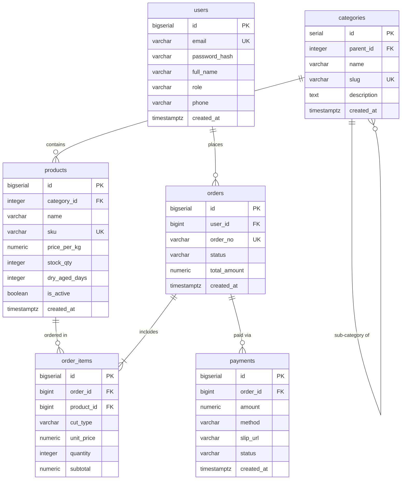

# SQL

(สำหรับฝั่ง Application และการเชื่อมต่อผ่าน ORM สามารถดูเพิ่มเติมที่กลุ่ม BACKEND: [Prisma ORM](/docs/backend/prisma-orm) โดยเอกสารนี้จะเน้นภาษา SQL ฉบับสมบูรณ์บน PostgreSQL 16 พร้อมตัวอย่างเปรียบเทียบสิ่งที่ Prisma สร้างขึ้นเบื้องหลัง)

<Callout type="note" title="ฐานข้อมูลและบริบทของระบบตัวอย่างตลอดทั้งเอกสาร">
เอกสารฉบับนี้ใช้ฐานข้อมูลจำลองของระบบระดับองค์กร **"Smart Butcher Marketplace"** (แพลตฟอร์มตลาดสดเนื้อพรีเมียมและเนื้อดรายเอจออนไลน์) ซึ่งรองรับการค้าเนื้อวัวนำเข้าคุณภาพสูง การบ่มดรายเอจ (Dry-Aging) ตามสั่ง และการชำระเงินแบบหลายช่องทาง
</Callout>

| หัวข้อในบทเรียนนี้ | ขอบเขตเนื้อหาสำคัญ | ลิงก์ข้ามไปยังหัวข้อ |
| :--- | :--- | :--- |
| **1. DDL & Constraints** | การสร้างตาราง, Primary/Foreign Key, NOT NULL, UNIQUE, CHECK | [อ่านหัวข้อที่ 1](/docs/database/sql/ddl-constraints) |
| **2. Basic CRUD DML** | คำสั่งเพิ่ม แก้ไข และลบข้อมูลพื้นฐาน `INSERT`, `UPDATE`, `DELETE` | [อ่านหัวข้อที่ 2](/docs/database/sql/basic-crud-dml) |
| **3. SELECT & Filtering** | `SELECT`, `WHERE`, `ORDER BY`, `LIMIT`, `OFFSET` และลำดับการรัน | [อ่านหัวข้อที่ 3](/docs/database/sql/select-filtering) |
| **4. String Functions** | การตัด, ต่อ, แปลงตัวพิมพ์ `CONCAT`, `SUBSTRING`, `LENGTH`, `TRIM` | [อ่านหัวข้อที่ 4](/docs/database/sql/string-functions) |
| **5. Math & Aggregates** | การคำนวณและสรุปผล `COUNT`, `SUM`, `AVG`, `ROUND`, `FILTER` | [อ่านหัวข้อที่ 5](/docs/database/sql/math-aggregates) |
| **6. CASE & NULL Handling** | ตรรกะเงื่อนไข `CASE WHEN`, `COALESCE`, `NULLIF`, ค่าว่าง | [อ่านหัวข้อที่ 6](/docs/database/sql/case-null-handling) |
| **7. Date & Time Queries** | ฟังก์ชันวันที่ `DATE_TRUNC`, `INTERVAL`, `EXTRACT`, `AGE` | [อ่านหัวข้อที่ 7](/docs/database/sql/date-time-queries) |
| **8. SQL JOINs** | `INNER`, `LEFT`, `RIGHT`, `FULL`, `CROSS` และ `SELF JOIN` | [อ่านหัวข้อที่ 8](/docs/database/sql/sql-joins) |
| **9. GROUP BY & Having** | การจัดกลุ่มคำนวณสถิติ และการกรองผลลัพธ์ด้วย `HAVING` | [อ่านหัวข้อที่ 9](/docs/database/sql/group-by-having) |
| **10. Set Operations** | การรวมและตัดชุดข้อมูลด้วย `UNION`, `INTERSECT`, `EXCEPT` | [อ่านหัวข้อที่ 10](/docs/database/sql/set-operations) |
| **11. Subquery & CTE** | การเขียนคิวรีย่อย และจัดระเบียบคิวรีซับซ้อนด้วย `WITH` (CTE) | [อ่านหัวข้อที่ 11](/docs/database/sql/subquery-cte) |
| **12. Window Functions** | `ROW_NUMBER`, `RANK`, `DENSE_RANK`, `LAG/LEAD`, `SUM() OVER` | [อ่านหัวข้อที่ 12](/docs/database/sql/window-functions) |
| **13. DML & RETURNING** | คืนค่าแถวข้อมูลที่ถูกแก้ไขทันทีด้วย `RETURNING` | [อ่านหัวข้อที่ 13](/docs/database/sql/dml-returning) |
| **14. UPSERT & Conflict** | การแทรกข้อมูลหรืออัปเดตอัตโนมัติด้วย `ON CONFLICT` | [อ่านหัวข้อที่ 14](/docs/database/sql/upsert-conflict) |
| **15. Full-Text Search** | ระบบค้นหาคำขั้นสูง `tsvector`, `tsquery`, GIN Index | [อ่านหัวข้อที่ 15](/docs/database/sql/full-text-search) |
| **16. Transactions & Locks** | คุณสมบัติ ACID, `BEGIN`, `COMMIT`, และ `SELECT FOR UPDATE` | [อ่านหัวข้อที่ 16](/docs/database/sql/transactions-locks) |
| **17. Index & EXPLAIN** | การสร้าง Index และวิเคราะห์ Execution Plan ด้วย `EXPLAIN` | [อ่านหัวข้อที่ 17](/docs/database/sql/index-explain) |
| **18. Anti-patterns** | ข้อผิดพลาดที่พบบ่อยในการเขียน SQL และวิธีแก้ไขตาม Best Practice | [อ่านหัวข้อที่ 18](/docs/database/sql/pitfalls) |

---

---

## สารบัญหัวข้อการเรียนรู้เชิงลึก (Learning Directory)

| ลำดับ | หัวข้อย่อย | ขอบเขตเนื้อหา | ลิงก์เข้าสู่บทเรียน |
| :---: | :--- | :--- | :--- |
| 1 | **DDL Constraints** | สร้างและปรับโครงสร้างตาราง, Primary/Foreign Key, NOT NULL, UNIQUE, CHECK | [เปิดอ่าน DDL Constraints](/docs/database/sql/ddl-constraints) |
| 2 | **Basic CRUD DML** | คำสั่งเพิ่ม แก้ไข และลบข้อมูลพื้นฐาน `INSERT`, `UPDATE`, `DELETE` และกลไก MVCC | [เปิดอ่าน Basic CRUD DML](/docs/database/sql/basic-crud-dml) |
| 3 | **SELECT Filtering** | เจาะลึกเนื้อหาและสถาปัตยกรรมของ SELECT Filtering พร้อมโค้ดตัวอย่างและการประยุกต์ใช้งานจริง | [เปิดอ่าน SELECT Filtering](/docs/database/sql/select-filtering) |
| 4 | **String Functions** | การตัด, ต่อ, แปลงตัวพิมพ์ `CONCAT`, `SUBSTRING`, `LENGTH`, `TRIM`, `SPLIT_PART` | [เปิดอ่าน String Functions](/docs/database/sql/string-functions) |
| 5 | **Math Aggregates** | การคำนวณและสรุปผล `COUNT`, `SUM`, `AVG`, `ROUND`, `FILTER (WHERE ...)` | [เปิดอ่าน Math Aggregates](/docs/database/sql/math-aggregates) |
| 6 | **CASE NULL Handling** | เจาะลึกเนื้อหาและสถาปัตยกรรมของ CASE NULL Handling พร้อมโค้ดตัวอย่างและการประยุกต์ใช้งานจริง | [เปิดอ่าน CASE NULL Handling](/docs/database/sql/case-null-handling) |
| 7 | **Date Time Queries** | เจาะลึกเนื้อหาและสถาปัตยกรรมของ Date Time Queries พร้อมโค้ดตัวอย่างและการประยุกต์ใช้งานจริง | [เปิดอ่าน Date Time Queries](/docs/database/sql/date-time-queries) |
| 8 | **SQL JOINs** | เจาะลึกเนื้อหาและสถาปัตยกรรมของ SQL JOINs พร้อมโค้ดตัวอย่างและการประยุกต์ใช้งานจริง | [เปิดอ่าน SQL JOINs](/docs/database/sql/sql-joins) |
| 9 | **GROUP BY Having** | เจาะลึกเนื้อหาและสถาปัตยกรรมของ GROUP BY Having พร้อมโค้ดตัวอย่างและการประยุกต์ใช้งานจริง | [เปิดอ่าน GROUP BY Having](/docs/database/sql/group-by-having) |
| 10 | **Set Operations** | เจาะลึกเนื้อหาและสถาปัตยกรรมของ Set Operations พร้อมโค้ดตัวอย่างและการประยุกต์ใช้งานจริง | [เปิดอ่าน Set Operations](/docs/database/sql/set-operations) |
| 11 | **Subquery CTE** | เจาะลึกเนื้อหาและสถาปัตยกรรมของ Subquery CTE พร้อมโค้ดตัวอย่างและการประยุกต์ใช้งานจริง | [เปิดอ่าน Subquery CTE](/docs/database/sql/subquery-cte) |
| 12 | **Window Functions** | เจาะลึกเนื้อหาและสถาปัตยกรรมของ Window Functions พร้อมโค้ดตัวอย่างและการประยุกต์ใช้งานจริง | [เปิดอ่าน Window Functions](/docs/database/sql/window-functions) |
| 13 | **DML RETURNING** | เจาะลึกเนื้อหาและสถาปัตยกรรมของ DML RETURNING พร้อมโค้ดตัวอย่างและการประยุกต์ใช้งานจริง | [เปิดอ่าน DML RETURNING](/docs/database/sql/dml-returning) |
| 14 | **UPSERT Conflict** | เจาะลึกเนื้อหาและสถาปัตยกรรมของ UPSERT Conflict พร้อมโค้ดตัวอย่างและการประยุกต์ใช้งานจริง | [เปิดอ่าน UPSERT Conflict](/docs/database/sql/upsert-conflict) |
| 15 | **Full-Text Search** | เจาะลึกเนื้อหาและสถาปัตยกรรมของ Full-Text Search พร้อมโค้ดตัวอย่างและการประยุกต์ใช้งานจริง | [เปิดอ่าน Full-Text Search](/docs/database/sql/full-text-search) |
| 16 | **Transactions Locks** | คุณสมบัติ ACID, การควบคุม Transaction, และ Row Locking ป้องกัน Race Condition | [เปิดอ่าน Transactions Locks](/docs/database/sql/transactions-locks) |
| 17 | **Index EXPLAIN** | การสร้าง B-Tree Index, Composite Index, และการวิเคราะห์ Plan ด้วย EXPLAIN ANALYZE | [เปิดอ่าน Index EXPLAIN](/docs/database/sql/index-explain) |
| 18 | **Anti-patterns** | ข้อผิดพลาดที่พบบ่อย (Anti-patterns), Checklist สรุป และลำดับการเรียนรู้ที่แนะนำ | [เปิดอ่าน Anti-patterns](/docs/database/sql/pitfalls) |

---

## แหล่งอ้างอิงทางการและดูเพิ่มเติม

- [เอกสารทางการของ SQL](https://google.com/search?q=SQL) — คู่มือและเอกสารการใช้งานฉบับสมบูรณ์
- [เนื้อหาในหมวด DATABASE](/) — กลับสู่หน้าหลักสารบัญ
