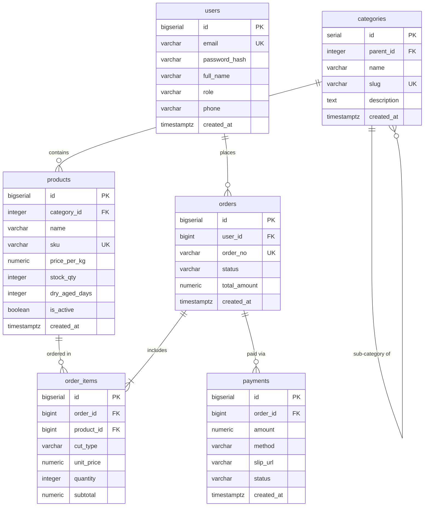

# SQL

(สำหรับฝั่ง Application และการเชื่อมต่อผ่าน ORM สามารถดูเพิ่มเติมที่กลุ่ม BACKEND: [Prisma ORM](/docs/backend/prisma-orm) โดยเอกสารนี้จะเน้นภาษา SQL ฉบับสมบูรณ์บน PostgreSQL 16 พร้อมตัวอย่างเปรียบเทียบสิ่งที่ Prisma สร้างขึ้นเบื้องหลัง)

<Callout type="note" title="ฐานข้อมูลและบริบทของระบบตัวอย่างตลอดทั้งเอกสาร">
เอกสารฉบับนี้ใช้ฐานข้อมูลจำลองของระบบระดับองค์กร **"Smart Butcher Marketplace"** (แพลตฟอร์มตลาดสดเนื้อพรีเมียมและเนื้อดรายเอจออนไลน์) ซึ่งรองรับการค้าเนื้อวัวนำเข้าคุณภาพสูง การบ่มดรายเอจ (Dry-Aging) ตามสั่ง และการชำระเงินแบบหลายช่องทาง
</Callout>

| หัวข้อในบทเรียนนี้ | ขอบเขตเนื้อหาสำคัญ | ลิงก์ข้ามไปยังหัวข้อ |
| :--- | :--- | :--- |
| **1. SELECT & Filtering** | `SELECT`, `WHERE`, `ORDER BY`, `LIMIT`, `OFFSET` และลำดับการรัน | [อ่านหัวข้อที่ 1](/docs/database/sql/select-filtering) |
| **2. DML & RETURNING** | `INSERT`, `UPDATE`, `DELETE` พร้อมการคืนค่าแถวที่แก้ด้วย `RETURNING` | [อ่านหัวข้อที่ 2](/docs/database/sql/dml-returning) |
| **3. SQL JOINs** | `INNER`, `LEFT`, `RIGHT`, `FULL`, `CROSS` และ `SELF JOIN` | [อ่านหัวข้อที่ 3](/docs/database/sql/sql-joins) |
| **4. GROUP BY & Aggregates** | `COUNT`, `SUM`, `AVG`, `FILTER` และความต่าง `WHERE` vs `HAVING` | [อ่านหัวข้อที่ 4](/docs/database/sql/group-by-having) |
| **5. Subquery & CTE** | การซ้อน Query และการจัดระเบียบ Query ซับซ้อนด้วย `WITH` (CTE) | [อ่านหัวข้อที่ 5](/docs/database/sql/subquery-cte) |
| **6. Set Operations** | การรวมและตัดชุดข้อมูลด้วย `UNION`, `UNION ALL`, `INTERSECT`, `EXCEPT` | [อ่านหัวข้อที่ 6](/docs/database/sql/set-operations) |
| **7. Window Functions** | `ROW_NUMBER`, `RANK`, `DENSE_RANK`, `LAG/LEAD`, `SUM() OVER` | [อ่านหัวข้อที่ 7](/docs/database/sql/window-functions) |
| **8–11. Advanced SQL** | `CASE`, `NULL`, Date/Time, Full-Text Search และ `UPSERT (ON CONFLICT)` | [อ่านหัวข้อที่ 8](/docs/database/sql/case-null-handling) |

---

---

## สารบัญหัวข้อการเรียนรู้เชิงลึก (Learning Directory)

| ลำดับ | หัวข้อย่อย | ขอบเขตเนื้อหา | ลิงก์เข้าสู่บทเรียน |
| :---: | :--- | :--- | :--- |
| 1 | **SELECT Filtering** | เจาะลึกเนื้อหาและสถาปัตยกรรมของ SELECT Filtering พร้อมโค้ดตัวอย่างและการประยุกต์ใช้งานจริง | [เปิดอ่าน SELECT Filtering](/docs/database/sql/select-filtering) |
| 2 | **DML RETURNING** | เจาะลึกเนื้อหาและสถาปัตยกรรมของ DML RETURNING พร้อมโค้ดตัวอย่างและการประยุกต์ใช้งานจริง | [เปิดอ่าน DML RETURNING](/docs/database/sql/dml-returning) |
| 3 | **SQL JOINs** | เจาะลึกเนื้อหาและสถาปัตยกรรมของ SQL JOINs พร้อมโค้ดตัวอย่างและการประยุกต์ใช้งานจริง | [เปิดอ่าน SQL JOINs](/docs/database/sql/sql-joins) |
| 4 | **GROUP BY Having** | เจาะลึกเนื้อหาและสถาปัตยกรรมของ GROUP BY Having พร้อมโค้ดตัวอย่างและการประยุกต์ใช้งานจริง | [เปิดอ่าน GROUP BY Having](/docs/database/sql/group-by-having) |
| 5 | **Subquery CTE** | เจาะลึกเนื้อหาและสถาปัตยกรรมของ Subquery CTE พร้อมโค้ดตัวอย่างและการประยุกต์ใช้งานจริง | [เปิดอ่าน Subquery CTE](/docs/database/sql/subquery-cte) |
| 6 | **Set Operations** | เจาะลึกเนื้อหาและสถาปัตยกรรมของ Set Operations พร้อมโค้ดตัวอย่างและการประยุกต์ใช้งานจริง | [เปิดอ่าน Set Operations](/docs/database/sql/set-operations) |
| 7 | **Window Functions** | เจาะลึกเนื้อหาและสถาปัตยกรรมของ Window Functions พร้อมโค้ดตัวอย่างและการประยุกต์ใช้งานจริง | [เปิดอ่าน Window Functions](/docs/database/sql/window-functions) |
| 8 | **CASE NULL Handling** | เจาะลึกเนื้อหาและสถาปัตยกรรมของ CASE NULL Handling พร้อมโค้ดตัวอย่างและการประยุกต์ใช้งานจริง | [เปิดอ่าน CASE NULL Handling](/docs/database/sql/case-null-handling) |
| 9 | **Date Time Queries** | เจาะลึกเนื้อหาและสถาปัตยกรรมของ Date Time Queries พร้อมโค้ดตัวอย่างและการประยุกต์ใช้งานจริง | [เปิดอ่าน Date Time Queries](/docs/database/sql/date-time-queries) |
| 10 | **Full-Text Search** | เจาะลึกเนื้อหาและสถาปัตยกรรมของ Full-Text Search พร้อมโค้ดตัวอย่างและการประยุกต์ใช้งานจริง | [เปิดอ่าน Full-Text Search](/docs/database/sql/full-text-search) |
| 11 | **UPSERT Conflict** | เจาะลึกเนื้อหาและสถาปัตยกรรมของ UPSERT Conflict พร้อมโค้ดตัวอย่างและการประยุกต์ใช้งานจริง | [เปิดอ่าน UPSERT Conflict](/docs/database/sql/upsert-conflict) |
| 12 | **Anti-patterns** | ข้อผิดพลาดที่พบบ่อย (Anti-patterns), Checklist สรุป และลำดับการเรียนรู้ที่แนะนำ | [เปิดอ่าน Anti-patterns](/docs/database/sql/pitfalls) |

---

## แหล่งอ้างอิงทางการและดูเพิ่มเติม

- [เอกสารทางการของ SQL](https://google.com/search?q=SQL) — คู่มือและเอกสารการใช้งานฉบับสมบูรณ์
- [เนื้อหาในหมวด DATABASE](/) — กลับสู่หน้าหลักสารบัญ
