## 1. แนวคิด (Concept)
การทำ **JOIN** เปรียบเหมือนการรวบรวมข้อมูลส่วนต่างๆ ของตลาดสด Smart Butcher มาประกอบเป็นใบเสร็จรับเงินที่สมบูรณ์:
- ตาราง `orders` มีรหัสออเดอร์และยอดเงิน
- ตาราง `users` มีชื่อและเบอร์โทรของผู้สั่งซื้อ
- ตาราง `order_items` มีรายละเอียดชิ้นเนื้อแต่ละแพ็ก
- ตาราง `products` มีชื่อสายพันธุ์และเกรดเนื้อ

การเลือกประเภท JOIN จะเป็นตัวกำหนดว่า หากข้อมูลบางชิ้นไม่เข้าคู่กัน ข้อมูลแถวนั้นจะยังคงปรากฏในรายงานหรือไม่

## 2. ภาพประกอบ Venn Diagram สำหรับการ JOIN

```mermaid filename="docs/database/sql-diagram.mmd"
flowchart TD
    subgraph IJ["1. INNER JOIN"]
        direction LR
        A1["ตารางซ้าย: users"] --- M1["ส่วนที่ตรงกันทั้ง 2 ฝั่ง<br/>(Users ที่มีคำสั่งซื้อ)"] --- B1["ตารางขวา: orders"]
    end

    subgraph LJ["2. LEFT OUTER JOIN"]
        direction LR
        A2["ทุกแถวของตารางซ้าย<br/>(Users ทั้งหมด)<br/>รวมคนที่ไม่เคยสั่งซื้อ"] --- M2["ส่วนที่ตรงกัน<br/>(Users + Orders)"]
    end

    subgraph RJ["3. RIGHT OUTER JOIN"]
        direction LR
        M3["ส่วนที่ตรงกัน<br/>(Orders + Users)"] --- B3["ทุกแถวของตารางขวา<br/>(Orders ทั้งหมด)"]
    end

    subgraph FJ["4. FULL OUTER JOIN"]
        direction LR
        A4["Users ทั้งหมด"] --- M4["ส่วนที่ตรงกัน"] --- B4["Orders ทั้งหมด"]
    end
```



## 3. หลักการเบื้องหลัง (Under the Hood)
PostgreSQL Query Planner จะเลือกใช้อัลกอริทึมในการ JOIN ข้อมูลตามขนาดของตารางและดัชนี (Indexes) ที่มี:
1. **Nested Loop Join**: เหมาะกับกรณีที่ตารางหนึ่งมีขนาดเล็กมาก และตารางที่สองมี B-Tree Index ที่ Join Key โดยจะวนลูปอ่านตารางนอกทีละแถว แล้วเอาค่าไปค้นหาใน Index ของตารางใน ($O(N \times \log M)$)
2. **Hash Join**: เหมาะกับตารางขนาดกลางถึงใหญ่ที่ไม่มี Index รองรับ Engine จะนำตารางที่เล็กกว่ามาสร้าง Hash Table ในหน่วยความจำ `work_mem` จากนั้นสแกนตารางใหญ่แล้วนำ Join Key มาคำนวณ Hash เพื่อจับคู่ ($O(N + M)$)
3. **Merge Join**: ทั้งสองตารางจะต้องถูกจัดเรียงตาม Join Key มาก่อนแล้ว (หรือดึงข้อมูลผ่าน Index ที่เรียงอยู่แล้ว) จากนั้นจะเลื่อนตัวชี้ (Pointers) วิ่งจับคู่ข้อมูลไปพร้อมกัน ($O(N + M)$ ไม่รวมเวลา Sort)

### กับดักมรณะ: ความแตกต่างระหว่างเงื่อนไขใน `ON` vs `WHERE` ใน LEFT JOIN
นี่คือจุดที่นักพัฒนาพลาดบ่อยที่สุด:
- **เงื่อนไขใน `ON` clause**: ใช้ตัดสินใจว่าจะ "จับคู่" แถวจากตารางขวาหรือไม่ หากเงื่อนไขไม่เป็นจริง แถวจากตารางซ้ายจะ **ยังคงอยู่** โดยคอลัมน์ของตารางขวาจะถูกเติมเป็น `NULL`
- **เงื่อนไขใน `WHERE` clause**: กรองแถวทิ้งหลังจากกระบวนการ JOIN เสร็จสมบูรณ์แล้ว หากใส่เงื่อนไขของตารางขวาลงใน `WHERE` เช่น `WHERE orders.status = 'COMPLETED'` แถวที่มีค่าเป็น `NULL` จากตารางซ้ายจะถูกกรองทิ้งทั้งหมด ส่งผลให้ LEFT JOIN กลายสภาพเป็น INNER JOIN ทันที!

## 4. ตัวอย่างโค้ด (Smart Butcher Marketplace)

### ตัวอย่างที่ 1: LEFT JOIN ตรวจสอบยอดซื้อรวมของลูกค้าทุกคน (รวมผู้ที่ยังไม่เคยสั่งซื้อ)
แสดงรายชื่อผู้ใช้ทั้งหมดในระบบ พร้อมยอดเงินรวมที่เคยชำระ หากผู้ใช้คนใดยังไม่เคยมีออเดอร์ ให้แสดงยอดเงินเป็น `0.00`:

```sql filename="sql/sql.sql"
-- LEFT JOIN เพื่อคงรายชื่อลูกค้าทุกคนไว้ แม้จะยังไม่เคยเปิดบิลซื้อเนื้อ
SELECT 
    u.id AS user_id,
    u.full_name,
    u.email,
    COUNT(o.id) AS total_orders,
    COALESCE(SUM(o.total_amount), 0.00) AS total_spent
FROM users u
LEFT JOIN orders o ON u.id = o.user_id AND o.status = 'COMPLETED' -- กรองสถานะที่ ON clause อย่างถูกต้อง!
GROUP BY u.id, u.full_name, u.email
ORDER BY total_spent DESC;
```

**ผลลัพธ์ที่ได้ (Expected Output):**

| user_id | full_name | email | total_orders | total_spent |
| :--- | :--- | :--- | :--- | :--- |
| 1 | Somchai Steaklover | somchai@butcher.io | 2 | 19100.00 |
| 2 | Anong Wagyuchef | anong@farmfresh.com | 0 | 0.00 |
| 4 | Karan Observer | guest.karan@gmail.com | 0 | 0.00 |
| 3 | Wichai Headbutcher | wichai@meatmaster.co | 0 | 0.00 |

**โค้ดเทียบเคียงใน Prisma Client:**
```typescript filename="src/sql.ts"
// Prisma Client โหลดข้อมูลสัมพันธ์ผ่าน include
const usersWithSpending = await prisma.user.findMany({
  select: {
    id: true,
    fullName: true,
    email: true,
    orders: {
      where: { status: 'COMPLETED' },
      select: { totalAmount: true },
    },
  },
});
```

### ตัวอย่างที่ 2: Multi-table INNER JOIN ออกใบสั่งจัดส่งเนื้อดรายเอจ
เชื่อมโยง 4 ตารางหลัก (`orders`, `users`, `order_items`, `products`) เพื่อดึงข้อมูลสำหรับแผนกจัดส่งสินค้า:

```sql filename="sql/sql.sql"
-- เชื่อมโยงหลายตารางเพื่อสร้างรายงานคำสั่งซื้อเนื้อ
SELECT 
    o.order_no,
    o.created_at AS order_date,
    u.full_name AS customer_name,
    u.phone AS customer_phone,
    p.name AS product_name,
    oi.cut_type,
    oi.quantity,
    oi.unit_price,
    oi.subtotal
FROM orders o
INNER JOIN users u ON o.user_id = u.id
INNER JOIN order_items oi ON o.id = oi.order_id
INNER JOIN products p ON oi.product_id = p.id
WHERE o.order_no = 'ORD-20261001-001'
ORDER BY oi.id ASC;
```

**ผลลัพธ์ที่ได้ (Expected Output):**

| order_no | order_date | customer_name | customer_phone | product_name | cut_type | quantity | unit_price | subtotal |
| :--- | :--- | :--- | :--- | :--- | :--- | :--- | :--- | :--- |
| ORD-20261001-001 | 2026-10-01 10:30:00+07 | Somchai Steaklover | 0812345678 | Miyazaki Wagyu A5 Ribeye | Thick Cut 2-inch | 2 | 4500.00 | 9000.00 |
| ORD-20261001-001 | 2026-10-01 10:30:00+07 | Somchai Steaklover | 0812345678 | 45-Day Dry-Aged Black Angus T-Bone | Standard Cut | 1 | 2800.00 | 4500.00 |

### ตัวอย่างที่ 3: CROSS JOIN สำหรับสร้างตารางเมทริกซ์จับคู่สินค้าเนื้อกับกล่องควบคุมอุณหภูมิ
เมื่อต้องการสร้างความเป็นไปได้ทั้งหมดระหว่างเนื้อพรีเมียมกับประเภทกล่องโฟมบรรจุภัณฑ์:

```sql filename="sql/sql.sql"
-- สร้างตารางรวมความเป็นไปได้ (Cartesian Product) สำหรับคำนวณค่าจัดส่ง
SELECT 
    p.sku AS product_sku,
    p.name AS product_name,
    pkg.box_type,
    pkg.extra_cost
FROM products p
CROSS JOIN (
    VALUES 
        ('Standard Chilled Box', 150.00),
        ('Dry-Ice Vacuum Box', 350.00)
) AS pkg(box_type, extra_cost)
WHERE p.dry_aged_days > 0;
```

## 5. ผิด vs ถูก (Anti-patterns & Best Practices)

### ❌ โค้ดที่ผิด: ใส่เงื่อนไขของตารางขวาใน `WHERE` ของ LEFT JOIN
```sql filename="sql/sql.sql"
-- ผิด: การใส่ o.status = 'COMPLETED' ใน WHERE จะคัดแถวที่เป็น NULL ทิ้ง
-- ทำให้ลูกค้าที่ไม่เคยสั่งซื้อเนื้อหลุดหายไปจากรายงานทันที (กลายเป็น INNER JOIN)
SELECT u.full_name, o.order_no
FROM users u
LEFT JOIN orders o ON u.id = o.user_id
WHERE o.status = 'COMPLETED';
```

### ✅ โค้ดที่ถูก: ย้ายเงื่อนไขการจับคู่ไปไว้ใน `ON` clause
```sql filename="sql/sql.sql"
-- ถูกต้อง: เงื่อนไขการจับคู่อยู่ใน ON clause ทำให้ลูกค้าที่ไม่มีออเดอร์ยังคงแสดงผล
SELECT u.full_name, o.order_no
FROM users u
LEFT JOIN orders o ON u.id = o.user_id AND o.status = 'COMPLETED';
```

## 6. ควรใช้เมื่อไหร่ / ไม่ควรใช้เมื่อไหร่
- **ควรใช้ INNER JOIN:** เมื่อต้องการเฉพาะแถวที่สมบูรณ์และมีความเกี่ยวข้องกันทั้งสองฝั่ง (เช่น หาเฉพาะออเดอร์ที่มีสินค้าจริง)
- **ควรใช้ LEFT JOIN:** เมื่อต้องการรักษาข้อมูลจากตารางหลักไว้ครบทุกแถว (เช่น รายชื่อลูกค้าทั้งหมด พร้อมประวัติออเดอร์ถ้ามี)
- **หลีกเลี่ยง CROSS JOIN:** ในตารางขนาดใหญ่ เพราะจะเกิดข้อมูลแบบ $N \times M$ แถว ซึ่งทำให้ระบบหน่วยความจำล้น (Memory Out of Bounds) ได้ง่าย

## 7. คำถามสัมภาษณ์ (Interview Questions)
- **Q1: อะไรคือปัจจัยหลักที่ทำให้ PostgreSQL Optimizer เลือกใช้ `Hash Join` แทน `Nested Loop Join`?**
  - *คำตอบ:* Optimizer จะพิจารณาจาก: 1) ขนาดของตาราง หากทั้งสองตารางมีขนาดปานกลางถึงใหญ่ และไม่มี Index ที่เหมาะสมบน Join Key, 2) ค่าประมาณ Cost ในการสร้าง Hash Table ในหน่วยความจำ `work_mem` ว่าต่ำกว่าการวนลูปซ้ำๆ หลายครั้ง, 3) ตัวเปรียบเทียบในเงื่อนไข Join เป็นการเปรียบเทียบความเท่ากัน (Equality Operator `=`) ซึ่งเข้าเงื่อนไขของ Hashing ได้พอดี
- **Q2: ในกรณีของ `LEFT JOIN` หากเราต้องการหาแถวในตารางซ้ายที่ "ไม่มีอยู่" ในตารางขวา (Anti-Join) เราควรเขียน Query อย่างไรให้มีประสิทธิภาพสูงสุด?**
  - *คำตอบ:* ใช้คำสั่ง `LEFT JOIN` ร่วมกับเงื่อนไข `WHERE right_table.id IS NULL` เช่น:
    ```sql filename="sql/sql.sql"
    SELECT u.id, u.email 
    FROM users u 
    LEFT JOIN orders o ON u.id = o.user_id 
    WHERE o.id IS NULL;
    ```
    ซึ่ง Optimizer มักจะแปลงคำสั่งนี้เป็น **Anti-Join Execution Plan** ที่หยุดค้นหาทันทีที่เจอข้อมูลคู่แรก ทำให้ทำงานได้รวดเร็วมาก

---
