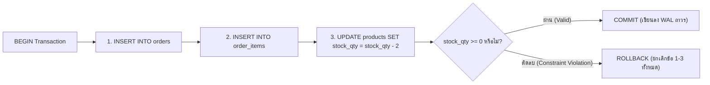
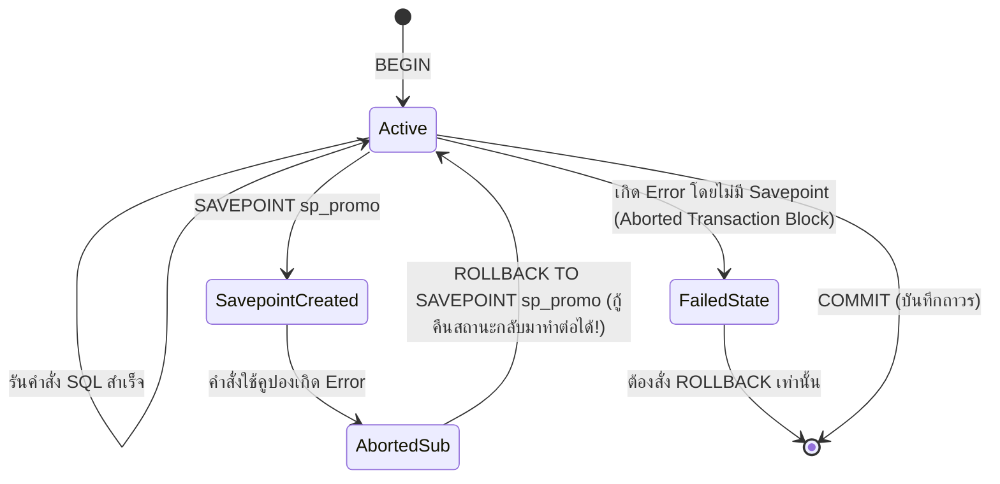

# Transactions

ในระบบอีคอมเมิร์ซและการเงิน การทำรายการทางธุรกิจหนึ่งอย่างไม่เคยจบลงที่คำสั่ง SQL เพียงบรรทัดเดียว เช่น เมื่อลูกค้ากดยืนยันการสั่งซื้อและชำระเงินใน **Smart Butcher Marketplace** ระบบต้องทำการสร้างใบสั่งซื้อ (`orders`), บันทึกรายการสินค้าย่อย (`order_items`), ตัดสต็อกเนื้อพรีเมียม (`products`), และบันทึกการชำระเงิน (`payments`) หากเกิดไฟดับหรือเกิดข้อผิดพลาดขึ้นระหว่างทาง เราจะไม่ยอมให้เกิดสถานะครึ่งๆ กลางๆ เด็ดขาด **Database Transaction** คือกลไกที่มัดรวมคำสั่งหลายคำสั่งให้กลายเป็นหน่วยการทำงานเดียวกัน (All-or-Nothing) เพื่อรับประกันความถูกต้องของข้อมูล 100%

| หมวดหมู่เนื้อหา | หัวข้อหลักในหน้านี้ | เป้าหมายการเรียนรู้ |
| :--- | :--- | :--- |
| **1. รากฐานความถูกต้อง** | คุณสมบัติ ACID อธิบายผ่านกระบวนการสั่งซื้อและตัดสต็อกจริง | เข้าใจ Atomicity, Consistency, Isolation, Durability และกลไก WAL |
| **2. คำสั่งควบคุมธุรกรรม** | การควบคุม Transaction ด้วย BEGIN, COMMIT, ROLLBACK และ SAVEPOINT | จัดการวงจรชีวิตของ Transaction และการย้อนกลับเฉพาะบางส่วนด้วย Savepoint |
| **3. ระดับการแยกตัว** | ระดับการแยกตัวของ Transaction (Isolation Levels) และปรากฏการณ์ข้อมูลเพี้ยน | วิเคราะห์ Dirty Read, Non-Repeatable Read, Phantom Read และ Serialization Anomaly |
| **4. พฤติกรรมของ Postgres** | พฤติกรรมค่าเริ่มต้นของ PostgreSQL 16 และการออกแบบ Transaction ให้สั้นที่สุด | ป้องกันปัญหา `idle in transaction` และการถือครอง Lock ข้าม Network Call |
| **5. การใช้งานกับ Prisma** | ความเชื่อมโยงระหว่าง SQL Transaction กับ Prisma $transaction | เลือกใช้ Sequential vs Interactive Transactions พร้อมกำหนด Timeout และ Isolation Level |

<Callout type="tip" title="กฎ All-or-Nothing ของระบบธุรกรรม">
ภายในบล็อกของ Transaction คำสั่งทั้งหมดต้องสำเร็จครบ 100% จึงจะถูกบันทึกถาวร (COMMIT) หากมีคำสั่งใดคำสั่งหนึ่งล้มเหลวแม้แต่จุดเดียว ระบบจะต้องย้อนกลับการเปลี่ยนแปลงทั้งหมดเสมือนไม่เคยมีอะไรเกิดขึ้นเลย (ROLLBACK)
</Callout>

---

## 1. คุณสมบัติ ACID อธิบายผ่านกระบวนการสั่งซื้อและตัดสต็อกจริง

### แนวคิด (Concept)
**ACID** คือคุณสมบัติ 4 ประการที่ฐานข้อมูลระดับ Enterprise อย่าง PostgreSQL 16 ให้คำมั่นสัญญาว่าจะรักษาไว้เสมอในทุกๆ Transaction ลองพิจารณาเมื่อลูกค้าสั่งซื้อเนื้อ Miyazaki Wagyu A5 จำนวน 2 แพ็ก:
1. **Atomicity (ความเป็นหนึ่งเดียว - All or Nothing):** การสร้างใบสั่งซื้อใน `orders`, การเพิ่มรายการใน `order_items`, และการลดจำนวน `stock_qty` ใน `products` ต้องสำเร็จพร้อมกันทั้งหมด หากตอนตัดสต็อกพบว่าเนื้อเหลือแค่ 1 แพ็ก (ไม่พอตัด) คำสั่งสร้างใบสั่งซื้อที่ทำไปก่อนหน้าจะต้องถูกยกเลิกทิ้งทันที
2. **Consistency (ความสอดคล้องตามกฎ):** การทำ Transaction ต้องเปลี่ยนสถานะฐานข้อมูลจากสถานะที่ถูกต้องหนึ่ง ไปสู่อีกสถานะที่ถูกต้องหนึ่งเสมอ โดยไม่ละเมิดกฎใดๆ ที่ตั้งไว้ เช่น กฎ `CHECK (stock_qty >= 0)` หรือกฎ `FOREIGN KEY`
3. **Isolation (การแยกตัวเป็นอิสระ):** ขณะที่ลูกค้าคนที่ 1 กำลังอยู่ในระหว่างขั้นตอนสั่งซื้อและยังไม่ได้ `COMMIT` ลูกค้าคนที่ 2 ที่เข้ามาดูหน้าเว็บในเสี้ยววินาทีเดียวกันจะต้องไม่เห็นข้อมูลที่ยังทำไม่เสร็จครึ่งๆ กลางๆ ของลูกค้าคนที่ 1
4. **Durability (ความคงทนถาวร):** ทันทีที่ฐานข้อมูลตอบกลับว่า `COMMIT` สำเร็จ ต่อให้ปลั๊กไฟของเซิร์ฟเวอร์หลุดหรือเครื่องดับในวินาทีถัดมา ข้อมูลคำสั่งซื้อและการตัดสต็อกของลูกค้ารายนั้นจะต้องไม่สูญหายเด็ดขาดเมื่อเปิดเครื่องกลับมาใหม่



### หลักการเบื้องหลัง (Under the Hood)
PostgreSQL 16 บรรลุคุณสมบัติ ACID ทั้ง 4 ข้อผ่านสถาปัตยกรรมระดับลึกภายใน Engine ดังนี้:
- **Atomicity & Isolation ผ่าน MVCC และ Transaction ID (`xid`):** ทุกครั้งที่ Transaction เริ่มมีการเขียนข้อมูล PostgreSQL จะแจกหมายเลข **Transaction ID (`xid` ขนาด 32-bit/64-bit)** ให้ และบันทึกค่า `xid` ลงในส่วนหัวของแถวที่สร้างใหม่ (`t_xmin`) หรือแถวที่ถูกลบ (`t_xmax`) หาก Transaction สั่ง `ROLLBACK` ระบบเพียงแค่บันทึกสถานะใน **Commit Log (`pg_xact`)** ว่าหมายเลข `xid` นี้ถูกยกเลิก (`ABORTED`) ทำให้ทุก Transaction อื่นเมินเฉยต่อแถวที่มี `xid` นั้นทันทีโดยไม่ต้องเสียเวลาย้อนลบข้อมูลจริง!
- **Durability ผ่าน Write-Ahead Logging (WAL):** ก่อนที่คำสั่ง `COMMIT` จะตอบกลับว่าสำเร็จ PostgreSQL บังคับให้ต้องเขียนบันทึกการเปลี่ยนแปลงลงในไฟล์ **WAL (`pg_wal`)** บนดิสก์แบบเรียงลำดับ (Sequential Append) และสั่ง `fsync()` ลงดิสก์จริงเรียบร้อยเสียก่อน แม้ข้อมูลในตารางหลักที่พักอยู่ใน RAM (`shared_buffers`) จะยังไม่ได้ถูกเขียนลงไฟล์ตาราง แต่หากไฟดับ PostgreSQL จะอ่านไฟล์ WAL มาจำลองเหตุการณ์ซ้ำ (Crash Recovery / Redo) จนข้อมูลกลับมาครบ 100%

### ตัวอย่างโค้ด (Smart Butcher Marketplace)

#### ตัวอย่างที่ 1: Transaction พื้นฐานสำหรับการสั่งซื้อเนื้อพรีเมียมและตัดสต็อกแบบ Atomic
แสดงการมัดรวมคำสั่งสร้างออเดอร์ เพิ่มรายการสินค้าย่อย และตัดสต็อกเนื้อให้อยู่ใน Transaction เดียวกัน:

```sql filename="sql/01_acid_order_checkout_basic.sql"
BEGIN;

-- 1. สร้างใบสั่งซื้อใหม่ในตาราง orders
INSERT INTO orders (
    id, user_id, order_number, status, subtotal_amount, shipping_fee, total_amount, shipping_address
) VALUES (
    'd1111111-1111-1111-1111-111111111111',
    'a1111111-1111-1111-1111-111111111111',
    'ORD-20261017-0001',
    'PENDING',
    10400.00,
    150.00,
    10550.00,
    '{"recipient": "เชฟสมชาย", "address": "สุขุมวิท 55 กรุงเทพฯ", "phone": "0812345678"}'::jsonb
);

-- 2. บันทึกรายการเนื้อที่สั่งซื้อพร้อม Snapshot ราคาลงใน order_items
INSERT INTO order_items (
    order_id, product_id, product_name_snapshot, product_sku_snapshot, quantity, unit_price
) VALUES (
    'd1111111-1111-1111-1111-111111111111',
    '8e94fae4-18df-4158-b34e-6e8ebdc5fca1',
    'Miyazaki Wagyu A5 Striploin',
    'WGY-MIYA-A5-STRIP',
    2,
    5200.00
);

-- 3. ตัดสต็อกสินค้าในตาราง products (หากสต็อกเหลือไม่พอให้ตัด จะติด CHECK constraint stock_qty >= 0 และยกเลิกทั้งชุด)
UPDATE products
SET stock_qty = stock_qty - 2,
    updated_at = CURRENT_TIMESTAMP
WHERE id = '8e94fae4-18df-4158-b34e-6e8ebdc5fca1';

COMMIT;
```

#### ตัวอย่างที่ 2: การทำ Atomic Checkout & Payment Confirmation ในคำสั่ง CTE หรือ Transaction ขั้นสูง
เมื่อลูกค้าชำระเงินสำเร็จและระบบต้องอัปเดตสถานะทั้งตาราง `payments` และ `orders` ไปพร้อมกันโดยตรวจสอบความตรงกันของยอดเงิน:

```sql filename="sql/02_acid_payment_confirmation.sql"
BEGIN;

-- 1. บันทึกและยืนยันรายการชำระเงินในตาราง payments
INSERT INTO payments (
    order_id, idempotency_key, payment_method, amount, status, provider_tx_id, paid_at
) VALUES (
    'd1111111-1111-1111-1111-111111111111',
    'pay_idem_20261017_0001',
    'PROMPTPAY_QR',
    10550.00,
    'SUCCEEDED',
    'omise_chrg_test_99887766',
    CURRENT_TIMESTAMP
);

-- 2. อัปเดตสถานะใบสั่งซื้อเป็น PAID เฉพาะเมื่อยอดเงินที่ชำระตรงกับ total_amount ของออเดอร์เท่านั้น
UPDATE orders o
SET status = 'PAID',
    updated_at = CURRENT_TIMESTAMP
FROM payments p
WHERE o.id = p.order_id
  AND o.id = 'd1111111-1111-1111-1111-111111111111'
  AND o.status = 'PENDING'
  AND o.total_amount = p.amount;

COMMIT;
```

### ผิด vs ถูก (Anti-pattern vs Best Practice)

| มิติการเปรียบเทียบ | ❌ ผิด (Anti-pattern) | ✅ ถูก (Best Practice) |
| :--- | :--- | :--- |
| **การแยกคำสั่งเขียนที่พึ่งพากัน** | รัน `INSERT INTO orders` และ `UPDATE products` แยกเป็น 2 คิวรีอิสระในโหมด Auto-commit | หุ้มคำสั่งทั้งหมดที่อยู่ในหน่วยธุรกิจเดียวกันไว้ภายใต้ `BEGIN ... COMMIT` เสมอ |
| **การพึ่งพา Application Rollback** | เมื่อขั้นตอนที่ 3 พัง พยายามเขียนโค้ด `DELETE FROM orders WHERE id = ...` เพื่อตามลบข้อมูลที่เพิ่งสร้างเอง | ใช้กลไก `ROLLBACK` ของ Database Transaction ซึ่งสะอาด ปลอดภัย และรับประกันผลลัพธ์ 100% |
| **การปิด `fsync` เพื่อเร่งความเร็ว** | ตั้งค่า `fsync = off` ใน `postgresql.conf` เพื่อให้ Benchmark เร็วขึ้น | เปิด `fsync = on` เสมอใน Production (หากต้องการเร่งความเร็วเฉพาะตาราง Log ที่ไม่สำคัญ ให้ใช้ `synchronous_commit = off` เฉพาะ Session นั้นแทน) |

### ควรใช้เมื่อไหร่ และ ไม่ควรใช้เมื่อไหร่
- **ควรใช้ Transaction หุ้มคำสั่งเสมอเมื่อ:** มีการเปลี่ยนแปลงข้อมูล (`INSERT`, `UPDATE`, `DELETE`) ตั้งแต่ 2 คำสั่งขึ้นไปที่ต้องสำเร็จหรือล้มเหลวพร้อมกัน หรือเมื่อต้องการอ่านข้อมูลมาตรวจสอบแล้วแก้ไขกลับลงไปโดยไม่ให้ค่าเปลี่ยนระหว่างทาง
- **ไม่จำเป็นต้องเปิด `BEGIN ... COMMIT` แบบ Explicit เมื่อ:** รันคำสั่ง SQL เดี่ยวๆ เพียง 1 คำสั่ง (เช่น `UPDATE products SET price_per_kg = 5500 WHERE id = $1;`) เพราะใน PostgreSQL ทุกคำสั่งเดี่ยวๆ จะทำงานเป็น Implicit Transaction (Auto-commit) ที่มีคุณสมบัติ ACID ในตัวเองอยู่แล้ว

### คำถามสัมภาษณ์ (Interview Q&A)
- **Q1: ใน PostgreSQL เมื่อเราสั่ง `ROLLBACK` Transaction ที่เพิ่งทำการ `INSERT` ข้อมูลไปแล้ว 10,000 แถว ทำไมคำสั่ง `ROLLBACK` จึงทำงานเสร็จในเสี้ยววินาที (Instant Rollback) ต่างจากฐานข้อมูลที่ใช้ Undo Log ที่ต้องเสียเวลาไล่ลบข้อมูลย้อนกลับ?**
  - **แนวคำตอบ:** เพราะ PostgreSQL เขียนแถวใหม่ทั้ง 10,000 แถวลงไปในตารางพร้อมประทับตราหมายเลข Transaction ID (`t_xmin = xid`) ของ Transaction นั้นไว้ เมื่อสั่ง `ROLLBACK` ตัว Engine เพียงแค่เปลี่ยนสถานะของหมายเลข `xid` นั้นใน Commit Log (`pg_xact`) เพียงจุดเดียวว่า `ABORTED` เสร็จแล้วตอบกลับทันที! เมื่อ Transaction อื่นมาอ่านพบแถวเหล่านั้นและเช็ค `pg_xact` เห็นว่า `ABORTED` ก็จะข้ามไปทันที ส่วนการเก็บกวาดพื้นที่ของแถวที่ถูกยกเลิกเหล่านั้นจะปล่อยให้เป็นหน้าที่ของ `Autovacuum` ทำอยู่เบื้องหลังในภายหลัง
- **Q2: ตัวอักษร "C" (Consistency) ใน ACID ของฐานข้อมูล ต่างจากคำว่า Consistency ใน CAP Theorem อย่างไร?**
  - **แนวคำตอบ:** Consistency ใน **ACID** หมายถึงการที่ข้อมูลในฐานข้อมูลต้องเป็นไปตามกฎและข้อบังคับที่นิยามไว้ทั้งหมดเสมอ (เช่น `NOT NULL`, `UNIQUE`, `CHECK`, `FOREIGN KEY`, และกฎทางธุรกิจอย่างยอดเงินรวมต้องตรงกัน) ส่วน Consistency ใน **CAP Theorem** (Linearizability) หมายถึงการที่ทุกๆ โหนดในระบบฐานข้อมูลแบบกระจายตัว (Distributed Nodes) มองเห็นข้อมูลเวอร์ชันล่าสุดตรงกันในเวลาเดียวกัน

---

## 2. การควบคุม Transaction ด้วย BEGIN, COMMIT, ROLLBACK และ SAVEPOINT

### แนวคิด (Concept)
ในการควบคุมวงจรชีวิตของ Transaction ใน PostgreSQL 16 เราใช้คำสั่งมาตรฐาน 4 คำสั่งหลัก:
1. **`BEGIN` (หรือ `START TRANSACTION`):** เริ่มต้นขอบเขตของ Transaction
2. **`COMMIT`:** ยืนยันการเปลี่ยนแปลงทั้งหมดใน Transaction นั้นให้มีผลถาวรและเปิดให้ Transaction อื่นมองเห็นได้
3. **`ROLLBACK`:** ยกเลิกการเปลี่ยนแปลงทั้งหมดตั้งแต่จุดที่สั่ง `BEGIN`
4. **`SAVEPOINT <name>` และ `ROLLBACK TO SAVEPOINT <name>`:** การปักหมุดจุดเซฟย่อยภายใน Transaction เพื่อให้สามารถย้อนกลับเฉพาะขั้นตอนย่อยที่ล้มเหลวได้โดยไม่ต้องยกเลิกงานทั้งหมดที่ทำสำเร็จไปก่อนหน้า



### หลักการเบื้องหลัง (Under the Hood)
**พฤติกรรมเฉพาะตัวที่สำคัญมากของ PostgreSQL เมื่อเกิด Error ภายใน Transaction:**
ต่างจากบางฐานข้อมูลที่เมื่อคำสั่งที่ 2 เกิด Error แล้วจะยอมให้รันคำสั่งที่ 3 ต่อไปได้ดื้อๆ ใน **PostgreSQL 16 ทันทีที่มีคำสั่ง SQL ใดคำสั่งหนึ่งภายในบล็อก `BEGIN ... COMMIT` เกิด Error (เช่น ติด Unique Constraint หรือหารด้วยศูนย์) ทั้ง Transaction นั้นจะถูกเปลี่ยนสถานะเป็น `Aborted` ทันที!**
หากแอปพลิเคชันพยายามส่งคำสั่ง SQL ถัดไปเข้ามาใน Transaction เดิม PostgreSQL จะปฏิเสธทุกคำสั่งด้วยข้อความ:
`ERROR: current transaction is aborted, commands ignored until end of transaction block`
ทางเดียวที่จะไปต่อได้คือต้องสั่ง `ROLLBACK` ทั้งหมด หรือหากต้องการดักจับ Error เฉพาะจุดเพื่อทำงานต่อ จะต้องปักหมุดด้วย **`SAVEPOINT`** (ซึ่งสร้าง Subtransaction ภายใน) ไว้ก่อนรันคำสั่งที่มีโอกาสพลาด แล้วสั่ง `ROLLBACK TO SAVEPOINT` เพื่อล้างสถานะ Error เฉพาะจุดนั้น!

### ตัวอย่างโค้ด (Smart Butcher Marketplace)

#### ตัวอย่างที่ 1: การแสดงพฤติกรรม Aborted Transaction และการจัดการด้วย `BEGIN ... ROLLBACK`
แสดงให้เห็นว่าเมื่อเกิด Constraint Violation ภายใน Transaction ของ PostgreSQL เราต้องสั่ง `ROLLBACK` เพื่อจบชุดคำสั่งอย่างถูกต้อง:

```sql filename="sql/03_transaction_abort_and_rollback.sql"
BEGIN;

-- ขั้นตอนที่ 1: หักสต็อกเนื้อ Ribeye จำนวน 1 ชิ้น (สำเร็จในมุมมองของ Transaction นี้)
UPDATE products
SET stock_qty = stock_qty - 1
WHERE sku = 'WGY-MIYA-A5-STRIP';

-- ขั้นตอนที่ 2: พยายามหักสต็อกเกินจำนวนที่มีอยู่จริง (สมมติสต็อกเหลือ 10 แต่พยายามหัก 999)
-- จะเกิด ERROR: new row for relation "products" violates check constraint "products_stock_qty_check"
UPDATE products
SET stock_qty = stock_qty - 999
WHERE sku = 'WGY-MIYA-A5-STRIP';

-- ณ จุดนี้ Transaction อยู่ในสถานะ Aborted แล้ว แม้จะสั่ง COMMIT ระบบก็จะแปลงเป็น ROLLBACK ให้อัตโนมัติ
ROLLBACK;
-- ผลลัพธ์: สต็อกที่ถูกหักไป 1 ชิ้นในขั้นตอนที่ 1 ถูกคืนกลับมาเท่าเดิม 100%
```

#### ตัวอย่างที่ 2: การใช้ `SAVEPOINT` สำหรับการลองใช้คูปองส่วนลดเสริมโดยไม่ทำให้ออเดอร์หลักล่ม
ในการสั่งซื้อเนื้อพรีเมียม หากลูกค้ากรอกรหัสของแถมพิเศษและของแถมหมดสต็อก เราต้องการแค่ยกเลิกการแจกของแถมชิ้นนั้น แต่ยังคงให้การสร้างใบสั่งซื้อเนื้อหลักดำเนินต่อไปได้จนจบ:

```sql filename="sql/04_savepoint_partial_rollback.sql"
BEGIN;

-- 1. สร้างใบสั่งซื้อหลักและตัดสต็อกเนื้อวากิว (งานหลักที่ต้องสำเร็จ)
INSERT INTO orders (id, user_id, order_number, status, subtotal_amount, total_amount, shipping_address)
VALUES (
    'e2222222-2222-2222-2222-222222222222',
    'a1111111-1111-1111-1111-111111111111',
    'ORD-20261017-0002',
    'PENDING',
    5200.00,
    5200.00,
    '{"recipient": "คุณวิภา", "address": "สีลม กรุงเทพฯ"}'::jsonb
);

UPDATE products SET stock_qty = stock_qty - 1 WHERE sku = 'WGY-MIYA-A5-STRIP';

-- 2. ปักหมุด SAVEPOINT ก่อนลองตัดสต็อกของแถม (เกลือหิมาลัยรมควัน) ซึ่งอาจหมดสต็อกได้
SAVEPOINT sp_free_gift;

-- สมมติของแถมชิ้นนี้สต็อกเป็น 0 คำสั่งนี้จะติด CHECK constraint (stock_qty >= 0) และเกิด Error!
UPDATE products SET stock_qty = stock_qty - 1 WHERE sku = 'GIFT-SMOKED-SALT';

-- 3. เมื่อโค้ดตรวจพบ Error จากการตัดของแถม ให้ถอยกลับมายังจุด SAVEPOINT sp_free_gift
ROLLBACK TO SAVEPOINT sp_free_gift;

-- ล้าง Savepoint ที่ไม่ใช้แล้ว และบันทึกออเดอร์เนื้อหลักต่อไปได้ตามปกติ!
RELEASE SAVEPOINT sp_free_gift;

COMMIT;
```

### ผิด vs ถูก (Anti-pattern vs Best Practice)

| มิติการเปรียบเทียบ | ❌ ผิด (Anti-pattern) | ✅ ถูก (Best Practice) |
| :--- | :--- | :--- |
| **การใส่ `try...catch` กลืน Error ใน Transaction** | ดัก `try { await tx.executeRaw(...) } catch {}` ในโค้ดแล้วพยายามรันคำสั่งถัดไปใน `tx` เดิมโดยไม่มี Savepoint | หากต้องเพิกเฉยต่อ Error เฉพาะจุดใน SQL ต้องใช้ `SAVEPOINT` หรือใช้ `ON CONFLICT DO NOTHING` แทน |
| **การสร้าง Savepoint ซ้อนกันในลูปใหญ่** | สร้าง `SAVEPOINT` ในลูป 1,000 รอบโดยไม่สั่ง `RELEASE SAVEPOINT` ทำให้เกิด Subtransaction Overflow | หลีกเลี่ยงการสร้าง Subtransactions ซ้อนกันเกิน 64 ชั้น และสั่ง `RELEASE SAVEPOINT` ทันทีเมื่อผ่านจุดเสี่ยงแล้ว |
| **การลืมปิด Transaction เมื่อเกิด Exception** | เขียน `BEGIN` ด้วยมือบน Connection แล้วเมื่อโค้ดโยน Error ลืมสั่ง `ROLLBACK` ในบล็อก `finally` | ใช้ Managed Transaction API (เช่น `prisma.$transaction`) ที่สั่ง `COMMIT`/`ROLLBACK` ให้อัตโนมัติเสมอ |

### ควรใช้เมื่อไหร่ และ ไม่ควรใช้เมื่อไหร่
- **ควรใช้ `SAVEPOINT` เมื่อ:** มีขั้นตอนเสริมที่เป็นทางเลือก (Optional Step) ภายใน Transaction หลัก ซึ่งหากล้มเหลวเราต้องการกู้คืนเฉพาะจุดนั้นแล้วทำงานหลักต่อไปให้จบ
- **ไม่ควรใช้ `SAVEPOINT` เมื่อ:** สามารถใช้คำสั่ง `INSERT ... ON CONFLICT DO NOTHING` หรือ `ON CONFLICT DO UPDATE` (Upsert) แก้ปัญหาข้อมูลซ้ำได้โดยไม่เกิด Error ตั้งแต่แรก (เพราะ `ON CONFLICT` ไม่สร้าง Subtransaction Overhead เลย)

### คำถามสัมภาษณ์ (Interview Q&A)
- **Q1: ทำไมใน PostgreSQL เมื่อเราเขียนโค้ดดัก `try { await tx.user.create(...) } catch (e) {}` แล้วรันคำสั่งถัดไปภายใต้ตัวแปร Transaction `tx` ตัวเดิม ระบบจึงพังด้วย Error `current transaction is aborted`?**
  - **แนวคำตอบ:** เพราะการดัก `try...catch` ในภาษา TypeScript/JavaScript เป็นเพียงการป้องกันไม่ให้ Exception เด้งหลุดออกจากฟังก์ชันในฝั่ง Application เท่านั้น แต่ในฝั่งของ PostgreSQL Backend Process ทันทีที่คำสั่ง `create` เกิด Error (เช่น อีเมลซ้ำ) สถานะของ Transaction ในฐานข้อมูลได้ถูกเปลี่ยนเป็น `Aborted` ไปเรียบร้อยแล้ว และ PostgreSQL จะไม่ยอมรับคำสั่งใดๆ อีกใน Transaction นั้นจนกว่าจะสั่ง `ROLLBACK` (หรือถ้าจะทำแบบนี้ในระดับ SQL ต้องใช้ `ON CONFLICT` หรือ `SAVEPOINT`)
- **Q2: อันตรายของการใช้ Subtransactions (`SAVEPOINT` หรือ `EXCEPTION` block ใน PL/pgSQL) จำนวนมากภายใต้ระบบที่มี Concurrency สูงคืออะไร?**
  - **แนวคำตอบ:** ใน PostgreSQL แต่ละ Connection มีแคชในหน่วยความจำ (`PGPROC`) สำหรับเก็บหมายเลข Subtransaction ID (`subxid`) ได้จำกัดเพียง **64 รายการต่อ 1 Transaction** หากมีการสร้าง `SAVEPOINT` ซ้อนกันเกิน 64 ครั้งใน Transaction เดียวกัน ระบบจะเกิด状态 **Subtransaction Overflow (`suboverflowed`)** ซึ่งบังคับให้ Transaction อื่นๆ ที่กำลังอ่านข้อมูลต้องไปเปิดอ่านไฟล์สถานะ `pg_subtrans` บนดิสก์/SLRU Buffer แทน ส่งผลให้เกิดการแย่งชิง Lock ระดับระบบและทำให้ประสิทธิภาพฐานข้อมูลตกลงอย่างรุนแรง

---

## 3. ระดับการแยกตัวของ Transaction (Isolation Levels) และปรากฏการณ์ข้อมูลเพี้ยน

### แนวคิด (Concept)
เมื่อมีผู้ใช้งานหลายร้อยคนทำรายการพร้อมกัน ย่อมเกิดคำถามว่า **"ในขณะที่ Transaction A กำลังทำงานอยู่และแก้ไขข้อมูลไปบางส่วนแล้ว Transaction B ที่รันอยู่พร้อมกันควรจะมองเห็นข้อมูลอย่างไร?"** มาตรฐาน SQL ได้นิยาม **ปรากฏการณ์ข้อมูลเพี้ยนจากการทำงานพร้อมกัน (Read Phenomena / Anomalies)** ไว้ 4 รูปแบบเรียงจากรุนแรงไปละเอียดอ่อน:
1. **Dirty Read (อ่านเห็นข้อมูลที่ยังไม่ Commit):** Transaction B แอบเห็นข้อมูลที่ Transaction A แก้ไขค้างไว้ แต่ยังไม่ได้สั่ง `COMMIT` (และต่อมา A ดันสั่ง `ROLLBACK` ทำให้ B ได้ข้อมูลปลอมไปใช้งาน!)
2. **Non-Repeatable Read (อ่านแถวเดิมซ้ำสองครั้งได้ค่าไม่เท่ากัน):** Transaction A อ่านราคาสินค้าแถวเดิมครั้งที่ 1 ได้ 5,000 บาท ทันใดนั้น Transaction B เข้ามาแก้ราคาเป็น 5,500 บาทแล้ว `COMMIT` เมื่อ Transaction A อ่านแถวเดิมซ้ำครั้งที่ 2 ภายใน Transaction เดียวกัน กลับได้ค่าเปลี่ยนเป็น 5,500 บาท
3. **Phantom Read (อ่านเงื่อนไขเดิมซ้ำแต่มีแถวผีโผล่เพิ่มหรือหายไป):** Transaction A คิวรีนับจำนวนออเดอร์วันนี้ได้ 10 แถว ทันใดนั้น Transaction B สั่ง `INSERT` ออเดอร์ใหม่เพิ่มเข้ามา 1 แถวแล้ว `COMMIT` เมื่อ Transaction A รันคิวรีเดิมซ้ำกลับได้ 11 แถว
4. **Serialization Anomaly:** ผลลัพธ์ของการรันหลาย Transaction พร้อมกัน ไม่ตรงกับผลลัพธ์ของการนำ Transaction เหล่านั้นมาเรียงต่อคิวรันทีละอันไม่ว่าจะเรียงลำดับแบบใดก็ตาม (เช่น กรณีอ่านเช็คเงื่อนไขพร้อมกันแล้วต่างคนต่างเขียนทับกัน หรือ Write Skew)

### หลักการเบื้องหลัง (Under the Hood)
เพื่อควบคุมปรากฏการณ์ข้างต้น มาตรฐาน SQL จึงแบ่ง **Isolation Levels** ออกเป็น 4 ระดับ แต่สิ่งที่ยอดเยี่ยมของ **PostgreSQL 16** คือกลไก **MVCC (Snapshot Isolation)** มีความแข็งแกร่งกว่ามาตรฐานขั้นต่ำของ SQL อย่างมาก:
- ใน PostgreSQL **ไม่มีปรากฏการณ์ Dirty Read เกิดขึ้นเลยในทุกระดับ!** แม้คุณจะสั่งตั้งค่าเป็น `READ UNCOMMITTED` ตัว PostgreSQL ก็จะยกระดับให้ทำงานเสมือน `READ COMMITTED` โดยอัตโนมัติ
- ในระดับ **`READ COMMITTED` (ค่าเริ่มต้นของ PostgreSQL 16):** แต่ละคำสั่ง SQL (`SELECT`, `UPDATE`) ภายใน Transaction จะถ่ายภาพ **Snapshot ใหม่ทุกครั้งที่เริ่มคำสั่งนั้น** ทำให้มองเห็นข้อมูลล่าสุดที่เพิ่งถูก `COMMIT` ไปก่อนวินาทีที่คำสั่งนั้นเริ่มรัน
- ในระดับ **`REPEATABLE READ`:** PostgreSQL จะถ่ายภาพ **Snapshot เพียงครั้งเดียวตอนรันคำสั่งแรกของ Transaction** และใช้ภาพนั้นไปจนจบ Transaction ทำให้ป้องกันได้ทั้ง **Non-Repeatable Read** และป้องกัน **Phantom Read** ได้ครบ 100% อีกด้วย! นอกจากนี้ หากมี Transaction อื่นแอบแก้ไขแถวเดียวกันตัดหน้าในขณะที่เราอยู่ในโหมด `REPEATABLE READ` แล้วเราพยายาม `UPDATE` แถวนั้นซ้ำ PostgreSQL จะโยน Error `ERROR: could not serialize access due to concurrent update` (รหัส `40001`) ทันทีเพื่อป้องกันข้อมูลทับกัน!
- ในระดับ **`SERIALIZABLE`:** ใช้กลไก **Serializable Snapshot Isolation (SSI)** คอยตรวจสอบ Dependency Graph (SIREAD Locks) เพื่อป้องกัน Serialization Anomaly ทุกรูปแบบโดยไม่ต้องล็อกตารางค้างไว้

#### ตารางเปรียบเทียบ Isolation Levels ใน PostgreSQL 16 จริง

| Isolation Level | Dirty Read | Non-Repeatable Read | Phantom Read | Serialization Anomaly | กลไก Snapshot ใน PostgreSQL 16 |
| :--- | :--- | :--- | :--- | :--- | :--- |
| **`READ UNCOMMITTED`** | ❌ ไม่เกิดเลย | อาจเกิดขึ้นได้ | อาจเกิดขึ้นได้ | อาจเกิดขึ้นได้ | ทำงานเหมือน `READ COMMITTED` ทุกประการ |
| **`READ COMMITTED` (Default)** | ❌ ไม่เกิดเลย | อาจเกิดขึ้นได้ | อาจเกิดขึ้นได้ | อาจเกิดขึ้นได้ | สร้าง Snapshot ใหม่ใน **ทุกๆ คำสั่ง SQL ย่อย** |
| **`REPEATABLE READ`** | ❌ ไม่เกิดเลย | ❌ ไม่เกิดเลย | ❌ **ไม่เกิดเลย** | อาจเกิด Write Skew ได้ | สร้าง Snapshot ครั้งเดียวที่ **คำสั่งแรกของ Transaction** |
| **`SERIALIZABLE`** | ❌ ไม่เกิดเลย | ❌ ไม่เกิดเลย | ❌ ไม่เกิดเลย | ❌ **ไม่เกิดเลย** | Snapshot ครั้งเดียว + ตรวจจับ SSI Conflicts (`40001`) |

### ตัวอย่างโค้ด (Smart Butcher Marketplace)

#### ตัวอย่างที่ 1: การใช้ `REPEATABLE READ` สำหรับการออกรายงานสรุปยอดขายและบัญชีประจำวัน
เมื่อฝ่ายบัญชีต้องการดึงรายงานที่ประกอบด้วยคิวรีหลายชุด (เช่น คิวรีที่ 1 ดึงยอดรวมจาก `orders` และคิวรีที่ 2 ดึงยอดรวมแยกตามวิธีชำระเงินจาก `payments`) หากใช้ `READ COMMITTED` แล้วมีลูกค้าจ่ายเงินเข้ามาตรงกลางระหว่างคิวรีที่ 1 กับ 2 ตัวเลขสองตารางจะไม่เท่ากันทันที! เราจึงต้องใช้ `REPEATABLE READ`:

```sql filename="sql/05_repeatable_read_financial_report.sql"
-- เริ่มต้น Transaction ในโหมด REPEATABLE READ และระบุว่าเป็น READ ONLY เพื่อประสิทธิภาพสูงสุด
BEGIN TRANSACTION ISOLATION LEVEL REPEATABLE READ READ ONLY;

-- คิวรีที่ 1: ดึงยอดรวมคำสั่งซื้อทั้งหมดที่ชำระเงินแล้ว (ถ่ายภาพ Snapshot ณ วินาทีนี้)
SELECT COUNT(*) AS total_paid_orders, SUM(total_amount) AS orders_sum
FROM orders
WHERE status IN ('PAID', 'PREPARING', 'SHIPPED', 'DELIVERED');

-- (ต่อให้มีลูกค้ากดจ่ายเงินสำเร็จเข้ามาในเสี้ยววินาทีนี้ คิวรีด้านล่างก็จะยังคงเห็นข้อมูลชุดเดียวกับคิวรีบนเป๊ะ 100%)

-- คิวรีที่ 2: ดึงยอดรวมการรับชำระเงินแยกตามช่องทาง ตัวเลขผลรวมจะตรงกับ orders_sum เสมอ!
SELECT payment_method, COUNT(*) AS tx_count, SUM(amount) AS payments_sum
FROM payments
WHERE status = 'SUCCEEDED'
GROUP BY payment_method;

COMMIT;
```

#### ตัวอย่างที่ 2: การใช้ `SERIALIZABLE` เพื่อป้องกันปัญหา Write Skew ในการอนุมัติวงเงินเครดิตลูกค้า VIP
สมมติร้านค้ามีกฎว่าลูกค้าองค์กร (ร้านอาหาร) มีวงเงินเครดิตรวม 100,000 บาท หากมีพนักงานขาย 2 คนเปิดดูยอดหนี้คงค้างของลูกค้าพร้อมกันเห็นว่ามียอดค้างอยู่ 60,000 บาท แล้วต่างคนต่างกดสร้างออเดอร์เครดิตใบใหม่ใบละ 30,000 บาทพร้อมกัน (รวมเป็น 120,000 บาท เกินวงเงิน!) เนื่องจากทั้งคู่เป็นการ `INSERT` แถวใหม่คนละแถว การล็อกแถวเดิมจึงช่วยไม่ได้ แต่ระดับ `SERIALIZABLE` จะตรวจจับและบล็อกไม่ให้เกินวงเงินได้ทันที:

```sql filename="sql/06_serializable_prevent_write_skew.sql"
BEGIN TRANSACTION ISOLATION LEVEL SERIALIZABLE;

-- 1. ตรวจสอบยอดออเดอร์เครดิตที่ยังไม่ชำระทั้งหมดของลูกค้ารายนี้
SELECT COALESCE(SUM(total_amount), 0.00) AS current_unpaid_credit
FROM orders
WHERE user_id = 'a1111111-1111-1111-1111-111111111111'
  AND status = 'PENDING';

-- 2. หากยอดรวม + ออเดอร์ใหม่ (30,000) ไม่เกิน 100,000 จึงทำการสร้างใบสั่งซื้อใหม่
-- หากมีอีก Transaction ในโหมด SERIALIZABLE ทำแบบเดียวกันพร้อมกัน ตัวที่ COMMIT ทีหลังจะได้ Error 40001 ทันที!
INSERT INTO orders (user_id, order_number, status, subtotal_amount, total_amount, shipping_address)
VALUES (
    'a1111111-1111-1111-1111-111111111111',
    'ORD-VIP-20261017-099',
    'PENDING',
    30000.00,
    30000.00,
    '{"recipient": "ภัตตาคารเนื้อย่างทองหล่อ"}'::jsonb
);

COMMIT;
```

### ผิด vs ถูก (Anti-pattern vs Best Practice)

| มิติการเปรียบเทียบ | ❌ ผิด (Anti-pattern) | ✅ ถูก (Best Practice) |
| :--- | :--- | :--- |
| **การใช้ `SERIALIZABLE` โดยไม่มีระบบ Retry** | เปิดโหมด `REPEATABLE READ` หรือ `SERIALIZABLE` แต่ไม่เขียนโค้ดดักจับ Error `40001` เพื่อสั่งรัน Transaction ซ้ำ (Retry) | เมื่อใช้ระดับที่สูงกว่า `READ COMMITTED` แอปพลิเคชันต้องมีลอจิก Retry อัตโนมัติเมื่อเกิด Serialization Failure (`40001`) เสมอ |
| **การดึงรายงานหลายตารางด้วย `READ COMMITTED`** | รันคิวรีสรุปงบการเงิน 5 คำสั่งแยกกันในโหมด Default ทำให้ตัวเลขระหว่างตารางขัดแย้งกันเมื่อมีออเดอร์ใหม่เข้ามา | หุ้มคิวรีรายงานทั้งหมดไว้ใน `BEGIN TRANSACTION ISOLATION LEVEL REPEATABLE READ READ ONLY; ... COMMIT;` |
| **การตั้ง `SERIALIZABLE` เป็นค่า Default ทั้งระบบ** | เปลี่ยนค่าเริ่มต้นของทุกคิวรีในระบบเป็น `SERIALIZABLE` ทำให้เกิด Overhead และ Serialization Error ในคิวรีทั่วไป | ใช้ `READ COMMITTED` เป็นค่าเริ่มต้น และยกระดับ Isolation Level เฉพาะ Transaction ที่ต้องการความเข้มงวดสูง |

### ควรใช้เมื่อไหร่ และ ไม่ควรใช้เมื่อไหร่
- **ควรใช้ `READ COMMITTED` (Default) เมื่อ:** เป็นการทำงานของ API ทั่วไป หรือเมื่อเรามีการใช้คำสั่งล็อกแถวแบบเจาะจง (`SELECT ... FOR UPDATE`) และคำสั่ง Atomic Update (`SET stock_qty = stock_qty - $1`) ควบคุมความถูกต้องไว้อยู่แล้ว
- **ควรใช้ `REPEATABLE READ` หรือ `SERIALIZABLE` เมื่อ:** ต้องออกรายงานทางการเงินที่ประกอบด้วยหลายคิวรีที่ต้องการเห็นภาพข้อมูล ณ จุดเวลาเดียวกันเป๊ะ หรือมีกฎทางธุรกิจที่ขึ้นอยู่กับผลรวมของหลายแถวซึ่งไม่สามารถล็อกแถวเดี่ยวๆ ได้

### คำถามสัมภาษณ์ (Interview Q&A)
- **Q1: ในมาตรฐาน ANSI SQL ระดับ `REPEATABLE READ` ยอมให้เกิดปรากฏการณ์ Phantom Read ได้ แต่ใน PostgreSQL 16 ทำไมระดับ `REPEATABLE READ` จึงป้องกัน Phantom Read ได้ด้วย?**
  - **แนวคำตอบ:** มาตรฐาน ANSI SQL ยุคดั้งเดิมเขียนขึ้นโดยอิงจากฐานข้อมูลที่ใช้ระบบ Lock-based (ซึ่งล็อกเฉพาะแถวที่มีอยู่เดิมแต่ไม่ได้ล็อกช่องว่างทำให้มีแถวใหม่แทรกเข้ามาได้) แต่ PostgreSQL ใช้สถาปัตยกรรม **MVCC (Snapshot Isolation)** โดยในระดับ `REPEATABLE READ` ตัว Engine จะยึดภาพถ่าย Snapshot ณ จุดเริ่มต้นของคำสั่งแรกใน Transaction ดังนั้นต่อให้ Transaction อื่น `INSERT` แถวใหม่และ `COMMIT` เข้ามา แถวใหม่เหล่านั้นจะมีหมายเลข `xmin` ที่ใหม่กว่า Snapshot จึงถูกกรองทิ้งทั้งหมด ทำให้ไม่เกิด Phantom Read เลยใน PostgreSQL
- **Q2: ปัญหา "Write Skew" คืออะไร และเกิดขึ้นในระดับ `REPEATABLE READ` ของ PostgreSQL ได้อย่างไร?**
  - **แนวคำตอบ:** Write Skew เกิดขึ้นเมื่อมี 2 Transactions อ่านข้อมูลชุดเดียวกัน (เช่น ตรวจสอบว่ามีเชฟแล่เนื้อเข้าเวรอย่างน้อย 1 คน โดยตอนนี้มีเชฟ A และเชฟ B เข้าเวรอยู่รวม 2 คน) ทั้งสอง Transaction เห็นว่ามี 2 คนจึงผ่านเงื่อนไข จากนั้น Transaction แรกสั่งอัปเดตสถานะของ **เชฟ A** ให้พักเวร และ Transaction ที่สองสั่งอัปเดตสถานะของ **เชฟ B** ให้พักเวร เนื่องจากทั้งคู่แก้ไข **คนละแถวกัน** ในระดับ `REPEATABLE READ` จึงไม่ตรวจพบการชนกันและยอมให้ทั้งคู่ `COMMIT` สำเร็จ ส่งผลให้ไม่เหลือเชฟเข้าเวรเลย 0 คน (ผิดกฎธุรกิจ) ซึ่งปัญหานี้ต้องป้องกันด้วยระดับ `SERIALIZABLE` หรือการล็อกแถวด้วย `FOR UPDATE`

---

## 4. พฤติกรรมค่าเริ่มต้นของ PostgreSQL 16 และการออกแบบ Transaction ให้สั้นที่สุด

### แนวคิด (Concept)
ใน PostgreSQL 16 ทุกๆ คำสั่ง SQL จะทำงานอยู่ภายใต้ Transaction เสมอ หากเราไม่ได้สั่ง `BEGIN` ด้วยตัวเอง PostgreSQL จะทำงานในโหมด **Autocommit** คือครอบ `BEGIN` ก่อนเริ่มคำสั่งและสั่ง `COMMIT` ทันทีที่คำสั่งนั้นทำงานเสร็จ แต่เมื่อเราเปิด Transaction ด้วยตัวเองเพื่อทำหลายขั้นตอน กฎเหล็กด้านสถาปัตยกรรมที่สำคัญที่สุดคือ **"Keep Transactions as Short as Possible (ออกแบบ Transaction ให้สั้นและจบเร็วที่สุด)"**

ศัตรูตัวร้ายที่สุดของฐานข้อมูล Production คือสถานะที่เรียกว่า **`idle in transaction`** ซึ่งหมายถึงแอปพลิเคชันได้สั่งเปิด `BEGIN` ไปแล้ว และรันคำสั่ง SQL ไปบางส่วน (ทำให้ถือครอง Row Locks และ Snapshot ไว้) แต่กลับหยุดนิ่งไม่ยอมส่งคำสั่งถัดไปและไม่ยอมสั่ง `COMMIT` หรือ `ROLLBACK` เสียที เพราะมัวแต่ไปรอเรียก External API (เช่น รอตัดบัตรเครดิตผ่าน Stripe/Omise หรือรอส่งอีเมล/อัปโหลดรูปภาพ)!

```mermaid filename="docs/database/transactions-diagram.mmd"
sequenceDiagram
    participant App as Backend API
    participant DB as PostgreSQL 16
    participant Ext as Payment Gateway / Email API
    Note over App,DB: ❌ ผิดมหันต์: เรียก External API ภายใน Database Transaction
    App->>DB: BEGIN; UPDATE products SET stock_qty = stock_qty - 1;
    Note right of DB: แถวสินค้าถูกล็อกค้างไว้! (สถานะ: idle in transaction)
    App->>Ext: HTTP POST /charge (รอเครือข่ายภายนอกนาน 3-10 วินาที...)
    Ext-->>App: ตอบกลับ 200 OK
    App->>DB: COMMIT;
    Note over App,DB: ✅ ถูกต้อง: แยก Network I/O ออกนอก Database Transaction
    App->>DB: Transaction ที่ 1: จองสต็อกและสร้างออเดอร์สถานะ PENDING (ใช้เวลา 2ms แล้ว COMMIT ทันที!)
    App->>Ext: HTTP POST /charge (ไม่มีการถือ Lock ใน DB เลย)
    Ext-->>App: ตอบกลับ 200 OK
    App->>DB: Transaction ที่ 2: บันทึก payments และเปลี่ยนสถานะเป็น PAID (ใช้เวลา 2ms แล้ว COMMIT!)
```

### หลักการเบื้องหลัง (Under the Hood)
ทำไมการเปิด Transaction ค้างไว้นานแค่ 5-10 วินาที จึงทำให้ฐานข้อมูลทั้งระบบล่มได้?
1. **Row Locks Contention:** ทันทีที่คำสั่ง `UPDATE products SET stock_qty = ...` รันเสร็จ แถวของสินค้านั้นจะถูกล็อก (`FOR NO KEY UPDATE`) ไปจนกว่าจะสั่ง `COMMIT` หากเราไปรอเรียก API ภายนอกนาน 5 วินาที ลูกค้าคนอื่นๆ ที่กดซื้อสินค้าชิ้นเดียวกันจะค้างเติ่งต่อคิวรอ Lock จนลามไปสู่การกิน Connection Pool เต็มทั้งระบบ
2. **Autovacuum Blocked (Xmin Horizon Stalled):** ตราบใดที่มี Transaction เปิดค้างอยู่ กระบวนการ Autovacuum จะไม่สามารถลบ Dead Tuples ที่เกิดขึ้นหลังจากที่ Transaction นั้นเริ่มต้นได้เลยทั่วทั้งฐานข้อมูล
3. **Connection Pool Starvation:** ในระบบที่ใช้ PgBouncer โหมด `transaction pooling` ตัว Connection ของฐานข้อมูลจะถูกยึดไว้กับ Client นั้นตลอดเวลาที่อยู่ในบล็อก `BEGIN ... COMMIT` และไม่สามารถสลับไปให้ Request อื่นยืมใช้ได้

เพื่อปกป้องฐานข้อมูล PostgreSQL 16 จึงมีพารามิเตอร์ป้องกันตัวเอง 3 ตัวที่ควรตั้งค่าไว้เสมอ:
- `statement_timeout`: ยกเลิกคิวรีเดี่ยวๆ ที่รันนานเกินกำหนด (เช่น `10s`)
- `lock_timeout`: ยกเลิกคำสั่งที่ต้องรอคิว Lock นานเกินกำหนด (เช่น `3s`) เพื่อไม่ให้คิวรอสะสมเป็นลูกโซ่
- `idle_in_transaction_session_timeout`: ตัดและ Rollback Transaction ที่เปิดค้างไว้เฉยๆ โดยไม่ส่งคำสั่งเข้ามานานเกินกำหนด (เช่น `15s`)

### ตัวอย่างโค้ด (Smart Butcher Marketplace)

#### ตัวอย่างที่ 1: การตั้งค่า Safety Timeouts ใน PostgreSQL 16 เพื่อป้องกัน Transaction ค้าง
กำหนดเพดานเวลาความปลอดภัยให้กับ Role ของแอปพลิเคชันหรือระดับฐานข้อมูล เพื่อป้องกันไม่ให้บั๊กในโค้ดฝั่ง Backend ล็อกฐานข้อมูลค้าง:

```sql filename="sql/07_configure_transaction_safety_timeouts.sql"
-- ตั้งค่าเพดานเวลาป้องกันตัวเองให้กับฐานข้อมูล smart_butcher_db บน Production
-- 1. หากเปิด BEGIN ทิ้งไว้โดยไม่ส่งคำสั่งใหม่เกิน 15 วินาที ให้ Rollback และตัด Session ทันที
ALTER DATABASE smart_butcher_db SET idle_in_transaction_session_timeout = '15s';

-- 2. หากคำสั่งใดต้องรอคิว Lock จาก Transaction อื่นนานเกิน 3 วินาที ให้ยกเลิกคำสั่งนั้นทันที (Fail Fast)
ALTER DATABASE smart_butcher_db SET lock_timeout = '3s';

-- 3. หากคิวรีเดี่ยวๆ รันนานเกิน 10 วินาที ให้ยกเลิกเพื่อคืนทรัพยากร CPU
ALTER DATABASE smart_butcher_db SET statement_timeout = '10s';
```

#### ตัวอย่างที่ 2: การจัดลำดับคำสั่งภายใน Transaction (เรียงคำสั่งที่ล็อกแถวเข้มข้นไว้ท้ายสุด!)
ภายใน Transaction เดียวกัน เราควรรันคำสั่ง `SELECT` หรือ `INSERT` ลงตารางของตัวเองก่อน แล้วนำคำสั่ง `UPDATE` ที่ต้องไปล็อกแถวที่ใช้ร่วมกัน (Shared Hot Rows เช่น การตัดสต็อก `products`) **ไว้เป็นคำสั่งสุดท้ายก่อน `COMMIT`** เพื่อบีบระยะเวลาถือครอง Lock บนแถวสินค้านั้นให้สั้นที่สุดระดับไมโครวินาที:

```sql filename="sql/08_optimize_lock_duration_inside_tx.sql"
BEGIN;

-- ขั้นที่ 1: INSERT ข้อมูลลงตาราง orders และ order_items ก่อน (เป็นการสร้างแถวใหม่ ไม่ได้ไปบล็อกลูกค้าคนอื่น)
INSERT INTO orders (id, user_id, order_number, status, subtotal_amount, total_amount, shipping_address)
VALUES (
    'f3333333-3333-3333-3333-333333333333',
    'a1111111-1111-1111-1111-111111111111',
    'ORD-20261017-0003',
    'PENDING',
    5200.00,
    5200.00,
    '{"recipient": "คุณนภา", "address": "อารีย์ กรุงเทพฯ"}'::jsonb
);

INSERT INTO order_items (order_id, product_id, product_name_snapshot, product_sku_snapshot, quantity, unit_price)
VALUES (
    'f3333333-3333-3333-3333-333333333333',
    '8e94fae4-18df-4158-b34e-6e8ebdc5fca1',
    'Miyazaki Wagyu A5 Striploin',
    'WGY-MIYA-A5-STRIP',
    1,
    5200.00
);

-- ขั้นที่ 2: วางคำสั่ง UPDATE ตาราง products (ซึ่งเป็น Hot Row ที่คนแย่งกันซื้อ) ไว้บรรทัดสุดท้ายติดกับ COMMIT!
-- ทำให้แถวสินค้านี้ถูกล็อกเพียงเสี้ยวของมิลลิวินาทีก่อนที่ COMMIT จะปลดล็อกทันที!
UPDATE products
SET stock_qty = stock_qty - 1,
    updated_at = CURRENT_TIMESTAMP
WHERE id = '8e94fae4-18df-4158-b34e-6e8ebdc5fca1';

COMMIT;
```

### ผิด vs ถูก (Anti-pattern vs Best Practice)

| มิติการเปรียบเทียบ | ❌ ผิด (Anti-pattern) | ✅ ถูก (Best Practice) |
| :--- | :--- | :--- |
| **การเรียก API ภายนอกใน Transaction** | เรียก Payment Gateway, ส่งอีเมล, หรืออัปโหลดไฟล์ S3 อยู่ข้างในบล็อก Transaction | แยกเป็น Pattern 2 เฟส (บันทึกสถานะ `PENDING` แล้ว `COMMIT` ก่อน -> เรียก API -> เปิด Transaction ใหม่อัปเดตผลลัพธ์) |
| **ลำดับการรันคำสั่งใน Transaction** | สั่ง `UPDATE products` ล็อกสินค้ายอดฮิตไว้บรรทัดแรก แล้วค่อยไปรันคำสั่งคำนวณและ `INSERT` อีก 10 ตาราง | รันคำสั่งเตรียมข้อมูลและ `INSERT` ตารางที่ไม่แย่งกับใครก่อน แล้วสั่ง `UPDATE` แถวที่มีการแย่งชิงสูงไว้ท้ายสุดก่อน `COMMIT` |
| **การไม่ตั้งค่า Timeout ป้องกัน** | ปล่อยค่า `idle_in_transaction_session_timeout = 0` (ไม่จำกัดเวลา) ตามค่าเริ่มต้น | ตั้งค่า `idle_in_transaction_session_timeout` และ `lock_timeout` เสมอเพื่อป้องกันระบบค้างทั้งลูกโซ่ |

### ควรใช้เมื่อไหร่ และ ไม่ควรใช้เมื่อไหร่
- **ควรตั้งค่า `idle_in_transaction_session_timeout` และ `lock_timeout` เมื่อ:** นำระบบขึ้นสู่สภาพแวดล้อม Staging และ Production ทุกครั้ง
- **ไม่ควรรันงานประมวลผลชุดใหญ่หรือรอคำตอบจากผู้ใช้ภายใน Transaction เมื่อ:** งานนั้นใช้เวลานานเกิน 1-2 วินาที โดยควรเปลี่ยนไปใช้ตารางคิวงาน (Outbox Pattern / Background Job Queue) แทน

### คำถามสัมภาษณ์ (Interview Q&A)
- **Q1: ทำไมการวางคำสั่ง `UPDATE products SET stock_qty = stock_qty - 1` ไว้เป็นคำสั่งสุดท้ายก่อน `COMMIT` จึงช่วยให้ระบบรองรับผู้ใช้งานพร้อมกัน (Throughput) ได้สูงกว่าการวางไว้เป็นคำสั่งแรกของ Transaction?**
  - **แนวคำตอบ:** เพราะใน PostgreSQL การล็อกแถวข้อมูล (`Row-level Lock`) จะเริ่มขึ้นทันทีที่รันคำสั่ง `UPDATE` นั้น และจะถูกถือครองไว้ไปจนกว่าจะถึงคำสั่ง `COMMIT` (ไม่ได้ปลดล็อกทันทีที่รันบรรทัด `UPDATE` เสร็จ) หากใน Transaction มีทั้งหมด 5 คำสั่ง คำสั่งละ 2ms (รวม 10ms) การเอา `UPDATE products` ไว้บรรทัดแรกจะทำให้แถวสินค้านั้นถูกล็อกนานถึง **10ms** (รับได้แค่ 100 ออเดอร์/วินาที) แต่ถ้าย้าย `UPDATE products` มาไว้บรรทัดที่ 5 ติดกับ `COMMIT` แถวสินค้านั้นจะถูกล็อกเพียงแค่ **2ms สุดท้าย** เท่านั้น ทำให้รองรับออเดอร์พร้อมกันบนสินค้าตัวเดียวกันได้เพิ่มขึ้นถึง 5 เท่า (500 ออเดอร์/วินาที)!
- **Q2: สถานะ `idle in transaction` ในตาราง `pg_stat_activity` หมายถึงอะไร และแตกต่างจากสถานะ `idle` ปกติอย่างไร?**
  - **แนวคำตอบ:** สถานะ `idle` ปกติ หมายถึง Connection ที่ว่างอยู่เฉยๆ ไม่ได้เปิด Transaction ค้างไว้ (ปลอดภัยและไม่ถือครอง Lock ใดๆ) ส่วนสถานะ `idle in transaction` หมายถึง Connection ที่แอปพลิเคชันสั่ง `BEGIN` เปิด Transaction ไปแล้วและอาจรันคำสั่งล็อกแถวไปแล้ว แต่ขณะนี้หยุดนิ่งไม่ได้ส่งคำสั่ง SQL ใดๆ เข้ามาเพิ่มและยังไม่ยอมสั่ง `COMMIT`/`ROLLBACK` ซึ่งเป็นสถานะที่อันตรายมากเพราะบล็อกทั้ง Transaction อื่นและบล็อก Autovacuum

---

## 5. ความเชื่อมโยงระหว่าง SQL Transaction กับ Prisma $transaction

### แนวคิด (Concept)
ในเลเยอร์ของ Backend ที่พัฒนาด้วย **NestJS / Node.js** และใช้ **Prisma ORM** การควบคุม SQL Transaction จะทำผ่าน API `prisma.$transaction()` ซึ่งมีให้เลือกใช้งาน 2 รูปแบบตามความซับซ้อนของงาน:
1. **Sequential Operations (`prisma.$transaction([op1, op2, ...])`):** การส่งอาร์เรย์ของคำสั่ง Prisma เข้าไปรันเรียงตามลำดับภายใต้ `BEGIN ... COMMIT` เดียวกัน เหมาะกับกรณีที่คำสั่งหลังไม่ต้องนำผลลัพธ์จากการคำนวณในโค้ด TypeScript ของคำสั่งแรกมาตัดสินใจ
2. **Interactive Transactions (`prisma.$transaction(async (tx) => { ... }, options)`):** การส่งฟังก์ชัน Callback เข้าไป โดย Prisma จะเปิด Connection เดียวกัน สั่ง `BEGIN` แล้วส่งตัวแปร Transaction Client (`tx`) มาให้เราเขียนลอจิกตรวจสอบเงื่อนไข รันคิวรีหลายขั้นตอน และหากโยน `throw new Error(...)` ออกมาเมื่อใด Prisma จะสั่ง `ROLLBACK` ให้ทันที

### หลักการเบื้องหลัง (Under the Hood)
ข้อผิดพลาดที่นักพัฒนา Fullstack มักทำผิดบ่อยที่สุดเมื่อใช้ Interactive Transactions (`async (tx) => { ... }`) คือ **การเผลอเรียกใช้ `this.prisma.<model>` (Global Client ตัวนอก) แทนที่จะเรียกใช้ตัวแปร `tx.<model>` (Transaction Client ตัวใน) ภายในบล็อก Callback!**
- หากเราเผลอเรียก `this.prisma.order.create(...)` ภายในบล็อก `tx` คำสั่งนั้นจะไปขอดึง **Connection ตัวใหม่จาก Pool** แล้วรันแยกออกไปข้างนอก Transaction ทันที! หากต่อมาเกิด Error คำสั่งนั้นจะไม่ถูก Rollback และที่เลวร้ายกว่านั้นคืออาจเกิด **Self-Deadlock** เพราะ Connection ข้างนอกไปรอ Lock จาก Connection `tx` ข้างในที่ตัวเองกำลังรออยู่!
- นอกจากนี้ ค่าเริ่มต้นของ Interactive Transaction ใน Prisma มี `timeout: 5000` (5 วินาที) และ `maxWait: 2000` (เวลารอดึง Connection จาก Pool 2 วินาที) ซึ่งเราสามารถกำหนดทั้ง `isolationLevel`, `maxWait`, และ `timeout` ได้อย่างละเอียด

### ตัวอย่างโค้ด (Smart Butcher Marketplace)

#### ตัวอย่างที่ 1: การใช้ Sequential `$transaction` สำหรับการอัปเดตราคาสินค้าหลายรายการและบันทึกประวัติพร้อมกัน
เมื่อแอดมินปรับราคาเนื้อวากิวและต้องการบันทึกประวัติลงตารางโดยไม่ต้องมีลอจิก `if/else` คั่นกลาง:

```typescript filename="src/catalog/catalog-pricing.service.ts"
import { Injectable } from '@nestjs/common';
import { PrismaService } from '../prisma/prisma.service';

@Injectable()
export class CatalogPricingService {
  constructor(private readonly prisma: PrismaService) {}

  async updateProductPriceWithLog(
    productId: string,
    newPricePerKg: number,
    adminId: string,
  ) {
    // ใช้ Sequential $transaction มัดรวมคำสั่งอัปเดตราคาและบันทึก Audit Log ใน Transaction เดียว
    const [updatedProduct] = await this.prisma.$transaction([
      this.prisma.product.update({
        where: { id: productId },
        data: {
          pricePerKg: newPricePerKg,
          version: { increment: 1 },
        },
      }),
      this.prisma.$executeRaw`
        INSERT INTO audit_logs (table_name, record_id, operation, new_values, changed_by)
        VALUES ('products', ${productId}::uuid, 'UPDATE', jsonb_build_object('price_per_kg', ${newPricePerKg}::numeric), ${adminId})
      `,
    ]);

    return updatedProduct;
  }
}
```

#### ตัวอย่างที่ 2: การใช้ Interactive `$transaction` ระดับ Production สำหรับสร้างคำสั่งซื้อและตัดสต็อกอย่างปลอดภัย
แสดงการใช้ `tx` ตลอดทั้งฟังก์ชัน การวางคำสั่งตัดสต็อกไว้ท้ายสุด และการกำหนดค่า `isolationLevel`, `maxWait`, `timeout`:

```typescript filename="src/orders/orders-checkout.service.ts"
import { Injectable, BadRequestException } from '@nestjs/common';
import { Prisma } from '@prisma/client';
import { PrismaService } from '../prisma/prisma.service';

interface CreateOrderDto {
  userId: string;
  productId: string;
  quantity: number;
  shippingAddress: Record<string, unknown>;
}

@Injectable()
export class OrdersCheckoutService {
  constructor(private readonly prisma: PrismaService) {}

  async checkoutSingleItemOrder(dto: CreateOrderDto) {
    // เปิด Interactive Transaction พร้อมกำหนดค่า Timeout และ Isolation Level
    return await this.prisma.$transaction(
      async (tx) => {
        // 1. ดึงข้อมูลสินค้าปัจจุบันผ่านตัวแปร tx เท่านั้น (ห้ามใช้ this.prisma!)
        const product = await tx.product.findFirst({
          where: {
            id: dto.productId,
            isActive: true,
            deletedAt: null,
          },
          select: {
            id: true,
            sku: true,
            name: true,
            pricePerKg: true,
            stockQty: true,
          },
        });

        if (!product) {
          throw new BadRequestException('ไม่พบสินค้าหรือสินค้านี้ปิดการขายแล้ว');
        }

        // 2. คำนวณยอดเงินรวมด้วย Prisma.Decimal เพื่อความแม่นยำทางการเงิน 100%
        const subtotal = product.pricePerKg.mul(dto.quantity);
        const shippingFee = new Prisma.Decimal(150.0);
        const totalAmount = subtotal.add(shippingFee);
        const orderNumber = `ORD-${Date.now()}`;

        // 3. สร้างใบสั่งซื้อและรายการสินค้าย่อยพร้อมเก็บ Snapshot ราคาและชื่อสินค้า
        const createdOrder = await tx.order.create({
          data: {
            userId: dto.userId,
            orderNumber,
            status: 'PENDING',
            subtotalAmount: subtotal,
            shippingFee,
            totalAmount,
            shippingAddress: dto.shippingAddress as Prisma.InputJsonValue,
            orderItems: {
              create: {
                productId: product.id,
                productNameSnapshot: product.name,
                productSkuSnapshot: product.sku,
                quantity: dto.quantity,
                unitPrice: product.pricePerKg,
              },
            },
          },
          include: { orderItems: true },
        });

        // 4. ตัดสต็อกแบบ Atomic ที่บรรทัดสุดท้ายก่อนจบ Transaction
        // เงื่อนไข stockQty: { gte: dto.quantity } ป้องกันสต็อกติดลบแม้มีคนซื้อพร้อมกัน!
        const stockUpdateResult = await tx.product.updateMany({
          where: {
            id: product.id,
            stockQty: { gte: dto.quantity },
          },
          data: {
            stockQty: { decrement: dto.quantity },
            version: { increment: 1 },
          },
        });

        if (stockUpdateResult.count === 0) {
          // เมื่อ throw Error ออกไป Prisma จะสั่ง ROLLBACK ยกเลิกใบสั่งซื้อด้านบนทั้งหมดทันที!
          throw new BadRequestException(
            `สินค้า ${product.name} มีสต็อกไม่เพียงพอสำหรับการสั่งซื้อ`,
          );
        }

        return createdOrder;
      },
      {
        maxWait: 2000, // รอคิว Connection จาก Pool สูงสุด 2 วินาที
        timeout: 5000, // เวลาทำงานรวมของ Transaction ห้ามเกิน 5 วินาที
        isolationLevel: Prisma.TransactionIsolationLevel.ReadCommitted,
      },
    );
  }
}
```

### ผิด vs ถูก (Anti-pattern vs Best Practice)

| มิติการเปรียบเทียบ | ❌ ผิด (Anti-pattern) | ✅ ถูก (Best Practice) |
| :--- | :--- | :--- |
| **การเรียก Client ภายใน Callback** | เรียก `await this.prisma.order.create(...)` ข้างใน `prisma.$transaction(async (tx) => { ... })` | เรียกผ่านพารามิเตอร์ `await tx.order.create(...)` ทุกจุดภายใน Callback เสมอ |
| **การส่ง `tx` ข้ามไปยัง Event/Async Queue** | ส่งตัวแปร `tx` เข้าไปใน Event Emitter ที่ทำงานแบบ Background หลักจากฟังก์ชันหลักจบแล้ว | ส่งเฉพาะข้อมูล (เช่น `orderId`) ออกไปหลัง `prisma.$transaction` ทำงานและ `COMMIT` เสร็จสมบูรณ์แล้วเท่านั้น |
| **การตั้งค่า `timeout` สูงเกินจริง** | ตั้ง `timeout: 120000` (2 นาที) เพื่อแก้ปัญหาโค้ดช้า ทำให้ฐานข้อมูลติด Lock นาน 2 นาที | แก้ไขโค้ดให้ย้ายงานช้า (เช่น การสร้างไฟล์ PDF หรือยิง API นอก) ออกนอก `$transaction` และคุม `timeout` ไว้ที่ `5000` ms |

### ควรใช้เมื่อไหร่ และ ไม่ควรใช้เมื่อไหร่
- **ควรใช้ Interactive `$transaction(async (tx) => ...)` เมื่อ:** ขั้นตอนถัดไปใน Transaction ต้องใช้ข้อมูลหรือตรวจสอบเงื่อนไขจากผลลัพธ์ของขั้นตอนก่อนหน้า
- **ควรใช้ Sequential `$transaction([...])` หรือ Nested Writes (`order.create({ data: { orderItems: { create: ... } } })`) เมื่อ:** เป็นการบันทึกข้อมูลแม่-ลูกพร้อมกันโดยไม่มีเงื่อนไขซับซ้อน เพราะ Nested Write ของ Prisma จะทำงานภายใต้ Transaction ให้อัตโนมัติอยู่แล้ว

### คำถามสัมภาษณ์ (Interview Q&A)
- **Q1: ในตัวอย่างโค้ดที่ 2 ทำไมเราจึงใช้ `tx.product.updateMany({ where: { id: product.id, stockQty: { gte: dto.quantity } }, data: { stockQty: { decrement: dto.quantity } } })` แทนที่จะเช็ค `if (product.stockQty < dto.quantity)` ใน TypeScript แล้วสั่ง `tx.product.update({ where: { id: product.id }, data: { stockQty: product.stockQty - dto.quantity } })`?**
  - **แนวคำตอบ:** เพราะในระดับ `READ COMMITTED` หากลูกค้า 2 คนอ่านค่า `product.stockQty` (สมมติเหลือ 1 ชิ้น) ในเสี้ยววินาทีเดียวกัน ทั้งคู่จะผ่าน `if (1 < 1)` ใน TypeScript แล้วต่างคนต่างสั่ง `SET stock_qty = 0` ทับกัน (เกิด **Lost Update** ขายของเกินสต็อกจริงไป 1 ชิ้น!) แต่การใช้ `updateMany` ที่ใส่เงื่อนไข `WHERE id = $1 AND stock_qty >= $2` พร้อมสั่ง `SET stock_qty = stock_qty - $2` จะบังคับให้ PostgreSQL ตรวจสอบค่าสต็อกล่าสุดและหักลบในระดับ Database Engine แบบ Atomic หากคนแรกตัดไปเหลือ 0 แล้ว คนที่สองจะได้ผลลัพธ์ `count === 0` และถูก Rollback ทันที!
- **Q2: เกิดอะไรขึ้นหากเราเรียกใช้ฟังก์ชันย่อย `await this.paymentService.recordLog(...)` ภายใน `prisma.$transaction(async (tx) => ...)` แต่เราไม่ได้ส่งตัวแปร `tx` เข้าไปให้ฟังก์ชันย่อยนั้น?**
  - **แนวคำตอบ:** ฟังก์ชันย่อยนั้นจะไปใช้ `this.prisma` ตัวหลัก ซึ่งเป็นการเปิด Connection แยกต่างหากที่ไม่เกี่ยวข้องกับ Transaction ปัจจุบันเลย ส่งผลให้ (1) หาก Transaction หลักเกิด Error และ Rollback ข้อมูลที่ `recordLog` เขียนไปแล้วจะไม่ถูกยกเลิกตาม และ (2) หากในขณะนั้น Connection Pool เต็มทุกช่อง ตัว Transaction หลักจะถือ Connection ค้างไว้เพื่อรอให้ `recordLog` ขอ Connection ใหม่ แต่ไม่มี Connection ว่างเหลือเลย ทำให้ระบบเกิด **Connection Pool Deadlock** ค้างจนกว่าจะ Timeout!

---

## ข้อผิดพลาดที่พบบ่อย (Anti-patterns)

1. **Holding Transactions Open Across Network Calls:** การเปิด Transaction แล้วสั่งตัดสต็อกหรือสร้างออเดอร์ จากนั้นรอเรียก HTTP API ของธนาคารหรือระบบส่งอีเมลภายในบล็อก Transaction เดิม ส่งผลให้เกิดสถานะ `idle in transaction` ล็อกแถวข้อมูลค้างไว้และทำลาย Throughput ของทั้งระบบ
2. **Using Global Prisma Client Inside Interactive Transaction:** การเผลอเขียน `this.prisma.table.update(...)` แทนที่จะเขียน `tx.table.update(...)` ภายใน `prisma.$transaction(async (tx) => ...)` ทำให้คำสั่งนั้นหลุดออกจากขอบเขต Transaction และไม่ถูก Rollback เมื่อเกิดข้อผิดพลาด
3. **Catching and Swallowing SQL Errors Inside a Transaction Block:** การดัก `try...catch` รอบคำสั่ง SQL ที่เกิด Error ภายใน Transaction แล้วพยายามรันคำสั่ง SQL อื่นต่อใน Transaction เดิมโดยไม่ได้ใช้ `SAVEPOINT` ซึ่งใน PostgreSQL จะล้มเหลวทั้งหมดด้วย Error `25P02 (in_failed_sql_transaction)`
4. **Read-Modify-Write without Atomic Update or Locking:** การดึงยอดเงินหรือจำนวนสต็อกมาเก็บในตัวแปร JavaScript บวกลบเลขในโค้ด แล้วสั่ง `SET stock_qty = ค่าใหม่` กลับเข้าไปในโหมด `READ COMMITTED` ปกติ ซึ่งก่อให้เกิดปัญหา Lost Update ทันทีเมื่อมีผู้ใช้ทำรายการพร้อมกัน
5. **Locking Hot Rows at the Beginning of a Long Transaction:** การสั่ง `UPDATE` แถวที่มีการแย่งชิงสูง (เช่น สินค้าโปรโมชัน) ไว้ตั้งแต่บรรทัดแรกของ Transaction ที่มีหลายขั้นตอน ทำให้แถวนั้นถูกล็อกนานเกินความจำเป็น แทนที่จะย้ายไปไว้บรรทัดสุดท้ายก่อน `COMMIT`

---

## Checklist สรุป

- [ ] **Atomic Multi-Table Writes:** ทุกกระบวนการทางธุรกิจที่มีการเขียนข้อมูลมากกว่า 1 ตาราง (เช่น สร้าง `orders` + `order_items` + ตัดสต็อก `products`) ถูกหุ้มด้วย Transaction เสมอ
- [ ] **Zero External I/O Inside Transaction:** ไม่มีคำสั่งเรียก API ภายนอก (`fetch`, `axios`, Payment Gateway, Email, S3 Upload) อยู่ภายในบล็อก `BEGIN ... COMMIT` หรือ `prisma.$transaction` เด็ดขาด
- [ ] **Hot Row Updates Placed Last:** คำสั่ง `UPDATE` บนตารางที่มีการแย่งชิงสูง (เช่น การตัดสต็อกสินค้าใน `products`) ถูกจัดวางไว้เป็นขั้นตอนท้ายสุดก่อนจบ Transaction เพื่อลดเวลาถือครอง Lock
- [ ] **Consistent `tx` Client Usage:** ภายใน Interactive Transaction ของ Prisma มีการส่งและเรียกใช้ตัวแปร `tx` ทุกจุด รวมถึงส่ง `tx` ต่อไปยัง Helper Methods ที่ถูกเรียกข้างในด้วย
- [ ] **Appropriate Isolation Level:** ใช้ `READ COMMITTED` คู่กับ Atomic Update / Row Locking สำหรับงานทั่วไป และใช้ `REPEATABLE READ` หรือ `SERIALIZABLE` (พร้อมกลไก Retry `40001`) สำหรับรายงานการเงินหรือกฎธุรกิจที่ซับซ้อน
- [ ] **Safety Timeouts Configured:** ตั้งค่า `idle_in_transaction_session_timeout`, `lock_timeout`, และ `statement_timeout` ในฐานข้อมูลควบคู่กับ `maxWait` และ `timeout` ใน Prisma

---

## ลำดับการเรียนที่แนะนำ และ ดูเพิ่มเติมที่

เมื่อคุณเข้าใจการมัดรวมคำสั่งด้วย Transactions และระดับการแยกตัวของข้อมูลแล้ว ขั้นตอนสุดท้ายที่สำคัญที่สุดในการสร้างระบบ E-Commerce ระดับ Enterprise คือการจัดการภาวะที่ผู้ใช้หลายพันคนแย่งกันซื้อสินค้าชิ้นสุดท้ายในเสี้ยววินาทีเดียวกันโดยไม่ให้เกิด Race Condition หรือ Deadlock:

<Callout type="tip" title="ก้าวต่อไปสู่การควบคุม Concurrency และ Locking เชิงลึก">
ลำพังแค่การเปิด Transaction แบบ READ COMMITTED ยังไม่เพียงพอที่จะป้องกันปัญหา Race Condition ทุกกรณี ศึกษาต่อในบท Concurrency เพื่อเรียนรู้การใช้ SELECT ... FOR UPDATE, Optimistic Locking, การป้องกัน Deadlock และการทำ Idempotency
</Callout>

- **พื้นฐานการออกแบบและประสิทธิภาพ:**
  - [Database Design](/docs/database/database-design)
  - [Indexing](/docs/database/indexing)
  - [Query Performance](/docs/database/query-performance)
  - [PostgreSQL 16](/docs/database/postgresql)
  - [SQL](/docs/database/sql)
- **การจัดการภาวะทำงานพร้อมกันและการเชื่อมต่อ (ลำดับถัดไปที่แนะนำ):**
  - [Concurrency](/docs/database/concurrency)
  - [Connection Pooling](/docs/database/connection-pooling)
  - [Backup & Recovery](/docs/database/backup)
- **การใช้งานร่วมกับฝั่ง Backend:**
  - [Prisma ORM](/docs/backend/prisma-orm)
  - [NestJS](/docs/backend/nestjs)
  - [Backend Security](/docs/backend/security)
