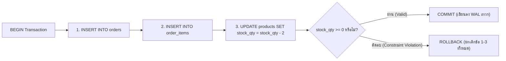

## 1. แนวคิด (Concept)
**ACID** คือคุณสมบัติ 4 ประการที่ฐานข้อมูลระดับ Enterprise อย่าง PostgreSQL 16 ให้คำมั่นสัญญาว่าจะรักษาไว้เสมอในทุกๆ Transaction ลองพิจารณาเมื่อลูกค้าสั่งซื้อเนื้อ Miyazaki Wagyu A5 จำนวน 2 แพ็ก:
1. **Atomicity (ความเป็นหนึ่งเดียว - All or Nothing):** การสร้างใบสั่งซื้อใน `orders`, การเพิ่มรายการใน `order_items`, และการลดจำนวน `stock_qty` ใน `products` ต้องสำเร็จพร้อมกันทั้งหมด หากตอนตัดสต็อกพบว่าเนื้อเหลือแค่ 1 แพ็ก (ไม่พอตัด) คำสั่งสร้างใบสั่งซื้อที่ทำไปก่อนหน้าจะต้องถูกยกเลิกทิ้งทันที
2. **Consistency (ความสอดคล้องตามกฎ):** การทำ Transaction ต้องเปลี่ยนสถานะฐานข้อมูลจากสถานะที่ถูกต้องหนึ่ง ไปสู่อีกสถานะที่ถูกต้องหนึ่งเสมอ โดยไม่ละเมิดกฎใดๆ ที่ตั้งไว้ เช่น กฎ `CHECK (stock_qty >= 0)` หรือกฎ `FOREIGN KEY`
3. **Isolation (การแยกตัวเป็นอิสระ):** ขณะที่ลูกค้าคนที่ 1 กำลังอยู่ในระหว่างขั้นตอนสั่งซื้อและยังไม่ได้ `COMMIT` ลูกค้าคนที่ 2 ที่เข้ามาดูหน้าเว็บในเสี้ยววินาทีเดียวกันจะต้องไม่เห็นข้อมูลที่ยังทำไม่เสร็จครึ่งๆ กลางๆ ของลูกค้าคนที่ 1
4. **Durability (ความคงทนถาวร):** ทันทีที่ฐานข้อมูลตอบกลับว่า `COMMIT` สำเร็จ ต่อให้ปลั๊กไฟของเซิร์ฟเวอร์หลุดหรือเครื่องดับในวินาทีถัดมา ข้อมูลคำสั่งซื้อและการตัดสต็อกของลูกค้ารายนั้นจะต้องไม่สูญหายเด็ดขาดเมื่อเปิดเครื่องกลับมาใหม่



## 2. หลักการเบื้องหลัง (Under the Hood)
PostgreSQL 16 บรรลุคุณสมบัติ ACID ทั้ง 4 ข้อผ่านสถาปัตยกรรมระดับลึกภายใน Engine ดังนี้:
- **Atomicity & Isolation ผ่าน MVCC และ Transaction ID (`xid`):** ทุกครั้งที่ Transaction เริ่มมีการเขียนข้อมูล PostgreSQL จะแจกหมายเลข **Transaction ID (`xid` ขนาด 32-bit/64-bit)** ให้ และบันทึกค่า `xid` ลงในส่วนหัวของแถวที่สร้างใหม่ (`t_xmin`) หรือแถวที่ถูกลบ (`t_xmax`) หาก Transaction สั่ง `ROLLBACK` ระบบเพียงแค่บันทึกสถานะใน **Commit Log (`pg_xact`)** ว่าหมายเลข `xid` นี้ถูกยกเลิก (`ABORTED`) ทำให้ทุก Transaction อื่นเมินเฉยต่อแถวที่มี `xid` นั้นทันทีโดยไม่ต้องเสียเวลาย้อนลบข้อมูลจริง!
- **Durability ผ่าน Write-Ahead Logging (WAL):** ก่อนที่คำสั่ง `COMMIT` จะตอบกลับว่าสำเร็จ PostgreSQL บังคับให้ต้องเขียนบันทึกการเปลี่ยนแปลงลงในไฟล์ **WAL (`pg_wal`)** บนดิสก์แบบเรียงลำดับ (Sequential Append) และสั่ง `fsync()` ลงดิสก์จริงเรียบร้อยเสียก่อน แม้ข้อมูลในตารางหลักที่พักอยู่ใน RAM (`shared_buffers`) จะยังไม่ได้ถูกเขียนลงไฟล์ตาราง แต่หากไฟดับ PostgreSQL จะอ่านไฟล์ WAL มาจำลองเหตุการณ์ซ้ำ (Crash Recovery / Redo) จนข้อมูลกลับมาครบ 100%

## 3. ตัวอย่างโค้ด (Smart Butcher Marketplace)

### ตัวอย่างที่ 1: Transaction พื้นฐานสำหรับการสั่งซื้อเนื้อพรีเมียมและตัดสต็อกแบบ Atomic
แสดงการมัดรวมคำสั่งสร้างออเดอร์ เพิ่มรายการสินค้าย่อย และตัดสต็อกเนื้อให้อยู่ใน Transaction เดียวกัน:

```sql filename="sql/01_acid_order_checkout_basic.sql"
BEGIN;

-- 1. สร้างใบสั่งซื้อใหม่ในตาราง orders
INSERT INTO orders (
    id, user_id, order_number, status, subtotal_amount, shipping_fee, total_amount, shipping_address
) VALUES (
    'd1111111-1111-1111-1111-111111111111',
    'a1111111-1111-1111-1111-111111111111',
    'ORD-20261017-0001',
    'PENDING',
    10400.00,
    150.00,
    10550.00,
    '{"recipient": "เชฟสมชาย", "address": "สุขุมวิท 55 กรุงเทพฯ", "phone": "0812345678"}'::jsonb
);

-- 2. บันทึกรายการเนื้อที่สั่งซื้อพร้อม Snapshot ราคาลงใน order_items
INSERT INTO order_items (
    order_id, product_id, product_name_snapshot, product_sku_snapshot, quantity, unit_price
) VALUES (
    'd1111111-1111-1111-1111-111111111111',
    '8e94fae4-18df-4158-b34e-6e8ebdc5fca1',
    'Miyazaki Wagyu A5 Striploin',
    'WGY-MIYA-A5-STRIP',
    2,
    5200.00
);

-- 3. ตัดสต็อกสินค้าในตาราง products (หากสต็อกเหลือไม่พอให้ตัด จะติด CHECK constraint stock_qty >= 0 และยกเลิกทั้งชุด)
UPDATE products
SET stock_qty = stock_qty - 2,
    updated_at = CURRENT_TIMESTAMP
WHERE id = '8e94fae4-18df-4158-b34e-6e8ebdc5fca1';

COMMIT;
```

### ตัวอย่างที่ 2: การทำ Atomic Checkout & Payment Confirmation ในคำสั่ง CTE หรือ Transaction ขั้นสูง
เมื่อลูกค้าชำระเงินสำเร็จและระบบต้องอัปเดตสถานะทั้งตาราง `payments` และ `orders` ไปพร้อมกันโดยตรวจสอบความตรงกันของยอดเงิน:

```sql filename="sql/02_acid_payment_confirmation.sql"
BEGIN;

-- 1. บันทึกและยืนยันรายการชำระเงินในตาราง payments
INSERT INTO payments (
    order_id, idempotency_key, payment_method, amount, status, provider_tx_id, paid_at
) VALUES (
    'd1111111-1111-1111-1111-111111111111',
    'pay_idem_20261017_0001',
    'PROMPTPAY_QR',
    10550.00,
    'SUCCEEDED',
    'omise_chrg_test_99887766',
    CURRENT_TIMESTAMP
);

-- 2. อัปเดตสถานะใบสั่งซื้อเป็น PAID เฉพาะเมื่อยอดเงินที่ชำระตรงกับ total_amount ของออเดอร์เท่านั้น
UPDATE orders o
SET status = 'PAID',
    updated_at = CURRENT_TIMESTAMP
FROM payments p
WHERE o.id = p.order_id
  AND o.id = 'd1111111-1111-1111-1111-111111111111'
  AND o.status = 'PENDING'
  AND o.total_amount = p.amount;

COMMIT;
```

## 4. ผิด vs ถูก (Anti-pattern vs Best Practice)

| มิติการเปรียบเทียบ | ❌ ผิด (Anti-pattern) | ✅ ถูก (Best Practice) |
| :--- | :--- | :--- |
| **การแยกคำสั่งเขียนที่พึ่งพากัน** | รัน `INSERT INTO orders` และ `UPDATE products` แยกเป็น 2 คิวรีอิสระในโหมด Auto-commit | หุ้มคำสั่งทั้งหมดที่อยู่ในหน่วยธุรกิจเดียวกันไว้ภายใต้ `BEGIN ... COMMIT` เสมอ |
| **การพึ่งพา Application Rollback** | เมื่อขั้นตอนที่ 3 พัง พยายามเขียนโค้ด `DELETE FROM orders WHERE id = ...` เพื่อตามลบข้อมูลที่เพิ่งสร้างเอง | ใช้กลไก `ROLLBACK` ของ Database Transaction ซึ่งสะอาด ปลอดภัย และรับประกันผลลัพธ์ 100% |
| **การปิด `fsync` เพื่อเร่งความเร็ว** | ตั้งค่า `fsync = off` ใน `postgresql.conf` เพื่อให้ Benchmark เร็วขึ้น | เปิด `fsync = on` เสมอใน Production (หากต้องการเร่งความเร็วเฉพาะตาราง Log ที่ไม่สำคัญ ให้ใช้ `synchronous_commit = off` เฉพาะ Session นั้นแทน) |

## 5. ควรใช้เมื่อไหร่ และ ไม่ควรใช้เมื่อไหร่
- **ควรใช้ Transaction หุ้มคำสั่งเสมอเมื่อ:** มีการเปลี่ยนแปลงข้อมูล (`INSERT`, `UPDATE`, `DELETE`) ตั้งแต่ 2 คำสั่งขึ้นไปที่ต้องสำเร็จหรือล้มเหลวพร้อมกัน หรือเมื่อต้องการอ่านข้อมูลมาตรวจสอบแล้วแก้ไขกลับลงไปโดยไม่ให้ค่าเปลี่ยนระหว่างทาง
- **ไม่จำเป็นต้องเปิด `BEGIN ... COMMIT` แบบ Explicit เมื่อ:** รันคำสั่ง SQL เดี่ยวๆ เพียง 1 คำสั่ง (เช่น `UPDATE products SET price_per_kg = 5500 WHERE id = $1;`) เพราะใน PostgreSQL ทุกคำสั่งเดี่ยวๆ จะทำงานเป็น Implicit Transaction (Auto-commit) ที่มีคุณสมบัติ ACID ในตัวเองอยู่แล้ว

## 6. คำถามสัมภาษณ์ (Interview Q&A)
- **Q1: ใน PostgreSQL เมื่อเราสั่ง `ROLLBACK` Transaction ที่เพิ่งทำการ `INSERT` ข้อมูลไปแล้ว 10,000 แถว ทำไมคำสั่ง `ROLLBACK` จึงทำงานเสร็จในเสี้ยววินาที (Instant Rollback) ต่างจากฐานข้อมูลที่ใช้ Undo Log ที่ต้องเสียเวลาไล่ลบข้อมูลย้อนกลับ?**
  - **แนวคำตอบ:** เพราะ PostgreSQL เขียนแถวใหม่ทั้ง 10,000 แถวลงไปในตารางพร้อมประทับตราหมายเลข Transaction ID (`t_xmin = xid`) ของ Transaction นั้นไว้ เมื่อสั่ง `ROLLBACK` ตัว Engine เพียงแค่เปลี่ยนสถานะของหมายเลข `xid` นั้นใน Commit Log (`pg_xact`) เพียงจุดเดียวว่า `ABORTED` เสร็จแล้วตอบกลับทันที! เมื่อ Transaction อื่นมาอ่านพบแถวเหล่านั้นและเช็ค `pg_xact` เห็นว่า `ABORTED` ก็จะข้ามไปทันที ส่วนการเก็บกวาดพื้นที่ของแถวที่ถูกยกเลิกเหล่านั้นจะปล่อยให้เป็นหน้าที่ของ `Autovacuum` ทำอยู่เบื้องหลังในภายหลัง
- **Q2: ตัวอักษร "C" (Consistency) ใน ACID ของฐานข้อมูล ต่างจากคำว่า Consistency ใน CAP Theorem อย่างไร?**
  - **แนวคำตอบ:** Consistency ใน **ACID** หมายถึงการที่ข้อมูลในฐานข้อมูลต้องเป็นไปตามกฎและข้อบังคับที่นิยามไว้ทั้งหมดเสมอ (เช่น `NOT NULL`, `UNIQUE`, `CHECK`, `FOREIGN KEY`, และกฎทางธุรกิจอย่างยอดเงินรวมต้องตรงกัน) ส่วน Consistency ใน **CAP Theorem** (Linearizability) หมายถึงการที่ทุกๆ โหนดในระบบฐานข้อมูลแบบกระจายตัว (Distributed Nodes) มองเห็นข้อมูลเวอร์ชันล่าสุดตรงกันในเวลาเดียวกัน

---
