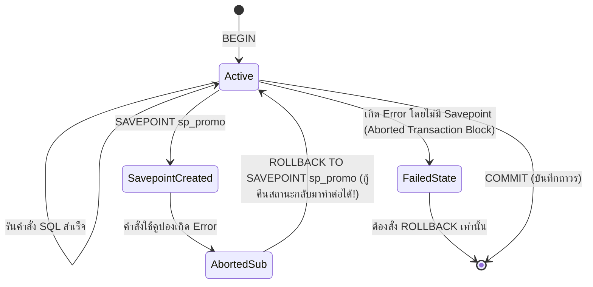

## 1. แนวคิด (Concept)
ในการควบคุมวงจรชีวิตของ Transaction ใน PostgreSQL 16 เราใช้คำสั่งมาตรฐาน 4 คำสั่งหลัก:
1. **`BEGIN` (หรือ `START TRANSACTION`):** เริ่มต้นขอบเขตของ Transaction
2. **`COMMIT`:** ยืนยันการเปลี่ยนแปลงทั้งหมดใน Transaction นั้นให้มีผลถาวรและเปิดให้ Transaction อื่นมองเห็นได้
3. **`ROLLBACK`:** ยกเลิกการเปลี่ยนแปลงทั้งหมดตั้งแต่จุดที่สั่ง `BEGIN`
4. **`SAVEPOINT <name>` และ `ROLLBACK TO SAVEPOINT <name>`:** การปักหมุดจุดเซฟย่อยภายใน Transaction เพื่อให้สามารถย้อนกลับเฉพาะขั้นตอนย่อยที่ล้มเหลวได้โดยไม่ต้องยกเลิกงานทั้งหมดที่ทำสำเร็จไปก่อนหน้า



## 2. หลักการเบื้องหลัง (Under the Hood)
**พฤติกรรมเฉพาะตัวที่สำคัญมากของ PostgreSQL เมื่อเกิด Error ภายใน Transaction:**
ต่างจากบางฐานข้อมูลที่เมื่อคำสั่งที่ 2 เกิด Error แล้วจะยอมให้รันคำสั่งที่ 3 ต่อไปได้ดื้อๆ ใน **PostgreSQL 16 ทันทีที่มีคำสั่ง SQL ใดคำสั่งหนึ่งภายในบล็อก `BEGIN ... COMMIT` เกิด Error (เช่น ติด Unique Constraint หรือหารด้วยศูนย์) ทั้ง Transaction นั้นจะถูกเปลี่ยนสถานะเป็น `Aborted` ทันที!**
หากแอปพลิเคชันพยายามส่งคำสั่ง SQL ถัดไปเข้ามาใน Transaction เดิม PostgreSQL จะปฏิเสธทุกคำสั่งด้วยข้อความ:
`ERROR: current transaction is aborted, commands ignored until end of transaction block`
ทางเดียวที่จะไปต่อได้คือต้องสั่ง `ROLLBACK` ทั้งหมด หรือหากต้องการดักจับ Error เฉพาะจุดเพื่อทำงานต่อ จะต้องปักหมุดด้วย **`SAVEPOINT`** (ซึ่งสร้าง Subtransaction ภายใน) ไว้ก่อนรันคำสั่งที่มีโอกาสพลาด แล้วสั่ง `ROLLBACK TO SAVEPOINT` เพื่อล้างสถานะ Error เฉพาะจุดนั้น!

## 3. ตัวอย่างโค้ด (Smart Butcher Marketplace)

### ตัวอย่างที่ 1: การแสดงพฤติกรรม Aborted Transaction และการจัดการด้วย `BEGIN ... ROLLBACK`
แสดงให้เห็นว่าเมื่อเกิด Constraint Violation ภายใน Transaction ของ PostgreSQL เราต้องสั่ง `ROLLBACK` เพื่อจบชุดคำสั่งอย่างถูกต้อง:

```sql filename="sql/03_transaction_abort_and_rollback.sql"
BEGIN;

-- ขั้นตอนที่ 1: หักสต็อกเนื้อ Ribeye จำนวน 1 ชิ้น (สำเร็จในมุมมองของ Transaction นี้)
UPDATE products
SET stock_qty = stock_qty - 1
WHERE sku = 'WGY-MIYA-A5-STRIP';

-- ขั้นตอนที่ 2: พยายามหักสต็อกเกินจำนวนที่มีอยู่จริง (สมมติสต็อกเหลือ 10 แต่พยายามหัก 999)
-- จะเกิด ERROR: new row for relation "products" violates check constraint "products_stock_qty_check"
UPDATE products
SET stock_qty = stock_qty - 999
WHERE sku = 'WGY-MIYA-A5-STRIP';

-- ณ จุดนี้ Transaction อยู่ในสถานะ Aborted แล้ว แม้จะสั่ง COMMIT ระบบก็จะแปลงเป็น ROLLBACK ให้อัตโนมัติ
ROLLBACK;
-- ผลลัพธ์: สต็อกที่ถูกหักไป 1 ชิ้นในขั้นตอนที่ 1 ถูกคืนกลับมาเท่าเดิม 100%
```

### ตัวอย่างที่ 2: การใช้ `SAVEPOINT` สำหรับการลองใช้คูปองส่วนลดเสริมโดยไม่ทำให้ออเดอร์หลักล่ม
ในการสั่งซื้อเนื้อพรีเมียม หากลูกค้ากรอกรหัสของแถมพิเศษและของแถมหมดสต็อก เราต้องการแค่ยกเลิกการแจกของแถมชิ้นนั้น แต่ยังคงให้การสร้างใบสั่งซื้อเนื้อหลักดำเนินต่อไปได้จนจบ:

```sql filename="sql/04_savepoint_partial_rollback.sql"
BEGIN;

-- 1. สร้างใบสั่งซื้อหลักและตัดสต็อกเนื้อวากิว (งานหลักที่ต้องสำเร็จ)
INSERT INTO orders (id, user_id, order_number, status, subtotal_amount, total_amount, shipping_address)
VALUES (
    'e2222222-2222-2222-2222-222222222222',
    'a1111111-1111-1111-1111-111111111111',
    'ORD-20261017-0002',
    'PENDING',
    5200.00,
    5200.00,
    '{"recipient": "คุณวิภา", "address": "สีลม กรุงเทพฯ"}'::jsonb
);

UPDATE products SET stock_qty = stock_qty - 1 WHERE sku = 'WGY-MIYA-A5-STRIP';

-- 2. ปักหมุด SAVEPOINT ก่อนลองตัดสต็อกของแถม (เกลือหิมาลัยรมควัน) ซึ่งอาจหมดสต็อกได้
SAVEPOINT sp_free_gift;

-- สมมติของแถมชิ้นนี้สต็อกเป็น 0 คำสั่งนี้จะติด CHECK constraint (stock_qty >= 0) และเกิด Error!
UPDATE products SET stock_qty = stock_qty - 1 WHERE sku = 'GIFT-SMOKED-SALT';

-- 3. เมื่อโค้ดตรวจพบ Error จากการตัดของแถม ให้ถอยกลับมายังจุด SAVEPOINT sp_free_gift
ROLLBACK TO SAVEPOINT sp_free_gift;

-- ล้าง Savepoint ที่ไม่ใช้แล้ว และบันทึกออเดอร์เนื้อหลักต่อไปได้ตามปกติ!
RELEASE SAVEPOINT sp_free_gift;

COMMIT;
```

## 4. ผิด vs ถูก (Anti-pattern vs Best Practice)

| มิติการเปรียบเทียบ | ❌ ผิด (Anti-pattern) | ✅ ถูก (Best Practice) |
| :--- | :--- | :--- |
| **การใส่ `try...catch` กลืน Error ใน Transaction** | ดัก `try { await tx.executeRaw(...) } catch {}` ในโค้ดแล้วพยายามรันคำสั่งถัดไปใน `tx` เดิมโดยไม่มี Savepoint | หากต้องเพิกเฉยต่อ Error เฉพาะจุดใน SQL ต้องใช้ `SAVEPOINT` หรือใช้ `ON CONFLICT DO NOTHING` แทน |
| **การสร้าง Savepoint ซ้อนกันในลูปใหญ่** | สร้าง `SAVEPOINT` ในลูป 1,000 รอบโดยไม่สั่ง `RELEASE SAVEPOINT` ทำให้เกิด Subtransaction Overflow | หลีกเลี่ยงการสร้าง Subtransactions ซ้อนกันเกิน 64 ชั้น และสั่ง `RELEASE SAVEPOINT` ทันทีเมื่อผ่านจุดเสี่ยงแล้ว |
| **การลืมปิด Transaction เมื่อเกิด Exception** | เขียน `BEGIN` ด้วยมือบน Connection แล้วเมื่อโค้ดโยน Error ลืมสั่ง `ROLLBACK` ในบล็อก `finally` | ใช้ Managed Transaction API (เช่น `prisma.$transaction`) ที่สั่ง `COMMIT`/`ROLLBACK` ให้อัตโนมัติเสมอ |

## 5. ควรใช้เมื่อไหร่ และ ไม่ควรใช้เมื่อไหร่
- **ควรใช้ `SAVEPOINT` เมื่อ:** มีขั้นตอนเสริมที่เป็นทางเลือก (Optional Step) ภายใน Transaction หลัก ซึ่งหากล้มเหลวเราต้องการกู้คืนเฉพาะจุดนั้นแล้วทำงานหลักต่อไปให้จบ
- **ไม่ควรใช้ `SAVEPOINT` เมื่อ:** สามารถใช้คำสั่ง `INSERT ... ON CONFLICT DO NOTHING` หรือ `ON CONFLICT DO UPDATE` (Upsert) แก้ปัญหาข้อมูลซ้ำได้โดยไม่เกิด Error ตั้งแต่แรก (เพราะ `ON CONFLICT` ไม่สร้าง Subtransaction Overhead เลย)

## 6. คำถามสัมภาษณ์ (Interview Q&A)
- **Q1: ทำไมใน PostgreSQL เมื่อเราเขียนโค้ดดัก `try { await tx.user.create(...) } catch (e) {}` แล้วรันคำสั่งถัดไปภายใต้ตัวแปร Transaction `tx` ตัวเดิม ระบบจึงพังด้วย Error `current transaction is aborted`?**
  - **แนวคำตอบ:** เพราะการดัก `try...catch` ในภาษา TypeScript/JavaScript เป็นเพียงการป้องกันไม่ให้ Exception เด้งหลุดออกจากฟังก์ชันในฝั่ง Application เท่านั้น แต่ในฝั่งของ PostgreSQL Backend Process ทันทีที่คำสั่ง `create` เกิด Error (เช่น อีเมลซ้ำ) สถานะของ Transaction ในฐานข้อมูลได้ถูกเปลี่ยนเป็น `Aborted` ไปเรียบร้อยแล้ว และ PostgreSQL จะไม่ยอมรับคำสั่งใดๆ อีกใน Transaction นั้นจนกว่าจะสั่ง `ROLLBACK` (หรือถ้าจะทำแบบนี้ในระดับ SQL ต้องใช้ `ON CONFLICT` หรือ `SAVEPOINT`)
- **Q2: อันตรายของการใช้ Subtransactions (`SAVEPOINT` หรือ `EXCEPTION` block ใน PL/pgSQL) จำนวนมากภายใต้ระบบที่มี Concurrency สูงคืออะไร?**
  - **แนวคำตอบ:** ใน PostgreSQL แต่ละ Connection มีแคชในหน่วยความจำ (`PGPROC`) สำหรับเก็บหมายเลข Subtransaction ID (`subxid`) ได้จำกัดเพียง **64 รายการต่อ 1 Transaction** หากมีการสร้าง `SAVEPOINT` ซ้อนกันเกิน 64 ครั้งใน Transaction เดียวกัน ระบบจะเกิด状态 **Subtransaction Overflow (`suboverflowed`)** ซึ่งบังคับให้ Transaction อื่นๆ ที่กำลังอ่านข้อมูลต้องไปเปิดอ่านไฟล์สถานะ `pg_subtrans` บนดิสก์/SLRU Buffer แทน ส่งผลให้เกิดการแย่งชิง Lock ระดับระบบและทำให้ประสิทธิภาพฐานข้อมูลตกลงอย่างรุนแรง

---
