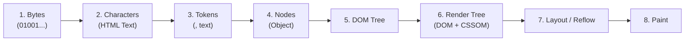

## 1. แนวคิด (Concept)

ในโลกของ HTML องค์ประกอบที่ปรากฏบนหน้าจอจะถูกจัดหมวดหมู่พฤติกรรมการไหล (Flow) เริ่มต้นออกเป็น 2 ประเภทหลัก:
- **Block Elements**: เปรียบเหมือน **"กล่องพัสดุขนาดใหญ่"** ที่กินพื้นที่เต็มความกว้างของหน้าจอ (100% width) และจะขึ้นบรรทัดใหม่เสมอ เช่น `<div>`, `<p>`, `<section>`, `<ul>`, `<h1>`-`<h6>`
- **Inline Elements**: เปรียบเหมือน **"ตัวอักษรหรือคำในประโยค"** ที่กินพื้นที่เฉพาะขนาดของเนื้อหาข้างใน ไม่ขึ้นบรรทัดใหม่ สามารถเรียงต่อกันในแนวนอนได้ เช่น `<span>`, `<a>`, `<strong>`, `<em>`

ส่วน **DOM Tree (Document Object Model)** คือโครงสร้างต้นไม้ในหน่วยความจำที่เบราว์เซอร์แปลงจากข้อความตัวอักษร HTML เพื่อให้ JavaScript และ CSS เข้าไปจัดการเปลี่ยนแปลงได้

---

## 2. หลักการเบื้องหลัง (Under the Hood)

กระบวนการ Critical Rendering Path ที่ Browser แปลง HTML เป็นหน้าจอจริง:



1. **HTML Parsing & Tokenization**: เอนจินจะอ่าน Byte แล้วแปลงเป็น Tokens เมื่อพบแท็กเปิดจะสร้าง Node ใส่เข้าไปในโครงสร้างต้นไม้
2. **Parsing Rules**: ตามมาตรฐาน HTML5 ห้ามนำ Block Element ไปใส่ไว้ข้างใน Inline Element (เช่น `<span><div>...</div></span>`) เบราว์เซอร์จะพยายามซ่อมแซม DOM อัตโนมัติ (DOM Auto-Correction) ซึ่งมักนำไปสู่อาการ Layout พัง หรือ Hydration Mismatch ใน React

---

## 3. ตัวอย่างโค้ด (HTML5)

### ตัวอย่างที่ 1: การวางโครงสร้างการ์ดสินค้าโดยแยก Block และ Inline อย่างถูกต้อง

```html filename="product-card.html"
<!-- <article> เป็น Block Element: กินความกว้างตาม Container -->
<article class="product-card">
  <!-- <h2> เป็น Block Element: หัวข้อขึ้นบรรทัดใหม่เสมอ -->
  <h2 class="product-title">หูฟังตัดเสียงรบกวน Wireless Pro</h2>

  <!-- <p> เป็น Block Element: ย่อหน้าข้อความ -->
  <p class="product-description">
    สัมผัสพลังเสียงคมชัดระดับพรีเมียม 
    <!-- <strong> และ <span> เป็น Inline Elements: ไหลไปตามข้อความในบรรทัดเดียวกัน -->
    พร้อมระบบ <strong class="highlight">Active Noise Cancellation</strong> 
    ในราคาเพียง <span class="price">฿4,990</span> บาท
  </p>

  <!-- <div> เป็น Block Element: ครอบปุ่มแอ็กชัน -->
  <div class="product-actions">
    <button type="button" class="btn-primary">เพิ่มลงตะกร้า</button>
  </div>
</article>
```

### ตัวอย่างที่ 2: พฤติกรรม Box Model ที่ต่างกันของ Inline vs Block

```html filename="box-model-demo.html"
<!-- Block Element: สามารถกำหนด width, height, margin-top/bottom ได้อย่างสมบูรณ์ -->
<div style="width: 250px; height: 100px; margin: 20px 0; background: #e0f2fe;">
  กล่อง Block (กว้าง 250px, สูง 100px)
</div>

<!-- Inline Element: ไม่สามารถกำหนด width, height, หรือ vertical margin ได้ เว้นแต่จะเปลี่ยนเป็น inline-block ใน CSS -->
<span style="width: 250px; height: 100px; margin-top: 50px; background: #fef08a;">
  ข้อความ Inline (width และ margin-top จะไม่ส่งผลใดๆ)
</span>
```

---

## 4. โค้ดที่มักเขียนผิด vs โค้ดที่ถูกต้อง

### ❌ โค้ดที่ผิด: ซ้อน Block Element เข้าไปใน Inline Element

```html
<!-- ผิด: <span> เป็น Inline element ห้ามบรรจุ <div> ซึ่งเป็น Block element -->
<span>
  <div class="user-badge">
    <p>ผู้ดูแลระบบ</p>
  </div>
</span>
```
*ผลกระทบ*: Browser Parsing Engine จะบังคับปิดแท็ก `<span>` ล่วงหน้า ทำให้ DOM Tree ผิดเพี้ยน และหากใช้ใน Next.js/React จะเกิด **Hydration Error** ทันที

### ✅ โค้ดที่ถูกต้อง: ใช้ Block ครอบ Inline หรือเปลี่ยนการแสดงผลผ่าน CSS

```html
<!-- ถูกต้อง: ใช้ Block ครอบ Block และ Inline อยู่ในชั้นที่เหมาะสม -->
<div class="user-badge">
  <span class="badge-label">ผู้ดูแลระบบ</span>
</div>
```

---

## 5. ควรใช้เมื่อไหร่ / ไม่ควรใช้เมื่อไหร่

### Block Elements (`<div>`, `<section>`, `<p>`)
- **ควรใช้**: เมื่อต้องการแบ่งส่วนประกอบหน้าจอ (Layout Division), ต้องการให้ชิ้นส่วนนั้นขึ้นบรรทัดใหม่, หรือต้องการควบคุม Box Model (Margin, Padding, Width, Height)
- **ไม่ควรใช้**: ซ้อนกันโดยไม่มีจุดประสงค์ (Div Soup) หากข้อความเป็นเพียงคำสั้นๆ ในบรรทัดเดียว ควรใช้ Inline element

### Inline Elements (`<span>`, `<strong>`, `<a>`)
- **ควรใช้**: สำหรับจัดรูปแบบคำ วลี หรือลิงก์ที่อยู่ร่วมกับข้อความอื่นในบรรทัดเดียวกัน
- **ไม่ควรใช้**: ห้ามนำไปครอบฟอร์มขนาดใหญ่, ตาราง, หรือเนื้อหาหลายๆ ย่อหน้า

---

## 6. คำถามสัมภาษณ์งาน (Interview Questions)

### Q1: อะไรคือความแตกต่างหลักระหว่าง `display: block`, `display: inline` และ `display: inline-block` ในเชิง Box Model?
**แนวทางคำตอบ**:
- `block`: ขึ้นบรรทัดใหม่เสมอ กินพื้นที่ความกว้าง 100% ของคอนเทนเนอร์ สามารถกำหนด `width`, `height`, `margin` และ `padding` ได้ทุกทิศทาง
- `inline`: อยู่ในบรรทัดเดิมตามการไหลของข้อความ กินพื้นที่ตามเนื้อหาจริง **ไม่สามารถ** กำหนด `width` และ `height` ได้ ส่วน `margin-top` และ `margin-bottom` จะไม่ส่งผลต่อพื้นที่แถว
- `inline-block`: เรียงต่อกันในแนวนอนเหมือน inline แต่มีพฤติกรรม Box Model เหมือน block ทำให้สามารถกำหนด `width`, `height`, `margin` และ `padding` ได้ทุกด้าน

### Q2: จงอธิบายความสัมพันธ์ระหว่าง HTML Source Code, DOM Tree และ Render Tree ในเบราว์เซอร์?
**แนวทางคำตอบ**:
- **HTML Source Code** เป็นเพียงตัวอักษรดิบ (Raw String) ที่ส่งมาจากเซิร์ฟเวอร์
- **DOM Tree** เกิดจากการที่เบราว์เซอร์ Parse ตัวอักษรเหล่านั้นออกมาเป็น Object Hierarchy ในหน่วยความจำ (รวมถึงแท็กที่มองไม่เห็นอย่าง `<head>`, `<script>`)
- **Render Tree** เกิดจากการรวมกันของ DOM Tree และ CSSOM (CSS Object Model) โดยจะตัด Node ที่ซ่อนอยู่หรือไม่ปรากฏบนหน้าจอออกไป (เช่น Node ที่มี `display: none` หรือแท็ก `<meta>`) เพื่อนำไปคำนวณตำแหน่ง (Layout) และระบายสี (Paint) บนหน้าจอต่อไป
