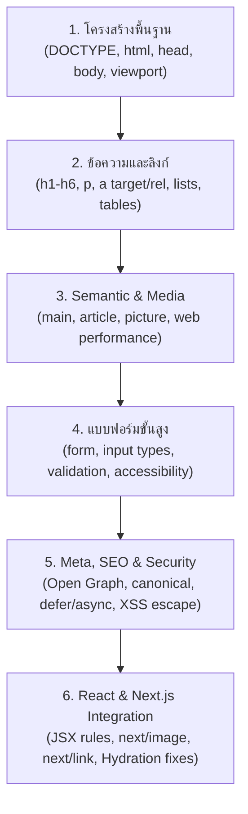

## 1. แนวคิด (Concept)

HTML เป็นภาษาที่เบราว์เซอร์ **"ให้อภัยสูงมาก (Extremely Forgiving)"** แม้คุณจะเขียนโค้ดผิดกฎ ลืมปิดแท็ก หรือวางโครงสร้างเพี้ยน เบราว์เซอร์จะไม่แสดง Error พังแบบ JavaScript แต่จะพยายามคาดเดาและเรนเดอร์สิ่งที่ดีที่สุดออกมาให้

แต่ความใจดีนี้คือ **กับดักที่อันตรายที่สุด** เพราะข้อผิดพลาดเหล่านั้นจะไปทำลาย **Accessibility (ผู้พิการใช้งานไม่ได้)**, **SEO (Google หาเว็บไม่เจอ)**, **Core Web Vitals (เว็บกระตุกช้า)**, และ **Hydration ใน Next.js/React**

การเป็นวิศวกรซอฟต์แวร์ระดับมืออาชีพเริ่มต้นจากการขจัด **5 มหาภัย Anti-patterns** เหล่านี้ให้หมดสิ้น

---

## 2. รวม 5 มหาภัย Anti-Patterns ใน HTML

### 1. ปรากฏการณ์ "Div Soup"
การใช้ `<div>` ครอบทุกอย่างโดยไม่ยอมใช้ `<header>`, `<nav>`, `<main>`, `<article>`, `<section>`, หรือ `<footer>`

### 2. ใช้ `<div>` หรือ `<span>` แทน `<button>`
การใส่ `onClick` ลงบน `<div>` หรือ `<span>` ทำให้ผู้ใช้ที่ควบคุมด้วยคีย์บอร์ดไม่สามารถกดปุ่ม Enter หรือ Spacebar ได้ และ Screen Reader จะไม่อ่านว่าเป็นปุ่ม

### 3. ใช้ Heading (`h1-h6`) เพื่อปรับขนาดตัวหนังสือ
การเลือกแท็ก `<h1>` เพียงเพราะอยากได้ตัวอักษรใหญ่ หรือเลือก `<h4>` เพราะอยากได้ตัวเล็ก ซึ่งทำลายโครงสร้างสารบัญของหน้าเว็บโดยสิ้นเชิง

### 4. การใช้ `id` ซ้ำในหน้าเดียวกัน
`id` ต้องเป็นหนึ่งเดียวในหน้าเสมอ หากมี `id="submit-btn"` ซ้ำกัน 2 ตัว จะทำให้ JavaScript ดึง element ผิดตัว และทำให้ `<label for="...">` ผูกกับ input ช่องแรกช่องเดียวเสมอ

### 5. ลืมใส่ `alt` ในแท็กรูปภาพ
การละเลย `alt` หรือใส่เป็นชื่อไฟล์สุ่ม เช่น `alt="IMG_2026.png"` ทำให้ผู้พิการทางสายตาไม่ทราบว่าภาพนั้นคืออะไร

---

## 3. ตัวอย่างโค้ด: เปรียบเทียบ ผิด vs ถูก

### ตัวอย่างที่ 1: การสร้างปุ่ม (The Button Anti-pattern)

#### ❌ โค้ดที่ผิด: ใช้ `<div>` ทำปุ่ม
```html
<!-- ผิด: กดแท็บมาโฟกัสไม่ได้, กด Enter/Spacebar ไม่ติด, a11y พัง 100% -->
<div class="submit-button" onclick="handleCheckout()">
  ยืนยันคำสั่งซื้อ
</div>
```

#### ✅ โค้ดที่ถูกต้อง: ใช้ Native `<button>`
```html
<!-- ถูกต้อง: รองรับ Keyboard, Tab, Enter, Space และ Screen Reader อัตโนมัติ -->
<button type="button" class="btn-primary" onclick="handleCheckout()">
  ยืนยันคำสั่งซื้อ
</button>
```

### ตัวอย่างที่ 2: การ์ดโปรไฟล์ผู้ใช้ (Div Soup vs Semantic Structure)

#### ❌ โค้ดที่ผิด: Div Soup
```html
<div class="card">
  <div class="header">
    <div class="title">สมชาย สายลุย</div>
    <div class="subtitle">วิศวกรซอฟต์แวร์</div>
  </div>
  <div class="content">
    <div class="text">ชอบเขียนโค้ดและแชร์ความรู้</div>
  </div>
</div>
```

#### ✅ โค้ดที่ถูกต้อง: Semantic Architecture
```html
<article class="user-profile-card">
  <header>
    <h2>สมชาย สายลุย</h2>
    <p class="role-badge">วิศวกรซอฟต์แวร์</p>
  </header>
  <p>ชอบเขียนโค้ดและแชร์ความรู้</p>
</article>
```

---

## 4. Checklist สรุปสิ่งที่ต้องรู้สำหรับ HTML5

- [x] **Document Shell**: มี `<!DOCTYPE html>`, `lang="th"`, `charset="UTF-8"` และ `meta viewport` ครบถ้วน
- [x] **Headings Hierarchy**: มี `<h1>` เพียงตัวเดียว และเรียงลำดับ `h1` → `h2` → `h3` โดยไม่ข้ามขั้น
- [x] **Semantic Landmarks**: มี `<header>`, `<nav>`, `<main>`, `<footer>` อย่างถูกต้อง
- [x] **Form Accessibility**: ทุก `<input>` มี `<label>` ผูกด้วย `id` เสมอ และปุ่มทั่วไปในฟอร์มต้องระบุ `type="button"`
- [x] **Images & CLS**: ระบุ `alt` บรรยายภาพ และมี `width`/`height` เพื่อป้องกันหน้าจอกระตุก
- [x] **External Links**: ใส่ `rel="noopener noreferrer"` เมื่อใช้ `target="_blank"`
- [x] **Performance**: โหลดสคริปต์ด้วย `defer` หรือ `type="module"` เพื่อไม่ให้บล็อกการเรนเดอร์
- [x] **Next.js Synergy**: ใช้ `Link` แทน `<a>` เพื่อทำ SPA, ใช้ `Image` แทน ``, และระวังไม่ให้เกิด Hydration Error จากการซ้อน Block ใน `<p>`

---

## 5. ลำดับขั้นตอนการเรียนรู้ที่แนะนำ (HTML5 Roadmap)



---

## 6. คำถามสัมภาษณ์งานยอดนิยม (Top Interview Questions)

### Q1: ทำไมการใช้ `<div>` และ `<span>` ทำเป็นปุ่มกด (Clickable) ถึงถือเป็น Anti-pattern ร้ายแรงในวงการวิศวกรรมเว็บ?
**แนวทางคำตอบ**: 
มี 4 เหตุผลสำคัญ:
1. **Keyboard Accessibility**: `<div>` ไม่ได้อยู่ใน Tab Sequence ตามธรรมชาติ ทำให้ผู้ใช้คีย์บอร์ดกด Tab เข้ามาโฟกัสไม่ได้ เว้นแต่จะเติม `tabindex="0"` ด้วยตนเอง
2. **Keyboard Event Triggers**: แท็ก `<button>` จะตอบสนองต่อทั้งการคลิกเมาส์, การกดปุ่ม `Enter`, และปุ่ม `Spacebar` อัตโนมัติ ในขณะที่ `<div>` จะดักจับเฉพาะ Event เมาส์คลิกเท่านั้น ทำให้ต้องเขียนโค้ด JavaScript ดักจับ Keyboard Events ซ้ำซ้อน
3. **Accessibility Tree**: Screen Reader จะประกาศว่า `<div>` เป็นข้อความหรือกล่องเปล่า ทำให้ผู้พิการไม่ทราบว่าชิ้นส่วนนี้สามารถกดเพื่อทำรายการได้ (เว้นแต่จะใส่ `role="button"`)
4. **Form Integration**: `<button>` ภายในฟอร์มมีความสามารถในการสั่ง Submit หรือ Reset ฟอร์มในตัว ซึ่ง `<div>` ทำไม่ได้เลย

### Q2: จงอธิบายว่าทำไมหน้าเว็บที่มีโครงสร้าง Semantic HTML ที่ดี ถึงส่งผลดีต่อทั้ง SEO และ Accessibility ไปพร้อมๆ กัน?
**แนวทางคำตอบ**: 
เพราะทั้ง **Search Engine Bots (เช่น Googlebot)** และ **Assistive Technologies (เช่น Screen Readers)** เป็นโปรแกรมคอมพิวเตอร์ที่ "มองไม่เห็นความสวยงามของ CSS" ทั้งสองต้องอาศัยการอ่านโครงสร้างความหมายของ HTML เพียงอย่างเดียว
- เมื่อเราใช้ `<main>`, `<article>`, และลำดับ `<h1>`-`<h6>` ที่ถูกต้อง บอทของ Google จะเข้าใจว่าเนื้อหาหลักและสารบัญของหน้านี้คืออะไร และจัดอันดับได้แม่นยำ
- ในขณะเดียวกัน โปรแกรม Screen Reader ก็จะแปลงโครงสร้างเดียวกันนี้เป็น Accessibility Landmarks และ Heading Tree ให้ผู้พิการสามารถกระโดดข้ามไปยังส่วนสำคัญได้ทันที ดังนั้น การทำ Semantic HTML ที่ถูกต้องจึงเป็นการยิงปืนนัดเดียวได้นกสองตัว ทั้งผู้ใช้ทุกคนและ Search Engines
