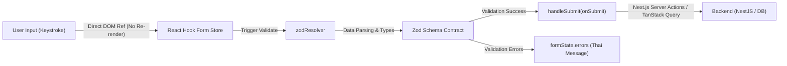

## ภาพรวม React Hook Form + Zod & Enterprise Form Architecture

การจัดการฟอร์ม (Form Handling) ใน React ถือเป็นหนึ่งในจุดที่สร้างปัญหาด้าน **Performance (Re-render)** และ **Code Duplication** มากที่สุด หากใช้วิธีดั้งเดิมอย่าง `useState` แยกทีละ input เมื่อฟอร์มมีขนาด 20-50 ช่อง ทุกการเคาะแป้นพิมพ์จะสั่ง Re-render ทั้งคอมโพเนนต์โดยไม่จำเป็น

การจับคู่กันระหว่าง **React Hook Form (RHF v7)** และ **Zod (Zod 4)** จึงกลายเป็นมาตรฐานทองคำ (Gold Standard) ของระบบ Form Management บน React 19 และ Next.js 16 (App Router):

1. **React Hook Form**: รับหน้าที่บริหารจัดการ State ของ UI Input ด้วย **Uncontrolled Components (Native Refs)** และระบบ **Isolated Micro-subscriptions** ทำให้ Component ไม่ต้อง Re-render ตอนพิมพ์ พิมพ์ลื่นไหลระดับ 60 FPS แม้มีนับร้อยฟิลด์
2. **Zod**: รับหน้าที่เป็น **Single Source of Truth** สำหรับ Data Contract ทั้งหมด โดยทำทั้ง **Static Type Inference (`z.infer`)** ในช่วงคอมไพล์ และ **Runtime Data Validation** ตอนรันไทม์ ป้องกันข้อมูลที่ผิดพลาดรั่วไหลไปยัง Backend
3. **`@hookform/resolvers/zod`**: กาวเชื่อมความสัมพันธ์ที่ส่งค่าฟอร์มไปให้ Zod ทำการ Parsing และแปลงข้อผิดพลาดกลับมาเป็น `formState.errors` ภาษาไทยที่อ่านเข้าใจง่ายทันที

---

## สารบัญหลักสูตร React Hook Form + Zod (Directory)

บทเรียนชุดนี้ถูกออกแบบมาเพื่อเตรียมความพร้อมให้ Senior Fullstack Developer เข้าใจทั้งเบื้องลึก สถาปัตยกรรมระดับ Production การเชื่อมต่อกับ shadcn/ui, TanStack Query, Next.js Server Actions และตอบคำถามสัมภาษณ์งานได้อย่างมั่นใจ:

| หัวข้อ | ลิงก์อ่านเนื้อหา | คำอธิบายสังเขป |
| :--- | :--- | :--- |
| **1. ปัญหาที่สองตัวนี้แก้** | [Problem & Philosophy](/docs/react-hook-form-zod/problems-overview) | วิกฤต `useState` ทีละช่อง, Controlled vs Uncontrolled, ทำไม RHF เร็ว และทำไม Type อย่างเดียวไม่พอ |
| **2. Zod พื้นฐาน** | [Zod Basics & Types](/docs/react-hook-form-zod/zod-basics) | Primitive types, enum, array, optional, default, validation rules, ข้อความ error ภาษาไทย และ Zod 4 syntax |
| **3. Zod ขั้นกลาง** | [Zod Refine & Transform](/docs/react-hook-form-zod/zod-intermediate) | `refine`, `superRefine` (เช็ครหัสผ่านตรงกัน), `transform`, `coerce` (แปลง number/date), union, schema composition |
| **4. z.infer และ Type Safety** | [z.infer & Type Safety](/docs/react-hook-form-zod/type-inference) | อนุมาน Type จาก Schema, `z.input` vs `z.output` เมื่อใช้ transform, ปัญหา Typescript mismatch |
| **5. RHF พื้นฐาน** | [RHF Core Basics](/docs/react-hook-form-zod/rhf-basics) | `useForm`, `register`, `handleSubmit`, `formState` (`errors`, `isDirty`, `isSubmitting`), `defaultValues`, `mode` |
| **6. เชื่อม RHF กับ Zod** | [Connecting with zodResolver](/docs/react-hook-form-zod/rhf-zod-resolver) | `@hookform/resolvers`, การส่ง error จาก Backend สู่ฟอร์มด้วย `setError`, type safety ระดับ field |
| **7. Controller & Custom Inputs** | [Controller & Custom Inputs](/docs/react-hook-form-zod/controller) | `Controller` และ `useController` สำหรับจัดการ Component ที่ไม่รองรับ ref (Select, Switch, DatePicker) |
| **8. Form ของ shadcn/ui** | [shadcn/ui Form Architecture](/docs/react-hook-form-zod/shadcn-form) | แกะสถาปัตยกรรม Form, FormField, FormItem, FormControl, FormMessage, ตัวอย่าง Login & Register สมบูรณ์ |
| **9. ฟอร์มที่ซับซ้อน** | [useFieldArray & Complex Forms](/docs/react-hook-form-zod/complex-nested-arrays) | Dynamic Fields เพิ่ม/ลบสินค้าในออเดอร์, Nested objects, `useWatch`, Multi-step Wizard |
| **10. ฟอร์มแก้ไขข้อมูล** | [Edit Form & State Reset](/docs/react-hook-form-zod/edit-form-reset) | โหลดข้อมูลเก่าผ่าน TanStack Query, การใช้ `reset()`, ป้องกันการทับคีย์ผู้ใช้, ดักจับ `isDirty` เตือนก่อนปิด |
| **11. การส่งข้อมูล (Submission)** | [Submissions & Server Actions](/docs/react-hook-form-zod/submit-server-actions) | TanStack Query `useMutation` ร่วมกับ Sonner, Next.js 16 Server Actions (`useActionState`) และ Shared Zod Schema |
| **12. อัปโหลดไฟล์ในฟอร์ม** | [File Uploads & Validation](/docs/react-hook-form-zod/file-uploads) | Validate MIME type และขนาดไฟล์ด้วย `z.instanceof(File)`, ส่ง FormData ไปยัง NestJS + Multer, Preview |
| **13. Zod นอกฟอร์ม** | [Zod Beyond Forms](/docs/react-hook-form-zod/zod-beyond-forms) | Validate API Response, Environment Variables (t3-env pattern), Shared Schema Fullstack, `safeParse` |
| **14. Accessibility & Form UX** | [Accessibility & Form UX](/docs/react-hook-form-zod/a11y-ux) | WAI-ARIA (`aria-invalid`, `aria-describedby`), `shouldFocusError`, Autocomplete, Disable Submit ป้องกัน Double-click |
| **15. Performance Tuning** | [Performance & Re-renders](/docs/react-hook-form-zod/performance) | Subscription architecture, เจาะลึก `watch` vs `useWatch`, การแยก Sub-form เพื่อคุม Render Scope |
| **16. Testing & Debugging** | [Testing & Debugging](/docs/react-hook-form-zod/testing-debugging) | Unit Test Zod Schema, Component Test ด้วย React Testing Library, React Hook Form DevTools |
| **17. ข้อผิดพลาด & Q&A** | [Pitfalls & Senior Q&A](/docs/react-hook-form-zod/pitfalls) | 7 Anti-patterns ยอดนิยม, Production Readiness Checklist, คำถามสัมภาษณ์งานระดับ Senior พร้อมแนวทางตอบ |
