## 1. แนวคิด (Concept)

การสร้างแบบฟอร์มที่มีคุณภาพระดับ **Enterprise Production** ไม่ได้วัดกันที่ความสวยงามของ CSS หรือ Animation เพียงอย่างเดียว แต่วัดกันที่ **ความสามารถในการเข้าถึงได้ของทุกคน (Accessibility - a11y)** ตามมาตรฐาน **WAI-ARIA (Web Accessibility Initiative - Accessible Rich Internet Applications)** และ **WCAG 2.1 AA**

ผู้ใช้งานระบบของเรามีความหลากหลายสูงมาก ตั้งแต่ผู้ใช้งานที่ใช้เมาส์ทั่วไป, ผู้ใช้งานที่พึ่งพาแป้นพิมพ์อย่างเดียว (Keyboard-only users), ผู้พิการทางสายตาที่ใช้ **Screen Reader** (เช่น NVDA, VoiceOver, JAWS), ตลอดจนผู้ใช้สมาร์ทโฟนที่ต้องพึ่งพา **Browser Autofill** และ **Password Managers** (เช่น 1Password, Bitwarden, Apple Keychain)

หากฟอร์มขาด Attribute สำคัญด้าน Accessibility:
- ผู้ใช้ Screen Reader จะได้ยินเพียง *"Edit text, blank"* โดยไม่รู้ว่าช่องนี้คืออะไร และไม่รู้ว่าทำไมถึงกด Submit ไม่ผ่าน
- Password Manager จะไม่สามารถจำแนกระหว่าง "รหัสผ่านปัจจุบัน" กับ "รหัสผ่านใหม่" ได้
- ผู้ใช้ที่กดปุ่มเร็วๆ อาจส่งคำสั่งซ้ำซ้อน (Double-submit) นำไปสู่การตัดเงินเบิ้ลในระบบการเงิน

### 6 กฎเหล็ก Form Accessibility & UX ใน React Hook Form:

1. **Explicit Label Association**: ทุก Input ต้องมี `<label>` ที่ผูกกันอย่างชัดเจนผ่าน `htmlFor` และ `id`
2. **Error State Announcement**: ระบุสถานะความผิดพลาดให้โปรแกรมช่วยอ่านทราบผ่าน `aria-invalid={!!errors.field}`
3. **Descriptive Association**: เชื่อมโยงคำอธิบายฟิลด์และข้อความ Error เข้ากับ Input ด้วย `aria-describedby`
4. **Intelligent Error Focus (`shouldFocusError`)**: ออโต้โฟกัสเคอร์เซอร์ไปยังฟิลด์แรกที่กรอกผิดทันทีหลังกด Submit
5. **Double-submit Prevention & Accessible Feedback**: สั่ง `disabled={isSubmitting}` บนปุ่ม Submit พร้อมแสดง Loading Spinner ที่มี `role="status"`
6. **Standard Semantic Autocomplete**: ระบุค่า `autoComplete` ให้ตรงกับมาตรฐานสากล เช่น `current-password`, `new-password`, `email`, `tel`, `address-line1`

---

## 2. หลักการเบื้องหลัง (Under the Hood)

### 1. วิธีที่ Accessibility Tree ทำงานร่วมกับ WAI-ARIA

เบราว์เซอร์ไม่ได้ส่ง HTML ตรงๆ ไปให้ Screen Reader แต่อ่าน HTML แล้วสร้างโครงสร้างข้อมูลคู่ขนานที่เรียกว่า **Accessibility Tree (a11y tree)**:

```mermaid
flowchart TD
    subgraph BrowserEngine ["Browser Rendering Engine"]
        DOM["DOM Tree (<input id='email'>)"]
        A11yTree["Accessibility Tree: Role = textbox, Name = 'อีเมลพนักงาน'"]
    end

    subgraph ARIAAttributes ["WAI-ARIA Attributes Binding"]
        AriaInvalid["aria-invalid='true'"]
        AriaDescribedby["aria-describedby='email-desc email-error'"]
    end

    subgraph AssistiveTech ["Assistive Technology (Screen Reader)"]
        VoiceOver["VoiceOver / NVDA"]
        SpeechOutput["🔊 'อีเมลพนักงาน, invalid data, กรุณาระบุอีเมลองค์กร, รูปแบบอีเมลไม่ถูกต้อง'"]
    end

    DOM --> A11yTree
    AriaInvalid --> A11yTree
    AriaDescribedby --> A11yTree
    A11yTree --> VoiceOver --> SpeechOutput
```



เมื่อผู้ใช้เลื่อน Tab เข้ามาที่ช่อง Input:
1. โปรแกรมช่วยอ่านจะค้นหา Label ผ่าน `id` ที่ระบุใน `htmlFor` มาประกาศเป็น **Accessible Name**
2. เมื่อ `aria-invalid="true"` โปรแกรมจะพูดเตือนทันทีว่าข้อมูลในช่องนี้ไม่ถูกต้อง
3. โปรแกรมจะรวบรวมข้อความจาก Element ที่มี ID ตรงกับ `aria-describedby` มารายงานเป็น **Accessible Description** ทำให้ผู้ใช้ทราบเหตุผลทันทีโดยไม่ต้องคลำหาข้อความ Error สีแดงบนหน้าจอ

### 2. กลไก `shouldFocusError` ใน React Hook Form

ภายใน `useForm`:
```typescript
const { register, handleSubmit } = useForm({
  shouldFocusError: true, // ค่าเริ่มต้นคือ true
});
```
เมื่อผู้ใช้กด Submit:
1. RHF ทำการ Validate ข้อมูลร่วมกับ `zodResolver`
2. หากมี Error เกิดขึ้น RHF จะเข้าถึง Internal Ref Registry ที่บันทึกไว้ตอนเราเรียก `register('fieldName')`
3. RHF จะเปรียบเทียบลำดับของ DOM Node ในเอกสาร (Document Order) และค้นหาฟิลด์แรกที่เกิดข้อผิดพลาด
4. RHF เรียกใช้ `ref.focus()` บน Element นั้นโดยอัตโนมัติ ทำให้ผู้ใช้งานไม่ต้องเลื่อนหาจุดผิดด้วยตัวเอง

### 3. Heuristics ของ Password Managers & Browser Autofill

Password Managers (เช่น 1Password, Bitwarden, Chrome Autofill) สแกน DOM โดยพิจารณาจาก `autocomplete`, `name`, และ `type`:
- หากพบ `autocomplete="current-password"` -> จะเสนอ Master Password หรือ รหัสผ่านเดิมที่มีอยู่ใน Vault
- หากพบ `autocomplete="new-password"` -> จะแสดงหน้าต่างสร้างรหัสผ่านสุ่มความปลอดภัยสูง (Strong Password Generator) ให้ผู้ใช้ทันที
- หากใส่ `autocomplete="off"` บนช่องรหัสผ่าน เบราว์เซอร์ยุคใหม่จะเพิกเฉย (Ignore) เพื่อความปลอดภัยของผู้ใช้ แต่การใส่ค่า Semantic ที่ถูกต้องจะช่วยเพิ่มอัตรา Conversion Rate ของการกรอกฟอร์มอย่างมหาศาล

---

## 3. ตัวอย่างโค้ด (TypeScript / TSX)

ตัวอย่างคอมโพเนนต์ฟอร์มเปลี่ยนรหัสผ่านและข้อมูลติดต่อความปลอดภัยสูงระดับ Enterprise:

```tsx filename="components/SecuritySettingsForm.tsx"
'use client';

import React from 'react';
import { useForm } from 'react-hook-form';
import { zodResolver } from '@hookform/resolvers/zod';
import { z } from 'zod';
import { Loader2, AlertCircle, CheckCircle2 } from 'lucide-react';

// 1. กำหนด Zod Schema พร้อมข้อความภาษาไทย
const SecurityFormSchema = z
  .object({
    email: z
      .string()
      .min(1, 'กรุณาระบุอีเมล')
      .email('รูปแบบอีเมลไม่ถูกต้อง กรุณาใช้อีเมลองค์กร เช่น name@company.com'),
    phone: z
      .string()
      .min(1, 'กรุณาระบุเบอร์โทรศัพท์สำหรับรับรหัส OTP')
      .regex(/^0[689]\d{8}$/, 'เบอร์โทรศัพท์ต้องขึ้นต้นด้วย 06, 08, หรือ 09 และมี 10 หลัก'),
    currentPassword: z
      .string()
      .min(1, 'กรุณาระบุรหัสผ่านปัจจุบันเพื่อยืนยันตัวตน'),
    newPassword: z
      .string()
      .min(8, 'รหัสผ่านใหม่ต้องมีความยาวอย่างน้อย 8 ตัวอักษร')
      .regex(/[A-Z]/, 'ต้องประกอบด้วยตัวพิมพ์ใหญ่อย่างน้อย 1 ตัว')
      .regex(/[a-z]/, 'ต้องประกอบด้วยตัวพิมพ์เล็กอย่างน้อย 1 ตัว')
      .regex(/[0-9]/, 'ต้องประกอบด้วยตัวเลขอย่างน้อย 1 ตัว'),
    confirmPassword: z.string().min(1, 'กรุณายืนยันรหัสผ่านใหม่อีกครั้ง'),
  })
  .refine((data) => data.newPassword === data.confirmPassword, {
    message: 'รหัสผ่านใหม่และการยืนยันรหัสผ่านไม่ตรงกัน',
    path: ['confirmPassword'],
  });

type SecurityFormValues = z.infer<typeof SecurityFormSchema>;

export function SecuritySettingsForm() {
  const {
    register,
    handleSubmit,
    formState: { errors, isSubmitting, isSubmitSuccessful },
  } = useForm<SecurityFormValues>({
    resolver: zodResolver(SecurityFormSchema),
    mode: 'onTouched', // Validate ทันทีที่ผู้ใช้ Tab ออกจากช่องเพื่อ Feedback ที่รวดเร็ว
    shouldFocusError: true, // เลื่อนเคอร์เซอร์ไปช่องแรกที่ผิดอัตโนมัติ
    defaultValues: {
      email: '',
      phone: '',
      currentPassword: '',
      newPassword: '',
      confirmPassword: '',
    },
  });

  const onSubmit = async (values: SecurityFormValues) => {
    // จำลองการเรียก API ส่งข้อมูลไปยัง Backend
    await new Promise((resolve) => setTimeout(resolve, 1500));
    console.log('Submitted Payload:', values);
  };

  return (
    <div className="max-w-xl mx-auto p-6 bg-white rounded-xl shadow-md border border-slate-200">
      <header className="mb-6">
        <h1 className="text-2xl font-bold text-slate-900">การตั้งค่าความปลอดภัยของบัญชี</h1>
        <p className="text-sm text-slate-600 mt-1">
          อัปเดตข้อมูลการติดต่อและรหัสผ่านเพื่อปกป้องบัญชีของคุณ
        </p>
      </header>

      {isSubmitSuccessful && (
        <div
          role="status"
          aria-live="polite"
          className="mb-6 p-4 bg-emerald-50 border border-emerald-200 rounded-lg flex items-center gap-3 text-emerald-800 text-sm"
        >
          <CheckCircle2 className="w-5 h-5 flex-shrink-0 text-emerald-600" aria-hidden="true" />
          <span>บันทึกการเปลี่ยนแปลงรหัสผ่านและข้อมูลความปลอดภัยเรียบร้อยแล้ว</span>
        </div>
      )}

      <form onSubmit={handleSubmit(onSubmit)} noValidate className="space-y-6">
        {/* ฟิลด์ อีเมล */}
        <div>
          <label htmlFor="security-email" className="block text-sm font-semibold text-slate-700 mb-1">
            อีเมลสำหรับแจ้งเตือน <span className="text-rose-600" aria-hidden="true">*</span>
          </label>
          <input
            id="security-email"
            type="email"
            autoComplete="email"
            inputMode="email"
            spellCheck={false}
            aria-required="true"
            aria-invalid={!!errors.email}
            aria-describedby={errors.email ? 'security-email-error' : 'security-email-desc'}
            className={`w-full px-3.5 py-2.5 rounded-lg border text-sm transition-colors focus:outline-none focus:ring-2 ${
              errors.email
                ? 'border-rose-400 bg-rose-50/30 text-rose-900 focus:ring-rose-500'
                : 'border-slate-300 bg-white text-slate-900 focus:ring-indigo-500'
            }`}
            {...register('email')}
          />
          <p id="security-email-desc" className="text-xs text-slate-500 mt-1.5">
            เราจะส่งข้อความแจ้งเตือนเมื่อมีการเข้าสู่ระบบจากอุปกรณ์ใหม่
          </p>
          {errors.email && (
            <p
              id="security-email-error"
              role="alert"
              className="text-xs font-medium text-rose-600 mt-1.5 flex items-center gap-1.5"
            >
              <AlertCircle className="w-4 h-4" aria-hidden="true" />
              <span>{errors.email.message}</span>
            </p>
          )}
        </div>

        {/* ฟิลด์ เบอร์โทรศัพท์ */}
        <div>
          <label htmlFor="security-phone" className="block text-sm font-semibold text-slate-700 mb-1">
            เบอร์โทรศัพท์มือถือ (2FA) <span className="text-rose-600" aria-hidden="true">*</span>
          </label>
          <input
            id="security-phone"
            type="tel"
            autoComplete="tel"
            inputMode="tel"
            aria-required="true"
            aria-invalid={!!errors.phone}
            aria-describedby={errors.phone ? 'security-phone-error' : 'security-phone-desc'}
            className={`w-full px-3.5 py-2.5 rounded-lg border text-sm transition-colors focus:outline-none focus:ring-2 ${
              errors.phone
                ? 'border-rose-400 bg-rose-50/30 text-rose-900 focus:ring-rose-500'
                : 'border-slate-300 bg-white text-slate-900 focus:ring-indigo-500'
            }`}
            {...register('phone')}
          />
          <p id="security-phone-desc" className="text-xs text-slate-500 mt-1.5">
            ตัวอย่าง: 0812345678 (ใช้สำหรับยืนยัน OTP เมื่อทำธุรกรรม)
          </p>
          {errors.phone && (
            <p
              id="security-phone-error"
              role="alert"
              className="text-xs font-medium text-rose-600 mt-1.5 flex items-center gap-1.5"
            >
              <AlertCircle className="w-4 h-4" aria-hidden="true" />
              <span>{errors.phone.message}</span>
            </p>
          )}
        </div>

        {/* ฟิลด์ รหัสผ่านปัจจุบัน */}
        <div>
          <label htmlFor="current-password" className="block text-sm font-semibold text-slate-700 mb-1">
            รหัสผ่านปัจจุบัน <span className="text-rose-600" aria-hidden="true">*</span>
          </label>
          <input
            id="current-password"
            type="password"
            autoComplete="current-password"
            aria-required="true"
            aria-invalid={!!errors.currentPassword}
            aria-describedby={errors.currentPassword ? 'current-password-error' : undefined}
            className={`w-full px-3.5 py-2.5 rounded-lg border text-sm transition-colors focus:outline-none focus:ring-2 ${
              errors.currentPassword
                ? 'border-rose-400 bg-rose-50/30 focus:ring-rose-500'
                : 'border-slate-300 focus:ring-indigo-500'
            }`}
            {...register('currentPassword')}
          />
          {errors.currentPassword && (
            <p
              id="current-password-error"
              role="alert"
              className="text-xs font-medium text-rose-600 mt-1.5 flex items-center gap-1.5"
            >
              <AlertCircle className="w-4 h-4" aria-hidden="true" />
              <span>{errors.currentPassword.message}</span>
            </p>
          )}
        </div>

        {/* ฟิลด์ รหัสผ่านใหม่ */}
        <div>
          <label htmlFor="new-password" className="block text-sm font-semibold text-slate-700 mb-1">
            รหัสผ่านใหม่ <span className="text-rose-600" aria-hidden="true">*</span>
          </label>
          <input
            id="new-password"
            type="password"
            autoComplete="new-password"
            aria-required="true"
            aria-invalid={!!errors.newPassword}
            aria-describedby={errors.newPassword ? 'new-password-error' : 'new-password-desc'}
            className={`w-full px-3.5 py-2.5 rounded-lg border text-sm transition-colors focus:outline-none focus:ring-2 ${
              errors.newPassword
                ? 'border-rose-400 bg-rose-50/30 focus:ring-rose-500'
                : 'border-slate-300 focus:ring-indigo-500'
            }`}
            {...register('newPassword')}
          />
          <p id="new-password-desc" className="text-xs text-slate-500 mt-1.5">
            ความยาวอย่างน้อย 8 ตัวอักษร ประกอบด้วยตัวพิมพ์ใหญ่ พิมพ์เล็ก และตัวเลข
          </p>
          {errors.newPassword && (
            <p
              id="new-password-error"
              role="alert"
              className="text-xs font-medium text-rose-600 mt-1.5 flex items-center gap-1.5"
            >
              <AlertCircle className="w-4 h-4" aria-hidden="true" />
              <span>{errors.newPassword.message}</span>
            </p>
          )}
        </div>

        {/* ฟิลด์ ยืนยันรหัสผ่านใหม่ */}
        <div>
          <label htmlFor="confirm-password" className="block text-sm font-semibold text-slate-700 mb-1">
            ยืนยันรหัสผ่านใหม่ <span className="text-rose-600" aria-hidden="true">*</span>
          </label>
          <input
            id="confirm-password"
            type="password"
            autoComplete="new-password"
            aria-required="true"
            aria-invalid={!!errors.confirmPassword}
            aria-describedby={errors.confirmPassword ? 'confirm-password-error' : undefined}
            className={`w-full px-3.5 py-2.5 rounded-lg border text-sm transition-colors focus:outline-none focus:ring-2 ${
              errors.confirmPassword
                ? 'border-rose-400 bg-rose-50/30 focus:ring-rose-500'
                : 'border-slate-300 focus:ring-indigo-500'
            }`}
            {...register('confirmPassword')}
          />
          {errors.confirmPassword && (
            <p
              id="confirm-password-error"
              role="alert"
              className="text-xs font-medium text-rose-600 mt-1.5 flex items-center gap-1.5"
            >
              <AlertCircle className="w-4 h-4" aria-hidden="true" />
              <span>{errors.confirmPassword.message}</span>
            </p>
          )}
        </div>

        {/* ปุ่ม Submit พร้อม Accessible Loading State */}
        <div className="pt-2">
          <button
            type="submit"
            disabled={isSubmitting}
            aria-busy={isSubmitting}
            className="w-full inline-flex items-center justify-center px-5 py-2.5 rounded-lg text-sm font-semibold text-white bg-indigo-600 hover:bg-indigo-700 focus:outline-none focus:ring-2 focus:ring-offset-2 focus:ring-indigo-500 disabled:opacity-60 disabled:cursor-not-allowed transition-all shadow-sm"
          >
            {isSubmitting ? (
              <span className="inline-flex items-center gap-2">
                <Loader2 className="w-4 h-4 animate-spin" aria-hidden="true" />
                <span>กำลังบันทึกข้อมูล...</span>
                <span className="sr-only">กำลังส่งข้อมูลความปลอดภัย กรุณารอสักครู่</span>
              </span>
            ) : (
              'บันทึกการเปลี่ยนแปลง'
            )}
          </button>
        </div>
      </form>
    </div>
  );
}
```

---

## 4. เทียบกับวิธีเดิม

| มิติการประเมิน | ฟอร์มแบบทั่วไป (Inaccessible Form) | ฟอร์มตามมาตรฐาน a11y & UX (WCAG 2.1 AA) |
| :--- | :--- | :--- |
| **การระบุชื่อ Input (Accessible Name)** | ใช้ `<div>` หรือ `<p>` แสดงหัวข้อ Screen Reader จะอ่านว่า *"Edit text blank"* | ใช้ `<label htmlFor={id}>` ผูกมัดแน่นหนา Screen Reader อ่านชื่อช่องถูกต้อง |
| **เมื่อกรอกข้อมูลผิดพลาด** | เปลี่ยนสีกรอบเป็นสีแดงอย่างเดียว (คนตาบอดสีแยกไม่ออก) | มีไอคอน + ข้อความชัดเจน + `aria-invalid="true"` แจ้งเตือนใน a11y tree |
| **การเชื่อมโยงข้อความ Error** | ข้อความลอยอยู่ใต้ input โดยไม่มีความสัมพันธ์เชิงโค้ด | ใช้ `aria-describedby="id-error"` ทำให้อ่านข้อความทันทีที่โฟกัส |
| **หลังกด Submit แล้วมีจุดผิด** | ผู้ใช้ต้องใช้เมาส์ไล่ดูว่าตรงไหนขึ้นสีแดง | RHF ใช้ `shouldFocusError` เลื่อนเคอร์เซอร์ไปจุดผิดแรกทันที |
| **สถานะตอนกำลังส่งข้อมูล** | ปุ่มยังคลิกซ้ำได้ เสี่ยง Duplicate API call | ปิด `disabled={isSubmitting}` + `aria-busy` + Accessible Spinner |
| **การกรอกรหัสผ่าน** | ไม่มี `autoComplete` ทำให้ Password Manager เสนอรหัสสับสน | ระบุ `current-password` และ `new-password` อย่างแม่นยำ |

---

## 5. ผิด vs ถูก (Anti-patterns vs Best Practices)

### 1. การเชื่อมต่อ Label และ Input

```tsx
// ❌ ผิด: ใช้ span หรือ div ทำหน้าที่เป็น label
<div className="font-bold">อีเมลพนักงาน</div>
<input type="text" {...register('email')} />
// ผลลัพธ์: Screen Reader ไม่รู้ว่า input นี้คืออะไร

// ✅ ถูก: ใช้ semantic label ผูก id เสมอ
<label htmlFor="user-email" className="font-bold">อีเมลพนักงาน</label>
<input id="user-email" type="text" {...register('email')} />
```

### 2. การจัดการสถานะ Submit ซ้ำซ้อน (Double Submission)

```tsx
// ❌ ผิด: ไม่ระงับการกดปุ่มระหว่าง submit
<button type="submit">
  {isSubmitting ? 'กำลังส่ง...' : 'ยืนยันการชำระเงิน'}
</button>
// ผลลัพธ์: ผู้ใช้ใจร้อนกดเบิ้ล 3 ครั้ง ส่งคำสั่งตัดเงินไปที่ Backend 3 รอบ!

// ✅ ถูก: ปิดการคลิก และแจ้งสถานะต่อ Assistive Technology
<button
  type="submit"
  disabled={isSubmitting}
  aria-busy={isSubmitting}
>
  {isSubmitting && <Spinner aria-hidden="true" />}
  <span>{isSubmitting ? 'กำลังดำเนินการ...' : 'ยืนยันการชำระเงิน'}</span>
  {isSubmitting && <span className="sr-only">ระบบกำลังประมวลผลธุรกรรม</span>}
</button>
```

### 3. การใช้ `noValidate` บน Form Tag

```tsx
// ❌ ผิด: ปล่อยให้เบราว์เซอร์แสดง Native Validation Tooltip ที่ขัดกับ Zod
<form onSubmit={handleSubmit(onSubmit)}>
// ผลลัพธ์: หน้าตา Popover ของแต่ละเบราว์เซอร์ไม่เหมือนกัน และชนกับ zodResolver

// ✅ ถูก: ใส่ noValidate เพื่อให้ React Hook Form และ Zod ควบคุมข้อความ Error 100%
<form onSubmit={handleSubmit(onSubmit)} noValidate>
```

---

## 6. ควรใช้เมื่อไหร่ / ไม่ควรใช้เมื่อไหร่

### ควรใช้:
- **ทุกระบบและทุกฟอร์มในโลกจริง**: Accessibility ไม่ใช่ฟีเจอร์เสริมหรือของแถม แต่เป็นข้อกำหนดพื้นฐาน (Baseline Requirement) สำหรับซอฟต์แวร์ระดับมืออาชีพ
- **ระบบ Enterprise, E-Commerce, ฟินเทค, และบริการสาธารณะ**: องค์กรระดับสากลมีข้อบังคับทางกฎหมาย (เช่น European Accessibility Act หรือ Section 508 ในสหรัฐฯ) ที่ต้องปฏิบัติตาม WCAG 2.1 AA
- **ฟอร์มที่ต้องการ Conversion Rate สูง**: การใส่ `autoComplete` ที่ถูกต้องจะช่วยลดระยะเวลาในการกรอกฟอร์มลงได้มากกว่า 30-50%

### ข้อควรระวัง (สิ่งที่ไม่ควรทำ):
- **ห้ามใส่ `aria-live="assertive"` กับฟิลด์ทั่วไป**: เพราะจะไปขัดจังหวะการอ่านของ Screen Reader อย่างก้าวร้าว ควรใช้ `role="alert"` หรือ `aria-live="polite"`
- **ห้ามใส่ `placeholder` แทน `label`**: เมื่อผู้ใช้เริ่มพิมพ์ ตัวอักษร Placeholder จะหายไป ทำให้ผู้ใช้ที่มีสมาธิสั้นหรือผู้สูงอายุลืมว่าตนเองกำลังกรอกอะไรอยู่

---

## 7. คำถามสัมภาษณ์งาน (Interview Questions)

### Q1: "ในการทำฟอร์มด้วย React Hook Form เราจะออกแบบฟอร์มอย่างไรให้ผ่านมาตรฐาน WCAG 2.1 AA ด้าน Form Accessibility?"

**แนวทางคำตอบระดับ Senior:**
> "เพื่อให้ฟอร์มผ่านมาตรฐาน WCAG 2.1 AA เราต้องครอบคลุม 5 เสาหลักตามข้อกำหนด WAI-ARIA ครับ:
>
> 1. **Perceivable (Accessible Name & Association)**: ทุก Input ต้องมี `<label>` ที่สัมพันธ์กันผ่านคู่แอตทริบิวต์ `htmlFor` และ `id` ห้ามใช้ `placeholder` แทน Label เด็ดขาด
> 2. **Operable (Keyboard Navigation & Focus Management)**: รองรับการนำทางด้วยคีย์บอร์ดทั้งหมดผ่านปุ่ม Tab และ Enter และเปิดใช้งาน `shouldFocusError: true` ใน React Hook Form เพื่อให้เคอร์เซอร์เลื่อนไปโฟกัสที่ช่องแรกที่กรอกผิดโดยอัตโนมัติเมื่อกด Submit
> 3. **Understandable (Error Identification & Suggestions)**: เมื่อเกิดข้อผิดพลาด ต้องระบุ `aria-invalid="true"` บน input นั้นๆ และใช้ `aria-describedby` ชี้ไปยัง ID ของข้อความ Error เพื่อให้ Screen Reader ประกาศคำอธิบายความผิดพลาดและแนวทางแก้ไขทันที
> 4. **Robust (Form Submissions & Dynamic States)**: จัดการสถานะ `isSubmitting` อย่างรอบคอบด้วยการใส่ `disabled` และ `aria-busy="true"` บนปุ่ม Submit พร้อมใส่ข้อความ `sr-only` เพื่อแจ้งให้ผู้ใช้ทราบว่าระบบกำลังโหลด
> 5. **Input Assistance**: กำหนด `autoComplete` attributes ให้ถูกต้องตาม HTML5 Spec เพื่อให้เบราว์เซอร์และเครื่องมือช่วยจำรหัสผ่านกรอกข้อมูลได้อย่างราบรื่นครับ"

---

### Q2: "ทำไมการตั้งค่า `autocomplete=\"off\"` ในช่องรหัสผ่านหรือที่อยู่ปัจจุบันถึงเป็น Anti-pattern ร้ายแรง และเราควรจัดการ autocomplete attributes อย่างไร?"

**แนวทางคำตอบระดับ Senior:**
> "การใส่ `autocomplete=\"off\"` บนช่องรหัสผ่านถือเป็น Anti-pattern ด้วย 3 เหตุผลหลักครับ:
>
> 1. **Browser Override**: เบราว์เซอร์สมัยใหม่เกือบทั้งหมด (Chrome, Safari, Firefox, Edge) เพิกเฉยต่อคำสั่ง `autocomplete=\"off\"` บนฟิลด์รหัสผ่านและข้อมูล Login อยู่แล้ว เนื่องจากข้อกังวลด้านความปลอดภัย
> 2. **ทุบทำลาย User Security**: การขัดขวาง Password Manager ทำให้ผู้ใช้ไม่สามารถบันทึกหรือสุ่มรหัสผ่านที่มีความซับซ้อน (Strong Passwords) ได้ ผู้ใช้จึงถูกบีบให้ตั้งรหัสผ่านสั้นๆ และใช้รหัสผ่านซ้ำเดิม ซึ่งเป็นความเสี่ยงต่อการโดน Credential Stuffing Attack
> 3. **สูญเสียบริบทเชิงความหมาย (Semantics)**: แนวทางที่ถูกต้องตามมาตรฐาน W3C คือการประกาศเจตนาของฟิลด์อย่างตรงไปตรงมา เช่น:
>    - ใช้ `autocomplete=\"current-password\"` สำหรับหน้าล็อกอิน เพื่อให้เครื่องมือดึงรหัสผ่านเดิมมากรอก
>    - ใช้ `autocomplete=\"new-password\"` สำหรับหน้าลงทะเบียนหรือเปลี่ยนรหัสผ่าน เพื่อเปิดใช้งานฟีเจอร์ Password Generator
>    - ใช้ `autocomplete=\"one-time-code\"` สำหรับช่อง OTP SMS
>
> การจัดการอย่างถูกต้องจึงเป็นการยกระดับทั้ง Security และ User Experience ไปพร้อมๆ กันครับ"
