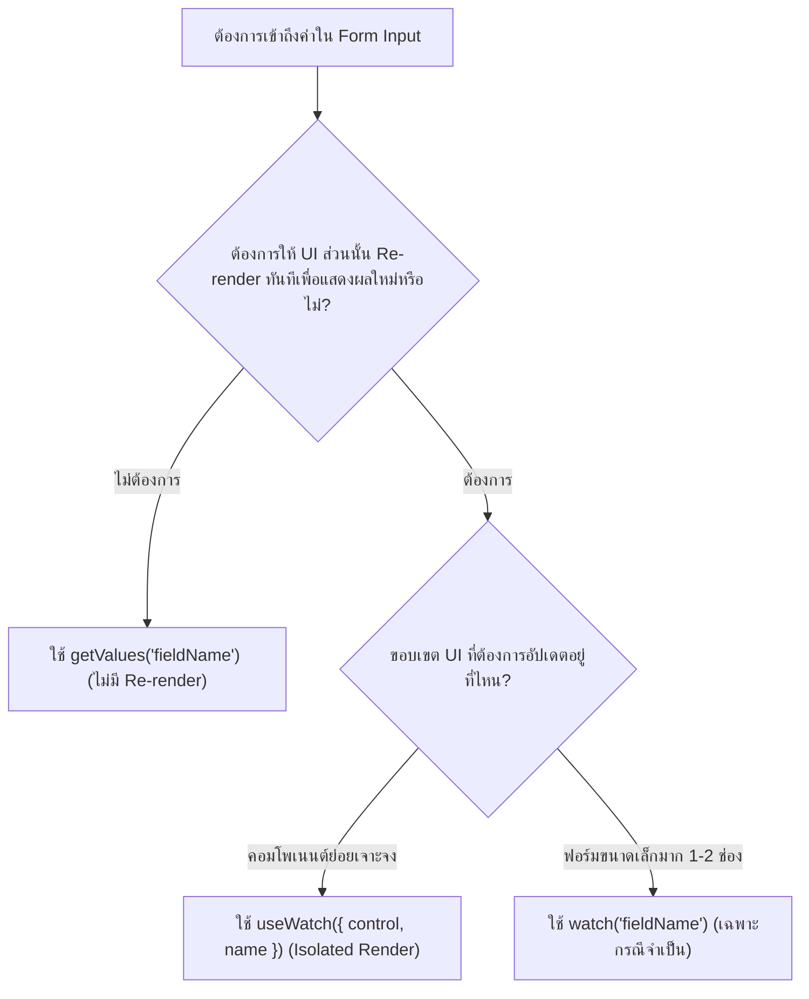

## 1. แนวคิด (Concept)

สาเหตุอันดับหนึ่งที่ทำให้ฟอร์มใน React มีอาการหน่วง กระตุก (Typing Latency) หรือพัดลมระบายความร้อนของเครื่องทำงานหนัก คือ **"Unnecessary Re-renders"**

เมื่อใช้งานฟอร์มแบบดั้งเดิม (Controlled Components ผ่าน `useState` หรือ Formik) ทุกครั้งที่ผู้ใช้เคาะแป้นพิมพ์แม้แต่ตัวอักษรเดียว:
1. ค่าใน State จะถูกอัปเดต
2. Root Component จะถูกสั่ง Re-render
3. Virtual DOM ทั้งหน้าจะถูกประมวลผลใหม่ (Reconciliation)
4. Child Components ทั้งหมดจะถูกรันซ้ำ แม้จะไม่ได้เกี่ยวข้องกับฟิลด์นั้นเลย

**React Hook Form (RHF v7)** ถูกออกแบบมาเพื่อทำลายข้อจำกัดนี้โดยสิ้นเชิงผ่านสถาปัตยกรรม **Uncontrolled Components + Native DOM Refs** และ **Isolated Micro-subscriptions** ทำให้ Component ไม่ต้อง Re-render ตอนพิมพ์เลยแม้แต่ครั้งเดียว สามารถรักษาอัตราเฟรมเรตได้ที่ **60-120 FPS** อย่างลื่นไหล

อย่างไรก็ตาม มี **"ภัยเงียบ (Silent Performance Killer)"** ที่นักพัฒนาจำนวนมากเผลอทำโดยไม่รู้ตัว นั่นคือการเรียกใช้:
```tsx
const formValues = watch(); // ❌ ภัยเงียบทำลาย Performance ที่ Root Component!
```
การเรียก `watch()` โดยไม่ระบุเจาะจงที่คอมโพเนนต์หลัก จะทำให้ RHF สั่ง Re-render ทั้งคอมโพเนนต์ทุกครั้งที่ค่าใดๆ ในฟอร์มเปลี่ยน ซึ่งลบล้างข้อดีทั้งหมดของ RHF ไปทันที

บทความนี้จะเจาะลึกสถาปัตยกรรมเบื้องหลังของ RHF, การกู้คืนประสิทธิภาพด้วย `useWatch`, และกลยุทธ์การจัดการฟอร์มขนาดใหญ่ระดับ Enterprise (100-1,000 ช่อง) ด้วย Sub-forms และ Virtualization

---

## 2. หลักการเบื้องหลัง (Under the Hood)

### 1. เปรียบเทียบวงรอบการทำงาน: Controlled vs RHF Uncontrolled

```mermaid
flowchart TD
    subgraph ControlledFlow ["แบบดั้งเดิม (useState / Formik)"]
        A1["ผู้ใช้เคาะแป้นพิมพ์ 'A'"] --> B1["onChange Handler ทำงาน"]
        B1 --> C1["setState(newValue)"]
        C1 --> D1["Root Component สั่ง Re-render"]
        D1 --> E1["Reconciliation (Diffing Virtual DOM ทั้งต้น)"]
        E1 --> F1["Real DOM Paint (เกิดความหน่วงสะสมสะเทือนทั้งหน้า)"]
    end

    subgraph UncontrolledFlow ["สถาปัตยกรรม React Hook Form (RHF)"]
        A2["ผู้ใช้เคาะแป้นพิมพ์ 'A'"] --> B2["เบราว์เซอร์อัปเดต Native Input DOM ทันที"]
        B2 --> C2["RHF ดักฟังผ่าน Event Listener บน DOM Ref"]
        C2 --> D2["อัปเดตค่าลงใน Internal Mutable Store (ไม่มี React Re-render!)"]
        D2 --> E2["ลื่นไหลระดับ Native Speed 60-120 FPS"]
    end
```



### 2. Isolated Proxy Subscriptions

RHF ไม่ได้ใช้ State ธรรมดาในการเก็บข้อมูลฟอร์ม แต่เก็บไว้ใน **Internal Ref Store** และใช้ **JavaScript `Proxy`** ในการสังเกตการณ์ว่า Component มีการอ่านค่า Property ใดของ `formState` หรือไม่:

```typescript
const {
  formState: { isDirty }, // RHF รู้ว่า Component นี้สนใจเฉพาะ 'isDirty'
} = useForm();
```
- หากค่า `errors` เปลี่ยน แต่ Component ไม่ได้เรียกใช้ `formState.errors` -> RHF **จะไม่สั่ง Re-render Component นั้น**
- หากค่า `isSubmitting` เปลี่ยน -> Component จะ Re-render เฉพาะเมื่อมีการอ่านค่า `isSubmitting` เท่านั้น

### 3. กลไกของ `useWatch` (Observer Pattern ผ่าน Custom Subject)

```mermaid
flowchart TD
    Store["RHF Control (Internal Subject / Event Bus)"]

    subgraph RootComponent ["Root Form Component (ไม่ต้อง Re-render)"]
        FormRoot["<form> ... </form>"]
    end

    subgraph IndependentInputs ["Inputs ทั่วไป (Uncontrolled)"]
        Input1["<input {...register('firstName')} />"]
        Input2["<input {...register('lastName')} />"]
    end

    subgraph IsolatedSubComponent ["Isolated Child Component"]
        WatchHook["useWatch({ control, name: 'planType' })"]
        DynamicUI["แสดงผลเฉพาะราคาแพ็กเกจที่เลือก"]
    end

    Input1 -.->|พิมพ์ข้อความ| Store
    Input2 -.->|พิมพ์ข้อความ| Store
    Store -->|"ยิง Notification เฉพาะเมื่อ 'planType' เปลี่ยน"| WatchHook
    WatchHook --> DynamicUI
```



เมื่อใช้ `useWatch({ control, name: 'planType' })`:
- Hook ตัวนี้จะลงทะเบียน (Subscribe) ตัวเองเข้ากับ Observable Subject ภายใน RHF
- เมื่อผู้ใช้แก้ไขช่อง `firstName` หรือ `lastName` -> RHF จะไม่ส่งสัญญาณใดๆ ไปยัง Component ที่ถือ `useWatch`
- เมื่อผู้ใช้เปลี่ยนค่าในช่อง `planType` -> RHF จะสั่ง Re-render **เฉพาะ Sub-component ย่อยนั้นจุดเดียว** โดยที่ Root Form Component ด้านบนไม่ขยับเลยแม้แต่น้อย

---

## 3. ตัวอย่างโค้ด (TypeScript / TSX)

### ตัวอย่าง: Enterprise Quotation Form (ระบบคำนวณใบเสนอราคาและส่วนลดแบบ Real-time)

ในฟอร์มนี้ มีข้อมูลลูกค้ากว่า 20 ช่อง และมีส่วนคำนวณราคาแบบสดๆ (Live Preview)

#### 1. Schema กำหนดสัญญาราคาและส่วนลด

```typescript filename="schemas/quotation-schema.ts"
import { z } from 'zod';

export const QuotationSchema = z.object({
  customerName: z.string().min(1, 'กรุณาระบุชื่อลูกค้า'),
  taxId: z.string().length(13, 'เลขประจำตัวผู้เสียภาษีต้องมี 13 หลัก'),
  companyAddress: z.string().min(1, 'กรุณาระบุที่อยู่'),
  contactEmail: z.string().email('กรุณาระบุอีเมลที่ถูกต้อง'),
  billingNote: z.string().optional(),
  // ข้อมูลสินค้าที่ต้องการคำนวณ
  subscriptionTier: z.enum(['STARTER', 'PROFESSIONAL', 'ENTERPRISE']),
  seatsCount: z.coerce.number().int().min(1, 'ต้องมีจำนวนอย่างน้อย 1 ที่นั่ง'),
  appliedCoupon: z.string().optional(),
});

export type QuotationFormValues = z.infer<typeof QuotationSchema>;
```

#### 2. Root Component: ไม่มี Re-render ตอนพิมพ์

```tsx filename="components/QuotationForm.tsx"
'use client';

import React, { useRef } from 'react';
import { useForm } from 'react-hook-form';
import { zodResolver } from '@hookform/resolvers/zod';
import { QuotationSchema, type QuotationFormValues } from '@/schemas/quotation-schema';
import { QuotationPriceSummary } from './QuotationPriceSummary';

export function QuotationForm() {
  const renderCounter = useRef(0);
  renderCounter.current += 1;

  const {
    register,
    handleSubmit,
    control,
    formState: { errors, isSubmitting },
  } = useForm<QuotationFormValues>({
    resolver: zodResolver(QuotationSchema),
    defaultValues: {
      customerName: '',
      taxId: '',
      companyAddress: '',
      contactEmail: '',
      billingNote: '',
      subscriptionTier: 'STARTER',
      seatsCount: 5,
      appliedCoupon: '',
    },
  });

  const onSubmit = async (data: QuotationFormValues) => {
    console.log('Quotation Submitted:', data);
  };

  return (
    <div className="max-w-4xl mx-auto p-6 bg-white rounded-xl shadow-md border border-slate-200">
      <div className="flex justify-between items-center mb-6 border-b pb-4">
        <div>
          <h2 className="text-xl font-bold text-slate-900">สร้างใบเสนอราคาองค์กร</h2>
          <p className="text-sm text-slate-500">กรอกข้อมูลลูกค้าและกำหนดแพ็กเกจระบบ</p>
        </div>
        {/* Render Badge แสดงให้เห็นว่า Root ไม่ Re-render เมื่อพิมพ์ */}
        <span className="px-3 py-1 bg-amber-100 text-amber-900 text-xs font-semibold rounded-full">
          Root Render Count: {renderCounter.current}
        </span>
      </div>

      <form onSubmit={handleSubmit(onSubmit)} className="space-y-6">
        <div className="grid grid-cols-1 md:grid-cols-2 gap-4">
          <div>
            <label className="block text-sm font-semibold text-slate-700 mb-1">ชื่อบริษัท / ลูกค้า</label>
            <input
              type="text"
              className="w-full px-3 py-2 border rounded-lg"
              {...register('customerName')}
            />
            {errors.customerName && <p className="text-xs text-rose-600 mt-1">{errors.customerName.message}</p>}
          </div>

          <div>
            <label className="block text-sm font-semibold text-slate-700 mb-1">เลขประจำตัวผู้เสียภาษี (13 หลัก)</label>
            <input
              type="text"
              className="w-full px-3 py-2 border rounded-lg"
              {...register('taxId')}
            />
            {errors.taxId && <p className="text-xs text-rose-600 mt-1">{errors.taxId.message}</p>}
          </div>

          <div>
            <label className="block text-sm font-semibold text-slate-700 mb-1">อีเมลผู้ประสานงาน</label>
            <input
              type="email"
              className="w-full px-3 py-2 border rounded-lg"
              {...register('contactEmail')}
            />
            {errors.contactEmail && <p className="text-xs text-rose-600 mt-1">{errors.contactEmail.message}</p>}
          </div>

          <div>
            <label className="block text-sm font-semibold text-slate-700 mb-1">แพ็กเกจระบบ</label>
            <select className="w-full px-3 py-2 border rounded-lg bg-white" {...register('subscriptionTier')}>
              <option value="STARTER">Starter ($29 / ที่นั่ง)</option>
              <option value="PROFESSIONAL">Professional ($79 / ที่นั่ง)</option>
              <option value="ENTERPRISE">Enterprise ($149 / ที่นั่ง)</option>
            </select>
          </div>

          <div>
            <label className="block text-sm font-semibold text-slate-700 mb-1">จำนวนที่นั่ง (Seats)</label>
            <input
              type="number"
              min="1"
              className="w-full px-3 py-2 border rounded-lg"
              {...register('seatsCount')}
            />
            {errors.seatsCount && <p className="text-xs text-rose-600 mt-1">{errors.seatsCount.message}</p>}
          </div>

          <div>
            <label className="block text-sm font-semibold text-slate-700 mb-1">โค้ดส่วนลด (Coupon)</label>
            <input
              type="text"
              placeholder="เช่น VIP2026"
              className="w-full px-3 py-2 border rounded-lg uppercase"
              {...register('appliedCoupon')}
            />
          </div>
        </div>

        {/* Sub-component ที่แยกการคำนวณราคาออกไปเฉพาะจุด */}
        <QuotationPriceSummary control={control} />

        <div className="flex justify-end pt-4">
          <button
            type="submit"
            disabled={isSubmitting}
            className="px-6 py-2.5 bg-indigo-600 hover:bg-indigo-700 text-white font-medium rounded-lg disabled:opacity-50"
          >
            {isSubmitting ? 'กำลังประมวลผล...' : 'ออกใบเสนอราคา'}
          </button>
        </div>
      </form>
    </div>
  );
}
```

#### 3. Isolated Sub-component: Re-render เฉพาะเมื่อฟิลด์ราคาเปลี่ยน

```tsx filename="components/QuotationPriceSummary.tsx"
'use client';

import React, { useRef } from 'react';
import { useWatch, type Control } from 'react-hook-form';
import type { QuotationFormValues } from '@/schemas/quotation-schema';

interface QuotationPriceSummaryProps {
  control: Control<QuotationFormValues>;
}

const TIER_PRICES: Record<string, number> = {
  STARTER: 29,
  PROFESSIONAL: 79,
  ENTERPRISE: 149,
};

export function QuotationPriceSummary({ control }: QuotationPriceSummaryProps) {
  const renderCounter = useRef(0);
  renderCounter.current += 1;

  // Subscribe เฉพาะ subscriptionTier, seatsCount, และ appliedCoupon
  const [tier, seats, coupon] = useWatch({
    control,
    name: ['subscriptionTier', 'seatsCount', 'appliedCoupon'],
  });

  const pricePerSeat = TIER_PRICES[tier || 'STARTER'] || 29;
  const validSeats = Number(seats) > 0 ? Number(seats) : 1;
  const subtotal = pricePerSeat * validSeats;
  const discountRate = coupon?.toUpperCase() === 'VIP2026' ? 0.2 : 0;
  const discountAmount = subtotal * discountRate;
  const grandTotal = subtotal - discountAmount;

  return (
    <div className="p-4 bg-slate-50 rounded-xl border border-slate-200 mt-6">
      <div className="flex justify-between items-center mb-3">
        <h3 className="text-sm font-bold text-slate-800">สรุปการคำนวณราคา (Live Calculation)</h3>
        <span className="px-2.5 py-0.5 bg-emerald-100 text-emerald-800 text-xs font-semibold rounded-full">
          Price Panel Render Count: {renderCounter.current}
        </span>
      </div>

      <div className="space-y-1.5 text-sm">
        <div className="flex justify-between text-slate-600">
          <span>ราคาต่อที่นั่ง ({tier}):</span>
          <span className="font-mono">${pricePerSeat}.00</span>
        </div>
        <div className="flex justify-between text-slate-600">
          <span>จำนวนที่นั่ง:</span>
          <span className="font-mono">{validSeats} ที่นั่ง</span>
        </div>
        <div className="flex justify-between text-slate-600">
          <span>ยอดรวมก่อนหักส่วนลด:</span>
          <span className="font-mono">${subtotal.toFixed(2)}</span>
        </div>
        {discountRate > 0 && (
          <div className="flex justify-between text-emerald-600 font-medium">
            <span>ส่วนลดพิเศษ ({coupon}):</span>
            <span className="font-mono">-${discountAmount.toFixed(2)} (20%)</span>
          </div>
        )}
        <div className="border-t pt-2 mt-2 flex justify-between text-base font-bold text-slate-900">
          <span>ยอดชำระสุทธิโดยประมาณ:</span>
          <span className="font-mono text-indigo-600">${grandTotal.toFixed(2)}</span>
        </div>
      </div>
    </div>
  );
}
```

---

## 4. เทียบกับวิธีเดิม

| สถาปัตยกรรม | วงจรการ Re-render ต่อการพิมพ์ 1 ตัวอักษร | ความเร็วการพิมพ์ (Typing Latency) | การกินหน่วยความจำ (Memory Pressure) |
| :--- | :--- | :--- | :--- |
| **`useState` ต่อ Input** | Re-render Component นั้น แต่ถ้าส่ง State ขึ้น Parent จะกระทบทั้งหน้า | ปานกลาง หากฟอร์มใหญ่จะเริ่มมีอาการพิมพ์แล้วหน่วง (30-40 ms) | สูง จากการสร้าง Closure ฟังก์ชันใหม่ทุกรอบ |
| **Formik / Redux Form** | Re-render ทุก Component ที่เชื่อมต่อกับ Formik Context | ตกต่ำมาก (15-25 FPS ในฟอร์ม 40+ ช่อง) เกิด INP Warning | สูงมาก มี Garbage Collection ถี่ |
| **RHF + `watch()` ที่ Root** | ❌ Re-render ทั้ง Form Component **(ทำลายข้อดีของ RHF โดยสิ้นเชิง)** | ช้าเทียบเท่ากับ Controlled Form ทั่วไป | สูง |
| **RHF Uncontrolled + `useWatch` ย่อย** | 🌟 **0 Re-renders ที่ Root Component** Re-render เฉพาะ Child Component ที่ต้องการผลลัพธ์ | **สูงสุด (60-120 FPS Native Speed)** Latency ต่ำกว่า 2 ms | ต่ำที่สุด |

---

## 5. ผิด vs ถูก (Anti-patterns vs Best Practices)

### 1. การดึงค่าฟอร์มมาแสดง Badge ที่ Header

```tsx
// ❌ ผิด: สั่ง watch() ที่ Root Component เพื่อเอาค่าไปแสดง badge เล็กๆ
export function OrderPage() {
  const { register, watch } = useForm();
  const allValues = watch(); // ทุกครั้งที่พิมพ์ช่องใดก็ตาม OrderPage และลูกๆ ทั้งหมด Re-render ทันที!

  return (
    <div>
      <header>จำนวนสินค้าที่เลือก: {allValues.items?.length || 0}</header>
      <BigFormSection register={register} />
    </div>
  );
}

// ✅ ถูก: สกัด Badge ออกเป็นคอมโพเนนต์ย่อยแล้วใช้ useWatch
function ItemCountBadge({ control }: { control: Control<FormValues> }) {
  const items = useWatch({ control, name: 'items' });
  return <span>จำนวนสินค้าที่เลือก: {items?.length || 0}</span>;
}

export function OrderPage() {
  const { register, control } = useForm();
  return (
    <div>
      <header><ItemCountBadge control={control} /></header>
      <BigFormSection register={register} />
    </div>
  );
}
```

### 2. การอ่านค่าตอนกดปุ่ม Submit หรือ Event Callback

```tsx
// ❌ ผิด: ใช้ watch() เพียงเพราะต้องการอ่านค่าไปยิง Analytics ตอนกดปุ่ม
const { watch } = useForm();
const handleAnalytics = () => {
  const currentEmail = watch('email'); // ทำให้ Component เสี่ยง Re-render พร่ำเพรื่อ
  analytics.track('click', { email: currentEmail });
};

// ✅ ถูก: ใช้ getValues() สำหรับการอ่านค่าแบบ One-off Snapshot โดยไม่ทำให้เกิด Re-render
const { getValues } = useForm();
const handleAnalytics = () => {
  const currentEmail = getValues('email'); // ดึงค่าจาก DOM Ref ตรงๆ ไม่ Re-render!
  analytics.track('click', { email: currentEmail });
};
```

---

## 6. ควรใช้เมื่อไหร่ / ไม่ควรใช้เมื่อไหร่

### การเลือกใช้ฟังก์ชันอ่านค่าใน RHF:



### การจัดการฟอร์มขนาดใหญ่ระดับ Enterprise (100+ ถึง 1,000 ช่อง):

1. **Sub-form Partitioning**: อย่าสร้างฟอร์มที่มี 200 inputs ในไฟล์เดียว ให้แบ่งย่อยตามแท็บหรือ Step Wizard แล้วใช้ `<FormProvider>` ครอบ เพื่อให้แต่ละ Step มี Scope การ Render ของตัวเอง
2. **DOM Virtualization (TanStack Virtual)**: สำหรับฟอร์มประเภทตารางบันทึกบัญชี (Spreadsheet Grid) ที่มีแถวสินค้า 100+ แถว ให้ใช้ `@tanstack/react-virtual` เรนเดอร์เฉพาะแถวที่กำลังปรากฏอยู่ใน Viewport เท่านั้น เพื่อลดการสร้าง DOM Node นับพันตัวในเวลาเดียวกัน

---

## 7. คำถามสัมภาษณ์งาน (Interview Questions)

### Q1: "ทำไมการเรียก `watch()` โดยไม่ระบุ parameter ที่ Root Component ถึงทำลายสถาปัตยกรรม Performance ของ React Hook Form และมีวิธีแก้ไขทางเทคนิคอย่างไร?"

**แนวทางคำตอบระดับ Senior:**
> "จุดขายหลักของ React Hook Form คือการใช้ **Uncontrolled Components ผ่าน Native DOM Refs** ซึ่งแยก Form State ออกจากวงจรชีวิตของ React ทำให้เวลาผู้ใช้พิมพ์ ตัวอักษรจะเข้าไปที่ DOM โดยตรงโดยไม่ต้องสั่ง Re-render
>
> แต่เมื่อเราเรียก `watch()` เปล่าๆ ที่ Root Component ตัว Hook จะทำการผูก State Listener เข้ากับทุกการกดแป้นพิมพ์ในฟอร์ม ส่งผลให้ Root Component ถูกสั่ง Re-render ทุกครั้งที่มี Input Mutation ซึ่งเท่ากับว่าเราเปลี่ยน Uncontrolled Form ให้กลับกลายเป็น Controlled Form ทันที และพาให้ Child Components ใต้ต้นไม้ทั้งหมดถูก Diff ใหม่โดยไม่จำเป็น
>
> **วิธีแก้ไข:**
> 1. หากต้องการอ่านค่าแบบ Instant Snapshot ตอนเกิด Event เช่น ตอนกดปุ่ม หรือใน Async function ให้เปลี่ยนไปใช้ `getValues('fieldName')` ซึ่งจะดึงค่าจาก Ref Store ตรงๆ โดยไม่แตะต้อง React Render
> 2. หากจำเป็นต้องนำค่านั้นมาแสดงผลบน UI แบบ Real-time ให้สกัด UI ส่วนนั้นออกเป็น Sub-component แล้วใช้งาน `useWatch({ control, name: 'fieldName' })` เพื่อจำกัดขอบเขตการ Re-render ให้อยู่เฉพาะใน Sub-component นั้น โดยไม่กระทบต่อ Root Form ครับ"

---

### Q2: "หากคุณต้องพัฒนาระบบ ERP / Financial Application ที่มีแบบฟอร์มบันทึกข้อมูลตารางมากกว่า 200-500 แถว คุณจะวางสถาปัตยกรรม Form Performance อย่างไรเพื่อไม่ให้เบราว์เซอร์เกิดอาการพิมพ์แล้วหน่วง?"

**แนวทางคำตอบระดับ Senior:**
> "สำหรับ Form ขนาดใหญ่ระดับ Data Grid ในระบบ ERP เราต้องใช้กลยุทธ์ด้าน Performance 4 ระดับครับ:
>
> 1. **DOM Virtualization**: ปัญหาคอขวดที่ใหญ่ที่สุดไม่ใช่ JavaScript แต่คือการที่ Browser ต้องดูแล DOM Tree ขนาดยักษ์ (500 แถว x 10 คอลัมน์ = 5,000 DOM inputs) เราต้องใช้ `@tanstack/react-virtual` เรนเดอร์เฉพาะแถวที่ผู้ใช้มองเห็นบนหน้าจอ (ประมาณ 15-20 แถว) เท่านั้น
> 2. **Field-level Isolation ด้วย Uncontrolled Pattern**: แต่ละ Cell ของตารางต้องใช้ `register` แบบ Uncontrolled หลีกเลี่ยงการเก็บค่าลง State รวม
> 3. **Cell Calculation Isolation**: หากในแต่ละแถวมีคอลัมน์คำนวณ เช่น `จำนวน x ราคา = ยอดรวม` ให้แยก Cell ยอดรวมนั้นเป็น Sub-component ที่ใช้ `useWatch` ดักฟังเฉพาะฟิลด์ในแถวของตัวเองผ่าน Index (`items.${index}.quantity`) เพื่อไม่ให้แถวอื่นๆ Re-render ตาม
> 4. **Validation Strategy Optimization**: สำหรับฟอร์มขนาดใหญ่ ไม่ควรใช้ `mode: 'onChange'` บน Root เพราะ Zod จะต้องวน parse ข้อมูลทั้ง 500 แถวทุกครั้งที่มีการพิมพ์ ควรตั้งเป็น `mode: 'onBlur'` หรือ `mode: 'onSubmit'` เพื่อลดภาระการคำนวณของ CPU ครับ"
