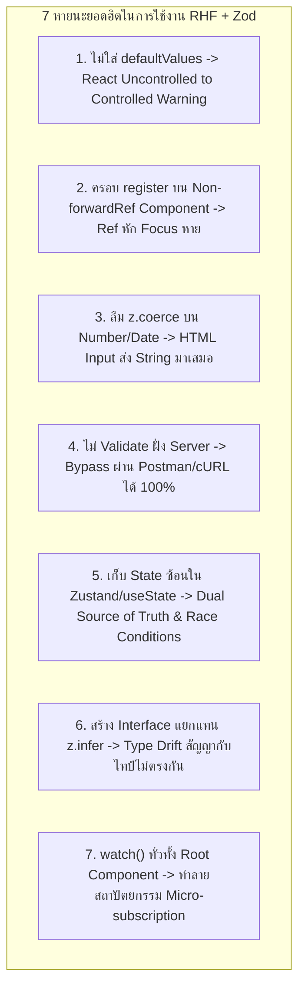

## 1. แนวคิด (Concept)

แม้ว่า **React Hook Form v7** ร่วมกับ **Zod v4** จะเป็นชุดเครื่องมือมาตรฐานระดับ Gold Standard สำหรับการพัฒนาฟอร์มบน **Next.js 16 (App Router)** และ **React 19** แต่ในทางปฏิบัติ นักพัฒนาจำนวนมากมักนำรูปแบบการเขียน (Mental Model) จากไลบรารีรุ่นเก่า เช่น Formik, Redux Form หรือ `useState` เข้ามาผสมปนเป

การผสมผสานกระบวนทัศน์ที่ไม่เข้ากัน นำไปสู่อาการผิดปกติยอดนิยม เช่น:
- ข้อความเตือนสีแดงในคอนโซล: *"A component is changing an uncontrolled input to be controlled"*
- การ Validate ล้มเหลวอย่างไม่ทราบสาเหตุในช่องตัวเลขและวันที่
- หน้าจอ Re-render รัวทุกครั้งที่มีการกดแป้นพิมพ์
- ช่องโหว่ความปลอดภัยร้ายแรงจากการละเลย Server-side Validation
- ภาวะ State Desynchronization จากการเก็บ Form Data ซ้ำซ้อน

เอกสารฉบับนี้รวบรวมและชำแหละ **7 Anti-patterns ที่พบบ่อยที่สุดในโปรเจกต์ระดับ Enterprise**, **Production Readiness Checklist 8 ข้อ** สำหรับตรวจสอบความพร้อมก่อน Release และ **ชุดคำถามสัมภาษณ์งานระดับ Senior Developer** พร้อมบทวิเคราะห์อย่างลึกซึ้ง

---

## 2. หลักการเบื้องหลัง (Under the Hood)

### เจาะลึก 7 ข้อผิดพลาดเชิงสถาปัตยกรรม (Architectural Pitfalls)



#### 1. ทำไมไม่ใส่ `defaultValues` ถึงเกิด Warning?
เมื่อไม่มีการระบุ `defaultValues` ใน `useForm()` ค่าเริ่มต้นของ Input ในรอบแรกของการเรนเดอร์จะมีค่าเป็น `undefined` ซึ่ง React จะมองว่า Input นั้นเป็น **Uncontrolled Component** แต่เมื่อผู้ใช้เริ่มพิมพ์ตัวอักษร RHF จะส่งค่าสตริงเข้าไป ทำให้ React มองว่าเป็น **Controlled Component** การสลับสถานะไปมาระหว่าง Uncontrolled และ Controlled ภายใน Component เดียวกันคือข้อห้ามร้ายแรงของ React

#### 2. ทำไม `register` ถึงใช้กับ Non-forwardRef Component ไม่ได้?
`register('fieldName')` ส่งคืน Object ที่ประกอบด้วย `{ onChange, onBlur, name, ref }` ซึ่งตัวแปร `ref` ต้องการ DOM Element จริงในการเกาะเพื่อทำ Focus Management หากนำไปครอบ Custom Component ที่ไม่ได้ใช้ `React.forwardRef` (หรือ React 19 Ref as prop) ตัว Ref จะไม่ถูกส่งต่อไปยัง Native `<input>` ทำให้ฟีเจอร์ `shouldFocusError` ใช้งานไม่ได้โดยสิ้นเชิง

#### 3. ธรรมชาติของ HTML Form Elements
ตามสเปก W3C HTML5 Input ทุกชนิด ไม่ว่าจะเป็น `type="number"`, `type="date"`, หรือ `type="range"` จะส่งค่ากลับมาผ่าน `event.target.value` เป็น **`string`** เสมอ หาก Zod Schema ประกาศเป็น `z.number()` โดยไม่มี `z.coerce.number()` หรือ `{ valueAsNumber: true }` Zod จะแจ้ง Error ทันทีว่า *"Expected number, received string"*

#### 4. ปัญหา Type Drift จากการประกาศ Type ซ้ำซ้อน
เมื่อนักพัฒนาเขียน `interface UserForm` แยกต่างหากจาก `const userSchema = z.object(...)` เมื่อเวลาผ่านไป มีคนมาเพิ่มฟิลด์ใน Schema แต่ลืมอัปเดต Interface หรือแก้ Type ไม่ตรงกัน ความปลอดภัยในระดับ Compile-time จะสูญสลายไปทันที

---

## 3. ตัวอย่างโค้ด (TypeScript / TSX)

### 1. การกำหนด `defaultValues` และ Type Coercion ที่ถูกต้อง

```typescript filename="schemas/customer-order.ts"
import { z } from 'zod';

// ✅ Best Practice: ใช้ z.coerce สำหรับ number และ date เพื่อรับมือ string จาก HTML DOM
export const CustomerOrderSchema = z.object({
  customerName: z.string().min(1, 'กรุณาระบุชื่อลูกค้า'),
  orderDate: z.coerce.date({
    errorMap: () => ({ message: 'กรุณาระบุรูปแบบวันที่ที่ถูกต้อง' }),
  }),
  itemCount: z.coerce
    .number({ invalid_type_error: 'กรุณาระบุจำนวนสินค้าเป็นตัวเลข' })
    .int('จำนวนชิ้นต้องเป็นจำนวนเต็ม')
    .positive('จำนวนสินค้าต้องมากกว่า 0 ชิ้น'),
  specialInstructions: z.string().default(''),
});

// ✅ Best Practice: อนุมาน Type จาก Schema เสมอ ห้ามเขียน interface ซ้ำ
export type CustomerOrderValues = z.infer<typeof CustomerOrderSchema>;
```

### 2. คอมโพเนนต์ฟอร์มพร้อม Controller สำหรับ 3rd-Party Components

```tsx filename="components/CustomerOrderForm.tsx"
'use client';

import React from 'react';
import { useForm, Controller } from 'react-hook-form';
import { zodResolver } from '@hookform/resolvers/zod';
import { CustomerOrderSchema, type CustomerOrderValues } from '@/schemas/customer-order';
// สมมติ CustomDatePicker เป็น Third-party component จากไลบรารีภายนอก
import { CustomDatePicker } from '@/components/ui/custom-date-picker';

export function CustomerOrderForm() {
  const {
    register,
    handleSubmit,
    control,
    formState: { errors, isSubmitting },
  } = useForm<CustomerOrderValues>({
    resolver: zodResolver(CustomerOrderSchema),
    // ✅ Best Practice: ระบุ defaultValues ครบทุกฟิลด์ หลีกเลี่ยง undefined
    defaultValues: {
      customerName: '',
      orderDate: new Date(),
      itemCount: 1,
      specialInstructions: '',
    },
  });

  const onSubmit = async (values: CustomerOrderValues) => {
    // ส่งข้อมูลไปยัง Next.js Server Action
    console.log('Valid Payload:', values);
  };

  return (
    <form onSubmit={handleSubmit(onSubmit)} className="space-y-4 max-w-lg mx-auto p-6 bg-white rounded-lg shadow">
      {/* 1. Standard Input ใช้ register ได้ปกติ */}
      <div>
        <label className="block text-sm font-medium text-slate-700">ชื่อลูกค้า</label>
        <input
          type="text"
          className="w-full mt-1 px-3 py-2 border rounded-md"
          {...register('customerName')}
        />
        {errors.customerName && <p className="text-xs text-rose-600 mt-1">{errors.customerName.message}</p>}
      </div>

      {/* 2. Number Input ใช้ register ร่วมกับ z.coerce ฝั่ง Schema */}
      <div>
        <label className="block text-sm font-medium text-slate-700">จำนวนสินค้า</label>
        <input
          type="number"
          min="1"
          className="w-full mt-1 px-3 py-2 border rounded-md"
          {...register('itemCount')}
        />
        {errors.itemCount && <p className="text-xs text-rose-600 mt-1">{errors.itemCount.message}</p>}
      </div>

      {/* 3. Third-party Component ที่ไม่มี ref ให้ใช้ Controller เสมอ */}
      <div>
        <label className="block text-sm font-medium text-slate-700">วันที่สั่งซื้อ</label>
        <Controller
          name="orderDate"
          control={control}
          render={({ field }) => (
            <CustomDatePicker
              selectedDate={field.value}
              onDateChange={field.onChange}
              onBlur={field.onBlur}
            />
          )}
        />
        {errors.orderDate && <p className="text-xs text-rose-600 mt-1">{errors.orderDate.message}</p>}
      </div>

      <button
        type="submit"
        disabled={isSubmitting}
        className="w-full py-2 px-4 bg-blue-600 hover:bg-blue-700 text-white font-semibold rounded-md disabled:opacity-50"
      >
        {isSubmitting ? 'กำลังบันทึก...' : 'บันทึกคำสั่งซื้อ'}
      </button>
    </form>
  );
}
```

### 3. Server-side Validation ซ้ำใน Next.js 16 Server Action

```typescript filename="app/actions/order-action.ts"
'use server';

import { CustomerOrderSchema } from '@/schemas/customer-order';

export async function submitOrderAction(formData: FormData) {
  const rawData = {
    customerName: formData.get('customerName'),
    orderDate: formData.get('orderDate'),
    itemCount: formData.get('itemCount'),
    specialInstructions: formData.get('specialInstructions'),
  };

  // ✅ Best Practice: Validate ซ้ำฝั่ง Server ด้วย Schema เดียวกันเสมอ!
  const validationResult = CustomerOrderSchema.safeParse(rawData);

  if (!validationResult.success) {
    return {
      success: false,
      errors: validationResult.error.flatten().fieldErrors,
      message: 'ข้อมูลที่ส่งมาไม่ถูกต้องตามเงื่อนไขความปลอดภัย',
    };
  }

  // มั่นใจได้ว่าข้อมูลปลอดภัย ไร้การ Bypass
  const cleanData = validationResult.data;
  await saveOrderToDatabase(cleanData);

  return { success: true, message: 'บันทึกคำสั่งซื้อสำเร็จ' };
}
```

---

## 4. เทียบกับวิธีเดิม

| ประเด็น | Anti-pattern ที่มักพบเจอ | Senior Best Practice | ผลลัพธ์ทางธุรกิจและเทคนิค |
| :--- | :--- | :--- | :--- |
| **Initial State** | ปล่อยฟิลด์ว่างไว้ ไม่มี `defaultValues` | กำหนดค่าเริ่มต้นทุกช่องอย่างชัดเจน | กำจัด Warning ในคอนโซล, ป้องกัน Uncontrolled crash |
| **Custom Inputs** | ฝืนใช้ `register` กับ Component แปลกๆ | หุ้มด้วย `<Controller>` หรือ `useController` | Focus ทำงานได้, ค่า State ซิงก์สมบูรณ์ |
| **Type Conversion** | พยายาม `parseInt` เองใน onSubmit | ใช้ `z.coerce.number()` หรือ `z.coerce.date()` | โค้ดสะอาด, Type ปลอดภัยตั้งแต่จังหวะ Parse |
| **Server Security** | เชื่อใจฟอร์ม Client-side อย่างเดียว | Validate ซ้ำด้วย Shared Schema บนเซิร์ฟเวอร์ | อุดช่องโหว่การยิง Payload ปลอมผ่าน cURL/Postman |
| **State Duplication** | ก๊อปค่า Form ไปใส่ Zustand ทุก Keystroke | ให้ RHF ถือ State จนกว่าจะ Submit สำเร็จ | ขจัด Race Conditions, ลด Re-render มหาศาล |
| **Type Source** | ประกาศ `interface` แยกต่างหาก | ใช้ `z.infer<typeof schema>` เป็นความจริงหนึ่งเดียว | ตัดปัญหา Type Drift ถาวรเมื่อ Schema มีการแก้ไข |
| **Observation** | เรียก `const values = watch()` ที่ Root | ใช้ `useWatch` ใน Isolated Sub-component | คงประสิทธิภาพ 60-120 FPS พิมพ์ไม่มีหน่วง |

---

## 5. ผิด vs ถูก (Anti-patterns vs Best Practices)

### 1. การเก็บ Form State ซ้ำซ้อนใน Zustand

```typescript
// ❌ ผิด: ซิงก์ค่าจาก RHF ลง Zustand ทุกครั้งที่พิมพ์
const { register } = useForm();
const setCustomerName = useStore((s) => s.setCustomerName);

<input
  {...register('name')}
  onChange={(e) => {
    // ก่อให้เกิด Double State, Re-render คู่ขนาน และความขัดแย้งของข้อมูล
    setCustomerName(e.target.value);
  }}
/>

// ✅ ถูก: ให้ RHF เป็นเจ้าของข้อมูลจนกว่าจะกด Submit แล้วค่อยนำไปเก็บใน Store
const onSubmit = (data: FormValues) => {
  // บันทึกเฉพาะข้อมูลที่ผ่าน Validation แล้วลง Global Store หรือส่งไป Backend
  useStore.getState().setCustomerProfile(data);
};
```

### 2. การลืมใช้ `z.coerce` บนช่องตัวเลข

```typescript
// ❌ ผิด: คาดหวัง number จาก HTML Input ธรรมดา
const Schema = z.object({
  age: z.number().min(18), // Input HTML ส่ง "20" (string) มาเสมอ -> Validate ไม่เคยผ่าน!
});

// ✅ ถูก: ใช้ z.coerce เพื่อแปลง string เป็น number โดยอัตโนมัติ
const Schema = z.object({
  age: z.coerce.number().min(18, 'ต้องมีอายุอย่างน้อย 18 ปี'),
});
```

---

## 6. ควรใช้เมื่อไหร่ / ไม่ควรใช้เมื่อไหร่ (Production Readiness Checklist 8 ข้อ)

ก่อนที่จะกดรวมโค้ด (Merge Pull Request) หรือปล่อยฟอร์มขึ้นสู่ Production ให้ตรวจสอบ Checklist 8 ข้อนี้:

- [ ] **1. Default Values Completeness**: กำหนด `defaultValues` ครบทุกคีย์ ไม่มีค่าใดเริ่มต้นเป็น `undefined` ลอยอยู่
- [ ] **2. Single Source of Truth via `z.infer`**: ประเภทข้อมูลทั้งหมด (Types) อนุมานมาจาก `z.infer<typeof schema>` โดยไม่มีการประกาศ `interface` ซ้ำซ้อน
- [ ] **3. Strict Server-side Validation**: มีการเรียกใช้ Zod Schema ตรวจสอบซ้ำอีกครั้งใน Next.js Server Action หรือ API Route Handler เสมอ
- [ ] **4. Robust Type Coercion**: ใช้ `z.coerce.number()`, `z.coerce.date()`, หรือ `z.coerce.boolean()` สำหรับฟิลด์ที่รับค่ามาจาก DOM
- [ ] **5. Accessibility Compliance**: มีการผูก `htmlFor` กับ `id`, มีการใส่ `aria-invalid`, และมี `aria-describedby` เชื่อมโยงข้อความ Error
- [ ] **6. Submission Feedback & Idempotency**: ปุ่มกดมี `disabled={isSubmitting}` พร้อมไอคอน Loading และมีระบบป้องกัน Double-submission
- [ ] **7. Controlled Component Encapsulation**: Component ภายนอก (Select, DatePicker, Rich Text) ถูกหุ้มด้วย `<Controller>` แทนการฝืนใช้ `register`
- [ ] **8. Performance Isolation**: ไม่มีการเรียก `watch()` โดยไม่ระบุฟิลด์ที่ Root Component หากจำเป็นต้องแสดงผล Real-time ให้แยกเป็น Sub-component ด้วย `useWatch`

---

## 7. คำถามสัมภาษณ์งาน (Interview Questions)

### Q1: "คุณพบเจอปัญหา React warning: 'A component is changing an uncontrolled input to be controlled' ในระบบ คุณวิเคราะห์สาเหตุและแก้ไขอย่างไรใน React Hook Form?"

**แนวทางคำตอบระดับ Senior:**
> "สาเหตุหลักของปัญหานี้เกิดจาก **Initial State Mismatch** ครับ:
>
> ใน React หากเราส่ง `value={undefined}` ไปยัง `<input>` React จะถือว่าองค์ประกอบนั้นเป็น **Uncontrolled Input** แต่เมื่อเวลาผ่านไป หากค่าของ Input เปลี่ยนเป็นข้อความ เช่น `value="John"` React จะถือว่ากลายร่างเป็น **Controlled Input** ซึ่ง React ไม่อนุญาตให้สลับพฤติกรรมนี้กลางคันระหว่างวงจรชีวิตของคอมโพเนนต์
>
> ใน React Hook Form ปัญหานี้มักเกิดจากการที่เราไม่กำหนด `defaultValues` ไว้ในตอนเรียก `useForm()` หรือกำหนดไม่ครบทุกฟิลด์ ทำให้ในการเรนเดอร์ครั้งแรก RHF ส่งค่า `undefined` ไปที่ Input และเมื่อผู้ใช้เริ่มพิมพ์ จึงส่ง String เข้าไปแทน
>
> **วิธีแก้ไข:**
> 1. ประกาศ `defaultValues` ให้ครบทุกฟิลด์ใน `useForm({ defaultValues: { username: '', age: 0 } })` โดยกำหนดเป็น Empty String `""` หรือค่าตัวเลขเริ่มต้นเสมอ ห้ามปล่อยให้เป็น `undefined`
> 2. กรณีที่ดึงข้อมูลเก่ามาจาก API (เช่น Edit Form) ให้ตรวจสอบว่าระหว่างรอข้อมูลกำลังโหลด (Loading State) มีการใส่ค่า Default Fallback ไว้ หรือใส่เงื่อนไขรอจนกว่าข้อมูลจะพร้อมแล้วค่อยสั่ง `reset(apiData)` ครับ"

---

### Q2: "ทำไมเราจึงไม่ควรเก็บ Form State ไว้ใน Global Store อย่าง Zustand หรือ Redux ควบคู่กับ React Hook Form และมีกรณีใดบ้างที่อนุโลมให้แชร์ State ระหว่างกันได้?"

**แนวทางคำตอบระดับ Senior:**
> "การเก็บ Form State ซ้อนกัน 2 ที่ถือเป็น Anti-pattern ที่เรียกว่า **Dual Source of Truth** ด้วยเหตุผล 3 ประการครับ:
>
> 1. **Re-render Performance Penalty**: จุดเด่นที่สุดของ RHF คือการใช้ Uncontrolled Ref เพื่อไม่ให้เกิด Re-render ตอนพิมพ์ หากเรานำค่าไป Dispatch ใส่ Global Store ทุก Keystroke เราจะดึงความหน่วงของ Global State กลับเข้ามาทำลาย Performance ทันที
> 2. **State Desynchronization & Race Conditions**: หากเกิดเหตุการณ์ที่ Global Store และ RHF มีการอัปเดตไม่พร้อมกัน อาจเกิดบั๊กที่ข้อมูลในหน้าจอกับข้อมูลใน Store ตีกันเอง
>
> **กรณีที่อนุโลมให้ใช้ร่วมกันได้:**
> - เราไม่ควรแชร์ State ระดับ Keystroke แต่เราสามารถแชร์ **Committed / Persisted State** ได้ เช่น ใน Multi-step Wizard เมื่อผู้ใช้กรอกฟอร์ม Step 1 เสร็จและกด 'Next' ผ่าน Validation แล้ว เราค่อยนำ Payload นั้นไปบันทึกไว้ใน Zustand Store เพื่อส่งต่อไปยังขั้นตอนถัดไปครับ"

---

### Q3: "ใน Next.js 16 ร่วมกับ React 19 เราจะออกแบบ End-to-End Form Architecture อย่างไรให้มั่นใจทั้ง Performance บน Client และ Security บน Server ด้วย Zod?"

**แนวทางคำตอบระดับ Senior:**
> "สถาปัตยกรรมที่ได้มาตรฐานสูงสุดคือ **Shared Contract & Perimeter Defense Architecture** ครับ:
>
> 1. **Single Source of Truth**: แยก Zod Schema ออกมาเป็นไฟล์กลาง (Shared Module หรือ Monorepo Package) เพื่อให้ Client และ Server Import Schema ตัวเดียวกันไปใช้งาน 100%
> 2. **Client-side UX Layer**: บน Next.js Client Component เราใช้ React Hook Form ร่วมกับ `zodResolver(schema)` เพื่อมอบประสบการณ์การใช้งานที่รวดเร็ว ให้ฟีดแบ็กข้อผิดพลาดทันทีที่กรอก (Instant Validation) โดยไม่ต้องรอรอบการส่ง Network Request
> 3. **Server-side Security Boundary**: ใน Next.js 16 Server Actions (ซึ่งทำงานเป็น Public HTTP POST Endpoint ภายใต้หน้ากาก) เราต้องมองว่าข้อมูลที่ส่งเข้ามาสามารถถูกปลอมแปลงหรือ Bypass ผ่าน Postman ได้เสมอ ดังนั้นเราต้องเรียกใช้ `schema.safeParse(formData)` ซ้ำอีกครั้งในฟังก์ชัน Server Action เสมอ
> 4. **Progressive Enhancement**: หากต้องการความพร้อมสูงสุด สามารถออกแบบให้ฟอร์มทำงานได้แม้ปิดการใช้งาน JavaScript ผ่าน HTML Form Action ดั้งเดิม ควบคู่กับ React 19 `useActionState` เพื่อรองรับทั้งกรณี JavaScript Enabled และ Disabled ครับ"

---

### Q4: "อธิบายความแตกต่างระหว่าง `z.input` กับ `z.output` ใน Zod เมื่อมีการใช้งาน `transform` หรือ `coerce` และมีผลอย่างไรกับการทำ Type Inference ใน React Hook Form?"

**แนวทางคำตอบระดับ Senior:**
> "โดยทั่วไปเมื่อเราใช้ `z.infer<typeof schema>` Zod จะอนุมาน Type ขาออก (**`z.output`**) ให้เป็นค่าเริ่มต้น แต่เมื่อมีการใช้งานคำสั่งจำพวก `.transform()` หรือ `.coerce`:
>
> - **`z.input<typeof schema>`**: คือชนิดของข้อมูลก่อนที่จะเข้าสู่กระบวนการแปลง (Pre-transformation Type) ซึ่งมักตรงกับสิ่งที่ผู้ใช้ป้อนเข้ามาจาก UI
> - **`z.output<typeof schema>`**: คือชนิดของข้อมูลหลังจากผ่านการตรวจสอบและแปลงเสร็จสิ้นแล้ว (Post-transformation Type)
>
> **ผลกระทบต่อ React Hook Form:**
> สมมติเรามี Schema:
> ```typescript
> const PriceSchema = z.object({
>   amount: z.string().transform((val) => parseFloat(val)),
> });
> ```
> ที่ Input ของ HTML ผู้ใช้จะพิมพ์เป็น `string` (`z.input`) แต่เมื่อผ่านการ Validate ใน `handleSubmit(onSubmit)` ข้อมูลที่ส่งให้ `onSubmit` จะกลายเป็น `number` (`z.output`)
>
> หากเรากำหนด Generic Type ให้กับ `useForm<z.infer<typeof PriceSchema>>` ซึ่งเท่ากับ `z.output` ตัว RHF จะมองว่า `amount` ต้องมีค่าเริ่มต้นเป็นตัวเลข ทำให้เกิดข้อขัดแย้งของ Type ระหว่าง HTML Input กับ Form State
>
> ดังนั้นใน React Hook Form การระบุ Type จึงต้องระมัดระวัง หากมีการ Transform ข้อมูลข้ามประเภท ควรใช้ Type สำหรับ Input Form ตอนประกาศ `useForm` และรับ Parsed Type ในขั้นตอน Submission หรือเลือกใช้ `z.coerce` ที่ออกแบบมาเพื่อรองรับการแปลงประเภทข้อมูลจาก Form DOM โดยตรงครับ"
