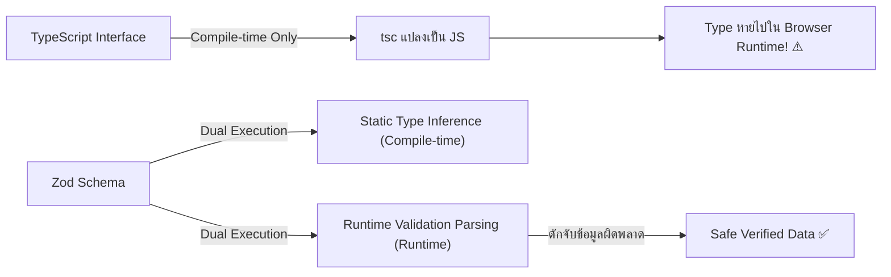

## 1. แนวคิด (Concept)

เมื่อระบบเว็บแอปพลิเคชันขยายขนาดจากฟอร์มล็อกอินเรียบง่าย 2 ช่อง ไปสู่แบบฟอร์มระดับองค์กร (Enterprise Forms) เช่น ระบบขึ้นทะเบียนพนักงาน, ระบบ Checkout ตะกร้าสินค้า, หรือระบบกรอกข้อมูลภาษีที่มีช่องกรอกข้อมูล 30–100 ฟิลด์ นักพัฒนาส่วนใหญ่มักเริ่มต้นด้วยวิธีพื้นฐานที่สุดใน React: **การผูก `useState` แยกทีละช่องกรอก**

```tsx
// ❌ ปัญหา Boilerplate จากการใช้ useState ดั้งเดิม
const [firstName, setFirstName] = useState('');
const [lastName, setLastName] = useState('');
const [email, setEmail] = useState('');
const [phone, setPhone] = useState('');
// ... ประกาศ state ซ้ำซ้อนไปเรื่อยๆ จนถึง 50 บรรทัด
```

แนวทางดั้งเดิมนี้นำมาซึ่งวิกฤตทางสถาปัตยกรรม 3 ประการหลัก:

1. **Re-render ทั้งคอมโพเนนต์ทุกครั้งที่เคาะแป้นพิมพ์ (Render Storm)**: ในโมเดล Controlled Component ทุกอักขระที่พิมพ์ลงใน `<input value={val} onChange={e => setVal(e.target.value)} />` จะบังคับให้คอมโพเนนต์ทั้งหน้า รวมถึงคอมโพเนนต์ลูก (Child Components) คำนวณ Virtual DOM ใหม่ทั้งหมด แม้ช่องนั้นจะไม่ได้มีความเกี่ยวข้องกับ UI ส่วนอื่นเลยก็ตาม
2. **Boilerplate มหาศาลและ Logic กระจัดกระจาย**: การจัดการ State, Error message, Loading state, Blur state, และ Validation rules แยกกันอย่างไม่เป็นระเบียบ โค้ด validation มักถูกเขียนแทรกปะปนอยู่ใน `onChange` หรือในฟังก์ชัน `handleSubmit` ขนาดยาวนับร้อยบรรทัด
3. **ช่องโหว่ด้านความปลอดภัยของข้อมูล (Compile-time Illusion)**: TypeScript ช่วยปกป้องโค้ดได้เฉพาะตอน **Compile-time** เท่านั้น เมื่อโค้ดถูกคอมไพล์เป็น JavaScript ทำงานบนเบราว์เซอร์ ข้อมูลที่ผู้ใช้กรอกเข้ามาหรือ Payload ที่ส่งมาจาก API ไม่มี Type Safety คอยคุ้มกันอยู่จริง หากไม่มี **Runtime Schema Validation** ข้อมูลขยะ (Corrupted Data) ย่อมหลุดรอดเข้าสู่ระบบได้ทันที

### การจับคู่ระดับ Gold Standard: React Hook Form + Zod

เพื่อแก้ปัญหาระดับรากฐานเหล่านี้ วงการพัฒนา Fullstack ยุคปัจจุบันบน React 19 และ Next.js 16 จึงเลือกใช้คู่หูที่ทำหน้าที่แบ่งแยกความรับผิดชอบอย่างชัดเจน (Separation of Concerns):

- **React Hook Form (RHF v7)**: ทำหน้าที่จัดการ State ของ UI Input ภายใน DOM โดยใช้ **Uncontrolled Components (Native HTML Refs)** ควบคู่กับ **Isolated Micro-subscriptions** ทำให้พิมพ์ได้ลื่นไหลระดับ 60 FPS ปราศจากการ Re-render ตัวคอมโพเนนต์หลักขณะพิมพ์
- **Zod (Zod v4)**: ทำหน้าที่เป็น **Single Source of Truth** ค้ำประกันความถูกต้องของข้อมูล (Data Integrity) ทั้งการทำ **Runtime Schema Validation** และการอนุมาน Static Types ผ่าน `z.infer` ไม่ต้องเขียน TypeScript Interface ซ้ำซ้อนอีกต่อไป

---

## 2. หลักการเบื้องหลัง (Under the Hood)

### 2.1 Controlled vs Uncontrolled Inputs

ในโลกของ React การจัดการฟอร์มแบ่งออกเป็น 2 แนวคิดหลัก:

| คุณลักษณะ | Controlled Components (`useState`) | Uncontrolled Components (`RHF`) |
| :--- | :--- | :--- |
| **แหล่งเก็บความจริง (Source of Truth)** | React State Memory | Native Browser DOM Elements (`HTMLInputElement`) |
| **การพิมพ์ข้อมูล (Keystroke)** | อัปเดต React State $\to$ กระตุ้น Re-render | เบราว์เซอร์จัดการค่าใน Ref ทันที $\to$ **Zero Re-render** |
| **ประสิทธิภาพ (Performance)** | $O(N)$ เมื่อ $N$ คือขนาดของ Subtree | $O(1)$ ไม่กระทบต่อ React Component Tree |
| **การดึงค่า (Value Access)** | มีค่าในตัวแปร State ตลอดเวลา | อ่านค่าผ่าน DOM Ref เมื่อเกิด Event ที่ต้องการ (เช่น Submit) |

### 2.2 ทำไม React Hook Form ถึงเร็วระดับศูนย์ Re-render?

สถาปัตยกรรมของ React Hook Form ไม่ได้ฝากค่าของ Input ไว้ใน React State แต่อย่างใด หากแต่ใช้ **External Form Store** ภายนอก และใช้ Native DOM Reference ผ่าน `ref`:

```mermaid
flowchart TD
    subgraph useStateModel ["โมเดลเดิม: Controlled Component (useState)"]
        K1["User กดแป้นพิมพ์ 'A'"] --> E1["onChange Event ยิงขึ้น"]
        E1 --> S1["setState('A')"]
        S1 --> R1["Full Component Re-render 💥"]
        R1 --> V1["คำนวณ Virtual DOM ใหม่ทั้งหมด"]
        V1 --> D1["อัปเดตค่ากลับลง DOM Input"]
    end

    subgraph rhfModel ["โมเดลใหม่: React Hook Form (Uncontrolled Ref)"]
        K2["User กดแป้นพิมพ์ 'A'"] --> D2["Native DOM อัปเดตทันที (Ref)"]
        D2 --> M2["External Store เก็บค่าเงียบๆ (No Render)"]
        M2 -.->|"เฉพาะช่องที่มี Error หรือถูก Watch"| S2["Micro-subscription อัปเดตเฉพาะจุด"]
    end
```



#### เปรียบเทียบรอบการ Render: 10 Keystrokes
- **`useState`**: ผู้ใช้พิมพ์คำว่า `"helloworld"` (10 ตัวอักษร) $\to$ คอมโพเนนต์ Re-render **10 รอบเต็ม** พร้อมคอมโพเนนต์ลูกทั้งหมด
- **React Hook Form**: ผู้ใช้พิมพ์คำว่า `"helloworld"` $\to$ คอมโพเนนต์ Re-render **0 รอบ** ค่าถูกเก็บลง DOM Ref โดยตรง จนกว่าจะกดปุ่ม Submit หรือมีเงื่อนไข Validation Trigger เฉพาะจุด

### 2.3 Isolated Micro-subscriptions

React Hook Form สร้าง Proxy หรือ Observer Pattern คอยดักจับสถานะภายใน `formState` หากคอมโพเนนต์ใดไม่ได้เรียกใช้ `errors` หรือ `isDirty` ตัว Hook จะไม่ลงทะเบียน Subscriber ในจุดนั้น ส่งผลให้กระบวนการ Validation และการคำนวณ Dirty State ทำงานได้อย่างรวดเร็วโดยไม่รบกวน Main Thread

### 2.4 ทำไม TypeScript Type อย่างเดียวถึงไม่เพียงพอ?



TypeScript เป็นระบบ **Static Type System** ซึ่งมีตัวตนอยู่เฉพาะในขั้นตอนการพัฒนาและการคอมไพล์ (Compile-time) เมื่อโค้ดถูกแปลงเป็น JavaScript สัญลักษณ์ Interface และ Type Aliases จะถูกลบทิ้งทั้งหมด (Type Erasure) 

ดังนั้น ถ้าผู้ใช้แก้ไข DOM Input ส่งข้อมูล string ว่า `"not-an-email"` หรือบอทส่ง Payload ผ่าน `fetch` API เข้ามา TypeScript จะไม่สามารถป้องกันระบบของคุณได้เลย Zod จึงเข้ามาทำหน้าที่เป็นยามเฝ้าประตูที่ทำการตรวจสอบโครงสร้างและเงื่อนไขข้อมูลจริงในเวลาทำงาน (**Runtime**)

---

## 3. ตัวอย่างโค้ด (TypeScript / TSX)

### ตัวอย่างที่ 1: ระบบอัปเดตโปรไฟล์ผู้ใช้ระดับ Enterprise (`UserProfileForm.tsx`)

ตัวอย่างนี้แสดงการใช้ React Hook Form ร่วมกับ Zod 4 เพื่อสร้างฟอร์มแก้ไขโปรไฟล์ พร้อมคำนวณ Dirty State และแสดงผล Error ภาษาไทยแบบ Isolated โดยที่คอมโพเนนต์แม่ไม่ต้อง Re-render ขณะพิมพ์ข้อความ

```tsx filename="components/forms/UserProfileForm.tsx"
'use client';

import React from 'react';
import { useForm } from 'react-hook-form';
import { zodResolver } from '@hookform/resolvers/zod';
import { z } from 'zod';
import { toast } from 'sonner';
import { Loader2, Save, UserCheck } from 'lucide-react';

// 1. กำหนด Single Source of Truth ด้วย Zod Schema v4
const userProfileSchema = z.object({
  fullName: z
    .string({ error: 'กรุณากรอกชื่อ-นามสกุล' })
    .min(3, { error: 'ชื่อ-นามสกุลต้องมีความยาวอย่างน้อย 3 ตัวอักษร' })
    .max(50, { error: 'ชื่อ-นามสกุลต้องไม่เกิน 50 ตัวอักษร' }),
  workEmail: z
    .string({ error: 'กรุณากรอกอีเมลที่ทำงาน' })
    .email({ error: 'รูปแบบอีเมลไม่ถูกต้อง เช่น name@company.com' }),
  bio: z
    .string()
    .max(200, { error: 'คำอธิบายตัวเองต้องไม่เกิน 200 ตัวอักษร' })
    .optional(),
  department: z.enum(['Engineering', 'Product', 'Marketing', 'Sales'], {
    error: 'กรุณาเลือกแผนกที่สังกัด',
  }),
});

// 2. อนุมาน Static TypeScript Type อัตโนมัติ ไม่ต้องเขียน interface แยก
type UserProfileValues = z.infer<typeof userProfileSchema>;

interface UserProfileFormProps {
  initialData?: Partial<UserProfileValues>;
}

export function UserProfileForm({ initialData }: UserProfileFormProps) {
  // 3. ผูก RHF กับ zodResolver และกำหนด defaultValues ให้ครบทุกช่อง
  const {
    register,
    handleSubmit,
    formState: { errors, isSubmitting, isDirty, isValid },
    reset,
  } = useForm<UserProfileValues>({
    resolver: zodResolver(userProfileSchema),
    mode: 'onBlur', // Validate เมื่อผู้ใช้สลับออกจากช่อง
    defaultValues: {
      fullName: initialData?.fullName ?? '',
      workEmail: initialData?.workEmail ?? '',
      bio: initialData?.bio ?? '',
      department: initialData?.department ?? 'Engineering',
    },
  });

  // 4. Submit handler ที่รับประกัน Type ปลอดภัย 100%
  const onSubmit = async (values: UserProfileValues) => {
    try {
      // จำลองการส่งข้อมูลผ่าน Next.js Server Action หรือ API Endpoint
      await new Promise((resolve) => setTimeout(resolve, 1200));
      
      toast.success('บันทึกข้อมูลโปรไฟล์เรียบร้อยแล้ว');
      // รีเซ็ตสถานะ isDirty โดยให้ค่าปัจจุบันกลายเป็น defaultValues ชุดใหม่
      reset(values);
    } catch (error) {
      toast.error('เกิดข้อผิดพลาดในการบันทึกข้อมูล กรุณาลองใหม่อีกครั้ง');
    }
  };

  return (
    <form
      onSubmit={handleSubmit(onSubmit)}
      className="max-w-xl mx-auto p-6 bg-surface border border-hairline rounded-2xl shadow-sm space-y-6"
    >
      <div className="border-b border-hairline pb-4">
        <h2 className="text-xl font-bold text-ink flex items-center gap-2">
          <UserCheck className="w-5 h-5 text-primary" />
          ข้อมูลโปรไฟล์พนักงาน
        </h2>
        <p className="text-sm text-muted">
          แก้ไขข้อมูลของคุณ ข้อมูลจะถูกตรวจสอบความถูกต้องก่อนส่งเข้าสู่เซิร์ฟเวอร์
        </p>
      </div>

      {/* ฟิลด์ชื่อ-นามสกุล */}
      <div className="space-y-1.5">
        <label htmlFor="fullName" className="text-sm font-medium text-ink">
          ชื่อ - นามสกุล <span className="text-rose-500">*</span>
        </label>
        <input
          id="fullName"
          type="text"
          placeholder="เช่น สมชาย ใจดี"
          {...register('fullName')}
          className={`w-full px-3.5 py-2.5 rounded-lg border text-sm transition-colors outline-none focus:ring-2 ${
            errors.fullName
              ? 'border-rose-500 focus:ring-rose-500/20'
              : 'border-hairline focus:ring-primary/20 focus:border-primary'
          }`}
        />
        {errors.fullName && (
          <p className="text-xs text-rose-500 font-medium">
            {errors.fullName.message}
          </p>
        )}
      </div>

      {/* ฟิลด์อีเมลที่ทำงาน */}
      <div className="space-y-1.5">
        <label htmlFor="workEmail" className="text-sm font-medium text-ink">
          อีเมลองค์กร <span className="text-rose-500">*</span>
        </label>
        <input
          id="workEmail"
          type="email"
          placeholder="user@company.com"
          {...register('workEmail')}
          className={`w-full px-3.5 py-2.5 rounded-lg border text-sm transition-colors outline-none focus:ring-2 ${
            errors.workEmail
              ? 'border-rose-500 focus:ring-rose-500/20'
              : 'border-hairline focus:ring-primary/20 focus:border-primary'
          }`}
        />
        {errors.workEmail && (
          <p className="text-xs text-rose-500 font-medium">
            {errors.workEmail.message}
          </p>
        )}
      </div>

      {/* ฟิลด์แผนก */}
      <div className="space-y-1.5">
        <label htmlFor="department" className="text-sm font-medium text-ink">
          แผนกสังกัด <span className="text-rose-500">*</span>
        </label>
        <select
          id="department"
          {...register('department')}
          className="w-full px-3.5 py-2.5 rounded-lg border border-hairline bg-surface text-sm outline-none focus:ring-2 focus:ring-primary/20 focus:border-primary"
        >
          <option value="Engineering">วิศวกรรมซอฟต์แวร์ (Engineering)</option>
          <option value="Product">พัฒนาผลิตภัณฑ์ (Product)</option>
          <option value="Marketing">การตลาด (Marketing)</option>
          <option value="Sales">ฝ่ายขาย (Sales)</option>
        </select>
        {errors.department && (
          <p className="text-xs text-rose-500 font-medium">
            {errors.department.message}
          </p>
        )}
      </div>

      {/* ฟิลด์ Bio */}
      <div className="space-y-1.5">
        <label htmlFor="bio" className="text-sm font-medium text-ink">
          ประวัติโดยย่อ (Optional)
        </label>
        <textarea
          id="bio"
          rows={3}
          placeholder="ความเชี่ยวชาญพิเศษ หรือเป้าหมายในการทำงาน..."
          {...register('bio')}
          className="w-full px-3.5 py-2.5 rounded-lg border border-hairline text-sm transition-colors outline-none focus:ring-2 focus:ring-primary/20 focus:border-primary"
        />
        {errors.bio && (
          <p className="text-xs text-rose-500 font-medium">
            {errors.bio.message}
          </p>
        )}
      </div>

      {/* ปุ่มกด Submit */}
      <div className="flex items-center justify-between pt-4 border-t border-hairline">
        <span className="text-xs text-muted">
          {isDirty ? 'มีการเปลี่ยนแปลงข้อมูลที่ยังไม่บันทึก' : 'ข้อมูลตรงกับล่าสุด'}
        </span>
        <button
          type="submit"
          disabled={isSubmitting || !isDirty}
          className="inline-flex items-center gap-2 px-5 py-2.5 rounded-lg bg-primary text-white text-sm font-medium hover:bg-primary/90 transition-all disabled:opacity-50 disabled:cursor-not-allowed shadow-sm"
        >
          {isSubmitting ? (
            <>
              <Loader2 className="w-4 h-4 animate-spin" />
              กำลังบันทึก...
            </>
          ) : (
            <>
              <Save className="w-4 h-4" />
              บันทึกการเปลี่ยนแปลง
            </>
          )}
        </button>
      </div>
    </form>
  );
}
```

---

### ตัวอย่างที่ 2: ฟอร์มสมัครสมาชิกพร้อมตรวจสอบรหัสผ่าน (`RegistrationForm.tsx`)

ตัวอย่างฟอร์มที่มีการตรวจสอบรหัสผ่านตรงกัน (Cross-field Validation) ด้วย `z.refine` พร้อมทั้งแสดงตัวจับเวลาเรนเดอร์เพื่อพิสูจน์ว่าพิมพ์แล้วไม่มีการ Re-render ส่วนเกิน

```tsx filename="components/forms/RegistrationForm.tsx"
'use client';

import React, { useRef } from 'react';
import { useForm } from 'react-hook-form';
import { zodResolver } from '@hookform/resolvers/zod';
import { z } from 'zod';
import { toast } from 'sonner';
import { Lock, Mail, ShieldAlert, Sparkles } from 'lucide-react';

const registerSchema = z
  .object({
    email: z
      .string({ error: 'กรุณากรอกอีเมล' })
      .email({ error: 'รูปแบบอีเมลไม่ถูกต้อง' }),
    password: z
      .string({ error: 'กรุณากรอกรหัสผ่าน' })
      .min(8, { error: 'รหัสผ่านต้องมีอย่างน้อย 8 ตัวอักษร' })
      .regex(/[A-Z]/, { error: 'รหัสผ่านต้องมีตัวพิมพ์ใหญ่ (A-Z) อย่างน้อย 1 ตัว' })
      .regex(/[0-9]/, { error: 'รหัสผ่านต้องมีตัวเลข (0-9) อย่างน้อย 1 ตัว' }),
    confirmPassword: z.string({ error: 'กรุณายืนยันรหัสผ่าน' }),
    acceptTerms: z.literal(true, {
      error: 'คุณต้องยอมรับข้อตกลงและเงื่อนไขการให้บริการก่อนดำเนินการต่อ',
    }),
  })
  .refine((data) => data.password === data.confirmPassword, {
    message: 'รหัสผ่านทั้งสองช่องไม่ตรงกัน',
    path: ['confirmPassword'], // ชี้ error ไปที่ช่อง confirmPassword
  });

type RegisterFormValues = z.infer<typeof registerSchema>;

export function RegistrationForm() {
  const renderCountRef = useRef(1);
  renderCountRef.current += 1;

  const {
    register,
    handleSubmit,
    formState: { errors, isSubmitting },
  } = useForm<RegisterFormValues>({
    resolver: zodResolver(registerSchema),
    mode: 'onSubmit',
    defaultValues: {
      email: '',
      password: '',
      confirmPassword: '',
      acceptTerms: false as unknown as true, // เพื่อให้ผ่าน type ตอนเริ่มต้น
    },
  });

  const handleRegister = async (data: RegisterFormValues) => {
    // ข้อมูล data ผ่าน validation 100% แน่นอน
    await new Promise((r) => setTimeout(r, 1000));
    toast.success(`สมัครสมาชิกสำเร็จ! ยินดีต้อนรับ ${data.email}`);
  };

  return (
    <div className="max-w-md mx-auto p-6 bg-surface border border-hairline rounded-2xl shadow-sm">
      <div className="flex items-center justify-between mb-4">
        <h2 className="text-xl font-bold text-ink flex items-center gap-2">
          <Sparkles className="w-5 h-5 text-amber-500" />
          สร้างบัญชีใหม่
        </h2>
        {/* Badge ตรวจสอบรอบการ Render */}
        <span className="text-[11px] font-mono px-2 py-0.5 rounded-full bg-subtle text-muted">
          Render ครั้งที่: {renderCountRef.current}
        </span>
      </div>

      <form onSubmit={handleSubmit(handleRegister)} className="space-y-4">
        {/* Email Field */}
        <div className="space-y-1">
          <label className="text-xs font-semibold text-ink flex items-center gap-1.5">
            <Mail className="w-3.5 h-3.5 text-muted" /> อีเมล
          </label>
          <input
            type="email"
            placeholder="developer@acme.co"
            {...register('email')}
            className="w-full px-3 py-2 text-sm rounded-lg border border-hairline outline-none focus:ring-2 focus:ring-primary/20"
          />
          {errors.email && (
            <p className="text-xs text-rose-500">{errors.email.message}</p>
          )}
        </div>

        {/* Password Field */}
        <div className="space-y-1">
          <label className="text-xs font-semibold text-ink flex items-center gap-1.5">
            <Lock className="w-3.5 h-3.5 text-muted" /> รหัสผ่าน
          </label>
          <input
            type="password"
            placeholder="••••••••"
            {...register('password')}
            className="w-full px-3 py-2 text-sm rounded-lg border border-hairline outline-none focus:ring-2 focus:ring-primary/20"
          />
          {errors.password && (
            <p className="text-xs text-rose-500">{errors.password.message}</p>
          )}
        </div>

        {/* Confirm Password Field */}
        <div className="space-y-1">
          <label className="text-xs font-semibold text-ink flex items-center gap-1.5">
            <Lock className="w-3.5 h-3.5 text-muted" /> ยืนยันรหัสผ่าน
          </label>
          <input
            type="password"
            placeholder="••••••••"
            {...register('confirmPassword')}
            className="w-full px-3 py-2 text-sm rounded-lg border border-hairline outline-none focus:ring-2 focus:ring-primary/20"
          />
          {errors.confirmPassword && (
            <p className="text-xs text-rose-500">{errors.confirmPassword.message}</p>
          )}
        </div>

        {/* Checkbox ยอมรับเงื่อนไข */}
        <div className="space-y-1 pt-1">
          <label className="flex items-start gap-2 cursor-pointer text-xs text-muted">
            <input
              type="checkbox"
              {...register('acceptTerms')}
              className="mt-0.5 rounded border-hairline text-primary focus:ring-primary"
            />
            <span>
              ฉันยอมรับเงื่อนไขการให้บริการและนโยบายความเป็นส่วนตัว
            </span>
          </label>
          {errors.acceptTerms && (
            <p className="text-xs text-rose-500">{errors.acceptTerms.message}</p>
          )}
        </div>

        <button
          type="submit"
          disabled={isSubmitting}
          className="w-full py-2.5 px-4 bg-primary text-white text-sm font-semibold rounded-lg hover:bg-primary/90 transition-all disabled:opacity-50"
        >
          {isSubmitting ? 'กำลังประมวลผล...' : 'ยืนยันการลงทะเบียน'}
        </button>
      </form>
    </div>
  );
}
```

---

## 4. เทียบกับวิธีเดิม (useState vs RHF + Zod)

ตารางเปรียบเทียบเชิงวิศวกรรมระหว่างการเขียนฟอร์มแบบเดิมด้วย `useState` กับการใช้ `React Hook Form + Zod`:

| มิติการเปรียบเทียบ | `useState` แบบดั้งเดิม | `React Hook Form + Zod` |
| :--- | :--- | :--- |
| **Component Re-renders** | Re-render ทั้งหมด **ทุกครั้ง** ที่กดแป้นพิมพ์ | **0 Re-render** ขณะพิมพ์ (ใช้ Native DOM Refs) |
| **ขนาด Boilerplate** | มหาศาล ต้องเขียน `value`, `onChange`, `errorState` ซ้ำทุกฟิลด์ | ต่ำมาก เพียงครอบสเปรด `{...register('fieldName')}` |
| **ความซับซ้อนของ Validation** | กระจัดกระจาย เขียน if-else ซ้อนกันใน submit function | ศูนย์รวมความจริงแห่งเดียว (Declarative Schema) |
| **Type Safety** | แยก Type กับเงื่อนไข อาจเกิดจุดคลาดเคลื่อน (Desync) | Auto-inferred Type จาก Schema (`z.infer`) แบบ 100% |
| **Cross-field Validation** | จัดการยาก มักมีบั๊กจังหวะ race condition ของ state | ใช้ `refine` หรือ `superRefine` รันทีเดียวอย่างแม่นยำ |
| **Memory Footprint** | สร้าง Function และ Object ใหม่ในทุก Keystroke | ทำงานผ่าน DOM Node โดยตรง ไม่กิน Memory เพิ่ม |
| **รองรับฟอร์มขนาดใหญ่ (50+ ฟิลด์)** | เกิดอาการพิมพ์แล้วกระตุก (Input Lag) ชัดเจน | ไหลลื่นระดับ 60 FPS คงที่ ไม่กระตุก |

---

## 5. ผิด vs ถูก (Anti-patterns vs Best Practices)

### กรณีที่ 1: การใช้ TypeScript Interface โดยไม่มี Runtime Validation
```tsx
// ❌ ผิด: เชื่อใจ TypeScript Interface อย่างเดียวในฟังก์ชันรับค่า
interface Payload {
  age: number;
}
function handleProcess(data: Payload) {
  // หากผู้ใช้ยิง API ผ่าน cURL ส่ง { "age": "ยี่สิบห้า" }
  // data.age.toFixed(2) จะทำให้แอปพัง Runtime ทันที (TypeError)!
  return data.age.toFixed(2);
}

// ✅ ถูก: ใช้ Zod Schema เป็นตัวกรองที่ Runtime เสมอ
const payloadSchema = z.object({
  age: z.coerce.number().min(1, 'อายุต้องเป็นตัวเลขที่มากกว่า 0'),
});
function handleProcessSafe(input: unknown) {
  const result = payloadSchema.safeParse(input);
  if (!result.success) {
    throw new Error('ข้อมูลไม่ถูกต้องตามสัญญา');
  }
  return result.data.age.toFixed(2); // ปลอดภัย 100% ทั้ง Compile-time และ Runtime
}
```

### กรณีที่ 2: การใช้ `watch()` ทั้งก้อนเพื่อดักฟังค่าฟอร์ม
```tsx
// ❌ ผิด: เรียก watch() แบบไม่ระบุชื่อฟิลด์ ทำให้ Component Re-render ทุกครั้งที่พิมพ์ช่องใดก็ตาม
const formValues = watch(); // ทำลายจุดเด่น Isolated Subscription ของ RHF ทันที

// ✅ ถูก: ระบุเฉพาะฟิลด์ที่ต้องการ หรือใช้ useWatch hook แยกเฉพาะคอมโพเนนต์ย่อย
const selectedDepartment = watch('department');
// หรือแยกเป็น Sub-component ที่เรียก useWatch({ control, name: 'department' })
```

---

## 6. ควรใช้เมื่อไหร่ / ไม่ควรใช้เมื่อไหร่

### ควรใช้ React Hook Form + Zod เมื่อ:
- ฟอร์มที่มีความซับซ้อนปานกลางถึงสูง (ตั้งแต่ 3 ช่องขึ้นไป จนถึงหลายสิบฟิลด์)
- ฟอร์มที่มีเงื่อนไขการตรวจสอบความถูกต้องเข้มงวด (Email format, Password strength, Date range)
- ต้องการประสิทธิภาพระดับสูงสุด (Zero input latency) โดยเฉพาะบนอุปกรณ์มือถือ
- ระบบที่ต้องการแชร์ Data Contract ระหว่าง Frontend (Next.js) และ Backend (NestJS / Node.js)
- ใช้งานร่วมกับ Design Systems ยุคใหม่อย่าง **shadcn/ui** ซึ่งออกแบบมาบนพื้นฐานของ RHF + Zod โดยเฉพาะ

### ไม่ควรใช้ (หรือไม่จำเป็นต้องใช้) เมื่อ:
- ช่องค้นหาดั้งเดิมช่องเดียว (`<input type="search" />`) บน Navbar: การใช้ `useState` ธรรมดา หรือ Search Params ใน URL เพียงพอและเรียบง่ายกว่า
- หน้าเว็บ Static ที่ใช้ `<form action="...">` ของ HTML แบบดั้งเดิมโดยไม่มี Client-side Interactivity ใดๆ
- ระบบที่ไม่มีความต้องการ Validation ซับซ้อนและมีเพียง 1 ฟิลด์เรียบง่าย

---

## 7. คำถามสัมภาษณ์งาน (Interview Questions)

### Q1: ทำไม React Hook Form ถึงมีประสิทธิภาพ (Performance) เหนือกว่า Formik หรือฟอร์มที่ใช้ `useState` อย่างมีนัยสำคัญ?
**แนวทางคำตอบแบบ Senior**:
> "React Hook Form ถูกออกแบบบนสถาปัตยกรรม **Uncontrolled Components** ที่ใช้ Native HTML DOM References (`ref`) เป็นแหล่งเก็บข้อมูลหลัก แทนที่จะบันทึกค่าทุกการกดแป้นพิมพ์ลงใน React State เหมือน Formik หรือ `useState` ทั่วไป
> 
> ในโมเดลของ Controlled Component ทุก 1 Keystroke จะสั่ง Trigger วงรอบ Reconciliation ของ React ทำให้เกิด Virtual DOM Diffing ทั้งคอมโพเนนต์ แต่ใน React Hook Form การพิมพ์อักขระจะเป็นการอัปเดตลงบน DOM Node โดยตรง ทำให้ **Zero Re-render** ระหว่างพิมพ์
> 
> นอกจากนี้ RHF ยังใช้ **Isolated Micro-subscriptions** โดยผูก Observer เข้ากับ Native Events (เช่น `blur`, `change`, `submit`) เฉพาะฟิลด์ที่ถูกลงทะเบียน จึงไม่มีการกระจาย Event ไปรบกวนคอมโพเนนต์อื่นใน Tree ช่วยลดการใช้ CPU และป้องกันปัญหา Input Lag ในฟอร์มระดับ Enterprise ได้อย่างสมบูรณ์แบบครับ"

---

### Q2: ในเมื่อเราเขียน TypeScript ครอบคลุม Interface ทั้งโปรเจกต์แล้ว ทำไมเรายังจำเป็นต้องใช้ Zod ในการ Validate ฟอร์มอีก?
**แนวทางคำตอบแบบ Senior**:
> "เพราะว่า TypeScript มีอยู่แค่ในขั้นตอน **Compile-time** ครับ เมื่อโค้ดถูกทรานส์ไพล์ไปเป็น JavaScript รันอยู่บนเบราว์เซอร์ของผู้ใช้ ข้อมูลชนิด Type และ Interface จะถูก **Erase (Type Erasure)** หายไปทั้งหมด 
> 
> ข้อมูลที่ผู้ใช้พิมพ์เข้ามาใน Form หรือส่งผ่าน Network Request ข้ามเซิร์ฟเวอร์ เข้ามาในระบบในฐานะ 'Untrusted Input' เสมอ TypeScript ไม่สามารถช่วยการันตีได้เลยว่า String ที่ส่งเข้ามาจะเป็นอีเมลจริงหรือไม่ หรือตัวเลขนั้นติดลบหรือไม่
> 
> Zod จึงเข้ามาแก้ปัญหานี้ในฐานะ **Runtime Schema Validator** ที่ทำการ Parse และ Validate ข้อมูลจริงในขณะรันไทม์ และที่สำคัญคือ Zod สามารถทำ **Static Type Inference** ผ่านคำสั่ง `z.infer<typeof schema>` ทำให้ Schema ทำหน้าที่เป็น **Single Source of Truth** ดูแลทั้งความปลอดภัยตอนคอมไพล์และความถูกต้องของข้อมูลตอนรันไทม์พร้อมกันในที่เดียวครับ"
