## 1. แนวคิด (Concept)

**React Hook Form (RHF v7)** ถูกออกแบบมาเพื่อแก้ปัญหาคอขวดของการจัดการฟอร์มใน React ด้วยปรัชญาที่เรียบง่ายแต่ทรงพลัง:

> *"เคารพกลไก Native HTML Form ของเบราว์เซอร์ ใช้ Uncontrolled DOM Inputs ผ่าน `ref` และ Re-render คอมโพเนนต์เฉพาะเมื่อมีความจำเป็นจริงเท่านั้น"*

แกนหลักของ React Hook Form ประกอบด้วย 3 เสาหลัก (Core APIs):

1. **`useForm`**: Hook หลักสำหรับสร้างอินสแตนซ์ควบคุมฟอร์ม กำหนดค่าเริ่มต้น (`defaultValues`), โหมดการตรวจสอบ (`mode`), และตัวเชื่อมต่อสคีมา (`resolver`)
2. **`register`**: ฟังก์ชันสำหรับลงทะเบียน DOM Input เข้าสู่ External Store ของ RHF โดยส่งคืนคุณสมบัติพื้นฐานที่ Native Input ต้องการ ได้แก่ `name`, `ref`, `onChange`, และ `onBlur`
3. **`handleSubmit`**: ฟังก์ชัน Wrapper ครอบขั้นตอนการส่งฟอร์ม โดยจะทำการตรวจสอบ Validation ของฟิลด์ทั้งหมดให้เสร็จสิ้นก่อน หากผ่านจึงจะเรียกฟังก์ชัน `onSubmit(data)` ของเรา แต่หากไม่ผ่านจะส่งต่อข้อมูลไปยัง `onError(errors)` พร้อมโฟกัสไปยังช่องที่มีข้อผิดพลาดช่องแรกโดยอัตโนมัติ

---

## 2. หลักการเบื้องหลัง (Under the Hood)

### 2.1 โครงสร้างภายในของ `register()`

เมื่อเราเขียนไวยากรณ์ `{...register('email')}` สิ่งที่เกิดขึ้นจริงใน DOM คือ RHF ทำการกระจาย Props 4 ตัวลงใน Element:

```tsx
// สิ่งที่เราเขียน
<input {...register('email')} />

// สิ่งที่ RHF ส่งกลับมาผูกเข้ากับ DOM
<input
  name="email"
  ref={(instance) => {
    // 1. นำ Native HTMLInputElement ไปเก็บไว้ใน External Ref Store
  }}
  onChange={(e) => {
    // 2. ดักฟัง Event เพื่ออัปเดต Internal State (ไม่สั่ง Re-render ทั้งคอมโพเนนต์)
  }}
  onBlur={(e) => {
    // 3. ปรับสถานะ touchedFields และสั่ง Validate หาก mode เป็น 'onBlur'
  }}
/>
```



```mermaid
flowchart TD
    subgraph HookInstance ["useForm() Instance"]
        Store[("External Form Store")]
        ProxyState["Proxy Tracking: formState"]
    end

    subgraph DOMInputs ["Native DOM"]
        In1["<input name='email' />"]
        In2["<input name='password' />"]
    end

    In1 -.->|"register('email') Ref"| Store
    In2 -.->|"register('password') Ref"| Store
    Store -->|"Selective Notification"| ProxyState
```

### 2.2 เจาะลึกสถานะ `formState`

RHF ใช้ JavaScript `Proxy` ครอบตัวแปร `formState` เพื่อตรวจสอบว่าคอมโพเนนต์ของเรามีการ Destructure ตัวแปรใดไปใช้งานบ้าง (Proxy-based Subscription) หากเราไม่ได้เรียกใช้ตัวแปรใด RHF จะไม่เสียเวลาคำนวณหรือ Trigger Re-render ในส่วนนั้น:

| ตัวแปรใน `formState` | ชนิดข้อมูล | คำอธิบายเชิงสถาปัตยกรรม |
| :--- | :--- | :--- |
| **`errors`** | `FieldErrors<T>` | ออบเจกต์เก็บข้อความและประเภทข้อผิดพลาดของแต่ละฟิลด์ |
| **`isSubmitting`** | `boolean` | เป็น `true` ทันทีที่ `handleSubmit` เริ่มทำงานจนกว่า Promise ของ async `onSubmit` จะเสร็จสิ้น |
| **`isDirty`** | `boolean` | เป็น `true` เมื่อมีฟิลด์ใดฟิลด์หนึ่งมีค่า **ไม่ตรงกับ `defaultValues`** |
| **`isValid`** | `boolean` | เป็น `true` เมื่อข้อมูลในทุกช่องผ่าน Validation ทั้งหมด |
| **`isSubmitSuccessful`** | `boolean` | เป็น `true` เมื่อการ Submit รอบล่าสุดสำเร็จโดยไม่มี Exception ขว้างออกมา |
| **`dirtyFields`** | `Partial<Readonly<...>>` | ดัชนีระบุเฉพาะเจาะจงว่าฟิลด์ใดบ้างที่ถูกแก้ไขจากค่าเริ่มต้น |
| **`touchedFields`** | `Partial<Readonly<...>>` | ดัชนีระบุว่าผู้ใช้ได้คลิกเข้าไป Focus แล้ว Blur ออกมาจากช่องใดบ้าง |

### 2.3 ความสำคัญสูงสุดของ `defaultValues`

> [!IMPORTANT]
> **ทำไมต้องกำหนด `defaultValues` ให้ครบทุกช่องเสมอ?**
> 1. **ป้องกัน React Warning**: ใน React หาก `<input />` เริ่มต้นด้วยค่า `undefined` แล้วเปลี่ยนเป็น `string` ในภายหลัง React จะพ่น Error แจ้งเตือน: *"A component is changing an uncontrolled input to be controlled"*
> 2. **เป็น Benchmark ในการคำนวณ `isDirty`**: RHF ต้องใช้ `defaultValues` เป็นค่าตั้งต้นในการทำ Deep Equality Comparison เพื่อตัดสินว่าฟอร์มถูกแก้ไขแล้วหรือไม่
> 3. **รองรับ SSR และ Hydration ใน Next.js 16**: ช่วยให้ Server Render และ Client Hydration มีค่าเริ่มต้นตรงกัน 100%

### 2.4 กลยุทธ์การเลือกโหมดการตรวจสอบ (`mode`)

| โหมด (`mode`) | จังหวะการรัน Validation | ประสิทธิภาพ (Perf) | UX Feedback | สถานการณ์ที่แนะนำ |
| :--- | :--- | :--- | :--- | :--- |
| **`onSubmit`** *(Default)* | เมื่อผู้ใช้กดปุ่มส่งฟอร์ม | สูงสุด (Zero Overhead) | ต่ำ (ต้องรอจนกว่าจะกดส่ง) | ฟอร์มสั้นๆ เช่น Login, Search Dialog |
| **`onBlur`** | เมื่อผู้ใช้คลิกหรือแท็บออกจากช่อง | สูงมาก | ดีเยี่ยม | แบบฟอร์มทั่วไป, กรอกที่อยู่, โปรไฟล์ |
| **`onChange`** | ทุกตัวอักษรที่พิมพ์ลงไป | ปานกลาง-ต่ำ | ทันที (Instant) | ฟอร์มเช็ค Password Strength สดๆ |
| **`onTouched`** | รอบแรกตรวจตอน Blur หลังจากนั้นตรวจทุก Keystroke | สูงมากและเป็นธรรมชาติ | ยอดเยี่ยมระดับ Gold Standard | แอประดับสากล (เช่น Stripe, Airbnb) |
| **`all`** | ตรวจสอบทั้งจังหวะ Blur และ Change ตลอดเวลา | ปานกลาง | สูงสุด | แบบฟอร์มที่มีเงื่อนไขเข้มงวดสูงมาก |

---

## 3. ตัวอย่างโค้ด (TypeScript / TSX)

### ตัวอย่างที่ 1: ระบบลงทะเบียนบัญชีองค์กร (`EnterpriseRegistrationForm.tsx`)

ตัวอย่างฟอร์มระดับ Production ที่สาธิตการใช้ `mode: 'onTouched'`, การตรวจสอบ `isDirty`, `isValid`, `touchedFields`, และการปิดปุ่ม Submit อัตโนมัติ:

```tsx filename="components/forms/EnterpriseRegistrationForm.tsx"
'use client';

import React from 'react';
import { useForm } from 'react-hook-form';
import { zodResolver } from '@hookform/resolvers/zod';
import { z } from 'zod';
import { toast } from 'sonner';
import { CheckCircle2, AlertCircle, Loader2, Building, Mail, Lock } from 'lucide-react';

const enterpriseSchema = z.object({
  companyName: z
    .string({ error: 'กรุณากรอกชื่อบริษัท' })
    .min(3, { error: 'ชื่อบริษัทต้องมีความยาวอย่างน้อย 3 ตัวอักษร' }),
  adminEmail: z
    .string({ error: 'กรุณากรอกอีเมลผู้ดูแล' })
    .email({ error: 'รูปแบบอีเมลไม่ถูกต้อง' }),
  password: z
    .string({ error: 'กรุณากรอกรหัสผ่าน' })
    .min(8, { error: 'รหัสผ่านต้องมีอย่างน้อย 8 ตัวอักษร' }),
  taxId: z
    .string({ error: 'กรุณากรอกเลขประจำตัวผู้เสียภาษี' })
    .regex(/^[0-9]{13}$/, { error: 'เลขประจำตัวผู้เสียภาษีต้องเป็นตัวเลข 13 หลัก' }),
});

type EnterpriseFormValues = z.infer<typeof enterpriseSchema>;

export function EnterpriseRegistrationForm() {
  const {
    register,
    handleSubmit,
    formState: { errors, isSubmitting, isDirty, isValid, touchedFields },
    reset,
  } = useForm<EnterpriseFormValues>({
    resolver: zodResolver(enterpriseSchema),
    mode: 'onTouched', // ตรวจสอบตอน Blur ครั้งแรก จากนั้นตรวจทุกการพิมพ์
    defaultValues: {
      companyName: '',
      adminEmail: '',
      password: '',
      taxId: '',
    },
  });

  const onSubmit = async (data: EnterpriseFormValues) => {
    // จำลองการเรียก API ลงทะเบียน
    await new Promise((resolve) => setTimeout(resolve, 1500));
    toast.success(`ลงทะเบียนบริษัท ${data.companyName} สำเร็จ`);
    reset(); // คืนค่าฟอร์มสู่ defaultValues พร้อมรีเซ็ต isDirty
  };

  return (
    <div className="max-w-lg mx-auto p-6 bg-surface border border-hairline rounded-2xl shadow-sm">
      <div className="mb-6 pb-4 border-b border-hairline">
        <h2 className="text-xl font-bold text-ink">ลงทะเบียนบัญชีองค์กร</h2>
        <p className="text-xs text-muted mt-1">
          กรอกข้อมูลนิติบุคคลเพื่อเริ่มใช้งานระบบ Enterprise Cloud
        </p>
      </div>

      <form onSubmit={handleSubmit(onSubmit)} className="space-y-4">
        {/* ชื่อบริษัท */}
        <div>
          <label className="text-xs font-semibold text-ink flex items-center justify-between">
            <span className="flex items-center gap-1.5">
              <Building className="w-3.5 h-3.5 text-muted" /> ชื่อบริษัท / นิติบุคคล
            </span>
            {touchedFields.companyName && !errors.companyName && (
              <span className="text-[11px] text-emerald-500 flex items-center gap-0.5">
                <CheckCircle2 className="w-3 h-3" /> ถูกต้อง
              </span>
            )}
          </label>
          <input
            type="text"
            placeholder="บริษัท เทคโนโลยี จำกัด"
            {...register('companyName')}
            className={`w-full mt-1 p-2.5 text-sm border rounded-lg outline-none transition-all ${
              errors.companyName
                ? 'border-rose-500 bg-rose-500/5'
                : 'border-hairline focus:ring-2 focus:ring-primary/20'
            }`}
          />
          {errors.companyName && (
            <p className="text-xs text-rose-500 mt-1 flex items-center gap-1">
              <AlertCircle className="w-3 h-3" /> {errors.companyName.message}
            </p>
          )}
        </div>

        {/* อีเมลผู้ดูแล */}
        <div>
          <label className="text-xs font-semibold text-ink flex items-center justify-between">
            <span className="flex items-center gap-1.5">
              <Mail className="w-3.5 h-3.5 text-muted" /> อีเมลผู้ดูแลระบบ
            </span>
            {touchedFields.adminEmail && !errors.adminEmail && (
              <span className="text-[11px] text-emerald-500 flex items-center gap-0.5">
                <CheckCircle2 className="w-3 h-3" /> ถูกต้อง
              </span>
            )}
          </label>
          <input
            type="email"
            placeholder="admin@company.com"
            {...register('adminEmail')}
            className={`w-full mt-1 p-2.5 text-sm border rounded-lg outline-none transition-all ${
              errors.adminEmail
                ? 'border-rose-500 bg-rose-500/5'
                : 'border-hairline focus:ring-2 focus:ring-primary/20'
            }`}
          />
          {errors.adminEmail && (
            <p className="text-xs text-rose-500 mt-1 flex items-center gap-1">
              <AlertCircle className="w-3 h-3" /> {errors.adminEmail.message}
            </p>
          )}
        </div>

        {/* รหัสผ่าน */}
        <div>
          <label className="text-xs font-semibold text-ink flex items-center gap-1.5">
            <Lock className="w-3.5 h-3.5 text-muted" /> รหัสผ่านหลัก
          </label>
          <input
            type="password"
            placeholder="••••••••"
            {...register('password')}
            className={`w-full mt-1 p-2.5 text-sm border rounded-lg outline-none transition-all ${
              errors.password
                ? 'border-rose-500 bg-rose-500/5'
                : 'border-hairline focus:ring-2 focus:ring-primary/20'
            }`}
          />
          {errors.password && (
            <p className="text-xs text-rose-500 mt-1 flex items-center gap-1">
              <AlertCircle className="w-3 h-3" /> {errors.password.message}
            </p>
          )}
        </div>

        {/* เลขประจำตัวผู้เสียภาษี */}
        <div>
          <label className="text-xs font-semibold text-ink">เลขประจำตัวผู้เสียภาษี (13 หลัก)</label>
          <input
            type="text"
            maxLength={13}
            placeholder="0105550000000"
            {...register('taxId')}
            className={`w-full mt-1 p-2.5 text-sm border rounded-lg outline-none transition-all ${
              errors.taxId
                ? 'border-rose-500 bg-rose-500/5'
                : 'border-hairline focus:ring-2 focus:ring-primary/20'
            }`}
          />
          {errors.taxId && (
            <p className="text-xs text-rose-500 mt-1 flex items-center gap-1">
              <AlertCircle className="w-3 h-3" /> {errors.taxId.message}
            </p>
          )}
        </div>

        {/* Footer Buttons */}
        <div className="pt-4 border-t border-hairline flex items-center justify-between">
          <span className="text-xs text-muted">
            {isDirty ? '⚠️ มีการแก้ไขข้อมูล' : 'สถานะ: ข้อมูลว่าง'}
          </span>

          <button
            type="submit"
            disabled={isSubmitting || !isDirty || !isValid}
            className="px-5 py-2.5 bg-primary text-white text-sm font-semibold rounded-lg hover:bg-primary/90 transition-all disabled:opacity-50 disabled:cursor-not-allowed flex items-center gap-2"
          >
            {isSubmitting ? (
              <>
                <Loader2 className="w-4 h-4 animate-spin" /> กำลังบันทึก...
              </>
            ) : (
              'สร้างบัญชีองค์กร'
            )}
          </button>
        </div>
      </form>
    </div>
  );
}
```

---

### ตัวอย่างที่ 2: ระบบแจ้งปัญหา Support Ticket พร้อมเตือนข้อมูลค้าง (`SupportTicketForm.tsx`)

ตัวอย่างการใช้ `reset()` เพื่อล้างฟอร์ม และการตรวจสอบ `isDirty` เพื่อเตือนผู้ใช้หากพยายามรีเซ็ตฟอร์มในขณะที่มีข้อความค้างอยู่:

```tsx filename="components/forms/SupportTicketForm.tsx"
'use client';

import React from 'react';
import { useForm } from 'react-hook-form';
import { zodResolver } from '@hookform/resolvers/zod';
import { z } from 'zod';
import { toast } from 'sonner';
import { LifeBuoy, RotateCcw, Send } from 'lucide-react';

const supportSchema = z.object({
  subject: z
    .string({ error: 'กรุณากรอกหัวข้อปัญหา' })
    .min(5, { error: 'หัวข้อต้องมีความยาวอย่างน้อย 5 ตัวอักษร' }),
  priority: z.enum(['LOW', 'MEDIUM', 'HIGH', 'URGENT'], {
    error: 'กรุณาระบุระดับความเร่งด่วน',
  }),
  message: z
    .string({ error: 'กรุณาระบุรายละเอียดปัญหา' })
    .min(20, { error: 'รายละเอียดต้องมีความยาวอย่างน้อย 20 ตัวอักษร' }),
});

type SupportFormValues = z.infer<typeof supportSchema>;

export function SupportTicketForm() {
  const {
    register,
    handleSubmit,
    reset,
    formState: { errors, isSubmitting, isDirty, isSubmitSuccessful },
  } = useForm<SupportFormValues>({
    resolver: zodResolver(supportSchema),
    mode: 'onBlur',
    defaultValues: {
      subject: '',
      priority: 'MEDIUM',
      message: '',
    },
  });

  const onSubmitTicket = async (data: SupportFormValues) => {
    await new Promise((r) => setTimeout(r, 1000));
    toast.success(`ส่งคำร้อง #${Math.floor(Math.random() * 90000 + 10000)} สำเร็จ`);
    reset(); // รีเซ็ตฟอร์มกลับสู่ค่าตั้งต้น
  };

  const handleManualReset = () => {
    if (isDirty) {
      const confirmDiscard = window.confirm('คุณมีข้อความที่ยังไม่ได้ส่ง ต้องการล้างฟอร์มทั้งหมดหรือไม่?');
      if (!confirmDiscard) return;
    }
    reset();
    toast.info('ล้างข้อมูลในฟอร์มเรียบร้อยแล้ว');
  };

  return (
    <div className="max-w-lg mx-auto p-6 bg-surface border border-hairline rounded-2xl shadow-sm space-y-4">
      <div className="flex items-center justify-between pb-3 border-b border-hairline">
        <div className="flex items-center gap-2">
          <LifeBuoy className="w-5 h-5 text-primary" />
          <h3 className="text-lg font-bold text-ink">เปิดคำร้องแจ้งปัญหา (Support Ticket)</h3>
        </div>
      </div>

      <form onSubmit={handleSubmit(onSubmitTicket)} className="space-y-4">
        <div>
          <label className="text-xs font-semibold text-ink">หัวข้อปัญหา</label>
          <input
            type="text"
            placeholder="เช่น ไม่สามารถเชื่อมต่อ Database ชั่วคราว"
            {...register('subject')}
            className="w-full mt-1 p-2 text-sm border rounded-lg border-hairline outline-none focus:ring-2 focus:ring-primary/20"
          />
          {errors.subject && <p className="text-xs text-rose-500 mt-1">{errors.subject.message}</p>}
        </div>

        <div>
          <label className="text-xs font-semibold text-ink">ระดับความเร่งด่วน</label>
          <select
            {...register('priority')}
            className="w-full mt-1 p-2 text-sm border rounded-lg border-hairline bg-surface outline-none focus:ring-2 focus:ring-primary/20"
          >
            <option value="LOW">ต่ำ (Low)</option>
            <option value="MEDIUM">ปานกลาง (Medium)</option>
            <option value="HIGH">สูง (High)</option>
            <option value="URGENT">เร่งด่วนสูงสุด (Urgent - ระบบหยุดทำงาน)</option>
          </select>
        </div>

        <div>
          <label className="text-xs font-semibold text-ink">รายละเอียดข้อผิดพลาด</label>
          <textarea
            rows={4}
            placeholder="อธิบายขั้นตอนการเกิดปัญหาอย่างละเอียด..."
            {...register('message')}
            className="w-full mt-1 p-2 text-sm border rounded-lg border-hairline outline-none focus:ring-2 focus:ring-primary/20"
          />
          {errors.message && <p className="text-xs text-rose-500 mt-1">{errors.message.message}</p>}
        </div>

        <div className="flex items-center justify-end gap-3 pt-2">
          <button
            type="button"
            onClick={handleManualReset}
            disabled={!isDirty || isSubmitting}
            className="px-4 py-2 border border-hairline text-xs font-medium rounded-lg hover:bg-subtle transition-colors disabled:opacity-40 flex items-center gap-1.5"
          >
            <RotateCcw className="w-3.5 h-3.5" /> ล้างข้อมูล
          </button>

          <button
            type="submit"
            disabled={isSubmitting}
            className="px-5 py-2 bg-primary text-white text-xs font-semibold rounded-lg hover:bg-primary/90 transition-colors disabled:opacity-50 flex items-center gap-1.5"
          >
            <Send className="w-3.5 h-3.5" />
            {isSubmitting ? 'กำลังส่งข้อมูล...' : 'ส่งคำร้อง'}
          </button>
        </div>
      </form>
    </div>
  );
}
```

---

## 4. เทียบกับวิธีเดิม (useState vs RHF + Zod)

| ฟีเจอร์ของฟอร์ม | การใช้ `useState` แมนนวล | การใช้ React Hook Form Core |
| :--- | :--- | :--- |
| **การเช็คว่าฟอร์มถูกแก้ไข (`isDirty`)** | ต้องเขียนฟังก์ชัน Deep Compare เทียบ State ปัจจุบันกับ Initial State เอง | มีแฟล็ก `isDirty` และ `dirtyFields` ให้อัตโนมัติในระดับ $O(1)$ |
| **การจัดการสถานะส่งข้อมูล (`isSubmitting`)** | ต้องประกาศ `const [loading, setLoading] = useState(false)` ครอบ `try/finally` ทุกฟังก์ชัน | RHF จัดการ Lifecycle ของ Promise ให้ใน `isSubmitting` ทันที |
| **Auto-focus ช่องที่มี Error** | ต้องเขียน `document.getElementById` หรือสร้าง `useRef` สารพัดตัว | RHF โฟกัสไปยัง Input แรกที่มี Error ให้อัตโนมัติ (`shouldFocusError: true`) |
| **การตรวจจับการสัมผัส (`touchedFields`)** | ต้องผูก `onFocus`/`onBlur` แยกทีละช่องเพื่อเซ็ตแฟล็ก | จัดการผ่าน `register` ลงทะเบียนระดับ Native DOM |

---

## 5. ผิด vs ถูก (Anti-patterns vs Best Practices)

### กรณีที่ 1: ละเลยการใส่ `defaultValues` ใน `useForm`
```tsx
// ❌ ผิด: ไม่ได้ระบุ defaultValues ทำให้ค่าเริ่มต้นใน input เป็น undefined
// เมื่อผู้ใช้เริ่มพิมพ์ React จะขึ้น Warning "uncontrolled to controlled input"
const { register } = useForm();

// ✅ ถูก: กำหนด defaultValues ให้ครอบคลุมทุกคีย์เสมอ
const { register } = useForm({
  defaultValues: {
    username: '',
    email: '',
    bio: '',
  },
});
```

### กรณีที่ 2: ครอบ `handleSubmit` ด้วย `onSubmit` ซ้อนกันเอง
```tsx
// ❌ ผิด: นำ e.preventDefault() มาเขียนครอบ handleSubmit อีกชั้นโดยไม่จำเป็น
const mySubmit = (e) => {
  e.preventDefault();
  handleSubmit(onSubmit)(e);
};

// ✅ ถูก: ส่ง handleSubmit(onSubmit) ให้แก่แท็ก <form onSubmit={...}> โดยตรง
<form onSubmit={handleSubmit(onSubmit)}>
```

---

## 6. ควรใช้เมื่อไหร่ / ไม่ควรใช้เมื่อไหร่

### ควรใช้ Core APIs ของ RHF เมื่อ:
- มีการใช้ Native HTML Inputs (`<input>`, `<select>`, `<textarea>`) ที่สามารถรองรับ DOM `ref` ได้โดยตรง
- ต้องการติดตามสถานะการแก้ไขของฟอร์มอย่างละเอียด (`isDirty`, `dirtyFields`)
- ต้องการควบคุมจังหวะการ Validate ให้เหมาะสมกับประเภทฟอร์มผ่านโหมด `onBlur` หรือ `onTouched`

### ไม่ควรใช้ (หรือต้องใช้ร่วมกับ `<Controller />`) เมื่อ:
- ช่อง Input เป็น Custom Component ของ Third-party UI (เช่น React-Select, Radix Switch, DatePicker พิเศษ) ที่ไม่เปิดเผย Native DOM Ref ออกมา

---

## 7. คำถามสัมภาษณ์งาน (Interview Questions)

### Q1: ทำไมใน React Hook Form เราจึงต้องกำหนด `defaultValues` ให้ครบทุกฟิลด์เสมอ และส่งผลอย่างไรต่อการคำนวณ `isDirty`?
**แนวทางคำตอบแบบ Senior**:
> "การกำหนด `defaultValues` ให้ครบทุกฟิลด์มีความสำคัญอย่างยิ่งต่อสถาปัตยกรรมของฟอร์ม 2 ประการครับ:
> 
> ประการแรกคือ **React Lifecycle Guarantee**: หากเราไม่ใส่ `defaultValues` ค่าเริ่มต้นของช่อง input จะเป็น `undefined` ซึ่ง React จะมองว่าเป็น Uncontrolled Input แต่ทันทีที่ผู้ใช้พิมพ์อักขระตัวแรกลงไป ค่าจะกลายเป็น String ทำให้ React พ่นข้อความเตือนเรื่องการเปลี่ยนสถานะระหว่าง Uncontrolled กับ Controlled Input
> 
> ประการที่สองคือ **Benchmark ของ `isDirty`**: React Hook Form คำนวณสถานะ `isDirty` โดยนำค่าปัจจุบันในฟอร์มไปเปรียบเทียบความเท่ากันแบบ Deep Equality กับ `defaultValues` หากเราไม่ได้ประกาศค่าเริ่มต้นไว้ ตัว RHF จะไม่มีจุดอ้างอิงที่ถูกต้อง ส่งผลให้สถานะ `isDirty` ทำงานผิดพลาด หรือกลายเป็น `true` ตลอดเวลาแม้ค่าจะว่างเปล่าครับ"

---

### Q2: โหมดการตรวจสอบ (`mode`) แต่ละแบบใน `useForm` มีผลต่อประสิทธิภาพและ UX อย่างไร และในงานจริงแนะนำโหมดใดมากที่สุด?
**แนวทางคำตอบแบบ Senior**:
> "ใน `useForm` มีโหมดหลักๆ ได้แก่ `onSubmit`, `onBlur`, `onChange`, และ `onTouched`:
> 
> 1. **`onSubmit`**: ประสิทธิภาพสูงที่สุดเพราะไม่มีการ Validate ใดๆ ในระหว่างที่ผู้ใช้กำลังพิมพ์ แต่ข้อเสียคือ UX ต่ำ เพราะผู้ใช้จะไม่รู้เลยว่าข้อมูลผิดจนกว่าจะกดส่ง
> 2. **`onChange`**: ให้ฟีดแบ็กทันทีแต่มีต้นทุน Performance สูงสุด เพราะการ Validate Schema จะถูกรันทุกครั้งที่พิมพ์อักขระ
> 3. **`onBlur`**: ประสิทธิภาพดีและ UX สุภาพ เพราะจะเตือนเมื่อผู้ใช้กรอกช่องนั้นเสร็จแล้วและย้ายไปยังช่องถัดไป
> 4. **`onTouched`**: **นี่คือโหมดที่ทีม Senior มักแนะนำเป็นมาตรฐานสากล** ครับ เพราะในการกรอกครั้งแรกมันจะรอจนกว่าผู้ใช้จะ Blur ออกจากช่อง (ไม่สร้างความรำคาญขณะกำลังเริ่มพิมพ์) แต่หลังจากช่องนั้นถูกแตะแล้ว (Touched) มันจะเปลี่ยนเป็นโหมด `onChange` ทันทีเพื่อให้ผู้ใช้เห็นข้อผิดพลาดหายไปทันทีที่แก้ไขตัวสะกดถูกต้องครับ"
