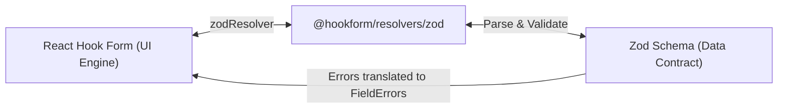
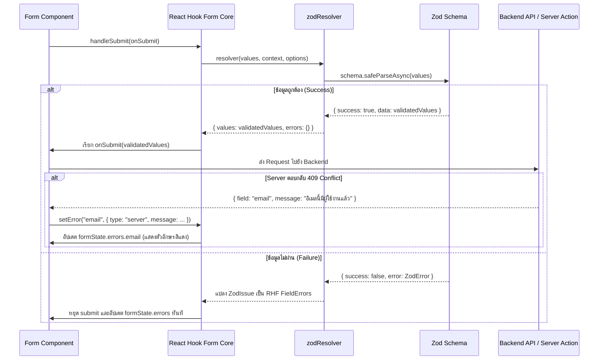

## 1. แนวคิด (Concept)

แม้ว่า **React Hook Form (RHF)** จะมีความสามารถในการตรวจสอบฟิลด์แบบ Built-in (เช่น `register('email', { required: true, pattern: /.../ })`) แต่ในระบบซอฟต์แวร์ระดับ Enterprise การกระจายกฎเกณฑ์ Validation ไว้ในแท็ก JSX แต่ละช่อง เป็นข้อผิดพลาดเชิงสถาปัตยกรรม (Architectural Anti-pattern) เพราะทำให้กฎเกณฑ์กระจัดกระจาย ไม่สามารถนำกลับมาใช้ซ้ำ (Reuse) ร่วมกับ API หรือ Backend ได้

แพ็กเกจ **`@hookform/resolvers/zod`** เข้ามาทำหน้าที่เป็น **สะพานเชื่อมมาตรฐาน (Standard Bridge)**:



ด้วยสถาปัตยกรรมนี้:
1. ฟอร์มใน UI มีหน้าที่เพียงผูก `zodResolver(schema)` ผ่านออปชัน `resolver`
2. กฎการตรวจสอบทั้งหมดถูกแยกออกไปอยู่ในไฟล์ Schema อิสระ ซึ่งสามารถแชร์ข้ามไปใช้งานร่วมกับ Next.js 16 Server Actions หรือ NestJS Controller ได้
3. เมื่อเกิดข้อผิดพลาดจากฝั่ง Backend (เช่น "อีเมลนี้ถูกลงทะเบียนไปแล้ว") เราสามารถใช้ฟังก์ชัน **`setError()`** ของ RHF ฉีดข้อผิดพลาดนั้นกลับเข้าไปในฟิลด์ UI เสมือนเป็น Validation Error ปกติได้อย่างแนบเนียน

---

## 2. หลักการเบื้องหลัง (Under the Hood)

### 2.1 สะพานเชื่อม `zodResolver` ทำงานอย่างไร?

เมื่อเกิดเหตุการณ์ Trigger Validation ใน React Hook Form (ตาม `mode` ที่กำหนด เช่น Submit หรือ Blur):



### 2.2 โครงสร้างการแปลง Error: จาก `ZodIssue` สู่ `FieldError`

Zod ส่งคืน Error ในรูปของ Tree โครงสร้างข้อมูล (`path: ['address', 'zipcode']`) ตัว `zodResolver` จะทำการแปลง Path ดังกล่าวให้สอดคล้องกับ Dot-notation ของ React Hook Form:

```typescript
// สิ่งที่ Zod ส่งออกมา
{
  issues: [
    {
      code: "custom",
      path: ["organization", "taxId"],
      message: "เลขประจำตัวผู้เสียภาษีไม่ถูกต้อง"
    }
  ]
}

// สิ่งที่ zodResolver แปลงให้ RHF formState.errors
errors.organization?.taxId?.message === "เลขประจำตัวผู้เสียภาษีไม่ถูกต้อง"
```

### 2.3 การจัดการ Server-side Error ด้วย `setError`

เมื่อการส่งข้อมูลไปสู่เซิร์ฟเวอร์ล้มเหลว (เช่น รหัสผ่านเดิมไม่ถูกต้อง หรือ Username ซ้ำ) เราไม่ควรแสดงผลผ่าน Alert หรือข้อความลอยๆ ด้านบนของหน้าจอเพียงอย่างเดียว แต่ควรส่งตรงไปยังช่องที่มีปัญหาด้วยฟังก์ชัน `setError`:

```typescript
setError('email', {
  type: 'server', // ระบุประเภท error ว่ามาจากเซิร์ฟเวอร์
  message: 'อีเมลนี้ถูกใช้งานในระบบแล้ว กรุณาใช้อีเมลอื่น',
}, {
  shouldFocus: true, // ให้เบราว์เซอร์เลื่อน Scroll และ Focus ไปที่ช่อง email อัตโนมัติ!
});
```

---

## 3. ตัวอย่างโค้ด (TypeScript / TSX)

### ตัวอย่างที่ 1: ระบบเข้าสู่ระบบระดับ Enterprise พร้อมจัดการ Server Error (`EnterpriseLoginForm.tsx`)

ตัวอย่างฟอร์มล็อกอินที่เชื่อมต่อ RHF + Zod พร้อมจัดการสถานะความล้มเหลวจาก API (HTTP 401 Unauthorized) และฉีด Error กลับเข้าสู่ช่องที่ระบุด้วย `setError`:

```tsx filename="components/forms/EnterpriseLoginForm.tsx"
'use client';

import React from 'react';
import { useForm } from 'react-hook-form';
import { zodResolver } from '@hookform/resolvers/zod';
import { z } from 'zod';
import { toast } from 'sonner';
import { LogIn, Mail, Lock, AlertCircle, Loader2 } from 'lucide-react';

// 1. กำหนด Schema ด้วย Zod 4
export const loginSchema = z.object({
  email: z
    .string({ error: 'กรุณากรอกอีเมล' })
    .email({ error: 'รูปแบบอีเมลไม่ถูกต้อง' }),
  password: z
    .string({ error: 'กรุณากรอกรหัสผ่าน' })
    .min(6, { error: 'รหัสผ่านต้องมีความยาวอย่างน้อย 6 ตัวอักษร' }),
  rememberMe: z.boolean().default(false),
});

export type LoginFormValues = z.infer<typeof loginSchema>;

export function EnterpriseLoginForm() {
  const {
    register,
    handleSubmit,
    setError,
    formState: { errors, isSubmitting },
  } = useForm<LoginFormValues>({
    resolver: zodResolver(loginSchema),
    mode: 'onSubmit',
    defaultValues: {
      email: '',
      password: '',
      rememberMe: false,
    },
  });

  // ฟังก์ชันจำลองการเรียก Backend Login API
  const handleLogin = async (data: LoginFormValues) => {
    try {
      await new Promise((r) => setTimeout(r, 1200));

      // จำลองสถานการณ์: ถ้ารหัสผ่านคือ 'wrong123' ให้ Backend ตีกลับ Error
      if (data.password === 'wrong123') {
        // ฉีด Error จาก Server ตรงเข้าสู่ฟิลด์ password พร้อมเลื่อนโฟกัส
        setError(
          'password',
          {
            type: 'server',
            message: 'รหัสผ่านไม่ถูกต้อง กรุณาตรวจสอบอีกครั้ง',
          },
          { shouldFocus: true }
        );
        return;
      }

      // จำลองสถานการณ์: ถ้าอีเมลถูกแบน
      if (data.email === 'banned@company.com') {
        setError(
          'email',
          {
            type: 'server',
            message: 'บัญชีนี้ถูกระงับการใช้งานชั่วคราว ติดต่อผู้ดูแลระบบ',
          },
          { shouldFocus: true }
        );
        return;
      }

      toast.success('เข้าสู่ระบบสำเร็จ กำลังนำคุณสู่แดชบอร์ด...');
    } catch (err) {
      toast.error('ไม่สามารถเชื่อมต่อเซิร์ฟเวอร์ได้ กรุณาลองใหม่');
    }
  };

  return (
    <div className="max-w-md mx-auto p-6 bg-surface border border-hairline rounded-2xl shadow-sm">
      <div className="flex items-center gap-2 mb-6 pb-4 border-b border-hairline">
        <LogIn className="w-5 h-5 text-primary" />
        <h3 className="text-lg font-bold text-ink">ลงชื่อเข้าสู่ระบบ</h3>
      </div>

      <form onSubmit={handleSubmit(handleLogin)} className="space-y-4">
        {/* อีเมล */}
        <div>
          <label className="text-xs font-semibold text-ink flex items-center gap-1.5">
            <Mail className="w-3.5 h-3.5 text-muted" /> อีเมล
          </label>
          <input
            type="email"
            placeholder="name@company.com"
            {...register('email')}
            className={`w-full mt-1 p-2.5 text-sm border rounded-lg outline-none transition-all ${
              errors.email
                ? 'border-rose-500 bg-rose-500/5'
                : 'border-hairline focus:ring-2 focus:ring-primary/20'
            }`}
          />
          {errors.email && (
            <p className="text-xs text-rose-500 mt-1 flex items-center gap-1">
              <AlertCircle className="w-3.5 h-3.5 shrink-0" />
              {errors.email.message}
            </p>
          )}
        </div>

        {/* รหัสผ่าน */}
        <div>
          <label className="text-xs font-semibold text-ink flex items-center gap-1.5">
            <Lock className="w-3.5 h-3.5 text-muted" /> รหัสผ่าน
          </label>
          <input
            type="password"
            placeholder="••••••••"
            {...register('password')}
            className={`w-full mt-1 p-2.5 text-sm border rounded-lg outline-none transition-all ${
              errors.password
                ? 'border-rose-500 bg-rose-500/5'
                : 'border-hairline focus:ring-2 focus:ring-primary/20'
            }`}
          />
          {errors.password && (
            <p className="text-xs text-rose-500 mt-1 flex items-center gap-1">
              <AlertCircle className="w-3.5 h-3.5 shrink-0" />
              {errors.password.message}
            </p>
          )}
        </div>

        {/* จดจำฉันในระบบ */}
        <div className="flex items-center justify-between text-xs">
          <label className="flex items-center gap-2 cursor-pointer text-muted">
            <input
              type="checkbox"
              {...register('rememberMe')}
              className="rounded border-hairline text-primary focus:ring-primary"
            />
            <span>จดจำการเข้าสู่ระบบ 30 วัน</span>
          </label>
          <a href="#forgot" className="text-primary hover:underline font-medium">
            ลืมรหัสผ่าน?
          </a>
        </div>

        <button
          type="submit"
          disabled={isSubmitting}
          className="w-full py-2.5 bg-primary text-white text-sm font-semibold rounded-lg hover:bg-primary/90 transition-all flex items-center justify-center gap-2 disabled:opacity-50"
        >
          {isSubmitting ? (
            <>
              <Loader2 className="w-4 h-4 animate-spin" /> กำลังตรวจสอบข้อมูล...
            </>
          ) : (
            'เข้าสู่ระบบ'
          )}
        </button>
      </form>
    </div>
  );
}
```

---

### ตัวอย่างที่ 2: ระบบเปลี่ยนรหัสผ่านความปลอดภัยสูง (`ChangePasswordForm.tsx`)

ตัวอย่างฟอร์มเปลี่ยนรหัสผ่านที่มีการเปรียบเทียบรหัสผ่านใหม่กับยืนยันรหัสผ่าน และจำลองการแปลง Response HTTP 400 จาก REST API มาเป็น Field Errors ใน RHF:

```tsx filename="components/forms/ChangePasswordForm.tsx"
'use client';

import React from 'react';
import { useForm } from 'react-hook-form';
import { zodResolver } from '@hookform/resolvers/zod';
import { z } from 'zod';
import { toast } from 'sonner';
import { KeyRound, ShieldAlert } from 'lucide-react';

const changePasswordSchema = z
  .object({
    currentPassword: z
      .string({ error: 'กรุณากรอกรหัสผ่านปัจจุบัน' })
      .min(1, { error: 'กรุณากรอกรหัสผ่านปัจจุบัน' }),
    newPassword: z
      .string({ error: 'กรุณากรอกรหัสผ่านใหม่' })
      .min(8, { error: 'รหัสผ่านใหม่ต้องมีอย่างน้อย 8 ตัวอักษร' })
      .regex(/[0-9]/, { error: 'ต้องมีตัวเลขอย่างน้อย 1 ตัว' }),
    confirmNewPassword: z.string({ error: 'กรุณายืนยันรหัสผ่านใหม่' }),
  })
  .refine((data) => data.newPassword === data.confirmNewPassword, {
    message: 'รหัสผ่านใหม่ทั้งสองช่องไม่ตรงกัน',
    path: ['confirmNewPassword'],
  });

type ChangePasswordValues = z.infer<typeof changePasswordSchema>;

export function ChangePasswordForm() {
  const {
    register,
    handleSubmit,
    setError,
    reset,
    formState: { errors, isSubmitting },
  } = useForm<ChangePasswordValues>({
    resolver: zodResolver(changePasswordSchema),
    defaultValues: {
      currentPassword: '',
      newPassword: '',
      confirmNewPassword: '',
    },
  });

  const onSubmit = async (data: ChangePasswordValues) => {
    try {
      await new Promise((resolve) => setTimeout(resolve, 1000));

      // จำลองสถานการณ์: เซิร์ฟเวอร์ตอบว่ารหัสผ่านเดิมไม่ถูกต้อง
      if (data.currentPassword !== 'secret123') {
        setError(
          'currentPassword',
          {
            type: 'server',
            message: 'รหัสผ่านปัจจุบันไม่ถูกต้อง กรุณาระบุรหัสผ่านที่ใช้งานอยู่ในปัจจุบัน',
          },
          { shouldFocus: true }
        );
        return;
      }

      toast.success('เปลี่ยนรหัสผ่านเรียบร้อยแล้ว กรุณาเข้าสู่ระบบใหม่อีกครั้ง');
      reset();
    } catch (error) {
      toast.error('เกิดข้อผิดพลาดในการเชื่อมต่อเซิร์ฟเวอร์');
    }
  };

  return (
    <div className="max-w-md mx-auto p-6 bg-surface border border-hairline rounded-2xl shadow-sm">
      <div className="flex items-center gap-2 mb-4 pb-3 border-b border-hairline">
        <KeyRound className="w-5 h-5 text-primary" />
        <h3 className="text-lg font-bold text-ink">เปลี่ยนรหัสผ่านความปลอดภัย</h3>
      </div>

      <form onSubmit={handleSubmit(onSubmit)} className="space-y-4">
        <div>
          <label className="text-xs font-semibold text-ink">รหัสผ่านปัจจุบัน</label>
          <input
            type="password"
            placeholder="••••••••"
            {...register('currentPassword')}
            className={`w-full mt-1 p-2 text-sm border rounded-lg outline-none ${
              errors.currentPassword ? 'border-rose-500' : 'border-hairline'
            }`}
          />
          {errors.currentPassword && (
            <p className="text-xs text-rose-500 mt-1">{errors.currentPassword.message}</p>
          )}
        </div>

        <div>
          <label className="text-xs font-semibold text-ink">รหัสผ่านใหม่</label>
          <input
            type="password"
            placeholder="••••••••"
            {...register('newPassword')}
            className={`w-full mt-1 p-2 text-sm border rounded-lg outline-none ${
              errors.newPassword ? 'border-rose-500' : 'border-hairline'
            }`}
          />
          {errors.newPassword && (
            <p className="text-xs text-rose-500 mt-1">{errors.newPassword.message}</p>
          )}
        </div>

        <div>
          <label className="text-xs font-semibold text-ink">ยืนยันรหัสผ่านใหม่</label>
          <input
            type="password"
            placeholder="••••••••"
            {...register('confirmNewPassword')}
            className={`w-full mt-1 p-2 text-sm border rounded-lg outline-none ${
              errors.confirmNewPassword ? 'border-rose-500' : 'border-hairline'
            }`}
          />
          {errors.confirmNewPassword && (
            <p className="text-xs text-rose-500 mt-1">{errors.confirmNewPassword.message}</p>
          )}
        </div>

        <button
          type="submit"
          disabled={isSubmitting}
          className="w-full mt-2 py-2.5 bg-primary text-white text-sm font-semibold rounded-lg hover:bg-primary/90 transition-colors disabled:opacity-50"
        >
          {isSubmitting ? 'กำลังอัปเดตรหัสผ่าน...' : 'อัปเดตรหัสผ่านใหม่'}
        </button>
      </form>
    </div>
  );
}
```

---

## 4. เทียบกับวิธีเดิม (useState vs RHF + Zod)

| มิติการทำงาน | เขียน Custom Handler (`useState`) | ใช้ `@hookform/resolvers/zod` |
| :--- | :--- | :--- |
| **จุดเก็บ Logic การตรวจสอบ** | เขียนปนอยู่ใน Event Handler หรือในฟังก์ชัน Submit ของแต่ละหน้า | แยกเป็น Declarative Zod Schema ชัดเจน สามารถแชร์ไปให้ Backend ได้ |
| **การเชื่อมโยง Error กับ UI** | ต้องสร้าง State `errors` แล้วจำแนกเองทีละฟิลด์ | RHF และ zodResolver แปลง Error ลงใน `formState.errors` ให้อัตโนมัติ |
| **การรับ Server Error** | จัดการยุ่งยาก มักแสดง Alert Box รวมด้านบน | ใช้ `setError('field', ...)` ชี้ไปยังช่องนั้น พร้อม Auto-scroll & Focus |
| **การล้าง Error เมื่อพิมพ์ใหม่** | ต้องเขียนดักฟัง `onChange` เพื่อเซ็ต `setError(null)` ทีละช่อง | RHF เคลียร์ Error ของฟิลด์นั้นให้อัตโนมัติทันทีที่ผู้ใช้แก้ไขถูกต้อง |

---

## 5. ผิด vs ถูก (Anti-patterns vs Best Practices)

### กรณีที่ 1: การเขียน Validation Rules ซ้ำซ้อนทั้งใน Schema และใน `register()`
```tsx
// ❌ ผิด: ใส่ required หรือ pattern ซ้ำใน register ทั้งๆ ที่มี zodResolver อยู่แล้ว
// ทำให้เกิด Conflict และความสับสนว่ากฎข้อไหนกำลังทำงานอยู่
<input {...register('email', { required: 'กรุณากรอกอีเมล', pattern: /.../ })} />

// ✅ ถูก: ให้ Zod Schema เป็นผู้ดูแลกฎเกณฑ์แต่เพียงผู้เดียว ส่วน register มีหน้าที่แค่ระบุชื่อฟิลด์
<input {...register('email')} />
```

### กรณีที่ 2: การไม่ระบุ `{ shouldFocus: true }` เมื่อเรียกใช้ `setError` จากเซิร์ฟเวอร์
```tsx
// ❌ ไม่สมบูรณ์: ผู้ใช้อาจมองไม่เห็นข้อผิดพลาด หากช่องนั้นอยู่ด้านบนที่ถูกเลื่อนหลุดหน้าจอไปแล้ว
setError('taxId', { type: 'server', message: 'เลขภาษีไม่ถูกต้อง' });

// ✅ ดีเยี่ยม: ใส่ shouldFocus: true เพื่อนำสายตาและเคอร์เซอร์ของผู้ใช้กลับไปยังจุดที่ต้องแก้ไขทันที
setError('taxId', { type: 'server', message: 'เลขภาษีไม่ถูกต้อง' }, { shouldFocus: true });
```

---

## 6. ควรใช้เมื่อไหร่ / ไม่ควรใช้เมื่อไหร่

### ควรใช้ `zodResolver` เมื่อ:
- แอปพลิเคชันต้องการสถาปัตยกรรมระดับองค์กรที่แบ่งแยก UI ออกจาก Data Rules ชัดเจน
- ต้องการแชร์ Schema ร่วมกันระหว่าง Client Component, Next.js Server Actions, และ NestJS Backend
- มีการรับ Server-side Rejection หรือ Business Error จาก API แล้วต้องการฉีดกลับเข้าสู่แต่ละฟิลด์อย่างเป็นระเบียบ

### ไม่ควรใช้เมื่อ:
- แบบฟอร์มนั้นไม่มีการตรวจสอบเงื่อนไขใดๆ เลย (Unvalidated Form) หรือมีแค่ฟิลด์เดียวที่เรียบง่ายมากๆ

---

## 7. คำถามสัมภาษณ์งาน (Interview Questions)

### Q1: `zodResolver` ทำหน้าที่อะไร และทำไมเราจึงไม่ควรเขียน Validation Rules ในตัวเลือกของฟังก์ชัน `register()` โดยตรง?
**แนวทางคำตอบแบบ Senior**:
> "`zodResolver` ทำหน้าที่เป็นสะพานเชื่อมระหว่าง React Hook Form และ Zod โดยจะนำค่าปัจจุบันในฟอร์มไปเข้ากระบวนการ `safeParseAsync` ของ Zod Schema แล้วแปลงข้อผิดพลาดที่เกิดขึ้นกลับมาเป็นรูปแบบ `FieldErrors` ที่ RHF เข้าใจ
> 
> เหตุผลที่เราไม่ควรเขียนกฎ Validation ปนอยู่ใน `register()` มี 3 ข้อหลักครับ:
> 1. **Separation of Concerns**: การเขียนกฎใน JSX ทำให้ UI ผูกติดกับ Business Logic ซึ่งผิดหลักการออกแบบสถาปัตยกรรมที่ดี
> 2. **Reusability**: Zod Schema เป็นโค้ด JavaScript บริสุทธิ์ ทำให้เราสามารถนำ Schema เดียวกันนี้ไปใช้ Validate ข้อมูลใน Next.js Server Actions หรือ Node.js Backend ได้โดยไม่ต้องเขียนโค้ดซ้ำ
> 3. **Cross-field Validation**: กฎใน `register()` ไม่สามารถตรวจสอบเงื่อนไขข้ามฟิลด์ (เช่น ยืนยันรหัสผ่านตรงกัน หรือเปรียบเทียบวันที่) ได้อย่างยืดหยุ่นเท่ากับ Zod ครับ"

---

### Q2: เมื่อ Backend ส่ง Error ตอบกลับมา เช่น "Username นี้ถูกใช้งานแล้ว" เรามีกลยุทธ์อย่างไรในการนำข้อผิดพลาดนั้นมาแสดงบนฟอร์มของ React Hook Form?
**แนวทางคำตอบแบบ Senior**:
> "ใน React Hook Form เราใช้ฟังก์ชัน **`setError`** ครับ โดยส่งชื่อฟิลด์เป้าหมาย เช่น `setError('username', { type: 'server', message: 'Username นี้ถูกใช้งานแล้ว' }, { shouldFocus: true })`
> 
> การทำแบบนี้มีข้อดีคือ:
> 1. ตัว Error จะถูกแทรกลงใน `formState.errors.username` ทันที ทำให้ UI แสดงผลกล่องสีแดงและข้อความเตือนใต้ช่องกรอกเหมือนกับ Client-side Validation โดยที่ผู้ใช้ไม่รู้สึกแปลกแยก
> 2. การใส่ `{ shouldFocus: true }` จะช่วยเลื่อน Scrollbar ของหน้าจอและวาง Cursor ลงในช่องที่มีปัญหาให้ผู้ใช้อัตโนมัติ ปรับปรุง UX อย่างมาก
> 3. ทันทีที่ผู้ใช้เริ่มพิมพ์แก้ไขค่าในช่องนั้นใหม่ RHF จะทำการเคลียร์ Server Error นั้นออกให้อัตโนมัติเมื่อฟอร์มเข้าสู่รอบการ Validate ครั้งถัดไปครับ"
