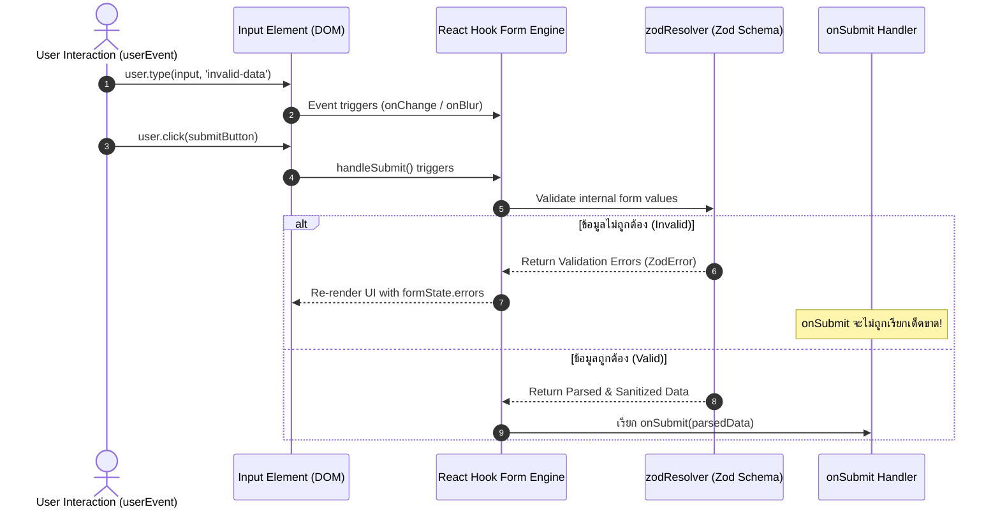

## 1. แนวคิด (Concept)

การทดสอบ (Testing) และการแก้ไขปัญหา (Debugging) ในระบบฟอร์มระดับ **Enterprise Production** ไม่ควรใช้ความรู้สึกหรือการคลิกมือซ้ำๆ แต่ต้องมี **พีระมิดการทดสอบ (Testing Pyramid / Trophy)** ที่ชัดเจนและทำซ้ำได้โดยอัตโนมัติ

ข้อได้เปรียบอันมหาศาลของการแยกความรับผิดชอบระหว่าง **Zod (Data Logic)** และ **React Hook Form (UI State Management)** คือเราสามารถแยกการทดสอบออกเป็น 2 ระดับอย่างสมบูรณ์:

1. **Pure Unit Testing บน Zod Schema**:
   - ทดสอบ Business Validation Rules ทั้งหมดในระดับ JavaScript บริสุทธิ์
   - ทำงานได้รวดเร็วระดับ Milliseconds โดย **ไม่ต้องจำลอง React DOM หรือใช้ JSDOM**
   - ครอบคลุม Boundary Values, Regex, Type Coercion, และข้อความแจ้งเตือนภาษาไทย
2. **Component Integration Testing ด้วย React Testing Library (@testing-library/react) + userEvent**:
   - จำลองพฤติกรรมจริงของผู้ใช้ (Real User Interactions) เช่น การคลิก, การ Tab, การพิมพ์ทีละตัวอักษร
   - ตรวจสอบว่า Error Message ภาษาไทยปรากฏบน UI อย่างถูกต้อง
   - ตรวจสอบว่า `onSubmit` Callback ถูกเรียกด้วย Payload ที่สมบูรณ์ 1 ครั้งถ้วน
3. **Real-time State Inspection ด้วย `@hookform/devtools`**:
   - มองเห็น Internal State ทุกอย่างของ RHF ทั้ง `values`, `errors`, `touchedFields`, `dirtyFields`, และ `isSubmitting` ขณะพัฒนาแบบ Real-time
4. **Diagnostic Checklist สำหรับปัญหา "กด Submit แล้วเงียบกริบ"**:
   - วิธีการสืบหาสาเหตุเชิงระบบเมื่อคลิกปุ่มส่งข้อมูลแล้วไม่มีอะไรเกิดขึ้นใน Console หรือ Network Tab

---

## 2. หลักการเบื้องหลัง (Under the Hood)

### 1. ลำดับเหตุการณ์อะซิงโครนัส (Async Execution Order) ใน RHF + RTL



### 2. ทำไมต้องใช้ `userEvent` แทน `fireEvent`?

ใน `@testing-library/react`:
- `fireEvent.change(input, { target: { value: 'test' } })`: เป็นเพียงการยิง Native Event `change` ดื้อๆ 1 ครั้ง โดยข้ามจังหวะ `pointerdown`, `focus`, `keydown`, `keypress`, `input`, `keyup`, และ `blur`
- `userEvent.type(input, 'test')`: จำลองพฤติกรรมของมนุษย์จริงๆ ตามลำดับ Event ของเบราว์เซอร์ครบทุกขั้นตอน ซึ่งทำให้ RHF ทำงานตรงตาม Lifecycle จริง โดยเฉพาะเมื่อตั้งค่า `mode: 'onTouched'` หรือ `mode: 'onBlur'`

### 3. สถาปัตยกรรมภายในของ `@hookform/devtools`

DevTools เชื่อมต่อกับ React Hook Form ผ่าน Object `control`:
- `control` ภายในมี **Subject (Observer Pattern)** ที่คอย Emit Event ทุกครั้งที่ State ย่อยเปลี่ยนแปลง
- คอมโพเนนต์ `<DevTool control={control} />` จะ Mount หน้าต่างลอยขึ้นมาบนหน้าจอเพื่อ Subscribe Event Bus ดังกล่าว ทำให้เราเห็น State Flow โดยไม่ต้องเขียน `console.log` ให้รกโค้ด

---

## 3. ตัวอย่างโค้ด (TypeScript / TSX)

### 1. Pure Unit Test สำหรับ Zod Schema (Vitest / Jest)

ทดสอบ Schema โดยไม่ต้องพึ่งพา React หรือ DOM:

```typescript filename="__tests__/schemas/employee-registration.test.ts"
import { describe, it, expect } from 'vitest';
import { z } from 'zod';

// กำหนด Schema สำหรับทดสอบ
export const EmployeeRegistrationSchema = z.object({
  fullName: z.string().min(3, 'ชื่อ-นามสกุลต้องมีความยาวอย่างน้อย 3 ตัวอักษร'),
  email: z.string().email('รูปแบบอีเมลองค์กรไม่ถูกต้อง'),
  department: z.enum(['ENGINEERING', 'PRODUCT', 'MARKETING', 'FINANCE'], {
    errorMap: () => ({ message: 'กรุณาเลือกแผนกที่สังกัด' }),
  }),
  salary: z.coerce.number().min(20000, 'ฐานเงินเดือนขั้นต่ำคือ 20,000 บาท'),
  probationMonths: z.coerce.number().int().min(1).max(6).default(4),
});

describe('EmployeeRegistrationSchema Unit Tests', () => {
  it('ควรผ่านการตรวจสอบเมื่อข้อมูลถูกต้องสมบูรณ์', () => {
    const validData = {
      fullName: 'สมชาย สายไอที',
      email: 'somchai@company.co.th',
      department: 'ENGINEERING',
      salary: '45000', // ทดสอบ Coercion จาก String เป็น Number
      probationMonths: '3',
    };

    const result = EmployeeRegistrationSchema.safeParse(validData);

    expect(result.success).toBe(true);
    if (result.success) {
      expect(result.data.salary).toBe(45000); // รับประกันว่าแปลงเป็น number แล้ว
      expect(result.data.probationMonths).toBe(3);
    }
  });

  it('ต้องปฏิเสธและส่งคืนข้อความภาษาไทยเมื่อเงินเดือนต่ำกว่าเกณฑ์', () => {
    const invalidData = {
      fullName: 'วิชัย รักงาน',
      email: 'wichai@company.co.th',
      department: 'MARKETING',
      salary: 15000, // ต่ำกว่าขั้นต่ำ 20,000
    };

    const result = EmployeeRegistrationSchema.safeParse(invalidData);

    expect(result.success).toBe(false);
    if (!result.success) {
      const fieldErrors = result.error.flatten().fieldErrors;
      expect(fieldErrors.salary).toContain('ฐานเงินเดือนขั้นต่ำคือ 20,000 บาท');
    }
  });

  it('ต้องใช้ค่า default สำหรับ probationMonths หากไม่ได้ระบุมา', () => {
    const dataWithoutProbation = {
      fullName: 'กานดา พัฒนา',
      email: 'kanda@company.co.th',
      department: 'PRODUCT',
      salary: 35000,
    };

    const result = EmployeeRegistrationSchema.safeParse(dataWithoutProbation);

    expect(result.success).toBe(true);
    if (result.success) {
      expect(result.data.probationMonths).toBe(4);
    }
  });
});
```

### 2. Component Integration Test ด้วย RTL และ `userEvent`

ทดสอบการโต้ตอบของผู้ใช้บนหน้าจอ:

```tsx filename="__tests__/components/EmployeeForm.test.tsx"
import React from 'react';
import { render, screen, waitFor } from '@testing-library/react';
import userEvent from '@testing-library/user-event';
import { describe, it, expect, vi } from 'vitest';
import { useForm } from 'react-hook-form';
import { zodResolver } from '@hookform/resolvers/zod';
import { EmployeeRegistrationSchema } from '../schemas/employee-registration.test';

// คอมโพเนนต์ฟอร์มสำหรับทดสอบ
function EmployeeForm({ onSubmit }: { onSubmit: (data: any) => void }) {
  const {
    register,
    handleSubmit,
    formState: { errors, isSubmitting },
  } = useForm({
    resolver: zodResolver(EmployeeRegistrationSchema),
    defaultValues: {
      fullName: '',
      email: '',
      department: 'ENGINEERING',
      salary: 0,
      probationMonths: 4,
    },
  });

  return (
    <form onSubmit={handleSubmit(onSubmit)} noValidate>
      <div>
        <label htmlFor="name-input">ชื่อ-นามสกุล</label>
        <input id="name-input" {...register('fullName')} />
        {errors.fullName && <p role="alert">{errors.fullName.message}</p>}
      </div>

      <div>
        <label htmlFor="email-input">อีเมลองค์กร</label>
        <input id="email-input" type="email" {...register('email')} />
        {errors.email && <p role="alert">{errors.email.message}</p>}
      </div>

      <div>
        <label htmlFor="salary-input">เงินเดือน</label>
        <input id="salary-input" type="number" {...register('salary')} />
        {errors.salary && <p role="alert">{errors.salary.message}</p>}
      </div>

      <button type="submit" disabled={isSubmitting}>
        บันทึกข้อมูลพนักงาน
      </button>
    </form>
  );
}

describe('EmployeeForm Integration Tests', () => {
  it('ต้องแสดง Error Message ภาษาไทยเมื่อผู้ใช้กด Submit โดยกรอกข้อมูลไม่ครบ', async () => {
    const user = userEvent.setup();
    const mockSubmit = vi.fn();

    render(<EmployeeForm onSubmit={mockSubmit} />);

    // กดปุ่ม Submit ทันทีโดยไม่กรอกชื่อ
    const submitBtn = screen.getByRole('button', { name: /บันทึกข้อมูลพนักงาน/i });
    await user.click(submitBtn);

    // ตรวจสอบว่า Error แจ้งเตือนปรากฏขึ้น
    expect(await screen.findByText('ชื่อ-นามสกุลต้องมีความยาวอย่างน้อย 3 ตัวอักษร')).toBeInTheDocument();
    expect(await screen.findByText('รูปแบบอีเมลองค์กรไม่ถูกต้อง')).toBeInTheDocument();

    // มั่นใจว่าฟังก์ชัน onSubmit ไม่ถูกเรียก
    expect(mockSubmit).not.toHaveBeenCalled();
  });

  it('ต้องเรียก onSubmit พร้อม Payload ที่สมบูรณ์เมื่อกรอกข้อมูลถูกต้องทั้งหมด', async () => {
    const user = userEvent.setup();
    const mockSubmit = vi.fn();

    render(<EmployeeForm onSubmit={mockSubmit} />);

    // ผู้ใช้พิมพ์ข้อมูลลงในฟิลด์ต่างๆ
    const nameInput = screen.getByLabelText(/ชื่อ-นามสกุล/i);
    const emailInput = screen.getByLabelText(/อีเมลองค์กร/i);
    const salaryInput = screen.getByLabelText(/เงินเดือน/i);
    const submitBtn = screen.getByRole('button', { name: /บันทึกข้อมูลพนักงาน/i });

    await user.type(nameInput, 'ประสิทธิ์ มุ่งมั่น');
    await user.type(emailInput, 'prasit@company.co.th');
    await user.clear(salaryInput);
    await user.type(salaryInput, '32000');

    await user.click(submitBtn);

    // ตรวจสอบการส่งข้อมูล
    await waitFor(() => {
      expect(mockSubmit).toHaveBeenCalledTimes(1);
    });

    expect(mockSubmit).toHaveBeenCalledWith(
      expect.objectContaining({
        fullName: 'ประสิทธิ์ มุ่งมั่น',
        email: 'prasit@company.co.th',
        salary: 32000,
        department: 'ENGINEERING',
        probationMonths: 4,
      }),
      expect.anything()
    );
  });
});
```

### 3. การติดตั้งและเปิดใช้งาน React Hook Form DevTools

ติดตั้ง Package เฉพาะ Development Environment:
```bash
npm install -D @hookform/devtools
```

การนำมาใช้งานในหน้า Page หรือ Form Component:

```tsx filename="components/RegistrationFormWithDevTools.tsx"
'use client';

import React from 'react';
import { useForm } from 'react-hook-form';
import { zodResolver } from '@hookform/resolvers/zod';
import { DevTool } from '@hookform/devtools';
import { EmployeeRegistrationSchema } from './schema';

export function RegistrationFormWithDevTools() {
  const { register, control, handleSubmit, formState } = useForm({
    resolver: zodResolver(EmployeeRegistrationSchema),
    defaultValues: {
      fullName: '',
      email: '',
      department: 'ENGINEERING',
      salary: 25000,
    },
  });

  const onSubmit = (data: any) => console.log('Data:', data);

  return (
    <div>
      <form onSubmit={handleSubmit(onSubmit)}>
        {/* ฟิลด์ของฟอร์ม */}
        <input {...register('fullName')} />
        <button type="submit">ส่งข้อมูล</button>
      </form>

      {/* เปิดใช้งาน DevTools เฉพาะตอน Local Development */}
      {process.env.NODE_ENV === 'development' && (
        <DevTool control={control} placement="top-right" />
      )}
    </div>
  );
}
```

---

## 4. เทียบกับวิธีเดิม

| มิติการทดสอบ | การทดสอบแบบเก่า (Manual Click & Console Dump) | การทดสอบตามแนวทาง Enterprise (Zod + RTL + userEvent) |
| :--- | :--- | :--- |
| **ความเร็วในการทดสอบ Business Logic** | ช้ามาก ต้องเปิดเบราว์เซอร์และคลิกกรอกทีละช่อง | ไวมาก รัน Zod Schema Unit Test ได้นับร้อยเคสในเสี้ยววินาที |
| **ความเสถียร (Flakiness)** | อาศัยสายตามนุษย์ ตกหล่นง่าย | อัตโนมัติใน CI/CD Pipeline ทุกครั้งที่มีการ Git Push |
| **การจำลอง Event** | ใช้ `fireEvent` ที่ไม่ตรงกับ Event Sequence จริงของ Browser | ใช้ `userEvent` จำลองพฤติกรรมมนุษย์เสมือนจริง 100% |
| **การ Debug Form State** | ใส่ `console.log(formState)` ใน JSX ทำให้โค้ดรกและ Re-render เพี้ยน | ใช้ `@hookform/devtools` ตรวจสอบ State ใน UI Overlay แบบ Real-time |

---

## 5. ผิด vs ถูก (Anti-patterns vs Best Practices)

### 1. การใช้ `fireEvent.change` แทน `userEvent.type`

```typescript
// ❌ ผิด: fireEvent ข้าม Focus/Blur/Keydown ทำให้ Trigger ของ RHF ทำงานไม่ครบ
fireEvent.change(screen.getByLabelText(/อีเมล/i), { target: { value: 'test@example.com' } });

// ✅ ถูก: userEvent จำลองเหตุการณ์เหมือนผู้ใช้พิมพ์จริงบนแป้นพิมพ์
const user = userEvent.setup();
await user.type(screen.getByLabelText(/อีเมล/i), 'test@example.com');
```

### 2. การเทสเฉพาะ UI โดยไม่ทำ Schema Unit Test

```typescript
// ❌ ผิด: พยายามเขียน Integration Test บนหน้าจอเพื่อครอบคลุม Regex และ Edge Cases 20 แบบ
// ผลลัพธ์: Test Suite ช้าลงอย่างมหาศาล และบำรุงรักษายาก

// ✅ ถูก: แยก Regex, Refine, และ Boundary Conditions ทั้งหมดไปทดสอบใน Zod Schema Test
// และใน Integration Test ให้ทดสอบเพียง Happy Path และ Error Rendering สำคัญๆ
```

### 3. การปล่อยให้ `@hookform/devtools` หลุดไปถึง Production Bundle

```tsx
// ❌ ผิด: Mount DevTool โดยไม่มีเงื่อนไขตรวจสอบ Environment
<DevTool control={control} />
// ผลลัพธ์: ลูกค้าบน Production มองเห็นแผงควบคุมภายในของฟอร์ม และเพิ่ม Bundle Size ให้กับแอป

// ✅ ถูก: ตรวจสอบ NODE_ENV เสมอ
{process.env.NODE_ENV === 'development' && <DevTool control={control} />}
```

---

## 6. ควรใช้เมื่อไหร่ / ไม่ควรใช้เมื่อไหร่

### Diagnostic Checklist: เมื่อ "กด Submit แล้วเงียบกริบ ไม่มีอะไรเกิดขึ้น"

หากคุณเจอปัญหายอดฮิต: คลิกปุ่มส่งข้อมูลแล้วไม่มี Request วิ่งออกไป, ไม่มี Log ใน Console, และหน้าจอไม่ขยับ ให้ไล่ตรวจตาม Checklist 5 ข้อนี้ตามลำดับ:

1. **ตรวจสอบ Callback ใน `handleSubmit`**:
   - คุณเผลอเขียน `<form onSubmit={onSubmit}>` แทนที่จะเป็น `<form onSubmit={handleSubmit(onSubmit)}>` หรือไม่?
2. **ดักจับ Validation Error Callback ตัวที่สอง**:
   - `handleSubmit` รองรับ Callback ตัวที่สองสำหรับจับ Error:
   ```typescript
   handleSubmit(
     (validData) => console.log('ผ่าน:', validData),
     (errors) => console.error('ติด Validation:', errors) // ใส่ตรงนี้เพื่อดูทันที!
   );
   ```
   - บ่อยครั้งที่มี Error เกิดขึ้นในฟิลด์ที่ไม่ได้แสดง `<p>{errors.field?.message}</p>` บนหน้าจอ ทำให้ผู้ใช้มองไม่เห็น Error แต่ RHF สั่งระงับการ Submit เอาไว้
3. **ตรวจสอบ Phantom / Hidden Required Fields**:
   - มีฟิลด์ที่ถูกตั้งค่า Zod เป็น `min(1)` หรือ `nonempty` แต่ Input ตัวนั้นถูกซ่อนด้วย `display: none` หรืออยู่ใน Tab อื่นที่ยังไม่ได้เปิดหรือไม่
4. **ตรวจสอบแอตทริบิวต์ของปุ่ม Submit**:
   - หากปุ่ม `<button>` อยู่ภายนอกแท็ก `<form>` คุณลืมใส่แอตทริบิวต์ `form="form-id"` หรือไม่
   - ปุ่มระบุ `type="button"` ค้างไว้แทนที่จะเป็น `type="submit"` หรือไม่
5. **Event Propagation Collisions**:
   - มีฟังก์ชันอื่นดัก `e.preventDefault()` หรือ `e.stopPropagation()` ไว้ก่อนถึง RHF หรือไม่

---

## 7. คำถามสัมภาษณ์งาน (Interview Questions)

### Q1: "ถ้ากดปุ่ม Submit ใน React Hook Form แล้วไม่มีอะไรเกิดขึ้นใน console หรือฟังก์ชัน onSubmit ไม่ถูกเรียกเลย คุณจะมีขั้นตอนการหาสาเหตุ (Debugging Process) อย่างไรบ้าง?"

**แนวทางคำตอบระดับ Senior:**
> "ผมจะดำเนินการวินิจฉัยปัญหาตามลำดับขั้น 4 สเต็ปครับ:
>
> 1. **สืบค้น Validation Errors ด้วย OnInvalid Callback**: โดยปกติ `handleSubmit` รับพารามิเตอร์ 2 ตัว คือ `onValid` และ `onInvalid` ผมจะใส่ฟังก์ชันดักฟังตัวที่สองทันที: `handleSubmit(onSuccess, (errors) => console.error('Form Invalid:', errors))` บ่อยครั้งเราจะพบว่าฟอร์มมี Error อยู่จริง แต่ไม่มี UI Component ที่ผูกแสดงผล error message ฟิลด์นั้น ทำให้หน้าจอเงียบสนิท
> 2. **ตรวจสอบ Form HTML Semantics**: ตรวจสอบว่าปุ่มเป็น `<button type=\"submit\">` จริงหรือไม่ และกรณีที่ปุ่มอยู่นอกแท็ก `<form>` ได้มีการผูก `form=\"my-form-id\"` ให้ตรงกับ `<form id=\"my-form-id\">` หรือไม่
> 3. **ตรวจสอบ Unmounted / Hidden Field Validation**: หากใน Zod Schema มีฟิลด์ที่บังคับ Required แต่ฟิลด์นั้นถูกซ่อนอยู่ใน Accordion, Tab อื่น หรือถูก Unmount ออกจาก DOM ไปโดยไม่ได้ Unregister RHF จะยังคงถือว่าฟอร์มไม่สมบูรณ์และระงับการส่งข้อมูล
> 4. **เปิดใช้งาน `@hookform/devtools`**: เพื่อดู State ของ `errors`, `isSubmitting`, และ `isValid` แบบสดๆ ซึ่งจะทำให้เห็นทันทีว่าติดค้างอยู่ที่ฟิลด์ใดครับ"

---

### Q2: "ทำไมในการทดสอบ Component ฟอร์มของ React Hook Form เราจึงควรหลีกเลี่ยง `fireEvent` และเลือกใช้ `userEvent` จาก `@testing-library/user-event`?"

**แนวทางคำตอบระดับ Senior:**
> "ความแตกต่างสำคัญอยู่ที่ **Event Lifecycle & Timing** ครับ:
>
> - `fireEvent` จะทำการ Dispatch เฉพาะ DOM Event ตัวเดี่ยวๆ เช่น `fireEvent.change` โดยไม่ก่อให้เกิดเหตุการณ์แวดล้อมที่เกิดขึ้นจริงในเบราว์เซอร์
> - แต่ในการใช้งานจริง เมื่อมนุษย์เคาะแป้นพิมพ์ เบราว์เซอร์จะยิง Event ต่อเนื่องกันเป็นชุด: `pointerdown` -> `focus` -> `keydown` -> `keypress` -> `input` -> `keyup` และเมื่อเปลี่ยนช่องจะเกิด `blur`
>
> React Hook Form มีการตั้งค่า Validation Mode หลายแบบ เช่น `mode: 'onTouched'` หรือ `mode: 'onBlur'` หากเราใช้ `fireEvent.change` Event `blur` หรือ `focus` จะไม่ถูกยิง ส่งผลให้ RHF ไม่ยอมรันการตรวจสอบ ทำให้ผลการทดสอบเกิดความผิดพลาด (False Negative / False Positive)
>
> การใช้ `userEvent.type()` จึงช่วยจำลองพฤติกรรมมนุษย์ได้เสมือนจริง 100% ทำให้เรามั่นใจได้ว่าพฤติกรรมของฟอร์มทั้งในสถานะ Focus, Blur และ Typing จะทำงานตรงตาม Production แน่นอนครับ"
