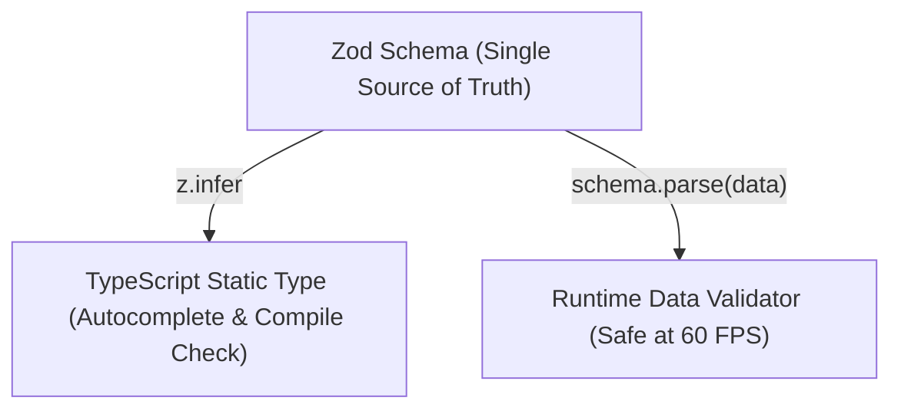
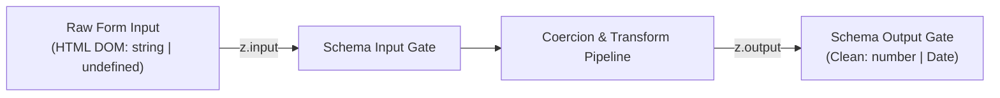

## 1. แนวคิด (Concept)

หนึ่งในพลังที่ยิ่งใหญ่ที่สุดของการนำ Zod มาใช้งานร่วมกับ TypeScript คือความสามารถในการทำ **Static Type Inference** หรือการอนุมานชนิดข้อมูลแบบสถิตโดยอัตโนมัติผ่านยูทิลิตี้ `z.infer`:



ในสถาปัตยกรรมระดับมืออาชีพ เราจะไม่เขียน `interface FormValues { ... }` แยกต่างหากจาก Zod Schema อีกต่อไป เพราะการเขียนแยกกันทำให้เกิดความเสี่ยงสูงที่เมื่อฟิลด์หนึ่งใน Schema มีการเปลี่ยนแปลง นักพัฒนาจะลืมอัปเดต Interface ตาม จนเกิดอาการข้อมูลคลาดเคลื่อน (Type Drift)

อย่างไรก็ตาม เมื่อ Schema มีการประยุกต์ใช้งาน **`z.coerce`**, **`.default()`**, หรือ **`.transform()`** ชนิดข้อมูลที่ไหลเข้า (Input) กับชนิดข้อมูลที่ส่งออกจากกระบวนการ Validate (Output) **อาจไม่ใช่ Type เดียวกันอีกต่อไป** นี่คือจุดที่นักพัฒนาหลายคนมักสับสน และเป็นที่มาของความเข้าใจลึกซึ้งระหว่าง `z.input` และ `z.output`

---

## 2. หลักการเบื้องหลัง (Under the Hood)

### 2.1 `z.input` vs `z.output` (vs `z.infer`)



- **`z.output<typeof schema>`**: คือ Type ของข้อมูลหลังจากที่ผ่านการ Parse, Coerce, และ Transform สำเร็จแล้ว และเป็นค่าเริ่มต้นของ **`z.infer<typeof schema>`** (กล่าวคือ `z.infer === z.output`)
- **`z.input<typeof schema>`**: คือ Type ของข้อมูลดิบก่อนจะถูกส่งเข้าสู่ Zod Schema

#### ตัวอย่างภาพจำลองความแตกต่าง:
```typescript
const budgetSchema = z.object({
  amount: z.coerce.number().min(100), // input ยอมรับ string | number | undefined, output เป็น number แน่นอน
  tag: z.string().default('General'), // input สามารถเป็น string | undefined, output เป็น string แน่นอน
});

type BudgetInput = z.input<typeof budgetSchema>;
// ผลลัพธ์: { amount: unknown (หรือ string | number); tag?: string }

type BudgetOutput = z.output<typeof budgetSchema>;
// ผลลัพธ์: { amount: number; tag: string }
```

### 2.2 ปัญหา Type Mismatch ยอดฮิตใน React Hook Form

เมื่อเราเรียกใช้ `useForm<T>` ร่วมกับ `zodResolver`:
- ช่อง `<input />` ใน HTML DOM คืนค่าออกมาเป็น `string` เสมอ
- หากเราผูก `useForm<BudgetOutput>` โดยตรง และกำหนด `defaultValues` เป็นค่าว่าง `""` TypeScript อาจแจ้งเตือนข้อผิดพลาดทันทีว่า `string` ไม่สามารถ Assign ให้กับ `number` ได้!

**ทางออกระดับ Senior**:
ใช้ประโยชน์จากการกำหนด Generic ใน `@hookform/resolvers/zod` ที่ออกแบบมารองรับทั้ง Input Type ของฟอร์ม และ Output Type ของ Submit Handler ได้อย่างสมบูรณ์แบบ:

```typescript
useForm<z.input<typeof schema>, unknown, z.output<typeof schema>>({
  resolver: zodResolver(schema),
});
```

---

## 3. ตัวอย่างโค้ด (TypeScript / TSX)

### ตัวอย่างที่ 1: ระบบตั้งค่าระบบองค์กร (`OrganizationSettingsForm.tsx`)

ตัวอย่างฟอร์มที่มีการแปลง String เป็น Number, การตัดคำ, และการแปลง Tag แบบ Comma-separated เป็น Array เพื่อแสดงความแตกต่างอย่างชัดเจนระหว่าง `z.input` และ `z.output`:

```tsx filename="components/forms/OrganizationSettingsForm.tsx"
'use client';

import React from 'react';
import { useForm } from 'react-hook-form';
import { zodResolver } from '@hookform/resolvers/zod';
import { z } from 'zod';
import { toast } from 'sonner';
import { Settings2, ShieldCheck } from 'lucide-react';

// 1. ประกาศ Schema พร้อม Transform และ Coercion
export const orgSettingsSchema = z.object({
  companyName: z
    .string({ error: 'กรุณากรอกชื่อบริษัท' })
    .min(2, { error: 'ชื่อบริษัทต้องมีความยาวอย่างน้อย 2 ตัวอักษร' })
    .transform((name) => name.trim()),

  maxUsersAllowed: z.coerce
    .number({ error: 'กรุณาระบุจำนวนผู้ใช้สูงสุด' })
    .int({ error: 'จำนวนผู้ใช้ต้องเป็นเลขจำนวนเต็ม' })
    .min(1, { error: 'ต้องรองรับผู้ใช้อย่างน้อย 1 คน' })
    .max(10000, { error: 'รองรับได้สูงสุด 10,000 คน' }),

  allowedIpsRaw: z
    .string()
    .transform((val) =>
      val
        .split(',')
        .map((ip) => ip.trim())
        .filter((ip) => ip.length > 0)
    ),

  enforce2FA: z.boolean().default(false),
});

// 2. แยก Type ชัดเจน: FormInput (สิ่งที่ DOM ถือ) vs FormOutput (สิ่งที่ Backend ได้รับ)
export type OrgSettingsInput = z.input<typeof orgSettingsSchema>;
export type OrgSettingsOutput = z.output<typeof orgSettingsSchema>;

export function OrganizationSettingsForm() {
  // 3. ผูก useForm พร้อม Generic 3 ตัวเพื่อ Type Safety สูงสุด
  const {
    register,
    handleSubmit,
    formState: { errors, isSubmitting },
  } = useForm<OrgSettingsInput, unknown, OrgSettingsOutput>({
    resolver: zodResolver(orgSettingsSchema),
    defaultValues: {
      companyName: 'Acme Innovation Co., Ltd.',
      maxUsersAllowed: 50,
      allowedIpsRaw: '192.168.1.1, 10.0.0.1',
      enforce2FA: true,
    },
  });

  // data ใน onSave จะมี Type เป็น OrgSettingsOutput (allowedIpsRaw กลายเป็น string[])
  const onSave = async (data: OrgSettingsOutput) => {
    await new Promise((r) => setTimeout(r, 800));
    console.log('Sanitized Payload for Backend API:', data);
    toast.success(`บันทึกการตั้งค่าบริษัท ${data.companyName} สำเร็จ`);
  };

  return (
    <div className="max-w-lg mx-auto p-6 bg-surface border border-hairline rounded-2xl shadow-sm">
      <div className="flex items-center gap-2 mb-6 pb-3 border-b border-hairline">
        <Settings2 className="w-5 h-5 text-primary" />
        <h3 className="text-lg font-bold text-ink">การตั้งค่าระบบความปลอดภัยองค์กร</h3>
      </div>

      <form onSubmit={handleSubmit(onSave)} className="space-y-4">
        <div>
          <label className="text-xs font-semibold text-ink">ชื่อบริษัท</label>
          <input
            type="text"
            {...register('companyName')}
            className="w-full mt-1 p-2.5 text-sm border rounded-lg border-hairline outline-none focus:ring-2 focus:ring-primary/20"
          />
          {errors.companyName && (
            <p className="text-xs text-rose-500 mt-1">{errors.companyName.message}</p>
          )}
        </div>

        <div>
          <label className="text-xs font-semibold text-ink">จำนวนบัญชีผู้ใช้งานสูงสุด</label>
          <input
            type="number"
            {...register('maxUsersAllowed')}
            className="w-full mt-1 p-2.5 text-sm border rounded-lg border-hairline outline-none focus:ring-2 focus:ring-primary/20"
          />
          {errors.maxUsersAllowed && (
            <p className="text-xs text-rose-500 mt-1">{errors.maxUsersAllowed.message}</p>
          )}
        </div>

        <div>
          <label className="text-xs font-semibold text-ink">
            IP Whitelist (คั่นแต่ละรายการด้วยเครื่องหมายจุลภาค ,)
          </label>
          <input
            type="text"
            placeholder="192.168.1.10, 10.0.4.5"
            {...register('allowedIpsRaw')}
            className="w-full mt-1 p-2.5 text-sm border rounded-lg border-hairline outline-none focus:ring-2 focus:ring-primary/20"
          />
          {errors.allowedIpsRaw && (
            <p className="text-xs text-rose-500 mt-1">{errors.allowedIpsRaw.message}</p>
          )}
          <span className="text-[11px] text-muted">
            ระบบจะแปลง String นี้เป็น Array ของ IP ที่ผ่านการ Trim ให้โดยอัตโนมัติ
          </span>
        </div>

        <div className="pt-2">
          <label className="flex items-center gap-2 cursor-pointer text-sm text-ink">
            <input
              type="checkbox"
              {...register('enforce2FA')}
              className="rounded border-hairline text-primary focus:ring-primary"
            />
            <span className="flex items-center gap-1.5 font-medium">
              <ShieldCheck className="w-4 h-4 text-emerald-500" />
              บังคับใช้งานยืนยันตัวตนสองขั้นตอน (Enforce 2FA)
            </span>
          </label>
        </div>

        <button
          type="submit"
          disabled={isSubmitting}
          className="w-full mt-4 py-2.5 bg-primary text-white text-sm font-semibold rounded-lg hover:bg-primary/90 transition-colors"
        >
          {isSubmitting ? 'กำลังบันทึก...' : 'บันทึกการตั้งค่านโยบาย'}
        </button>
      </form>
    </div>
  );
}
```

---

### ตัวอย่างที่ 2: ระบบสำรองที่นั่งสัมมนา (`EventBookingForm.tsx`)

ตัวอย่างฟอร์มที่เชื่อมโยง Type Safety ระหว่าง Frontend UI, Zod Type Inference และ Server Actions Payload:

```tsx filename="components/forms/EventBookingForm.tsx"
'use client';

import React from 'react';
import { useForm } from 'react-hook-form';
import { zodResolver } from '@hookform/resolvers/zod';
import { z } from 'zod';
import { toast } from 'sonner';
import { Ticket, Mail, User, CreditCard } from 'lucide-react';

const eventBookingSchema = z.object({
  attendeeName: z
    .string({ error: 'กรุณากรอกชื่อผู้เข้าร่วม' })
    .min(3, { error: 'ชื่อต้องมีความยาวอย่างน้อย 3 ตัวอักษร' }),

  attendeeEmail: z
    .string({ error: 'กรุณากรอกอีเมล' })
    .email({ error: 'รูปแบบอีเมลไม่ถูกต้อง' }),

  ticketCount: z.coerce
    .number({ error: 'กรุณาระบุจำนวนบัตร' })
    .int()
    .min(1, { error: 'ต้องซื้อบัตรอย่างน้อย 1 ใบ' })
    .max(5, { error: 'ซื้อได้ไม่เกิน 5 ใบต่อ 1 รายการ' }),

  eventSession: z.enum(['MORNING', 'AFTERNOON', 'FULL_DAY'], {
    error: 'กรุณาเลือกรอบการเข้าฟัง',
  }),
});

type EventBookingValues = z.infer<typeof eventBookingSchema>;

export function EventBookingForm() {
  const {
    register,
    handleSubmit,
    watch,
    formState: { errors, isSubmitting },
  } = useForm<EventBookingValues>({
    resolver: zodResolver(eventBookingSchema),
    defaultValues: {
      attendeeName: '',
      attendeeEmail: '',
      ticketCount: 1,
      eventSession: 'FULL_DAY',
    },
  });

  const ticketCount = watch('ticketCount') || 1;
  const pricePerTicket = 1500;
  const totalAmount = ticketCount * pricePerTicket;

  const onBookTicket = async (data: EventBookingValues) => {
    await new Promise((r) => setTimeout(r, 1000));
    toast.success(`สำรองบัตรจำนวน ${data.ticketCount} ใบสำเร็จ สำหรับ ${data.attendeeName}`);
  };

  return (
    <div className="max-w-md mx-auto p-6 bg-surface border border-hairline rounded-2xl shadow-sm">
      <div className="flex items-center gap-2 mb-4 pb-3 border-b border-hairline">
        <Ticket className="w-5 h-5 text-primary" />
        <h3 className="text-lg font-bold text-ink">จองบัตรงานสัมมนา Fullstack Tech 2026</h3>
      </div>

      <form onSubmit={handleSubmit(onBookTicket)} className="space-y-4">
        <div>
          <label className="text-xs font-semibold text-ink flex items-center gap-1">
            <User className="w-3.5 h-3.5 text-muted" /> ชื่อ-นามสกุล
          </label>
          <input
            type="text"
            placeholder="เช่น วีรภัทร ชาญวิทย์"
            {...register('attendeeName')}
            className="w-full mt-1 p-2 text-sm border rounded-lg border-hairline outline-none focus:ring-2 focus:ring-primary/20"
          />
          {errors.attendeeName && (
            <p className="text-xs text-rose-500 mt-1">{errors.attendeeName.message}</p>
          )}
        </div>

        <div>
          <label className="text-xs font-semibold text-ink flex items-center gap-1">
            <Mail className="w-3.5 h-3.5 text-muted" /> อีเมลสำหรับรับ E-Ticket
          </label>
          <input
            type="email"
            placeholder="vipat@tech.co"
            {...register('attendeeEmail')}
            className="w-full mt-1 p-2 text-sm border rounded-lg border-hairline outline-none focus:ring-2 focus:ring-primary/20"
          />
          {errors.attendeeEmail && (
            <p className="text-xs text-rose-500 mt-1">{errors.attendeeEmail.message}</p>
          )}
        </div>

        <div className="grid grid-cols-2 gap-3">
          <div>
            <label className="text-xs font-semibold text-ink">จำนวนบัตร</label>
            <input
              type="number"
              min={1}
              max={5}
              {...register('ticketCount')}
              className="w-full mt-1 p-2 text-sm border rounded-lg border-hairline outline-none focus:ring-2 focus:ring-primary/20"
            />
            {errors.ticketCount && (
              <p className="text-xs text-rose-500 mt-1">{errors.ticketCount.message}</p>
            )}
          </div>

          <div>
            <label className="text-xs font-semibold text-ink">รอบสัมมนา</label>
            <select
              {...register('eventSession')}
              className="w-full mt-1 p-2 text-sm border rounded-lg border-hairline outline-none focus:ring-2 focus:ring-primary/20 bg-surface"
            >
              <option value="MORNING">ช่วงเช้า (09:00 - 12:00)</option>
              <option value="AFTERNOON">ช่วงบ่าย (13:00 - 17:00)</option>
              <option value="FULL_DAY">ทั้งวัน (09:00 - 17:00)</option>
            </select>
          </div>
        </div>

        <div className="p-3 bg-subtle rounded-xl flex items-center justify-between text-sm">
          <span className="text-muted">ยอดรวมที่ต้องชำระ:</span>
          <span className="font-bold text-ink text-base">฿{totalAmount.toLocaleString()}</span>
        </div>

        <button
          type="submit"
          disabled={isSubmitting}
          className="w-full py-2.5 bg-primary text-white text-sm font-semibold rounded-lg hover:bg-primary/90 transition-colors flex items-center justify-center gap-2"
        >
          <CreditCard className="w-4 h-4" />
          {isSubmitting ? 'กำลังดำเนินการ...' : 'ยืนยันและชำระเงิน'}
        </button>
      </form>
    </div>
  );
}
```

---

## 4. เทียบกับวิธีเดิม (useState vs RHF + Zod)

| มิติการทำงาน | วิธีเดิม (เขียน TypeScript Type แยกเอง) | ใช้ `z.infer` ร่วมกับ RHF |
| :--- | :--- | :--- |
| **การจัดการสัญญา (Contract)** | ต้องแก้ทั้ง Interface และ Validation Code ทุกครั้งที่มีฟิลด์ใหม่ | ปรับแก้ที่ Zod Schema จุดเดียว Type ทั้งระบบอัปเดตทันที |
| **ความผิดพลาดมนุษย์ (Human Error)** | เสี่ยงต่อการลืมแก้ Type ทำให้ตอนคอมไพล์ผ่าน แต่รันไทม์เกิดข้อผิดพลาด | ขจัด Type Drift 100% เพราะ Type อนุมานจาก Schema โดยตรง |
| **Input vs Output Types** | จัดการยาก มักใช้ `any` หรือ `unknown` ชั่วคราว | มี `z.input` และ `z.output` ให้ใช้แบบแยกประเภทชัดเจน |
| **Generics ใน useForm** | มักระบุ `<any>` เพื่อหลีกเลี่ยง Error สีแดงของ TypeScript | มี Strict Generic Contract คุ้มกันตลอดเส้นทางของฟอร์ม |

---

## 5. ผิด vs ถูก (Anti-patterns vs Best Practices)

### กรณีที่ 1: การเขียน Type หรือ Interface ทับซ้อนกับ Zod Schema
```typescript
// ❌ ผิด: เสียเวลาเขียน Type ซ้ำ และเสี่ยงต่อการหลุดไม่ตรงกัน
interface UserForm {
  name: string;
  email: string;
}
const userSchema = z.object({
  name: z.string(),
  email: z.string().email(),
});

// ✅ ถูก: อนุมาน Type จาก Schema โดยตรง เป็น Single Source of Truth
const userSchema = z.object({
  name: z.string(),
  email: z.string().email(),
});
type UserForm = z.infer<typeof userSchema>;
```

### กรณีที่ 2: ใช้ `z.infer` กับฟอร์มที่มี Transform ซับซ้อนจนเกิด Mismatch ใน `defaultValues`
```typescript
// ❌ สับสน: เมื่อ schema มี .transform() ค่า z.infer จะเป็น Type ของ Output
// ทำให้ defaultValues ใน useForm บ่นว่าค่า Input ไม่ตรงกับ Output!
const schema = z.object({
  tags: z.string().transform((v) => v.split(',')),
});

// ✅ ถูก: แยกการส่ง Generic ใน useForm ให้ชัดเจน
type Input = z.input<typeof schema>;   // { tags: string }
type Output = z.output<typeof schema>; // { tags: string[] }

useForm<Input, unknown, Output>({
  resolver: zodResolver(schema),
  defaultValues: { tags: '' }, // ถูกต้องตาม Input Type!
});
```

---

## 6. ควรใช้เมื่อไหร่ / ไม่ควรใช้เมื่อไหร่

### ควรใช้ `z.infer` และ Type Inference เมื่อ:
- ประกาศ Schema ข้อมูลทุกประเภทในระบบ ไม่ว่าจะเป็น Form, API Request, API Response หรือ Database Row
- ฟอร์มที่มีกระบวนการ Coercion หรือ Data Transformation (ให้ใช้คู่กับ `z.input` และ `z.output`)
- ต้องการส่งต่อ Type ไปยัง Props ของคอมโพเนนต์ลูก หรือ Server Actions ใน Next.js 16

### ไม่ควรใช้เมื่อ:
- ระบบมีการใช้ Generic Utility Type ภายนอกที่ซับซ้อนเกินกว่าที่ Zod จะรองรับได้โดยตรง (เช่น Recursive Conditional Types ลึกๆ หลายชั้น ในกรณีนั้นอาจเขียน Type เสริมควบคู่)

---

## 7. คำถามสัมภาษณ์งาน (Interview Questions)

### Q1: `z.infer<T>`, `z.input<T>`, และ `z.output<T>` มีความแตกต่างกันอย่างไร ในสถานการณ์ใดที่ทั้งสองค่านี้จะให้ผลลัพธ์ไม่เหมือนกัน?
**แนวทางคำตอบแบบ Senior**:
> "`z.infer<T>` โดยปริยายแล้วมีค่าเทียบเท่ากับ `z.output<T>` ครับ ซึ่งหมายถึง **รูปทรงของข้อมูลหลังจากผ่านการ Parse และ Validate สำเร็จแล้ว**
> 
> ในกรณีที่ Schema ของเราประกอบด้วย Primitives ธรรมดา เช่น `z.string()`, `z.number()` ทั้ง `z.input` และ `z.output` จะมีหน้าตาเหมือนกันทุกประการ
> 
> แต่ทั้งสองจะให้ผลลัพธ์แตกต่างกันทันทีเมื่อเราใช้:
> 1. **`z.coerce`**: เช่น `z.coerce.number()` -> `z.input` จะยอมรับ `unknown` หรือ `string | number` แต่ `z.output` จะเป็น `number` แน่นอน
> 2. **`.transform()`**: เช่น การรับ string แล้วแปลงเป็น `string[]` หรือ `Date` -> `z.input` จะเป็นชนิดตั้งต้น ส่วน `z.output` จะเป็นชนิดข้อมูลปลายทาง
> 3. **`.default()`**: `z.input` จะเป็นฟิลด์ optional (`T | undefined`) แต่ `z.output` จะได้ค่าจริงเสมอไม่เป็น undefined ครับ"

---

### Q2: ในการเขียน TypeScript ร่วมกับ React Hook Form ทำไมเราจึงไม่ควรระบุ Type ของ `useForm` เป็น `useForm<any>`?
**แนวทางคำตอบแบบ Senior**:
> "การระบุ `useForm<any>` เป็น Anti-pattern ที่ทำลายข้อได้เปรียบทั้งหมดของ TypeScript ครับ เพราะ:
> 
> 1. **สูญเสีย Autocomplete**: เมื่อเราเรียก `register('fieldName')` ตัว IDE จะไม่สามารถแนะนำชื่อฟิลด์ได้ และหากพิมพ์ชื่อฟิลด์ผิด (Typo) TypeScript จะไม่สามารถแจ้งเตือนได้เลย
> 2. **Type Safety ใน `handleSubmit(onSubmit)` พังทลาย**: พารามิเตอร์ `data` ในฟังก์ชัน `onSubmit` จะกลายเป็น `any` ทำให้โค้ดส่วนที่นำข้อมูลไปใช้ต่อ เสี่ยงต่อ Runtime Error สูงมาก
> 3. **Refactor Risk**: เมื่อมีการเปลี่ยนโครงสร้างฟอร์มในอนาคต เราจะไม่ได้รับ Compile Error คอยชี้เป้าว่ามีคอมโพเนนต์หรือฟิลด์ไหนบ้างที่ต้องอัปเดตตาม
> 
> การใช้ `useForm<z.infer<typeof schema>>` รับประกันว่าการเปลี่ยนแปลงทั้งหมดจะถูกตรวจจับตั้งแต่ขั้นตอนคอมไพล์อย่างรัดกุมครับ"
