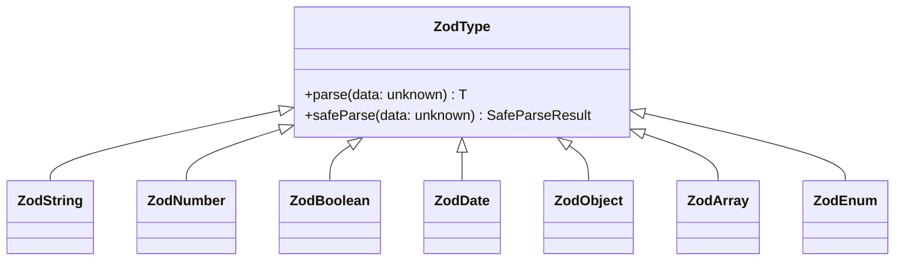

## 1. แนวคิด (Concept)

**Zod** คือไลบรารีสำหรับการประกาศโครงสร้างข้อมูล (Schema Declaration) และตรวจสอบความถูกต้องตอนรันไทม์ (Runtime Type Validation) โดยมุ่งเน้นปรัชญา **TypeScript-first**:

> *"ประกาศ Schema เพียงครั้งเดียว แล้วปล่อยให้ Zod อนุมาน Static TypeScript Type และทำหน้าที่ตรวจจับข้อมูลผิดพลาดตอนรันไทม์ให้โดยอัตโนมัติ"*

ในอดีต นักพัฒนาต้องเขียน Type Definition สองชุดควบคู่กัน:
1. `interface User { email: string; age: number; }` สำหรับตอนเขียนโค้ด (Compile-time)
2. ฟังก์ชันตรวจสอบ `if (typeof data.email !== 'string')` หรือ Regex สารพัดชนิดสำหรับตอนรันไทม์

หากมีการเพิ่มฟิลด์ใหม่หรือเปลี่ยนกฎเกณฑ์ ความไม่สอดคล้องระหว่าง Type กับฟังก์ชันตรวจสอบ (Type Desynchronization) ย่อมเกิดขึ้นทันที Zod ขจัดปัญหานี้โดยทำหน้าที่เป็น **Single Source of Truth** ที่สมบูรณ์แบบ

### วิวัฒนาการสู่ Zod v4 (Next-Generation Engine)

ในเวอร์ชัน 4 สถาปัตยกรรมภายในของ Zod ถูกยกเครื่องใหม่หมดเพื่อรองรับการใช้งานระดับ Fullstack บน Next.js 16 และ React 19:
- **JIT Parsing Engine**: ความเร็วในการ Parse ข้อมูลสูงขึ้นกว่าเดิม 2–5 เท่า ด้วยการออกแบบ Internal AST และ Fast-path parsing
- **Top-Level Type Shortcuts**: รองรับฟังก์ชันระบุ Type ทันที เช่น `z.email()`, `z.uuid()`, `z.url()` นอกเหนือจาก `z.string().email()` แบบดั้งเดิม
- **ไวยากรณ์ `{ error: '...' }`**: กำหนดข้อความ Error Message ได้สั้นกระชับและเป็นธรรมชาติกว่า `{ message: '...' }` แบบเดิม
- **Full Tree-shaking**: โครงสร้างแบบโมดูลาร์แท้จริง นำเข้าเฉพาะสิ่งจำเป็น ทำให้ขนาดของ Client Bundle ลดลงอย่างมีนัยสำคัญ

---

## 2. หลักการเบื้องหลัง (Under the Hood)

### 2.1 โครงสร้าง Type Hierarchy และ Primitives



หัวใจของ Zod คือคลาส `ZodType` ที่มีเมธอดหลัก 2 รูปแบบในการตรวจสอบข้อมูล:
- **`parse(data)`**: ตรวจสอบข้อมูล หากผ่านจะคืนค่าข้อมูลที่มี Type ชัดเจน หากไม่ผ่านจะขว้าง `ZodError` ทันที
- **`safeParse(data)`**: ไม่โยน Exception แต่คืน Object รูปแบบ Discriminated Union:
  - `{ success: true, data: T }`
  - `{ success: false, error: ZodError }`

### 2.2 ความแตกต่างระหว่าง Optional, Nullable, Nullish และ Default

หนึ่งในจุดที่สร้างบั๊กบ่อยที่สุดในฟอร์มคือความสับสนเรื่องค่าว่าง:

| Modifier | ชนิดข้อมูลที่ยอมรับ | ค่าใน TypeScript Type | ตัวอย่างการใช้งานจริง |
| :--- | :--- | :--- | :--- |
| **`z.string()`** | ต้องเป็น string เท่านั้น ห้ามเว้นว่าง | `string` | รหัสผ่าน, ชื่อผู้ใช้ |
| **`.optional()`** | ยอมรับ `undefined` หรือไม่ส่งคีย์มา | `string \| undefined` | เบอร์โทรศัพท์สำรอง |
| **`.nullable()`** | ยอมรับ `null` (เช่น ข้อมูลจากฐานข้อมูล SQL) | `string \| null` | วันที่ลาออกของพนักงาน |
| **`.nullish()`** | ยอมรับทั้ง `undefined` และ `null` | `string \| null \| undefined` | ข้อมูลจาก Legacy REST API |
| **`.default(val)`** | ถ้าเป็น `undefined` จะแทนที่ด้วย `val` | `string` (Input เป็น optional) | สถานะเริ่มต้น `PENDING` |

### 2.3 ตารางเปรียบเทียบไวยากรณ์ Zod 3 vs Zod 4

| ความสามารถ | Zod 3 (ไวยากรณ์เดิม) | Zod 4 (ไวยากรณ์ใหม่) |
| :--- | :--- | :--- |
| **Custom Error** | `z.string({ invalid_type_error: "..." })` | `z.string({ error: "ข้อความภาษาไทย" })` |
| **Email Validation** | `z.string().email("อีเมลไม่ถูกต้อง")` | `z.email({ error: "อีเมลไม่ถูกต้อง" })` หรือ `z.string().email(...)` |
| **UUID / URL** | `z.string().uuid()` / `z.string().url()` | `z.uuid()` / `z.url()` (Top-level shortcuts) |
| **Parsing Engine** | Dynamic dispatch loop | Monomorphic Fast-path compiled parser |
| **Bundle Footprint** | โหลด Schema Rules ขนาดใหญ่ล่วงหน้า | Granular Tree-shaking ย่อยระดับฟังก์ชัน |

---

## 3. ตัวอย่างโค้ด (TypeScript / TSX)

### ตัวอย่างที่ 1: ระบบจัดการข้อมูลสมาชิกและสิทธิ์องค์กร (`MemberProfileSchema.ts`)

แสดงการใช้ Primitives, Enum, Regex รหัสผ่าน, และการใส่ข้อความ Error ภาษาไทยอย่างละเอียดด้วย Zod 4:

```tsx filename="schemas/member-schema.ts"
import { z } from 'zod';

// 1. ประกาศ Enum สำหรับสิทธิ์การใช้งาน
export const RoleEnum = z.enum(['SUPER_ADMIN', 'EDITOR', 'VIEWER'], {
  error: 'กรุณาเลือกสิทธิ์การใช้งานที่กำหนดไว้เท่านั้น',
});

// 2. ประกาศ Schema หลักของสมาชิก
export const memberProfileSchema = z.object({
  id: z.uuid({ error: 'รหัสประจำตัวต้องอยู่ในรูปแบบ UUID เท่านั้น' }),
  
  username: z
    .string({ error: 'กรุณากรอกชื่อผู้ใช้' })
    .min(4, { error: 'ชื่อผู้ใช้ต้องมีความยาวอย่างน้อย 4 ตัวอักษร' })
    .max(20, { error: 'ชื่อผู้ใช้ต้องไม่เกิน 20 ตัวอักษร' })
    .regex(/^[a-zA-Z0-9_]+$/, {
      error: 'ชื่อผู้ใช้ต้องประกอบด้วยตัวอักษรภาษาอังกฤษ ตัวเลข หรือขีดล่าง (_) เท่านั้น',
    }),

  email: z.string({ error: 'กรุณากรอกอีเมล' }).email({
    error: 'รูปแบบอีเมลไม่ถูกต้อง เช่น member@organization.org',
  }),

  website: z
    .url({ error: 'ลิงก์เว็บไซต์ต้องขึ้นต้นด้วย https://' })
    .optional()
    .or(z.literal('')), // รองรับค่า string ว่างจาก input

  age: z
    .number({ error: 'อายุต้องระบุเป็นตัวเลข' })
    .int({ error: 'อายุต้องเป็นเลขจำนวนเต็ม' })
    .min(18, { error: 'ผู้ใช้งานต้องมีอายุ 18 ปีบริบูรณ์ขึ้นไป' })
    .max(100, { error: 'อายุต้องไม่เกิน 100 ปี' }),

  role: RoleEnum.default('VIEWER'),

  tags: z
    .array(z.string().min(1, { error: 'ชื่อ Tag ต้องไม่ว่างเปล่า' }), {
      error: 'Tags ต้องอยู่ในรูปแบบรายการข้อมูล (Array)',
    })
    .min(1, { error: 'ต้องมีป้ายกำกับ (Tag) อย่างน้อย 1 รายการ' })
    .max(5, { error: 'สามารถระบุป้ายกำกับได้สูงสุดไม่เกิน 5 รายการ' }),

  isActive: z.boolean().default(true),

  joinedDate: z.date({
    error: 'กรุณาระบุวันที่เข้าทำงานที่ถูกต้อง',
  }),
});

// 3. อนุมาน Type สำหรับใช้งานในคอมโพเนนต์หรือ Service Layer
export type MemberProfile = z.infer<typeof memberProfileSchema>;
```

#### การนำไปใช้งานในคอมโพเนนต์ UI ด้วย React Hook Form:

```tsx filename="components/forms/MemberEditForm.tsx"
'use client';

import React from 'react';
import { useForm } from 'react-hook-form';
import { zodResolver } from '@hookform/resolvers/zod';
import { memberProfileSchema, MemberProfile } from '@/schemas/member-schema';
import { toast } from 'sonner';

export function MemberEditForm() {
  const {
    register,
    handleSubmit,
    formState: { errors, isSubmitting },
  } = useForm<MemberProfile>({
    resolver: zodResolver(memberProfileSchema),
    defaultValues: {
      id: crypto.randomUUID(),
      username: '',
      email: '',
      website: '',
      age: 25,
      role: 'VIEWER',
      tags: ['General'],
      isActive: true,
      joinedDate: new Date(),
    },
  });

  const onValidSubmit = async (data: MemberProfile) => {
    // ข้อมูลทุกฟิลด์ได้รับการรับรองความถูกต้องแล้ว
    toast.success(`อัปเดตสมาชิก ${data.username} สำเร็จ`);
  };

  return (
    <form onSubmit={handleSubmit(onValidSubmit)} className="space-y-4 max-w-lg p-6 bg-surface rounded-xl border border-hairline">
      <div>
        <label className="text-xs font-semibold text-ink">Username</label>
        <input
          type="text"
          {...register('username')}
          className="w-full mt-1 p-2 border rounded-md text-sm border-hairline"
          placeholder="john_doe"
        />
        {errors.username && (
          <p className="text-xs text-rose-500 mt-1">{errors.username.message}</p>
        )}
      </div>

      <div>
        <label className="text-xs font-semibold text-ink">Email</label>
        <input
          type="email"
          {...register('email')}
          className="w-full mt-1 p-2 border rounded-md text-sm border-hairline"
          placeholder="john@example.com"
        />
        {errors.email && (
          <p className="text-xs text-rose-500 mt-1">{errors.email.message}</p>
        )}
      </div>

      <button
        type="submit"
        disabled={isSubmitting}
        className="w-full py-2 bg-primary text-white rounded-md text-sm font-medium hover:bg-primary/90 transition-colors"
      >
        {isSubmitting ? 'กำลังบันทึก...' : 'บันทึกข้อมูลสมาชิก'}
      </button>
    </form>
  );
}
```

---

### ตัวอย่างที่ 2: ระบบจัดการสต็อกสินค้า E-Commerce (`ProductCreationForm.tsx`)

ตัวอย่างฟอร์มบันทึกสินค้าที่มีการตรวจสอบตัวเลข ราคาสินค้า ปริมาณในคลังสินค้า และค่าทางเลือก:

```tsx filename="components/forms/ProductCreationForm.tsx"
'use client';

import React from 'react';
import { useForm } from 'react-hook-form';
import { zodResolver } from '@hookform/resolvers/zod';
import { z } from 'zod';
import { toast } from 'sonner';
import { PackagePlus } from 'lucide-react';

const productSchema = z.object({
  sku: z
    .string({ error: 'กรุณาระบุรหัสสินค้า (SKU)' })
    .min(6, { error: 'รหัส SKU ต้องมีอย่างน้อย 6 ตัวอักษร' })
    .regex(/^[A-Z]{3}-[0-9]{4}$/, {
      error: 'รูปแบบ SKU ต้องเป็นตัวอักษรพิมพ์ใหญ่ 3 ตัว ตามด้วยขีดและตัวเลข 4 หลัก (เช่น PRD-1024)',
    }),

  title: z
    .string({ error: 'กรุณาระบุชื่อสินค้า' })
    .min(3, { error: 'ชื่อสินค้าต้องมีอย่างน้อย 3 ตัวอักษร' })
    .max(100, { error: 'ชื่อสินค้าต้องยาวไม่เกิน 100 ตัวอักษร' }),

  price: z
    .number({ error: 'ราคาสินค้าต้องเป็นตัวเลข' })
    .positive({ error: 'ราคาสินค้าต้องมากกว่า 0 บาท' })
    .max(1_000_000, { error: 'ราคาสินค้าต้องไม่เกิน 1,000,000 บาท' }),

  stockQuantity: z
    .number({ error: 'จำนวนสต็อกต้องเป็นตัวเลข' })
    .int({ error: 'จำนวนสินค้าต้องเป็นจำนวนเต็ม' })
    .nonnegative({ error: 'จำนวนสต็อกต้องไม่ติดลบ' }),

  description: z.string().max(1000, { error: 'คำอธิบายต้องไม่เกิน 1,000 ตัวอักษร' }).optional(),

  isPublished: z.boolean().default(false),
});

type ProductFormValues = z.infer<typeof productSchema>;

export function ProductCreationForm() {
  const {
    register,
    handleSubmit,
    formState: { errors, isSubmitting },
    reset,
  } = useForm<ProductFormValues>({
    resolver: zodResolver(productSchema),
    defaultValues: {
      sku: '',
      title: '',
      price: 0,
      stockQuantity: 10,
      description: '',
      isPublished: false,
    },
  });

  const onSubmitProduct = async (data: ProductFormValues) => {
    await new Promise((r) => setTimeout(r, 800));
    toast.success(`เพิ่มสินค้า "${data.title}" สำเร็จ!`);
    reset();
  };

  return (
    <form
      onSubmit={handleSubmit(onSubmitProduct)}
      className="max-w-xl mx-auto p-6 bg-surface border border-hairline rounded-2xl shadow-sm space-y-4"
    >
      <div className="flex items-center gap-2 pb-3 border-b border-hairline">
        <PackagePlus className="w-5 h-5 text-primary" />
        <h3 className="text-lg font-bold text-ink">สร้างรายการสินค้าใหม่</h3>
      </div>

      <div className="grid grid-cols-1 md:grid-cols-2 gap-4">
        <div>
          <label className="text-xs font-semibold text-ink">รหัส SKU</label>
          <input
            type="text"
            placeholder="PRD-1024"
            {...register('sku')}
            className="w-full mt-1 p-2 text-sm border rounded-lg border-hairline outline-none focus:ring-2 focus:ring-primary/20"
          />
          {errors.sku && <p className="text-xs text-rose-500 mt-1">{errors.sku.message}</p>}
        </div>

        <div>
          <label className="text-xs font-semibold text-ink">ชื่อสินค้า</label>
          <input
            type="text"
            placeholder="โต๊ะทำงานปรับระดับไฟฟ้า"
            {...register('title')}
            className="w-full mt-1 p-2 text-sm border rounded-lg border-hairline outline-none focus:ring-2 focus:ring-primary/20"
          />
          {errors.title && <p className="text-xs text-rose-500 mt-1">{errors.title.message}</p>}
        </div>

        <div>
          <label className="text-xs font-semibold text-ink">ราคา (บาท)</label>
          <input
            type="number"
            step="0.01"
            {...register('price', { valueAsNumber: true })}
            className="w-full mt-1 p-2 text-sm border rounded-lg border-hairline outline-none focus:ring-2 focus:ring-primary/20"
          />
          {errors.price && <p className="text-xs text-rose-500 mt-1">{errors.price.message}</p>}
        </div>

        <div>
          <label className="text-xs font-semibold text-ink">จำนวนในคลัง</label>
          <input
            type="number"
            {...register('stockQuantity', { valueAsNumber: true })}
            className="w-full mt-1 p-2 text-sm border rounded-lg border-hairline outline-none focus:ring-2 focus:ring-primary/20"
          />
          {errors.stockQuantity && (
            <p className="text-xs text-rose-500 mt-1">{errors.stockQuantity.message}</p>
          )}
        </div>
      </div>

      <div>
        <label className="text-xs font-semibold text-ink">รายละเอียดสินค้า (Optional)</label>
        <textarea
          rows={3}
          {...register('description')}
          className="w-full mt-1 p-2 text-sm border rounded-lg border-hairline outline-none focus:ring-2 focus:ring-primary/20"
          placeholder="ระบุสเปกหรือรายละเอียดสำคัญ..."
        />
        {errors.description && (
          <p className="text-xs text-rose-500 mt-1">{errors.description.message}</p>
        )}
      </div>

      <div className="pt-2">
        <label className="flex items-center gap-2 cursor-pointer text-sm text-ink">
          <input
            type="checkbox"
            {...register('isPublished')}
            className="rounded border-hairline text-primary focus:ring-primary"
          />
          <span>เผยแพร่สินค้าสู่หน้าร้านทันที</span>
        </label>
      </div>

      <button
        type="submit"
        disabled={isSubmitting}
        className="w-full py-2.5 bg-primary text-white rounded-lg text-sm font-semibold hover:bg-primary/90 transition-colors disabled:opacity-50"
      >
        {isSubmitting ? 'กำลังบันทึกข้อมูล...' : 'บันทึกสินค้าลงระบบ'}
      </button>
    </form>
  );
}
```

---

## 4. เทียบกับวิธีเดิม (Manual Validation vs Zod Validation)

| ด้านการใช้งาน | การเขียนฟังก์ชัน Validate แบบแมนนวล (Manual) | การประกาศ Schema ด้วย Zod |
| :--- | :--- | :--- |
| **การบำรุงรักษาโค้ด** | เงื่อนไข `if-else` กระจัดกระจาย ยากต่อการอ่านและรีแฟกเตอร์ | โครงสร้าง Declarative อ่านเข้าใจง่ายในจุดเดียว |
| **ความสัมพันธ์กับ Type** | ต้องสร้าง TypeScript Interface แยก และแก้ไขควบคู่กันเสมอ | Auto-inference 100% ผ่าน `z.infer<typeof schema>` |
| **การจัดการ Error Messages** | ต้องเขียน Array ดักเก็บ Error หรือเขียน Object จำแนกฟิลด์เอง | Zod ส่งคืน `ZodError` ที่มี `path` ชี้ตรงถึงจุดผิดพลาดทันที |
| **Nested Objects & Arrays** | ต้องเขียน Recursive Loop ตรวจสอบ Array ใน Object ซับซ้อน | คอมโพสได้ง่ายดายด้วย `z.array(z.object({...}))` |
| **Reusability** | ใช้ซ้ำข้ามระบบยาก ต้องส่งผ่านเป็น Helper Function | ส่งต่อ Schema ข้ามโปรเจกต์ (Frontend $\leftrightarrow$ Backend) ได้โดยตรง |

---

## 5. ผิด vs ถูก (Anti-patterns vs Best Practices)

### กรณีที่ 1: การลืมระบุข้อความ Error หรือพึ่งพาข้อความภาษาอังกฤษดั้งเดิม
```tsx
// ❌ ผิด: ผู้ใช้ภาษาไทยจะเห็นข้อความระบบภาษาอังกฤษที่เข้าใจยาก เช่น "Required" หรือ "String must contain at least 8 character(s)"
const badSchema = z.object({
  email: z.string().email(),
  password: z.string().min(8),
});

// ✅ ถูก: กำหนดข้อความ Error ภาษาไทยที่กระชับ สื่อความหมายชัดเจน และสุภาพ
const goodSchema = z.object({
  email: z.string({ error: 'กรุณากรอกอีเมล' }).email({ error: 'รูปแบบอีเมลไม่ถูกต้อง' }),
  password: z.string({ error: 'กรุณากรอกรหัสผ่าน' }).min(8, { error: 'รหัสผ่านต้องมีอย่างน้อย 8 ตัวอักษร' }),
});
```

### กรณีที่ 2: สับสนระหว่าง `optional()` กับ `nullable()`
```tsx
// ❌ สับสน: ฟิลด์ในฟอร์มส่งค่า null มาจาก API หรือฐานข้อมูล แต่ Schema ดักไว้แค่ .optional()
const schema = z.object({
  middleName: z.string().optional(), // ยอมรับแค่ string | undefined (แต่ reject ถ้าได้ null)
});

// ✅ ถูก: หากข้อมูลมาจาก SQL Database ที่รองรับ NULL ควรใช้ .nullable() หรือ .nullish()
const robustSchema = z.object({
  middleName: z.string().nullish(), // ยอมรับ string | null | undefined ปลอดภัยทุกทาง
});
```

---

## 6. ควรใช้เมื่อไหร่ / ไม่ควรใช้เมื่อไหร่

### ควรใช้ Zod Basics เมื่อ:
- ต้องการ Validate Primitive Data Types (String, Number, Boolean, Date, Enum)
- ต้องการคุมข้อความ Error Message เป็นภาษาไทยให้เป็นมาตรฐานเดียวทั้งระบบ
- ต้องการสร้างสัญญาข้อมูล (Data Contract) ร่วมกันระหว่าง API Response และ UI Form State
- ฟอร์มต้องการการตรวจสอบเงื่อนไขความยาว, Regex หรือ Format มาตรฐาน (Email, UUID, URL)

### ไม่ควรใช้ (หรือพิจารณาเครื่องมืออื่น) เมื่อ:
- ข้อมูลไม่มีโครงสร้างแน่นอน (Pure Dynamic JSON) ที่ต้องประมวลผลแบบดิบ
- การคำนวณระดับ Micro-performance ในลูปขนาดนับล้านรอบต่อวินาที (Game Loop หรือ Audio Processing)

---

## 7. คำถามสัมภาษณ์งาน (Interview Questions)

### Q1: `z.safeParse()` แตกต่างจาก `z.parse()` อย่างไร และทำไมในระดับ Production จึงแนะนำให้ใช้ `safeParse()`?
**แนวทางคำตอบแบบ Senior**:
> "`z.parse()` จะทำหน้าที่ตรวจสอบข้อมูล หากข้อมูลไม่ตรงตาม Schema มันจะทำการโยน Exception หรือ Throw `ZodError` ออกมาทันที ซึ่งหากเราไม่ได้ครอบ `try/catch` ไว้ อาจทำให้แอปพลิเคชันเกิด Unhandled Exception และหน้าจอขาวได้
> 
> ในทางตรงกันข้าม `z.safeParse()` ถูกออกแบบมาบนรูปแบบ **Discriminated Union Pattern** โดยจะไม่ขว้าง Error แต่จะส่งคืน Object เสมอ:
> - หากสำเร็จจะได้ `{ success: true, data: T }`
> - หากล้มเหลวจะได้ `{ success: false, error: ZodError }`
> 
> ในระบบ Production แนะนำให้ใช้ `safeParse()` เพราะทำให้โค้ดของเราเป็นแนวทางแบบ Functional Programming (Result Pattern) จัดการ Control Flow ได้สะอาดตา ตรวจสอบผ่าน `if (!result.success)` ได้โดยตรง และ TypeScript ยังสามารถทำ Type Narrowing ตัวแปร `data` ได้อย่างปลอดภัย 100% ครับ"

---

### Q2: ใน Zod 4 มีการปรับปรุงความสามารถอะไรบ้างเมื่อเทียบกับ Zod 3 ในแง่ของ Developer Experience และ Performance?
**แนวทางคำตอบแบบ Senior**:
> "ใน Zod 4 มีการพัฒนาสำคัญ 3 ด้านหลักครับ:
> 
> 1. **สถาปัตยกรรม Parsing Engine ใหม่**: Zod 4 ปรับโครงสร้างภายในเป็น JIT-style Fast-path parser ช่วยเพิ่มความเร็วในการประมวลผลข้อมูลสูงขึ้น 2–5 เท่า เมื่อเทียบกับ Zod 3 และลด Memory Allocation ต่อรอบการ Validate
> 2. **ความกระชับของไวยากรณ์ (Syntax & Ergonomics)**: มีการเพิ่ม Top-level Type Shortcuts เช่น `z.email()`, `z.uuid()`, `z.url()` และเปลี่ยนการส่ง Error Parameter จาก `{ message: '...' }` หรือ `{ invalid_type_error: '...' }` มาเป็น `{ error: '...' }` ตัวเดียว ซึ่งอ่านเข้าใจง่ายและลด Boilerplate ได้มาก
> 3. **Tree-shaking และ Bundle Footprint**: ปรับโมดูลาร์ให้รองรับ ESM เต็มรูปแบบ ทำให้ Bundler อย่าง Turbopack หรือ Vite สามารถตัดชิ้นส่วน Schema ที่ไม่ได้ใช้ออกไปจาก Production Client Bundle ได้ดีกว่าเดิมมากครับ"
