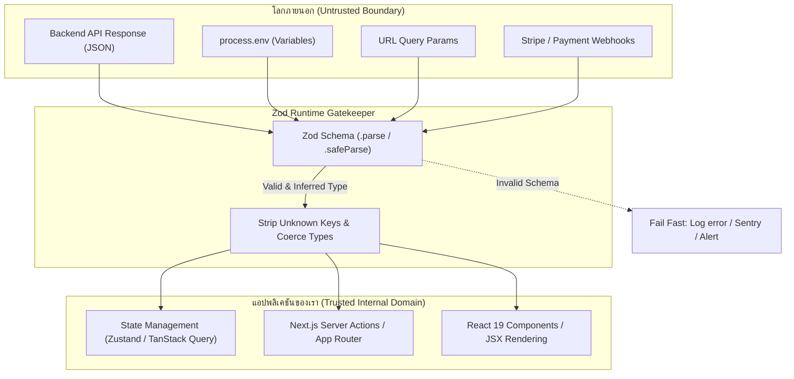
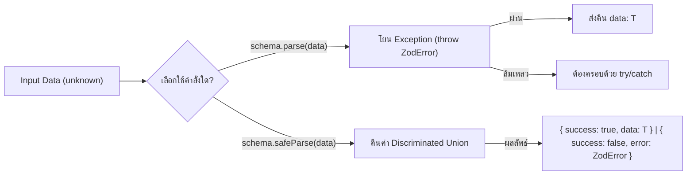

## 1. แนวคิด (Concept)

นักพัฒนาจำนวนมากเริ่มต้นรู้จัก **Zod** ในฐานะไลบรารีสำหรับทำ Form Validation ควบคู่กับ React Hook Form แต่แท้จริงแล้ว บทบาทที่ทรงพลังที่สุดของ Zod ในสถาปัตยกรรมระดับ **Enterprise Fullstack** คือการเป็น **Universal Data Contract & Runtime Gatekeeper**

ในระบบ TypeScript เรามักตกอยู่ในภาพลวงตาของ **"Type Safety"** โดยลืมไปว่า TypeScript มีตัวตนอยู่แค่ในช่วง **Compile-time** เท่านั้น เมื่อโค้ดถูกแปลงเป็น JavaScript และนำไปรันบน Production สภาพแวดล้อมจริง ข้อมูลที่ไหลเข้ามาจากภายนอก (External Boundaries) ไม่มีอะไรรับประกันความถูกต้องเลย:
- ข้อมูล JSON จาก REST API หรือ 3rd-party Services ที่อาจเปลี่ยนโครงสร้างกะทันหัน
- Environment Variables (`process.env`) ที่อาจสะกดผิดหรือลืมตั้งค่าบน Vercel / Docker
- URL Query Parameters และ Route Segments ใน Next.js ที่ผู้ใช้สามารถพิมพ์อะไรเข้ามาก็ได้
- Webhook Payload จาก Stripe หรือ Payment Gateway

หากปราศจาก Runtime Validation ข้อผิดพลาดสุดคลาสสิกอย่าง `Uncaught TypeError: Cannot read properties of undefined` จะหลุดเข้าไปพังในเบราว์เซอร์ของผู้ใช้ทันที

การประยุกต์ใช้ Zod นอกฟอร์มครอบคลุม 5 มิติหลัก:
1. **Validating API Responses**: กรองและตรวจจับโครงสร้าง JSON จาก Backend ก่อนส่งเข้าสู่ State หรือ UI Component
2. **Environment Variables Validation (t3-env pattern)**: ตรวจสอบ Config ของระบบตอน Server Startup / Build ทันที (Fail-Fast)
3. **End-to-End Shared Contract**: แชร์ Zod DTO schema ตัวเดียวกันระหว่าง Next.js Frontend และ NestJS / Hono Backend ใน Monorepo
4. **safeParse vs parse**: การเลือกใช้กลยุทธ์รับมือข้อผิดพลาดอย่างเหมาะสมระหว่าง Exception-driven และ Result-type
5. **เทียบเคียง Zod กับ class-validator ใน NestJS**: ทำความเข้าใจข้อดีข้อจำกัดเพื่อเลือกเทคโนโลยีให้เหมาะกับทีม

---

## 2. หลักการเบื้องหลัง (Under the Hood)

### สถาปัตยกรรม Perimeter Defense (Data Gatekeeper)

ในทางสถาปัตยกรรมซอฟต์แวร์ เราควรมองระบบของเราเป็น **"Trusted Internal Domain"** และมองโลกภายนอกทั้งหมดเป็น **"Untrusted Boundary"**



### การจัดการคีย์ที่ไม่รู้จัก: `strip()`, `passthrough()`, และ `strict()`

โดยค่าเริ่มต้น (`default`) ของ Zod Object:
- **`strip` (Default)**: Zod จะคัดกรองเฉพาะคีย์ที่นิยามไว้ใน Schema เท่านั้น คีย์แปลกปลอมที่แอบแฝงมากับ JSON จะถูกตัดทิ้ง ป้องกันปัญหา Mass Assignment Vulnerability
- **`passthrough`**: อนุญาตให้คีย์อื่นๆ ที่ไม่ได้นิยามหลุดรอดผ่านเข้าไปได้
- **`strict`**: หากมีคีย์ที่ไม่ได้ประกาศส่งเข้ามา Zod จะมองว่าเกิด Validation Error ทันที

### กลไกภายใน: `safeParse` vs `parse`



- **`parse()`**: เหมาะสำหรับจุดที่ระบบไม่สามารถทำงานต่อได้หากข้อมูลไม่ถูกต้อง เช่น การโหลดค่า Environment Variables ตอน Server Startup (ถ้าไม่มี `DATABASE_URL` ให้พังทันที ไม่ต้องรันต่อ)
- **`safeParse()`**: เหมาะสำหรับ Business Logic Flow, API Controllers, และ Functional Programming ที่ไม่ต้องการให้โปรแกรมโยน Exception เพราะการโยน Exception ใน JavaScript มี Overhead ของ Call Stack Unwinding

---

## 3. ตัวอย่างโค้ด (TypeScript / TSX)

### 1. Validating API Responses ป้องกัน Runtime Crash ใน UI

ตัวอย่าง Service ดึงข้อมูลคำสั่งซื้อและสรุปยอดชำระเงินสำหรับ E-Commerce Dashboard:

```typescript filename="services/order-service.ts"
import { z } from 'zod';

// นิยาม Schema ตรวจสอบโครงสร้างข้อมูลที่ส่งมาจาก Backend
export const OrderItemSchema = z.object({
  id: z.string().uuid(),
  productId: z.string(),
  title: z.string(),
  unitPrice: z.number().nonnegative(),
  quantity: z.number().int().positive(),
});

export const OrderResponseSchema = z.object({
  orderId: z.string(),
  customer: z.object({
    id: z.string(),
    email: z.string().email(),
    fullName: z.string(),
  }),
  items: z.array(OrderItemSchema).min(1, 'คำสั่งซื้อต้องมีสินค้าอย่างน้อย 1 ชิ้น'),
  discountAmount: z.number().default(0),
  totalAmount: z.number().positive(),
  status: z.enum(['PENDING', 'PAID', 'SHIPPED', 'CANCELLED']),
  createdAt: z.string().datetime(),
});

// Infer Type อัตโนมัติจาก Schema ตัวเดียว
export type OrderResponse = z.infer<typeof OrderResponseSchema>;

export async function fetchOrderDetails(orderId: string): Promise<OrderResponse> {
  const response = await fetch(`https://api.store.example.com/v1/orders/${orderId}`, {
    headers: {
      'Content-Type': 'application/json',
    },
    // Next.js 16 fetch caching options
    next: { revalidate: 60 },
  });

  if (!response.ok) {
    throw new Error(`ไม่สามารถดึงข้อมูลคำสั่งซื้อได้: HTTP ${response.status}`);
  }

  const rawJson: unknown = await response.json();

  // ป้องกัน Backend ส่ง null หรือ schema ไม่ตรง
  const parseResult = OrderResponseSchema.safeParse(rawJson);

  if (!parseResult.success) {
    // บันทึก Log ลงระบบ Monitoring (เช่น Sentry / Datadog) เพื่อเตือนทีม Backend
    console.error('API Contract Violation:', {
      orderId,
      issues: parseResult.error.format(),
    });

    throw new Error('โครงสร้างข้อมูลจากระบบคำสั่งซื้อไม่ถูกต้อง กรุณาติดต่อทีมสนับสนุน');
  }

  // ได้รับ Type OrderResponse ที่ปลอดภัย 100% สำหรับส่งต่อไปยัง Component
  return parseResult.data;
}
```

### 2. Environment Variables Validation ใน Next.js 16 (t3-env pattern)

การตรวจสอบไฟล์ `.env` ตั้งแต่วินาทีที่เริ่ม Build หรือ Start เซิร์ฟเวอร์:

```typescript filename="env.ts"
import { z } from 'zod';

const serverEnvSchema = z.object({
  NODE_ENV: z.enum(['development', 'test', 'production']).default('development'),
  DATABASE_URL: z.string().url('DATABASE_URL ต้องเป็น Connection String รูปแบบ URL ที่ถูกต้อง'),
  REDIS_URL: z.string().url(),
  AUTH_SECRET: z.string().min(32, 'AUTH_SECRET ต้องมีความยาวอย่างน้อย 32 ตัวอักษรเพื่อความปลอดภัย'),
  PORT: z.coerce.number().default(3000),
});

const clientEnvSchema = z.object({
  NEXT_PUBLIC_APP_URL: z.string().url(),
  NEXT_PUBLIC_API_URL: z.string().url(),
  NEXT_PUBLIC_ENABLE_ANALYTICS: z
    .enum(['true', 'false'])
    .default('false')
    .transform((val) => val === 'true'),
});

function validateEnv() {
  const isServer = typeof window === 'undefined';

  if (isServer) {
    const serverResult = serverEnvSchema.safeParse(process.env);
    if (!serverResult.success) {
      console.error('❌ Invalid Server Environment Variables:');
      console.error(JSON.stringify(serverResult.error.format(), null, 2));
      throw new Error('ระบบไม่สามารถเริ่มต้นได้เนื่องจาก Environment Variables ไม่ถูกต้อง');
    }
  }

  const clientResult = clientEnvSchema.safeParse({
    NEXT_PUBLIC_APP_URL: process.env.NEXT_PUBLIC_APP_URL,
    NEXT_PUBLIC_API_URL: process.env.NEXT_PUBLIC_API_URL,
    NEXT_PUBLIC_ENABLE_ANALYTICS: process.env.NEXT_PUBLIC_ENABLE_ANALYTICS,
  });

  if (!clientResult.success) {
    console.error('❌ Invalid Client Environment Variables:');
    console.error(JSON.stringify(clientResult.error.format(), null, 2));
    throw new Error('Client Environment Variables ขาดหายหรือไม่ถูกต้อง');
  }

  return {
    ...serverEnvSchema.parse(process.env),
    ...clientResult.data,
  };
}

export const env = validateEnv();
```

### 3. End-to-End Shared Contract ใน Monorepo (Next.js + NestJS / Hono)

โครงสร้างโฟลเดอร์ใน Turborepo:
```text
my-enterprise-monorepo/
├── packages/
│   └── shared-contracts/
│       ├── src/
│       │   └── auth.contract.ts
│       └── package.json
├── apps/
│   ├── web/ (Next.js 16)
│   └── api/ (NestJS / Hono)
```

#### Shared Contract Package:
```typescript filename="packages/shared-contracts/src/auth.contract.ts"
import { z } from 'zod';

export const UserRegistrationSchema = z.object({
  email: z.string().email('กรุณาระบุอีเมลที่ถูกต้อง'),
  password: z
    .string()
    .min(8, 'รหัสผ่านต้องมีอย่างน้อย 8 ตัวอักษร')
    .regex(/[A-Z]/, 'ต้องมีตัวพิมพ์ใหญ่อย่างน้อย 1 ตัว')
    .regex(/[0-9]/, 'ต้องมีตัวเลขอย่างน้อย 1 ตัว'),
  fullName: z.string().min(2, 'กรุณาระบุชื่อ-นามสกุล'),
  role: z.enum(['USER', 'ORGANIZER']).default('USER'),
});

export type UserRegistrationInput = z.infer<typeof UserRegistrationSchema>;

export const UserProfileResponseSchema = z.object({
  id: z.string().uuid(),
  email: z.string().email(),
  fullName: z.string(),
  role: z.enum(['USER', 'ORGANIZER', 'ADMIN']),
  createdAt: z.string(),
});

export type UserProfileResponse = z.infer<typeof UserProfileResponseSchema>;
```

#### การนำไปใช้ใน Hono Backend API:
```typescript filename="apps/api/src/routes/auth.ts"
import { Hono } from 'hono';
import { zValidator } from '@hono/zod-validator';
import { UserRegistrationSchema } from '@repo/shared-contracts';

const app = new Hono();

app.post('/register', zValidator('json', UserRegistrationSchema), async (c) => {
  // c.req.valid('json') ได้ Type ตรงกับ UserRegistrationInput 100%
  const validatedData = c.req.valid('json');

  const user = await createNewUserInDatabase(validatedData);

  return c.json({
    success: true,
    data: user,
  }, 201);
});
```

#### การนำไปใช้ใน Next.js 16 Server Action:
```typescript filename="apps/web/app/actions/register.ts"
'use server';

import { UserRegistrationSchema } from '@repo/shared-contracts';

export type ActionState = {
  success: boolean;
  message?: string;
  errors?: Record<string, string[]>;
};

export async function registerAction(prevState: ActionState, formData: FormData): Promise<ActionState> {
  const rawData = Object.fromEntries(formData.entries());

  const result = UserRegistrationSchema.safeParse(rawData);

  if (!result.success) {
    return {
      success: false,
      errors: result.error.flatten().fieldErrors,
    };
  }

  // ส่งข้อมูลที่ผ่านการ Validate แน่นอนไปยัง Database
  await registerUserToDatabase(result.data);

  return { success: true, message: 'ลงทะเบียนสำเร็จ' };
}
```

---

## 4. เทียบกับวิธีเดิม

| มิติการเปรียบเทียบ | TypeScript Type Assertion (`as Type`) | Manual If-Else Verification | Zod Universal Schema |
| :--- | :--- | :--- | :--- |
| **ความปลอดภัยใน Runtime** | ❌ **ไม่มีเลย** (Type หายไปหลัง Compile) | ⚠️ พอใช้ได้ แต่เขียนโค้ดยาวและมักเช็คไม่ครบ | ✅ **สมบูรณ์แบบ 100%** ตรวจสอบทุกมิติ |
| **Single Source of Truth** | ❌ ต้องเขียน Interface แยก | ❌ ต้องเขียน Type คู่กับ Logic ตรวจสอบ | ✅ เขียน Schema ครั้งเดียว ได้ทั้ง Type และ Validator |
| **การแปลงชนิดข้อมูล (Coercion)** | ❌ ทำไม่ได้ | ⚠️ ต้องเขียนฟังก์ชันแปลงแยกเอง | ✅ มี `z.coerce` ทำงานอัตโนมัติ |
| **ข้อความแจ้งเตือน Error** | ❌ ไม่มีข้อความเตือน | ⚠️ ต้องเขียน `throw Error` ทีละบรรทัด | ✅ รองรับ Custom Thai Error Messages ละเอียดระดับ Field |
| **การตัดคีย์แปลกปลอม (Sanitization)** | ❌ ไม่ตัด (คีย์แฝงยังคงอยู่) | ❌ ต้องเขียน Object pick เอง | ✅ ทำการ `strip()` อัตโนมัติ ป้องกันข้อมูลรั่วไหล |

### เปรียบเทียบ Zod vs class-validator (ในฝั่ง Backend / NestJS)

| คุณสมบัติ | Zod (Modern Functional) | class-validator (Legacy Decorator) |
| :--- | :--- | :--- |
| **ปรัชญาการออกแบบ** | Functional Composition, Declarative | Object-Oriented, Class Decorators |
| **การรองรับ Monorepo กับ Frontend** | 🌟 ราบรื่นมาก แชร์ข้าม Next.js, Node, Edge ได้ทันที | ❌ ติดปัญหา `reflect-metadata` บวมและไม่เหมาะกับ Frontend |
| **Bundle Size & Tree-shaking** | เล็กมาก ไม่มี Dependency บวม รองรับ Tree-shaking | ขนาดใหญ่ ต้องใช้ `class-transformer` และ Polyfill |
| **Type Inference** | ดึง Type ผ่าน `z.infer<typeof schema>` ทันที | ต้องประกาศ Property ซ้ำใน Class และผูก Decorator |
| **ความเร็วในการประมวลผล** | สูงมาก (ยิ่งใน Zod 4 ปรับปรุง engine ใหม่) | มี overhead ของ Reflection Metadata |

---

## 5. ผิด vs ถูก (Anti-patterns vs Best Practices)

### 1. การ Cast Type ให้กับข้อมูลจาก `fetch()`

```typescript
// ❌ ผิด: หลอกตัวเองและคอมไพเลอร์ด้วย "as"
const response = await fetch('/api/user/profile');
const data = (await response.json()) as UserProfile;
// ถ้าระบบเปลี่ยนชื่อฟิลด์จาก user_name เป็น username บรรทัดนี้จะพังทันที!
console.log(data.profile.address.zipcode); // Uncaught TypeError: Cannot read properties of undefined

// ✅ ถูก: ตรวจสอบและสกัด Type ด้วย Zod
const response = await fetch('/api/user/profile');
const rawData: unknown = await response.json();
const result = UserProfileSchema.safeParse(rawData);

if (!result.success) {
  // จัดการ Graceful Fallback หรือแสดง Error State
  throw new Error('ข้อมูลผู้ใช้งานไม่ถูกต้องตามสัญญา API');
}
const user = result.data; // Type ปลอดภัยและรับประกันว่ามี property ครบจริง
```

### 2. การเข้าถึง `process.env` โดยตรงในโค้ดส่วนต่างๆ

```typescript
// ❌ ผิด: เข้าถึง process.env ตรงๆ ทั่วแอป พร้อมเครื่องหมาย ! เสี่ยงตาย
const dbUrl = process.env.DATABASE_URL!;
const apiKey = process.env.NEXT_PUBLIC_STRIPE_KEY; // ถ้าสะกดผิด ไม่มีใครรู้ล่วงหน้า

// ✅ ถูก: รวมการตรวจสอบไว้ที่ศูนย์กลาง (Centralized Env Module)
import { env } from '@/env';

const dbUrl = env.DATABASE_URL; // คอมไพเลอร์รู้ Type และเซิร์ฟเวอร์จะ Crash ทันทีถ้าลืมใส่ตอนเริ่มแอป
```

### 3. การใช้ `parse()` ในที่ที่ไม่ควร Throw Exception

```typescript
// ❌ ผิด: ใช้ parse() ใน React Query Fetcher โดยไม่ครอบ catch ทำให้ Error กระเด็นเป็น Unhandled Rejection
export function useProductQuery(id: string) {
  return useQuery({
    queryKey: ['product', id],
    queryFn: async () => {
      const res = await fetch(`/api/products/${id}`);
      return ProductSchema.parse(await res.json()); // ถ้า Backend ส่งฟิลด์ผิด แอปหน้าขาว
    },
  });
}

// ✅ ถูก: จัดการ Error ให้เป็นมิตรผ่าน safeParse หรือ Custom Error Wrapper
export function useProductQuery(id: string) {
  return useQuery({
    queryKey: ['product', id],
    queryFn: async () => {
      const res = await fetch(`/api/products/${id}`);
      const json: unknown = await res.json();
      const parsed = ProductSchema.safeParse(json);
      if (!parsed.success) {
        throw new Error(`ข้อมูลสินค้าไม่ถูกต้อง: ${parsed.error.issues[0]?.message}`);
      }
      return parsed.data;
    },
  });
}
```

---

## 6. ควรใช้เมื่อไหร่ / ไม่ควรใช้เมื่อไหร่

### เมื่อไหร่ควรใช้ Zod นอกฟอร์ม:
- **จุดเชื่อมต่อระหว่างระบบ (System Boundaries)**: ข้อมูลที่ข้ามผ่านเครือข่าย ทั้ง REST API Responses, GraphQL Responses, Webhook Payloads
- **การตั้งค่าระบบ (Configuration & Env)**: ตรวจสอบความถูกต้องของ Environment Variables ทันทีที่เซิร์ฟเวอร์เริ่มทำงาน
- **Next.js URL Segments**: Validate `params` และ `searchParams` ใน Server Components หรือ Route Handlers เพื่อป้องกันผู้ใช้ใส่ query string ประหลาด
- **LocalStorage & SessionStorage**: ตรวจสอบข้อมูลแคชในเบราว์เซอร์ที่อาจถูกดัดแปลงหรือเป็นเวอร์ชันเก่าก่อนนำมาแปลงกลับเป็น State

### เมื่อไหร่ไม่ควรใช้ Zod:
- **ฟังก์ชันภายในโดเมนเดียวกัน (Internal Private Functions)**: โค้ดที่เรียกหากันเองภายในไฟล์หรือโมดูลเดียวกัน ซึ่ง TypeScript ปกป้องอย่างแน่นหนาอยู่แล้ว การนำ Zod ไป `parse` ทุกฟังก์ชันจะทำให้สิ้นเปลือง CPU Cycle โดยไร้ประโยชน์
- **ประมวลผล Big Data ระดับล้านระเบียนใน Memory**: การนำ Zod ไปวนลูป parse ข้อมูล Array ขนาดหลายสิบ Megabytes ใน Loop ความเร็วสูง อาจสร้าง Performance Overhead ได้ ควรใช้ Stream หรือ Validate เฉพาะ Sampling Data

---

## 7. คำถามสัมภาษณ์งาน (Interview Questions)

### Q1: "ในเมื่อเราใช้ TypeScript ครอบคลุมทั้งโปรเจกต์แล้ว ทำไมเรายังต้องใช้ Zod ในการ Validate API Response หรือ Environment Variables อีก?"

**แนวทางคำตอบระดับ Senior:**
> "TypeScript เป็นเครื่องมือในระดับ **Static Analysis (Compile-time)** เท่านั้น เมื่อผ่านกระบวนการ Transpile โค้ดทั้งหมดจะกลายเป็น JavaScript ธรรมดา ข้อมูลประเภท Type Definition และ Interface จะถูกลบออก (Type Erasure) ทั้งหมด
>
> ในความเป็นจริง ข้อมูลจาก External World เช่น API Response จาก Third-party, ข้อมูลจากฐานข้อมูล, หรือ `process.env` ไหลเข้ามาในระบบตอน **Runtime** ซึ่ง TypeScript ไม่สามารถปกป้องอะไรได้เลย หาก Backend มีการ Deploy ฟิลด์ใหม่ หรือเปลี่ยน Nullable property โดยไม่แจ้งล่วงหน้า โค้ด Frontend ที่เขียน Type Assertion ไว้ เช่น `res as UserResponse` จะไม่แจ้ง Error ใดๆ ตอนรันไทม์จนกว่าจะเกิด `TypeError: Cannot read properties of undefined`
>
> การนำ Zod มาใช้ตรงขอบเขตของระบบ (Boundary Layer) จึงเป็นการสร้าง **Perimeter Defense** ที่ทำหน้าที่เป็น Runtime Gatekeeper ซึ่งนอกจากจะช่วยรับประกันความถูกต้องของข้อมูลก่อนส่งเข้า Component แล้ว ยังทำหน้าที่เป็น **Single Source of Truth** ที่ทำให้เราอนุมาน Type (`z.infer`) กลับมาให้ TypeScript ได้อย่างแม่นยำ 100% โดยไม่ต้องเขียนโค้ดซ้ำซ้อนครับ"

---

### Q2: "เปรียบเทียบการออกแบบสถาปัตยกรรมระหว่าง Zod กับ class-validator ใน NestJS มีข้อดีข้อเสียต่างกันอย่างไรเมื่อทำ Fullstack Monorepo?"

**แนวทางคำตอบระดับ Senior:**
> "การเปรียบเทียบนี้สะท้อนความแตกต่างระหว่าง **Functional Programming** และ **Object-Oriented Programming**:
>
> 1. **Monorepo Interoperability**: `class-validator` และ `class-transformer` พึ่งพา Decorator และ `reflect-metadata` ซึ่งออกแบบมาเพื่อ Node.js runtime หากเราต้องการแชร์ DTO ตัวเดียวกันไปยัง Next.js Frontend หรือ Cloudflare Workers เราจะต้องลาก Metadata Polyfill ไปด้วย ซึ่งทำให้ Bundle Size ใหญ่ขึ้นอย่างมีนัยสำคัญและมักชนกับ Next.js Compiler ขณะที่ `Zod` เป็น Pure TypeScript/JavaScript ไร้ Dependency ภายนอก ทำให้แชร์ข้ามระหว่าง Next.js และ NestJS ได้อย่างราบรื่น
> 2. **Type Inference**: Zod ช่วยให้เราใช้หลักการ 'Schema as Single Source of Truth' แล้วดึง Type ออกมาด้วย `z.infer<typeof schema>` ทันที ลดโอกาสการเกิด Type Drift ขณะที่ `class-validator` ต้องประกาศ Class ซ้ำ และต้องระบุ Property types สองรอบ
> 3. **Tree-shaking & Performance**: Zod 4 ได้รับการปรับโครงสร้างเพื่อรองรับ Tree-shaking อย่างเต็มรูปแบบ และมีความเร็วในการ Parse สูงกว่าการทำ Reflection ผ่าน Class Decorators
>
> ดังนั้นใน Monorepo ยุคใหม่ ทีมส่วนใหญ่จึงนิยมใช้ Zod ใน Shared Package (`@repo/contracts`) เพื่อให้ทั้ง Next.js, NestJS (ผ่าน ZodValidationPipe) หรือ Hono ใช้ Data Contract ชุดเดียวกันได้จริงครับ"
