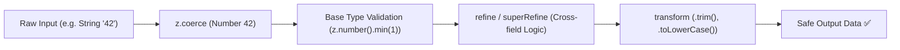
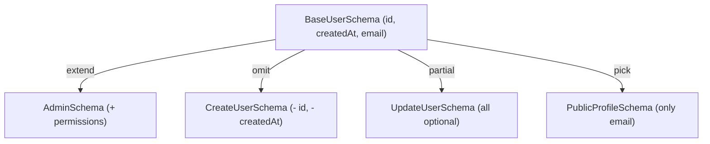

## 1. แนวคิด (Concept)

เมื่อก้าวพ้นระดับการตรวจสอบฟิลด์เดี่ยว (Single-field Validation) แอปพลิเคชันระดับ Production มักต้องเผชิญกับโจทย์ทางธุรกิจที่มีเงื่อนไขซับซ้อนและพึ่งพาซึ่งกันและกัน (Inter-field Dependencies):

1. **Cross-Field Validation**: กฎเกณฑ์ที่ต้องเปรียบเทียบข้อมูลตั้งแต่ 2 ฟิลด์ขึ้นไป เช่น
   - รหัสผ่านและยืนยันรหัสผ่านต้องตรงกัน (`confirmPassword === password`)
   - วันที่สิ้นสุดการจองห้องพักต้องอยู่หลังวันที่เริ่มต้น (`endDate > startDate`)
   - หากเลือกช่องทางการจัดส่งเป็น "ด่วนพิเศษ" ต้องกรอกเบอร์โทรศัพท์ติดต่อ
2. **Data Coercion & Normalization**: ความจริงที่ว่าเบราว์เซอร์ส่งค่าจาก `<input type="number" />` หรือ `<input type="date" />` กลับมาเป็น **String เสมอ** ใน DOM Event ทำให้เราต้องการเครื่องมือแปลงชนิดข้อมูล (Type Coercion) ตั้งแต่ก้าวแรกก่อนทำการ Validate
3. **Data Transformation**: การตัดช่องว่างหน้า-หลัง (`trim()`), การแปลงอีเมลเป็นตัวพิมพ์เล็ก (`toLowerCase()`), หรือการ Hash ค่าก่อนส่งต่อไปยัง Service
4. **Polymorphic Forms (Discriminated Unions)**: แบบฟอร์มที่มีโครงสร้างเปลี่ยนไปตามการเลือกของผู้ใช้ เช่น ฟอร์มการชำระเงินที่เปลี่ยนฟิลด์ตามวิธีชำระ (บัตรเครดิต vs พร้อมเพย์ QR)

Zod มีเครื่องมือขั้นสูงที่ออกแบบมาเพื่อรองรับงานเหล่านี้ได้อย่างสมบูรณ์แบบ ทั้ง `refine`, `superRefine`, `transform`, `coerce`, และ `discriminatedUnion`

---

## 2. หลักการเบื้องหลัง (Under the Hood)

### 2.1 วงจรชีวิตของ Pipeline: Parse $\to$ Coerce $\to$ Validate $\to$ Refine $\to$ Transform



1. **`z.coerce` (Coercion)**: รันก่อน Base Validation โดยนำค่า Raw Input ผ่าน JavaScript Built-in Constructor เช่น `Number(val)`, `Boolean(val)`, หรือ `new Date(val)`
2. **`refine` vs `superRefine`**:
   - `refine(fn, options)`: เหมาะสำหรับเงื่อนไข Boolean สั้นๆ คืนค่า `true/false` 
   - `superRefine(fn)`: มี Context (`ctx`) ให้เราเพิ่ม Error Issue ได้หลายจุดพร้อมกัน และกำหนดตำแหน่งฟิลด์เป้าหมายผ่าน `ctx.addIssue({ path: ['targetField'] })`
3. **`discriminatedUnion` vs `union`**:
   - `z.union([A, B])`: จะวน Loop ทดสอบ Schema A หากไม่ผ่านจะไป Schema B (ประสิทธิภาพ $O(N)$ และข้อความ Error มักคลุมเครือ)
   - `z.discriminatedUnion('type', [A, B])`: ตรวจสอบคีย์ Discriminator ก่อน แล้วกระโดดเข้าจับคู่ Schema นั้นทันที (ประสิทธิภาพ $O(1)$ รวดเร็ว และ Type Narrowing สมบูรณ์)

### 2.2 การประกอบ Schema (Schema Composition)

ในระบบ Enterprise ห้ามเขียน Schema ซ้ำซ้อน แต่ควรแยกชิ้นส่วนและประกอบขึ้นมาใหม่:



- **`.extend({ ... })`**: เพิ่มฟิลด์ใหม่เข้าไปใน Object Schema เดิม
- **`.omit({ id: true })`**: ตัดฟิลด์ที่ไม่ต้องการออก
- **`.pick({ email: true })`**: เลือกเฉพาะฟิลด์ที่กำหนด
- **`.partial()`**: เปลี่ยนทุกฟิลด์ใน Schema ให้กลายเป็น `optional` (มีประโยชน์อย่างยิ่งสำหรับฟอร์ม Update / Patch)
- **`.merge(OtherSchema)`**: รวมสอง Object Schema เข้าด้วยกัน

---

## 3. ตัวอย่างโค้ด (TypeScript / TSX)

### ตัวอย่างที่ 1: ระบบจองโรงแรมพร้อมช่วงวันที่และ Coerce (`HotelReservationForm.tsx`)

ตัวอย่างนี้แสดงการใช้งาน `z.coerce`, การตัดช่องว่างด้วย `transform`, และการทำ Cross-field Validation ด้วย `superRefine` พร้อมชี้ Error ไปยังฟิลด์ `checkOutDate`:

```tsx filename="components/forms/HotelReservationForm.tsx"
'use client';

import React from 'react';
import { useForm } from 'react-hook-form';
import { zodResolver } from '@hookform/resolvers/zod';
import { z } from 'zod';
import { toast } from 'sonner';
import { CalendarDays, Users, BedDouble, ArrowRight } from 'lucide-react';

// 1. ประกาศ Schema พร้อม Cross-field validation และ Coercion
export const hotelReservationSchema = z
  .object({
    guestName: z
      .string({ error: 'กรุณาระบุชื่อผู้เข้าพัก' })
      .min(3, { error: 'ชื่อต้องมีความยาวอย่างน้อย 3 ตัวอักษร' })
      .transform((val) => val.trim()), // ทำความสะอาดข้อมูลตัดช่องว่าง

    // Coerce ค่า string จาก input type="date" ให้กลายเป็น Date Object
    checkInDate: z.coerce.date({
      error: 'กรุณาระบุวันที่เข้าพัก (Check-in)',
    }),

    checkOutDate: z.coerce.date({
      error: 'กรุณาระบุวันที่คืนห้อง (Check-out)',
    }),

    // Coerce ค่า string จาก input type="number" ให้เป็น Number
    numberOfGuests: z.coerce
      .number({ error: 'กรุณาระบุจำนวนผู้เข้าพัก' })
      .int({ error: 'จำนวนผู้เข้าพักต้องเป็นเลขจำนวนเต็ม' })
      .min(1, { error: 'ต้องมีผู้เข้าพักอย่างน้อย 1 ท่าน' })
      .max(6, { error: 'ห้องพัก 1 ห้องรองรับได้สูงสุดไม่เกิน 6 ท่าน' }),

    specialRequests: z
      .string()
      .max(300, { error: 'คำขอพิเศษต้องไม่เกิน 300 ตัวอักษร' })
      .optional()
      .transform((val) => val?.trim() || undefined),
  })
  .superRefine((data, ctx) => {
    const today = new Date();
    today.setHours(0, 0, 0, 0);

    // กฎข้อที่ 1: ห้ามเลือกวัน Check-in ย้อนหลัง
    if (data.checkInDate < today) {
      ctx.addIssue({
        code: z.ZodIssueCode.custom,
        message: 'วันที่เข้าพักต้องไม่เป็นวันในอดีต',
        path: ['checkInDate'],
      });
    }

    // กฎข้อที่ 2: วัน Check-out ต้องเกิดขึ้นหลังวัน Check-in เสมอ
    if (data.checkOutDate <= data.checkInDate) {
      ctx.addIssue({
        code: z.ZodIssueCode.custom,
        message: 'วันที่คืนห้องต้องอยู่หลังวันที่เข้าพักอย่างน้อย 1 วัน',
        path: ['checkOutDate'], // ส่ง error ตรงไปยัง input checkOutDate
      });
    }
  });

type ReservationFormValues = z.infer<typeof hotelReservationSchema>;

export function HotelReservationForm() {
  const {
    register,
    handleSubmit,
    formState: { errors, isSubmitting },
  } = useForm<ReservationFormValues>({
    resolver: zodResolver(hotelReservationSchema),
    defaultValues: {
      guestName: '',
      numberOfGuests: 2,
      specialRequests: '',
    },
  });

  const onBookRoom = async (data: ReservationFormValues) => {
    // ข้อมูล data.checkInDate และ data.checkOutDate เป็น Instance ของ Date จริง 100%
    await new Promise((r) => setTimeout(r, 1000));
    toast.success(
      `จองห้องพักสำเร็จสำหรับคุณ ${data.guestName} (${data.checkInDate.toLocaleDateString('th-TH')} - ${data.checkOutDate.toLocaleDateString('th-TH')})`
    );
  };

  return (
    <div className="max-w-xl mx-auto p-6 bg-surface border border-hairline rounded-2xl shadow-sm">
      <div className="flex items-center gap-2 mb-6 pb-4 border-b border-hairline">
        <BedDouble className="w-6 h-6 text-primary" />
        <div>
          <h2 className="text-lg font-bold text-ink">แบบฟอร์มสำรองห้องพัก</h2>
          <p className="text-xs text-muted">ระบบตรวจสอบช่วงเวลาการเข้าพักและข้อมูลอัตโนมัติ</p>
        </div>
      </div>

      <form onSubmit={handleSubmit(onBookRoom)} className="space-y-4">
        <div>
          <label className="text-xs font-semibold text-ink">ชื่อผู้เข้าพัก</label>
          <input
            type="text"
            placeholder="เช่น วรรณพร บุญรักษา"
            {...register('guestName')}
            className="w-full mt-1 p-2.5 text-sm border rounded-lg border-hairline outline-none focus:ring-2 focus:ring-primary/20"
          />
          {errors.guestName && (
            <p className="text-xs text-rose-500 mt-1">{errors.guestName.message}</p>
          )}
        </div>

        <div className="grid grid-cols-1 md:grid-cols-2 gap-4">
          <div>
            <label className="text-xs font-semibold text-ink flex items-center gap-1">
              <CalendarDays className="w-3.5 h-3.5 text-muted" /> วันที่เข้าพัก (Check-in)
            </label>
            <input
              type="date"
              {...register('checkInDate')}
              className="w-full mt-1 p-2.5 text-sm border rounded-lg border-hairline outline-none focus:ring-2 focus:ring-primary/20"
            />
            {errors.checkInDate && (
              <p className="text-xs text-rose-500 mt-1">{errors.checkInDate.message}</p>
            )}
          </div>

          <div>
            <label className="text-xs font-semibold text-ink flex items-center gap-1">
              <CalendarDays className="w-3.5 h-3.5 text-muted" /> วันที่คืนห้อง (Check-out)
            </label>
            <input
              type="date"
              {...register('checkOutDate')}
              className="w-full mt-1 p-2.5 text-sm border rounded-lg border-hairline outline-none focus:ring-2 focus:ring-primary/20"
            />
            {errors.checkOutDate && (
              <p className="text-xs text-rose-500 mt-1">{errors.checkOutDate.message}</p>
            )}
          </div>
        </div>

        <div>
          <label className="text-xs font-semibold text-ink flex items-center gap-1">
            <Users className="w-3.5 h-3.5 text-muted" /> จำนวนผู้เข้าพัก (ท่าน)
          </label>
          <input
            type="number"
            min={1}
            max={6}
            {...register('numberOfGuests')}
            className="w-full mt-1 p-2.5 text-sm border rounded-lg border-hairline outline-none focus:ring-2 focus:ring-primary/20"
          />
          {errors.numberOfGuests && (
            <p className="text-xs text-rose-500 mt-1">{errors.numberOfGuests.message}</p>
          )}
        </div>

        <div>
          <label className="text-xs font-semibold text-ink">คำขอพิเศษเพิ่มเติม (Optional)</label>
          <textarea
            rows={2}
            placeholder="เช่น ขอห้องชั้นสูง, ขอหมอนเพิ่ม..."
            {...register('specialRequests')}
            className="w-full mt-1 p-2.5 text-sm border rounded-lg border-hairline outline-none focus:ring-2 focus:ring-primary/20"
          />
          {errors.specialRequests && (
            <p className="text-xs text-rose-500 mt-1">{errors.specialRequests.message}</p>
          )}
        </div>

        <button
          type="submit"
          disabled={isSubmitting}
          className="w-full mt-2 py-3 bg-primary text-white text-sm font-semibold rounded-lg hover:bg-primary/90 transition-colors flex items-center justify-center gap-2"
        >
          {isSubmitting ? 'กำลังตรวจสอบข้อมูล...' : 'ยืนยันการจองห้องพัก'}
          <ArrowRight className="w-4 h-4" />
        </button>
      </form>
    </div>
  );
}
```

---

### ตัวอย่างที่ 2: ระบบชำระเงินหลายรูปแบบด้วย Discriminated Union (`CheckoutPaymentForm.tsx`)

ตัวอย่างฟอร์มชำระเงินที่สลับ Schema ระหว่าง บัตรเครดิต (Credit Card) และ พร้อมเพย์ (PromptPay QR) โดยใช้ `z.discriminatedUnion`:

```tsx filename="components/forms/CheckoutPaymentForm.tsx"
'use client';

import React from 'react';
import { useForm } from 'react-hook-form';
import { zodResolver } from '@hookform/resolvers/zod';
import { z } from 'zod';
import { toast } from 'sonner';
import { CreditCard, QrCode, ShieldCheck } from 'lucide-react';

// 1. กำหนด Schema ย่อยสำหรับบัตรเครดิต
const creditCardPaymentSchema = z.object({
  paymentMethod: z.literal('CREDIT_CARD'),
  cardNumber: z
    .string({ error: 'กรุณากรอกหมายเลขบัตรเครดิต' })
    .regex(/^[0-9]{16}$/, { error: 'หมายเลขบัตรเครดิตต้องเป็นตัวเลข 16 หลัก' }),
  cardHolder: z
    .string({ error: 'กรุณากรอกชื่อบนบัตร' })
    .min(3, { error: 'ชื่อบนบัตรต้องมีอย่างน้อย 3 ตัวอักษร' }),
  expiry: z
    .string({ error: 'กรุณากรอกวันหมดอายุ' })
    .regex(/^(0[1-9]|1[0-2])\/([0-9]{2})$/, {
      error: 'รูปแบบวันหมดอายุต้องเป็น MM/YY เช่น 08/28',
    }),
  cvv: z
    .string({ error: 'กรุณากรอกรหัส CVV' })
    .regex(/^[0-9]{3,4}$/, { error: 'CVV ต้องเป็นตัวเลข 3 หรือ 4 หลัก' }),
});

// 2. กำหนด Schema ย่อยสำหรับ PromptPay
const promptPayPaymentSchema = z.object({
  paymentMethod: z.literal('PROMPTPAY'),
  phoneNumberOrId: z
    .string({ error: 'กรุณากรอกเบอร์มือถือหรือเลขบัตรประชาชนสำหรับรับใบเสร็จ' })
    .min(10, { error: 'ข้อมูลต้องมีความยาวอย่างน้อย 10 หลัก' }),
});

// 3. รวมเป็น Discriminated Union โดยใช้ Discriminator Key คือ 'paymentMethod'
export const checkoutPaymentSchema = z.discriminatedUnion('paymentMethod', [
  creditCardPaymentSchema,
  promptPayPaymentSchema,
]);

export type CheckoutPaymentValues = z.infer<typeof checkoutPaymentSchema>;

export function CheckoutPaymentForm() {
  const {
    register,
    handleSubmit,
    watch,
    formState: { errors, isSubmitting },
  } = useForm<CheckoutPaymentValues>({
    resolver: zodResolver(checkoutPaymentSchema),
    defaultValues: {
      paymentMethod: 'CREDIT_CARD',
      cardNumber: '',
      cardHolder: '',
      expiry: '',
      cvv: '',
    },
  });

  // สังเกตเฉพาะค่า paymentMethod เพื่อสลับฟอร์ม UI
  const selectedMethod = watch('paymentMethod');

  const onPay = async (data: CheckoutPaymentValues) => {
    await new Promise((r) => setTimeout(r, 1200));
    if (data.paymentMethod === 'CREDIT_CARD') {
      toast.success(`ชำระผ่านบัตรเครดิตลงท้ายด้วย ${data.cardNumber.slice(-4)} สำเร็จ`);
    } else {
      toast.success(`สร้าง QR พร้อมเพย์สำหรับบัญชี ${data.phoneNumberOrId} สำเร็จ`);
    }
  };

  return (
    <div className="max-w-md mx-auto p-6 bg-surface border border-hairline rounded-2xl shadow-sm">
      <div className="flex items-center gap-2 mb-4 pb-3 border-b border-hairline">
        <ShieldCheck className="w-5 h-5 text-emerald-500" />
        <h3 className="text-lg font-bold text-ink">ชำระเงินปลอดภัย</h3>
      </div>

      <form onSubmit={handleSubmit(onPay)} className="space-y-4">
        {/* เลือกระบบชำระเงิน */}
        <div className="grid grid-cols-2 gap-3">
          <label
            className={`flex items-center justify-center gap-2 p-3 rounded-xl border cursor-pointer transition-all ${
              selectedMethod === 'CREDIT_CARD'
                ? 'border-primary bg-primary/5 text-primary font-semibold'
                : 'border-hairline hover:bg-subtle'
            }`}
          >
            <input
              type="radio"
              value="CREDIT_CARD"
              {...register('paymentMethod')}
              className="sr-only"
            />
            <CreditCard className="w-4 h-4" />
            <span className="text-xs">บัตรเครดิต</span>
          </label>

          <label
            className={`flex items-center justify-center gap-2 p-3 rounded-xl border cursor-pointer transition-all ${
              selectedMethod === 'PROMPTPAY'
                ? 'border-primary bg-primary/5 text-primary font-semibold'
                : 'border-hairline hover:bg-subtle'
            }`}
          >
            <input
              type="radio"
              value="PROMPTPAY"
              {...register('paymentMethod')}
              className="sr-only"
            />
            <QrCode className="w-4 h-4" />
            <span className="text-xs">พร้อมเพย์ QR</span>
          </label>
        </div>

        {/* ฟิลด์เฉพาะของบัตรเครดิต */}
        {selectedMethod === 'CREDIT_CARD' && (
          <div className="space-y-3 pt-2">
            <div>
              <label className="text-xs font-semibold text-ink">หมายเลขบัตรเครดิต (16 หลัก)</label>
              <input
                type="text"
                maxLength={16}
                placeholder="4111222233334444"
                {...register('cardNumber')}
                className="w-full mt-1 p-2 text-sm border rounded-lg border-hairline outline-none focus:ring-2 focus:ring-primary/20"
              />
              {'cardNumber' in errors && errors.cardNumber && (
                <p className="text-xs text-rose-500 mt-1">{errors.cardNumber.message}</p>
              )}
            </div>

            <div>
              <label className="text-xs font-semibold text-ink">ชื่อบนหน้าบัตร</label>
              <input
                type="text"
                placeholder="SOMCHAI JAIDEE"
                {...register('cardHolder')}
                className="w-full mt-1 p-2 text-sm border rounded-lg border-hairline outline-none focus:ring-2 focus:ring-primary/20"
              />
              {'cardHolder' in errors && errors.cardHolder && (
                <p className="text-xs text-rose-500 mt-1">{errors.cardHolder.message}</p>
              )}
            </div>

            <div className="grid grid-cols-2 gap-3">
              <div>
                <label className="text-xs font-semibold text-ink">หมดอายุ (MM/YY)</label>
                <input
                  type="text"
                  placeholder="12/28"
                  maxLength={5}
                  {...register('expiry')}
                  className="w-full mt-1 p-2 text-sm border rounded-lg border-hairline outline-none focus:ring-2 focus:ring-primary/20"
                />
                {'expiry' in errors && errors.expiry && (
                  <p className="text-xs text-rose-500 mt-1">{errors.expiry.message}</p>
                )}
              </div>
              <div>
                <label className="text-xs font-semibold text-ink">CVV (3-4 หลัก)</label>
                <input
                  type="password"
                  placeholder="•••"
                  maxLength={4}
                  {...register('cvv')}
                  className="w-full mt-1 p-2 text-sm border rounded-lg border-hairline outline-none focus:ring-2 focus:ring-primary/20"
                />
                {'cvv' in errors && errors.cvv && (
                  <p className="text-xs text-rose-500 mt-1">{errors.cvv.message}</p>
                )}
              </div>
            </div>
          </div>
        )}

        {/* ฟิลด์เฉพาะของ PromptPay */}
        {selectedMethod === 'PROMPTPAY' && (
          <div className="space-y-3 pt-2">
            <div>
              <label className="text-xs font-semibold text-ink">เบอร์โทรศัพท์สำหรับรับใบเสร็จ</label>
              <input
                type="tel"
                placeholder="0812345678"
                {...register('phoneNumberOrId')}
                className="w-full mt-1 p-2 text-sm border rounded-lg border-hairline outline-none focus:ring-2 focus:ring-primary/20"
              />
              {'phoneNumberOrId' in errors && errors.phoneNumberOrId && (
                <p className="text-xs text-rose-500 mt-1">{errors.phoneNumberOrId.message}</p>
              )}
            </div>
          </div>
        )}

        <button
          type="submit"
          disabled={isSubmitting}
          className="w-full mt-4 py-2.5 bg-primary text-white rounded-lg text-sm font-semibold hover:bg-primary/90 transition-colors"
        >
          {isSubmitting ? 'กำลังประมวลผลการชำระเงิน...' : 'ยืนยันยอดชำระ ฿1,500.00'}
        </button>
      </form>
    </div>
  );
}
```

---

## 4. เทียบกับวิธีเดิม (useState vs RHF + Zod)

| โจทย์ที่ต้องแก้ | วิธีเดิม (React `useState` + Custom Check) | วิธีการของ RHF + Zod ขั้นกลาง |
| :--- | :--- | :--- |
| **ยืนยันรหัสผ่านตรงกัน** | เขียน `if (pw !== confirmPw)` ใน `handleSubmit` สลับ state error เอง | ใช้ `.refine()` หรือ `superRefine` รันอัตโนมัติก่อนส่ง callback |
| **การระบุตำแหน่ง Error** | ต้องสร้างตัวแปร State เก็บ String Error แยกสำหรับทุกช่อง | ใช้ `ctx.addIssue({ path: ['targetField'] })` ชี้ลง input ทันที |
| **การแปลงตัวเลข DOM Input** | ต้องครอบ `parseInt(e.target.value)` ในทุก handler | ใช้ `z.coerce.number()` หรือ `valueAsNumber: true` เบ็ดเสร็จ |
| **ฟอร์มสลับประเภท (Polymorphic)** | เขียนเงื่อนไข if ซ้อนกันหลายชั้น เสี่ยงต่อ Type Undefined | ใช้ `z.discriminatedUnion` ที่ Narrow Type ให้อัตโนมัติ |
| **การตัดช่องว่าง (Whitespace)** | ต้องมาจำเรียก `.trim()` ก่อนส่ง API ทุกครั้ง | จัดการใน Data Pipeline อัตโนมัติด้วย `.transform((v) => v.trim())` |

---

## 5. ผิด vs ถูก (Anti-patterns vs Best Practices)

### กรณีที่ 1: การใช้ `refine` โดยไม่ระบุ `path` ของ Error
```tsx
// ❌ ผิด: ไม่ได้ระบุ path ใน refine ทำให้ Error ลอยไปอยู่ที่ root formState.errors[''] 
// ส่งผลให้ใต้ช่อง input ไม่มีข้อความสีแดงขึ้นมาแสดงผล!
const badSchema = z.object({
  password: z.string(),
  confirmPassword: z.string(),
}).refine((data) => data.password === data.confirmPassword, {
  message: 'รหัสผ่านไม่ตรงกัน',
});

// ✅ ถูก: ระบุ path: ['confirmPassword'] เสมอ เพื่อให้ RHF ผูก error เข้ากับฟิลด์นั้น
const goodSchema = z.object({
  password: z.string(),
  confirmPassword: z.string(),
}).refine((data) => data.password === data.confirmPassword, {
  message: 'รหัสผ่านไม่ตรงกัน',
  path: ['confirmPassword'],
});
```

### กรณีที่ 2: ใช้ `z.union` แทนที่จะเป็น `z.discriminatedUnion`
```tsx
// ❌ ประสิทธิภาพต่ำ: z.union จะรันตรวจ schema ทีละตัวจนกว่าจะเจอตัวที่ผ่าน 
// หากเกิด error ข้อความแจ้งเตือนจะรวมกันจนมั่วและอ่านไม่รู้เรื่อง
const slowSchema = z.union([creditCardSchema, promptPaySchema]);

// ✅ ถูก: ใช้ z.discriminatedUnion โดยระบุแท็กตัวจำแนก (Discriminator)
const fastSchema = z.discriminatedUnion('paymentMethod', [
  creditCardSchema,
  promptPaySchema,
]);
```

---

## 6. ควรใช้เมื่อไหร่ / ไม่ควรใช้เมื่อไหร่

### ควรใช้ Zod Intermediate เมื่อ:
- ต้องทำ Cross-field Validation (เปรียบเทียบรหัสผ่าน, ตรวจสอบช่วงวันที่, ความสัมพันธ์ระหว่างตัวเลือก)
- ข้อมูลที่รับเข้ามาเป็น String จาก Native HTML Input แต่ระบบ Backend ต้องการ Number หรือ Date Object (`z.coerce`)
- ฟอร์มเป็นแบบไดนามิกที่มีหลายประเภทตามตัวเลือกของผู้ใช้ (Multi-modal or Polymorphic forms)
- ต้องการดัดแปลงข้อมูล (Sanitize / Transform) ก่อนส่งต่อให้ Database ทันที เช่น trim, hash, uppercase

### ไม่ควรใช้เมื่อ:
- การ Validation ต้อง Query ข้อมูลสดจากฐานข้อมูล เช่น เช็คว่า Username ซ้ำหรือไม่ในทันที (กรณีนี้ควรใช้ Asynchronous Server Action หรือ React Query แยกต่างหาก ไม่ควรยัดลงใน Client-side Synchronous Schema)

---

## 7. คำถามสัมภาษณ์งาน (Interview Questions)

### Q1: `refine` และ `superRefine` ใน Zod แตกต่างกันอย่างไร และเมื่อไหร่ที่เราต้องเลือกใช้ `superRefine`?
**แนวทางคำตอบแบบ Senior**:
> "`refine` เป็น High-level API ที่รับฟังก์ชันซึ่งคืนค่า Boolean (`true` หรือ `false`) และรับ Configuration Object ตัวเดียว เหมาะกับเงื่อนไขการตรวจสอบระดับเดี่ยวที่เรียบง่าย 
> 
> แต่เมื่อไหร่ก็ตามที่เราต้องทำการตรวจสอบที่ซับซ้อน เช่น:
> 1. ต้องการตรวจสอบเงื่อนไขหลายข้อต่อกัน และสามารถพ่น Error ออกมาได้หลายข้อความพร้อมกัน
> 2. ต้องการระบุตำแหน่ง Error Path หลายฟิลด์แบบไดนามิกขึ้นอยู่กับเงื่อนไข
> 3. ต้องการควบคุม Error Code เฉพาะเจาะจงใน Zod
> 
> เราจำเป็นต้องใช้ `superRefine` ครับ เพราะ `superRefine` จะส่งพารามิเตอร์ `(data, ctx)` เข้ามา โดย `ctx.addIssue()` ให้อิสระอย่างเต็มที่ในการ Dispatch ปัญหาไปยังฟิลด์ใดก็ได้ใน Tree ข้อมูลครับ"

---

### Q2: ในการจัดการ Input แบบตัวเลขบน HTML ทำไมเราถึงต้องใช้ `z.coerce.number()` หรือระบุ `valueAsNumber: true` ใน React Hook Form?
**แนวทางคำตอบแบบ Senior**:
> "พฤติกรรมพื้นฐานของ Web Browser ตามมาตรฐาน HTML DOM คือ แม้เราจะกำหนดแท็ก `<input type="number" />` ก็ตาม เมื่อเกิด Event เช่น `e.target.value` เบราว์เซอร์จะคืนค่าออกมาเป็น **String** เสมอครับ (เช่น `'25'` แทนที่จะเป็นตัวเลข `25`)
> 
> หากเราประกาศ Schema ด้วย `z.number()` ธรรมดา Zod จะปฏิเสธข้อมูลทันทีด้วยข้อผิดพลาด `'Expected number, received string'` 
> 
> เพื่อแก้ปัญหานี้ เรามี 2 วิธีการระดับ Senior:
> 1. ในระดับ RHF: ใส่ตัวเลือก `{ ...register('age', { valueAsNumber: true }) }` เพื่อให้ RHF แปลงเป็น number ใน DOM Event
> 2. ในระดับ Zod: ใช้ `z.coerce.number()` ซึ่งจะทำการแปลงค่าดิบผ่าน `Number(val)` ในขั้นตอน Coercion ก่อนส่งต่อไปยังกระบวนการ Validate ทำให้รองรับได้ทั้งการรับค่าจาก HTML Input และจาก JSON Payload บนเซิร์ฟเวอร์ครับ"
