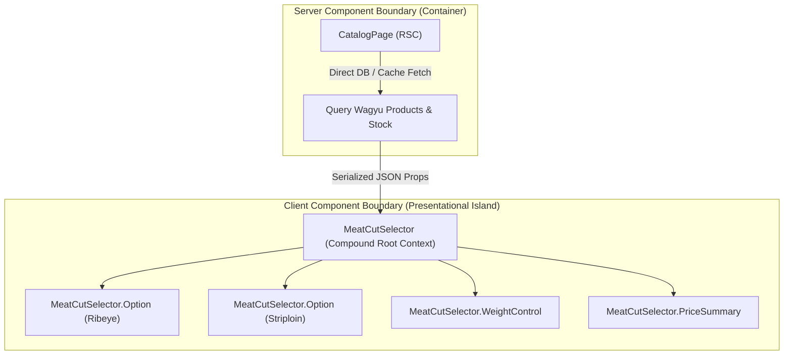

## 1. แนวคิด (Concept)

เมื่อแอปพลิเคชันเติบโตจากระบบขนาดเล็กสู่ระดับองค์กร (Enterprise Scale) ความท้าทายหลักของทีมวิศวกรซอฟต์แวร์ไม่ได้อยู่ที่ "การเขียนฟังก์ชันให้ทำงานได้" แต่อยู่ที่ **"การควบคุม Cognitive Load และจัดการการเปลี่ยนแปลงของระบบ"** 

ในยุคของ **React 19** และ **Next.js 16** สถาปัตยกรรมระดับแนวหน้าได้ก้าวข้ามแนวคิดดั้งเดิมอย่างการแยกโฟลเดอร์ตามชนิดไฟล์ (Layer-based Architecture เช่น กองไฟล์ `components/`, `hooks/`, `services/` รวมกัน) และก้าวข้ามปัญหา **Mega Components** ที่รับ Props หลายสิบคู่จนยากจะบำรุงรักษา

แกนหลักของสถาปัตยกรรมสมัยใหม่ในระบบ **Smart Butcher Marketplace** ขับเคลื่อนด้วย 4 เสาหลัก:
1. **Feature-based Colocation**: การรวมทุกทรัพยากรที่เกี่ยวข้องกับฟังก์ชันเดียวกัน (Components, Hooks, Types, API Actions, Tests) ไว้ในโฟลเดอร์ฟีเจอร์เดียวกัน เพื่อเพิ่มขอบเขตการแก้ไขที่จำกัด (High Cohesion, Low Coupling)
2. **Component Composition**: การแบ่งคอมโพเนนต์เป็นชิ้นส่วนย่อยที่เปิดช่องให้ผู้บริโภคส่ง `children` หรือ `Slot` เข้ามาแทนการปั๊ม boolean props จำนวนมาก
3. **Compound Component Pattern**: แบบแผนการออกแบบคอมโพเนนต์ที่ทำงานร่วมกันเป็นเอกภาพผ่าน Shared Context เช่น `<MeatCutSelector>` และ `<MeatCutSelector.Option>`
4. **Modern Container / Presentational Pattern**: การประยุกต์ใช้ React Server Components (RSC) ทำหน้าที่เป็น Container (Data Fetching, DB Queries, Security Boundary) และ Client Components ทำหน้าที่เป็น Presentational Interactive Islands

<Callout type="note" title="หัวใจของ Inversion of Control ใน React 19">
แทนที่คอมโพเนนต์แม่จะต้องรู้ทุกรายละเอียดว่าลูกข้างในต้องเรนเดอร์อะไร ให้มอบอำนาจการควบคุม (Invert Control) ให้ผู้เรียกใช้งานเป็นคนกำหนดโครงสร้างผ่าน Composition รูปแบบนี้ทำให้ระบบมีความยืดหยุ่นสูงสุดเมื่อความต้องการทางธุรกิจเปลี่ยนไป
</Callout>

---

## 2. หลักการเบื้องหลัง (Under the Hood)

เพื่อสร้างสถาปัตยกรรมที่ยืดหยุ่นและรองรับการขยายตัว สถาปนิกซอฟต์แวร์ต้องเข้าใจกลไกภายในของ React Fiber Tree และการส่งผ่านข้อมูล:

### 2.1 Colocation vs Layer-based ในสเกลระดับ Enterprise
การจัดโฟลเดอร์แบบเดิม (Layer-based):
- หากต้องการแก้ฟีเจอร์ "ตัดแบ่งเนื้อวากิว" นักพัฒนาต้องกระโดดไปมาระหว่าง `src/components/MeatModal.tsx`, `src/hooks/useMeatCut.ts`, `src/services/meatApi.ts`, และ `src/types/meat.ts`
- การลบฟีเจอร์ทิ้งมักทิ้งโค้ดขยะกำพร้า (Dead Code) ตกค้างไว้เสมอ

การจัดแบบ **Feature-based Colocation (Vertical Slicing)**:
```text filename="Directory Structure: Feature-based Colocation"
src/
└── features/
    ├── butcher-cutting/           # ขอบเขตของโดเมนการตัดเนื้อ
    │   ├── api/                   # Server Actions & Query definitions
    │   ├── components/            # UI components เฉพาะฟีเจอร์นี้
    │   ├── hooks/                 # Custom hooks เฉพาะฟีเจอร์
    │   ├── types/                 # TypeScript interfaces เฉพาะฟีเจอร์
    │   └── index.ts               # Public API barrier ของโมดูล
    └── checkout/                  # ขอบเขตของระบบชำระเงิน
```
ประโยชน์คือเมื่อต้องการปรับปรุงฟีเจอร์ การเปลี่ยนแปลงจะจำกัดอยู่เฉพาะภายในไดเรกทอรีของฟีเจอร์นั้น (Mental Model Locality)

### 2.2 กลไก Compound Component Pattern
เบื้องหลังของ Compound Components เช่น `<Select>` กับ `<Option>` อาศัย **React Context API** ที่ถูกจำกัดขอบเขต (Scoped Context) ไว้เฉพาะใน Subtree ของ Root Component:
- Root Component ทำหน้าที่สร้าง Instance ของ Context และควบคุม State กลาง (เช่น `selectedCutId`, `onSelectCut`)
- Sub-components เข้าถึง Context ผ่าน Custom Hook ภายใน ซึ่งจะตรวจเช็คว่าตัวมันถูกเรนเดอร์อยู่ภายใต้ Root หรือไม่ หากอยู่นอก Root จะแจ้งเตือน Runtime Error ทันที
- รูปแบบนี้ขจัดปัญหา **Prop Drilling** ได้โดยสิ้นเชิง เพราะส่วนประกอบย่อยสามารถวางลึกลงไปกี่ระดับใน JSX ก็ได้



---

## 3. ตัวอย่างโค้ด (Smart Butcher Marketplace)

### ตัวอย่างที่ 1: Compound Component Pattern สำหรับ `<ButcherCutSelector>` ปราศจาก Prop Drilling

ตัวอย่างนี้แสดงการสร้างคอมโพเนนต์เลือกชิ้นส่วนเนื้อพรีเมียม (Wagyu Cuts) โดยออกแบบเป็น Compound Component ที่เปิดโอกาสให้ผู้ใช้งานจัดวาง Layout ปุ่มเลือกเนื้อ, ตัวปรับน้ำหนัก, และการสรุปราคาได้อย่างอิสระ

```tsx filename="src/features/catalog/components/ButcherCutSelector.tsx"
'use client';

import React, { createContext, useContext, useState, ReactNode } from 'react';

// ชนิดข้อมูลสินค้าเนื้อพรีเมียม
export interface MeatOption {
  id: string;
  title: string;
  grade: 'A5' | 'A4' | 'Dry-Aged';
  pricePer100g: number;
  availableGrams: number;
}

// -------------------------------------------------------------------------
// 1. Context สำหรับประสานงานภายใน Compound Component
// -------------------------------------------------------------------------
interface ButcherCutContextValue {
  selectedCut: MeatOption | null;
  weightGrams: number;
  selectCut: (cut: MeatOption) => void;
  updateWeight: (grams: number) => void;
}

const ButcherCutContext = createContext<ButcherCutContextValue | null>(null);

function useButcherCutContext(): ButcherCutContextValue {
  const context = useContext(ButcherCutContext);
  if (!context) {
    throw new Error('ButcherCut sub-components must be wrapped within <ButcherCutSelector>');
  }
  return context;
}

// -------------------------------------------------------------------------
// 2. Root Component (เจ้าของ State และ Context Provider)
// -------------------------------------------------------------------------
interface ButcherCutSelectorProps {
  children: ReactNode;
  defaultCut?: MeatOption;
  initialWeightGrams?: number;
  onSelectionChange?: (cut: MeatOption, weightGrams: number, totalPrice: number) => void;
}

export function ButcherCutSelector({
  children,
  defaultCut = undefined,
  initialWeightGrams = 200,
  onSelectionChange,
}: ButcherCutSelectorProps) {
  const [selectedCut, setSelectedCut] = useState<MeatOption | null>(defaultCut || null);
  const [weightGrams, setWeightGrams] = useState<number>(initialWeightGrams);

  const selectCut = (cut: MeatOption) => {
    setSelectedCut(cut);
    if (onSelectionChange) {
      const price = (cut.pricePer100g * weightGrams) / 100;
      onSelectionChange(cut, weightGrams, price);
    }
  };

  const updateWeight = (grams: number) => {
    setWeightGrams(grams);
    if (selectedCut && onSelectionChange) {
      const price = (selectedCut.pricePer100g * grams) / 100;
      onSelectionChange(selectedCut, grams, price);
    }
  };

  return (
    <ButcherCutContext.Provider value={{ selectedCut, weightGrams, selectCut, updateWeight }}>
      <div className="bg-slate-900 border border-slate-800 rounded-2xl p-6 shadow-2xl space-y-6">
        {children}
      </div>
    </ButcherCutContext.Provider>
  );
}

// -------------------------------------------------------------------------
// 3. Sub-components (ส่วนย่อยของ Compound Component)
// -------------------------------------------------------------------------

// 3.1 หัวข้อแสดงสถานะ
ButcherCutSelector.Header = function ButcherCutHeader({ title }: { title: string }) {
  return (
    <div className="border-b border-slate-800 pb-3">
      <h3 className="text-lg font-bold text-white tracking-wide">{title}</h3>
      <p className="text-xs text-slate-400">เลือกชิ้นส่วนเนื้อและระบุน้ำหนักที่ต้องการตัดสด</p>
    </div>
  );
};

// 3.2 ตัวเลือกชิ้นเนื้อแต่ละรายการ
ButcherCutSelector.Option = function ButcherCutOption({ cut }: { cut: MeatOption }) {
  const { selectedCut, selectCut } = useButcherCutContext();
  const isSelected = selectedCut?.id === cut.id;

  return (
    <button
      type="button"
      onClick={() => selectCut(cut)}
      className={`w-full text-left p-3.5 rounded-xl border transition-all flex items-center justify-between ${
        isSelected
          ? 'bg-rose-950/40 border-rose-500 ring-1 ring-rose-500'
          : 'bg-slate-950/60 border-slate-800 hover:border-slate-700'
      }`}
    >
      <div>
        <div className="flex items-center gap-2">
          <span className="font-semibold text-slate-100 text-sm">{cut.title}</span>
          <span className="text-[10px] px-1.5 py-0.5 rounded font-bold bg-amber-950 text-amber-300 border border-amber-800">
            {cut.grade}
          </span>
        </div>
        <div className="text-xs text-slate-400 mt-1">
          คงเหลือในตู้บ่ม: {cut.availableGrams} กรัม
        </div>
      </div>
      <div className="text-right">
        <span className="text-sm font-mono font-bold text-rose-400">
          ฿{cut.pricePer100g}
        </span>
        <span className="text-[10px] text-slate-400 block">/ 100g</span>
      </div>
    </button>
  );
};

// 3.3 ปุ่มปรับน้ำหนักที่ต้องการตัด
ButcherCutSelector.WeightControl = function ButcherCutWeightControl({
  min = 100,
  max = 1000,
  step = 50,
}: {
  min?: number;
  max?: number;
  step?: number;
}) {
  const { weightGrams, updateWeight } = useButcherCutContext();

  return (
    <div className="p-4 bg-slate-950 rounded-xl border border-slate-800 space-y-2">
      <div className="flex justify-between text-xs text-slate-300 font-medium">
        <span>น้ำหนักเนื้อที่ต้องการตัด (กรัม):</span>
        <span className="font-mono text-amber-400 font-bold">{weightGrams} g</span>
      </div>
      <input
        type="range"
        min={min}
        max={max}
        step={step}
        value={weightGrams}
        onChange={(e) => updateWeight(Number(e.target.value))}
        className="w-full accent-rose-500 cursor-pointer"
      />
      <div className="flex justify-between text-[10px] text-slate-400 font-mono">
        <span>{min} g (สเต๊ก 1 จาน)</span>
        <span>{max} g (ครอบครัว)</span>
      </div>
    </div>
  );
};

// 3.4 กล่องสรุปราคารวม
ButcherCutSelector.PriceSummary = function ButcherCutPriceSummary() {
  const { selectedCut, weightGrams } = useButcherCutContext();

  if (!selectedCut) {
    return (
      <div className="p-3 text-center bg-slate-950/40 rounded-lg text-xs text-slate-400 border border-dashed border-slate-800">
        กรุณาเลือกชิ้นส่วนเนื้อเพื่อคำนวณราคา
      </div>
    );
  }

  const totalPrice = (selectedCut.pricePer100g * weightGrams) / 100;

  return (
    <div className="flex items-center justify-between p-4 bg-gradient-to-r from-rose-950/30 to-slate-900 border border-rose-900/40 rounded-xl">
      <div>
        <span className="text-xs text-slate-400 block">ราคารวมโดยประมาณ:</span>
        <span className="text-xs text-slate-300">
          ({selectedCut.title} {weightGrams}g)
        </span>
      </div>
      <div className="text-2xl font-mono font-black text-rose-400">
        ฿{totalPrice.toLocaleString()}
      </div>
    </div>
  );
};
```

---

### ตัวอย่างที่ 2: Modern Container / Presentational Pattern ใน React 19 (Server + Client Islands)

ในยุค React 19 เราไม่จำเป็นต้องเขียน Redux Thunk หรือ Client-side Data Fetching สับสนวุ่นวาย เราใช้ **Server Component** เป็น Container ในการดึงข้อมูลจาก Database โดยตรง แล้วส่งข้อมูลบริสุทธิ์ลงมายัง **Presentational Client Island**

```tsx filename="src/features/catalog/components/ButcherCatalogContainer.tsx"
// -------------------------------------------------------------------------
// SERVER COMPONENT (Container): ดึงข้อมูลที่เซิร์ฟเวอร์โดยตรง
// -------------------------------------------------------------------------
import React from 'react';
import { ButcherCutSelector, MeatOption } from './ButcherCutSelector';
import { AddToCartButton } from './AddToCartButton';

// ฟังก์ชันจำลองการคิวรีฐานข้อมูลโดยตรงบนเซิร์ฟเวอร์ (Zero Client Bundle)
async function fetchFreshWagyuInventory(): Promise<MeatOption[]> {
  // จำลอง Database Call
  return [
    {
      id: 'cut-01',
      title: 'Kagoshima Wagyu A5 Striploin',
      grade: 'A5',
      pricePer100g: 650,
      availableGrams: 2400,
    },
    {
      id: 'cut-02',
      title: 'Miyazaki Wagyu A4 Ribeye',
      grade: 'A4',
      pricePer100g: 520,
      availableGrams: 1800,
    },
    {
      id: 'cut-03',
      title: 'Australian Black Angus Dry-Aged 45 Days',
      grade: 'Dry-Aged',
      pricePer100g: 380,
      availableGrams: 3500,
    },
  ];
}

// นี่คือ Container Component (RSC)
export async function ButcherCatalogContainer() {
  const inventory = await fetchFreshWagyuInventory();

  return (
    <section className="max-w-xl mx-auto p-4 space-y-6">
      {/* ใช้ Compound Component เพื่อจัด Composition หน้าจออย่างยืดหยุ่น */}
      <ButcherCutSelector defaultCut={inventory[0]} initialWeightGrams={300}>
        <ButcherCutSelector.Header title="จัดสเปกเนื้อพรีเมียมสั่งตัดพิเศษ" />
        
        <div className="space-y-3">
          {inventory.map((cut) => (
            <ButcherCutSelector.Option key={cut.id} cut={cut} />
          ))}
        </div>

        <ButcherCutSelector.WeightControl min={150} max={800} step={50} />
        <ButcherCutSelector.PriceSummary />
        
        {/* Client Interactive Action Button */}
        <AddToCartButton />
      </ButcherCutSelector>
    </section>
  );
}
```

```tsx filename="src/features/catalog/components/AddToCartButton.tsx"
'use client';

import React, { useTransition } from 'react';

export function AddToCartButton() {
  const [isPending, startTransition] = useTransition();

  const handleOrder = () => {
    startTransition(async () => {
      // จำลองการเรียก Server Action สั่งตัดเนื้อเข้าตะกร้า
      await new Promise((resolve) => setTimeout(resolve, 600));
      alert('เพิ่มเนื้อลงตะกร้าสั่งตัดสำเร็จ!');
    });
  };

  return (
    <button
      type="button"
      onClick={handleOrder}
      disabled={isPending}
      className="w-full py-3 bg-rose-600 hover:bg-rose-500 active:bg-rose-700 disabled:bg-slate-700 text-white font-bold rounded-xl text-sm transition-all shadow-lg shadow-rose-950/40"
    >
      {isPending ? 'กำลังบันทึกรายการคำสั่งตัด...' : 'ยืนยันสั่งตัดและนำใส่ตะกร้า'}
    </button>
  );
}
```

---

## 4. ข้อผิดพลาดที่พบบ่อย (Anti-pattern vs Best Practice)

### 4.1 Mega Components พร้อม Prop Drilling
- **Anti-pattern**: สร้างคอมโพเนนต์เดี่ยวขนาดยักษ์ เช่น `<MeatCard isA5={true} showWeightSlider={true} showPrice={true} hasDiscount={false} customColor="red" />` เมื่อต้องเพิ่มฟีเจอร์ใหม่ ก็ต้องเพิ่ม boolean props ซ้อนเข้าไปเรื่อยๆ จนโค้ดข้างในเต็มไปด้วยเงื่อนไข `if-else` ซับซ้อน
- **Best Practice**: แยกย่อยเป็น Compound Components หรือ Slot Composition ผู้บริโภคต้องการแสดงชิ้นส่วนใด ก็เลือกวางเฉพาะชิ้นส่วนนั้นใน JSX

### 4.2 การใส่ `'use client'` ไว้ที่บนสุดของไฟล์ Container
- **Anti-pattern**: ใส่ `'use client'` ไว้ที่หน้าเพจหรือคอมโพเนนต์ Container ตัวแม่ ทำให้คอมโพเนนต์ลูกทั้งหมดถูกแปลงเป็น Client Bundle เบราว์เซอร์ต้องดาวน์โหลด JavaScript ก้อนใหญ่และสูญเสียประโยชน์ของ Server Side Rendering
- **Best Practice**: ผลัก `'use client'` ลงไปให้อยู่ลึกที่สุดเท่าที่จะทำได้ (Leaves of the Tree) ปล่อยให้ Container ด้านบนเป็น Pure Server Component

### 4.3 การละเลยการตรวจสอบ Context ข้าม Boundary ใน Compound Component
- **Anti-pattern**: ใช้ `useContext` ตรงๆ โดยไม่มีการเช็ค `if (!context) throw new Error(...)` เมื่อนักพัฒนาท่านอื่นเผลอนำ `<ButcherCutSelector.Option>` ไปใช้นอก Root คอมโพเนนต์จะแครชเงียบๆ หรือพ่น error `Cannot read properties of undefined` ที่เข้าใจยาก
- **Best Practice**: สร้าง Guarded Custom Hook เสมอ เพื่อให้ชี้จุดผิดพลาดได้ทันทีขณะเขียนโค้ด

```typescript filename="src/types/architecture-matrix.ts"
// สรุปตารางเปรียบเทียบสถาปัตยกรรม
export interface PatternEvaluation {
  pattern: string;
  scalability: 'Low' | 'Medium' | 'High' | 'Enterprise';
  pros: string;
  cons: string;
}

export const ARCHITECTURE_PATTERNS: PatternEvaluation[] = [
  {
    pattern: 'Layer-based (Classic)',
    scalability: 'Low',
    pros: 'เข้าใจง่ายในโปรเจกต์ขนาดเล็ก',
    cons: 'เกิด Spaghetti import ข้ามโฟลเดอร์เมื่อโปรเจกต์ใหญ่',
  },
  {
    pattern: 'Feature-based (Colocation)',
    scalability: 'Enterprise',
    pros: 'จัดการโค้ดแยกตาม Domain Boundary ลดการกระทบกระเทือน',
    cons: 'ต้องวางแผนโครงสร้าง Folder ในช่วงเริ่มต้น',
  },
  {
    pattern: 'Compound Component',
    scalability: 'High',
    pros: 'ยืดหยุ่นสูง ปราศจาก Prop Drilling ปรับ UI Layout อิสระ',
    cons: 'ต้องสร้าง Context และ Hook ห่อหุ้ม',
  },
];
```

---

## 5. ควรใช้เมื่อไหร่ และ ไม่ควรใช้เมื่อไหร่

### ควรใช้ (Recommended Use Cases)
- **Feature-based Directory**: ใช้กับทุกโปรเจกต์ที่มีหน้าจอมากกว่า 5 หน้าขึ้นไป หรือมีทีมนักพัฒนามากกว่า 2 คนทำงานร่วมกัน
- **Compound Components**: ใช้กับ UI Component ที่มีความสัมพันธ์แบบ Parent-Child ที่ต้องการความยืดหยุ่นสูง เช่น Dialog, Tabs, Select Dropdowns, Accordion, และ Multi-step Steppers
- **RSC Container / Island Pattern**: ใช้กับหน้าเพจที่มีการดึงข้อมูลจากฐานข้อมูลหรือ API ภายใน เพื่อประหยัด Bandwidth และโหลดหน้าเว็บได้ทันที

### ไม่ควรใช้ (When NOT to Use)
- **ไม่ควรใช้ Compound Components กับส่วนประกอบที่ตายตัว**: หากคอมโพเนนต์นั้นมีแค่ปุ่มเดียวและข้อความบรรทัดเดียว (เช่น `<SimpleBadge label="..." />`) การทำเป็น Compound Component ถือเป็น Over-engineering
- **ไม่ควรทำ Deep Nesting จนเกินขอบเขต**: โฟลเดอร์ฟีเจอร์ไม่ควรซ้อนกันเกิน 2-3 ชั้นเพื่อไม่ให้เส้นทาง Path การ Import ยาวจนสูญเสียความชัดเจน

---

## 6. คำถามสัมภาษณ์งาน (Interview Q&A)

### Q1: ทำไม Compound Component Pattern จึงเหนือกว่า Mega Component ที่ใช้ Configuration Props ในการสร้าง Design System?
**แนวคำตอบระดับ Senior**:
1. **Inversion of Control (IoC)**: Compound Component ส่งมอบอิสรภาพในการจัดวาง Layout ให้แก่ผู้ใช้งาน เช่น ผู้ใช้อยากสลับเอาตัวเลื่อนน้ำหนักไปไว้ด้านบนก่อน แล้วค่อยแสดงกล่องเลือกเนื้อ ก็สามารถสลับลำดับ JSX ได้ทันที ในขณะที่ Mega Component ถูกผูกติดด้วยโครงร่าง HTML ตายตัวในเทมเพลต
2. **ขจัด Props Explosion**: Mega Component มักจบลงด้วยการมี Props 30-50 ตัว (`showSubtitle`, `isCompact`, `headerActionSlot`) ทำให้ Type Definition ซับซ้อนและเกิด Dead Code ง่าย ส่วน Compound Component แต่ละชิ้นมี Props เฉพาะของตัวเอง โค้ดกระชับและ Type-safe ชัดเจน
3. **Accessibility และ Semantic Tree**: การแยกคอมโพเนนต์ย่อยช่วยให้กำหนด ARIA Attributes (เช่น `aria-expanded`, `aria-controls`) และจัดการ Keyboard Navigation ผ่าน Context ได้อย่างเป็นระเบียบ

### Q2: ในสถาปัตยกรรม React Server Components (RSC) เราสามารถส่ง Compound Component ข้าม Server / Client Boundary ได้อย่างไร?
**แนวคำตอบระดับ Senior**:
Compound Component ที่มี Context และ Interactive State จำเป็นต้องเป็น **Client Component** (ประกาศ `'use client'` ที่ Root ของมัน) อย่างไรก็ตาม เราสามารถส่ง **Server Components** เข้าไปเป็น `children` ของ Compound Component ได้:
- ข้อมูลที่ Server Component ดึงมาจะถูกแปลงเป็น Serialized Virtual DOM Tree (JSX Element) บนเซิร์ฟเวอร์
- เมื่อส่งผ่านข้าม Boundary เข้าไปในช่อง `children` ของ Client Root Component ตัว Client Component จะเรนเดอร์เนื้อหานั้นออกมาโดยตรง โดยที่ JavaScript Code ของคอมโพเนนต์ที่เป็น Server จะไม่ถูกส่งลงมาใน Client Bundle เลยแม้แต่ไบต์เดียว ทำให้ได้ทั้งความยืดหยุ่นของ Composition และความเร็วของการทำ Zero-Bundle Server Rendering

---

## ลำดับการเรียนที่แนะนำ และ ดูเพิ่มเติมที่

1. พื้นฐานสเตตและการเรนเดอร์: [React State & Render](/docs/react/state-render)
2. การปรับแต่งประสิทธิภาพขั้นสูง: [React Performance](/docs/react/performance)
3. การจัดการ State ด้วย Context & Zustand: [React Context & Zustand](/docs/react/context-zustand)
4. การสร้างฟอร์มและการจัดการข้อมูล: [React Forms](/docs/react/forms)
5. สถาปัตยกรรม Server และ Client ใน Next.js: [Next.js RSC & Client Components](/docs/nextjs/rsc-client)
