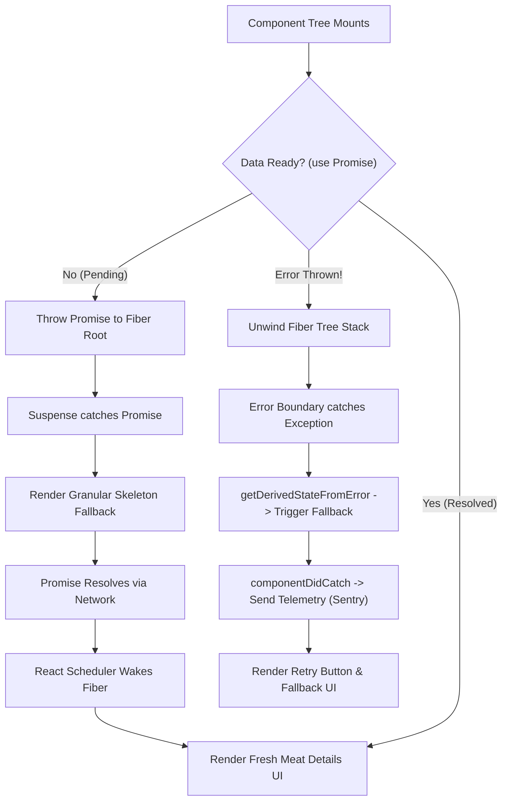

## 1. แนวคิด (Concept)

ในยุคของ React 19 และ Next.js 16 สถาปัตยกรรมการแสดงผลและการจัดการข้อผิดพลาดได้เปลี่ยนผ่านจากวิธีตั้งรับแบบเดิม (Imperative error handling ด้วย `try/catch` และ `isLoading` state กระจัดกระจาย) เข้าสู่กระบวนทัศน์แบบ **Declarative Asynchronous Boundaries** ซึ่งมีแกนหลัก 2 ประการที่ทำงานประสานกันอย่างแนบแน่น:

1. **React Suspense (The Asynchronous Coordinator)**: กลไกคั่นจังหวะการเรนเดอร์ในระดับ Subtree เมื่อคอมโพเนนต์ลูกต้องการข้อมูลที่ยังไม่พร้อม (Promise ที่ยังไม่ resolve) React จะพักการเรนเดอร์ชิ้นส่วนนั้นไว้ชั่วคราว แล้วเรนเดอร์ Fallback UI (เช่น สเกเลตันจำลองขนาดและรูปทรงจริง) แทน โดยไม่บล็อกการเรนเดอร์ส่วนอื่นของหน้าเว็บ ช่วยขจัดปัญหา Layout Shift (CLS) และทำให้เกิดการทำ Streaming SSR ได้อย่างราบรื่น
2. **Error Boundary (The Fault-Tolerant Safety Net)**: ป้อมปราการสกัดกั้นความผิดพลาดที่เกิดขึ้นขณะเรนเดอร์ (Render-phase exceptions) หากคอมโพเนนต์ย่อยเกิด runtime error เช่น ข้อมูลจาก API มีโครงสร้างผิดเพี้ยน หรือเกิดข้อผิดพลาดในการคำนวณราคา Error Boundary จะกักกันข้อผิดพลาดไว้เฉพาะส่วนที่เสียหาย แสดง UI สำหรับแจ้งเตือนและให้ปุ่ม Retry แก่ผู้ใช้งาน ในขณะที่ชิ้นส่วนอื่นของระบบ (เช่น แถบนำทาง ตะกร้าสินค้า และแชตสนทนา) ยังคงทำงานได้ตามปกติ 100%

<Callout type="note" title="สถาปัตยกรรมระดับ Production ของ Smart Butcher Marketplace">
ในระบบตลาดค้าเนื้อเกรดพรีเมียม ข้อมูลสต็อกเนื้อวากิวสด (Wagyu A5), ราคาสดตามน้ำหนักกรัมจริง และระบบชำระเงิน มีความอ่อนไหวสูงมาก หากระบบดึงรีวิวของลูกค้าไม่สำเร็จ ต้องไม่ทำให้ระบบสั่งซื้อเนื้อหรือปุ่มชำระเงินล่มไปด้วย การแยกชั้น Suspense และ Error Boundary อย่างละเอียดจึงเป็นหัวใจสำคัญของความน่าเชื่อถือระดับองค์กร
</Callout>

---

## 2. หลักการเบื้องหลัง (Under the Hood)

เบื้องหลังการทำงานของ React 19 และ Concurrent Mode มีกลไกการสืบทอดและกักกันข้อผิดพลาดที่วิศวกรซอฟต์แวร์ระดับ Senior ต้องเข้าใจในระดับลึก:

### 2.1 กลไก Fiber Unwinding ใน Error Boundary
เมื่อคอมโพเนนต์โยนข้อผิดพลาด (Exception) ออกมาในระหว่างขั้นตอนการ Render:
1. React จะหยุดการทำงานของ Fiber Node ตัวปัจจุบันทันที
2. React Scheduler จะทำการ **Unwind the Stack** ย้อนกลับขึ้นไปตามโครงสร้าง Fiber Tree เพื่อค้นหา Class Component หรือ Custom Boundary ที่มีฟังก์ชัน `componentDidCatch` หรือ `getDerivedStateFromError` ที่ใกล้ที่สุด
3. `static getDerivedStateFromError(error)` ถูกเรียกใช้ใน Render Phase เพื่อปรับปรุง state ให้แสดง Fallback UI ใน Commit ถัดไป
4. `componentDidCatch(error, errorInfo)` ถูกเรียกใช้ใน Commit Phase ซึ่งเป็นจุดที่ปลอดภัยในการยิง Error Telemetry ไปยังระบบภายนอก (เช่น Sentry หรือ Datadog) พร้อม Component Stack Trace
5. ใน React 19 ฟังก์ชัน `useActionState` และ Server Actions มี Error Lifecycle แยกออกจาก Render Error โดยการโยน Error ใน Server Action จะถูกแปลงเป็น Serialized Error ส่งกลับมายัง Action State โดยตรง เว้นแต่จะหลุดไปถึง Root จึงจะทริกเกอร์ `global-error.tsx`

### 2.2 กลไก Throwing Promises ใน React Suspense
เมื่อคอมโพเนนต์ลูกเรียกใช้งาน `use(promise)` หรือเข้าถึงทรัพยากร Suspense-enabled:
1. หากสถานะของ Promise ยังเป็น `pending` ตัวคอมโพเนนต์จะทำท่าการโยนค่า (Throw) ตัว Promise นั้นขึ้นไปบน Fiber Tree
2. Suspense Component ตัวที่ใกล้ที่สุดจะจับ (Catch) Promise นั้นไว้ แล้วสลับโหมดการทำงานของ Subtree นั้นเป็น Suspended พร้อมสลับมาเรนเดอร์ `fallback` แทน
3. ตัว Promise จะแนบ Listener (`promise.then(retryRender)`) เอาไว้ เมื่อข้อมูลเดินทางมาถึงและ Promise ถูก Resolve ตัว React Scheduler จะปลุก Fiber Node นั้นขึ้นมาทำ Re-render ใหม่อีกครั้งโดยอัตโนมัติ



---

## 3. ตัวอย่างโค้ด (Smart Butcher Marketplace)

### ตัวอย่างที่ 1: Multi-layer Suspense พร้อม Granular Skeleton สำหรับหน้ารายละเอียดเนื้อพรีเมียม

ในระบบ Smart Butcher Marketplace หน้ารายละเอียดชิ้นเนื้อประกอบด้วยข้อมูลหลายส่วนที่มีความเร็วในการโหลดต่างกันมาก: ข้อมูลเนื้อพื้นฐาน (เร็ว), สต็อกห้องเย็นแบบเรียลไทม์ (ปานกลาง), และรีวิวการบ่มเนื้อจากผู้เชี่ยวชาญ (ช้า) การรวม Suspense ชั้นเดียวจะทำให้ผู้ใช้รอนานทั้งหน้า เราจึงออกแบบเป็น Multi-layer Suspense ที่โหลดแยกส่วนอิสระ

```tsx filename="src/components/meat-detail/MultiLayerMeatDetail.tsx"
import React, { Suspense, use } from 'react';

// โครงสร้างประเภทข้อมูลชิ้นเนื้อพรีเมียม
export interface MeatCut {
  id: string;
  name: string;
  origin: string;
  marblingScore: number;
  basePricePerKg: number;
  description: string;
}

export interface InventoryStatus {
  sku: string;
  availableKg: number;
  agingDays: number;
  coldStorageRoom: string;
}

export interface MeatReview {
  id: string;
  author: string;
  rating: number;
  comment: string;
  createdAt: string;
}

// -------------------------------------------------------------------------
// Skeleton Fallbacks (ออกแบบจำลองขนาดจริง ป้องกัน Cumulative Layout Shift)
// -------------------------------------------------------------------------
export function ProductInfoSkeleton() {
  return (
    <div className="space-y-4 p-6 bg-slate-900 border border-slate-800 rounded-2xl animate-pulse">
      <div className="h-8 bg-slate-800 rounded-md w-3/4" />
      <div className="h-4 bg-slate-800 rounded-md w-1/2" />
      <div className="h-20 bg-slate-800 rounded-md w-full" />
      <div className="h-6 bg-slate-800 rounded-md w-1/4" />
    </div>
  );
}

export function InventorySkeleton() {
  return (
    <div className="p-4 bg-amber-950/20 border border-amber-900/30 rounded-xl space-y-3 animate-pulse">
      <div className="h-5 bg-amber-900/40 rounded w-1/3" />
      <div className="flex gap-4">
        <div className="h-10 bg-amber-900/30 rounded flex-1" />
        <div className="h-10 bg-amber-900/30 rounded flex-1" />
      </div>
    </div>
  );
}

export function ReviewsSkeleton() {
  return (
    <div className="space-y-3 p-4 border border-slate-800 rounded-xl animate-pulse">
      <div className="h-5 bg-slate-800 rounded w-40" />
      <div className="h-12 bg-slate-800/60 rounded" />
      <div className="h-12 bg-slate-800/60 rounded" />
    </div>
  );
}

// -------------------------------------------------------------------------
// Asynchronous Sub-components (ใช้ use() ของ React 19)
// -------------------------------------------------------------------------
export function BasicMeatInfo({ cutPromise }: { cutPromise: Promise<MeatCut> }) {
  const meat = use(cutPromise);

  return (
    <div className="p-6 bg-slate-900 border border-slate-800 rounded-2xl text-slate-100 shadow-xl">
      <div className="flex justify-between items-start">
        <div>
          <span className="px-2.5 py-1 text-xs font-semibold uppercase tracking-wider bg-rose-900/60 text-rose-300 rounded-md border border-rose-700/50">
            {meat.origin}
          </span>
          <h1 className="text-2xl font-bold mt-2 text-white">{meat.name}</h1>
        </div>
        <div className="text-right">
          <div className="text-xs text-slate-400">Marbling Score</div>
          <div className="text-xl font-black text-amber-400">BMS #{meat.marblingScore}</div>
        </div>
      </div>
      <p className="mt-3 text-sm text-slate-300 leading-relaxed">{meat.description}</p>
      <div className="mt-4 text-2xl font-mono font-bold text-rose-400">
        ฿{meat.basePricePerKg.toLocaleString()} / กิโลกรัม
      </div>
    </div>
  );
}

export function LiveInventoryTracker({ inventoryPromise }: { inventoryPromise: Promise<InventoryStatus> }) {
  const inventory = use(inventoryPromise);

  return (
    <div className="p-4 bg-emerald-950/20 border border-emerald-800/40 rounded-xl text-emerald-200">
      <div className="flex items-center justify-between">
        <span className="text-xs font-medium uppercase tracking-wide">สถานะสต็อกห้องเย็น</span>
        <span className="text-xs font-mono bg-emerald-900/50 px-2 py-0.5 rounded text-emerald-300">
          ห้อง: {inventory.coldStorageRoom}
        </span>
      </div>
      <div className="mt-2 flex items-baseline gap-4">
        <div className="text-xl font-bold text-emerald-400 font-mono">
          คงเหลือ {inventory.availableKg} กก.
        </div>
        <div className="text-xs text-emerald-300/80">
          ระยะเวลาบ่ม Dry-Aged: <span className="font-semibold text-emerald-200">{inventory.agingDays} วัน</span>
        </div>
      </div>
    </div>
  );
}

export function ButcherReviews({ reviewsPromise }: { reviewsPromise: Promise<MeatReview[]> }) {
  const reviews = use(reviewsPromise);

  return (
    <div className="p-4 border border-slate-800 rounded-xl bg-slate-950 text-slate-200 space-y-3">
      <h3 className="text-sm font-semibold text-slate-300">ความเห็นจากเชฟและผู้เชี่ยวชาญ ({reviews.length})</h3>
      <div className="space-y-2">
        {reviews.map((rev) => (
          <div key={rev.id} className="p-2.5 rounded-lg bg-slate-900/80 border border-slate-800 text-xs">
            <div className="flex justify-between text-slate-400 font-medium">
              <span>{rev.author}</span>
              <span className="text-amber-400 font-mono">★ {rev.rating}/5</span>
            </div>
            <p className="mt-1 text-slate-300">{rev.comment}</p>
          </div>
        ))}
      </div>
    </div>
  );
}

// -------------------------------------------------------------------------
// Orchestrator Component: แยก Suspense 3 ชั้น ไม่บล็อกซึ่งกันและกัน
// -------------------------------------------------------------------------
export function MeatDetailView({
  cutPromise,
  inventoryPromise,
  reviewsPromise,
}: {
  cutPromise: Promise<MeatCut>;
  inventoryPromise: Promise<InventoryStatus>;
  reviewsPromise: Promise<MeatReview[]>;
}) {
  return (
    <section className="max-w-2xl mx-auto p-4 space-y-4">
      {/* ชั้นที่ 1: ข้อมูลหลัก โหลดแสดงผลก่อนทันทีเพื่อ First Meaningful Paint */}
      <Suspense fallback={<ProductInfoSkeleton />}>
        <BasicMeatInfo cutPromise={cutPromise} />
      </Suspense>

      {/* ชั้นที่ 2: สต็อกเรียลไทม์ ใช้ Skeleton เฉพาะโซน ไม่ดึงหน้าเว็บหลักให้ค้าง */}
      <Suspense fallback={<InventorySkeleton />}>
        <LiveInventoryTracker inventoryPromise={inventoryPromise} />
      </Suspense>

      {/* ชั้นที่ 3: รีวิวขนาดยาว อยู่ล่างสุด โหลดแยกโดยไม่หน่วงส่วนสำคัญ */}
      <Suspense fallback={<ReviewsSkeleton />}>
        <ButcherReviews reviewsPromise={reviewsPromise} />
      </Suspense>
    </section>
  );
}
```

---

### ตัวอย่างที่ 2: Production-grade Error Boundary พร้อม Telemetry, Reset Keys และ Auto-retry เมื่อเชื่อมต่ออินเทอร์เน็ตใหม่

สำหรับระบบ Checkout สั่งซื้อเนื้อ Wagyu ตัดชิ้นพิเศษ หากเกิดเน็ตเวิร์กขาดหายหรือ API ขัดข้อง เราต้องมีระบบตรวจจับสถานะ Online/Offline อัตโนมัติ, ส่ง Log เข้า Monitoring Service พร้อมแนบ Context ละเอียดยิบ และอนุญาตให้กู้คืน State ได้อย่างแม่นยำ

```tsx filename="src/components/checkout/ProductionErrorBoundary.tsx"
'use client';

import React, { Component, ErrorInfo, ReactNode } from 'react';

// โครงสร้าง Telemetry Payload สำหรับส่งเข้า Datadog หรือ Sentry
export interface ErrorTelemetryPayload {
  name: string;
  message: string;
  stack?: string;
  componentStack?: string;
  context: {
    userId?: string;
    orderId?: string;
    route: string;
    onlineStatus: boolean;
    timestamp: string;
  };
}

// ฟังก์ชันจำลองการส่ง Log เข้า Telemetry Monitoring Service
async function sendErrorTelemetry(payload: ErrorTelemetryPayload): Promise<void> {
  try {
    if (process.env.NODE_ENV === 'production') {
      await fetch('/api/telemetry/errors', {
        method: 'POST',
        headers: { 'Content-Type': 'application/json' },
        body: JSON.stringify(payload),
      });
    } else {
      console.error('[DEV ERROR TELEMETRY]', payload);
    }
  } catch (telemetryErr) {
    // ป้องกัน Telemetry Error ซ้อนทับการทำงานหลัก
    console.error('Failed to dispatch error telemetry', telemetryErr);
  }
}

interface ErrorBoundaryProps {
  children: ReactNode;
  fallbackTitle?: string;
  userId?: string;
  orderId?: string;
  resetKeys?: unknown[]; // เมื่อค่าใน array เปลี่ยน จะทำการ reset boundary อัตโนมัติ
  onReset?: () => void;
}

interface ErrorBoundaryState {
  hasError: boolean;
  error: Error | null;
  isOnline: boolean;
}

export class ProductionErrorBoundary extends Component<ErrorBoundaryProps, ErrorBoundaryState> {
  constructor(props: ErrorBoundaryProps) {
    super(props);
    this.state = {
      hasError: false,
      error: null,
      isOnline: typeof navigator !== 'undefined' ? navigator.onLine : true,
    };
  }

  static getDerivedStateFromError(error: Error): Partial<ErrorBoundaryState> {
    // ปรับปรุง State ทันทีเพื่อให้เรนเดอร์ Fallback UI ใน Commit ถัดไป
    return { hasError: true, error };
  }

  componentDidCatch(error: Error, errorInfo: ErrorInfo): void {
    const { userId, orderId } = this.props;

    const payload: ErrorTelemetryPayload = {
      name: error.name,
      message: error.message,
      stack: error.stack,
      componentStack: errorInfo.componentStack ?? undefined,
      context: {
        userId,
        orderId,
        route: typeof window !== 'undefined' ? window.location.pathname : 'server',
        onlineStatus: typeof navigator !== 'undefined' ? navigator.onLine : true,
        timestamp: new Date().toISOString(),
      },
    };

    // ส่งรายงานข้อผิดพลาดไปยังระบบ Observability
    sendErrorTelemetry(payload);
  }

  componentDidMount(): void {
    if (typeof window !== 'undefined') {
      window.addEventListener('online', this.handleOnline);
      window.addEventListener('offline', this.handleOffline);
    }
  }

  componentWillUnmount(): void {
    if (typeof window !== 'undefined') {
      window.removeEventListener('online', this.handleOnline);
      window.removeEventListener('offline', this.handleOffline);
    }
  }

  componentDidUpdate(prevProps: ErrorBoundaryProps): void {
    // หาก resetKeys เปลี่ยนแปลง (เช่น ผู้ใช้เลือกตัดเนื้อชิ้นใหม่ หรือเปลี่ยนวิธีจ่ายเงิน)
    if (this.state.hasError && this.props.resetKeys && prevProps.resetKeys) {
      const hasKeyChanged = this.props.resetKeys.some(
        (key, idx) => key !== prevProps.resetKeys?.[idx]
      );
      if (hasKeyChanged) {
        this.handleReset();
      }
    }
  }

  handleOnline = (): void => {
    this.setState({ isOnline: true });
    // เมื่อเน็ตกลับมา หากเคยค้างอยู่ที่สถานะ Error ให้ลองรีเซ็ตและเรนเดอร์ใหม่ทันที
    if (this.state.hasError) {
      this.handleReset();
    }
  };

  handleOffline = (): void => {
    this.setState({ isOnline: false });
  };

  handleReset = (): void => {
    this.props.onReset?.();
    this.setState({ hasError: false, error: null });
  };

  render(): ReactNode {
    const { hasError, error, isOnline } = this.state;
    const { children, fallbackTitle = 'การทำรายการขัดข้องชั่วคราว' } = this.props;

    if (hasError) {
      return (
        <div
          role="alert"
          aria-live="assertive"
          className="p-6 my-4 bg-rose-950/40 border border-rose-800 rounded-2xl text-slate-100 shadow-2xl space-y-4"
        >
          <div className="flex items-center gap-3">
            <span className="p-2 bg-rose-900/60 text-rose-300 rounded-xl text-lg font-bold">
              ⚠️
            </span>
            <div>
              <h2 className="text-lg font-bold text-rose-200">{fallbackTitle}</h2>
              <p className="text-xs text-rose-300/80">
                {!isOnline
                  ? 'คุณกำลังอยู่ในโหมดออฟไลน์ กรุณาตรวจสอบสัญญาณอินเทอร์เน็ต'
                  : 'ระบบได้บันทึกข้อผิดพลาดและแจ้งทีมวิศวกรเพื่อตรวจสอบทันที'}
              </p>
            </div>
          </div>

          <div className="p-3 bg-black/40 rounded-lg text-xs font-mono text-rose-300 overflow-x-auto border border-rose-900/50">
            {error?.message || 'Unknown runtime error occurred.'}
          </div>

          <div className="flex flex-wrap items-center justify-between gap-3 pt-2">
            <span className="text-xs text-slate-400">
              สถานะเครือข่าย:{' '}
              <strong className={isOnline ? 'text-emerald-400' : 'text-amber-400'}>
                {isOnline ? 'เชื่อมต่อออนไลน์' : 'ขาดการเชื่อมต่อ (รอการเชื่อมต่อใหม่...)'}
              </strong>
            </span>
            <button
              type="button"
              onClick={this.handleReset}
              className="px-4 py-2 bg-rose-600 hover:bg-rose-500 active:bg-rose-700 text-white text-xs font-bold rounded-lg transition-colors shadow-lg shadow-rose-900/30"
            >
              ลองใหม่อีกครั้ง (Retry)
            </button>
          </div>
        </div>
      );
    }

    return children;
  }
}
```

---

## 4. ข้อผิดพลาดที่พบบ่อย (Anti-pattern vs Best Practice)

### 4.1 การวาง Error Boundary แบบเหมาคลุมทั้งหน้าเว็บ (Monolithic Boundary)
- **Anti-pattern**: นำ `<ErrorBoundary>` ครอบไว้ที่ Root Layout เพียงจุดเดียว เมื่อคอมโพเนนต์ย่อยด้านล่าง เช่น วิดเจ็ตแชตหรือรีวิวลูกค้ามีบั๊ก หน้าเว็บทั้งหน้าจะกลายเป็นหน้าข้อผิดพลาดสีขาว ผู้ใช้ไม่สามารถกดสั่งซื้อเนื้อในตะกร้าได้
- **Best Practice**: วาง Error Boundary แยกตามโดเมนและขอบเขตวิกฤต (Fault Isolation) หุ้มเฉพาะจุดที่เสี่ยง เช่น แผงคำนวณราคา, วิดเจ็ตสต็อกสด และช่องทางชำระเงินแยกอิสระจากกัน

### 4.2 การใช้ Suspense Fallback ที่ขนาดไม่ตรงกับเนื้อหาจริง
- **Anti-pattern**: ใช้ `<Suspense fallback={<div>Loading...</div>}>` หรือ Skeleton สี่เหลี่ยมเล็กๆ เมื่อโหลดเสร็จแล้ว UI เนื้อวากิวขนาด 500px โผล่ขึ้นมา ทำให้เนื้อหาข้างล่างกระโดดลงไปด้านล่างอย่างรุนแรง (เกิด Cumulative Layout Shift - CLS)
- **Best Practice**: สร้าง Skeleton ที่มีความกว้าง ความสูง และ Margin เท่ากับเนื้อหาตอนเรนเดอร์จริงทุกประการ เพื่อให้เบราว์เซอร์จัดเตรียมพื้นที่รอไว้ล่วงหน้า

### 4.3 การลืมส่ง Error Telemetry ใน Production
- **Anti-pattern**: ดักจับ Error ใน Boundary แล้วแสดงปุ่ม Retry เฉยๆ โดยไม่มีการส่ง Stack trace หรือ Context ไปยัง Monitoring tools ทำให้ทีมพัฒนาไม่รู้ว่าผู้ใช้เจอบั๊กอะไรในกระบวนการ Checkout
- **Best Practice**: นำ `componentDidCatch` ส่ง Payload พร้อม Trace ID, User ID, และ Route Path ไปยัง Sentry หรือ Datadog ทันที

```typescript filename="src/types/error-comparison.ts"
// ตัวอย่างตารางวิเคราะห์การจัดการข้อผิดพลาด
export interface StrategyComparison {
  criteria: string;
  naiveApproach: string;
  seniorArchitectApproach: string;
}

export const ERROR_STRATEGY: StrategyComparison[] = [
  {
    criteria: 'Granularity',
    naiveApproach: 'หุ้ม Root Layout 1 จุด พังทั้งหน้า',
    seniorArchitectApproach: 'หุ้มแยกระดับ Feature (Catalog, Cart, Checkout)',
  },
  {
    criteria: 'Suspense Layout',
    naiveApproach: 'Spinner หมุนตรงกลางหน้าจอ',
    seniorArchitectApproach: 'Zero-CLS Granular Skeleton จำลองโครงสร้างจริง',
  },
  {
    criteria: 'Network Resilience',
    naiveApproach: 'ให้ผู้ใช้กด F5 รีเฟรชหน้าเว็บเอง',
    seniorArchitectApproach: 'ตรวจจับ online event และ retry กู้คืน state อัตโนมัติ',
  },
];
```

---

## 5. ควรใช้เมื่อไหร่ และ ไม่ควรใช้เมื่อไหร่

### ควรใช้ (Recommended Use Cases)
- **Suspense**: ใช้เมื่อมีการดึงข้อมูลแบบ Asynchronous ผ่าน React 19 `use(promise)`, การทำ Dynamic Code Splitting ด้วย `React.lazy()`, หรือการทำ Streaming SSR ใน Next.js App Router
- **Granular Skeleton**: ใช้กับเนื้อหาที่มีโครงร่างคงที่แน่นอน เช่น รายการชิ้นเนื้อวากิว, ตารางประวัติออเดอร์, และแดชบอร์ดสรุปยอดขาย
- **Error Boundary**: ใช้ครอบบริเวณที่มีการคำนวณที่ซับซ้อน, จุดที่มีการประมวลผลข้อมูล JSON จากภายนอกที่อาจมีฟิลด์ตกหล่น, และกระบวนการชำระเงินที่ต้องการ Fallback และปุ่ม Retry เฉพาะจุด

### ไม่ควรใช้ (When NOT to Use)
- **ไม่ควรใช้ Error Boundary กับ Event Handlers ทั่วไป**: ฟังก์ชันอย่าง `onClick` หรือ `onSubmit` จะไม่ถูกดักจับโดย Error Boundary เนื่องจากทำงานนอก Render Phase หากเกิดข้อผิดพลาดใน `onClick` ต้องใช้ `try/catch` ตามปกติ
- **ไม่ควรใช้ Error Boundary กับ Asynchronous Code ภายนอก React Lifecycle**: เช่น `setTimeout` หรือ Event Listener ดั้งเดิม ต้องจัดการด้วย Promise Catch
- **ไม่ควรใช้ Suspense กับข้อมูลที่ต้องการให้อัปเดตทันทีแบบ In-place**: เช่น การพิมพ์แป้นพิมพ์ในช่อง Search Bar ที่ควรใช้ `useDeferredValue` หรือ Transition ควบคู่กัน แทนที่จะสลับไปแสดง Skeleton จนเสียโฟกัส

---

## 6. คำถามสัมภาษณ์งาน (Interview Q&A)

### Q1: ทำไม Error Boundary ถึงไม่สามารถดักจับข้อผิดพลาดใน Event Handler (เช่น `onClick`) ได้ และเราจะแก้ปัญหานี้ในระดับ Production ได้อย่างไร?
**แนวคำตอบระดับ Senior**:
Error Boundary ทำงานโดยการดักจับข้อผิดพลาดที่เกิดขึ้นในระหว่างขั้นตอน **Render Phase** และ **Lifecycle Methods/Commit Phase** ของ React Fiber Tree เท่านั้น แต่ Event Handlers (เช่น ฟังก์ชันเมื่อกดคลิกปุ่มเพิ่มเนื้อลงตะกร้า) ถูกประมวลผลโดย Event Loop ของเบราว์เซอร์นอกกระบวนการเรนเดอร์ของ React ดังนั้นเมื่อเกิดข้อผิดพลาดใน Event Handler ตัว React Fiber จึงไม่มีการ Unwind Stack และ Error Boundary จะมองไม่เห็นข้อผิดพลาดนั้น

**วิธีแก้ปัญหาในระดับ Production**:
1. ภายใน Event Handler ต้องใช้โครงสร้าง `try/catch` โดยตรง
2. หากต้องการส่งต่อข้อผิดพลาดจาก Event Handler ไปให้ Error Boundary จัดการเพื่อแสดง Fallback UI เดียวกัน สามารถใช้ Custom Hook ที่เรียก `setState(() => { throw error; })` หรือใช้ `useErrorBoundary` จากไลบรารียอดนิยมอย่าง `react-error-boundary` ซึ่งจะส่ง Exception กลับเข้าสู่ Render Phase ในรอบถัดไปทันที

### Q2: ในสถาปัตยกรรม React 19 และ Next.js App Router สตรีมมิ่งด้วย Suspense กับการจัดการ Hydration Mismatch มีความเกี่ยวข้องกันอย่างไร?
**แนวคำตอบระดับ Senior**:
Suspense เป็นหัวใจของการทำ **Selective Hydration**:
1. เมื่อเซิร์ฟเวอร์ส่ง HTML ก้อนแรกพร้อม Skeleton Fallback มาให้เบราว์เซอร์ เบราว์เซอร์สามารถเริ่มต้น Hydrate ชิ้นส่วนภายนอกที่พร้อมแล้วได้ทันที โดยไม่ต้องรอให้ข้อมูลของคอมโพเนนต์ช้า (เช่น รีวิวเนื้อวากิว) เดินทางมาถึงจนครบ
2. เมื่อข้อมูลช้า resolve ฝั่งเซิร์ฟเวอร์จะสตรีม HTML ก้อนใหม่พร้อม inline script เพื่อสลับเอาเนื้อหาจริงเข้าไปแทนที่ Skeleton และ React จะทำการ Hydrate เฉพาะ Subtree นั้นอย่างอิสระ
3. หากเกิด Hydration Error ขึ้นเฉพาะใน Subtree นั้น React 19 จะไม่ทำลายแอปพลิเคชันทั้งหน้า แต่จะพยายาม Render Subtree นั้นใหม่บนฝั่ง Client แบบเดี่ยวๆ (Client-side Recoverable Error) และหากยังล้มเหลว Error Boundary ตัวที่ใกล้ที่สุดจะรับช่วงต่อ แสดงผล Fallback ที่ปลอดภัยโดยที่แอปพลิเคชันส่วนอื่นยังทำงานได้ต่อเนื่อง

---

## ลำดับการเรียนที่แนะนำ และ ดูเพิ่มเติมที่

1. พื้นฐานสเตตและการเรนเดอร์: [React State & Render](/docs/react/state-render)
2. การปรับแต่งประสิทธิภาพขั้นสูง: [React Performance](/docs/react/performance)
3. สถาปัตยกรรมการประกอบคอมโพเนนต์: [React Architecture](/docs/react/architecture)
4. การจัดการ Type ปลอดภัยในระดับสากล: [TypeScript Basics](/docs/typescript/basics)
5. สถาปัตยกรรม Server และ Client ใน Next.js: [Next.js RSC & Client Components](/docs/nextjs/rsc-client)
