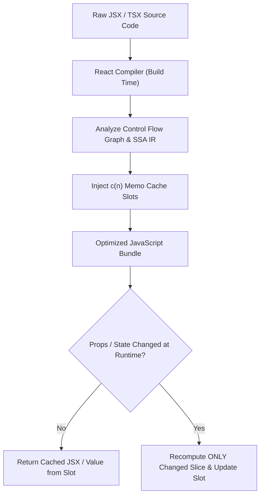

## 1. แนวคิด (Concept)

ในประวัติศาสตร์ของ React การปรับปรุงประสิทธิภาพ (Performance Optimization) เคยเป็นภาระทางสติปัญญาที่หนักหนาสาหัสที่สุดของนักพัฒนา Frontend โดยเราต้องคอยห่อหุ้มฟังก์ชันด้วย `useCallback`, ห่อหุ้มการคำนวณด้วย `useMemo`, และหุ้มคอมโพเนนต์ด้วย `React.memo` อย่างพร่ำเพรื่อเพื่อหลีกเลี่ยง "Unnecessary Re-renders" ทว่าในความเป็นจริง การทำ Manual Memoization บ่อยครั้งกลับสร้างผลเสียมากกว่าผลดี ทั้งปัญหา Dependency Array ไม่ตรงจริง, หน่วยความจำรั่วไหลจากการเก็บแคช, และโค้ดอ่านยากจนสูญเสียความคล่องตัว

**React 19** ร่วมกับ **React Compiler (รหัสพัฒนาเดิม: Forget)** ได้สร้างจุดเปลี่ยนครั้งใหญ่ระดับปฏิวัติวงการ โดยเปลี่ยนการจัดการ Memoization จากการเขียนด้วยมือ (Manual) ไปสู่การวิเคราะห์เชิงลึกอัตโนมัติที่ระดับคอมไพเลอร์ (Automatic Build-time Memoization)

อย่างไรก็ตาม React Compiler ไม่ใช่ยาวิเศษที่แก้ปัญหาประสิทธิภาพได้ทุกมิติ ในระบบขนาดใหญ่ เช่น แพลตฟอร์ม **Smart Butcher Marketplace** ที่ต้องจัดการตารางข้อมูลออเดอร์เนื้อสดระดับ 10,000+ รายการ ปัญหาไม่ได้อยู่ที่การ Re-render ของ React เพียงอย่างเดียว แต่อยู่ที่ **DOM Node Overload** (จำนวนโหนดในเบราว์เซอร์มากเกินไปจนทำให้ GPU และ Layout Engine ค้าง) ซึ่งจำเป็นต้องใช้เทคนิคขั้นสูงอย่าง **List Virtualization** และการตรวจวัดอย่างแม่นยำด้วย **React DevTools Profiler & Flamegraph**

<Callout type="tip" title="กฎเหล็กของ Performance Engineering ยุค React 19">
ห้ามเดาว่าตรงไหนช้า จงตรวจวัดด้วย Profiler ก่อนเสมอ และจงเข้าใจว่า React Compiler ช่วยลด Render Overhead ของ JavaScript แต่ List Virtualization คือคำตอบเดียวในการลด DOM & Layout Tree Cost ของเบราว์เซอร์
</Callout>

---

## 2. หลักการเบื้องหลัง (Under the Hood)

การจะก้าวขึ้นสู่ระดับ Senior Frontend Architect จำเป็นต้องเข้าใจเบื้องลึกของกลไกการคอมไพล์และการประมวลผลกราฟิกของเบราว์เซอร์อย่างถ่องแท้:

### 2.1 สถาปัตยกรรม React Compiler: Memo Cache Array & SSA
React Compiler ทำงานที่ขั้นตอน Build-time (ผ่าน Babel/SWC Plugin) โดยไม่ส่งผลกระทบต่อ Runtime เล็กน้อยหรือไม่มีเลย:
1. **Static Single Assignment (SSA) IR**: คอมไพเลอร์จะแปลงโค้ด JSX/TSX เป็นรูปแบบ Intermediate Representation (IR) เพื่อวิเคราะห์ Flow ของข้อมูลและการพึ่งพา (Dependency Graph) ของทุกตัวแปร
2. **Memo Cache Slots (`c(n)`)**: คอมไพเลอร์จะฉีด Array พิเศษชื่อ `c` เข้าไปในคอมโพเนนต์ และสร้างเงื่อนไขตรวจสอบแบบสั้นระดับค่าตัวแปร เช่น:
   - หาก `input` ไม่เปลี่ยน ให้คืนค่าจาก Slot ในแคชทันที
   - หาก `input` มีการเปลี่ยนแปลง จึงจะประมวลผลนิพจน์นั้นใหม่แล้วบันทึกทับในแคช
3. **ขอบเขตอัตโนมัติ**: คอมไพเลอร์สามารถแบ่งขอบเขตการแคชได้ละเอียดระดับ JSX Element ย่อย ทำให้คอมโพเนนต์ที่มีหลายท่อน สามารถเลือกเรนเดอร์เฉพาะท่อนที่ข้อมูลเปลี่ยนได้ โดยไม่ต้องแยกคอมโพเนนต์เป็นไฟล์เล็กๆ ด้วยซ้ำ



### 2.2 เมื่อไหร่ที่ Manual Memoization ยังจำเป็น และเมื่อไหร่ที่สร้าง Overhead?
- **เมื่อไหร่ที่สร้าง Overhead (ไร้ประโยชน์)**: การใช้ `useCallback` กับฟังก์ชันธรรมดาที่ผูกกับปุ่ม `<button onClick={fn}>` ในคอมโพเนนต์ใบไม้ (Leaf component) นั้น ค่าใช้จ่ายในการจัดสรรหน่วยความจำเพื่อเปรียบเทียบ Dependency Array ในทุก Render มีราคาสูงกว่าต้นทุนการสร้างฟังก์ชันใหม่ใน V8 Engine เสียอีก!
- **เมื่อไหร่ที่ยังต้อง Manual**:
  1. การคำนวณ Heavy Algorithm เชิงคณิตศาสตร์ (เช่น การคำนวณส่วนลดตามสูตรผสมของเกรดเนื้อ 50 ตัวแปร)
  2. โค้ดภายนอกที่มี Third-party libraries คาดหวัง Stable Object Reference แบบตายตัว (เช่น Instance ของ Charting library หรือ WebGL context)
  3. โค้ดที่ยังไม่ผ่านกฎ Rules of React (เช่น การกลายพันธุ์ State นอกทาง) ซึ่ง Compiler จะข้าม (Bail out) การ Optimize คอมโพเนนต์นั้นไป

### 2.3 กลไก List Virtualization (@tanstack/react-virtual)
เมื่อเราต้องการแสดงตารางประวัติคำสั่งซื้อเนื้อ 10,000 แถว:
- **วิธีธรรมดา**: เบราว์เซอร์ต้องสร้าง DOM Elements กว่า 100,000 โหนด กินหน่วยความจำ 200MB+ และทำให้ Scroll ติดขัดที่ 15 FPS
- **กลไก Virtualization**:
  1. คำนวณความสูงรวมทั้งหมด (Total Height = 10,000 x ความสูงแถว) แล้วสร้าง Container หลอก (Phantom Scrollbar)
  2. ดักจับค่า `scrollTop` ของจุดที่ผู้ใช้กำลังเลื่อนดู
  3. เรนเดอร์เฉพาะแถวที่มองเห็นได้ในหน้าจอ (เช่น 15 แถว) บวกล่วงหน้าบน-ล่างเล็กน้อย (Overscan เช่น 5 แถว รวม 25 แถว)
  4. ทำการเลื่อนตำแหน่ง (Translation via CSS `transform: translateY(...)`) ของ 25 แถวนั้นให้ตรงตำแหน่ง ทำให้เบราว์เซอร์จัดการ DOM เพียง 25 แถวตลอดเวลา เลื่อนลื่นไหล 60-120 FPS

---

## 3. ตัวอย่างโค้ด (Smart Butcher Marketplace)

### ตัวอย่างที่ 1: Virtualized Orders Table รองรับ 20,000 รายการด้วย `@tanstack/react-virtual`

ตัวอย่างนี้แสดงการสร้างตารางแสดงรายการสั่งซื้อเนื้อพรีเมียม (Wagyu Ribeye, Tenderloin, Dry-aged Sirloin) จำนวนหลายหมื่นรายการ พร้อมการวัดขนาดความสูงแถวแบบไดนามิก (Dynamic Row Height Measurement)

```tsx filename="src/components/orders/VirtualizedOrderTable.tsx"
'use client';

import React, { useRef, useState, useMemo } from 'react';
import { useVirtualizer } from '@tanstack/react-virtual';

// โครงสร้างคำสั่งซื้อเนื้อพรีเมียม
export interface ButcherOrder {
  id: string;
  customerName: string;
  meatCut: string;
  grade: 'A5' | 'A4' | 'F1' | 'Prime';
  weightGrams: number;
  totalPrice: number;
  status: 'PENDING' | 'CUTTING' | 'PACKAGED' | 'DISPATCHED';
  orderedAt: string;
}

// ฟังก์ชันสร้าง Mock ข้อมูล 20,000 ออเดอร์
export function generateMockOrders(count: number): ButcherOrder[] {
  const cuts = ['Wagyu A5 Striploin', 'Matsusaka Ribeye', 'Dry-Aged Angus T-Bone', 'Kobe Tenderloin'];
  const grades: ButcherOrder['grade'][] = ['A5', 'A4', 'F1', 'Prime'];
  const statuses: ButcherOrder['status'][] = ['PENDING', 'CUTTING', 'PACKAGED', 'DISPATCHED'];

  return Array.from({ length: count }, (_, idx) => {
    const weight = Math.floor(Math.random() * 800) + 200; // 200g - 1,000g
    const pricePerGram = 6.5;
    return {
      id: `ORD-${(idx + 1).toString().padStart(6, '0')}`,
      customerName: `เชฟสุรชัย ลำดับที่ ${idx + 1}`,
      meatCut: cuts[idx % cuts.length],
      grade: grades[idx % grades.length],
      weightGrams: weight,
      totalPrice: Math.round(weight * pricePerGram),
      status: statuses[idx % statuses.length],
      orderedAt: new Date(Date.now() - idx * 360000).toLocaleString('th-TH'),
    };
  });
}

export function VirtualizedOrderTable() {
  const [searchQuery, setSearchQuery] = useState('');
  // จำลองคำสั่งซื้อ 20,000 ออเดอร์
  const allOrders = useMemo(() => generateMockOrders(20000), []);

  // คัดกรองข้อมูลอย่างรวดเร็ว
  const filteredOrders = useMemo(() => {
    if (!searchQuery.trim()) return allOrders;
    const query = searchQuery.toLowerCase();
    return allOrders.filter(
      (ord) =>
        ord.id.toLowerCase().includes(query) ||
        ord.customerName.toLowerCase().includes(query) ||
        ord.meatCut.toLowerCase().includes(query)
    );
  }, [allOrders, searchQuery]);

  // Viewport Container อ้างอิงสำหรับการ Scroll
  const parentRef = useRef<HTMLDivElement>(null);

  // ตั้งค่า Virtualizer สำหรับรายการ
  const rowVirtualizer = useVirtualizer({
    count: filteredOrders.length,
    getScrollElement: () => parentRef.current,
    estimateSize: () => 56, // ความสูงแถวประมาณ 56px
    overscan: 8,            // เรนเดอร์ล่วงหน้า 8 แถวนอกสายตาเพื่อความลื่น
  });

  return (
    <div className="w-full max-w-5xl mx-auto p-4 space-y-4">
      <div className="flex flex-col sm:flex-row justify-between items-start sm:items-center gap-4 bg-slate-900 p-4 rounded-xl border border-slate-800">
        <div>
          <h2 className="text-xl font-bold text-white">ตารางคำสั่งซื้อเนื้อสดเรียลไทม์</h2>
          <p className="text-xs text-slate-400">
            กำลังแสดง {filteredOrders.length.toLocaleString()} รายการ (จากทั้งหมด {allOrders.length.toLocaleString()})
          </p>
        </div>
        <input
          type="text"
          placeholder="ค้นหา Order ID หรือชื่อเนื้อ..."
          value={searchQuery}
          onChange={(e) => setSearchQuery(e.target.value)}
          className="px-3 py-2 bg-slate-800 border border-slate-700 rounded-lg text-sm text-slate-100 placeholder-slate-400 focus:outline-none focus:ring-2 focus:ring-rose-500 w-full sm:w-72"
        />
      </div>

      {/* Header ค้างตำแหน่ง (Sticky Header) */}
      <div className="bg-slate-950 border border-slate-800 rounded-xl overflow-hidden shadow-2xl">
        <div className="grid grid-cols-6 gap-2 p-3 bg-slate-900 border-b border-slate-800 text-xs font-semibold text-slate-300 uppercase tracking-wider">
          <span>รหัสคำสั่งซื้อ</span>
          <span>ลูกค้า</span>
          <span>ชิ้นเนื้อ / เกรด</span>
          <span className="text-right">น้ำหนัก (g)</span>
          <span className="text-right">ราคารวม (฿)</span>
          <span className="text-center">สถานะ</span>
        </div>

        {/* Scrollable Virtualized Body */}
        <div
          ref={parentRef}
          className="h-[500px] overflow-auto relative will-change-transform"
        >
          <div
            style={{
              height: `${rowVirtualizer.getTotalSize()}px`,
              width: '100%',
              position: 'relative',
            }}
          >
            {rowVirtualizer.getVirtualItems().map((virtualRow) => {
              const order = filteredOrders[virtualRow.index];
              return (
                <div
                  key={order.id}
                  style={{
                    position: 'absolute',
                    top: 0,
                    left: 0,
                    width: '100%',
                    height: `${virtualRow.size}px`,
                    transform: `translateY(${virtualRow.start}px)`,
                  }}
                  className="grid grid-cols-6 gap-2 items-center px-3 py-2 border-b border-slate-800/60 hover:bg-slate-900/50 text-xs text-slate-200 transition-colors"
                >
                  <span className="font-mono text-rose-400 font-medium">{order.id}</span>
                  <span className="truncate">{order.customerName}</span>
                  <div className="truncate">
                    <span>{order.meatCut}</span>
                    <span className="ml-1.5 px-1.5 py-0.2 bg-amber-950 text-amber-300 border border-amber-800 rounded text-[10px] font-bold">
                      {order.grade}
                    </span>
                  </div>
                  <span className="font-mono text-right text-slate-300">
                    {order.weightGrams.toLocaleString()} g
                  </span>
                  <span className="font-mono text-right text-emerald-400 font-bold">
                    ฿{order.totalPrice.toLocaleString()}
                  </span>
                  <div className="text-center">
                    <span
                      className={`inline-block px-2 py-0.5 rounded text-[10px] font-semibold ${
                        order.status === 'DISPATCHED'
                          ? 'bg-emerald-950 text-emerald-300 border border-emerald-800'
                          : order.status === 'CUTTING'
                          ? 'bg-blue-950 text-blue-300 border border-blue-800'
                          : 'bg-slate-800 text-slate-300'
                      }`}
                    >
                      {order.status}
                    </span>
                  </div>
                </div>
              );
            })}
          </div>
        </div>
      </div>
    </div>
  );
}
```

---

### ตัวอย่างที่ 2: React DevTools Profiler Integration พร้อม Telemetry สำหรับตรวจจับ Slow Renders

เมื่อใช้ React 19 เราสามารถฝังคอมโพเนนต์ `<Profiler>` เพื่อส่งสถิติการเรนเดอร์ (Phase, Actual Duration, Base Duration) ไปยังเซิร์ฟเวอร์เพื่อตรวจจับว่าหน้าตัดชิ้นเนื้อส่วนใดทำงานช้าผิดปกติ

```tsx filename="src/components/profiling/MeatCatalogProfiler.tsx"
'use client';

import React, { Profiler, ProfilerOnRenderCallback, ReactNode } from 'react';

// โครงสร้างเมตริกส่งไปยัง OpenTelemetry หรือ Datadog
export interface RenderMetricPayload {
  id: string;
  phase: 'mount' | 'update' | 'nested-update';
  actualDuration: number;
  baseDuration: number;
  startTime: number;
  commitTime: number;
  thresholdExceeded: boolean;
}

// ค่าเกณฑ์ความหน่วงที่ยอมรับได้ (เช่น เรนเดอร์เกิน 16ms ถือว่าตกเฟรม 60fps)
const FRAME_BUDGET_MS = 16.0;

const handleProfileRender: ProfilerOnRenderCallback = (
  id,
  phase,
  actualDuration,
  baseDuration,
  startTime,
  commitTime
) => {
  const isSlow = actualDuration > FRAME_BUDGET_MS;

  const metric: RenderMetricPayload = {
    id,
    phase,
    actualDuration: Number(actualDuration.toFixed(2)),
    baseDuration: Number(baseDuration.toFixed(2)),
    startTime: Math.round(startTime),
    commitTime: Math.round(commitTime),
    thresholdExceeded: isSlow,
  };

  // หากเรนเดอร์ช้าเกินงบประมาณเฟรม ให้แจ้งเตือนวิศวกร
  if (isSlow) {
    console.warn(`[PERF ALERT] Slow render in <${id}>! took ${actualDuration.toFixed(2)}ms`, metric);
  }

  // ส่งข้อมูลเข้า Telemetry เมื่ออยู่ในสภาพแวดล้อมจริง
  if (typeof window !== 'undefined' && process.env.NODE_ENV === 'production' && isSlow) {
    navigator.sendBeacon('/api/telemetry/performance', JSON.stringify(metric));
  }
};

export function MeatCatalogProfiler({ children }: { children: ReactNode }) {
  return (
    <Profiler id="ButcherCatalog" onRender={handleProfileRender}>
      {children}
    </Profiler>
  );
}
```

---

## 4. ข้อผิดพลาดที่พบบ่อย (Anti-pattern vs Best Practice)

### 4.1 การใส่ `useCallback` ครอบฟังก์ชันทุกตัวโดยไม่เข้าใจ React Compiler
- **Anti-pattern**: สมาชิกทีมใส่ `useCallback` และ `useMemo` ทุกบรรทัดเพราะเชื่อว่าจะช่วยประหยัดเวลา ทว่าใน React 19 ตัว React Compiler จัดการแคชให้อย่างมีประสิทธิภาพสูงสุดในระดับไบต์โค้ด การเขียน manual hooks ซ้อนทับกลับกลายเป็นการขัดขวางการวิเคราะห์ของคอมไพเลอร์ และทำให้โค้ดบวมโดยใช่เหตุ
- **Best Practice**: ปล่อยให้ React Compiler ทำงานโดยอัตโนมัติ เขียนโค้ดแบบ Pure JavaScript ที่ปฏิบัติตาม Rules of React อย่างเคร่งครัด แล้วทำการวัดด้วย Profiler ก่อนจึงค่อย Optimize เฉพาะจุด

### 4.2 การสร้าง Inline Object ใน Props โดยไม่ตั้งใจ
- **Anti-pattern**: การส่ง `style={{ marginTop: 10 }}` หรือ `filter={{ status: 'PENDING' }}` ข้ามชั้นลงไปในคอมโพเนนต์ยักษ์ที่ยังไม่ได้ผ่าน Compiler หรือเป็น Third-party library ทำให้เกิด Object Reference ใหม่ทุกรอบการเรนเดอร์
- **Best Practice**: ประกาศค่าคงที่ไว้นอกคอมโพเนนต์ หรือส่งค่า Primitive แทน

### 4.3 การใช้ List Virtualization โดยไม่ล็อกขนาด Container ให้แน่นอน
- **Anti-pattern**: นำ `useVirtualizer` ไปครอบ `<div>` ที่ไม่มีการกำหนดความสูงที่แน่นอน (เช่น ลืมกำหนด `h-[500px]` และ `overflow-auto`) ส่งผลให้ Virtualizer คำนวณความสูงไม่ได้และเรนเดอร์แถวทั้งหมดออกมาพร้อมกัน นำไปสู่การกินแรมมหาศาลเหมือนเดิม
- **Best Practice**: กำหนด Viewport Container ให้มีขนาดจำกัดและระบุ `overflow-auto` ควบคู่กับ CSS `will-change-transform` เสมอ

```typescript filename="src/types/performance-checklist.ts"
// รายการตรวจสอบประสิทธิภาพระดับ Production
export interface PerformanceAuditItem {
  layer: 'Compiler' | 'DOM Virtualization' | 'Profiler';
  symptom: string;
  solution: string;
}

export const PERF_CHECKLIST: PerformanceAuditItem[] = [
  {
    layer: 'Compiler',
    symptom: 'Components re-render due to mutable states outside React',
    solution: 'Ensure immutability and verify compiler output via React DevTools badge',
  },
  {
    layer: 'DOM Virtualization',
    symptom: 'Laggy scroll on 10k items table, browser memory exceeds 300MB',
    solution: 'Implement @tanstack/react-virtual with dynamic measurement & overscan',
  },
  {
    layer: 'Profiler',
    symptom: 'Dropping below 60fps on cut selection click',
    solution: 'Check Flamegraph to identify commit phase bottlenecks (>16ms)',
  },
];
```

---

## 5. ควรใช้เมื่อไหร่ และ ไม่ควรใช้เมื่อไหร่

### ควรใช้ (Recommended Use Cases)
- **React Compiler**: เปิดใช้งานเป็นค่าเริ่มต้นกับโปรเจกต์ React 19 / Next.js 16 ทั้งหมด เพื่อประหยัดเวลาและลดข้อผิดพลาดของ Dependency Arrays
- **List Virtualization (`@tanstack/react-virtual`)**: ใช้เมื่อต้องแสดงรายการข้อมูลมากกว่า 100-200 รายการขึ้นไปบนหน้าจอเดียวกัน เช่น ตารางสต็อกเนื้อ, รายการออเดอร์ในคลังสินค้า, หรือ Infinite Scrolling ของฟีดสินค้า
- **React Profiler**: ใช้ในระหว่างการทำ Performance Sprint, การทดสอบ E2E อัตโนมัติ, หรือวางในจุดวิกฤต เช่น หน้าสรุปยอดเงินและตัดสต็อก

### ไม่ควรใช้ (When NOT to Use)
- **ไม่ควรใช้ Virtualization กับรายการขนาดเล็ก**: หากรายการมีเพียง 10-30 รายการ การนำ Virtualizer เข้ามาติดตั้งจะเพิ่มขนาด JavaScript Bundle และความซับซ้อนของ DOM โดยไม่เห็นผลต่างทางความเร็ว
- **ไม่ควร Manual Memoize ตัวแปรพื้นฐาน**: เช่น ตัวเลขสต็อกหรือข้อความสั้นๆ `const total = useMemo(() => a + b, [a, b])` ถือเป็น Overhead ที่สิ้นเปลืองทรัพยากรซีพียู

---

## 6. คำถามสัมภาษณ์งาน (Interview Q&A)

### Q1: React Compiler ใน React 19 แตกต่างจาก `React.memo` อย่างไร และทำไมมันถึงเร็วกว่า?
**แนวคำตอบระดับ Senior**:
`React.memo` เป็น High-Order Component ที่ทำงานใน **Runtime Phase** โดยจะทำการ Shallow Compare ค่า Props ทั้งหมดก่อนที่คอมโพเนนต์จะเริ่มเรนเดอร์ ซึ่งมีข้อจำกัดสำคัญคือ:
1. หาก Props มี Object หรือ Callback ใหม่หลุดเข้ามาแม้แต่ตัวเดียว Shallow Compare จะล้มเหลวทันที และทำให้คอมโพเนนต์ต้องรันเรนเดอร์ทั้งตัวอยู่ดี
2. ต้องเสียต้นทุนในการวนลูปเปรียบเทียบ Props ทุกรอบ

ในทางตรงกันข้าม **React Compiler** ทำงานที่ **Build Time**:
1. มันทำการแปลงโครงสร้างโค้ดเป็น SSA Form เพื่อตรวจสอบการพึ่งพาตัวแปรในระดับ Fine-grained (แต่ละบรรทัด)
2. มันสร้าง Memoization Slot แยกรายนิพจน์ภายในคอมโพเนนต์ตัวเดียวกัน ทำให้สามารถข้ามการประมวลผลเฉพาะบรรทัดที่ตัวแปรต้นทางไม่เปลี่ยนแปลงได้ โดยไม่ต้องเสียต้นทุน Shallow Compare ของทั้งคอมโพเนนต์

### Q2: ในการวิเคราะห์ React DevTools Flamegraph อะไรคือความแตกต่างระหว่าง "Render Duration" กับ "Commit Phase" และหากหน้าเว็บค้างตอนกดปุ่ม จะหาสาเหตุได้อย่างไร?
**แนวคำตอบระดับ Senior**:
- **Render Duration**: คือเวลาที่ React ใช้ในการรันฟังก์ชันคอมโพเนนต์ ประมวลผล Hooks และสร้าง Virtual DOM ต้นใหม่ (Fiber Reconciler)
- **Commit Phase**: คือเวลาที่ React นำการเปลี่ยนแปลงที่คำนวณได้ ไปปรับปรุงลงสู่เบราว์เซอร์จริง (Real DOM Mutation) รวมถึงการรัน `useLayoutEffect` และการคำนวณ Style/Layout ของเบราว์เซอร์

**การวินิจฉัยเมื่อหน้าเว็บค้าง**:
1. เปิด Flamegraph ดูแท่งความสูงของคอมโพเนนต์ที่เปลี่ยนสีเป็นสีเหลือง/แดง
2. หาก **Render Duration สูง**: แสดงว่ามี JavaScript Logic หนักๆ อยู่ในฟังก์ชันคอมโพเนนต์ (เช่น ลูปฟิลเตอร์ข้อมูลขนาดใหญ่ในตัวเรนเดอร์) วิธีแก้คือย้ายไปคำนวณล่วงหน้าหรือใช้ Web Worker
3. หาก **Commit Duration สูง**: แสดงว่า React พยายามแทรก DOM Node ลงในหน้าจอมากเกินไปพร้อมกัน (เช่น เรนเดอร์ 5,000 โหนดลงหน้าจอ) หรือมี `useLayoutEffect` ที่อ่าน/เขียน CSS Property จนเกิด Forced Synchronous Layout / Layout Thrashing วิธีแก้คือการใช้ List Virtualization

---

## ลำดับการเรียนที่แนะนำ และ ดูเพิ่มเติมที่

1. การจัดการความผิดพลาดและ Fallback: [React Error & Suspense](/docs/react/error-suspense)
2. สถาปัตยกรรมโครงสร้างโค้ด: [React Architecture](/docs/react/architecture)
3. การใช้งาน Custom Hooks อย่างมีประสิทธิภาพ: [React Custom Hooks](/docs/react/custom-hooks)
4. การจัดการ State และ Reducer: [React useReducer](/docs/react/use-reducer)
5. สถาปัตยกรรม Next.js App Router: [Next.js RSC & Client Components](/docs/nextjs/rsc-client)
