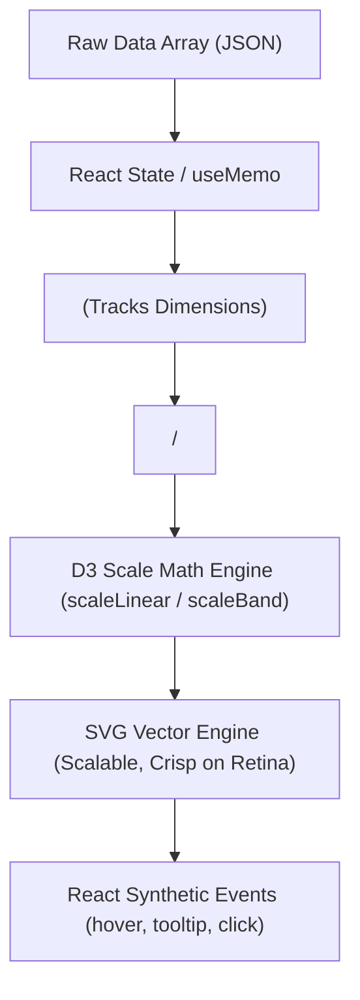

## ภาพรวม Recharts & Modern Data Visualization ใน React 19 / Next.js 16

**Recharts** คือไลบรารีสร้างกราฟและ Data Visualization ยอดนิยมอันดับ 1 สำหรับ React โดยถูกออกแบบบนปรัชญา **Declarative React Components** ร่วมกับการคำนวณสเกลของ **D3.js** และการวาดภาพกราฟิกแบบเวกเตอร์ด้วย **SVG (Scalable Vector Graphics)**

แทนที่คุณจะต้องเขียนโค้ดสั่งการ Canvas ทีละพิกเซลแบบ Imperative หรือคำนวณพิกัด DOM ยุ่งยากด้วย D3 เพียวๆ Recharts ช่วยให้นักพัฒนาสามารถประกอบชิ้นส่วนกราฟได้เหมือนการต่อเลโก้:

```tsx
<ResponsiveContainer width="100%" height={350}>
  <BarChart data={salesData}>
    <CartesianGrid strokeDasharray="3 3" />
    <XAxis dataKey="month" />
    <YAxis tickFormatter={(val) => `฿${val.toLocaleString()}`} />
    <Tooltip content={<CustomTooltip />} />
    <Bar dataKey="revenue" fill="var(--color-revenue)" radius={[4, 4, 0, 0]} />
  </BarChart>
</ResponsiveContainer>
```



---

## จุดเด่นและข้อควรพิจารณา (Trade-offs)

1. **Declarative Composition**: ทุกส่วนประกอบของกราฟแยกเป็น Component อิสระ (`<XAxis>`, `<Tooltip>`, `<Legend>`, `<ReferenceLine>`) ปรับแต่งและสลับตำแหน่งได้ทันที
2. **SVG-based Rendering**: คมชัดทุกระดับความละเอียดหน้าจอ (Retina display) และสามารถใช้ CSS / Tailwind ในการจัดสไตล์, ทำ Gradient หรือ Transition ได้โดยตรง
3. **shadcn/ui Chart Foundation**: ใน Next.js 16 สถาปัตยกรรม UI ยุคใหม่ของ shadcn/ui เลือกใช้ Recharts เป็นแกนหลักเบื้องหลัง component `<ChartContainer>` และ `<ChartTooltip>` ผูกกับระบบ Semantic Color Tokens ใน `globals.css`
4. **ข้อจำกัดเรื่องข้อมูลจำนวนมาก (High Data Points)**: เนื่องจากทุกแท่งหรือจุดใน Recharts คือ SVG DOM Node หากเรนเดอร์ข้อมูลมากกว่า 3,000–5,000 จุดพร้อมกัน อาจทำให้เฟรมเรตตกได้ ซึ่งต้องใช้เทคนิค Data Downsampling หรือ Canvas-based libraries (เช่น Chart.js) เข้ามาช่วย

---

## สารบัญหลักสูตร Recharts (Directory)

บทเรียนชุดนี้ครอบคลุมตั้งแต่พื้นฐาน โครงสร้างข้อมูล การเชื่อมต่อ shadcn/ui Chart ไปจนถึงการรับมือกับ SSR Hydration ใน Next.js 16 และ Best Practices ระดับ Senior:

| หัวข้อ | ลิงก์อ่านเนื้อหา | คำอธิบายสังเขป |
| :--- | :--- | :--- |
| **1. แนวคิดและเปรียบเทียบ** | [Concept & Ecosystem](/docs/recharts/concept-comparison) | React + D3 + SVG, SVG vs Canvas, เทียบกับ Chart.js, Nivo, Visx และเกณฑ์เลือกใช้ |
| **2. การติดตั้ง & โครงสร้างพื้นฐาน** | [Installation & Core Setup](/docs/recharts/installation-basics) | ติดตั้ง, `ResponsiveContainer` (ทำไมต้องกำหนดความสูง), โครงสร้างข้อมูล, `dataKey`, Axis, Grid |
| **3. กราฟพื้นฐานที่ใช้บ่อย** | [Line, Bar, Area & Pie Charts](/docs/recharts/basic-charts) | เจาะลึก 4 กราฟหลัก (Line, Bar, Area, Donut/Pie) และการเลือกกราฟให้ตรงกับประเภทข้อมูล |
| **4. กราฟขั้นกลาง** | [Composed, Dual-Axis & Stacked](/docs/recharts/advanced-charts) | `ComposedChart` ผสม Line+Bar, หลายแกน Y (Dual Y-Axis), Stacked Bar, Radar, `ReferenceLine` |
| **5. การปรับแต่งหน้าตา & รูปแบบ** | [Styling, Gradients & Formatters](/docs/recharts/styling-formatters) | SVG Gradient (`<defs>`), ขอบมน Bar `radius`, Tick Formatters (สกุลเงินบาท, ตัวย่อ 1.2M), ฟอนต์ภาษาไทย |
| **6. Tooltip และ Legend กำหนดเอง** | [Custom Tooltip & Legend](/docs/recharts/custom-tooltip-legend) | Component `CustomTooltip`, แกะ Payload, Legend แบบ Interactive คลิกเปิด/ปิดชุดข้อมูล |
| **7. Interactivity & Filter** | [Interactivity & Brush Filter](/docs/recharts/interactivity-events) | เหตุการณ์ `onClick` ดึงค่า Drill-down, Hover state, แถบสไลด์ `Brush` สำหรับซูมช่วงเวลา |
| **8. Recharts กับ shadcn/ui Chart** | [shadcn/ui Chart & Theming](/docs/recharts/shadcn-chart-integration) | สถาปัตยกรรม `ChartContainer`, `ChartConfig`, การผูกโทเคน `--chart-1` ... `--chart-5`, Dark Mode |
| **9. Responsive และ Dark Mode** | [Responsive & Dark Mode](/docs/recharts/responsive-dark-mode) | เทคนิคจัด Layout บน Mobile (ซ่อน Tick, ย่อฟอนต์), Dark Mode ควบคู่กับ Tailwind v4 และ `next-themes` |
| **10. การแปลงข้อมูลสำหรับกราฟ** | [Data Wrangling & Pipelines](/docs/recharts/data-transformation) | รวมยอดด้วย `reduce`, เติมวันที่ที่หายไป (Zero-filling gap), คำนวณ %, `useMemo`, ดึงจาก NestJS/Prisma |
| **11. Next.js 16 App Router** | [Next.js 16 SSR & Hydration](/docs/recharts/nextjs-app-router) | `"use client"`, แก้บั๊ก ResponsiveContainer ขนาดกว้างยาวเป็น 0, Prefetch บน Server, Loading Skeleton |
| **12. ตัวอย่าง Dashboard ใช้งานจริง** | [Real-world Analytics Dashboard](/docs/recharts/real-world-dashboard) | E-Commerce / SaaS Dashboard ครบวงจร: KPI Metric Cards + Sales Trend + Revenue Area + Order Pipeline |
| **13. Performance และ Accessibility** | [Performance & Accessibility](/docs/recharts/performance-a11y) | `React.memo`, ปิด `isAnimationActive` เมื่อข้อมูลเยอะ, `accessibilityLayer`, ตารางสำรอง `sr-only` |
| **14. ข้อผิดพลาด & Q&A สัมภาษณ์** | [Pitfalls & Senior Q&A](/docs/recharts/pitfalls) | 7 Anti-patterns ยอดฮิต, Production Readiness Checklist, รวมคำถามสัมภาษณ์งานระดับ Senior |
