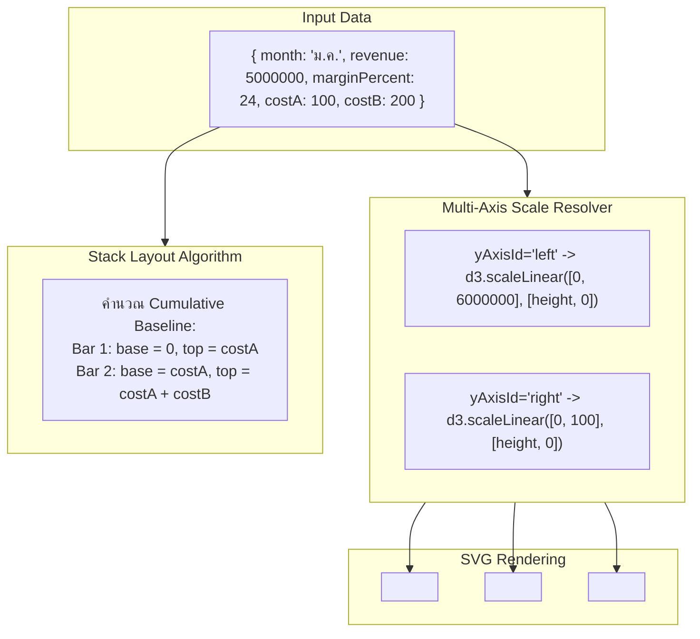

## 1. แนวคิด (Concept)

เมื่อระบบต้องการสื่อสารข้อมูลที่มีความซับซ้อนมากกว่ามิติเดียว กราฟเดี่ยวๆ อาจไม่เพียงพอ Recharts รองรับการสร้างกราฟขั้นกลางและกราฟเชิงซ้อนที่ตอบสนองความต้องการระดับผู้บริหาร:

1. **ComposedChart (กราฟไฮบริดรวมมิติ)**:
   รวมกราฟประเภทต่างๆ เช่น `<Bar>`, `<Line>`, และ `<Area>` ไว้บนพิกัดเดียวกัน ช่วยให้เห็นความสัมพันธ์ระหว่าง "ตัวเลขปริมาณ" (Volume via Bar) คู่กับ "ตัวเลขแนวโน้มหรืออัตราส่วน" (Trend/Ratio via Line) ในช็อตเดียว
2. **Dual Y-Axis (ระบบแกน Y คู่ขนาน)**:
   แก้ปัญหาเมื่อข้อมูล 2 ชุดมีหน่วยวัดที่แตกต่างกันโดยสิ้นเชิง เช่น แกนซ้ายแสดง "ยอดขายเป็นบาท (฿)" ขณะที่แกนขวาแสดง "อัตรากำไรสุทธิเป็นเปอร์เซ็นต์ (%)" โดยผูกความสัมพันธ์ด้วยคุณสมบัติ `yAxisId="left"` และ `yAxisId="right"`
3. **Stacked Bar & Stacked Area (การวางซ้อนข้อมูล)**:
   นำข้อมูลหลายหมวดหมู่มาซ้อนทับกันในแท่งเดียวหรือพื้นที่เดียวผ่านคุณสมบัติ `stackId="a"` ช่วยให้เห็นทั้ง "ยอดรวมสุทธิ" และ "การกระจายตัวของส่วนประกอบย่อย"
4. **RadarChart & ScatterChart (ข้อมูลพหุมิติและสหสัมพันธ์)**:
   - **RadarChart**: แสดงคุณลักษณะรอบด้าน (Multi-variable Attributes) เช่น ทักษะพนักงาน หรือคะแนนความพึงพอใจรอบทิศทาง
   - **ScatterChart**: วิเคราะห์การกระจายตัวและความสัมพันธ์ระหว่างตัวแปร 2 ตัว (Correlation)
5. **ReferenceLine & ReferenceArea (เส้นและแถบอ้างอิงเป้าหมาย)**:
   ขีดเส้นเกณฑ์มาตรฐาน (Target KPI, Average, SLA Threshold) หรือไฮไลต์ช่วงเวลาวิกฤตลงบนกราฟเพื่อเพิ่มบริบททางธุรกิจ

---

## 2. หลักการเบื้องหลัง (Under the Hood)

### สถาปัตยกรรม Multi-Axis & Stack Engine



- **Multi-Axis Scale Resolution**:
  เมื่อระบุ `yAxisId="left"` และ `yAxisId="right"` Recharts จะสร้างอินสแตนซ์ของ `d3.scaleLinear` แยกกันสองชุด แต่ละแกนจะคำนวณ Min/Max ของชุดข้อมูลที่ผูกกับแกนนั้นๆ โดยอัตโนมัติ
- **Stack Engine Calculation**:
  เมื่อมีการระบุ `stackId="group1"` อัลกอริทึมจะสะสมค่าพิกัดฐาน (Baseline Offset) ของแท่งก่อนหน้า เพื่อนำมาเป็นจุดเริ่มต้นของแท่งถัดไป โดยรองรับ `stackOffset="sign"` สำหรับข้อมูลที่มีทั้งค่าบวกและค่าลบ
- **ReferenceLine Coordinate Mapping**:
  `<ReferenceLine y={20} yAxisId="right" />` จะนำค่า 20 ส่งเข้าสเกลของแกนขวา เพื่อแปลงเป็นพิกัดแกน Y บนจอ แล้วเรนเดอร์แท็ก `<line x1={0} y1={yPos} x2={width} y2={yPos} />` ของ SVG

---

## 3. ตัวอย่างโค้ด (TypeScript / TSX)

### ตัวอย่างที่ 1: แดชบอร์ดผู้บริหาร ComposedChart พร้อม Dual Y-Axis และ ReferenceLine

แสดงยอดขายแท่ง Bar คู่กับต้นทุน Area และอัตรากำไรเส้น Line พร้อมเส้นเป้าหมายกำไร 20%

```tsx filename="components/analytics/ExecutiveRevenueMarginComposed.tsx"
'use client';

import React from 'react';
import {
  ResponsiveContainer,
  ComposedChart,
  Bar,
  Line,
  Area,
  XAxis,
  YAxis,
  CartesianGrid,
  Tooltip,
  Legend,
  ReferenceLine,
} from 'recharts';

export interface ExecutiveMetric {
  period: string;
  grossRevenue: number;
  operatingExpense: number;
  netMarginPercent: number;
}

interface ExecutiveDashboardProps {
  data: ExecutiveMetric[];
}

export function ExecutiveRevenueMarginComposed({ data }: ExecutiveDashboardProps) {
  const formatCurrency = (val: number) => `฿${(val / 1_000_000).toFixed(1)}M`;
  const formatPercent = (val: number) => `${val}%`;

  return (
    <div className="w-full rounded-2xl border border-slate-200 bg-white p-6 shadow-sm dark:border-slate-800 dark:bg-slate-900">
      <div className="mb-4 flex flex-col gap-1">
        <h3 className="text-lg font-bold text-slate-800 dark:text-slate-100">
          ภาพรวมรายได้ ค่าใช้จ่าย และอัตรากำไรสุทธิ (Executive Composed View)
        </h3>
        <p className="text-xs text-slate-500">
          แกนซ้าย: ยอดเงิน (ล้านบาท) | แกนขวา: อัตรากำไรสุทธิ (%) | เส้นประแดง: เกณฑ์เป้าหมาย 20%
        </p>
      </div>

      <div className="h-[400px] w-full">
        <ResponsiveContainer width="100%" height="100%">
          <ComposedChart
            data={data}
            margin={{ top: 20, right: 20, bottom: 10, left: 10 }}
          >
            <CartesianGrid strokeDasharray="3 3" vertical={false} stroke="#f1f5f9" />
            
            {/* แกน X */}
            <XAxis
              dataKey="period"
              tickLine={false}
              tick={{ fontSize: 12, fill: '#64748b' }}
            />

            {/* แกน Y ซ้าย: จำนวนเงิน (บาท) */}
            <YAxis
              yAxisId="currencyAxis"
              orientation="left"
              tickLine={false}
              axisLine={false}
              tickFormatter={formatCurrency}
              tick={{ fontSize: 12, fill: '#64748b' }}
            />

            {/* แกน Y ขวา: เปอร์เซ็นต์ (%) */}
            <YAxis
              yAxisId="percentAxis"
              orientation="right"
              domain={[0, 40]}
              tickLine={false}
              axisLine={false}
              tickFormatter={formatPercent}
              tick={{ fontSize: 12, fill: '#10b981' }}
            />

            <Tooltip
              formatter={(val: any, name: any) => {
                if (name === 'อัตรากำไร') return [`${val}%`, name];
                return [`฿${Number(val).toLocaleString()}`, name];
              }}
              contentStyle={{ borderRadius: '8px', border: '1px solid #e2e8f0' }}
            />
            <Legend verticalAlign="top" align="right" wrapperStyle={{ paddingBottom: '12px' }} />

            {/* เส้นเป้าหมาย KPI อัตรากำไร 20% บนแกนขวา */}
            <ReferenceLine
              yAxisId="percentAxis"
              y={20}
              stroke="#ef4444"
              strokeDasharray="4 4"
              strokeWidth={1.5}
              label={{
                value: 'Target Margin (20%)',
                position: 'insideTopRight',
                fill: '#ef4444',
                fontSize: 11,
              }}
            />

            {/* 1. Bar: ยอดขายรวม (แกนซ้าย) */}
            <Bar
              yAxisId="currencyAxis"
              dataKey="grossRevenue"
              name="รายได้รวม"
              fill="#3b82f6"
              radius={[4, 4, 0, 0]}
              maxBarSize={42}
            />

            {/* 2. Area: ค่าใช้จ่ายดำเนินงาน (แกนซ้าย) */}
            <Area
              yAxisId="currencyAxis"
              type="monotone"
              dataKey="operatingExpense"
              name="ค่าใช้จ่าย"
              fill="#cbd5e1"
              stroke="#94a3b8"
              fillOpacity={0.4}
            />

            {/* 3. Line: อัตรากำไรสุทธิ (แกนขวา) */}
            <Line
              yAxisId="percentAxis"
              type="monotone"
              dataKey="netMarginPercent"
              name="อัตรากำไร"
              stroke="#10b981"
              strokeWidth={3}
              dot={{ r: 4, fill: '#10b981' }}
              activeDot={{ r: 6 }}
            />
          </ComposedChart>
        </ResponsiveContainer>
      </div>
    </div>
  );
}
```

---

### ตัวอย่างที่ 2: Stacked Bar ยอดขายย่อย คู่กับ RadarChart ประเมินศักยภาพทีม

สาธิตการใช้ `stackId` ในการซ้อนแท่ง และ `RadarChart` สำหรับการประเมินทักษะหลายมิติ

```tsx filename="components/analytics/StackedAndRadarDashboard.tsx"
'use client';

import React from 'react';
import {
  ResponsiveContainer,
  BarChart,
  Bar,
  XAxis,
  YAxis,
  CartesianGrid,
  Tooltip,
  Legend,
  RadarChart,
  Radar,
  PolarGrid,
  PolarAngleAxis,
  PolarRadiusAxis,
} from 'recharts';

export interface DepartmentRevenueStacked {
  quarter: string;
  b2bSoftware: number;
  consulting: number;
  maintenance: number;
}

export interface SkillCapability {
  dimension: string;
  engineeringScore: number;
  targetBenchmark: number;
}

interface DualAnalyticsProps {
  stackedData: DepartmentRevenueStacked[];
  radarData: SkillCapability[];
}

export function StackedAndRadarDashboard({
  stackedData,
  radarData,
}: DualAnalyticsProps) {
  return (
    <div className="grid grid-cols-1 gap-6 lg:grid-cols-2">
      {/* 1. Stacked Bar Chart */}
      <div className="rounded-2xl border border-slate-200 bg-white p-6 shadow-sm dark:border-slate-800 dark:bg-slate-900">
        <h4 className="font-semibold text-slate-800 dark:text-slate-100">
          โครงสร้างรายได้แยกตามบริการ (Stacked View)
        </h4>
        <p className="mb-4 text-xs text-slate-500">
          แสดงสัดส่วนสะสมในแท่งเดียวด้วย `stackId="revenueGroup"`
        </p>

        <div className="h-[300px] w-full">
          <ResponsiveContainer width="100%" height="100%">
            <BarChart data={stackedData} margin={{ top: 10, right: 10, left: 0, bottom: 5 }}>
              <CartesianGrid strokeDasharray="3 3" vertical={false} stroke="#f1f5f9" />
              <XAxis dataKey="quarter" tickLine={false} tick={{ fontSize: 11 }} />
              <YAxis
                tickLine={false}
                axisLine={false}
                tickFormatter={(v) => `฿${(v / 1_000_000).toFixed(1)}M`}
                tick={{ fontSize: 11 }}
              />
              <Tooltip formatter={(v: any) => [`฿${Number(v).toLocaleString()}`, '']} />
              <Legend wrapperStyle={{ fontSize: '11px', paddingTop: '8px' }} />
              <Bar dataKey="b2bSoftware" name="B2B Software" stackId="revenueGroup" fill="#2563eb" />
              <Bar dataKey="consulting" name="Consulting" stackId="revenueGroup" fill="#06b6d4" />
              <Bar
                dataKey="maintenance"
                name="Maintenance"
                stackId="revenueGroup"
                fill="#f59e0b"
                radius={[4, 4, 0, 0]}
              />
            </BarChart>
          </ResponsiveContainer>
        </div>
      </div>

      {/* 2. RadarChart: Skill Matrix */}
      <div className="rounded-2xl border border-slate-200 bg-white p-6 shadow-sm dark:border-slate-800 dark:bg-slate-900">
        <h4 className="font-semibold text-slate-800 dark:text-slate-100">
          เมทริกซ์ประเมินขีดความสามารถทีม (Skill Matrix)
        </h4>
        <p className="mb-4 text-xs text-slate-500">
          เปรียบเทียบความสามารถจริงกับเกณฑ์มาตรฐาน 6 มิติ
        </p>

        <div className="h-[300px] w-full">
          <ResponsiveContainer width="100%" height="100%">
            <RadarChart data={radarData} outerRadius="75%">
              <PolarGrid stroke="#e2e8f0" />
              <PolarAngleAxis dataKey="dimension" tick={{ fontSize: 10, fill: '#64748b' }} />
              <PolarRadiusAxis angle={30} domain={[0, 100]} stroke="#94a3b8" tick={{ fontSize: 9 }} />
              <Radar
                name="คะแนนทีมปัจจุบัน"
                dataKey="engineeringScore"
                stroke="#8b5cf6"
                fill="#8b5cf6"
                fillOpacity={0.5}
              />
              <Radar
                name="เกณฑ์มาตรฐานอุตสาหกรรม"
                dataKey="targetBenchmark"
                stroke="#94a3b8"
                fill="#94a3b8"
                fillOpacity={0.15}
              />
              <Legend wrapperStyle={{ fontSize: '11px' }} />
              <Tooltip />
            </RadarChart>
          </ResponsiveContainer>
        </div>
      </div>
    </div>
  );
}
```

---

## 4. เทียบกับวิธีอื่น (Recharts vs Canvas/Chart.js/D3)

| ฟีเจอร์ขั้นสูง | Recharts | Chart.js | Visx |
| :--- | :--- | :--- | :--- |
| **Composed Chart** | ใช้คอมโพเนนต์ `<ComposedChart>` แล้วแทรก `<Bar>`, `<Line>`, `<Area>` รวมกันได้ทันที | ต้องระบุ `type: 'bar'` ที่ root แล้วใส่ `type: 'line'` แยกในแต่ละ dataset | ต้องรวม `@visx/shape` แต่ละตัวมาซ้อนใน SVG เอง |
| **Dual Y-Axis** | จับคู่ผ่าน Props `yAxisId="left"` บน Axis และ Element ตรงไปตรงมา | ต้องนิยาม `scales: { y: { ... }, y1: { ... } }` ใน options | ต้องคำนวณและวางแกน `<AxisLeft>` และ `<AxisRight>` อิสระ |
| **ReferenceLine** | ประกาศ `<ReferenceLine y={val} label="..." />` เป็น JSX จบในบรรทัดเดียว | ต้องติดตั้งและคอนฟิกปลั๊กอิน `chartjs-plugin-annotation` เพิ่มเติม | เขียน SVG `<line>` พร้อมส่งค่าผ่าน `scale(val)` เอง |

---

## 5. ผิด vs ถูก (Anti-patterns vs Best Practices)

### กรณีที่ 1: ลืมจับคู่ `yAxisId` ใน Dual Y-Axis

```tsx
// ❌ ผิด: กำหนด YAxis สองแกน แต่ลืมใส่ yAxisId ให้ Bar หรือ Line
<ComposedChart data={data}>
  <YAxis yAxisId="left" />
  <YAxis yAxisId="right" orientation="right" />
  {/* Line ไม่ได้ใส่ yAxisId จะกระโดดไปผูกกับ Default Axis ซึ่งสเกลไม่ตรงกับแกนขวา */}
  <Bar dataKey="revenue" yAxisId="left" />
  <Line dataKey="marginPercent" /> {/* 15% จะถูกเรนเดอร์เทียบกับสเกล 10,000,000 จมติดพื้น */}
</ComposedChart>
```

```tsx
// ✅ ถูก: จับคู่ yAxisId ให้ครบถ้วนทั้งที่แกน Y และที่ตัวชิ้นส่วนกราฟ
<ComposedChart data={data}>
  <YAxis yAxisId="left" orientation="left" />
  <YAxis yAxisId="right" orientation="right" domain={[0, 100]} />
  <Bar dataKey="revenue" yAxisId="left" fill="#2563eb" />
  <Line dataKey="marginPercent" yAxisId="right" stroke="#10b981" />
</ComposedChart>
```

---

### กรณีที่ 2: ใช้ Stacked Bar แต่ในข้อมูลมีค่าติดลบปนบวกโดยไม่ระบุ `stackOffset`

```tsx
// ❌ ผิด: ข้อมูลที่มีผลขาดทุน (ค่าลบ) ปนกับกำไร (ค่าบวก) แต่ใช้ Stacked ปกติ
// Recharts จะบวกเลขต่อกันทำให้ความสูงของแท่งแสดงทิศทางที่สับสน
<BarChart data={profitAndLossData}>
  <Bar dataKey="positiveRevenue" stackId="a" />
  <Bar dataKey="negativeLoss" stackId="a" />
</BarChart>
```

```tsx
// ✅ ถูก: กำหนด stackOffset="sign" เพื่อแยกแท่งบวกให้ชี้ขึ้น และแท่งลบให้ดิ่งลงจากศูนย์
<BarChart data={profitAndLossData} stackOffset="sign">
  <XAxis dataKey="month" />
  <YAxis />
  <ReferenceLine y={0} stroke="#000" />
  <Bar dataKey="positiveRevenue" stackId="a" fill="#10b981" />
  <Bar dataKey="negativeLoss" stackId="a" fill="#ef4444" />
</BarChart>
```

---

## 6. ควรใช้เมื่อไหร่ / ไม่ควรใช้เมื่อไหร่

### ควรใช้ Composed & Dual-Axis เมื่อ:
- ข้อมูล 2 ชุดมีความสัมพันธ์เชิงเหตุและผลชัดเจน (เช่น ปริมาณการโฆษณา vs ยอดลงทะเบียน)
- ต้องการประหยัดพื้นที่บนหน้า Dashboard โดยรวม 2 เมทริกซ์ที่เกื้อหนุนกันไว้ในกรอบเดียว

### ไม่ควรใช้ Dual Y-Axis เมื่อ:
- สเกลของแกนทั้งสองสามารถถูกปรับแต่งจนทำให้เกิดภาพลวงตาชี้นำ (Misleading Correlation) เช่น การบีบแกนเปอร์เซ็นต์ให้ดูเหมือนพุ่งสูงกว่าความเป็นจริง
- หากข้อมูลทั้ง 2 ตัวมีความสำคัญเท่ากันและมีแนวโน้มซับซ้อน **ควรแยกเป็น 2 กราฟย่อยวางคู่กัน (Small Multiples)** จะช่วยให้อ่านและเทียบเวลาได้แม่นยำกว่าโดยไม่รบกวนสายตา

---

## 7. คำถามสัมภาษณ์งาน (Interview Questions)

### Q1: ปัญหา "Scale Distortion" หรือภาพลวงตาของ Dual Y-Axis คืออะไร และในการออกแบบระบบ Visualization ที่ดี มีแนวทางป้องกันอย่างไร?
**แนวทางคำตอบแบบ Senior**:
"Scale Distortion เกิดจากการที่กราฟ 2 ชุดข้อมูลใช้มาตราส่วน (Domain Range) ที่เป็นอิสระต่อกัน ทำให้ผู้ใช้อาจเข้าใจผิดว่าเส้นทั้งสองตัดกันหรือวิ่งคู่ขนานกัน ทั้งที่ในความเป็นจริงจุดตัดนั้นเป็นเพียงผลข้างเคียงจากการกำหนดค่า Min/Max ของแกนหน้าจอ

แนวทางป้องกัน:
1. **จัดชุดสีของแกนให้ตรงกับชุดข้อมูล (Color-matching Axis)**: ใส่สีของตัวเลข Tick และ Label บนแกน Y ฝั่งซ้ายให้เป็นสีเดียวกับแท่ง Bar และฝั่งขวาเป็นสีเดียวกับเส้น Line เพื่อให้สายตาเชื่อมโยงหน่วยวัดได้ทันที
2. **ล็อก Baseline ที่ 0 เสมอ (Zero Baseline Lock)**: หลีกเลี่ยงการตัดสเกลให้ลอยเหนือศูนย์หากไม่จำเป็น เพื่อคงสัดส่วนจริง
3. **พิจารณาใช้ Small Multiples**: หากความต่างของหน่วยทำให้ผู้ใช้สับสน การแยกเป็น 2 กราฟความสูง 150px วางเรียงบน-ล่างโดยแชร์แกน X เดียวกัน มักเป็นทางออกที่ปลอดภัยต่อการตัดสินใจทางธุรกิจมากกว่า"

---

### Q2: ในการทำ Stacked Bar Chart หรือ Stacked Area Chart เมื่อมีข้อมูลที่มีค่าเป็นลบ (Negative values) ต้องตั้งค่าคุณสมบัติใดใน Recharts เพื่อไม่ให้เกิดภาพกราฟที่ทับซ้อนผิดเพี้ยน?
**แนวทางคำตอบแบบ Senior**:
"ต้องกำหนดคุณสมบัติ `stackOffset="sign"` บน `<BarChart>` หรือ `<AreaChart>`

โดยกลไกการทำงานของ `stackOffset="sign"` คือ:
- ชุดข้อมูลที่มีค่าเป็นบวก (Positive) จะถูกนำไปสะสมต่อกันในทิศทางด้านบนของแกน 0 (`y > 0`)
- ชุดข้อมูลที่มีค่าเป็นลบ (Negative) จะถูกนำไปสะสมแยกต่างหากในทิศทางดิ่งลงด้านล่างของแกน 0 (`y < 0`)
ทำให้แท่งบวกและลบไม่หักล้างทับซ้อนกันจนบดบัง และเมื่อใส่ `<ReferenceLine y={0} />` ผู้ใช้จะสามารถเห็นทั้งยอดรับสุทธิและยอดจ่ายติดลบได้อย่างชัดเจน"
