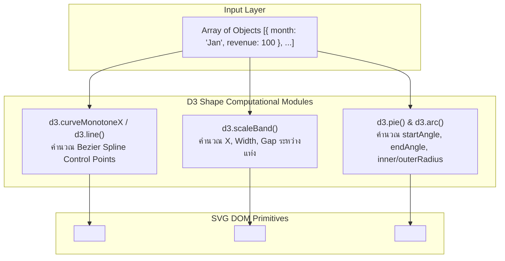

## 1. แนวคิด (Concept)

ในระบบ Data Visualization ระดับองค์กร ข้อมูลมากกว่า 80% ถูกนำเสนอผ่านกราฟพื้นฐาน 4 ประเภทหลัก การเลือกประเภทกราฟให้สอดคล้องกับ **Business Questions** เป็นปัจจัยชี้ขาดว่าผู้ใช้งานจะเข้าใจข้อมูลได้ทันทีหรือไม่:

1. **LineChart (แนวโน้มตามกาลเวลา - Time-series Trends)**:
   - *คำถามธุรกิจ*: "ยอดขายเติบโตขึ้นหรือลดลงเมื่อเทียบกับไตรมาสก่อน?", "อัตราการแปลง (Conversion Rate) มีความผันผวนอย่างไรในรอบ 30 วัน?"
   - *คุณลักษณะ*: เน้นแสดงทิศทาง ความต่อเนื่อง และความเร็วของการเปลี่ยนแปลงของตัวเลข
2. **BarChart (เปรียบเทียบเชิงปริมาณระหว่างหมวดหมู่ - Category Comparison)**:
   - *คำถามธุรกิจ*: "สาขาใดทำยอดขายได้สูงสุดในเดือนนี้?", "ผลิตภัณฑ์กลุ่มใดมีกำไรสุทธิมากที่สุด?"
   - *คุณลักษณะ*: เปรียบเทียบความแตกต่างของขนาดข้อมูลแบบไม่ต่อเนื่อง (Discrete Categories) ได้ชัดเจนที่สุดผ่านความสูงหรือความยาวของแท่ง
3. **AreaChart (ปริมาณสะสมตามเวลา - Cumulative Volume & Magnitude)**:
   - *คำถามธุรกิจ*: "ปริมาณการใช้งานแบนด์วิดท์เซิร์ฟเวอร์รวมอยู่ในระดับอันตรายหรือไม่?", "การสะสมของยอดเงินฝากเติบโตอย่างไร?"
   - *คุณลักษณะ*: เหมือน LineChart แต่เพิ่มการระบายสีทึบหรือไล่ระดับ (Gradient) ใต้เส้นเพื่อเน้นย้ำถึง "น้ำหนักและปริมาณมหภาค"
4. **PieChart & DonutChart (สัดส่วนของชิ้นส่วนต่อภาพรวม - Part-to-Whole Ratio)**:
   - *คำถามธุรกิจ*: "ช่องทางการชำระเงินใดครองส่วนแบ่งตลาดมากที่สุด?", "สัดส่วนงบประมาณด้านการตลาดถูกแบ่งไปที่ช่องทางใดบ้าง?"
   - *คุณลักษณะ*: แสดงสัดส่วนร้อยละ (Percentage) โดยแปลงเป็นองศาของวงกลม (360 องศา) และการเจาะรูตรงกลางเป็น **Donut Chart** ช่วยเพิ่มพื้นที่สำหรับวางตัวเลขสรุปรวม (Total Metric)

---

## 2. หลักการเบื้องหลัง (Under the Hood)

### การสร้างรูปทรงเรขาคณิตด้วย D3 Shape

Recharts อาศัยอัลกอริทึมจากแพ็กเกจ `d3-shape` ในการแปลงข้อมูลดิบไปเป็นคำสั่งวาด SVG Vector:



- **Line & Area Interpolation (`type="monotone"`)**:
  Recharts ใช้ฟังก์ชัน Cubic Hermite Spline ที่คงคุณสมบัติ Monotonicity (ค่าไม่แกว่งล้นพิกัดจริง) เพื่อสร้างชุดคำสั่ง SVG Path `d="M ... C ..."` ทำให้เส้นโค้งนุ่มนวลเป็นธรรมชาติ
- **Bar Spacing Calculation**:
  ความกว้างของแท่งถูกกำหนดผ่าน `barSize`, `barGap` (ระยะห่างระหว่างแท่งในกลุ่มเดียวกัน) และ `barCategoryGap` (ระยะห่างระหว่างกลุ่มหมวดหมู่) โดยคำนวณจากความกว้างรวมของ SVG หักลบด้วยขอบ
- **Donut Chart Hole Geometry**:
  Donut Chart ไม่ใช่รูปทรงใหม่ แต่คือ `PieChart` ที่มีการกำหนดค่า `innerRadius` มากกว่า 0 (เช่น `innerRadius={60}` และ `outerRadius={90}`) ส่งผลให้ `d3.arc()` วาดเฉพาะวงแหวนรอบนอก

---

## 3. ตัวอย่างโค้ด (TypeScript / TSX)

### ตัวอย่างที่ 1: ระบบเปรียบเทียบยอดขายและประสิทธิภาพรายสาขา (Line & Bar)

ตัวอย่างนี้แสดงการใช้งาน `LineChart` แสดงแนวโน้มรายเดือน ควบคู่กับ `BarChart` แสดงยอดขายรายสาขาในสถาปัตยกรรมระดับ Production

```tsx filename="components/analytics/SalesTrendAndBranchBar.tsx"
'use client';

import React from 'react';
import {
  ResponsiveContainer,
  LineChart,
  Line,
  BarChart,
  Bar,
  XAxis,
  YAxis,
  CartesianGrid,
  Tooltip,
  Legend,
} from 'recharts';

export interface MonthlyTrend {
  month: string;
  actualRevenue: number;
  projectedRevenue: number;
}

export interface BranchPerformance {
  branchName: string;
  salesVolume: number;
  customerVisits: number;
}

interface AnalyticsDashboardProps {
  trendData: MonthlyTrend[];
  branchData: BranchPerformance[];
}

export function SalesTrendAndBranchBar({
  trendData,
  branchData,
}: AnalyticsDashboardProps) {
  const formatMillionBaht = (val: number) => `฿${(val / 1_000_000).toFixed(1)}M`;
  const formatThousand = (val: number) => `${(val / 1_000).toFixed(0)}k`;

  return (
    <div className="grid grid-cols-1 gap-6 lg:grid-cols-2">
      {/* 1. LineChart: แนวโน้มตามกาลเวลา */}
      <div className="rounded-2xl border border-slate-200 bg-white p-6 shadow-sm dark:border-slate-800 dark:bg-slate-900">
        <h3 className="text-base font-semibold text-slate-800 dark:text-slate-100">
          แนวโน้มรายได้รายเดือน (Actual vs Projected)
        </h3>
        <p className="mb-4 text-xs text-slate-500">
          ติดตามความคลาดเคลื่อนระหว่างเป้าหมายที่คาดการณ์กับตัวเลขจริง
        </p>

        <div className="h-[300px] w-full">
          <ResponsiveContainer width="100%" height="100%">
            <LineChart data={trendData} margin={{ top: 10, right: 20, left: 0, bottom: 5 }}>
              <CartesianGrid strokeDasharray="3 3" vertical={false} stroke="#f1f5f9" />
              <XAxis dataKey="month" tickLine={false} tick={{ fontSize: 11, fill: '#64748b' }} />
              <YAxis
                tickLine={false}
                axisLine={false}
                tickFormatter={formatMillionBaht}
                tick={{ fontSize: 11, fill: '#64748b' }}
              />
              <Tooltip
                formatter={(val: any) => [`฿${Number(val).toLocaleString()}`, '']}
                contentStyle={{ borderRadius: '8px', border: '1px solid #e2e8f0' }}
              />
              <Legend wrapperStyle={{ fontSize: '12px', paddingTop: '10px' }} />
              <Line
                type="monotone"
                dataKey="actualRevenue"
                name="รายได้จริง"
                stroke="#2563eb"
                strokeWidth={2.5}
                activeDot={{ r: 6 }}
              />
              <Line
                type="monotone"
                dataKey="projectedRevenue"
                name="ประมาณการ"
                stroke="#94a3b8"
                strokeWidth={2}
                strokeDasharray="4 4"
                dot={false}
              />
            </LineChart>
          </ResponsiveContainer>
        </div>
      </div>

      {/* 2. BarChart: เปรียบเทียบข้อมูลระหว่างหมวดหมู่สาขา */}
      <div className="rounded-2xl border border-slate-200 bg-white p-6 shadow-sm dark:border-slate-800 dark:bg-slate-900">
        <h3 className="text-base font-semibold text-slate-800 dark:text-slate-100">
          ยอดขายเปรียบเทียบรายสาขาหลัก
        </h3>
        <p className="mb-4 text-xs text-slate-500">
          เปรียบเทียบยอดขายรวมกับปริมาณลูกค้าที่เข้าใช้บริการ
        </p>

        <div className="h-[300px] w-full">
          <ResponsiveContainer width="100%" height="100%">
            <BarChart data={branchData} margin={{ top: 10, right: 20, left: 0, bottom: 5 }}>
              <CartesianGrid strokeDasharray="3 3" vertical={false} stroke="#f1f5f9" />
              <XAxis
                dataKey="branchName"
                tickLine={false}
                tick={{ fontSize: 11, fill: '#64748b' }}
              />
              <YAxis
                tickLine={false}
                axisLine={false}
                tickFormatter={formatMillionBaht}
                tick={{ fontSize: 11, fill: '#64748b' }}
              />
              <Tooltip
                formatter={(val: any, name: any) => [
                  name === 'ยอดขาย' ? `฿${Number(val).toLocaleString()}` : Number(val).toLocaleString(),
                  name,
                ]}
                contentStyle={{ borderRadius: '8px', border: '1px solid #e2e8f0' }}
              />
              <Legend wrapperStyle={{ fontSize: '12px', paddingTop: '10px' }} />
              <Bar
                dataKey="salesVolume"
                name="ยอดขาย"
                fill="#0ea5e9"
                radius={[4, 4, 0, 0]}
                maxBarSize={36}
              />
            </BarChart>
          </ResponsiveContainer>
        </div>
      </div>
    </div>
  );
}
```

---

### ตัวอย่างที่ 2: มอนิเตอร์หน่วยความจำและสัดส่วนช่องทางชำระเงิน (Area & Donut)

ตัวอย่างนี้แสดง `AreaChart` พร้อมการไล่เฉดสี SVG Gradient และ `PieChart` ในรูปแบบ Donut ที่มีตัวเลขยอดรวมตรงกลางวง

```tsx filename="components/analytics/MemoryAndPaymentOverview.tsx"
'use client';

import React from 'react';
import {
  ResponsiveContainer,
  AreaChart,
  Area,
  PieChart,
  Pie,
  Cell,
  XAxis,
  YAxis,
  Tooltip,
  Legend,
} from 'recharts';

export interface MemoryLog {
  time: string;
  usedGb: number;
}

export interface PaymentChannelShare {
  channel: string;
  amount: number;
}

const DONUT_COLORS = ['#3b82f6', '#10b981', '#f59e0b', '#ec4899', '#8b5cf6'];

interface SystemOverviewProps {
  memoryLogs: MemoryLog[];
  paymentShares: PaymentChannelShare[];
}

export function MemoryAndPaymentOverview({
  memoryLogs,
  paymentShares,
}: SystemOverviewProps) {
  const totalPaymentAmount = paymentShares.reduce((acc, curr) => acc + curr.amount, 0);

  return (
    <div className="grid grid-cols-1 gap-6 lg:grid-cols-2">
      {/* 1. AreaChart: แสดงปริมาณการใช้งานแรมตามเวลา */}
      <div className="rounded-2xl border border-slate-200 bg-white p-6 shadow-sm dark:border-slate-800 dark:bg-slate-900">
        <h3 className="text-base font-semibold text-slate-800 dark:text-slate-100">
          ปริมาณการใช้งานหน่วยความจำระบบ (Memory Usage)
        </h3>
        <p className="mb-4 text-xs text-slate-500">
          แสดงปริมาณความหนาแน่นระดับสะสมแบบต่อเนื่อง
        </p>

        <div className="h-[280px] w-full">
          <ResponsiveContainer width="100%" height="100%">
            <AreaChart data={memoryLogs} margin={{ top: 10, right: 10, left: -15, bottom: 0 }}>
              <defs>
                <linearGradient id="memGradient" x1="0" y1="0" x2="0" y2="1">
                  <stop offset="5%" stopColor="#6366f1" stopOpacity={0.8} />
                  <stop offset="95%" stopColor="#6366f1" stopOpacity={0.05} />
                </linearGradient>
              </defs>
              <XAxis dataKey="time" tickLine={false} tick={{ fontSize: 10, fill: '#94a3b8' }} />
              <YAxis tickLine={false} axisLine={false} unit="GB" tick={{ fontSize: 10, fill: '#94a3b8' }} />
              <Tooltip formatter={(val: any) => [`${val} GB`, 'หน่วยความจำที่ใช้']} />
              <Area
                type="monotone"
                dataKey="usedGb"
                stroke="#6366f1"
                strokeWidth={2}
                fillOpacity={1}
                fill="url(#memGradient)"
              />
            </AreaChart>
          </ResponsiveContainer>
        </div>
      </div>

      {/* 2. DonutChart: สัดส่วนช่องทางชำระเงินพร้อมตัวเลขตรงกลาง */}
      <div className="rounded-2xl border border-slate-200 bg-white p-6 shadow-sm dark:border-slate-800 dark:bg-slate-900">
        <h3 className="text-base font-semibold text-slate-800 dark:text-slate-100">
          สัดส่วนช่องทางการชำระเงิน (Payment Share)
        </h3>
        <p className="mb-4 text-xs text-slate-500">
          ยอดรวมทั้งหมด: ฿{(totalPaymentAmount / 1_000_000).toFixed(2)} ล้านบาท
        </p>

        <div className="relative h-[280px] w-full">
          <ResponsiveContainer width="100%" height="100%">
            <PieChart>
              <Tooltip
                formatter={(val: any, name: any) => [
                  `฿${Number(val).toLocaleString()} (${((Number(val) / totalPaymentAmount) * 100).toFixed(1)}%)`,
                  name,
                ]}
              />
              <Legend verticalAlign="bottom" height={36} wrapperStyle={{ fontSize: '11px' }} />
              <Pie
                data={paymentShares}
                dataKey="amount"
                nameKey="channel"
                cx="50%"
                cy="45%"
                innerRadius={65}
                outerRadius={95}
                paddingAngle={3}
              >
                {paymentShares.map((_, index) => (
                  <Cell key={`cell-${index}`} fill={DONUT_COLORS[index % DONUT_COLORS.length]} />
                ))}
              </Pie>
            </PieChart>
          </ResponsiveContainer>

          {/* ป้ายแสดงยอดรวมตรงกลาง Donut */}
          <div className="pointer-events-none absolute inset-0 flex flex-col items-center justify-center pb-8">
            <span className="text-xs text-slate-400 font-medium">ยอดรวม</span>
            <span className="text-base font-bold text-slate-800 dark:text-slate-100">
              ฿{(totalPaymentAmount / 1_000_000).toFixed(1)}M
            </span>
          </div>
        </div>
      </div>
    </div>
  );
}
```

---

## 4. เทียบกับวิธีอื่น (Recharts vs Canvas/Chart.js/D3)

| รูปแบบกราฟ | Recharts (SVG) | Chart.js (Canvas) | Nivo (SVG) |
| :--- | :--- | :--- | :--- |
| **Line / Area Chart** | สลับประเภทเส้น (`monotone`, `step`, `linear`) ง่ายมากผ่าน Props `type` | ต้องเซ็ตพารามิเตอร์ `tension: 0.4` หรือ `stepped: true` | มีฟังก์ชัน Interpolation ครบถ้วน แต่ปรับแต่งมาร์กเกอร์ยากกว่า |
| **Bar Chart Radius** | กำหนดขอบมนง่ายๆ: `radius={[4, 4, 0, 0]}` | กำหนด `borderRadius: { topLeft: 4, ... }` | กำหนด `borderRadius: 4` ทุกมุมเท่ากัน |
| **Donut Chart Center** | วาง HTML/Tailwind ซ้อนทับตรงกลางได้ทันทีด้วย Absolute Div | ต้องเขียน Canvas Plugin คำนวณพิกัด `ctx.fillText()` | มีคอมโพเนนต์ Center Metric ในตัวสำหรับบางชาร์ต |

---

## 5. ผิด vs ถูก (Anti-patterns vs Best Practices)

### กรณีที่ 1: การใช้ PieChart กับข้อมูลที่มีมากกว่า 7-10 รายการ

```tsx
// ❌ ผิด: ยัดหมวดหมู่สินค้า 20 หมวดลงใน PieChart ทำให้ชิ้นพายซอยถี่จนมองไม่เห็นความต่าง
<PieChart>
  <Pie data={twentyCategories} dataKey="count" />
</PieChart>
```

```tsx
// ✅ ถูก: รวมรายการย่อยที่มีค่าน้อยเป็นกลุ่ม "อื่นๆ (Others)" หรือเปลี่ยนไปใช้ Horizontal BarChart
const topCategories = sanitizeCategories(twentyCategories, 5); // 5 อันดับแรก + Others

<BarChart layout="vertical" data={sortedCategories}>
  <XAxis type="number" />
  <YAxis type="category" dataKey="name" width={120} />
  <Bar dataKey="count" fill="#3b82f6" />
</BarChart>
```
*เหตุผล*: สายตามนุษย์มีความสามารถต่ำในการเปรียบเทียบมุมและองศาของวงกลม หากชิ้นพายมีขนาดใกล้เคียงกันหรือมีจำนวนมากกว่า 7 หมวดหมู่ กราฟจะสูญเสียประสิทธิภาพในการสื่อสารทันที

---

### กรณีที่ 2: ใช้ LineChart กับข้อมูลหมวดหมู่ที่ไม่ต่อเนื่องตามเวลา (Discrete Categories)

```tsx
// ❌ ผิด: เชื่อมโยงข้อมูลที่ไม่มีความสัมพันธ์เชิงลำดับเวลาด้วยเส้น Line
const branchData = [
  { branch: 'เชียงใหม่', sales: 100 },
  { branch: 'ภูเก็ต', sales: 250 },
  { branch: 'ขอนแก่น', sales: 180 },
];
// การใช้ <LineChart> จะสร้างภาพลวงตาว่าเชียงใหม่กับภูเก็ตมีแนวโน้มต่อเนื่องกัน
```

```tsx
// ✅ ถูก: ใช้ BarChart สำหรับเปรียบเทียบหมวดหมู่ที่ไม่เกี่ยวข้องกัน
<BarChart data={branchData}>
  <XAxis dataKey="branch" />
  <YAxis />
  <Bar dataKey="sales" fill="#3b82f6" />
</BarChart>
```

---

## 6. ควรใช้เมื่อไหร่ / ไม่ควรใช้เมื่อไหร่

### เมทริกซ์การตัดสินใจเลือกประเภทกราฟ (Chart Selection Matrix)

| คำถามหรือเป้าหมายของข้อมูล | ประเภทกราฟที่เหมาะสม | ทางเลือกสำรอง |
| :--- | :--- | :--- |
| ติดตามแนวโน้มตามลำดับเวลา (วัน, สัปดาห์, เดือน, ปี) | **LineChart** | AreaChart |
| เปรียบเทียบตัวเลขระหว่างทีม, สาขา, ผลิตภัณฑ์ | **BarChart (แนวตั้ง หรือ แนวนอน)** | Treemap |
| แสดงการใช้ทรัพยากร, โควตา, ปริมาณการสะสมต่อเนื่อง | **AreaChart** | Stacked Bar |
| สัดส่วนส่วนแบ่งตลาด หรือโครงสร้างงบประมาณ (< 5 หมวด) | **DonutChart (มีรูกลาง)** | 100% Stacked Bar |
| สัดส่วนที่มีหมวดหมู่มากกว่า 7 หมวดขึ้นไป | **BarChart เรียงจากมากไปน้อย** | Treemap |

---

## 7. คำถามสัมภาษณ์งาน (Interview Questions)

### Q1: คุณสมบัติ `type` ใน LineChart และ AreaChart (เช่น `linear`, `monotone`, `natural`, `step`) มีความแตกต่างกันอย่างไร และเหตุใดในรายงานการเงินจึงไม่ควรใช้ `type="natural"`?
**แนวทางคำตอบแบบ Senior**:
"`type` ใน Recharts คือฟังก์ชัน D3 Curve Interpolation ที่ควบคุมลักษณะเส้นเชื่อมระหว่างจุด:
- `linear`: ลากเส้นตรงเชื่อมจุดต่อจุด ทำให้เห็นการหักมุมชัดเจน ซื่อตรงต่อข้อมูลดิบที่สุด
- `monotone` (`curveMonotoneX`): สร้างเส้นโค้งเรียบโดยรักษาระดับการเพิ่มขึ้นหรือลดลงของข้อมูล ไม่ให้เกิดการแกว่งเลยจุดจริง (No Overshoot)
- `step`: ลากเป็นขั้นบันได เหมาะกับข้อมูลที่มีการเปลี่ยนสถานะเป็นขั้น เช่น ราคาหุ้นที่ปรับเป็นรอบ หรือสถานะเปิด/ปิดเครื่องจักร
- `natural`: ใช้อัลกอริทึม Natural Cubic Spline ซึ่งแม้จะให้เส้นโค้งที่ดูนุ่มนวลสวยงามที่สุด แต่มีจุดอ่อนร้ายแรงคือ **Overshooting** (เส้นโค้งอาจกระดกสูงกว่าจุดจริง หรือห้อยต่ำกว่าศูนย์)

ในงานการเงิน (Financial Reporting) ห้ามใช้ `natural` โดยเด็ดขาด เพราะอาจสร้างภาพลวงตาทางบัญชี เช่น รายได้จริงไม่เคยติดลบ แต่เส้นโค้งของกราฟห้อยลงไปใต้แกนศูนย์ ทำให้ผู้บริหารตีความข้อมูลผิดพลาด ควรใช้ `monotone` หรือ `linear` เท่านั้น"

---

### Q2: เทคนิคการสร้าง Donut Chart ให้มีตัวเลขสรุปรวม (Summary Metric) อยู่ตรงกลางวงกลมใน Recharts ทำได้อย่างไรโดยไม่ทำให้การคำนวณตำแหน่งผิดเพี้ยนเมื่อหน้าจอเปลี่ยนขนาด?
**แนวทางคำตอบแบบ Senior**:
"การสร้าง Donut Chart เริ่มต้นด้วยการกำหนด `innerRadius` ให้มากกว่า 0 บน `<Pie>` (เช่น `innerRadius={70}` และ `outerRadius={100}`)

ส่วนการวางข้อความสรุปตรงกลางวง มี 2 วิธีหลัก:
1. **HTML Absolute Positioning ซ้อนทับบน Wrapper Div (แนะนำสำหรับงาน Production ทั่วไป)**:
   กำหนดให้ Parent มีคลาส `relative` และวาง `<div>` ซ้อนทับด้วย `absolute inset-0 flex flex-col items-center justify-center pointer-events-none` วิธีนี้ดีที่สุดเพราะจัดสไตล์ฟอนต์, สี และ Dark Mode ด้วย Tailwind ได้ง่าย และปรับตัวตามขนาดหน้าจอได้อย่างแม่นยำ
2. **SVG `<text>` Component ภายใน `<PieChart>`**:
   สามารถส่ง Element `<text x="50%" y="50%" textAnchor="middle" dominantBaseline="middle">` เข้าไปใน SVG ตรงๆ วิธีนี้อยู่ในผืนผ้าใบ SVG เดียวกัน แต่การจัดหลายบรรทัดหรือสลับฟอนต์ไทย-อังกฤษจะยุ่งยากกว่าวิธีแรก"
