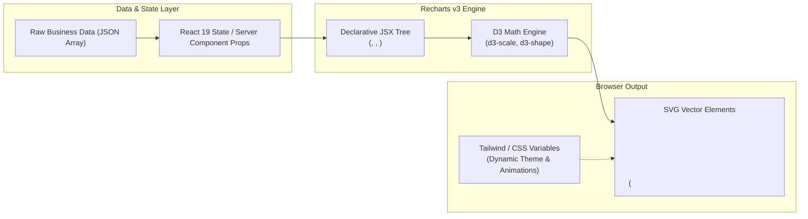

## 1. แนวคิด (Concept)

**Recharts** เป็นไลบรารี Data Visualization สำหรับ React ที่สร้างมาตรฐานใหม่ให้กับวงการ Web Dashboard โดยผสมผสานจุดแข็งของ 3 เทคโนโลยีหลักเข้าด้วยกัน:

1. **Declarative Composition (React Component Model)**: ปรัชญาการออกแบบที่มองทุกส่วนประกอบของชาร์ตเป็นอิสระต่อกัน (Composable Primitives) เช่น `<LineChart>`, `<XAxis>`, `<Tooltip>`, `<CartesianGrid>` แทนที่จะส่ง Configuration Object ก้อนยักษ์เหมือนไลบรารียุคเก่า การเขียน Recharts จึงเหมือนการต่อบล็อกเลโก้ที่อ่านเข้าใจง่ายและควบคุมผ่าน React Props ได้โดยตรง
2. **D3 Mathematical Engine (D3 Scales & Interpolation)**: Recharts ไม่ได้นำเข้า D3 ทั้งหมด แต่ดึงเฉพาะโมดูลคณิตศาสตร์ขั้นสูง เช่น `d3-scale`, `d3-shape` และ `d3-interpolate` มาใช้คำนวณการแปลงค่าข้อมูล (Domain) ไปเป็นพิกัดหน้าจอ (Range) ทำให้การกระจายตัวของข้อมูลและเส้นโค้งมีความแม่นยำสูง
3. **SVG-based Native Rendering**: เรนเดอร์ชิ้นส่วนกราฟิกทั้งหมดเป็น Scalable Vector Graphics (SVG) ลงใน Document Object Model (DOM) โดยตรง ทำให้กราฟมีความคมชัดระดับพิกเซลบนทุกความหนาแน่นหน้าจอ (Retina / 4K) รองรับ CSS / Tailwind จัดสไตล์ และตรวจจับ Event (Hover, Click) ได้ในระดับ Element ย่อย



---

## 2. หลักการเบื้องหลัง (Under the Hood)

### สถาปัตยกรรมภายในของ Recharts

เมื่อ Component ของ Recharts ถูกเมานต์ลงใน DOM เบื้องหลังจะมีกระบวนการทำงานที่เป็นลำดับขั้นตอน:

1. **Dimension Calculation**: คอมโพเนนต์แม่ (เช่น `<ResponsiveContainer>`) ใช้ `ResizeObserver API` คำนวณขนาดกว้าง-ยาวจริงของ Parent Container จากนั้นส่งค่า `width` และ `height` ผ่าน React Context ไปยังชาร์ตภายใน
2. **Domain & Range Mapping**: Recharts รวบรวมข้อมูลจาก Property `data` และอ่าน Property ตามที่ระบุใน `dataKey` (เช่น `"revenue"`) เพื่อหาค่าต่ำสุด-สูงสุด (Domain: `[min, max]`) จากนั้นส่งต่อให้ `d3-scale` ทำการ Map สัดส่วนเข้ากับขนาดพิกเซลที่คำนวณได้ (Range: `[0, width]` หรือ `[height, 0]`)
3. **Shape Generation**: สำหรับเส้นกราฟ (`<Line>`) หรือพื้นที่ใต้กราฟ (`<Area>`) Recharts จะใช้ `d3-shape` สร้าง SVG Path Data (`d="M0,120L40,80..."`) ออกมาเป็น String เพื่อส่งให้แท็ก `<path>` ของ SVG
4. **SVG vs HTML5 Canvas (DOM Overhead Trade-off)**:
   - **SVG (Recharts / Nivo)**: ทุกแท่งกราฟ จุด หรือเส้น คือ 1 DOM Node ในต้นไม้ของบราวเซอร์ ข้อดีคือรองรับ CSS Transition, Tooltip ดักจับง่ายผ่าน Event Bubbling, คมชัด ไม่แตกเมื่อซูม แต่มีข้อจำกัดคือหากมีข้อมูลเกิน **3,000–5,000 จุด** ปริมาณ DOM Nodes จะทำให้ Garbage Collector และ Layout Engine ทำงานหนักจนเฟรมเรตตก
   - **Canvas (Chart.js)**: วาดภาพลงบนผืนผ้าใบผืนเดียว (`<canvas>`) ซึ่งมีเพียง 1 DOM Node ข้อดีคือรองรับข้อมูลระดับ 100,000+ จุดได้อย่างลื่นไหล แต่ข้อเสียคือกราฟิกจะแตกหากไม่จัดการ Device Pixel Ratio (DPR), ไม่สามารถใช้ CSS ปรับแต่งได้โดยตรง และการดักจับพิกัดเมาส์ต้องคำนวณ Ray-casting / Bounding Box เอง

---

## 3. ตัวอย่างโค้ด (TypeScript / TSX)

### ตัวอย่างที่ 1: ระบบวิเคราะห์รายได้องค์กร (Enterprise Financial Overview)

ตัวอย่างนี้แสดงโครงสร้างชาร์ตแบบ Declarative ใน Next.js 16 App Router โดยมีการคำนวณค่าและจัดการ Type อย่างรัดกุม

```tsx filename="components/analytics/FinancialOverviewChart.tsx"
'use client';

import React, { useMemo } from 'react';
import {
  ResponsiveContainer,
  ComposedChart,
  CartesianGrid,
  XAxis,
  YAxis,
  Tooltip,
  Legend,
  Bar,
  Line,
} from 'recharts';

export interface MonthlyFinancialRecord {
  month: string;
  revenue: number;
  operationalCost: number;
  targetRevenue: number;
}

interface FinancialOverviewProps {
  data: MonthlyFinancialRecord[];
  currencySymbol?: string;
}

export function FinancialOverviewChart({
  data,
  currencySymbol = '฿',
}: FinancialOverviewProps) {
  // คำนวณค่าทางสถิติเพิ่มเติมด้วย useMemo เพื่อประสิทธิภาพสูงสุด
  const chartData = useMemo(() => {
    return data.map((item) => ({
      ...item,
      grossProfit: item.revenue - item.operationalCost,
    }));
  }, [data]);

  const currencyFormatter = (val: number) => {
    if (val >= 1_000_000) return `${currencySymbol}${(val / 1_000_000).toFixed(1)}M`;
    if (val >= 1_000) return `${currencySymbol}${(val / 1_000).toFixed(0)}K`;
    return `${currencySymbol}${val}`;
  };

  return (
    <div className="w-full rounded-2xl border border-slate-200 bg-white p-6 shadow-sm dark:border-slate-800 dark:bg-slate-900">
      <div className="mb-6 flex flex-col gap-1">
        <h3 className="text-lg font-semibold text-slate-900 dark:text-slate-100">
          ภาพรวมรายได้และต้นทุนดำเนินงาน
        </h3>
        <p className="text-sm text-slate-500 dark:text-slate-400">
          เปรียบเทียบรายได้จริงกับเป้าหมายประจำปีและต้นทุนตามรอบเดือน
        </p>
      </div>

      <div className="h-[380px] w-full">
        <ResponsiveContainer width="100%" height="100%">
          <ComposedChart
            data={chartData}
            margin={{ top: 20, right: 20, bottom: 20, left: 10 }}
          >
            <CartesianGrid strokeDasharray="3 3" stroke="#e2e8f0" vertical={false} />
            <XAxis
              dataKey="month"
              stroke="#64748b"
              fontSize={12}
              tickLine={false}
              axisLine={{ stroke: '#cbd5e1' }}
            />
            <YAxis
              stroke="#64748b"
              fontSize={12}
              tickLine={false}
              axisLine={false}
              tickFormatter={currencyFormatter}
            />
            <Tooltip
              formatter={(value: any, name: any) => [
                `${currencySymbol}${Number(value).toLocaleString()}`,
                name === 'revenue'
                  ? 'รายได้จริง'
                  : name === 'operationalCost'
                  ? 'ต้นทุน'
                  : 'เป้าหมาย',
              ]}
              contentStyle={{
                backgroundColor: 'rgba(15, 23, 42, 0.9)',
                borderRadius: '8px',
                border: 'none',
                color: '#fff',
                fontSize: '12px',
              }}
            />
            <Legend verticalAlign="top" align="right" height={36} />
            <Bar
              dataKey="revenue"
              name="รายได้จริง"
              fill="#2563eb"
              radius={[4, 4, 0, 0]}
              maxBarSize={48}
            />
            <Bar
              dataKey="operationalCost"
              name="ต้นทุน"
              fill="#f43f5e"
              radius={[4, 4, 0, 0]}
              maxBarSize={48}
            />
            <Line
              type="monotone"
              dataKey="targetRevenue"
              name="เป้าหมาย"
              stroke="#10b981"
              strokeWidth={2.5}
              dot={{ r: 4, fill: '#10b981' }}
            />
          </ComposedChart>
        </ResponsiveContainer>
      </div>
    </div>
  );
}
```

### ตัวอย่างที่ 2: Telemetry Sensor Monitor พร้อมเทคนิคคัดกรองข้อมูล (Downsampled Stream)

เมื่อต้องแสดงข้อมูลเซนเซอร์ที่มีความถี่สูง การป้อนข้อมูลดิบระดับหลายหมื่นจุดเข้า SVG ตรงๆ จะทำให้เบราว์เซอร์กระตุก ตัวอย่างนี้แสดงการทำ Data Downsampling ระดับง่ายเพื่อรักษาประสิทธิภาพของ Recharts:

```tsx filename="components/analytics/TelemetrySensorMonitor.tsx"
'use client';

import React, { useMemo, useState } from 'react';
import {
  ResponsiveContainer,
  LineChart,
  Line,
  XAxis,
  YAxis,
  CartesianGrid,
  Tooltip,
} from 'recharts';

interface TelemetryPoint {
  timestamp: string;
  temperature: number;
  cpuLoad: number;
}

interface TelemetryProps {
  rawData: TelemetryPoint[];
}

export function TelemetrySensorMonitor({ rawData }: TelemetryProps) {
  const [maxNodes, setMaxNodes] = useState<number>(60);

  // ป้องกัน DOM Bloat: ทำ Simple Downsampling ก่อนส่งให้ Recharts
  const sampledData = useMemo(() => {
    if (rawData.length <= maxNodes) return rawData;
    const step = Math.ceil(rawData.length / maxNodes);
    return rawData.filter((_, index) => index % step === 0);
  }, [rawData, maxNodes]);

  return (
    <div className="w-full rounded-2xl border border-slate-200 bg-white p-6 shadow-sm dark:border-slate-800 dark:bg-slate-900">
      <div className="mb-4 flex items-center justify-between">
        <div>
          <h4 className="font-semibold text-slate-800 dark:text-slate-100">
            ระบบตรวจสอบเซิร์ฟเวอร์แบบเรียลไทม์
          </h4>
          <p className="text-xs text-slate-500">
            ข้อมูลดิบ: {rawData.length} จุด | เรนเดอร์บน SVG: {sampledData.length} จุด
          </p>
        </div>
        <select
          value={maxNodes}
          onChange={(e) => setMaxNodes(Number(e.target.value))}
          className="rounded-lg border border-slate-300 bg-white px-2.5 py-1 text-xs text-slate-700 dark:border-slate-700 dark:bg-slate-800 dark:text-slate-200"
        >
          <option value={30}>30 จุด (เร็วมาก)</option>
          <option value={60}>60 จุด (สมดุล)</option>
          <option value={120}>120 จุด (ละเอียด)</option>
        </select>
      </div>

      <div className="h-[280px] w-full">
        <ResponsiveContainer width="100%" height="100%">
          <LineChart data={sampledData}>
            <CartesianGrid strokeDasharray="2 2" stroke="#f1f5f9" />
            <XAxis dataKey="timestamp" fontSize={11} stroke="#94a3b8" />
            <YAxis yAxisId="temp" stroke="#f97316" fontSize={11} unit="°C" />
            <YAxis yAxisId="cpu" orientation="right" stroke="#6366f1" fontSize={11} unit="%" />
            <Tooltip />
            <Line
              yAxisId="temp"
              type="monotone"
              dataKey="temperature"
              stroke="#f97316"
              strokeWidth={2}
              dot={false}
              isAnimationActive={false} // ปิด Animation สำหรับข้อมูลอัปเดตบ่อย
            />
            <Line
              yAxisId="cpu"
              type="monotone"
              dataKey="cpuLoad"
              stroke="#6366f1"
              strokeWidth={2}
              dot={false}
              isAnimationActive={false}
            />
          </LineChart>
        </ResponsiveContainer>
      </div>
    </div>
  );
}
```

---

## 4. เทียบกับวิธีอื่น (Recharts vs Canvas/Chart.js/D3)

| เกณฑ์เปรียบเทียบ | Recharts (v3) | Chart.js (v4) / react-chartjs-2 | Nivo | Visx (Airbnb) |
| :--- | :--- | :--- | :--- | :--- |
| **เทคโนโลยีการวาด** | **SVG** | **HTML5 Canvas** | SVG / Canvas / HTTP API | SVG / Canvas (D3 wrapper) |
| **แนวคิดการออกแบบ** | Declarative React Components | Config-driven Object | Declarative Component พ่วง Theme | Low-level Primitives / Unstyled |
| **จุดเด่น** | ประกอบชิ้นส่วนอิสระ, ผูกกับ shadcn/ui ได้เนียนตา | รับจุดข้อมูลมหาศาลได้ลื่นไหล | ชาร์ตสำเร็จรูปหลากหลาย ดีไซน์สวยโมเดิร์น | ควบคุมสไตล์และตรรกะได้ 100% ไม่มีข้อจำกัด |
| **ข้อจำกัด** | ข้อมูล > 5,000 จุดเริ่มหน่วง | ปรับแต่ง Layout ย่อยด้วย CSS ไม่ได้ | Bundle size ค่อนข้างใหญ่, ปรับแต่งโครงสร้างยาก | ต้องเขียน Boilerplate คำนวณแกนและ Tooltip เอง |
| **ขนาด Bundle (Gzip)** | ~45 - 55 KB | ~60 - 70 KB | ~80 - 120 KB (ขึ้นกับแพ็กเกจ) | เล็กมากถ้าเลือกเฉพาะโมดูล (~15 - 30 KB) |
| **ความเข้ากันได้กับ React 19** | สมบูรณ์แบบ | ต้องพึ่งพา wrapper library | สมบูรณ์แบบ | สมบูรณ์แบบ |

---

## 5. ผิด vs ถูก (Anti-patterns vs Best Practices)

### กรณีที่ 1: การนำเข้าโมดูล Recharts ทั้งหมดแบบ Barrel Import

```tsx
// ❌ ผิด: นำเข้าแบบกวาดหมด ส่งผลให้ Bundle Size บวมโดยไม่จำเป็น
import * as Recharts from 'recharts';

export function BadChart({ data }: { data: any[] }) {
  return (
    <Recharts.ResponsiveContainer width="100%" height={300}>
      <Recharts.BarChart data={data}>
        <Recharts.Bar dataKey="val" />
      </Recharts.BarChart>
    </Recharts.ResponsiveContainer>
  );
}
```

```tsx
// ✅ ถูก: Named Import เฉพาะ Component ที่ใช้งานจริง เพื่อให้ Tree-shaking ทำงานได้เต็มประสิทธิภาพ
import { ResponsiveContainer, BarChart, Bar, XAxis, YAxis } from 'recharts';

export function GoodChart({ data }: { data: Array<{ label: string; val: number }> }) {
  return (
    <ResponsiveContainer width="100%" height={300}>
      <BarChart data={data}>
        <XAxis dataKey="label" />
        <YAxis />
        <Bar dataKey="val" fill="#3b82f6" />
      </BarChart>
    </ResponsiveContainer>
  );
}
```
*เหตุผล*: การใช้ Named Import ช่วยให้ Bundler ของ Next.js (Turbopack หรือ Webpack) สามารถตัดทิ้งคอมโพเนนต์อย่าง `RadarChart`, `Treemap` หรือ `PolarGrid` ที่ไม่ได้ถูกเรียกใช้งาน ลดขนาดจาวาสคริปต์ที่ต้องส่งให้ไคลเอนต์ลงได้หลายสิบกิโลไบต์

---

### กรณีที่ 2: ลืมใส่ `'use client'` ใน Next.js App Router

```tsx
// ❌ ผิด: วาง Recharts ใน Server Component โดยตรง
// app/dashboard/page.tsx (Server Component โดยค่าเริ่มต้น)
import { LineChart, Line } from 'recharts';

export default function DashboardPage() {
  // บราวเซอร์จะเกิด Hydration Error หรือ Window is not defined ทันที
  return <LineChart width={400} height={300} data={[]}><Line dataKey="x" /></LineChart>;
}
```

```tsx
// ✅ ถูก: แยกส่วนกราฟออกมาเป็น Client Component ชัดเจน
// components/dashboard/RevenueChart.tsx
'use client';

import { ResponsiveContainer, LineChart, Line } from 'recharts';

export function RevenueChart({ data }: { data: any[] }) {
  return (
    <ResponsiveContainer width="100%" height={300}>
      <LineChart data={data}>
        <Line dataKey="value" stroke="#2563eb" />
      </LineChart>
    </ResponsiveContainer>
  );
}
```
*เหตุผล*: Recharts มีการเข้าถึง DOM API, วัดขนาดหน้าจอ (`ResizeObserver`), และคำนวณ SVG Path ซึ่งทำงานได้เฉพาะบน Web Browser Runtime เท่านั้น

---

## 6. ควรใช้เมื่อไหร่ / ไม่ควรใช้เมื่อไหร่

### ควรใช้ Recharts เมื่อ:
- พัฒนาเว็บแอปพลิเคชันระดับองค์กร (Enterprise SaaS, Admin Backoffice, CRM, ERP) ที่ต้องการหน้าตา UI สะอาดตา ปรับเปลี่ยนสีสันตาม Design System ได้ง่าย
- ใช้งานร่วมกับ **shadcn/ui** หรือ **Tailwind CSS** ซึ่งมีคอมโพเนนต์ชาร์ตรองรับ Recharts เป็นค่ามาตรฐาน
- กราฟที่ต้องการ Tooltip แบบกำหนดเองที่มี Interaction ซับซ้อน (เช่น แสดงปุ่มกด หรือลิงก์ภายใน Tooltip)
- ชุดข้อมูลมีความยาวปกติ (เช่น 12 เดือน, 30 วัน, 52 สัปดาห์ หรือไม่เกิน 1,000 จุดข้อมูลต่อกราฟ)

### ไม่ควรใช้ Recharts เมื่อ:
- งาน Data Visualization ความถี่สูงระดับ High-Frequency Trading (HFT) หรือคลื่นไฟฟ้าหัวใจ (ECG/EEG) ที่มีข้อมูลหลั่งไหลระดับ 10,000–100,000 จุดต่อวินาที (ควรเลือก **Chart.js** หรือ **uPlot**)
- กราฟิกเชิงแผนที่ภูมิศาสตร์ (Geo-Spatial / GIS) หรือกราฟ 3 มิติ (ควรเลือก **Mapbox**, **Deck.gl** หรือ **Three.js**)
- เมื่อต้องการสร้าง Custom Chart ประหลาดที่ไม่มีแกนแบบมาตรฐาน เช่น Voronoi Diagram ซับซ้อน หรือ Custom Physics Simulation (ควรเลือก **Visx** หรือ **D3 เพียวๆ**)

---

## 7. คำถามสัมภาษณ์งาน (Interview Questions)

### Q1: สถาปัตยกรรม SVG-based ของ Recharts มีผลต่อ Performance อย่างไรเมื่อเทียบกับ Canvas และหากต้องแสดงผลข้อมูลจำนวนมากใน Recharts คุณมีแนวทางแก้ไขอย่างไร?
**แนวทางคำตอบแบบ Senior**:
"Recharts เรนเดอร์ชิ้นส่วนกราฟิกเป็น SVG DOM Elements ส่งผลให้บราวเซอร์ต้องสร้าง DOM Node สำหรับแต่ละจุดข้อมูล (เช่น Bar 1,000 แท่ง = 1,000 `<rect>` elements) ซึ่งทำให้เกิดปัญหา DOM Overhead และ Garbage Collection เมื่อมีข้อมูลหลายพันจุด ต่างจาก Canvas ที่ทั้งกราฟมีเพียง 1 Node

หากจำเป็นต้องใช้ Recharts ในระบบที่มีข้อมูลหนาแน่น แนวทางแก้ปัญหาแบ่งเป็น 3 ระดับ:
1. **Data Downsampling**: ยุบรวมข้อมูลก่อนส่งเข้าชาร์ต โดยใช้อัลกอริทึมอย่าง LTTB (Largest Triangle Three Buckets) หรือ Simple Stride Filtering เพื่อคงรูปทรงแนวโน้มของกราฟไว้แต่ลดจำนวนจุดลงเหลือไม่เกิน 200–300 จุด
2. **Deactivate Animation & Dots**: ปิด Animation (`isAnimationActive={false}`) และไม่เรนเดอร์จุดวงกลมบนเส้น (`dot={false}`) เพื่อลดการสร้าง `<circle>` nodes ซ้ำซ้อน
3. **Chunking & Virtual Scrolling**: ใช้ Brush Component หรือแบ่งช่วงเวลาแสดงผลแทนการยัดข้อมูลประวัติศาสตร์ 10 ปีลงในกราฟเดียว"

---

### Q2: ทำไม Recharts จึงเลือกใช้ D3 เฉพาะส่วน Math Engine แต่ปฏิเสธการใช้ D3 DOM Manipulation (เช่น `d3.select().append()`)?
**แนวทางคำตอบแบบ Senior**:
"เพราะแนวทางของ D3 ดั้งเดิมคือ **Imperative DOM Mutation** ซึ่งขัดแย้งกับหลักการ **Declarative Virtual DOM Reconciliation** ของ React โดยตรง หากปล่อยให้ D3 ไปแก้ DOM เอง React จะไม่รับรู้ถึงการเปลี่ยนแปลง ส่งผลให้เกิดปัญหา State Inconsistency, Memory Leak และทำลายกลไก Concurrent Mode ของ React 19

Recharts จึงแยกบทบาทอย่างชัดเจน:
- **D3 รับผิดชอบเรื่องคณิตศาสตร์บริสุทธิ์ (Pure Math Functions)**: เช่น การแปลงตัวเลขเป็นพิกัด (`d3-scale`) และการสร้างสตริงสำหรับ Path (`d3-shape`)
- **React รับผิดชอบเรื่อง DOM Lifecycle**: รับพิกัดและ Path String จาก D3 ไปสร้างเป็น SVG JSX Elements ทำให้กราฟตอบสนองต่อ React State และ Props ได้อย่างเป็นธรรมชาติ 100%"
