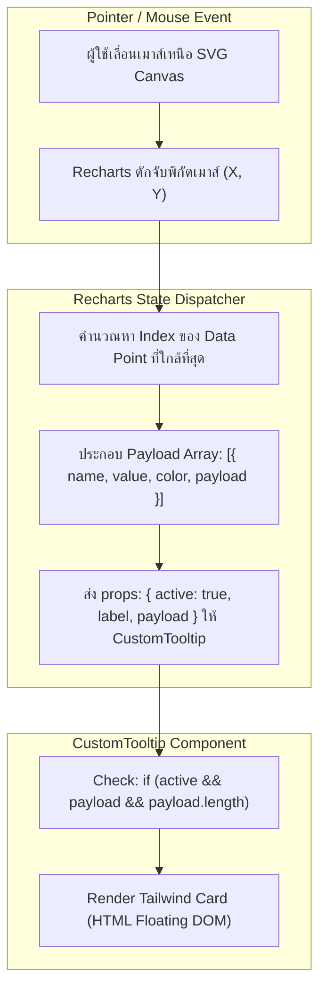

## 1. แนวคิด (Concept)

Tooltip และ Legend เป็นสะพานเชื่อมสำคัญระหว่างผู้ใช้งานกับตัวเลขสถิติบนกราฟ ในการพัฒนาระดับ Production การใช้หน้าต่างข้อมูลเริ่มต้น (Default Tooltip) มักไม่ตอบโจทย์ความต้องการทางธุรกิจ:

1. **Custom Tooltip (หน้าต่างข้อมูลแบบกำหนดเอง)**:
   Recharts อนุญาตให้เราส่ง React Component อิสระเข้าไปใน Prop `content={<CustomTooltip />}` ได้โดยตรง ทำให้เราสามารถใช้พลังของ **Tailwind CSS**, แสดงไอคอน, บ่งบอกสถานะด้วย Badge หรือแม้แต่แสดงตัวเลขคำนวณเสริม (เช่น ผลต่างยอดขาย % YoY)
2. **การแกะโครงสร้าง Payload**:
   เมื่อผู้ใช้เลื่อนเมาส์ชี้บนกราฟ Recharts จะส่ง Props สำคัญ 3 ตัวเข้ามาที่ Custom Tooltip:
   - `active`: บูลีนบอกว่าเมาส์กำลังโฟกัสอยู่บนจุดข้อมูลหรือไม่
   - `label`: ค่าของแกน X ณ จุดนั้น (เช่น ชื่อเดือน หรือวันที่)
   - `payload`: อาร์เรย์ของออบเจกต์ที่บรรจุข้อมูลดิบ, สี (`color`), ชื่อ (`name`), และก้อนข้อมูลดั้งเดิม (`payload.payload`)
3. **Interactive Legend (คำอธิบายสัญลักษณ์แบบตอบสนอง)**:
   ผู้ใช้สามารถคลิกที่ป้ายสัญลักษณ์ชุดข้อมูลเพื่อเปิด/ปิด (Toggle Visibility) การแสดงผลของเส้นหรือแท่งนั้นๆ แบบเรียลไทม์ผ่าน Prop `hide` ช่วยให้การวิเคราะห์ข้อมูลที่มีหลาย Series ไม่รกสายตา

---

## 2. หลักการเบื้องหลัง (Under the Hood)

### การทำงานของ Tooltip Event Loop และ Props Lifecycle



1. **Floating DOM Positioning**:
   ตัว Tooltip ไม่ได้ถูกเรนเดอร์เป็น SVG Element ภายใน แต่จะถูกยกออกมาเป็น HTML DOM ที่ครอบด้วย `div` ซึ่งมีคุณสมบัติ `position: absolute` หรือ CSS `transform` พิกัดตามเมาส์ เพื่อให้สามารถแสดงเนื้อหา HTML ซับซ้อนและอยู่นอกกรอบ Canvas ได้
2. **Type Safety กับ TooltipProps**:
   ใน TypeScript ของ Recharts v3 เราสามารถประกาศ Type สำหรับ Component Tooltip โดยระบุ Generic Types:
   `TooltipProps<ValueType, NameType>` เพื่อให้อ่านค่าใน `payload` ได้อย่างแม่นยำ
3. **กลไกการ Toggle ด้วย Prop `hide`**:
   เมื่อต้องการซ่อนเส้นกราฟ การส่ง `hide={true}` ให้กับ `<Line>` หรือ `<Bar>` จะสั่งให้ Recharts ข้ามการวาดรูปทรงนั้นใน SVG แต่ยังคงรักษา Domain Min/Max ของแกนไว้ ช่วยป้องกันปัญหากราฟหดตัววูบวาบจนเสียจังหวะสายตา

---

## 3. ตัวอย่างโค้ด (TypeScript / TSX)

### ตัวอย่างที่ 1: Custom Tooltip สไตล์การ์ดโมเดิร์น พร้อมการคำนวณอัตราการเติบโต

ตัวอย่างนี้แสดงการสร้างคอมโพเนนต์ Custom Tooltip ที่มีดีไซน์คมชัดด้วย Tailwind CSS และแสดง Badge เปอร์เซ็นต์การเติบโต

```tsx filename="components/analytics/SalesWithCustomTooltip.tsx"
'use client';

import React from 'react';
import {
  ResponsiveContainer,
  BarChart,
  Bar,
  XAxis,
  YAxis,
  CartesianGrid,
  Tooltip,
  TooltipProps,
} from 'recharts';

export interface SalesRecord {
  month: string;
  currentYearSales: number;
  lastYearSales: number;
}

// 1. สร้าง Custom Tooltip Component พร้อม Type ที่ถูกต้อง
function CustomFinanceTooltip({
  active,
  payload,
  label,
}: TooltipProps<number, string>) {
  // กฎเหล็ก: ต้องตรวจสอบสถานะความพร้อมของข้อมูลเสมอก่อนเรนเดอร์
  if (!active || !payload || !payload.length) {
    return null;
  }

  const current = Number(payload.find((p) => p.dataKey === 'currentYearSales')?.value ?? 0);
  const previous = Number(payload.find((p) => p.dataKey === 'lastYearSales')?.value ?? 0);
  const growthRate = previous > 0 ? ((current - previous) / previous) * 100 : 0;
  const isPositive = growthRate >= 0;

  return (
    <div className="min-w-[220px] rounded-xl border border-slate-200 bg-white/95 p-4 shadow-xl backdrop-blur-md dark:border-slate-800 dark:bg-slate-900/95">
      <div className="mb-2 flex items-center justify-between border-b border-slate-100 pb-2 dark:border-slate-800">
        <span className="text-xs font-bold text-slate-700 dark:text-slate-200">
          รอบเดือน: {label}
        </span>
        <span
          className={`inline-flex items-center rounded-full px-2 py-0.5 text-[10px] font-semibold ${
            isPositive
              ? 'bg-emerald-50 text-emerald-600 dark:bg-emerald-950/50 dark:text-emerald-400'
              : 'bg-rose-50 text-rose-600 dark:bg-rose-950/50 dark:text-rose-400'
          }`}
        >
          {isPositive ? '↑ +' : '↓ '}
          {growthRate.toFixed(1)}% YoY
        </span>
      </div>

      <div className="space-y-1.5">
        {payload.map((entry, index) => (
          <div key={`item-${index}`} className="flex items-center justify-between text-xs">
            <div className="flex items-center gap-2">
              <span
                className="h-2.5 w-2.5 rounded-full"
                style={{ backgroundColor: entry.color }}
              />
              <span className="text-slate-500 dark:text-slate-400">{entry.name}</span>
            </div>
            <span className="font-semibold text-slate-800 dark:text-slate-100">
              ฿{Number(entry.value).toLocaleString()}
            </span>
          </div>
        ))}
      </div>
    </div>
  );
}

// 2. คอมโพเนนต์กราฟหลัก
interface SalesChartProps {
  data: SalesRecord[];
}

export function SalesWithCustomTooltip({ data }: SalesChartProps) {
  return (
    <div className="w-full rounded-2xl border border-slate-200 bg-white p-6 shadow-sm dark:border-slate-800 dark:bg-slate-900">
      <div className="mb-4">
        <h3 className="text-base font-semibold text-slate-800 dark:text-slate-100">
          เปรียบเทียบยอดขายปีปัจจุบันเทียบกับปีก่อนหน้า (YoY)
        </h3>
        <p className="text-xs text-slate-500">
          เลื่อนเมาส์เพื่อดูการ์ดข้อมูลและอัตราการเติบโตคำนวณอัตโนมัติ
        </p>
      </div>

      <div className="h-[340px] w-full">
        <ResponsiveContainer width="100%" height="100%">
          <BarChart data={data} margin={{ top: 15, right: 15, left: 10, bottom: 5 }}>
            <CartesianGrid strokeDasharray="3 3" vertical={false} stroke="#f1f5f9" />
            <XAxis dataKey="month" tickLine={false} tick={{ fontSize: 11, fill: '#64748b' }} />
            <YAxis
              tickLine={false}
              axisLine={false}
              tickFormatter={(v) => `฿${(v / 1_000_000).toFixed(1)}M`}
              tick={{ fontSize: 11, fill: '#64748b' }}
            />
            {/* นำ Custom Tooltip มาสวมใส่แทน Default */}
            <Tooltip content={<CustomFinanceTooltip />} />
            <Bar
              dataKey="currentYearSales"
              name="ปี 2026"
              fill="#2563eb"
              radius={[4, 4, 0, 0]}
              maxBarSize={36}
            />
            <Bar
              dataKey="lastYearSales"
              name="ปี 2025"
              fill="#94a3b8"
              radius={[4, 4, 0, 0]}
              maxBarSize={36}
            />
          </BarChart>
        </ResponsiveContainer>
      </div>
    </div>
  );
}
```

---

### ตัวอย่างที่ 2: Interactive Legend สามารถคลิกเปิด/ปิดชุดข้อมูลแบบเรียลไทม์

สาธิตการทำ Custom Legend ด้วย React State ที่ให้ผู้ใช้กดคลิกสัญลักษณ์เพื่อซ่อน/แสดง Series ผ่าน Prop `hide`

```tsx filename="components/analytics/InteractiveFilterLegendChart.tsx"
'use client';

import React, { useState } from 'react';
import {
  ResponsiveContainer,
  LineChart,
  Line,
  XAxis,
  YAxis,
  CartesianGrid,
  Tooltip,
} from 'recharts';

export interface MultiRegionalMetric {
  period: string;
  centralRegion: number;
  northernRegion: number;
  southernRegion: number;
}

interface InteractiveChartProps {
  data: MultiRegionalMetric[];
}

interface SeriesConfig {
  key: keyof Omit<MultiRegionalMetric, 'period'>;
  label: string;
  color: string;
}

const SERIES_LIST: SeriesConfig[] = [
  { key: 'centralRegion', label: 'ภาคกลาง', color: '#2563eb' },
  { key: 'northernRegion', label: 'ภาคเหนือ', color: '#10b981' },
  { key: 'southernRegion', label: 'ภาคใต้', color: '#f59e0b' },
];

export function InteractiveFilterLegendChart({ data }: InteractiveChartProps) {
  // จัดเก็บรายการชุดข้อมูลที่ถูกสั่ง "ซ่อน" (Hidden Series)
  const [hiddenKeys, setHiddenKeys] = useState<string[]>([]);

  const toggleSeries = (key: string) => {
    setHiddenKeys((prev) =>
      prev.includes(key) ? prev.filter((k) => k !== key) : [...prev, key]
    );
  };

  return (
    <div className="w-full rounded-2xl border border-slate-200 bg-white p-6 shadow-sm dark:border-slate-800 dark:bg-slate-900">
      <div className="mb-4 flex flex-col justify-between gap-3 sm:flex-row sm:items-center">
        <div>
          <h3 className="text-base font-semibold text-slate-800 dark:text-slate-100">
            ยอดจำหน่ายแยกตามภูมิภาค
          </h3>
          <p className="text-xs text-slate-500">
            คลิกที่ปุ่มสัญลักษณ์ภูมิภาคด้านขวาเพื่อเปิด/ปิดชุดข้อมูล
          </p>
        </div>

        {/* Custom Interactive Legend UI */}
        <div className="flex flex-wrap items-center gap-2">
          {SERIES_LIST.map((series) => {
            const isHidden = hiddenKeys.includes(series.key);
            return (
              <button
                key={series.key}
                onClick={() => toggleSeries(series.key)}
                className={`flex items-center gap-1.5 rounded-full border px-3 py-1 text-xs font-medium transition ${
                  isHidden
                    ? 'border-slate-200 bg-slate-50 text-slate-400 opacity-60 dark:border-slate-800 dark:bg-slate-950'
                    : 'border-slate-300 bg-white text-slate-700 shadow-sm dark:border-slate-700 dark:bg-slate-800 dark:text-slate-200'
                }`}
              >
                <span
                  className="h-2 w-2 rounded-full"
                  style={{ backgroundColor: isHidden ? '#cbd5e1' : series.color }}
                />
                <span className={isHidden ? 'line-through' : ''}>{series.label}</span>
              </button>
            );
          })}
        </div>
      </div>

      <div className="h-[320px] w-full">
        <ResponsiveContainer width="100%" height="100%">
          <LineChart data={data} margin={{ top: 10, right: 15, left: 10, bottom: 5 }}>
            <CartesianGrid strokeDasharray="3 3" vertical={false} stroke="#f1f5f9" />
            <XAxis dataKey="period" tickLine={false} tick={{ fontSize: 11, fill: '#64748b' }} />
            <YAxis
              tickLine={false}
              axisLine={false}
              tickFormatter={(v) => `฿${(v / 1_000).toFixed(0)}K`}
              tick={{ fontSize: 11, fill: '#64748b' }}
            />
            <Tooltip
              formatter={(v: any, name: any) => [`฿${Number(v).toLocaleString()}`, name]}
              contentStyle={{ borderRadius: '8px', border: '1px solid #e2e8f0' }}
            />

            {SERIES_LIST.map((series) => (
              <Line
                key={series.key}
                type="monotone"
                dataKey={series.key}
                name={series.label}
                stroke={series.color}
                strokeWidth={2.5}
                dot={{ r: 3 }}
                activeDot={{ r: 5 }}
                // ควบคุมการแสดงผลผ่าน Prop `hide` แทนการตัดข้อมูลออกจาก Data Array
                hide={hiddenKeys.includes(series.key)}
              />
            ))}
          </LineChart>
        </ResponsiveContainer>
      </div>
    </div>
  );
}
```

---

## 4. เทียบกับวิธีอื่น (Recharts vs Canvas/Chart.js/D3)

| การปรับแต่ง Tooltip & Legend | Recharts | Chart.js | Nivo |
| :--- | :--- | :--- | :--- |
| **การสร้าง Custom Tooltip** | ส่ง React JSX Component ผ่าน Props `content` ตรงๆ | ต้องเขียน HTML String Generator ผ่าน Callback `plugins.tooltip.external` | มีฟังก์ชัน `tooltip={({ point }) => <Custom />}` ในตัว |
| **Styling ด้วย Tailwind** | ใช้คลาส Tailwind CSS ได้ 100% สบายตา | ต้องจัดการ Inline Style ใน DOM Node ที่สร้างด้วย JavaScript ดิบ | รองรับสไตล์แบบ Object หรือ Tailwind ภายใน Wrapper |
| **การทำ Interactive Legend** | ผูก State เข้ากับ Prop `hide` หรือใช้ Custom Legend Component | ต้องเขียน Logic เข้าไปแก้ `meta.hidden` ใน Chart Instance | มี Event `onClick` ใน Legend แต่การ Override สไตล์มีความจำกัด |

---

## 5. ผิด vs ถูก (Anti-patterns vs Best Practices)

### กรณีที่ 1: ลืมตรวจสอบ Guard Condition ใน Custom Tooltip จนเกิด Runtime Crash

```tsx
// ❌ ผิด: พยายามเข้าถึง payload[0] โดยตรงโดยไม่ตรวจ active หรือ length
function BadTooltip({ active, payload, label }: any) {
  // เมื่อเมาส์อยู่นอกกราฟ active จะเป็น false และ payload จะเป็น undefined/empty
  // โค้ดนี้จะพังด้วยข้อผิดพลาด: TypeError: Cannot read properties of undefined (reading 'value')
  return (
    <div>
      <p>{label}</p>
      <p>{payload[0].value}</p>
    </div>
  );
}
```

```tsx
// ✅ ถูก: ใส่ Guard Clause ป้องกันข้อผิดพลาดเสมอ
function GoodTooltip({ active, payload, label }: TooltipProps<number, string>) {
  if (!active || !payload || !payload.length) {
    return null;
  }

  return (
    <div className="p-3 bg-white border rounded shadow">
      <p className="font-bold">{label}</p>
      <p>{payload[0].value}</p>
    </div>
  );
}
```

---

### กรณีที่ 2: กรองข้อมูลออกจาก Array แทนการใช้ Prop `hide` ในการปิดชุดข้อมูล

```tsx
// ❌ ผิด: เมื่อคลิกปิด ให้ลบ Field นั้นออกจาก Array ข้อมูลดิบ
// ผลลัพธ์: จะเกิด Re-render ขนานใหญ่ และสเกลแกน Y จะกระตุกวูบวาบเพราะ Min/Max เปลี่ยนกะทันหัน
const sanitizedData = rawData.map(item => {
  const copy = { ...item };
  if (hiddenKeys.includes('revenue')) delete copy.revenue;
  return copy;
});
```

```tsx
// ✅ ถูก: ส่ง Array ข้อมูลเดิม แต่สั่งซ่อนผ่าน Prop `hide` บนคอมโพเนนต์ชาร์ต
<Line dataKey="revenue" hide={hiddenKeys.includes('revenue')} />
```
*เหตุผล*: การใช้ `hide` เป็นการสั่งในระดับ View Layer โดยที่สเกลของแกนยังคงเสถียรและนุ่มนวลกว่ามาก

---

## 6. ควรใช้เมื่อไหร่ / ไม่ควรใช้เมื่อไหร่

### ควรใช้ Custom Tooltip เมื่อ:
- ต้องแสดงข้อมูลเสริมที่ไม่ได้ถูกวาดเป็นแท่งกราฟ (เช่น เปอร์เซ็นต์การเติบโต, ชื่อผู้รับผิดชอบ, บันทึกหมายเหตุ)
- ต้องการคุม Design System ขององค์กร (สีขอบ, ฟอนต์, Shadow, Dark Mode) ให้กลมกลืนกับส่วนอื่นของหน้าเว็บ

### ใช้ Default Tooltip ต่อไปเมื่อ:
- ชาร์ตมีมิติเดียว เรียบง่าย เช่น มีเพียง 1 เส้น และต้องการเพียงการแปลงตัวเลข (`formatter={(val) => ฿val}`)
- ทำงานในโหมดต้นแบบรวดเร็ว (Prototype Phase)

---

## 7. คำถามสัมภาษณ์งาน (Interview Questions)

### Q1: เมื่อสร้าง Custom Tooltip ใน Recharts ทำไมต้องตรวจสอบเงื่อนไข `if (!active || !payload || !payload.length)` ก่อนเสมอ และใน `payload[0]` มีข้อมูลชนิดใดบรรจุอยู่บ้าง?
**แนวทางคำตอบแบบ Senior**:
"ต้องตรวจสอบเงื่อนไขนี้เพราะ Recharts จะยังคงเรนเดอร์ Custom Tooltip Component ไว้ใน DOM Tree เสมอแม้ผู้ใช้จะไม่ได้เลื่อนเมาส์ชี้อยู่บนกราฟ ในจังหวะนั้น Recharts จะส่ง `active = false` และ `payload = undefined` หรืออาร์เรย์ว่าง `[]` หากเราพยายามเข้าถึง `payload[0].value` เบราว์เซอร์จะเกิด TypeError ทันที

โครงสร้างภายใน `payload[0]` ประกอบด้วย Metadata ครบครัน ได้แก่:
- `dataKey`: คีย์ที่ผูกกับชุดข้อมูล เช่น `'revenue'`
- `name`: ชื่อที่แสดงผลใน Legend
- `value`: ค่าตัวเลขจริง ณ จุดพิกัดนั้น
- `color`: รหัสสีประจำเส้นหรือแท่งกราฟ
- `payload`: ก้อน Object แถวข้อมูลดิบดั้งเดิมทั้งก้อน (`original row object`) ทำให้เราสามารถดึงฟิลด์อื่นๆ ที่ไม่ได้นำมาพล็อตกราฟ (เช่น `note`, `id`, `auditLog`) มาแสดงใน Tooltip ได้"

---

### Q2: ในการทำ Interactive Legend เพื่อเปิด/ปิดชุดข้อมูล (Series Visibility Toggling) ทำไมจึงควรใช้ Prop `hide` บนคอมโพเนนต์ชาร์ต แทนการลบ Property นั้นออกจากชุดข้อมูลดิบ?
**แนวทางคำตอบแบบ Senior**:
"1. **ความคงที่ของสเกลแกน (Scale Stability)**: การลบข้อมูลออกจาก Data Array จะทำให้ D3 ทำการคำนวณ Domain Min/Max ของแกน Y ใหม่ทั้งหมด ส่งผลให้สเกลกระตุกวูบวาบ สร้างความสับสนต่อสายตา แต่หากใช้ `hide` สเกลของแกนจะคงเดิมหรือปรับตัวตามที่ออกแบบไว้
2. **ประสิทธิภาพการ Render**: การลบและสร้าง Data Array ใหม่ทุกครั้งที่คลิก Toggle จะทำให้เกิด Object Allocation ใหม่ใน Memory และบังคับให้ React ทำ Reconciliation ขนานใหญ่ ในขณะที่การเปลี่ยน Prop `hide` สั่งเพียงการสลับ CSS Visibility หรือข้ามขั้นตอนการวาด SVG Element ในรอบนั้น ซึ่งกินทรัพยากรน้อยกว่ามาก"
