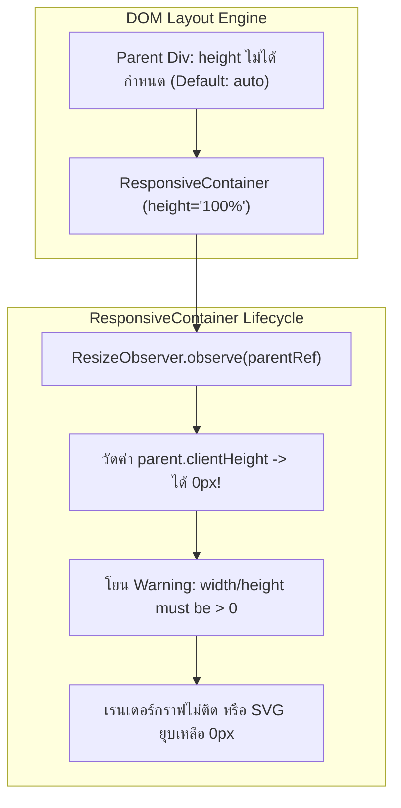

## 1. แนวคิด (Concept)

การเริ่มต้นพัฒนา Data Visualization ด้วย **Recharts v3** บน **Next.js 16** และ **React 19** มีหัวใจหลัก 3 ประการที่นักพัฒนาต้องทำความเข้าใจ:

1. **การติดตั้งแพ็กเกจ**:
   Recharts รองรับสถาปัตยกรรมโมเดิร์นแบบ ES Modules อย่างสมบูรณ์ ติดตั้งได้ง่ายด้วยคำสั่ง:
   ```bash
   npm install recharts
   # หรือใช้ pnpm / yarn / bun
   pnpm add recharts
   ```
2. **โครงสร้างข้อมูลมาตรฐาน (Array of Objects)**:
   Recharts ถูกออกแบบมาให้อ่านข้อมูลชุดในรูปแบบอาร์เรย์ของออบเจกต์ JavaScript (JSON Standard) โดยแต่ละ Element ในอาร์เรย์แทนข้อมูล 1 จุดเวลา หรือ 1 รายการ เช่น:
   ```ts
   [
     { period: '2026-Q1', revenue: 450000, activeUsers: 1200 },
     { period: '2026-Q2', revenue: 580000, activeUsers: 1650 },
   ]
   ```
   และใช้คำสั่ง `dataKey="revenue"` เพื่อระบุว่ากราฟิกแท่งนั้นๆ หรือเส้นนั้นๆ ดึงตัวเลขจากฟิลด์ใด
3. **การประกอบองค์ประกอบมาตรฐาน (Standard Composition)**:
   ชาร์ต 1 ตัวประกอบด้วยชิ้นส่วนมาตรฐานที่ทำงานสอดประสานกัน:
   - `<ResponsiveContainer>`: Wrapper ควบคุมขนาดให้ยืดหยุ่นตามความกว้างของหน้าจอ
   - `<CartesianGrid>`: เส้นตารางอ้างอิงแนวนอนและแนวตั้ง
   - `<XAxis>` และ `<YAxis>`: แกนพิกัดข้อมูล
   - `<Tooltip>`: หน้าต่างข้อมูลลอยตัวเมื่อเลื่อนเมาส์ชี้
   - `<Legend>`: คำอธิบายสัญลักษณ์และสีของชุดข้อมูล

---

## 2. หลักการเบื้องหลัง (Under the Hood)

### ปัญหา Parent 0px Height และการทำงานของ ResponsiveContainer

หนึ่งในปัญหาที่พบบ่อยที่สุดของนักพัฒนาหน้าใหม่คือคำเตือนในคอนโซล:
`The width(0) and height(0) of chart should be greater than 0`



1. **ResizeObserver API**:
   `<ResponsiveContainer>` ใช้ `ResizeObserver` ในการดักจับการเปลี่ยนแปลงขนาดของ Parent DOM Node แบบเรียลไทม์
2. **ทำไมความสูงจึงกลายเป็น 0px?**:
   ตามมาตรฐาน CSS Box Model ค่า `height: 100%` จะคำนวณได้ก็ต่อเมื่อ **Parent Container มีการกำหนดความสูงที่แน่นอน** (เช่น มี `height: 400px`, `min-h-[300px]` หรืออยู่ภายใน Flex/Grid ที่มีความสูงชัดเจน) หาก Parent มีความสูงเป็น `auto` ความสูงของ Parent จะขึ้นกับเนื้อหาภายใน แต่เนื้อหาภายใน (`ResponsiveContainer`) กำลังรอขนาดจาก Parent จึงเกิดภาวะพึ่งพาซึ่งกันและกัน (Circular Dependency) ส่งผลให้บราวเซอร์คืนค่าความสูงเป็น `0px`
3. **ทางออก**:
   ต้องกำหนดความสูงที่ชัดเจนให้ Parent เสมอ (เช่น ใส่คลาส Tailwind `h-[350px] w-full`) หรือกำหนดคุณสมบัติ `aspect={2}` หรือ `height={350}` ลงบน `<ResponsiveContainer>` โดยตรง

---

## 3. ตัวอย่างโค้ด (TypeScript / TSX)

### ตัวอย่างที่ 1: กราฟรายได้องค์กรมาตรฐาน (Enterprise Sales Setup)

ตัวอย่างนี้สาธิตการจัดวางคอมโพเนนต์มาตรฐานพร้อม TypeScript Interfaces ที่รัดกุม

```tsx filename="components/analytics/EnterpriseRevenueChart.tsx"
'use client';

import React from 'react';
import {
  ResponsiveContainer,
  BarChart,
  Bar,
  XAxis,
  YAxis,
  CartesianGrid,
  Tooltip,
  Legend,
} from 'recharts';

export interface QuarterlySalesMetric {
  fiscalQuarter: string;
  enterpriseSoftware: number;
  cloudServices: number;
  supportConsulting: number;
}

interface EnterpriseRevenueChartProps {
  data: QuarterlySalesMetric[];
  title?: string;
}

export function EnterpriseRevenueChart({
  data,
  title = 'ยอดขายแยกตามกลุ่มผลิตภัณฑ์ (Fiscal Year 2026)',
}: EnterpriseRevenueChartProps) {
  const currencyFormatter = (value: number) => {
    return `฿${(value / 1_000_000).toFixed(1)}M`;
  };

  return (
    <div className="w-full rounded-xl border border-slate-200 bg-white p-6 shadow-sm dark:border-slate-800 dark:bg-slate-900">
      <div className="mb-4">
        <h3 className="text-base font-semibold text-slate-800 dark:text-slate-100">
          {title}
        </h3>
        <p className="text-xs text-slate-500 dark:text-slate-400">
          หน่วย: ล้านบาท (THB) - ข้อมูลอัปเดตอัตโนมัติจากฐานข้อมูลกลาง
        </p>
      </div>

      {/* จุดสำคัญ: กำหนดความสูงแน่นอนที่ Wrapper ครอบ เพื่อให้ ResponsiveContainer วัดขนาดได้ */}
      <div className="h-[360px] w-full">
        <ResponsiveContainer width="100%" height="100%">
          <BarChart
            data={data}
            margin={{ top: 10, right: 20, left: 10, bottom: 5 }}
          >
            <CartesianGrid strokeDasharray="3 3" vertical={false} stroke="#f1f5f9" />
            <XAxis
              dataKey="fiscalQuarter"
              tickLine={false}
              axisLine={{ stroke: '#e2e8f0' }}
              tick={{ fill: '#64748b', fontSize: 12 }}
            />
            <YAxis
              tickLine={false}
              axisLine={false}
              tickFormatter={currencyFormatter}
              tick={{ fill: '#64748b', fontSize: 12 }}
            />
            <Tooltip
              formatter={(value: any, name: any) => [
                `฿${Number(value).toLocaleString()}`,
                name,
              ]}
              cursor={{ fill: 'rgba(241, 245, 249, 0.5)' }}
              contentStyle={{
                borderRadius: '8px',
                border: '1px solid #e2e8f0',
                boxShadow: '0 4px 6px -1px rgba(0, 0, 0, 0.1)',
              }}
            />
            <Legend
              verticalAlign="top"
              align="right"
              iconType="circle"
              wrapperStyle={{ paddingBottom: '16px', fontSize: '12px' }}
            />
            <Bar
              dataKey="enterpriseSoftware"
              name="Enterprise License"
              fill="#3b82f6"
              radius={[4, 4, 0, 0]}
            />
            <Bar
              dataKey="cloudServices"
              name="Cloud Platform"
              fill="#10b981"
              radius={[4, 4, 0, 0]}
            />
            <Bar
              dataKey="supportConsulting"
              name="Professional Services"
              fill="#8b5cf6"
              radius={[4, 4, 0, 0]}
            />
          </BarChart>
        </ResponsiveContainer>
      </div>
    </div>
  );
}
```

---

### ตัวอย่างที่ 2: Card มอนิเตอร์ทรัพยากรเซิร์ฟเวอร์ พร้อม Aspect Ratio และ SSR Skeleton

ใน Next.js 16 การโหลดชาร์ตฝั่ง Client Component อาจทำให้หน้าจอกระตุก (Layout Shift) หากไม่สำรองพื้นที่ไว้ ตัวอย่างนี้แสดงการใช้ SSR Guard และ Skeleton ควบคู่กับ Aspect Ratio:

```tsx filename="components/analytics/ServerMetricsCard.tsx"
'use client';

import React, { useState, useEffect } from 'react';
import {
  ResponsiveContainer,
  AreaChart,
  Area,
  XAxis,
  YAxis,
  Tooltip,
} from 'recharts';

export interface ServerLoadSample {
  timeLabel: string;
  cpuPercent: number;
  memoryPercent: number;
}

interface ServerMetricsCardProps {
  metrics: ServerLoadSample[];
}

export function ServerMetricsCard({ metrics }: ServerMetricsCardProps) {
  const [isMounted, setIsMounted] = useState<boolean>(false);

  // ป้องกัน Hydration Mismatch และรอให้ Browser DOM พร้อมสำหรับ ResizeObserver
  useEffect(() => {
    setIsMounted(true);
  }, []);

  if (!isMounted) {
    return (
      <div className="flex h-[280px] w-full animate-pulse items-center justify-center rounded-xl bg-slate-100 dark:bg-slate-800">
        <span className="text-xs text-slate-400">กำลังโหลดโมดูลกราฟิก...</span>
      </div>
    );
  }

  return (
    <div className="w-full rounded-xl border border-slate-200 bg-white p-5 dark:border-slate-800 dark:bg-slate-900">
      <div className="mb-3 flex items-center justify-between">
        <div>
          <h4 className="text-sm font-semibold text-slate-800 dark:text-slate-200">
            ภาระการทำงานของโหนดเซิร์ฟเวอร์ (Real-time Cluster)
          </h4>
          <span className="text-xs text-emerald-500 font-medium">● สถานะปกติ (Normal)</span>
        </div>
      </div>

      {/* ใช้ aspect ratio: กราฟจะรักษาอัตราส่วน 16:9 เสมอในทุกขนาดหน้าจอ */}
      <div className="w-full">
        <ResponsiveContainer width="100%" aspect={2.4}>
          <AreaChart data={metrics} margin={{ top: 5, right: 10, left: -20, bottom: 0 }}>
            <XAxis
              dataKey="timeLabel"
              tickLine={false}
              tick={{ fontSize: 10, fill: '#94a3b8' }}
            />
            <YAxis
              domain={[0, 100]}
              tickLine={false}
              axisLine={false}
              tick={{ fontSize: 10, fill: '#94a3b8' }}
              unit="%"
            />
            <Tooltip
              formatter={(val: any) => [`${val}%`, '']}
              contentStyle={{ fontSize: '11px', borderRadius: '6px' }}
            />
            <Area
              type="monotone"
              dataKey="cpuPercent"
              name="CPU"
              stroke="#ef4444"
              fill="#fee2e2"
              fillOpacity={0.6}
            />
            <Area
              type="monotone"
              dataKey="memoryPercent"
              name="RAM"
              stroke="#0ea5e9"
              fill="#e0f2fe"
              fillOpacity={0.6}
            />
          </AreaChart>
        </ResponsiveContainer>
      </div>
    </div>
  );
}
```

---

## 4. เทียบกับวิธีอื่น (Recharts vs Canvas/Chart.js/D3)

| คุณสมบัติการเซ็ตอัป | Recharts | Chart.js (react-chartjs-2) | D3.js เพียวๆ |
| :--- | :--- | :--- | :--- |
| **รูปแบบการนิยามกราฟ** | JSX Declarative Primitives | Single Configuration Object | Imperative DOM Mutation Scripts |
| **การรองรับ Responsive** | หุ้มด้วย `<ResponsiveContainer>` | ตั้งค่า `responsive: true, maintainAspectRatio: false` ใน config | ต้องเขียน `window.addEventListener('resize')` และ Re-draw เอง |
| **ชนิดของข้อมูลที่รับ** | Array of Objects (อ่านง่าย ตรงไปตรงมา) | แยกเป็น Array ของ labels และ Array ย่อยของ datasets | รองรับทั้ง Flat Array, Matrix และ Hierarchy |
| **การปรับแต่ง Tooltip** | สอดแทรก React Component ผ่าน `content={<Custom />}` | เขียน Callback ฟังก์ชันสร้าง HTML String ดิบ | จัดการ Event Listener และคำนวณตำแหน่งเอง |

---

## 5. ผิด vs ถูก (Anti-patterns vs Best Practices)

### กรณีที่ 1: วาง ResponsiveContainer ใน Parent ที่ไม่มีความสูง (Parent 0px Height)

```tsx
// ❌ ผิด: Parent เป็น div ธรรมดาที่ไม่มีการกำหนด height ทำให้ความสูงเป็น 0px
export function BadContainer({ data }: { data: any[] }) {
  return (
    <div>
      <ResponsiveContainer width="100%" height="100%">
        <BarChart data={data}>
          <Bar dataKey="val" />
        </BarChart>
      </ResponsiveContainer>
    </div>
  );
}
```

```tsx
// ✅ ถูก: กำหนดความสูงที่แน่นอนให้ Parent เสมอ หรือใช้ aspect ratio
export function GoodContainer({ data }: { data: any[] }) {
  return (
    <div className="h-[320px] w-full">
      <ResponsiveContainer width="100%" height="100%">
        <BarChart data={data}>
          <Bar dataKey="val" fill="#2563eb" />
        </BarChart>
      </ResponsiveContainer>
    </div>
  );
}
```
*เหตุผล*: `ResponsiveContainer` ต้องการอ่านขนาด `clientHeight` ของ Parent Element หากไม่ได้ระบุความสูง บราวเซอร์จะคืนค่า 0px และ Recharts จะแสดงข้อผิดพลาดใน Console

---

### กรณีที่ 2: ระบุ `dataKey` สะกดผิดหรือไม่ตรงกับ Property ของ Object

```tsx
// ❌ ผิด: Object ใช้ key ว่า 'monthlyRevenue' แต่ใน Bar ดันระบุ dataKey="revenue"
const salesData = [{ month: 'ม.ค.', monthlyRevenue: 150000 }];

export function BrokenChart() {
  return (
    <BarChart data={salesData} width={400} height={200}>
      <Bar dataKey="revenue" /> {/* แท่งกราฟจะไม่แสดงผลเลย และไม่แจ้ง error */}
    </BarChart>
  );
}
```

```tsx
// ✅ ถูก: ใช้ TypeScript Interface ควบคุมความถูกต้องของ Key
interface MonthlyData {
  month: string;
  monthlyRevenue: number;
}

const verifiedData: MonthlyData[] = [{ month: 'ม.ค.', monthlyRevenue: 150000 }];

export function CorrectChart() {
  return (
    <BarChart data={verifiedData} width={400} height={200}>
      <Bar dataKey="monthlyRevenue" fill="#059669" />
    </BarChart>
  );
}
```

---

## 6. ควรใช้เมื่อไหร่ / ไม่ควรใช้เมื่อไหร่

### ควรใช้ ResponsiveContainer เมื่อ:
- ชาร์ตอยู่บนหน้า Dashboard หรือหน้าเว็บทั่วไปที่ต้องปรับขนาดตาม Grid, Flex หรือความกว้างของหน้าจอเบราว์เซอร์ (Responsive Layout)
- ใช้งานในระบบที่มีทั้งมุมมอง Mobile, Tablet และ Desktop

### ไม่ควรใช้ ResponsiveContainer เมื่อ:
- **ส่งออกไฟล์ภาพหรือ PDF (Export to PNG / PDF via Puppeteer/html2canvas)**: ควรรูปร่างพิกัดที่แน่นอนด้วย `width={800} height={400}` เพื่อให้ขนาดผลลัพธ์คงที่สม่ำเสมอ ไม่เปลี่ยนตามขนาดหน้าจอเซิร์ฟเวอร์
- **ชาร์ตขนาดเล็กจิ๋ว (Sparkline)**: ใน Table Cell ขนาดเล็ก เช่น กราฟแสดงแนวโน้ม 50x20px ควรกำหนดขนาดคงที่ เพื่อลดภาระการทำงานของ `ResizeObserver` ในตารางที่มีหลายร้อยแถว

---

## 7. คำถามสัมภาษณ์งาน (Interview Questions)

### Q1: ปัญหา "The width(0) and height(0) of chart should be greater than 0" เกิดจากสาเหตุใด และมีวิธีจัดการที่เหมาะสมใน Next.js App Router อย่างไร?
**แนวทางคำตอบแบบ Senior**:
"ข้อผิดพลาดนี้เกิดขึ้นจาก 2 ปัจจัยหลัก:
1. **CSS Box Layout**: ตัว `<ResponsiveContainer>` มีการใช้ `height="100%"` แต่ Parent Container ไม่มีขนาดความสูงที่แน่นอน (เป็น `height: auto`) ทำให้ `ResizeObserver` อ่านความสูงได้เป็น `0px`
2. **SSR / Hydration Phase ใน Next.js**: ในขณะที่หน้าเว็บกำลังทำ Server-Side Rendering บน Node.js จะไม่มี DOM หรือ Window APIs ให้วัดขนาด เมื่อส่ง HTML มาที่เบราว์เซอร์และเริ่มกระบวนการ Hydration อาจมีชั่วขณะที่ Container ยังไม่ได้ Layout เสร็จสมบูรณ์

วิธีป้องกันและแก้ไขในระดับ Production:
- กำหนดความสูงที่ชัดเจนให้ Parent Container ผ่าน Tailwind เช่น `h-[350px] w-full`
- ตรวจสอบการ Mount ฝั่ง Client โดยใช้ `useEffect` หรือ Dynamic Import (`next/dynamic` พร้อม `ssr: false`) เพื่อเรนเดอร์ชาร์ตเมื่อ DOM พร้อมใช้งานจริง พร้อมใส่ Skeleton Placeholder ไว้ล่วงหน้าเพื่อป้องกัน Layout Shift"

---

### Q2: ใน Recharts คุณสมบัติ `dataKey` รองรับค่าประเภทใดได้บ้าง และมี Use Case ใดที่ควรส่งฟังก์ชันแทนสตริง?
**แนวทางคำตอบแบบ Senior**:
"`dataKey` รองรับทั้ง **String**, **Number** และ **Accessor Function**:
- **String**: รูปแบบมาตรฐานสำหรับอ่านค่า Property ระดับบนของ Object เช่น `dataKey="revenue"`
- **Accessor Function `(dataObject) => computedValue`**: ใช้เมื่อต้องการคำนวณค่าสดๆ โดยไม่ต้องแปลงโครงสร้างข้อมูลล่วงหน้า เช่น:
  ```tsx
  <Bar dataKey={(entry) => entry.grossRevenue - entry.discount} />
  ```
  หรือกรณีที่ Object มีโครงสร้างซ้อนกัน (Deeply Nested) เช่น:
  ```tsx
  <Line dataKey={(entry) => entry.meta.metrics.speed} />
  ```
  การใช้ฟังก์ชันช่วยเพิ่มความยืดหยุ่นสูง แต่ควรระวังไม่ใส่ตรรกะที่คำนวณหนักมากเกินไปเพราะฟังก์ชันนี้จะถูกเรียกประมวลผลทุกจุดข้อมูลในทุก Render Cycle"
