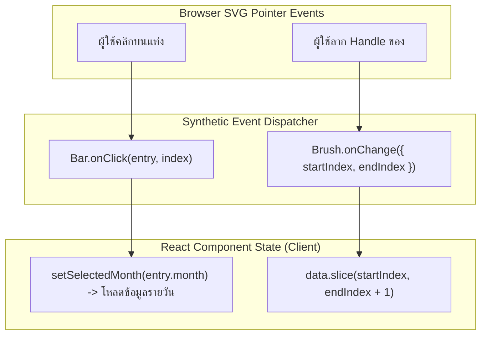

## 1. แนวคิด (Concept)

Data Visualization ที่ยอดเยี่ยมไม่ใช่เพียงการแสดงรูปภาพที่หยุดนิ่ง แต่ต้องเปิดโอกาสให้ผู้ใช้งานได้ "สำรวจ" (Explore) ข้อมูลเชิงลึกด้วยตนเอง **Recharts v3** รองรับการโต้ตอบที่หลากหลายผ่าน React State Management:

1. **onClick Events & Data Drill-down**:
   ผู้ใช้สามารถคลิกบนชิ้นส่วนกราฟิก เช่น แท่ง Bar, ชิ้นพาย Pie Slice หรือจุด Scatter เพื่อเปิดดูข้อมูลย่อยในระดับที่ลึกขึ้น (เช่น คลิกแท่ง "ยอดขายเดือนตุลาคม" เพื่อเจาะดูยอดขายรายวันของเดือนตุลาคม)
2. **Active Shape & Pie Hover Highlight**:
   การขยายขนาดหรือเพิ่มรัศมีของชิ้นพายที่เมาส์กำลังชี้อยู่ ผ่านการควบคุม `activeIndex` ร่วมกับฟังก์ชัน `renderActiveShape` ช่วยเน้นย้ำข้อมูลที่กำลังสนใจได้อย่างทรงพลัง
3. **Brush Component (แถบสไลด์ปรับช่วงเวลา)**:
   คอมโพเนนต์ `<Brush>` วางแถบสไลเดอร์แบบสองหัวไว้ที่ขอบล่างของกราฟ อนุญาตให้ผู้ใช้ลากย่อ/ขยาย หรือเลื่อนช่วงเวลา (Date Range Zooming) ได้อย่างลื่นไหลโดยไม่ต้องพึ่งพาไลบรารีภายนอก
4. **การเชื่อมต่อกับตัวกรองภายนอก (External Filter Sync)**:
   ผสานการทำงานระหว่างกราฟกับ UI ควบคุมภายนอก เช่น Dropdown เลือกสาขา หรือ Date Range Picker โดยขับเคลื่อนผ่าน React 19 State

---

## 2. หลักการเบื้องหลัง (Under the Hood)

### สถาปัตยกรรม Event Dispatching และ Brush Windowing



1. **SVG Event Bubbling**:
   เนื่องจากแท่ง Bar แต่ละแท่งคือแท็ก `<rect>` ของ SVG จริงใน DOM เบราว์เซอร์จึงส่ง Native Event ผ่านระบบ **React Synthetic Event** ทำให้เราสามารถดึงข้อมูลของจุดนั้นออกมาได้โดยตรงผ่าน Parameter ตัวแรกของ `onClick`
2. **Brush Windowing Algorithm**:
   คอมโพเนนต์ `<Brush>` จะเรนเดอร์ชาร์ตขนาดจิ๋ว (Mini Sparkline) อยู่ด้านล่าง เมื่อผู้ใช้เลื่อนแถบจับ ซอฟต์แวร์จะคำนวณสัดส่วนพิกเซลเทียบกับจำนวนข้อมูลในอาร์เรย์ แล้วทำการตัดส่วน (Array Slicing: `data.slice(startIndex, endIndex + 1)`) ส่งต่อให้ชาร์ตหลักเรนเดอร์เฉพาะหน้าต่างเวลาที่เลือก
3. **Pie Sector Math (`d3-shape arc`)**:
   ฟังก์ชัน `renderActiveShape` จะรับพิกัดองศา `startAngle`, `endAngle` และรัศมี `innerRadius`, `outerRadius` ของชิ้นพายที่ถูก Hover จากนั้นส่งต่อให้คอมโพเนนต์ `<Sector>` ของ Recharts วาดส่วนโค้งที่มีรัศมีใหญ่ขึ้นกว่าปกติ (`outerRadius + 8`)

---

## 3. ตัวอย่างโค้ด (TypeScript / TSX)

### ตัวอย่างที่ 1: ระบบวิเคราะห์ยอดขายแบบ Master-Detail Drill-down (คลิกเดือนเจาะดูรายวัน)

ตัวอย่างนี้สาธิตการจับเหตุการณ์ `onClick` บนแท่ง Bar เพื่อเปลี่ยนมุมมองจาก "รายเดือน" เป็น "รายวัน" พร้อมปุ่มย้อนกลับ (Breadcrumb Navigation)

```tsx filename="components/analytics/SalesDrilldownDashboard.tsx"
'use client';

import React, { useState } from 'react';
import {
  ResponsiveContainer,
  BarChart,
  Bar,
  XAxis,
  YAxis,
  CartesianGrid,
  Tooltip,
} from 'recharts';

export interface MonthlySummary {
  month: string;
  revenue: number;
  dailyBreakdown: Array<{ day: string; revenue: number }>;
}

const MOCK_MONTHLY_DATA: MonthlySummary[] = [
  {
    month: 'ต.ค. 2026',
    revenue: 1250000,
    dailyBreakdown: [
      { day: '01 ต.ค.', revenue: 38000 },
      { day: '02 ต.ค.', revenue: 42000 },
      { day: '03 ต.ค.', revenue: 55000 },
      { day: '04 ต.ค.', revenue: 31000 },
      { day: '05 ต.ค.', revenue: 49000 },
    ],
  },
  {
    month: 'พ.ย. 2026',
    revenue: 1480000,
    dailyBreakdown: [
      { day: '01 พ.ย.', revenue: 52000 },
      { day: '02 พ.ย.', revenue: 48000 },
      { day: '03 พ.ย.', revenue: 61000 },
      { day: '04 พ.ย.', revenue: 59000 },
      { day: '05 พ.ย.', revenue: 70000 },
    ],
  },
  {
    month: 'ธ.ค. 2026',
    revenue: 1950000,
    dailyBreakdown: [
      { day: '01 ธ.ค.', revenue: 65000 },
      { day: '02 ธ.ค.', revenue: 78000 },
      { day: '03 ธ.ค.', revenue: 92000 },
      { day: '04 ธ.ค.', revenue: 84000 },
      { day: '05 ธ.ค.', revenue: 110000 },
    ],
  },
];

export function SalesDrilldownDashboard() {
  const [selectedMonth, setSelectedMonth] = useState<MonthlySummary | null>(null);

  // ดักจับ Event เมื่อผู้ใช้คลิกบนแท่งเดือน
  const handleBarClick = (entry: any) => {
    if (entry && entry.month) {
      const found = MOCK_MONTHLY_DATA.find((m) => m.month === entry.month);
      if (found) setSelectedMonth(found);
    }
  };

  const currencyFormatter = (val: number) => `฿${(val / 1_000).toFixed(0)}k`;

  return (
    <div className="w-full rounded-2xl border border-slate-200 bg-white p-6 shadow-sm dark:border-slate-800 dark:bg-slate-900">
      {/* ส่วนหัวและระบบนำทาง Breadcrumb */}
      <div className="mb-4 flex items-center justify-between">
        <div>
          <div className="flex items-center gap-2 text-sm font-medium">
            <button
              onClick={() => setSelectedMonth(null)}
              className={`${
                selectedMonth
                  ? 'text-blue-600 hover:underline dark:text-blue-400'
                  : 'text-slate-800 font-bold dark:text-slate-100'
              }`}
            >
              ภาพรวมรายเดือน
            </button>
            {selectedMonth && (
              <>
                <span className="text-slate-400">/</span>
                <span className="text-slate-800 font-bold dark:text-slate-100">
                  {selectedMonth.month} (รายวัน)
                </span>
              </>
            )}
          </div>
          <p className="text-xs text-slate-500 mt-1">
            {selectedMonth
              ? 'แสดงข้อมูลยอดขายรายวัน คลิกปุ่มย้อนกลับเพื่อดูภาพรวมรายเดือน'
              : 'คลิกที่แท่งกราฟของเดือนใดก็ได้เพื่อเจาะดูรายละเอียดรายวัน (Drill-down)'}
          </p>
        </div>

        {selectedMonth && (
          <button
            onClick={() => setSelectedMonth(null)}
            className="rounded-lg border border-slate-300 bg-slate-50 px-3 py-1.5 text-xs font-semibold text-slate-700 hover:bg-slate-100 dark:border-slate-700 dark:bg-slate-800 dark:text-slate-200"
          >
            ← ย้อนกลับ
          </button>
        )}
      </div>

      <div className="h-[340px] w-full">
        <ResponsiveContainer width="100%" height="100%">
          {selectedMonth ? (
            // มุมมองรายวัน (Detail Level)
            <BarChart data={selectedMonth.dailyBreakdown}>
              <CartesianGrid strokeDasharray="3 3" vertical={false} stroke="#f1f5f9" />
              <XAxis dataKey="day" tickLine={false} tick={{ fontSize: 11 }} />
              <YAxis
                tickLine={false}
                axisLine={false}
                tickFormatter={currencyFormatter}
                tick={{ fontSize: 11 }}
              />
              <Tooltip formatter={(v: any) => [`฿${Number(v).toLocaleString()}`, 'ยอดขายรายวัน']} />
              <Bar dataKey="revenue" fill="#10b981" radius={[4, 4, 0, 0]} maxBarSize={40} />
            </BarChart>
          ) : (
            // มุมมองภาพรวมรายเดือน (Master Level)
            <BarChart data={MOCK_MONTHLY_DATA}>
              <CartesianGrid strokeDasharray="3 3" vertical={false} stroke="#f1f5f9" />
              <XAxis dataKey="month" tickLine={false} tick={{ fontSize: 11 }} />
              <YAxis
                tickLine={false}
                axisLine={false}
                tickFormatter={(v) => `฿${(v / 1_000_000).toFixed(1)}M`}
                tick={{ fontSize: 11 }}
              />
              <Tooltip formatter={(v: any) => [`฿${Number(v).toLocaleString()}`, 'ยอดขายรวม']} />
              <Bar
                dataKey="revenue"
                fill="#2563eb"
                radius={[4, 4, 0, 0]}
                cursor="pointer" // แสดงรูปมือชี้เพื่อให้รู้ว่าคลิกได้
                onClick={handleBarClick}
                maxBarSize={48}
              />
            </BarChart>
          )}
        </ResponsiveContainer>
      </div>
    </div>
  );
}
```

---

### ตัวอย่างที่ 2: Time-series พร้อม Brush Slider และ Donut ที่ขยายชิ้นพายเมื่อ Hover

สาธิตการใช้ `<Brush>` เพื่อซูมขอบเขตเวลา และการใช้ `activeIndex` + `Sector` บน `PieChart`

```tsx filename="components/analytics/TimelineBrushAndInteractivePie.tsx"
'use client';

import React, { useState } from 'react';
import {
  ResponsiveContainer,
  AreaChart,
  Area,
  Brush,
  XAxis,
  YAxis,
  CartesianGrid,
  Tooltip,
  PieChart,
  Pie,
  Cell,
  Sector,
} from 'recharts';

export interface TrafficDataPoint {
  date: string;
  requests: number;
}

export interface DeviceCategory {
  device: string;
  share: number;
}

const PIE_COLORS = ['#3b82f6', '#10b981', '#f59e0b', '#8b5cf6'];

// ฟังก์ชันวาดรูปทรงชิ้นพายแบบขยายขนาดเมื่อเมาส์ชี้ (Active Shape)
const renderActiveShape = (props: any) => {
  const {
    cx,
    cy,
    innerRadius,
    outerRadius,
    startAngle,
    endAngle,
    fill,
    payload,
    percent,
  } = props;

  return (
    <g>
      <text x={cx} y={cy - 10} textAnchor="middle" fill="#1e293b" className="text-xs font-bold dark:fill-slate-100">
        {payload.device}
      </text>
      <text x={cx} y={cy + 12} textAnchor="middle" fill="#64748b" className="text-[11px]">
        {`${(percent * 100).toFixed(1)}%`}
      </text>
      <Sector
        cx={cx}
        cy={cy}
        innerRadius={innerRadius}
        outerRadius={outerRadius + 8} // ขยายรัศมีออกไปอีก 8px
        startAngle={startAngle}
        endAngle={endAngle}
        fill={fill}
      />
      <Sector
        cx={cx}
        cy={cy}
        startAngle={startAngle}
        endAngle={endAngle}
        innerRadius={outerRadius + 10}
        outerRadius={outerRadius + 12}
        fill={fill}
      />
    </g>
  );
};

interface DualInteractiveProps {
  trafficData: TrafficDataPoint[];
  deviceShares: DeviceCategory[];
}

export function TimelineBrushAndInteractivePie({
  trafficData,
  deviceShares,
}: DualInteractiveProps) {
  const [activeIndex, setActiveIndex] = useState<number>(0);

  return (
    <div className="grid grid-cols-1 gap-6 lg:grid-cols-3">
      {/* 1. AreaChart พร้อม Brush Slider (2 คอลัมน์) */}
      <div className="rounded-2xl border border-slate-200 bg-white p-6 shadow-sm dark:border-slate-800 dark:bg-slate-900 lg:col-span-2">
        <h4 className="font-semibold text-slate-800 dark:text-slate-100">
          ปริมาณการเรียกใช้งานระบบ (API Requests)
        </h4>
        <p className="mb-4 text-xs text-slate-500">
          ลากแถบสไลด์ Brush ด้านล่างเพื่อซูมและเลือกช่วงเวลาที่ต้องการตรวจสอบ
        </p>

        <div className="h-[320px] w-full">
          <ResponsiveContainer width="100%" height="100%">
            <AreaChart data={trafficData} margin={{ top: 10, right: 10, left: -10, bottom: 0 }}>
              <CartesianGrid strokeDasharray="3 3" vertical={false} stroke="#f1f5f9" />
              <XAxis dataKey="date" tickLine={false} tick={{ fontSize: 10 }} />
              <YAxis tickLine={false} axisLine={false} tick={{ fontSize: 10 }} />
              <Tooltip />
              <Area type="monotone" dataKey="requests" stroke="#2563eb" fill="#dbeafe" strokeWidth={2} />
              {/* Brush Slider */}
              <Brush
                dataKey="date"
                height={28}
                stroke="#2563eb"
                fill="#f8fafc"
                travellerWidth={10}
              />
            </AreaChart>
          </ResponsiveContainer>
        </div>
      </div>

      {/* 2. Interactive Donut Chart พร้อม Active Shape Highlight (1 คอลัมน์) */}
      <div className="rounded-2xl border border-slate-200 bg-white p-6 shadow-sm dark:border-slate-800 dark:bg-slate-900">
        <h4 className="font-semibold text-slate-800 dark:text-slate-100">
          อุปกรณ์ที่ใช้งาน (Devices)
        </h4>
        <p className="mb-4 text-xs text-slate-500">
          เลื่อนเมาส์ชี้เพื่อขยายดูสัดส่วน
        </p>

        <div className="h-[320px] w-full">
          <ResponsiveContainer width="100%" height="100%">
            <PieChart>
              <Pie
                activeIndex={activeIndex}
                activeShape={renderActiveShape}
                data={deviceShares}
                dataKey="share"
                nameKey="device"
                cx="50%"
                cy="50%"
                innerRadius={60}
                outerRadius={80}
                onMouseEnter={(_, index) => setActiveIndex(index)}
              >
                {deviceShares.map((_, index) => (
                  <Cell key={`cell-${index}`} fill={PIE_COLORS[index % PIE_COLORS.length]} />
                ))}
              </Pie>
            </PieChart>
          </ResponsiveContainer>
        </div>
      </div>
    </div>
  );
}
```

---

## 4. เทียบกับวิธีอื่น (Recharts vs Canvas/Chart.js/D3)

| รูปแบบการโต้ตอบ (Interactivity) | Recharts (SVG) | Chart.js (Canvas) | D3.js เพียวๆ |
| :--- | :--- | :--- | :--- |
| **การคลิกชิ้นส่วนกราฟิก** | ผูก `onClick={(entry) => ...}` บน Element ได้โดยตรง | ต้องหา element ผ่าน `chart.getElementsAtEventForMode(e, ...)` | สั่ง `selection.on('click', (event, d) => ...)` |
| **แถบสไลด์ซูม (Brush / Range)** | มีคอมโพเนนต์ `<Brush>` สำเร็จรูปใส่เป็น JSX ได้เลย | ต้องติดตั้งปลั๊กอินภายนอก เช่น `chartjs-plugin-zoom` | มีโมดูล `d3-brush` แต่ต้องเขียน Logic ลากและอัปเดตแกนเอง |
| **Active Shape Highlight** | ใช้ฟังก์ชัน `activeShape={<Sector />}` กำหนดพิกัดใหม่ | ปรับเปลี่ยนผ่าน `hoverRadius` หรือ `hoverBackgroundColor` | ต้องสร้าง SVG Transition ปรับ Attribute `d` หรือ `r` |

---

## 5. ผิด vs ถูก (Anti-patterns vs Best Practices)

### กรณีที่ 1: ผูก `onClick` ไว้ที่ Root `<BarChart>` แทนคอมโพเนนต์ `<Bar>`

```tsx
// ❌ ผิด: ผูก onClick ที่ Root Component
// ผลลัพธ์: จะได้ Event State ของทั้งชาร์ต ซึ่งต้องมานั่งแกะ activePayload เอง เสี่ยงต่อการได้ค่า null หากคลิกโดนพื้นที่ว่าง
<BarChart onClick={(e) => console.log(e)}>
  <Bar dataKey="val" />
</BarChart>
```

```tsx
// ✅ ถูก: ผูก onClick ไว้ที่ระดับคอมโพเนนต์ <Bar> หรือส่ง handler เข้าไปโดยตรง
<BarChart>
  <Bar
    dataKey="val"
    cursor="pointer"
    onClick={(entry, index) => {
      console.log('Clicked Bar Data:', entry);
    }}
  />
</BarChart>
```

---

### กรณีที่ 2: ลืมใส่ `cursor="pointer"` บนชิ้นส่วนที่สามารถคลิกได้

```tsx
// ❌ ผิด: กราฟรองรับการคลิก Drill-down แต่เมาส์ยังคงเป็นลูกศรปกติ (Default Cursor)
// ทำให้ผู้ใช้งานไม่ทราบว่ากราฟสามารถคลิกเพื่อดูข้อมูลเชิงลึกได้
<Bar dataKey="sales" onClick={handleDrilldown} />
```

```tsx
// ✅ ถูก: ระบุ cursor="pointer" ชัดเจน เพื่อมอบ UX ที่ดีแก่ผู้ใช้งาน
<Bar dataKey="sales" cursor="pointer" onClick={handleDrilldown} />
```

---

## 6. ควรใช้เมื่อไหร่ / ไม่ควรใช้เมื่อไหร่

### ควรใช้ Brush Component เมื่อ:
- ข้อมูลตามลำดับเวลามีความหนาแน่นสูง เช่น ข้อมูลราคาสินทรัพย์รายชั่วโมง หรือ System Logs 365 วัน
- ผู้ใช้ต้องการสำรวจแนวโน้มแบบกว้างสลับกับการซูมดูช่วงเวลาเฉพาะจุดได้อย่างอิสระบนหน้าจอเดียว

### ควรใช้ External Filter (เช่น DatePicker / Dropdown) เมื่อ:
- ข้อมูลมีปริมาณมหาศาลเกินกว่าจะส่งมาทั้งหมดในคราวเดียว: ควรให้ผู้ใช้เลือกช่วงเวลาจาก Calendar แล้วยิง API เรียกเฉพาะชุดข้อมูลนั้นมาจากเซิร์ฟเวอร์
- ระบบต้องการความแม่นยำระดับวินาทีหรือมีพิกัดเวลาแบบเฉพาะเจาะจง

---

## 7. คำถามสัมภาษณ์งาน (Interview Questions)

### Q1: เมื่อต้องการทำ Data Drill-down (คลิกแท่งกราฟเพื่อดูรายละเอียดระดับย่อย) ใน Recharts เหตุใดการผูก `onClick` ที่คอมโพเนนต์ `<Bar>` โดยตรง จึงแม่นยำกว่าการผูกไว้ที่ Root `<BarChart onClick={...}>`?
**แนวทางคำตอบแบบ Senior**:
"การผูก Event ที่ Root `<BarChart onClick={...}>` จะเป็นการดักฟัง Event ระดับ SVG Container ทั้งผืน ซึ่ง Parameter ที่ได้รับกลับมาจะเป็น `CategoricalChartState` ที่มีข้อมูลว่าเมาส์อยู่ที่พิกัดใด และกำลังทับซ้อนกับ Category ใด (Active Index) หากผู้ใช้คลิกโดนพื้นที่ว่างระหว่างแท่ง หรือคลิกโดนแกน Grid ตัว `activePayload` อาจเป็น Undefined หรือคืนค่าผิดแท่งได้

ในทางกลับกัน การผูก `onClick` ที่ `<Bar>` โดยตรง จะเป็นการแนบ React Synthetic Event เข้ากับ SVG `<rect>` ของแท่งข้อมูลนั้นๆ โดยเฉพาะ ทำให้:
1. ทำงานเฉพาะเมื่อคลิกโดนตัวแท่งจริงเท่านั้น (Definite Target Hit)
2. คืนค่า Parameter ตัวแรกเป็นข้อมูลดิบของแถวนั้น (`Data Entry`) และ Parameter ที่สองเป็น Index ได้อย่างแม่นยำ 100% โดยไม่ต้องเขียนตรรกะค้นหาเพิ่มเติม"

---

### Q2: คอมโพเนนต์ `<Brush>` ของ Recharts ทำงานอย่างไรในระดับโครงสร้างข้อมูล และมีข้อควรระวังเรื่อง Performance อย่างไรเมื่อผู้ใช้ลากสไลด์บนชุดข้อมูลขนาดใหญ่?
**แนวทางคำตอบแบบ Senior**:
"คอมโพเนนต์ `<Brush>` ทำงานเป็นตัวควบคุมช่วงดัชนี (Index Range Controller):
- เมื่อผู้ใช้ลากจุดจับ (Travellers) ตัว Brush จะส่งค่า `startIndex` และ `endIndex` ออกมา
- Recharts จะนำดัชนีนี้ไป Slice อาร์เรย์ข้อมูลหลัก เพื่อนำไปคำนวณสเกล D3 และวาดกราฟิกใหม่เฉพาะช่วงดัชนีที่เลือก

ข้อควรระวังเรื่อง Performance:
1. **การลากแบบต่อเนื่อง (Continuous Scrubbing)**: ทุกพิกเซลที่ผู้ใช้ลากเมาส์จะกระตุ้นการคำนวณ D3 Scale และ Re-render SVG ใหม่ทั้งหมด หากชาร์ตมี Element จำนวนมาก การลากอาจเกิดอาการกระตุก (Framerate Drop)
2. **แนวทางแก้ไข**:
   - ปิด Animation บนชาร์ตหลัก (`isAnimationActive={false}`) เมื่อเปิดใช้งาน Brush
   - ปิดการเรนเดอร์จุดวงกลม (`dot={false}`) บนเส้น Line หรือ Area
   - หากมีการเชื่อมต่อ Event `onChange` ของ Brush เข้ากับ State ภายนอก ควรใช้ฟังก์ชัน **Throttle / Debounce** เพื่อหน่วงเวลาการประมวลผล ไม่ให้รันถี่เกิน 60fps"
