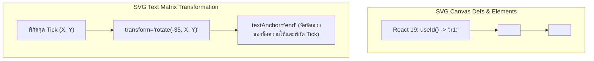

## 1. แนวคิด (Concept)

ชาร์ตที่มีประโยชน์ทางธุรกิจต้องมาพร้อมกับสุนทรียภาพและความสามารถในการอ่าน (Readability) **Recharts v3** อาศัยความเป็น SVG ทำให้เราสามารถปรับแต่งหน้าตากราฟได้อย่างอิสระเทียบเท่ากับการเขียน CSS:

1. **SVG Gradients & Visual Polish**:
   เพิ่มมิติให้แก่กราฟโดยเฉพาะ `<AreaChart>` ด้วยการประกาศแท็ก `<defs>` บรรจุ `<linearGradient>` เพื่อให้เกิดการไล่เฉดสีจากทึบด้านบนไปสู่โปร่งใสที่ก้นกราฟ
2. **ขอบมนและรูปทรงแท่ง Bar**:
   ควบคุมความโค้งมนของมุมแท่ง Bar ด้วย `radius={[top-left, top-right, bottom-right, bottom-left]}` เช่น `radius={[6, 6, 0, 0]}` เพื่อสร้างความรู้สึกโมเดิร์น ไม่แข็งกระด้าง
3. **Tick Formatter มาตรฐานสากล**:
   แปลงตัวเลขดิบ (Raw Numbers) ให้เป็นรูปแบบที่มนุษย์เข้าใจง่ายทันที เช่น สกุลเงินบาท (`฿`), ตัวเลขย่อขนาดกะทัดรัด (`1.2K`, `5.4M`) และวันที่ภาษาไทย ด้วย `Intl.NumberFormat` และ `Intl.DateTimeFormat`
4. **การจัดการข้อความและภาษาไทยบนแกน X (Typography & Rotation)**:
   เมื่อชื่อหมวดหมู่หรือเดือนเป็นภาษาไทยที่มีความยาวมาก การปล่อยให้แสดงผลแนวนอนจะทำให้ข้อความซ้อนทับกัน จึงต้องใช้เทคนิคการเอียงองศา (`angle={-30}`), จัดจุดยึด (`textAnchor="end"`) และควบคุมความถี่การแสดงผล (`interval={0}`)

---

## 2. หลักการเบื้องหลัง (Under the Hood)

### SVG Defs, Matrix Transform และปัญหา ID Collision



1. **SVG `<defs>` & LinearGradient ID Collision**:
   SVG Gradient ต้องถูกอ้างอิงผ่าน Attribute `fill="url(#myGradientId)"` หากหน้า Dashboard มีชาร์ตประเภทเดียวกันหลายตัวและใช้ ID แข็งทื่อเหมือนกัน (เช่น `id="colorRevenue"`) เบราว์เซอร์จะหยิบ Gradient ของตัวแรกใน DOM Tree มาใช้กับทุกชาร์ต ส่งผลให้ชาร์ตตัวหลังแสดงสีเพี้ยน ทางแก้ที่ปลอดภัยที่สุดใน React 19 คือการใช้ Hook `useId()` เพื่อสร้าง ID ที่ไม่ซ้ำกันอย่างแน่นอน
2. **Text Anchor & Bounding Box**:
   เมื่อสั่ง `angle={-35}` กับ SVG `<text>` เบราว์เซอร์จะหมุนข้อความรอบจุดกำเนิด (Origin) หากใช้ค่าเริ่มต้น `textAnchor="middle"` กึ่งกลางของข้อความจะอยู่ที่จุด Tick ส่งผลให้ส่วนหัวของข้อความพุ่งขึ้นไปทับเส้นแกนกราฟ การระบุ `textAnchor="end"` จะบังคับให้จุดสิ้นสุดของข้อความสัมผัสกับจุด Tick พอดี ทำให้อ่านได้สวยงามเป็นระเบียบ
3. **ประสิทธิภาพของ Intl API Caching**:
   การเรียก `new Intl.NumberFormat()` ภายในฟังก์ชัน `tickFormatter` ทุกครั้งจะสร้าง Garbage Collection มหาศาล เนื่องจากอินสแตนซ์ของ Intl มีต้นทุนในการคอมไพล์ Locale สูง จึงควรสร้างอินสแตนซ์ทิ้งไว้ระดับโมดูลหรือใช้ `useMemo`

---

## 3. ตัวอย่างโค้ด (TypeScript / TSX)

### ตัวอย่างที่ 1: กราฟรายได้ภาษาไทยพร้อม SVG Gradient แบบ Dynamic ID

ตัวอย่างนี้สาธิตการใช้ `useId()` สำหรับ Gradient, การจัดขอบมนแท่ง Bar, และการจัดรูปแบบวันที่ภาษาไทยร่วมกับสกุลเงินบาท

```tsx filename="components/analytics/LocalizedFinanceChart.tsx"
'use client';

import React, { useId, useMemo } from 'react';
import {
  ResponsiveContainer,
  AreaChart,
  Area,
  XAxis,
  YAxis,
  CartesianGrid,
  Tooltip,
} from 'recharts';

export interface DailyCashflow {
  dateIso: string; // เช่น "2026-10-01"
  inflow: number;
}

interface LocalizedFinanceChartProps {
  data: DailyCashflow[];
}

// สร้าง Intl Formatters ไว้นอก Component เพื่อป้องกันการสร้าง Object ซ้ำซ้อน
const thaiDateFormatter = new Intl.DateTimeFormat('th-TH', {
  day: 'numeric',
  month: 'short',
});

const currencyFormatter = new Intl.NumberFormat('th-TH', {
  style: 'currency',
  currency: 'THB',
  maximumFractionDigits: 0,
});

const compactBahtFormatter = (val: number) => {
  if (val >= 1_000_000) return `฿${(val / 1_000_000).toFixed(1)}M`;
  if (val >= 1_000) return `฿${(val / 1_000).toFixed(0)}K`;
  return `฿${val}`;
};

export function LocalizedFinanceChart({ data }: LocalizedFinanceChartProps) {
  // สร้าง Unique ID สำหรับ linearGradient ป้องกันปัญหา ID Collision
  const rawId = useId();
  const gradientId = `inflowGradient-${rawId.replace(/:/g, '')}`;

  return (
    <div className="w-full rounded-2xl border border-slate-200 bg-white p-6 shadow-sm dark:border-slate-800 dark:bg-slate-900">
      <div className="mb-4">
        <h3 className="text-base font-semibold text-slate-800 dark:text-slate-100">
          กระแสเงินสดรับรายวัน (Daily Cash Inflow)
        </h3>
        <p className="text-xs text-slate-500">
          แสดงการแปลงวันที่ตามปฏิทินไทยและระบบตัวเลขย่อ
        </p>
      </div>

      <div className="h-[320px] w-full">
        <ResponsiveContainer width="100%" height="100%">
          <AreaChart data={data} margin={{ top: 15, right: 15, left: 10, bottom: 25 }}>
            <defs>
              <linearGradient id={gradientId} x1="0" y1="0" x2="0" y2="1">
                <stop offset="5%" stopColor="#059669" stopOpacity={0.8} />
                <stop offset="95%" stopColor="#059669" stopOpacity={0.0} />
              </linearGradient>
            </defs>
            <CartesianGrid strokeDasharray="3 3" vertical={false} stroke="#f1f5f9" />
            <XAxis
              dataKey="dateIso"
              tickLine={false}
              axisLine={{ stroke: '#cbd5e1' }}
              tickFormatter={(str) => thaiDateFormatter.format(new Date(str))}
              tick={{ fontSize: 11, fill: '#64748b' }}
              dy={10}
            />
            <YAxis
              tickLine={false}
              axisLine={false}
              tickFormatter={compactBahtFormatter}
              tick={{ fontSize: 11, fill: '#64748b' }}
            />
            <Tooltip
              labelFormatter={(label) => `วันที่ ${thaiDateFormatter.format(new Date(label))}`}
              formatter={(val: any) => [currencyFormatter.format(Number(val)), 'เงินสดรับ']}
              contentStyle={{
                borderRadius: '8px',
                border: '1px solid #e2e8f0',
                backgroundColor: 'rgba(255, 255, 255, 0.95)',
                boxShadow: '0 4px 6px -1px rgba(0, 0, 0, 0.1)',
              }}
            />
            <Area
              type="monotone"
              dataKey="inflow"
              stroke="#059669"
              strokeWidth={2.5}
              fillOpacity={1}
              fill={`url(#${gradientId})`}
            />
          </AreaChart>
        </ResponsiveContainer>
      </div>
    </div>
  );
}
```

---

### ตัวอย่างที่ 2: กราฟแท่ง Bar ข้อมูลหนาแน่นพร้อม Label ภาษาไทยเอียง 35 องศา

แก้ปัญหาข้อความภาษาไทยยาวเบียดกัน ด้วยการหมุนมุมฉลากบนแกน X และปรับแต่งขอบมนของแท่ง

```tsx filename="components/analytics/HighDensityBranchBarChart.tsx"
'use client';

import React from 'react';
import {
  ResponsiveContainer,
  BarChart,
  Bar,
  XAxis,
  YAxis,
  CartesianGrid,
  Tooltip,
} from 'recharts';

export interface BranchSalesRecord {
  branchFullName: string;
  quarterlyRevenue: number;
}

interface HighDensityProps {
  records: BranchSalesRecord[];
}

export function HighDensityBranchBarChart({ records }: HighDensityProps) {
  return (
    <div className="w-full rounded-2xl border border-slate-200 bg-white p-6 shadow-sm dark:border-slate-800 dark:bg-slate-900">
      <div className="mb-4">
        <h3 className="text-base font-semibold text-slate-800 dark:text-slate-100">
          ยอดขายรายสาขาในเขตกรุงเทพและปริมณฑล
        </h3>
        <p className="text-xs text-slate-500">
          สาธิตการจัดวางฉลากภาษาไทยยาวด้วย `angle={-35}`, `textAnchor="end"` และ `interval={0}`
        </p>
      </div>

      <div className="h-[380px] w-full">
        <ResponsiveContainer width="100%" height="100%">
          <BarChart
            data={records}
            margin={{ top: 20, right: 20, left: 10, bottom: 65 }}
          >
            <CartesianGrid strokeDasharray="3 3" vertical={false} stroke="#f1f5f9" />
            <XAxis
              dataKey="branchFullName"
              interval={0} // แสดงครบทุก Label ห้ามเว้นข้าม
              angle={-35} // เอียงข้อความทวนเข็มนาฬิกา 35 องศา
              textAnchor="end" // ยึดปลายข้อความไว้ที่เส้น Tick
              dx={-4}
              dy={8}
              tickLine={false}
              tick={{ fontSize: 11, fill: '#475569' }}
            />
            <YAxis
              tickLine={false}
              axisLine={false}
              tickFormatter={(v) => `฿${(v / 1_000_000).toFixed(1)}M`}
              tick={{ fontSize: 11, fill: '#64748b' }}
            />
            <Tooltip
              formatter={(v: any) => [`฿${Number(v).toLocaleString()}`, 'ยอดขายสุทธิ']}
              contentStyle={{ borderRadius: '8px', border: '1px solid #e2e8f0' }}
            />
            <Bar
              dataKey="quarterlyRevenue"
              name="ยอดขาย"
              fill="#3b82f6"
              radius={[6, 6, 0, 0]} // ขอบมนเฉพาะมุมบนซ้ายและบนขวา
              maxBarSize={32}
            />
          </BarChart>
        </ResponsiveContainer>
      </div>
    </div>
  );
}
```

---

## 4. เทียบกับวิธีอื่น (Recharts vs Canvas/Chart.js/D3)

| การปรับแต่งสไตล์และฟอร์แมตเตอร์ | Recharts (SVG) | Chart.js (Canvas) | D3.js เพียวๆ |
| :--- | :--- | :--- | :--- |
| **การทำ Gradient ไล่เฉดสี** | ประกาศ `<linearGradient>` แบบ Declarative ใน JSX | ต้องเขียนฟังก์ชัน Canvas `ctx.createLinearGradient()` | ผูก DOM สร้าง `<defs>` และแท็ก `<stop>` ด้วย D3 Selection |
| **การหมุนข้อความบนแกน (Rotation)** | ใส่ Props `angle={-35} textAnchor="end"` | ตั้งค่า `minRotation: 35, maxRotation: 35` ในแกน | คำนวณ SVG Transform Attribute `transform="rotate(-35)"` |
| **ขอบมนแท่ง Bar** | ใส่ Array 4 ค่า: `radius={[6, 6, 0, 0]}` | ระบุ `borderRadius` เป็น Object หรือ Number | ต้องคำนวณ Path โค้งมนด้วย SVG Path Arc คำสั่ง `a` |
| **CSS Variables / Dark Mode** | ใช้ `fill="var(--chart-primary)"` ได้โดยตรง | อ่าน CSS Variable ไม่ได้ทันที ต้องดึงผ่าน `getComputedStyle()` | รองรับผ่าน CSS Attributes |

---

## 5. ผิด vs ถูก (Anti-patterns vs Best Practices)

### กรณีที่ 1: การตั้งชื่อ ID ซ้ำกันใน SVG LinearGradient

```tsx
// ❌ ผิด: กำหนด id แบบคงที่ เมื่อวางคอมโพเนนต์นี้ 2 ตัวในหน้าเดียวกัน Gradient จะตีกัน
export function BadAreaChart({ data }: { data: any[] }) {
  return (
    <AreaChart data={data}>
      <defs>
        <linearGradient id="areaGradient">
          <stop stopColor="#3b82f6" />
        </linearGradient>
      </defs>
      <Area fill="url(#areaGradient)" />
    </AreaChart>
  );
}
```

```tsx
// ✅ ถูก: ใช้ React 19 `useId()` เพื่อสร้าง ID ที่มีขอบเขตเฉพาะอินสแตนซ์
export function GoodAreaChart({ data }: { data: any[] }) {
  const uniqueId = useId();
  const gradId = `areaGrad-${uniqueId.replace(/:/g, '')}`;

  return (
    <AreaChart data={data}>
      <defs>
        <linearGradient id={gradId}>
          <stop stopColor="#3b82f6" />
        </linearGradient>
      </defs>
      <Area fill={`url(#${gradId})`} />
    </AreaChart>
  );
}
```

---

### กรณีที่ 2: เอียงข้อความแกน X ด้วย `angle` แต่ลืมใส่ `textAnchor="end"`

```tsx
// ❌ ผิด: เอียงข้อความโดยปล่อยให้ textAnchor เป็นค่าเริ่มต้น (middle)
// ผลลัพธ์: ข้อความจะหมุนรอบตรงกลาง ทำให้ตัวอักษรส่วนหัวลอยพาดทับเส้นแกนและตัวกราฟ
<XAxis dataKey="thaiName" angle={-35} />
```

```tsx
// ✅ ถูก: ระบุ textAnchor="end" พร้อมชดเชยระยะ dx / dy
<XAxis
  dataKey="thaiName"
  angle={-35}
  textAnchor="end"
  dx={-4}
  dy={6}
/>
```

---

## 6. ควรใช้เมื่อไหร่ / ไม่ควรใช้เมื่อไหร่

### ควรเอียงข้อความบนแกน X (`angle={-30}`) เมื่อ:
- ข้อมูลมีจำนวนรายการปานกลาง (8 - 15 จุด) และข้อความเป็นภาษาไทยที่มีความยาวมากกว่า 6-8 พยางค์
- จำเป็นต้องแสดงชื่อของทุกจุดข้อมูลโดยห้ามเว้นข้าม (`interval={0}`)

### ไม่ควรเอียงข้อความบนแกน X เมื่อ:
- มีข้อมูลมากกว่า 20 จุดขึ้นไป: การเอียงข้อความจะยังคงทำให้ตัวหนังสือเบียดกันจนอ่านไม่ได้ **ควรเปลี่ยนการจัดวางเป็น Horizontal BarChart (กราฟแท่งแนวนอน)** ที่มีแกน Y รองรับความสูงได้ไม่จำกัด
- สามารถตัดย่อข้อความได้: เช่น เปลี่ยนจาก "มกราคม" เป็น "ม.ค." หรือเปลี่ยนชื่อสาขาเต็มเป็นรหัสย่อสาขา

---

## 7. คำถามสัมภาษณ์งาน (Interview Questions)

### Q1: ในหน้า Dashboard ที่มีชาร์ตหลายตัว การใช้ SVG `<linearGradient>` มักเจอบั๊ก Gradient ID ทับซ้อนกัน (ID Collision) ปัญหานี้ส่งผลอย่างไร และมีวิธีแก้ไขที่ปลอดภัยใน Next.js 16 / React 19 อย่างไร?
**แนวทางคำตอบแบบ Senior**:
"ในมาตรฐาน SVG ตัวอ้างอิง `fill="url(#myId)"` ทำงานผ่านระบบ Global ID ของ DOM Tree หากคอมโพเนนต์ชาร์ต 2 ตัวมีแท็ก `<linearGradient id="primaryGrad">` ชาร์ตตัวที่สองจะถูกบังคับให้ใช้คำจำกัดความ Gradient ของตัวแรก ส่งผลให้สีเพี้ยนหรือทึบไปเลยเมื่อชาร์ตตัวแรกถูก Unmount ออกจากหน้าจอ

แนวทางแก้ไขใน React 19 / Next.js 16:
1. ใช้ Hook `useId()` ประจำตัวคอมโพเนนต์ เพื่อสร้าง Dynamic ID เช่น `const id = useId(); const gradId = \`chart-grad-\${id}\`;`
2. เนื่องจาก `useId()` ใน React มักคืนค่าที่มีเครื่องหมายโคลอน (เช่น `:r1:`) ซึ่งบางเบราว์เซอร์หรือเครื่องมือ SVG Selector อาจมีปัญหากับอักขระพิเศษ ควรทำ Sanitize สตริงเล็กน้อย เช่น `id.replace(/:/g, '')`
3. ผูก ID นั้นเข้ากับทั้ง `<linearGradient id={gradId}>` และ `<Area fill={\`url(#\${gradId})\`} />` เพื่อรับประกันว่าทุกชาร์ตจะมี Gradient Isolated ประจำตัวเอง 100%"

---

### Q2: เมื่อฉลากข้อความบนแกน X เป็นภาษาไทยและมีความยาวมาก หากกำหนด `angle={-35}` เพียงอย่างเดียว ตำแหน่งข้อความจะคลาดเคลื่อน ทำไมต้องระบุ `textAnchor="end"` ร่วมด้วย?
**แนวทางคำตอบแบบ Senior**:
"โดยปกติ SVG Text มีจุดอ้างอิงพิกัด (Anchor Point) ที่ควบคุมด้วยแอตทริบิวต์ `textAnchor` ซึ่งมีค่าเริ่มต้นคือ `start` หรือ `middle`:
- เมื่อกำหนด `textAnchor="middle"` จุดหมุน (Pivot Point) ของการ Transform `rotate(-35)` จะอยู่ที่กึ่งกลางกล่องข้อความ ทำให้เมื่อหมุนเอียงไป 35 องศา ครึ่งบนของข้อความจะดีดตัวขึ้นไปด้านบนและทับซ้อนกับเส้นแกน X รวมถึงแท่งกราฟด้านล่าง
- เมื่อเปลี่ยนเป็น `textAnchor="end"` จุดหมุนจะย้ายไปอยู่ที่ปลายขวาสุดของข้อความ (ท้ายประโยค) ทำให้ตัวอักษรทั้งหมดทอดตัวเอียงลงไปทางด้านล่างของแกน X อย่างเป็นระเบียบ และปลายข้อความจะแตะกับขีดแสดงจุด (Tick Line) พอดี โดยสามารถเพิ่ม `dx` และ `dy` อีกเล็กน้อยเพื่อเว้นระยะ Margin ให้สวยงามสมบูรณ์แบบ"
