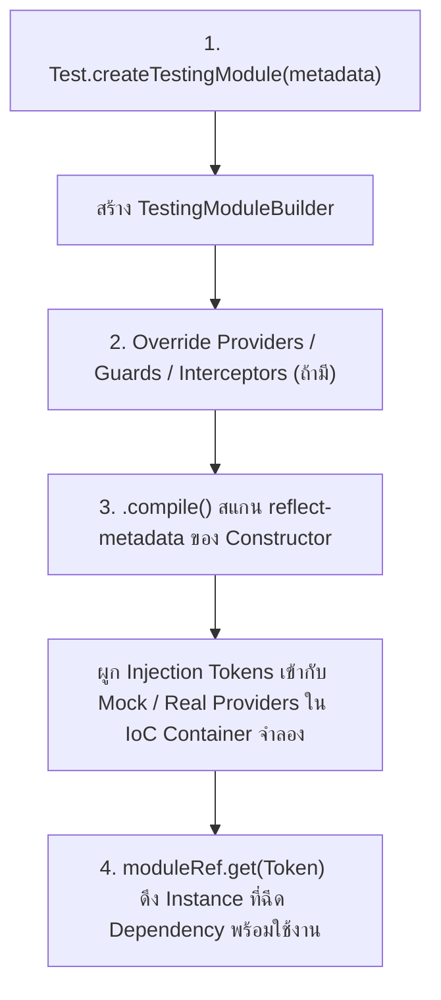
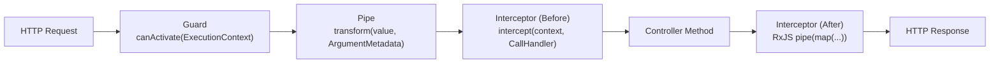
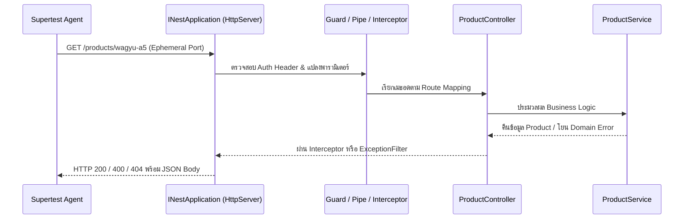
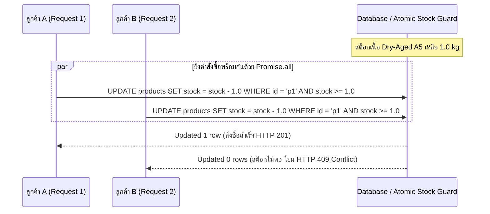

# Backend Testing

(สำหรับพื้นฐานแนวคิดการทดสอบซอฟต์แวร์และเครื่องมือ Jest สามารถศึกษาเพิ่มเติมได้ที่ [Testing Fundamentals](/docs/testing/fundamentals) และ [Jest](/docs/testing/jest) ส่วนการทดสอบฝั่งหน้าบ้านและแบบครบวงจรดูได้ที่ [Frontend Testing](/docs/testing/frontend-testing) และ [E2E Testing](/docs/testing/e2e-playwright))

<Callout type="tip" title="ความสำคัญของการทดสอบ Backend ระดับ Enterprise">
ในระบบอีคอมเมิร์ซจำหน่ายเนื้อพรีเมียมและเนื้อบ่มดรายเอจอย่าง Smart Butcher Marketplace เลเยอร์ Backend คือปราการด่านสุดท้ายที่ควบคุมความถูกต้องของสต็อกเนื้อวากิว การคำนวณราคาตามน้ำหนักจริง การตรวจสอบสิทธิ์เข้าถึงของช่างแล่เนื้อ (Butcher) และธุรกรรมการชำระเงิน การเขียนชุดทดสอบด้วย NestJS 11 Testing Module ร่วมกับ Jest และ Supertest ช่วยรับประกันว่าทุก Business Logic และ HTTP Contract จะทำงานได้อย่างแม่นยำภายใต้สภาวะโหลดสูงและไม่มีช่องโหว่ทางธุรกิจ
</Callout>

## สารบัญหัวข้อในหน้านี้

| ลำดับ | หัวข้อหลัก | เครื่องมือและเทคโนโลยีสำคัญ | เป้าหมายการทดสอบ |
| :--- | :--- | :--- | :--- |
| **1** | โครงสร้างการทดสอบใน NestJS 11 และ `Test.createTestingModule` | `@nestjs/testing`, IoC Container | สร้าง Isolated Module จำลอง Dependency Injection |
| **2** | การเขียน Unit Test สำหรับ Service โดยการ Mock `PrismaService` | `jest-mock-extended`, Custom Provider | ทดสอบตรรกะทางธุรกิจและ Transaction โดยไม่ต่อ DB จริง |
| **3** | การเขียน Unit Test สำหรับ Controller, Guard, Pipe และ Interceptor | `ExecutionContext`, `CallHandler`, RxJS `of` | ทดสอบ Request Pipeline, RBAC และการแปลงข้อมูล |
| **4** | การทำ Integration และ E2E Testing ด้วย Supertest | `supertest`, `INestApplication` | ทดสอบ HTTP Lifecycle ครบวงจรตั้งแต่ Routing ถึง Response |
| **5** | การทดสอบ Authentication Flow, DTO Validation และ Multer | `ValidationPipe`, JWT, `.attach()` | ทดสอบความปลอดภัย ข้อมูลขาเข้า และการอัปโหลดใบรับรองเนื้อ |
| **6** | การจัดการฐานข้อมูลเทสต์, Mock บริการภายนอก และ Race Condition | `Promise.allSettled`, Prisma Clean-up | ป้องกันการขายเนื้อเกินสต็อก (Overselling) และแยกสภาพแวดล้อม |

---

## 1. โครงสร้างการทดสอบใน NestJS 11 และการทำงานของ Test.createTestingModule

### แนวคิด (Concept)
สถาปัตยกรรมของ [NestJS](/docs/backend/nestjs) ขับเคลื่อนด้วยระบบ **Dependency Injection (DI)** และ **Inversion of Control (IoC) Container** ในการรันแอปพลิเคชันจริง NestJS จะอ่าน Metadata จาก `@Module()` เพื่อสร้างกราฟความสัมพันธ์ของ Providers ทั้งหมด แต่ในการเขียน Unit Test เราไม่ต้องการบูตระบบทั้งก้อน (ซึ่งอาจรวมถึงการเชื่อมต่อฐานข้อมูล PostgreSQL, Redis หรือระบบแจ้งเตือนภายนอก)

แพ็กเกจ `@nestjs/testing` จึงมอบคลาส `Test` และเมธอด `Test.createTestingModule()` เพื่อสร้าง **Isolated Testing Container** ขนาดจิ๋วที่จำลองการทำงานของ IoC Container เฉพาะส่วนที่เราต้องการทดสอบ ช่วยให้เราสามารถสับเปลี่ยน (Swap) Dependency จริงให้กลายเป็น Test Double (เช่น Mock หรือ Stub) ได้อย่างอิสระและมี Type Safety เต็มรูปแบบ

### หลักการเบื้องหลัง (Under the Hood)
เมื่อเรียกใช้งาน `Test.createTestingModule({ controllers, providers, imports }).compile()` กลไกภายในของ NestJS 11 จะทำงานตามลำดับดังนี้:



1. **Metadata Scanning:** ตัว `TestingModuleBuilder` จะอ่าน TypeScript Design-time Metadata (`design:paramtypes`) ที่ถูกสร้างโดย `emitDecoratorMetadata` เพื่อดูว่าคลาสเป้าหมายต้องการ Dependency อะไรบ้างใน Constructor
2. **Token Binding:** แทนที่จะใช้คลาสจริงทั้งหมด เราสามารถกำหนด Custom Provider ในรูปแบบ `{ provide: Token, useValue: mockObject }` หรือใช้เมธอด `.overrideProvider(Token).useValue(mockObject)` เพื่อบังคับให้ IoC Container จ่ายตัวจำลองเข้าไปแทน
3. **Compilation & Instantiation:** คำสั่ง `.compile()` จะทำการ Resolve Dependency Graph ทั้งหมดแบบ Asynchronous และคืนค่าเป็น `TestingModule` ซึ่งเราสามารถเรียก `.get<T>(Token)` เพื่อดึง Singleton Instance หรือ `.resolve<T>(Token)` สำหรับ Request-scoped / Transient Instance ออกมาทดสอบได้ทันที

### ตัวอย่างโค้ด (Smart Butcher Marketplace)

#### ตัวอย่างที่ 1 (พื้นฐาน): การสร้าง Testing Module สำหรับตรวจสอบราคาและเกรดเนื้อพรีเมียม
ตัวอย่างการสร้างชุดทดสอบระดับเริ่มต้นสำหรับ `MeatGradingService` โดยประกอบโมดูลทดสอบที่มีทั้งการดึงอินสแตนซ์และการแทนที่ค่าคอนฟิกด้วย `useValue`:

```typescript filename="src/products/meat-grading.service.spec.ts"
import { Test, TestingModule } from '@nestjs/testing';
import { Injectable, Inject } from '@nestjs/common';

export const GRADING_CONFIG_TOKEN = 'GRADING_CONFIG_TOKEN';

export interface GradingConfig {
  minWagyuBmsScore: number;
  maxDryAgeMoistureLossPercent: number;
}

export interface Product {
  id: string;
  sku: string;
  name: string;
  pricePerKg: number;
  bmsScore: number;
  dryAgedDays: number;
}

@Injectable()
export class MeatGradingService {
  constructor(
    @Inject(GRADING_CONFIG_TOKEN) private readonly config: GradingConfig,
  ) {}

  isAuthenticA5Wagyu(product: Product): boolean {
    return product.bmsScore >= this.config.minWagyuBmsScore && product.pricePerKg > 0;
  }

  calculateNetSellableWeightKg(rawWeightKg: number, dryAgedDays: number): number {
    if (rawWeightKg <= 0) {
      throw new Error('Raw weight must be greater than zero');
    }
    const dailyLossRate = 0.004; // สูญเสียความชื้นเฉลี่ย 0.4% ต่อวัน
    const totalLossPercent = Math.min(
      dryAgedDays * dailyLossRate * 100,
      this.config.maxDryAgeMoistureLossPercent,
    );
    const netWeight = rawWeightKg * (1 - totalLossPercent / 100);
    return Number(netWeight.toFixed(3));
  }
}

describe('MeatGradingService (TestingModule Fundamentals)', () => {
  let service: MeatGradingService;

  const mockGradingConfig: GradingConfig = {
    minWagyuBmsScore: 8, // มาตรฐาน A5 ต้องมี BMS ตั้งแต่ 8 ถึง 12
    maxDryAgeMoistureLossPercent: 25,
  };

  beforeEach(async () => {
    const moduleRef: TestingModule = await Test.createTestingModule({
      providers: [
        MeatGradingService,
        {
          provide: GRADING_CONFIG_TOKEN,
          useValue: mockGradingConfig,
        },
      ],
    }).compile();

    service = moduleRef.get<MeatGradingService>(MeatGradingService);
  });

  it('should return true when wagyu product has BMS score of 10 and valid price', () => {
    const miyazakiRibeye: Product = {
      id: 'prod-wagyu-01',
      sku: 'WAGYU-A5-RIB-01',
      name: 'Miyazaki A5 Ribeye',
      pricePerKg: 4800,
      bmsScore: 10,
      dryAgedDays: 0,
    };

    const result = service.isAuthenticA5Wagyu(miyazakiRibeye);

    expect(result).toBe(true);
  });

  it('should calculate net sellable weight after 30 days of dry-aging', () => {
    // 30 วัน * 0.4% = ลดลง 12% จาก 10.0 กก. เหลือ 8.8 กก.
    const netWeight = service.calculateNetSellableWeightKg(10.0, 30);

    expect(netWeight).toBeCloseTo(8.8, 3);
  });
});
```

#### ตัวอย่างที่ 2 (ขั้นสูง): การใช้ `.overrideProvider()` และ `.useMocker()` สำหรับโมดูลที่มี Dependency ซับซ้อน
เมื่อโมดูลมีการนำเข้า (Import) โมดูลย่อยอื่นๆ หรือใช้ Provider จำนวนมาก เราสามารถใช้ `.useMocker()` ของ NestJS 11 เพื่อสร้าง Auto-mock ให้กับทุก Token ที่ไม่ได้ระบุไว้โดยอัตโนมัติ และใช้ `.overrideProvider()` เพื่อกำหนดพฤติกรรมเฉพาะจุด:

```typescript filename="src/orders/order-pricing.module.spec.ts"
import { Test, TestingModule } from '@nestjs/testing';
import { Injectable, Module } from '@nestjs/common';

export interface ColdChainFeeCalculator {
  calculateChilledDeliveryFee(weightKg: number, province: string): Promise<number>;
}

export const COLD_CHAIN_CALCULATOR = 'COLD_CHAIN_CALCULATOR';

@Injectable()
export class VipDiscountProvider {
  getDiscountRate(userTier: 'STANDARD' | 'GOLD' | 'BUTCHER_PRO'): number {
    const rates = { STANDARD: 0, GOLD: 0.05, BUTCHER_PRO: 0.12 };
    return rates[userTier];
  }
}

@Injectable()
export class OrderSummaryService {
  constructor(
    private readonly discountProvider: VipDiscountProvider,
    private readonly gradingService: MeatGradingService,
  ) {}

  computeOrderTotal(
    product: Product,
    weightKg: number,
    userTier: 'STANDARD' | 'GOLD' | 'BUTCHER_PRO',
  ): { subtotal: number; discount: number; finalTotal: number } {
    const subtotal = product.pricePerKg * weightKg;
    const discountRate = this.discountProvider.getDiscountRate(userTier);
    const discount = Math.round(subtotal * discountRate);
    return {
      subtotal,
      discount,
      finalTotal: subtotal - discount,
    };
  }
}

@Module({
  providers: [
    VipDiscountProvider,
    MeatGradingService,
    OrderSummaryService,
    {
      provide: GRADING_CONFIG_TOKEN,
      useValue: { minWagyuBmsScore: 8, maxDryAgeMoistureLossPercent: 25 },
    },
  ],
  exports: [OrderSummaryService],
})
export class OrderPricingModule {}

describe('OrderPricingModule with overrideProvider & useMocker', () => {
  let orderSummaryService: OrderSummaryService;

  beforeEach(async () => {
    const moduleRef: TestingModule = await Test.createTestingModule({
      imports: [OrderPricingModule],
    })
      .overrideProvider(VipDiscountProvider)
      .useValue({
        // จำลองโปรโมชันพิเศษลด 20% สำหรับทุก Tier ในช่วงเทศกาลสเต็ก
        getDiscountRate: jest.fn().mockReturnValue(0.2),
      })
      .useMocker((token) => {
        if (token === COLD_CHAIN_CALCULATOR) {
          return {
            calculateChilledDeliveryFee: jest.fn().mockResolvedValue(150),
          };
        }
        return undefined;
      })
      .compile();

    orderSummaryService = moduleRef.get<OrderSummaryService>(OrderSummaryService);
  });

  it('should apply overridden 20% festival discount rate to wagyu order total', () => {
    const kobeStriploin: Product = {
      id: 'prod-kobe-02',
      sku: 'KOBE-A5-STR-02',
      name: 'Kobe A5 Striploin',
      pricePerKg: 6000,
      bmsScore: 11,
      dryAgedDays: 0,
    };

    const summary = orderSummaryService.computeOrderTotal(kobeStriploin, 1.5, 'STANDARD');

    expect(summary.subtotal).toBe(9000);
    expect(summary.discount).toBe(1800);
    expect(summary.finalTotal).toBe(7200);
  });
});
```

### ผิด vs ถูก (Anti-pattern vs Best Practice)

| มิติการเปรียบเทียบ | ❌ ผิด (Anti-pattern) | ✅ ถูก (Best Practice) |
| :--- | :--- | :--- |
| **การ Import Module ใน Unit Test** | สั่ง `imports: [AppModule]` ใน Unit Test ทุกไฟล์ ทำให้ต้องต่อ Database และโหลดทุก Controller จนเทสต์ช้ามาก | ลงทะเบียนเฉพาะคลาสเป้าหมายใน `providers: [TargetService, MockDep]` เพื่อให้คอมไพล์เสร็จในระดับมิลลิวินาที |
| **การจัดการ Scoped Providers** | ใช้ `moduleRef.get()` ดึง Provider ที่ตั้งค่าเป็น `Scope.REQUEST` แล้วเกิดข้อผิดพลาดดึงอินสแตนซ์ไม่ได้ | ใช้ `await moduleRef.resolve(ScopedService)` สำหรับ Request-scoped หรือ Transient-scoped Providers เสมอ |
| **การสร้าง Instance โดยไม่จำเป็น** | บูต `Test.createTestingModule` ใหม่แม้แต่กับ Pure Utility Class ที่ไม่มี Decorator หรือ DI ซับซ้อน | หากคลาสมี Dependency ที่จัดการผ่าน DI ให้ใช้ `Test.createTestingModule` แต่ต้องล้างสถานะ Mock ใน `beforeEach` เสมอ |

### ควรใช้เมื่อไหร่ และ ไม่ควรใช้เมื่อไหร่
- **ควรใช้เมื่อ:** ทดสอบ Service, Controller, Guard หรือ Provider ที่พึ่งพาระบบ Dependency Injection ของ NestJS, มีการใช้ Custom Injection Tokens (`@Inject()`) หรือต้องการทดสอบการทำงานร่วมกันของ Provider ภายใน Module ย่อย
- **ไม่ควรใช้เมื่อ:** ทดสอบ Pure Helper Functions เช่น ฟังก์ชันแปลงหน่วยน้ำหนักกรัมเป็นกิโลกรัม หรือ Domain Logic ที่ไม่มี Dependency ภายนอก ซึ่งสามารถเรียกฟังก์ชันทดสอบด้วย Jest ได้โดยตรงโดยไม่ต้องเสียเวลาสร้าง IoC Container

### คำถามสัมภาษณ์ (Interview Q&A)
- **Q1: ใน `@nestjs/testing` เมธอด `moduleRef.get()` แตกต่างจาก `moduleRef.resolve()` อย่างไร และเมื่อไหร่ที่จำเป็นต้องใช้ `resolve()`?**
  - *แนวคำตอบ:* `moduleRef.get()` เป็นเมธอดแบบ Synchronous ที่ใช้ดึง Singleton Instance ที่ถูกสร้างและเก็บแคชไว้ใน IoC Container ตอนสั่ง `.compile()` ส่วน `moduleRef.resolve()` เป็นเมธอดแบบ Asynchronous ที่จะสร้าง Instance ใหม่จาก Dependency Tree เฉพาะสำหรับ Context นั้นๆ เราจำเป็นต้องใช้ `resolve()` เมื่อ Provider เป้าหมายถูกกำหนดด้วย `@Injectable({ scope: Scope.REQUEST })` หรือ `Scope.TRANSIENT` เพราะอินสแตนซ์เหล่านี้ไม่ได้ถูกสร้างไว้ล่วงหน้าในระดับ Global Container
- **Q2: หากลืมใส่ `await` หน้า `Test.createTestingModule(...).compile()` จะเกิดอะไรขึ้นในขั้นตอนรันเทสต์?**
  - *แนวคำตอบ:* เมธอด `.compile()` คืนค่าเป็น `Promise<TestingModule>` เนื่องจาก NestJS ต้องรองรับ Async Providers (`useFactory: async () => ...`) หากลืม `await` ตัวแปร `moduleRef` จะมีค่าเป็น Promise ที่ยัง Pending อยู่และไม่มีเมธอด `.get()` ทำให้เกิด `TypeError: moduleRef.get is not a function` ทันทีที่รัน `beforeEach`

---

## 2. การเขียน Unit Test สำหรับ Service โดยการ Mock PrismaService

### แนวคิด (Concept)
ในระบบที่ใช้ [Prisma ORM](/docs/backend/prisma-orm) เป็น Data Access Layer ตัว `PrismaService` จะทำหน้าที่เชื่อมต่อกับฐานข้อมูลจริง ในการเขียน **Unit Test** สำหรับ Business Service (เช่น `ProductService` หรือ `OrderService`) เป้าหมายของเราคือการพิสูจน์ว่า **"ตรรกะทางธุรกิจ เงื่อนไขการตรวจสอบ และการจัดการข้อผิดพลาดในโค้ดทำงานถูกต้องหรือไม่"** โดยไม่ต้องการให้เกิด Network I/O ไปยังฐานข้อมูลจริง

การ Mock `PrismaService` ช่วยให้เราสามารถจำลองสถานการณ์ทุกรูปแบบได้ทันที เช่น กรณีไม่พบสินค้า (`null`), กรณีสต็อกเนื้อดรายเอจไม่เพียงพอ, กรณีเกิดข้อผิดพลาด Unique Constraint (`P2002`) หรือการทดสอบ Interactive Transactions (`prisma.$transaction`) โดยที่เทสต์นับร้อยข้อสามารถรันจบได้ภายในเวลาไม่ถึง 1 วินาที

### หลักการเบื้องหลัง (Under the Hood)
`PrismaClient` มีโครงสร้าง Type ที่ซับซ้อนและซ้อนทับกันหลายชั้น (Nested Delegates เช่น `prisma.product.findUnique`, `prisma.order.create`, `prisma.$transaction`) การสร้าง Object Mock ด้วยมือเปล่า (`{ product: { findUnique: jest.fn() } }`) มักทำให้สูญเสีย Type Safety หรือเกิดปัญหา Type ไม่ตรงกับ Prisma Schema

ด้วยเหตุนี้ แนวทางมาตรฐานระดับ Enterprise คือการใช้ไลบรารี `jest-mock-extended` (`mockDeep<PrismaService>()`) ซึ่งทำงานด้วยกลไก **Recursive ES6 Proxy**:
1. เมื่อโค้ดเข้าถึง Property ใดๆ ของ `PrismaService` ไม่ว่าจะลึกกี่ระดับ (เช่น `prisma.orderItem.findMany`) ตัว Proxy จะดักจับ (Trap `get`) และสร้าง `jest.fn()` ให้อัตโนมัติแบบ Lazy Instantiation
2. มอบ Type `DeepMockProxy<PrismaService>` ที่คงชนิดข้อมูลของ Argument และค่า Return ตามที่ระบุใน `schema.prisma` ทุกประการ หากนักพัฒนาเปลี่ยนชื่อฟิลด์ในฐานข้อมูล โค้ดในไฟล์เทสต์จะแจ้งเตือน Type Error ทันที

### ตัวอย่างโค้ด (Smart Butcher Marketplace)

#### ตัวอย่างที่ 1 (พื้นฐาน): การทดสอบ `ProductService` (ค้นหาเนื้อพรีเมียมและตรวจสอบราคาติดลบ)
ตัวอย่างการใช้ `DeepMockProxy<PrismaService>` เพื่อทดสอบการดึงข้อมูลเนื้อวากิวและการดักจับ Business Exception เมื่อตั้งราคาหรือสต็อกไม่ถูกต้อง:

```typescript filename="src/products/product.service.spec.ts"
import { Test, TestingModule } from '@nestjs/testing';
import { Injectable, NotFoundException, BadRequestException } from '@nestjs/common';
import { mockDeep, DeepMockProxy } from 'jest-mock-extended';

// จำลองโครงสร้างจาก Prisma Client สำหรับโดเมน Smart Butcher Marketplace
export interface CategoryEntity {
  id: string;
  name: string;
  slug: string;
}

export interface ProductEntity {
  id: string;
  sku: string;
  name: string;
  categoryId: string;
  pricePerKg: number;
  stockKg: number;
  isDryAged: boolean;
  dryAgedDays: number;
}

export class PrismaService {
  product!: {
    findUnique: (args: { where: { id?: string; sku?: string } }) => Promise<ProductEntity | null>;
    create: (args: { data: Omit<ProductEntity, 'id'> }) => Promise<ProductEntity>;
    update: (args: { where: { id: string }; data: Partial<ProductEntity> }) => Promise<ProductEntity>;
  };
  $transaction!: <T>(fn: (tx: PrismaService) => Promise<T>) => Promise<T>;
}

@Injectable()
export class ProductService {
  constructor(private readonly prisma: PrismaService) {}

  async getProductById(id: string): Promise<ProductEntity> {
    const product = await this.prisma.product.findUnique({ where: { id } });
    if (!product) {
      throw new NotFoundException(`Butcher cut with ID ${id} was not found`);
    }
    return product;
  }

  async createPremiumCut(data: Omit<ProductEntity, 'id'>): Promise<ProductEntity> {
    if (data.pricePerKg <= 0) {
      throw new BadRequestException('Wagyu price per kg must be greater than zero');
    }
    if (data.isDryAged && data.dryAgedDays < 14) {
      throw new BadRequestException('Dry-aged beef requires a minimum aging period of 14 days');
    }

    const existingSku = await this.prisma.product.findUnique({ where: { sku: data.sku } });
    if (existingSku) {
      throw new BadRequestException(`SKU ${data.sku} already exists in inventory`);
    }

    return this.prisma.product.create({ data });
  }
}

describe('ProductService (Unit Test with Mocked PrismaService)', () => {
  let service: ProductService;
  let prismaMock: DeepMockProxy<PrismaService>;

  beforeEach(async () => {
    prismaMock = mockDeep<PrismaService>();

    const moduleRef: TestingModule = await Test.createTestingModule({
      providers: [
        ProductService,
        {
          provide: PrismaService,
          useValue: prismaMock,
        },
      ],
    }).compile();

    service = moduleRef.get<ProductService>(ProductService);
  });

  it('should return product entity when valid wagyu cut ID exists', async () => {
    const mockRibeye: ProductEntity = {
      id: 'prod-001',
      sku: 'WAGYU-RIB-45D',
      name: '45-Day Dry-Aged Miyazaki A5 Ribeye',
      categoryId: 'cat-dry-aged',
      pricePerKg: 5200,
      stockKg: 12.5,
      isDryAged: true,
      dryAgedDays: 45,
    };

    prismaMock.product.findUnique.mockResolvedValue(mockRibeye);

    const result = await service.getProductById('prod-001');

    expect(result).toEqual(mockRibeye);
    expect(prismaMock.product.findUnique).toHaveBeenCalledWith({
      where: { id: 'prod-001' },
    });
  });

  it('should throw NotFoundException when product ID does not exist', async () => {
    prismaMock.product.findUnique.mockResolvedValue(null);

    await expect(service.getProductById('prod-non-existent')).rejects.toThrow(
      NotFoundException,
    );
  });

  it('should throw BadRequestException when wagyu price is negative or zero', async () => {
    await expect(
      service.createPremiumCut({
        sku: 'WAGYU-ERR-01',
        name: 'Invalid Price Wagyu',
        categoryId: 'cat-wagyu',
        pricePerKg: -500,
        stockKg: 5.0,
        isDryAged: false,
        dryAgedDays: 0,
      }),
    ).rejects.toThrow('Wagyu price per kg must be greater than zero');

    expect(prismaMock.product.create).not.toHaveBeenCalled();
  });
});
```

#### ตัวอย่างที่ 2 (ขั้นสูง): การจำลอง Interactive Transaction (`prisma.$transaction`) สำหรับระบบสั่งซื้อและตัดสต็อกเนื้อ
ในการสั่งซื้อเนื้อสเต็ก ระบบต้องตรวจสอบสต็อก ตัดสต็อก สร้าง `Order` พร้อม `OrderItem` และบันทึก `Payment` ภายใน Database Transaction เดียวกัน เราสามารถจำลอง `prisma.$transaction` ให้ส่ง `prismaMock` ตัวเดิมเข้าไปเป็น Transaction Client (`tx`) ได้ดังนี้:

```typescript filename="src/orders/order-transaction.service.spec.ts"
import { Test, TestingModule } from '@nestjs/testing';
import { Injectable, ConflictException } from '@nestjs/common';
import { mockDeep, DeepMockProxy } from 'jest-mock-extended';

export interface OrderItemEntity {
  id: string;
  orderId: string;
  productId: string;
  weightKg: number;
  unitPrice: number;
  subtotal: number;
}

export interface OrderEntity {
  id: string;
  userId: string;
  totalAmount: number;
  status: 'PENDING_PAYMENT' | 'PAID' | 'CANCELLED';
}

export interface PaymentEntity {
  id: string;
  orderId: string;
  amount: number;
  method: 'PROMPTPAY' | 'CREDIT_CARD';
  status: 'COMPLETED' | 'FAILED';
}

export class ButcherPrismaService {
  product!: {
    findUnique: (args: { where: { id: string } }) => Promise<{ id: string; stockKg: number; pricePerKg: number } | null>;
    update: (args: { where: { id: string }; data: { stockKg: { decrement: number } } }) => Promise<{ id: string; stockKg: number }>;
  };
  order!: {
    create: (args: { data: { userId: string; totalAmount: number; status: OrderEntity['status'] } }) => Promise<OrderEntity>;
  };
  orderItem!: {
    create: (args: { data: Omit<OrderItemEntity, 'id'> }) => Promise<OrderItemEntity>;
  };
  payment!: {
    create: (args: { data: Omit<PaymentEntity, 'id'> }) => Promise<PaymentEntity>;
  };
  $transaction!: <T>(callback: (tx: ButcherPrismaService) => Promise<T>) => Promise<T>;
}

@Injectable()
export class ButcherOrderService {
  constructor(private readonly prisma: ButcherPrismaService) {}

  async placeButcherOrder(
    userId: string,
    productId: string,
    requestedWeightKg: number,
    paymentMethod: 'PROMPTPAY' | 'CREDIT_CARD',
  ): Promise<{ order: OrderEntity; payment: PaymentEntity }> {
    return this.prisma.$transaction(async (tx) => {
      const product = await tx.product.findUnique({ where: { id: productId } });
      if (!product || product.stockKg < requestedWeightKg) {
        throw new ConflictException('Insufficient dry-aged beef stock for requested weight');
      }

      await tx.product.update({
        where: { id: productId },
        data: { stockKg: { decrement: requestedWeightKg } },
      });

      const totalAmount = Math.round(product.pricePerKg * requestedWeightKg);

      const order = await tx.order.create({
        data: {
          userId,
          totalAmount,
          status: 'PAID',
        },
      });

      await tx.orderItem.create({
        data: {
          orderId: order.id,
          productId,
          weightKg: requestedWeightKg,
          unitPrice: product.pricePerKg,
          subtotal: totalAmount,
        },
      });

      const payment = await tx.payment.create({
        data: {
          orderId: order.id,
          amount: totalAmount,
          method: paymentMethod,
          status: 'COMPLETED',
        },
      });

      return { order, payment };
    });
  }
}

describe('ButcherOrderService (Interactive Transaction Unit Test)', () => {
  let service: ButcherOrderService;
  let prismaMock: DeepMockProxy<ButcherPrismaService>;

  beforeEach(async () => {
    prismaMock = mockDeep<ButcherPrismaService>();

    // กำหนดให้ $transaction รัน Callback โดยส่ง prismaMock เข้าไปเป็น tx
    prismaMock.$transaction.mockImplementation(async (callback) => {
      return callback(prismaMock);
    });

    const moduleRef: TestingModule = await Test.createTestingModule({
      providers: [
        ButcherOrderService,
        { provide: ButcherPrismaService, useValue: prismaMock },
      ],
    }).compile();

    service = moduleRef.get<ButcherOrderService>(ButcherOrderService);
  });

  it('should deduct stock, create order, order item, and payment inside transaction when stock is sufficient', async () => {
    prismaMock.product.findUnique.mockResolvedValue({
      id: 'prod-tomahawk-01',
      stockKg: 5.0,
      pricePerKg: 3200,
    });
    prismaMock.product.update.mockResolvedValue({
      id: 'prod-tomahawk-01',
      stockKg: 3.5,
    });
    prismaMock.order.create.mockResolvedValue({
      id: 'ord-9001',
      userId: 'user-cust-01',
      totalAmount: 4800,
      status: 'PAID',
    });
    prismaMock.orderItem.create.mockResolvedValue({
      id: 'item-1',
      orderId: 'ord-9001',
      productId: 'prod-tomahawk-01',
      weightKg: 1.5,
      unitPrice: 3200,
      subtotal: 4800,
    });
    prismaMock.payment.create.mockResolvedValue({
      id: 'pay-501',
      orderId: 'ord-9001',
      amount: 4800,
      method: 'PROMPTPAY',
      status: 'COMPLETED',
    });

    const result = await service.placeButcherOrder(
      'user-cust-01',
      'prod-tomahawk-01',
      1.5,
      'PROMPTPAY',
    );

    expect(result.order.totalAmount).toBe(4800);
    expect(result.payment.status).toBe('COMPLETED');
    expect(prismaMock.product.update).toHaveBeenCalledWith({
      where: { id: 'prod-tomahawk-01' },
      data: { stockKg: { decrement: 1.5 } },
    });
  });

  it('should abort order creation and throw ConflictException when requested weight exceeds available stock', async () => {
    prismaMock.product.findUnique.mockResolvedValue({
      id: 'prod-tomahawk-01',
      stockKg: 0.8, // เหลือเพียง 0.8 กก. แต่ลูกค้าสั่ง 2.0 กก.
      pricePerKg: 3200,
    });

    await expect(
      service.placeButcherOrder('user-cust-01', 'prod-tomahawk-01', 2.0, 'CREDIT_CARD'),
    ).rejects.toThrow(ConflictException);

    // ยืนยันว่าไม่มีการตัดสต็อกหรือสร้างคำสั่งซื้อเกิดขึ้น
    expect(prismaMock.product.update).not.toHaveBeenCalled();
    expect(prismaMock.order.create).not.toHaveBeenCalled();
  });
});
```

### ผิด vs ถูก (Anti-pattern vs Best Practice)

| มิติการเปรียบเทียบ | ❌ ผิด (Anti-pattern) | ✅ ถูก (Best Practice) |
| :--- | :--- | :--- |
| **การตรวจสอบ Query ของ Prisma** | ยืนยันแค่ว่า `expect(prisma.product.update).toHaveBeenCalled()` โดยไม่ตรวจพารามิเตอร์ `where` และ `data` | ตรวจสอบว่า `where` และค่า `decrement` ถูกส่งเข้าไปด้วยตัวเลขที่คำนวณถูกต้องหรือไม่เพื่อป้องกันบั๊กตัดสต็อกผิดชิ้น |
| **การสร้าง Mock Prisma** | ใช้ `as any` กับ Object เปล่า เช่น `{ product: { findMany: jest.fn() } } as any` จนหลุด Type Check | ใช้ `mockDeep<PrismaService>()` จาก `jest-mock-extended` เพื่อรักษา Strict Type Safety ตาม Schema |
| **ความคาดหวังต่อ Constraint ของ DB** | คิดว่า `prismaMock` จะโยน Foreign Key Error หรือ Unique Error ออกมาเองอัตโนมัติ | จำลองการโยน `PrismaClientKnownRequestError` ด้วย `mockRejectedValueOnce` เมื่อต้องการทดสอบการจัดการ Error ของ Service |

### ควรใช้เมื่อไหร่ และ ไม่ควรใช้เมื่อไหร่
- **ควรใช้เมื่อ:** ทดสอบตรรกะการคำนวณราคา การตรวจสอบเงื่อนไขทางธุรกิจ (Business Rules) การแยกกิ่งเงื่อนไข (Branching Logic) และการจัดการ Exception ภายใน Service ที่ต้องการความเร็วสูง
- **ไม่ควรใช้เมื่อ:** ต้องการพิสูจน์ว่า Raw SQL (`prisma.$queryRaw`), Complex Relational Filtering, Database Triggers หรือ Index Constraint บน PostgreSQL ทำงานถูกต้องจริง กรณีเหล่านั้นต้องทดสอบด้วย Integration Test ที่เชื่อมต่อ Test Database จริง

### คำถามสัมภาษณ์ (Interview Q&A)
- **Q1: การจำลอง `PrismaService` ด้วย `mockDeep` มีข้อจำกัดอะไรที่ Unit Test ไม่สามารถตรวจพบได้?**
  - *แนวคำตอบ:* `mockDeep` เพียงแค่คืนค่าตามที่เราสั่งใน `mockResolvedValue` โดยไม่ได้ประมวลผลคำสั่งคิวรีกับเครื่องยนต์ฐานข้อมูลจริง ดังนั้นมันจะไม่สามารถตรวจพบข้อผิดพลาดระดับฐานข้อมูลได้ เช่น เงื่อนไข `where` ที่เขียนตรรกะผิดแต่ Type ถูก, การเกิด Deadlock, การละเมิด Foreign Key Constraint หรือการที่ Transaction ไม่ได้ Rollback จริงเมื่อเกิด Unhandled Error นอกบล็อก จึงต้องมี E2E / Integration Test คอยประกบเสมอ
- **Q2: เราจะจำลองการเกิด Unique Constraint Violation (รหัส `P2002` เช่น SKU เนื้อซ้ำ) ใน Unit Test ของ Prisma ได้อย่างไร?**
  - *แนวคำตอบ:* สร้างอินสแตนซ์ของ `Prisma.PrismaClientKnownRequestError` เช่น `new Prisma.PrismaClientKnownRequestError('Unique constraint failed on the fields: (sku)', { code: 'P2002', clientVersion: '6.0.0', meta: { target: ['sku'] } })` แล้วสั่ง `prismaMock.product.create.mockRejectedValueOnce(error)` เพื่อทดสอบว่า Service แปลง Error ดังกล่าวเป็น `ConflictException` (HTTP 409) ได้อย่างถูกต้อง

---

## 3. การเขียน Unit Test สำหรับ Controller, Guard, Pipe และ Interceptor

### แนวคิด (Concept)
ในสถาปัตยกรรมของ NestJS 11 ก่อนที่ HTTP Request จะเดินทางไปถึง Business Service และส่งกลับออกไปเป็น Response จะต้องไหลผ่านไปป์ไลน์สำคัญ 4 ด่าน ได้แก่:
1. **Guard:** ด่านตรวจสิทธิ์ (เช่น ตรวจสอบว่าผู้ใช้มี Role เป็น `BUTCHER` หรือ `ADMIN` หรือไม่)
2. **Pipe:** ด่านตรวจสอบและแปลงข้อมูลขาเข้า (เช่น แปลงรหัส SKU ให้เป็นตัวพิมพ์ใหญ่และตรวจสอบรูปแบบ)
3. **Controller:** ด่านรับพารามิเตอร์และกระจายงานไปยัง Service
4. **Interceptor:** ด่านครอบการทำงานก่อนและหลัง Controller ด้วย RxJS Observable (เช่น ห่อหุ้ม Response ด้วยรูปแบบมาตรฐาน หรือบันทึกเวลาประมวลผล)

การเขียน Unit Test แยกแต่ละชิ้นส่วนช่วยให้เราทดสอบ Edge Cases ของ Guard, Pipe และ Interceptor ได้อย่างครบถ้วนโดยไม่ต้องยิง HTTP Request จริงทุกครั้ง

### หลักการเบื้องหลัง (Under the Hood)


- **`ExecutionContext`:** ทั้ง Guard และ Interceptor รับอาร์กิวเมนต์เป็น `ExecutionContext` ซึ่งเป็น Wrapper ที่ช่วยดึงข้อมูลผ่าน `context.switchToHttp().getRequest()` และ `Reflector` สำหรับอ่าน Custom Metadata (เช่น `@Roles('BUTCHER')`) ในการเขียนเทสต์ เราสามารถสร้าง Helper จำลอง `ExecutionContext` และ Mock `Reflector` ได้โดยตรง
- **`CallHandler` และ RxJS:** เมธอด `intercept(context, next: CallHandler)` ของ Interceptor กำหนดให้ `next.handle()` คืนค่าเป็น RxJS `Observable` ในการเขียน Unit Test เราจึงใช้ฟังก์ชัน `of(mockResponse)` จาก `rxjs` เพื่อจำลองค่าที่ส่งกลับมาจาก Controller และใช้ `lastValueFrom()` เพื่อแกะผลลัพธ์จาก Observable มาทำ Assertion

### ตัวอย่างโค้ด (Smart Butcher Marketplace)

#### ตัวอย่างที่ 1 (พื้นฐาน): การเขียน Unit Test สำหรับ `ButcherRoleGuard` และ `SkuNormalizationPipe`
การทดสอบ Guard ที่ตรวจสิทธิ์ช่างแล่เนื้อ (`BUTCHER`) คู่กับ `Reflector` และ Pipe ที่จัดรูปแบบรหัส SKU เนื้อพรีเมียม:

```typescript filename="src/common/guards-and-pipes.spec.ts"
import {
  CanActivate,
  ExecutionContext,
  Injectable,
  ForbiddenException,
  PipeTransform,
  BadRequestException,
} from '@nestjs/common';
import { Reflector } from '@nestjs/core';
import { createMock } from '@golevelup/ts-jest';

export type UserRole = 'CUSTOMER' | 'BUTCHER' | 'ADMIN';

@Injectable()
export class ButcherRoleGuard implements CanActivate {
  constructor(private readonly reflector: Reflector) {}

  canActivate(context: ExecutionContext): boolean {
    const requiredRoles = this.reflector.getAllAndOverride<UserRole[]>('roles', [
      context.getHandler(),
      context.getClass(),
    ]);

    if (!requiredRoles || requiredRoles.length === 0) {
      return true;
    }

    const request = context.switchToHttp().getRequest<{
      user?: { id: string; role: UserRole };
    }>();

    if (!request.user || !requiredRoles.includes(request.user.role)) {
      throw new ForbiddenException('Access restricted to certified Smart Butchers only');
    }

    return true;
  }
}

@Injectable()
export class SkuNormalizationPipe implements PipeTransform<string, string> {
  transform(value: string): string {
    const normalized = value.trim().toUpperCase();
    // รูปแบบ SKU ต้องขึ้นต้นด้วย WAGYU-, DRYAGED- หรือ PRIME-
    const validSkuRegex = /^(WAGYU|DRYAGED|PRIME)-[A-Z0-9]{3,10}$/;
    if (!validSkuRegex.test(normalized)) {
      throw new BadRequestException(`Invalid butcher SKU format: ${value}`);
    }
    return normalized;
  }
}

describe('ButcherRoleGuard & SkuNormalizationPipe Unit Tests', () => {
  let guard: ButcherRoleGuard;
  let reflector: Reflector;
  let skuPipe: SkuNormalizationPipe;

  beforeEach(() => {
    reflector = new Reflector();
    guard = new ButcherRoleGuard(reflector);
    skuPipe = new SkuNormalizationPipe();
  });

  describe('ButcherRoleGuard', () => {
    it('should allow access when route requires BUTCHER role and user is a BUTCHER', () => {
      jest.spyOn(reflector, 'getAllAndOverride').mockReturnValue(['BUTCHER', 'ADMIN']);

      const mockContext = createMock<ExecutionContext>({
        switchToHttp: () => ({
          getRequest: () => ({
            user: { id: 'user-butcher-09', role: 'BUTCHER' as UserRole },
          }),
        }),
      });

      expect(guard.canActivate(mockContext)).toBe(true);
    });

    it('should throw ForbiddenException when CUSTOMER attempts to access BUTCHER endpoint', () => {
      jest.spyOn(reflector, 'getAllAndOverride').mockReturnValue(['BUTCHER']);

      const mockContext = createMock<ExecutionContext>({
        switchToHttp: () => ({
          getRequest: () => ({
            user: { id: 'user-cust-01', role: 'CUSTOMER' as UserRole },
          }),
        }),
      });

      expect(() => guard.canActivate(mockContext)).toThrow(ForbiddenException);
    });
  });

  describe('SkuNormalizationPipe', () => {
    it('should trim whitespace and convert valid lowercase wagyu SKU to uppercase', () => {
      const result = skuPipe.transform('  wagyu-a5rib01 ');
      expect(result).toBe('WAGYU-A5RIB01');
    });

    it('should throw BadRequestException when SKU prefix does not match butcher catalog rules', () => {
      expect(() => skuPipe.transform('PORK-BELLY01')).toThrow(BadRequestException);
    });
  });
});
```

#### ตัวอย่างที่ 2 (ขั้นสูง): การเขียน Unit Test สำหรับ `OrderController` และ `ColdChainResponseInterceptor`
การทดสอบ Controller ที่เรียก Service และการทดสอบ Interceptor ที่แนบข้อมูลการควบคุมอุณหภูมิความเย็น (Cold-chain Metadata) ลงใน Response ของคำสั่งซื้อเนื้อสด:

```typescript filename="src/orders/order-controller-interceptor.spec.ts"
import {
  Controller,
  Post,
  Body,
  Injectable,
  NestInterceptor,
  ExecutionContext,
  CallHandler,
} from '@nestjs/common';
import { Test, TestingModule } from '@nestjs/testing';
import { Observable, of, lastValueFrom } from 'rxjs';
import { map } from 'rxjs/operators';
import { createMock } from '@golevelup/ts-jest';

export interface CreateOrderDto {
  userId: string;
  productId: string;
  weightKg: number;
}

export interface OrderResponse {
  orderId: string;
  status: 'CONFIRMED';
  totalPrice: number;
}

@Injectable()
export class OrderApplicationService {
  async createChilledOrder(dto: CreateOrderDto): Promise<OrderResponse> {
    return {
      orderId: 'ord-101',
      status: 'CONFIRMED',
      totalPrice: dto.weightKg * 4000,
    };
  }
}

@Controller('orders')
export class OrderController {
  constructor(private readonly orderService: OrderApplicationService) {}

  @Post()
  async create(@Body() dto: CreateOrderDto): Promise<OrderResponse> {
    return this.orderService.createChilledOrder(dto);
  }
}

export interface StandardButcherEnvelope<T> {
  success: boolean;
  coldChainTargetTempCelsius: number;
  data: T;
}

@Injectable()
export class ColdChainResponseInterceptor<T>
  implements NestInterceptor<T, StandardButcherEnvelope<T>>
{
  intercept(
    _context: ExecutionContext,
    next: CallHandler<T>,
  ): Observable<StandardButcherEnvelope<T>> {
    return next.handle().pipe(
      map((data) => ({
        success: true,
        coldChainTargetTempCelsius: 1.5, // มาตรฐานขนส่งเนื้อดรายเอจต้องคุมที่ 0-2 องศาเซลเซียส
        data,
      })),
    );
  }
}

describe('OrderController & ColdChainResponseInterceptor Unit Tests', () => {
  let controller: OrderController;
  let mockOrderService: jest.Mocked<OrderApplicationService>;

  beforeEach(async () => {
    const moduleRef: TestingModule = await Test.createTestingModule({
      controllers: [OrderController],
      providers: [
        {
          provide: OrderApplicationService,
          useValue: {
            createChilledOrder: jest.fn(),
          },
        },
      ],
    }).compile();

    controller = moduleRef.get<OrderController>(OrderController);
    mockOrderService = moduleRef.get(OrderApplicationService);
  });

  it('should delegate order creation to OrderApplicationService and return response', async () => {
    const dto: CreateOrderDto = {
      userId: 'user-88',
      productId: 'prod-ribeye-a5',
      weightKg: 1.2,
    };
    const expectedResponse: OrderResponse = {
      orderId: 'ord-555',
      status: 'CONFIRMED',
      totalPrice: 4800,
    };

    mockOrderService.createChilledOrder.mockResolvedValue(expectedResponse);

    const result = await controller.create(dto);

    expect(result).toEqual(expectedResponse);
    expect(mockOrderService.createChilledOrder).toHaveBeenCalledWith(dto);
  });

  it('should wrap controller output with coldChainTargetTempCelsius envelope in interceptor', async () => {
    const interceptor = new ColdChainResponseInterceptor<OrderResponse>();
    const mockContext = createMock<ExecutionContext>();
    const rawPayload: OrderResponse = {
      orderId: 'ord-555',
      status: 'CONFIRMED',
      totalPrice: 4800,
    };

    const mockCallHandler: CallHandler<OrderResponse> = {
      handle: () => of(rawPayload),
    };

    const observable$ = interceptor.intercept(mockContext, mockCallHandler);
    const wrappedResult = await lastValueFrom(observable$);

    expect(wrappedResult).toEqual({
      success: true,
      coldChainTargetTempCelsius: 1.5,
      data: rawPayload,
    });
  });
});
```

### ผิด vs ถูก (Anti-pattern vs Best Practice)

| มิติการเปรียบเทียบ | ❌ ผิด (Anti-pattern) | ✅ ถูก (Best Practice) |
| :--- | :--- | :--- |
| **การคาดหวังให้ Guard ทำงานใน Unit Test ของ Controller** | เรียก `await controller.create(dto)` โดยตรงแล้วหวังว่า `@UseGuards(ButcherRoleGuard)` จะบล็อกให้ | เข้าใจว่าการเรียกเมธอดของ Controller โดยตรงใน Unit Test ไม่ได้ผ่าน HTTP Pipeline ของ NestJS จึงต้องเขียน Unit Test ของ Guard แยก หรือทดสอบการผสานกันใน Supertest E2E |
| **การทดสอบ RxJS Interceptor** | ใช้ `.subscribe()` ใน `it()` โดยไม่ใช้ `done` callback หรือ `lastValueFrom` ทำให้เทสต์จบก่อนที่ Observable จะส่งค่า | แปลง Observable เป็น Promise ด้วย `await lastValueFrom(interceptor.intercept(...))` เพื่อให้ Jest รอตรวจผลลัพธ์อย่างถูกต้อง |

### ควรใช้เมื่อไหร่ และ ไม่ควรใช้เมื่อไหร่
- **ควรใช้เมื่อ:** ต้องการทดสอบตรรกะการตรวจสิทธิ์หลายเงื่อนไขใน Guard, การแปลงข้อมูลและ Regex ใน Custom Pipe หรือการแปลงโครงสร้างข้อมูล/การดักจับ Error ใน Interceptor อย่างรวดเร็ว
- **ไม่ควรใช้เมื่อ:** ต้องการพิสูจน์ว่า Decorator `@UseGuards()`, `@UseInterceptors()` หรือ HTTP Status Code `@HttpCode(201)` ที่แปะไว้บนหัว Controller ถูกผูกเข้ากับ HTTP Route จริงอย่างถูกต้อง (ต้องใช้ Supertest ในหัวข้อที่ 4)

### คำถามสัมภาษณ์ (Interview Q&A)
- **Q1: เหตุใดเวลาเราเขียน Unit Test เรียก `controller.createOrder(invalidDto)` โดยตรง ตัว `ValidationPipe` หรือ `@UseGuards()` ที่แปะไว้บนเมธอดจึงไม่ทำงาน?**
  - *แนวคำตอบ:* เพราะ Decorators เช่น `@UseGuards()`, `@UsePipes()`, `@UseInterceptors()` ทำหน้าที่เพียงบันทึก Metadata ลงบนคลาสหรือเมธอดผ่าน `reflect-metadata` เท่านั้น ผู้ที่ทำหน้าที่อ่าน Metadata เหล่านี้และรันตามลำดับ Lifecycle คือ HTTP Router / Request Pipeline ของ NestJS เมื่อเราเรียกเมธอด `controller.createOrder()` โดยตรงในฐานะฟังก์ชันของคลาส TypeScript จึงเป็นการข้าม HTTP Pipeline ไปทั้งหมด หากต้องการให้ Pipeline ทำงานครบต้องทดสอบผ่าน `supertest` กับ `app.getHttpServer()`
- **Q2: การใช้ `@golevelup/ts-jest` (`createMock<ExecutionContext>()`) ช่วยแก้ปัญหาอะไรในการทดสอบ Guard?**
  - *แนวคำตอบ:* อินเทอร์เฟซ `ExecutionContext` ของ NestJS มีเมธอดย่อยจำนวนมาก (`switchToHttp`, `switchToRpc`, `switchToWs`, `getClass`, `getHandler`, `getArgs` ฯลฯ) หากเขียน Mock เองจะต้องประกาศทุกเมธอดเพื่อให้ผ่าน TypeScript Strict Mode หรือต้องจำใจใช้ `as unknown as ExecutionContext` การใช้ `createMock<ExecutionContext>()` จะสร้าง Deep Auto-Mock ที่มี Type ครบถ้วนให้อัตโนมัติ โดยเราระบุเฉพาะเมธอดที่เทสต์นั้นสนใจ เช่น `switchToHttp().getRequest()` เท่านั้น

---

## 4. การทำ Integration และ E2E Testing ด้วย Supertest

### แนวคิด (Concept)
ในขณะที่ Unit Test ทดสอบคลาสแต่ละตัวแยกจากกัน **Integration / E2E HTTP Testing** ด้วย **Supertest** จะทำการบูตอินสแตนซ์ของแอปพลิเคชัน NestJS (`INestApplication`) ขึ้นมาทำงานจริงบน HTTP Server จำลองในหน่วยความจำ แล้วส่ง HTTP Request จริง (รวมถึง Headers, Query Strings, JSON Body) วิ่งผ่าน Middleware, Guard, Interceptor, Pipe, Controller, Service ไปจนถึง Exception Filter แล้วตรวจสอบ HTTP Response Status Code และ Payload ที่ตอบกลับมา

### หลักการเบื้องหลัง (Under the Hood)


1. **`app = moduleRef.createNestApplication()`:** สร้างอินสแตนซ์แอปพลิเคชันเต็มรูปแบบจาก `TestingModule`
2. **`await app.init()`:** ทำการผูก Routes ทั้งหมดเข้ากับ HTTP Adapter (Express หรือ Fastify) และเรียก Lifecycle Hooks (`onModuleInit`, `onApplicationBootstrap`)
3. **`request(app.getHttpServer())`:** ตัว Supertest จะรับ `http.Server` ของ Node.js ไปเปิดพอร์ตชั่วคราว (Ephemeral Port) เฉพาะตอนส่ง Request โดยที่เราไม่ต้องรัน `app.listen(3000)` ค้างไว้ ช่วยลดปัญหาพอร์ตชนกัน (`EADDRINUSE`) เวลาสั่งรันเทสต์พร้อมกันหลายไฟล์
4. **`await app.close()`:** ปิดการเชื่อมต่อทั้งหมดใน `afterAll` และเรียก `onModuleDestroy` / `onApplicationShutdown` เพื่อป้องกันปัญหา Open Handles ค้างใน Jest

<Callout type="warning" title="ความสอดคล้องของ Global Enhancers ใน main.ts และเทสต์">
ในโปรเจกต์จริง การตั้งค่าอย่าง `app.useGlobalPipes(new ValidationPipe(...))` หรือ `app.setGlobalPrefix('api/v1')` มักเขียนอยู่ในไฟล์ `main.ts` ซึ่งไม่ได้ถูกเรียกเมื่อใช้ `Test.createTestingModule()` ดังนั้นควรแยกฟังก์ชันตั้งค่าออกมาเป็น Helper เช่น `setupNestApp(app)` เพื่อเรียกใช้ร่วมกันทั้งใน `main.ts` และในไฟล์เทสต์ E2E ทุกไฟล์
</Callout>

### ตัวอย่างโค้ด (Smart Butcher Marketplace)

#### ตัวอย่างที่ 1 (พื้นฐาน): การทดสอบ REST API ของระบบหมวดหมู่และรายการเนื้อพรีเมียม (`GET` และ `POST`)
ตัวอย่างการบูต `INestApplication` และใช้ Supertest ทดสอบ HTTP Status Code, Response Headers และโครงสร้างข้อมูล JSON:

```typescript filename="test/products-catalog.e2e-spec.ts"
import { Test, TestingModule } from '@nestjs/testing';
import {
  INestApplication,
  Controller,
  Get,
  Post,
  Param,
  Body,
  NotFoundException,
  Module,
} from '@nestjs/common';
import request from 'supertest';

interface CatalogProduct {
  id: string;
  sku: string;
  name: string;
  category: string;
  pricePerKg: number;
}

@Controller('api/v1/products')
class CatalogController {
  private readonly items: CatalogProduct[] = [
    {
      id: 'prod-101',
      sku: 'WAGYU-A5-RIB',
      name: 'Miyazaki A5 Ribeye Steak',
      category: 'Japanese Wagyu',
      pricePerKg: 4900,
    },
  ];

  @Get()
  findAll(): CatalogProduct[] {
    return this.items;
  }

  @Get(':id')
  findOne(@Param('id') id: string): CatalogProduct {
    const found = this.items.find((item) => item.id === id);
    if (!found) {
      throw new NotFoundException(`Product ${id} not found in butcher catalog`);
    }
    return found;
  }

  @Post()
  create(@Body() body: Omit<CatalogProduct, 'id'>): CatalogProduct {
    const created: CatalogProduct = {
      id: `prod-${this.items.length + 101}`,
      ...body,
    };
    this.items.push(created);
    return created;
  }
}

@Module({
  controllers: [CatalogController],
})
class CatalogTestModule {}

describe('Products Catalog API (Supertest Integration)', () => {
  let app: INestApplication;

  beforeAll(async () => {
    const moduleRef: TestingModule = await Test.createTestingModule({
      imports: [CatalogTestModule],
    }).compile();

    app = moduleRef.createNestApplication();
    await app.init();
  });

  afterAll(async () => {
    await app.close();
  });

  it('should return 200 and list of premium beef products on GET /api/v1/products', async () => {
    const response = await request(app.getHttpServer())
      .get('/api/v1/products')
      .expect('Content-Type', /json/)
      .expect(200);

    expect(response.body).toHaveLength(1);
    expect(response.body[0]).toMatchObject({
      sku: 'WAGYU-A5-RIB',
      pricePerKg: 4900,
    });
  });

  it('should return 404 NotFoundException payload when requesting unknown product ID', async () => {
    const response = await request(app.getHttpServer())
      .get('/api/v1/products/prod-999')
      .expect(404);

    expect(response.body).toEqual({
      statusCode: 404,
      message: 'Product prod-999 not found in butcher catalog',
      error: 'Not Found',
    });
  });

  it('should return 201 and newly created dry-aged cut on POST /api/v1/products', async () => {
    const newCut = {
      sku: 'DRYAGED-T-BONE-30D',
      name: '30-Day Dry-Aged Black Angus T-Bone',
      category: 'Dry-Aged Beef',
      pricePerKg: 3100,
    };

    const response = await request(app.getHttpServer())
      .post('/api/v1/products')
      .send(newCut)
      .expect(201);

    expect(response.body).toMatchObject({
      id: expect.any(String),
      sku: 'DRYAGED-T-BONE-30D',
      pricePerKg: 3100,
    });
  });
});
```

#### ตัวอย่างที่ 2 (ขั้นสูง): การทดสอบ Custom Exception Filter และ End-to-End Checkout Flow
ตัวอย่างการผูก Global Exception Filter สำหรับแปลง Domain Error ของระบบชำระเงิน (`PaymentGatewayDeclinedError`) ให้กลายเป็นโครงสร้าง HTTP 402 Payment Required มาตรฐานของระบบ Smart Butcher:

```typescript filename="test/checkout-payment-filter.e2e-spec.ts"
import { Test, TestingModule } from '@nestjs/testing';
import {
  INestApplication,
  Controller,
  Post,
  Body,
  Catch,
  ExceptionFilter,
  ArgumentsHost,
  HttpStatus,
  Module,
} from '@nestjs/common';
import { Response, Request } from 'express';
import request from 'supertest';

export class PaymentGatewayDeclinedError extends Error {
  constructor(
    public readonly orderId: string,
    public readonly declineReason: string,
  ) {
    super(`Payment declined for order ${orderId}: ${declineReason}`);
  }
}

@Catch(PaymentGatewayDeclinedError)
export class ButcherPaymentExceptionFilter implements ExceptionFilter {
  catch(exception: PaymentGatewayDeclinedError, host: ArgumentsHost): void {
    const ctx = host.switchToHttp();
    const response = ctx.getResponse<Response>();
    const requestObj = ctx.getRequest<Request>();

    response.status(HttpStatus.PAYMENT_REQUIRED).json({
      statusCode: HttpStatus.PAYMENT_REQUIRED,
      errorCode: 'BUTCHER_PAYMENT_DECLINED',
      orderId: exception.orderId,
      reason: exception.declineReason,
      path: requestObj.url,
    });
  }
}

@Controller('api/v1/payments')
class PaymentController {
  @Post('charge')
  chargeOrder(
    @Body() body: { orderId: string; amount: number; cardToken: string },
  ): { paymentId: string; status: 'PAID' } {
    if (body.cardToken === 'tok_insufficient_funds') {
      throw new PaymentGatewayDeclinedError(body.orderId, 'INSUFFICIENT_CARD_BALANCE');
    }
    return {
      paymentId: 'pay_live_8899',
      status: 'PAID',
    };
  }
}

@Module({
  controllers: [PaymentController],
})
class PaymentTestModule {}

describe('Payment Checkout & Global Exception Filter (Supertest E2E)', () => {
  let app: INestApplication;

  beforeAll(async () => {
    const moduleRef: TestingModule = await Test.createTestingModule({
      imports: [PaymentTestModule],
    }).compile();

    app = moduleRef.createNestApplication();
    app.useGlobalFilters(new ButcherPaymentExceptionFilter());
    await app.init();
  });

  afterAll(async () => {
    await app.close();
  });

  it('should return 201 and PAID status when valid card token is charged', async () => {
    const response = await request(app.getHttpServer())
      .post('/api/v1/payments/charge')
      .send({
        orderId: 'ord-wagyu-77',
        amount: 12500,
        cardToken: 'tok_visa_valid',
      })
      .expect(201);

    expect(response.body).toEqual({
      paymentId: 'pay_live_8899',
      status: 'PAID',
    });
  });

  it('should catch PaymentGatewayDeclinedError and return formatted 402 JSON response', async () => {
    const response = await request(app.getHttpServer())
      .post('/api/v1/payments/charge')
      .send({
        orderId: 'ord-wagyu-78',
        amount: 18900,
        cardToken: 'tok_insufficient_funds',
      })
      .expect(402);

    expect(response.body).toEqual({
      statusCode: 402,
      errorCode: 'BUTCHER_PAYMENT_DECLINED',
      orderId: 'ord-wagyu-78',
      reason: 'INSUFFICIENT_CARD_BALANCE',
      path: '/api/v1/payments/charge',
    });
  });
});
```

### ผิด vs ถูก (Anti-pattern vs Best Practice)

| มิติการเปรียบเทียบ | ❌ ผิด (Anti-pattern) | ✅ ถูก (Best Practice) |
| :--- | :--- | :--- |
| **การบูต `INestApplication`** | สั่ง `app.init()` ใหม่ใน `beforeEach` ทุกเคส ทำให้เสียเวลาบูตระบบซ้ำๆ จนเทสต์ E2E ช้าลง 10 เท่า | บูต `app.init()` เพียงครั้งเดียวใน `beforeAll` และล้างเฉพาะข้อมูลในฐานข้อมูลหรือสถานะ Mock ใน `beforeEach` |
| **การปิดแอปหลังจบเทสต์** | ไม่เขียน `afterAll(async () => await app.close())` ทำให้ Jest แจ้งเตือนว่าไม่สามารถออกจาก Process ได้ | เรียก `await app.close()` ใน `afterAll` เสมอเพื่อคืนทรัพยากร HTTP Server และ Database Connection Pool |

### ควรใช้เมื่อไหร่ และ ไม่ควรใช้เมื่อไหร่
- **ควรใช้เมื่อ:** ทดสอบ HTTP Contract (Route Path, Query Parameters, Status Codes, Headers), การทำงานร่วมกันของ Guard + Pipe + Exception Filter และความถูกต้องของ API ก่อนส่งมอบให้ทีม Frontend
- **ไม่ควรใช้เมื่อ:** ทดสอบฟังก์ชันคำนวณที่มีเคสย่อย 50 รูปแบบ (Combinatorial Logic) เพราะการส่ง HTTP Request ผ่าน Supertest ทั้ง 50 รอบจะช้ากว่าการรัน Unit Test บน Service โดยตรง

### คำถามสัมภาษณ์ (Interview Q&A)
- **Q1: ในการรัน Supertest กับ NestJS ทำไมเราจึงใช้ `await app.init()` แทนที่จะใช้ `await app.listen(3000)`?**
  - *แนวคำตอบ:* `app.init()` ทำการเริ่มต้น Dependency Injection Container, ลงทะเบียน Routes และเรียก Lifecycle Hooks ทั้งหมดโดยไม่ต้องเปิด TCP Socket ผูกติดกับพอร์ตคงที่ (เช่น 3000) เมื่อส่ง `app.getHttpServer()` ให้ Supertest ตัว Supertest จะจัดการเปิดพอร์ตสุ่มชั่วคราว (Port 0 / Ephemeral Port) ของระบบปฏิบัติการให้อัตโนมัติและปิดทันทีหลังจบ Request ทำให้สามารถรันเทสต์หลายไฟล์แบบขนาน (Parallel) ได้โดยไม่เกิดข้อผิดพลาด `EADDRINUSE`
- **Q2: หากใช้ `APP_GUARD` หรือ `APP_PIPE` ผ่าน DI ในโมดูล แตกต่างจากการใช้ `app.useGlobalGuards()` หรือ `app.useGlobalPipes()` ในไฟล์เทสต์อย่างไร?**
  - *แนวคำตอบ:* การลงทะเบียนผ่าน Token `APP_GUARD` หรือ `APP_PIPE` ใน `providers` ของ Module จะทำให้ Guard หรือ Pipe นั้นอยู่ภายใต้ IoC Container จึงสามารถ Inject Dependency อื่นๆ (เช่น `Reflector` หรือ `ConfigService`) เข้าไปใน Constructor ได้ และทำงานทันทีที่ Import โมดูลนั้นใน `Test.createTestingModule()` โดยไม่ต้องเขียน `app.useGlobal...` ซ้ำในทุกไฟล์เทสต์

---

## 5. การทดสอบ Authentication Flow, DTO Validation และการอัปโหลดไฟล์ด้วย Multer

### แนวคิด (Concept)
ในระบบ Production ของ Smart Butcher Marketplace มีจุดเสี่ยงสำคัญ 3 ประการที่ต้องได้รับการคุ้มครองด้วยเทสต์เสมอ:
1. **[Authentication & Authorization](/docs/backend/authentication):** การตรวจสอบ JWT Bearer Token และสิทธิ์ในการจัดการข้อมูลร้านค้า (เช่น เฉพาะ `BUTCHER` เท่านั้นที่เพิ่มรายการเนื้อวากิวใหม่ได้)
2. **[DTO Validation](/docs/backend/security):** การใช้ `ValidationPipe` ร่วมกับ `class-validator` และ `class-transformer` เพื่อคัดกรองข้อมูลขาเข้า (เช่น ห้ามตั้งราคาเนื้อติดลบ, ห้ามส่งฟิลด์แปลกปลอมเข้ามาทำ Mass Assignment Attack ด้วย `whitelist: true` และ `forbidNonWhitelisted: true`)
3. **[File Upload ด้วย Multer](/docs/backend/file-upload):** การอัปโหลดไฟล์รูปภาพลายไขมันเนื้อ (Marbling Photo) หรือใบรับรองสายพันธุ์วากิว (Certificate of Authenticity) ซึ่งต้องตรวจสอบทั้งขนาดไฟล์และชนิดไฟล์ (MIME Type) ผ่าน Multipart/form-data

### หลักการเบื้องหลัง (Under the Hood)
- **`ValidationPipe` Lifecycle:** เมื่อเปิดใช้งาน `transform: true` ตัว `class-transformer` จะแปลง Plain JSON Object จาก HTTP Body ให้กลายเป็นอินสแตนซ์ของคลาส DTO ก่อน จากนั้น `class-validator` จะตรวจสอบตาม Decorator ที่ระบุไว้ หากไม่ผ่านจะโยน `BadRequestException` พร้อมรายการข้อความผิดพลาดทันทีก่อนถึง Controller
- **Supertest Multipart Streaming:** เมธอด `.field('key', 'value')` และ `.attach('file', buffer, 'filename.jpg')` ของ Supertest จะสร้าง HTTP Request แบบ `multipart/form-data` พร้อม Boundary Header ที่ถูกต้องและส่งผ่าน `FileInterceptor` (Multer) ของ NestJS เข้าไปในหน่วยความจำ (`memoryStorage`) โดยที่เราไม่ต้องสร้างไฟล์ขยะลงฮาร์ดดิสก์จริงขณะรันเทสต์

### ตัวอย่างโค้ด (Smart Butcher Marketplace)

#### ตัวอย่างที่ 1 (พื้นฐาน): การทดสอบ DTO Validation (`ValidationPipe`) และ JWT Authentication Flow
ตัวอย่างการทดสอบสร้างสินค้าเนื้อวากิวที่ตรวจสอบทั้ง Bearer Token และกฎความถูกต้องของ DTO (ราคา, คะแนน BMS และการป้องกันฟิลด์แปลกปลอม):

```typescript filename="test/auth-and-dto-validation.e2e-spec.ts"
import { Test, TestingModule } from '@nestjs/testing';
import {
  INestApplication,
  Controller,
  Post,
  Body,
  UseGuards,
  CanActivate,
  ExecutionContext,
  UnauthorizedException,
  ValidationPipe,
  Module,
} from '@nestjs/common';
import { IsString, IsNumber, Min, Max, IsNotEmpty } from 'class-validator';
import request from 'supertest';

export class CreateWagyuProductDto {
  @IsString()
  @IsNotEmpty()
  sku!: string;

  @IsString()
  @IsNotEmpty()
  name!: string;

  @IsNumber()
  @Min(100, { message: 'wagyu price per kg must be at least 100 THB' })
  pricePerKg!: number;

  @IsNumber()
  @Min(1)
  @Max(12, { message: 'BMS marbling score cannot exceed 12' })
  bmsScore!: number;
}

class JwtAuthGuard implements CanActivate {
  canActivate(context: ExecutionContext): boolean {
    const req = context.switchToHttp().getRequest<{ headers: Record<string, string | undefined> }>();
    const authHeader = req.headers.authorization;
    if (!authHeader || !authHeader.startsWith('Bearer valid-butcher-jwt')) {
      throw new UnauthorizedException('Invalid or missing butcher access token');
    }
    return true;
  }
}

@Controller('api/v1/admin/products')
class AdminProductController {
  @Post()
  @UseGuards(JwtAuthGuard)
  createProduct(@Body() dto: CreateWagyuProductDto): { id: string } & CreateWagyuProductDto {
    return {
      id: 'prod-wagyu-new',
      ...dto,
    };
  }
}

@Module({
  controllers: [AdminProductController],
})
class AdminProductTestModule {}

describe('Authentication & DTO Validation (Supertest)', () => {
  let app: INestApplication;

  beforeAll(async () => {
    const moduleRef: TestingModule = await Test.createTestingModule({
      imports: [AdminProductTestModule],
    }).compile();

    app = moduleRef.createNestApplication();
    app.useGlobalPipes(
      new ValidationPipe({
        whitelist: true,
        forbidNonWhitelisted: true,
        transform: true,
      }),
    );
    await app.init();
  });

  afterAll(async () => {
    await app.close();
  });

  it('should return 401 Unauthorized when Bearer token is missing', async () => {
    await request(app.getHttpServer())
      .post('/api/v1/admin/products')
      .send({
        sku: 'WAGYU-A5-01',
        name: 'Kobe Ribeye',
        pricePerKg: 5500,
        bmsScore: 10,
      })
      .expect(401);
  });

  it('should return 400 when wagyu price is negative or BMS score exceeds 12', async () => {
    const response = await request(app.getHttpServer())
      .post('/api/v1/admin/products')
      .set('Authorization', 'Bearer valid-butcher-jwt')
      .send({
        sku: 'WAGYU-A5-01',
        name: 'Kobe Ribeye',
        pricePerKg: -1500,
        bmsScore: 15,
      })
      .expect(400);

    expect(response.body.message).toEqual(
      expect.arrayContaining([
        'wagyu price per kg must be at least 100 THB',
        'BMS marbling score cannot exceed 12',
      ]),
    );
  });

  it('should return 400 when unwhitelisted property is injected into payload', async () => {
    const response = await request(app.getHttpServer())
      .post('/api/v1/admin/products')
      .set('Authorization', 'Bearer valid-butcher-jwt')
      .send({
        sku: 'WAGYU-A5-01',
        name: 'Kobe Ribeye',
        pricePerKg: 5500,
        bmsScore: 10,
        isAdminApproved: true, // ฟิลด์แปลกปลอมที่ไม่ได้อยู่ใน DTO
      })
      .expect(400);

    expect(response.body.message).toContain('property isAdminApproved should not exist');
  });
});
```

#### ตัวอย่างที่ 2 (ขั้นสูง): การทดสอบอัปโหลดไฟล์ใบรับรองเนื้อวากิว (Multer + `ParseFilePipe`) ด้วย `Buffer`
ตัวอย่างการใช้ `.attach()` และ `.field()` ของ Supertest เพื่อทดสอบการอัปโหลดไฟล์ใบรับรองสายพันธุ์เนื้อวากิว โดยตรวจสอบทั้งชนิดไฟล์ (`FileTypeValidator`) และขนาดไฟล์สูงสุด (`MaxFileSizeValidator`):

```typescript filename="test/wagyu-certificate-upload.e2e-spec.ts"
import { Test, TestingModule } from '@nestjs/testing';
import {
  INestApplication,
  Controller,
  Post,
  UseInterceptors,
  UploadedFile,
  Body,
  ParseFilePipe,
  MaxFileSizeValidator,
  FileTypeValidator,
  Module,
} from '@nestjs/common';
import { FileInterceptor } from '@nestjs/platform-express';
import request from 'supertest';

@Controller('api/v1/certificates')
class CertificateUploadController {
  @Post('upload')
  @UseInterceptors(FileInterceptor('certificateFile'))
  uploadWagyuCertificate(
    @UploadedFile(
      new ParseFilePipe({
        validators: [
          new MaxFileSizeValidator({ maxSize: 1024 * 50 }), // จำกัดขนาดไม่เกิน 50 KB สำหรับเทสต์
          new FileTypeValidator({ fileType: /(jpg|jpeg|png|pdf)$/ }),
        ],
      }),
    )
    file: Express.Multer.File,
    @Body('cattleTraceabilityId') cattleTraceabilityId: string,
  ): {
    cattleTraceabilityId: string;
    originalName: string;
    mimeType: string;
    sizeBytes: number;
  } {
    return {
      cattleTraceabilityId,
      originalName: file.originalname,
      mimeType: file.mimetype,
      sizeBytes: file.size,
    };
  }
}

@Module({
  controllers: [CertificateUploadController],
})
class CertificateUploadTestModule {}

describe('Wagyu Certificate File Upload with Multer (Supertest)', () => {
  let app: INestApplication;

  beforeAll(async () => {
    const moduleRef: TestingModule = await Test.createTestingModule({
      imports: [CertificateUploadTestModule],
    }).compile();

    app = moduleRef.createNestApplication();
    await app.init();
  });

  afterAll(async () => {
    await app.close();
  });

  it('should return 201 and file metadata when uploading valid PNG certificate under size limit', async () => {
    const fakePngBuffer = Buffer.from('89504e470d0a1a0a0000000d49484452', 'hex');

    const response = await request(app.getHttpServer())
      .post('/api/v1/certificates/upload')
      .field('cattleTraceabilityId', 'JP-KOBE-99887766')
      .attach('certificateFile', fakePngBuffer, {
        filename: 'kobe-pedigree-cert.png',
        contentType: 'image/png',
      })
      .expect(201);

    expect(response.body).toEqual({
      cattleTraceabilityId: 'JP-KOBE-99887766',
      originalName: 'kobe-pedigree-cert.png',
      mimeType: 'image/png',
      sizeBytes: fakePngBuffer.length,
    });
  });

  it('should return 400 Bad Request when uploaded file exceeds maximum allowed size', async () => {
    // สร้าง Buffer ขนาด 60 KB ซึ่งเกินลิมิต 50 KB ที่ตั้งไว้
    const oversizedBuffer = Buffer.alloc(1024 * 60, 'a');

    await request(app.getHttpServer())
      .post('/api/v1/certificates/upload')
      .field('cattleTraceabilityId', 'JP-KOBE-99887766')
      .attach('certificateFile', oversizedBuffer, {
        filename: 'huge-scan.png',
        contentType: 'image/png',
      })
      .expect(400);
  });
});
```

### ผิด vs ถูก (Anti-pattern vs Best Practice)

| มิติการเปรียบเทียบ | ❌ ผิด (Anti-pattern) | ✅ ถูก (Best Practice) |
| :--- | :--- | :--- |
| **การอัปโหลดไฟล์ในเทสต์** | อ่านไฟล์รูปภาพขนาดใหญ่จากฮาร์ดดิสก์จริงและบันทึกไฟล์ลงโฟลเดอร์ `./uploads` จริงจนพื้นที่ CI เต็ม | ใช้ `Buffer.from(...)` ส่งผ่าน `.attach()` ในหน่วยความจำ และ Mock บริการอัปโหลดขึ้น Cloud Storage (เช่น S3 / Cloudflare R2) |
| **การทดสอบ DTO Validation** | เขียนเทสต์แต่เคสที่ส่งข้อมูลถูก (Happy Path) โดยไม่เคยทดสอบเคสที่ส่งชนิดข้อมูลผิดหรือส่งฟิลด์เกิน | เขียนเทสต์ยืนยันว่า `whitelist: true` และ `forbidNonWhitelisted: true` บล็อกฟิลด์แปลกปลอมและคืน HTTP 400 จริง |

### ควรใช้เมื่อไหร่ และ ไม่ควรใช้เมื่อไหร่
- **ควรใช้เมื่อ:** ทดสอบทุก Endpoint ที่เปิดรับข้อมูลจากผู้ใช้ภายนอก (POST, PUT, PATCH), Endpoint ที่มีการจำกัดสิทธิ์ตาม Role และ Endpoint ที่รับไฟล์ Multipart/form-data
- **ไม่ควรใช้เมื่อ:** ไม่ควรเชื่อมต่อไปยัง OAuth Provider ภายนอกจริง (เช่น Google / Line Login API จริง) ในระหว่างรันเทสต์ ให้ใช้การสร้าง JWT Token สำหรับเทสต์ด้วย `JwtService.sign()` หรือ Override Guard แทน

### คำถามสัมภาษณ์ (Interview Q&A)
- **Q1: ในการเขียนเทสต์สำหรับระบบที่มี Authentication เราควรเลือกใช้ `overrideGuard(JwtAuthGuard)` หรือส่ง Header `.set('Authorization', 'Bearer ...')` จริง?**
  - *แนวคำตอบ:* ควรใช้ทั้งสองแนวทางตามวัตถุประสงค์ของเทสต์:
    1. มีชุดทดสอบเฉพาะสำหรับ **Authentication Flow** ที่ไม่ Override Guard เพื่อพิสูจน์ว่า `JwtStrategy`, การตรวจสอบวันหมดอายุของ Token และการคืนค่า `401 Unauthorized` ทำงานถูกต้องจริง
    2. สำหรับเทสต์ฟีเจอร์ทางธุรกิจอื่นๆ (เช่น การคำนวณส่วนลดหรือการค้นหาสินค้า) สามารถใช้ `.overrideGuard()` หรือสร้าง Helper ฟังก์ชัน `getTestAuthHeader(user)` ที่ Sign Token ด้วย Test Secret เพื่อลดความซ้ำซ้อนและทำให้เทสต์รันเร็วขึ้น
- **Q2: ทำไมการใช้ `.send({ file: ... })` จึงไม่สามารถใช้ทดสอบ `@UseInterceptors(FileInterceptor('file'))` ของ Multer ได้?**
  - *แนวคำตอบ:* เพราะ `.send({...})` ของ Supertest จะส่งข้อมูลด้วย Header `Content-Type: application/json` ในขณะที่ Multer จะทำงานเฉพาะเมื่อตรวจพบ Header `Content-Type: multipart/form-data` เท่านั้น จึงต้องใช้เมธอด `.attach('fieldName', buffer, options)` ร่วมกับ `.field('key', 'value')` เพื่อให้ Supertest สร้าง Multipart Stream ที่ถูกต้อง

---

## 6. การจัดการฐานข้อมูลสำหรับเทสต์, การ Mock บริการภายนอก และทดสอบ Race Condition

### แนวคิด (Concept)
ในระบบอีคอมเมิร์ซระดับ Enterprise อย่าง Smart Butcher Marketplace เนื้อบ่มดรายเอจแต่ละล็อต (เช่น *60-Day Dry-Aged Ribeye*) มีจำนวนจำกัดเพียงไม่กี่ชิ้นในตู้บ่ม หากลูกค้า VIP สองคนกดสั่งซื้อเนื้อชิ้นสุดท้ายพร้อมกันในเสี้ยววินาทีเดียวกัน (Concurrent Requests) ระบบที่ไม่รัดกุมจะเกิดปัญหา **Race Condition (Lost Update / Overselling)** คืออ่านค่าสต็อกว่าเหลือ 1 ชิ้นพร้อมกัน แล้วตัดสต็อกซ้ำซ้อนจนขายเกินจำนวนที่มีจริง

การทดสอบระดับ Production จึงต้องครอบคลุม 3 มิติสำคัญ:
1. **Test Database Isolation:** การแยกฐานข้อมูลสำหรับเทสต์และการล้างข้อมูล (`TRUNCATE ... CASCADE`) เพื่อให้แต่ละ Test Case เริ่มต้นจากสถานะที่สะอาดเสมอ
2. **External Service Mocking:** การจำลองบริการภายนอก เช่น ระบบตัดบัตรเครดิต (Stripe/Omise) หรือระบบเรียกรถขนส่งควบคุมอุณหภูมิ (Cold-chain Logistics API) ไม่ให้ยิงออกไปยังระบบจริง
3. **Concurrency & Race Condition Testing:** การยิงคำสั่งซื้อพร้อมกันด้วย `Promise.allSettled()` เพื่อพิสูจน์ว่าระบบ Atomic Update หรือ Optimistic/Pessimistic Locking ป้องกันการขายเกินสต็อกได้ 100%

### หลักการเบื้องหลัง (Under the Hood)


เมื่อเราใช้ `Promise.all` หรือ `Promise.allSettled` ยิง Request เข้าไปยัง Service หรือ Supertest พร้อมกันหลายเส้นทาง จะเป็นการจำลองสภาวะ Concurrency ที่ช่วยให้ตรวจจับช่องโหว่ของโค้ดแบบ **Read-Modify-Write** (อ่านค่าด้วย `findUnique` ก่อนแล้วค่อยสั่ง `update`) และพิสูจน์ความถูกต้องของการใช้ Atomic Conditional Update (`updateMany` พร้อมเงื่อนไข `stockKg: { gte: requestedKg }`)

### ตัวอย่างโค้ด (Smart Butcher Marketplace)

#### ตัวอย่างที่ 1 (พื้นฐาน): กลยุทธ์การล้างฐานข้อมูลเทสต์และการ Mock External Payment Gateway
ตัวอย่างการสร้าง Helper สำหรับรีเซ็ตสถานะข้อมูลก่อนรันแต่ละเทสต์ และการแทนที่ `ExternalPaymentGateway` ด้วย Test Double เพื่อทดสอบทั้งกรณีตัดเงินสำเร็จและกรณีเครือข่ายธนาคารล่ม:

```typescript filename="src/payments/external-payment-isolation.spec.ts"
import { Test, TestingModule } from '@nestjs/testing';
import { Injectable, ServiceUnavailableException } from '@nestjs/common';

export interface ChargeResult {
  transactionId: string;
  chargedAmount: number;
  status: 'SUCCESS' | 'FAILED';
}

@Injectable()
export class StripePaymentClient {
  async chargeCreditCard(_token: string, _amount: number): Promise<ChargeResult> {
    throw new Error('Real Stripe HTTP call should never be executed in automated tests');
  }
}

@Injectable()
export class ButcherCheckoutService {
  private orderStore = new Map<string, { id: string; amount: number; paid: boolean }>();

  constructor(private readonly stripeClient: StripePaymentClient) {}

  seedTestOrder(id: string, amount: number): void {
    this.orderStore.set(id, { id, amount, paid: false });
  }

  clearDatabase(): void {
    this.orderStore.clear();
  }

  async processOrderPayment(orderId: string, cardToken: string): Promise<ChargeResult> {
    const order = this.orderStore.get(orderId);
    if (!order) {
      throw new Error(`Order ${orderId} not found`);
    }

    try {
      const charge = await this.stripeClient.chargeCreditCard(cardToken, order.amount);
      if (charge.status === 'SUCCESS') {
        order.paid = true;
      }
      return charge;
    } catch {
      throw new ServiceUnavailableException(
        'External payment provider is temporarily unreachable',
      );
    }
  }
}

describe('ButcherCheckoutService (DB Cleanup & External Gateway Mock)', () => {
  let checkoutService: ButcherCheckoutService;
  let mockStripeClient: jest.Mocked<StripePaymentClient>;

  beforeEach(async () => {
    const moduleRef: TestingModule = await Test.createTestingModule({
      providers: [
        ButcherCheckoutService,
        {
          provide: StripePaymentClient,
          useValue: {
            chargeCreditCard: jest.fn(),
          },
        },
      ],
    }).compile();

    checkoutService = moduleRef.get<ButcherCheckoutService>(ButcherCheckoutService);
    mockStripeClient = moduleRef.get(StripePaymentClient);

    // รีเซ็ตข้อมูลและเตรียม Seed ใหม่ให้สะอาดในทุกๆ beforeEach
    checkoutService.clearDatabase();
    checkoutService.seedTestOrder('ord-wagyu-500', 8500);
  });

  it('should mark order as paid when external payment gateway returns SUCCESS', async () => {
    mockStripeClient.chargeCreditCard.mockResolvedValue({
      transactionId: 'ch_mock_991',
      chargedAmount: 8500,
      status: 'SUCCESS',
    });

    const result = await checkoutService.processOrderPayment('ord-wagyu-500', 'tok_visa');

    expect(result.transactionId).toBe('ch_mock_991');
    expect(mockStripeClient.chargeCreditCard).toHaveBeenCalledWith('tok_visa', 8500);
  });

  it('should throw ServiceUnavailableException when external payment gateway times out', async () => {
    mockStripeClient.chargeCreditCard.mockRejectedValue(new Error('ETIMEDOUT'));

    await expect(
      checkoutService.processOrderPayment('ord-wagyu-500', 'tok_visa'),
    ).rejects.toThrow(ServiceUnavailableException);
  });
});
```

#### ตัวอย่างที่ 2 (ขั้นสูง): การเขียนเทสต์จำลอง Race Condition เมื่อลูกค้า 5 คนแย่งซื้อเนื้อ Dry-Aged ชิ้นสุดท้ายพร้อมกัน
ตัวอย่างการพิสูจน์การทำงานของระบบตัดสต็อกแบบ Atomic Guard เมื่อมีลูกค้า 5 คนกดสั่งซื้อเนื้อริบอายบ่ม 60 วันที่เหลือในสต็อกเพียงชิ้นเดียวพร้อมกัน จะต้องมีผู้สั่งซื้อสำเร็จเพียง 1 คน และอีก 4 คนต้องได้รับ `ConflictException` โดยสต็อกห้ามติดลบเด็ดขาด:

```typescript filename="src/inventory/race-condition-stock.spec.ts"
import { ConflictException, Injectable } from '@nestjs/common';

export interface InventoryRecord {
  productId: string;
  sku: string;
  availableUnits: number;
  version: number;
}

@Injectable()
export class AtomicButcherInventoryService {
  private readonly stockTable = new Map<string, InventoryRecord>();

  seedInventory(record: InventoryRecord): void {
    this.stockTable.set(record.productId, { ...record });
  }

  getInventory(productId: string): InventoryRecord | undefined {
    return this.stockTable.get(productId);
  }

  /**
   * จำลองการทำงานของ UPDATE products SET available_units = available_units - :qty
   * WHERE product_id = :id AND available_units >= :qty
   */
  async reserveRareCutAtomically(
    productId: string,
    userId: string,
    quantity: number,
  ): Promise<{ reservationId: string; userId: string; remainingUnits: number }> {
    // จำลองความหน่วงของ Network I/O เล็กน้อยเพื่อให้คำสั่งทั้งหมดเข้าคิวพร้อมกัน
    await new Promise((resolve) => setTimeout(resolve, 10));

    const item = this.stockTable.get(productId);
    if (!item || item.availableUnits < quantity) {
      throw new ConflictException(
        `Out of stock: Rare cut ${productId} is no longer available for ${userId}`,
      );
    }

    // Atomic state transition
    item.availableUnits -= quantity;
    item.version += 1;

    return {
      reservationId: `res-${userId}-${item.version}`,
      userId,
      remainingUnits: item.availableUnits,
    };
  }
}

describe('AtomicButcherInventoryService (Concurrency & Race Condition Test)', () => {
  let inventoryService: AtomicButcherInventoryService;

  beforeEach(() => {
    inventoryService = new AtomicButcherInventoryService();
    // มีเนื้อ 60-Day Dry-Aged A5 Chateaubriand เหลือเพียง 1 ชิ้นสุดท้ายในระบบ
    inventoryService.seedInventory({
      productId: 'prod-chateaubriand-last',
      sku: 'DRYAGED-CHAT-60D',
      availableUnits: 1,
      version: 1,
    });
  });

  it('should allow exactly 1 customer to succeed and reject 4 others when 5 customers buy the last wagyu cut concurrently', async () => {
    const concurrentBuyers = ['user-1', 'user-2', 'user-3', 'user-4', 'user-5'];

    // ยิงคำสั่งจองเนื้อพร้อมกันทั้ง 5 คนในเวลาเดียวกัน
    const results = await Promise.allSettled(
      concurrentBuyers.map((buyerId) =>
        inventoryService.reserveRareCutAtomically('prod-chateaubriand-last', buyerId, 1),
      ),
    );

    const fulfilled = results.filter(
      (r): r is PromiseFulfilledResult<{ reservationId: string; userId: string; remainingUnits: number }> =>
        r.status === 'fulfilled',
    );
    const rejected = results.filter(
      (r): r is PromiseRejectedResult => r.status === 'rejected',
    );

    // ต้องมีผู้ซื้อสำเร็จเพียง 1 คนเท่านั้น
    expect(fulfilled).toHaveLength(1);
    expect(fulfilled[0].value.remainingUnits).toBe(0);

    // อีก 4 คนต้องถูกปฏิเสธด้วย ConflictException
    expect(rejected).toHaveLength(4);
    for (const rejection of rejected) {
      expect(rejection.reason).toBeInstanceOf(ConflictException);
    }

    // สต็อกสุทธิในระบบต้องเป็น 0 ห้ามติดลบเด็ดขาด
    const finalStock = inventoryService.getInventory('prod-chateaubriand-last');
    expect(finalStock?.availableUnits).toBe(0);
    expect(finalStock?.version).toBe(2);
  });
});
```

### ผิด vs ถูก (Anti-pattern vs Best Practice)

| มิติการเปรียบเทียบ | ❌ ผิด (Anti-pattern) | ✅ ถูก (Best Practice) |
| :--- | :--- | :--- |
| **การจัดการฐานข้อมูลเทสต์** | ใช้ฐานข้อมูลชุดเดียวกับ Development หรือให้ไฟล์เทสต์เขียนทับข้อมูลกันโดยไม่ล้างตาราง | ใช้ฐานข้อมูลแยกสำหรับเทสต์ (เช่นผ่าน [Docker](/docs/backend/docker) Compose) และล้างข้อมูลก่อนเริ่มแต่ละเคสด้วย `beforeEach` |
| **การทดสอบระบบตัดสต็อก** | ทดสอบเฉพาะการยิง Request ทีละอันแบบเรียงลำดับ (Sequential) จนไม่เห็นบั๊ก Race Condition | ใช้ `Promise.allSettled` ยิง Concurrent Requests พร้อมกันเพื่อพิสูจน์ว่าสต็อกไม่ติดลบ |

### ควรใช้เมื่อไหร่ และ ไม่ควรใช้เมื่อไหร่
- **ควรใช้เมื่อ:** ทดสอบระบบที่มีการแย่งชิงทรัพยากรจำกัด (การตัดสต็อกเนื้อหายาก, การใช้คูปองส่วนลดจำนวนจำกัด, การกดรับงานแล่เนื้อของ Butcher) และระบบที่เชื่อมต่อกับ Third-party API ภายนอก
- **ไม่ควรใช้เมื่อ:** ไม่ควรใช้การทดสอบ Concurrency หนักๆ กับ Endpoint ทั่วไปที่เป็นการอ่านข้อมูลอย่างเดียว (`GET`) ซึ่งไม่ได้มีการเปลี่ยนแปลงสถานะในฐานข้อมูล

### คำถามสัมภาษณ์ (Interview Q&A)
- **Q1: ในการรัน Integration Test ที่ต่อฐานข้อมูล PostgreSQL จริง ทำไมจึงมักแนะนำให้รัน Jest ด้วย `--runInBand` (รันทีละไฟล์) หรือแยก Schema ตาม `JEST_WORKER_ID`?**
  - *แนวคำตอบ:* หาก Jest รันหลาย Worker Process พร้อมกันโดยชี้ไปที่ตารางในฐานข้อมูลเดียวกัน เมื่อ Worker A กำลังรันเทสต์สร้างคำสั่งซื้ออยู่แต่ Worker B รันจบเคสแล้วสั่ง `TRUNCATE TABLE orders CASCADE` จะทำให้ข้อมูลของ Worker A หายไปกลางคันและเกิด Flaky Test ทันที การใช้ `--runInBand` หรือการให้แต่ละ Worker ใช้ Database Schema แยกตาม `process.env.JEST_WORKER_ID` จะช่วยป้องกันการชนกันของข้อมูลได้อย่างสมบูรณ์
- **Q2: ทำไมการเขียนโค้ด `const product = await prisma.product.findUnique(...); if (product.stock >= qty) { await prisma.product.update(...); }` จึงไม่ปลอดภัยต่อ Race Condition แม้จะรันใน Transaction ระดับ `READ COMMITTED`?**
  - *แนวคำตอบ:* เพราะในระดับ Isolation มาตรฐาน (`READ COMMITTED` ของ PostgreSQL) Transaction สองตัวที่เข้ามาพร้อมกันสามารถอ่านค่า `product.stock` ได้เท่ากับ `1` ทั้งคู่ก่อนที่ฝ่ายใดฝ่ายหนึ่งจะทันได้ Commit การอัปเดต วิธีแก้ไขที่ถูกต้องคือการเปลี่ยนไปใช้ Atomic Conditional Update เช่น `prisma.product.updateMany({ where: { id, stockKg: { gte: qty } }, data: { stockKg: { decrement: qty } } })` แล้วตรวจว่า `result.count === 1` หรือใช้ `SELECT ... FOR UPDATE` (Pessimistic Locking)

---

## ข้อผิดพลาดที่พบบ่อย (Anti-patterns)

1. **The Monolithic Unit Test (โหลด `AppModule` ทั้งก้อนใน Unit Test):**
   - **ปัญหา:** นักพัฒนาใส่ `imports: [AppModule]` ในไฟล์ `.spec.ts` ทุกไฟล์ ทำให้ทุกครั้งที่รัน Unit Test ต้องรอการเชื่อมต่อฐานข้อมูล โหลดโมดูลนับสิบตัว และเสียเวลาคอมไพล์นานหลายวินาทีต่อไฟล์
   - **วิธีแก้:** ใน Unit Test ให้ลงทะเบียนเฉพาะ `TargetService` และ Mock Providers ที่เกี่ยวข้องเท่านั้น สงวนการโหลด `AppModule` ไว้เฉพาะในไฟล์ `.e2e-spec.ts`
2. **The Divergent Pipeline (ตั้งค่า `ValidationPipe` ในเทสต์ไม่ตรงกับ `main.ts`):**
   - **ปัญหา:** ใน `main.ts` ตั้งค่า `whitelist: true, transform: true` แต่ในไฟล์เทสต์ E2E สั่งแค่ `app.useGlobalPipes(new ValidationPipe())` เปล่าๆ ทำให้เทสต์ให้ผลลัพธ์ไม่ตรงกับ Production จริง
   - **วิธีแก้:** แยกฟังก์ชันตั้งค่า Global Pipes, Filters และ Interceptors ออกมาเป็นฟังก์ชันกลาง เช่น `configureButcherApp(app: INestApplication)` แล้วเรียกใช้ทั้งใน `main.ts` และในไฟล์เทสต์
3. **The Unclosed Nest Application (ลืมสั่ง `await app.close()`):**
   - **ปัญหา:** เปิด `app.init()` ใน E2E Test แต่ไม่มี `afterAll(async () => await app.close())` ทำให้ Connection Pool และ HTTP Server ค้างอยู่ในหน่วยความจำจน Jest ค้างบน CI Pipeline
   - **วิธีแก้:** มีบล็อก `afterAll` ที่เรียก `await app.close()` คู่กับ `beforeAll` เสมอ
4. **Testing the Mock Instead of the System (Mock ลึกจนไม่ได้ทดสอบตรรกะจริง):**
   - **ปัญหา:** ใน Unit Test ของ `OrderService` ดันไป Mock เมธอดคำนวณราคาภายในคลาสเดียวกันเอง (`jest.spyOn(orderService, 'calculateTotal').mockReturnValue(5000)`) จนไม่ได้ทดสอบว่าสูตรคำนวณราคาเนื้อดรายเอจทำงานถูกหรือไม่
   - **วิธีแก้:** Mock เฉพาะขอบเขต I/O ภายนอก (เช่น `PrismaService`, Payment Gateway, S3) และปล่อยให้ตรรกะทางธุรกิจภายในรันจริงทั้งหมด

---

## Checklist สรุป

ก่อนส่งมอบโค้ดฝั่ง Backend ของระบบ **Smart Butcher Marketplace** ขึ้นสู่ไปป์ไลน์ CI/CD ให้ตรวจสอบรายการต่อไปนี้:

- [ ] **Isolated Unit Tests:** ไฟล์ `.spec.ts` ของ Service ใช้ `Test.createTestingModule` เฉพาะคลาสที่เกี่ยวข้องและ Mock `PrismaService` ด้วย `mockDeep<PrismaService>()`
- [ ] **Transaction Verification:** ทุกเมธอดที่มีการตัดสต็อกเนื้อและสร้างคำสั่งซื้อมีการทดสอบทั้งกรณีสำเร็จและกรณีที่สต็อกไม่พอ (ต้องไม่เกิดการสร้าง Order หรือตัดสต็อกบางส่วน)
- [ ] **Guard & Pipe Coverage:** มีการทดสอบ Custom Guards (เช่น `ButcherRoleGuard`) และ Custom Pipes ทั้งเคสที่อนุญาตให้ผ่านและเคสที่โยน `ForbiddenException` / `BadRequestException`
- [ ] **Consistent App Setup:** ไฟล์ `.e2e-spec.ts` ใช้การตั้งค่า `ValidationPipe` (`whitelist: true`, `forbidNonWhitelisted: true`, `transform: true`) และ Global Exception Filters ชุดเดียวกับ Production
- [ ] **Proper Resource Teardown:** ทุกไฟล์ที่เรียก `await app.init()` มีการเรียก `await app.close()` ใน `afterAll` ครบถ้วน ไม่มีคำเตือนเรื่อง Open Handles
- [ ] **Concurrency Safety:** ฟีเจอร์ที่เกี่ยวข้องกับการจองเนื้อหายากหรือการตัดสต็อกมีชุดทดสอบด้วย `Promise.allSettled` เพื่อยืนยันว่าไม่เกิดปัญหาขายเกินสต็อก (Overselling)

---

## ลำดับการเรียนที่แนะนำ และ ดูเพิ่มเติมที่

เมื่อคุณเชี่ยวชาญการเขียนชุดทดสอบฝั่ง Backend ด้วย NestJS 11, Jest และ Supertest แล้ว ขอแนะนำให้ศึกษาต่อในหัวข้อที่เชื่อมโยงกันดังนี้:

<Callout type="tip" title="เส้นทางการเรียนรู้ถัดไป">
หลังจากวางรากฐานการทดสอบ REST API, Service และ Database บนฝั่ง Backend อย่างแข็งแกร่งแล้ว ขั้นตอนต่อไปคือการเชื่อมต่อคุณภาพไปยังฝั่งหน้าบ้านด้วยการทดสอบ React Components ใน Next.js 16 และการปิดจบด้วยการทดสอบ E2E ผ่านเบราว์เซอร์จริงด้วย Playwright
</Callout>

- **พื้นฐานการทดสอบและเครื่องมือหลัก:**
  - [Testing Fundamentals](/docs/testing/fundamentals) — แนวคิด Testing Pyramid, Test Doubles และหลักการ FIRST
  - [Jest](/docs/testing/jest) — เจาะลึก Matchers, Lifecycle Hooks, Spy, Mock และการตั้งค่า `jest.config.ts`
- **สถาปัตยกรรม Backend ที่เกี่ยวข้องโดยตรง:**
  - [NestJS](/docs/backend/nestjs) — โครงสร้าง Modules, Dependency Injection, Guards, Pipes และ Interceptors
  - [Prisma ORM](/docs/backend/prisma-orm) — การออกแบบ Schema, Relations และการจัดการ Transactions
  - [Authentication](/docs/backend/authentication) — การออกแบบระบบยืนยันตัวตนด้วย JWT และ RBAC
  - [Security](/docs/backend/security) — การป้องกันช่องโหว่ด้วย ValidationPipe และ Rate Limiting
  - [File Upload](/docs/backend/file-upload) — การจัดการอัปโหลดไฟล์ด้วย Multer และการตรวจสอบความปลอดภัยของไฟล์
  - [Docker](/docs/backend/docker) — การจำลองคอนเทนเนอร์ฐานข้อมูลสำหรับรัน Integration Test
- **การทดสอบฝั่ง Frontend, E2E และ CI/CD:**
  - [Frontend Testing](/docs/testing/frontend-testing) — การทดสอบ React 19 และ Next.js 16 ด้วย React Testing Library และ MSW
  - [E2E Testing](/docs/testing/e2e-playwright) — การทดสอบระบบครบวงจรบนเบราว์เซอร์จริงด้วย Playwright
  - [ESLint & Prettier](/docs/testing/eslint-prettier) — การตั้งค่า Static Analysis ดักจับข้อผิดพลาดในไฟล์เทสต์
  - [Git Hooks & CI](/docs/testing/git-hooks-ci) — การรันชุดทดสอบอัตโนมัติบน GitHub Actions และ Husky
  - [Debugging & Type Checking](/docs/testing/debugging-type-checking) — เทคนิคการวิเคราะห์จุดพังของเทสต์และการตรวจสอบชนิดข้อมูล
