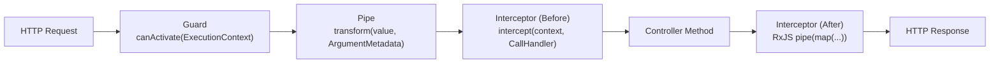

## 1. แนวคิด (Concept)
ในสถาปัตยกรรมของ NestJS 11 ก่อนที่ HTTP Request จะเดินทางไปถึง Business Service และส่งกลับออกไปเป็น Response จะต้องไหลผ่านไปป์ไลน์สำคัญ 4 ด่าน ได้แก่:
1. **Guard:** ด่านตรวจสิทธิ์ (เช่น ตรวจสอบว่าผู้ใช้มี Role เป็น `BUTCHER` หรือ `ADMIN` หรือไม่)
2. **Pipe:** ด่านตรวจสอบและแปลงข้อมูลขาเข้า (เช่น แปลงรหัส SKU ให้เป็นตัวพิมพ์ใหญ่และตรวจสอบรูปแบบ)
3. **Controller:** ด่านรับพารามิเตอร์และกระจายงานไปยัง Service
4. **Interceptor:** ด่านครอบการทำงานก่อนและหลัง Controller ด้วย RxJS Observable (เช่น ห่อหุ้ม Response ด้วยรูปแบบมาตรฐาน หรือบันทึกเวลาประมวลผล)

การเขียน Unit Test แยกแต่ละชิ้นส่วนช่วยให้เราทดสอบ Edge Cases ของ Guard, Pipe และ Interceptor ได้อย่างครบถ้วนโดยไม่ต้องยิง HTTP Request จริงทุกครั้ง

## 2. หลักการเบื้องหลัง (Under the Hood)


- **`ExecutionContext`:** ทั้ง Guard และ Interceptor รับอาร์กิวเมนต์เป็น `ExecutionContext` ซึ่งเป็น Wrapper ที่ช่วยดึงข้อมูลผ่าน `context.switchToHttp().getRequest()` และ `Reflector` สำหรับอ่าน Custom Metadata (เช่น `@Roles('BUTCHER')`) ในการเขียนเทสต์ เราสามารถสร้าง Helper จำลอง `ExecutionContext` และ Mock `Reflector` ได้โดยตรง
- **`CallHandler` และ RxJS:** เมธอด `intercept(context, next: CallHandler)` ของ Interceptor กำหนดให้ `next.handle()` คืนค่าเป็น RxJS `Observable` ในการเขียน Unit Test เราจึงใช้ฟังก์ชัน `of(mockResponse)` จาก `rxjs` เพื่อจำลองค่าที่ส่งกลับมาจาก Controller และใช้ `lastValueFrom()` เพื่อแกะผลลัพธ์จาก Observable มาทำ Assertion

## 3. ตัวอย่างโค้ด (Smart Butcher Marketplace)

### ตัวอย่างที่ 1 (พื้นฐาน): การเขียน Unit Test สำหรับ `ButcherRoleGuard` และ `SkuNormalizationPipe`
การทดสอบ Guard ที่ตรวจสิทธิ์ช่างแล่เนื้อ (`BUTCHER`) คู่กับ `Reflector` และ Pipe ที่จัดรูปแบบรหัส SKU เนื้อพรีเมียม:

```typescript filename="src/common/guards-and-pipes.spec.ts"
import {
  CanActivate,
  ExecutionContext,
  Injectable,
  ForbiddenException,
  PipeTransform,
  BadRequestException,
} from '@nestjs/common';
import { Reflector } from '@nestjs/core';
import { createMock } from '@golevelup/ts-jest';

export type UserRole = 'CUSTOMER' | 'BUTCHER' | 'ADMIN';

@Injectable()
export class ButcherRoleGuard implements CanActivate {
  constructor(private readonly reflector: Reflector) {}

  canActivate(context: ExecutionContext): boolean {
    const requiredRoles = this.reflector.getAllAndOverride<UserRole[]>('roles', [
      context.getHandler(),
      context.getClass(),
    ]);

    if (!requiredRoles || requiredRoles.length === 0) {
      return true;
    }

    const request = context.switchToHttp().getRequest<{
      user?: { id: string; role: UserRole };
    }>();

    if (!request.user || !requiredRoles.includes(request.user.role)) {
      throw new ForbiddenException('Access restricted to certified Smart Butchers only');
    }

    return true;
  }
}

@Injectable()
export class SkuNormalizationPipe implements PipeTransform<string, string> {
  transform(value: string): string {
    const normalized = value.trim().toUpperCase();
    // รูปแบบ SKU ต้องขึ้นต้นด้วย WAGYU-, DRYAGED- หรือ PRIME-
    const validSkuRegex = /^(WAGYU|DRYAGED|PRIME)-[A-Z0-9]{3,10}$/;
    if (!validSkuRegex.test(normalized)) {
      throw new BadRequestException(`Invalid butcher SKU format: ${value}`);
    }
    return normalized;
  }
}

describe('ButcherRoleGuard & SkuNormalizationPipe Unit Tests', () => {
  let guard: ButcherRoleGuard;
  let reflector: Reflector;
  let skuPipe: SkuNormalizationPipe;

  beforeEach(() => {
    reflector = new Reflector();
    guard = new ButcherRoleGuard(reflector);
    skuPipe = new SkuNormalizationPipe();
  });

  describe('ButcherRoleGuard', () => {
    it('should allow access when route requires BUTCHER role and user is a BUTCHER', () => {
      jest.spyOn(reflector, 'getAllAndOverride').mockReturnValue(['BUTCHER', 'ADMIN']);

      const mockContext = createMock<ExecutionContext>({
        switchToHttp: () => ({
          getRequest: () => ({
            user: { id: 'user-butcher-09', role: 'BUTCHER' as UserRole },
          }),
        }),
      });

      expect(guard.canActivate(mockContext)).toBe(true);
    });

    it('should throw ForbiddenException when CUSTOMER attempts to access BUTCHER endpoint', () => {
      jest.spyOn(reflector, 'getAllAndOverride').mockReturnValue(['BUTCHER']);

      const mockContext = createMock<ExecutionContext>({
        switchToHttp: () => ({
          getRequest: () => ({
            user: { id: 'user-cust-01', role: 'CUSTOMER' as UserRole },
          }),
        }),
      });

      expect(() => guard.canActivate(mockContext)).toThrow(ForbiddenException);
    });
  });

  describe('SkuNormalizationPipe', () => {
    it('should trim whitespace and convert valid lowercase wagyu SKU to uppercase', () => {
      const result = skuPipe.transform('  wagyu-a5rib01 ');
      expect(result).toBe('WAGYU-A5RIB01');
    });

    it('should throw BadRequestException when SKU prefix does not match butcher catalog rules', () => {
      expect(() => skuPipe.transform('PORK-BELLY01')).toThrow(BadRequestException);
    });
  });
});
```

### ตัวอย่างที่ 2 (ขั้นสูง): การเขียน Unit Test สำหรับ `OrderController` และ `ColdChainResponseInterceptor`
การทดสอบ Controller ที่เรียก Service และการทดสอบ Interceptor ที่แนบข้อมูลการควบคุมอุณหภูมิความเย็น (Cold-chain Metadata) ลงใน Response ของคำสั่งซื้อเนื้อสด:

```typescript filename="src/orders/order-controller-interceptor.spec.ts"
import {
  Controller,
  Post,
  Body,
  Injectable,
  NestInterceptor,
  ExecutionContext,
  CallHandler,
} from '@nestjs/common';
import { Test, TestingModule } from '@nestjs/testing';
import { Observable, of, lastValueFrom } from 'rxjs';
import { map } from 'rxjs/operators';
import { createMock } from '@golevelup/ts-jest';

export interface CreateOrderDto {
  userId: string;
  productId: string;
  weightKg: number;
}

export interface OrderResponse {
  orderId: string;
  status: 'CONFIRMED';
  totalPrice: number;
}

@Injectable()
export class OrderApplicationService {
  async createChilledOrder(dto: CreateOrderDto): Promise<OrderResponse> {
    return {
      orderId: 'ord-101',
      status: 'CONFIRMED',
      totalPrice: dto.weightKg * 4000,
    };
  }
}

@Controller('orders')
export class OrderController {
  constructor(private readonly orderService: OrderApplicationService) {}

  @Post()
  async create(@Body() dto: CreateOrderDto): Promise<OrderResponse> {
    return this.orderService.createChilledOrder(dto);
  }
}

export interface StandardButcherEnvelope<T> {
  success: boolean;
  coldChainTargetTempCelsius: number;
  data: T;
}

@Injectable()
export class ColdChainResponseInterceptor<T>
  implements NestInterceptor<T, StandardButcherEnvelope<T>>
{
  intercept(
    _context: ExecutionContext,
    next: CallHandler<T>,
  ): Observable<StandardButcherEnvelope<T>> {
    return next.handle().pipe(
      map((data) => ({
        success: true,
        coldChainTargetTempCelsius: 1.5, // มาตรฐานขนส่งเนื้อดรายเอจต้องคุมที่ 0-2 องศาเซลเซียส
        data,
      })),
    );
  }
}

describe('OrderController & ColdChainResponseInterceptor Unit Tests', () => {
  let controller: OrderController;
  let mockOrderService: jest.Mocked<OrderApplicationService>;

  beforeEach(async () => {
    const moduleRef: TestingModule = await Test.createTestingModule({
      controllers: [OrderController],
      providers: [
        {
          provide: OrderApplicationService,
          useValue: {
            createChilledOrder: jest.fn(),
          },
        },
      ],
    }).compile();

    controller = moduleRef.get<OrderController>(OrderController);
    mockOrderService = moduleRef.get(OrderApplicationService);
  });

  it('should delegate order creation to OrderApplicationService and return response', async () => {
    const dto: CreateOrderDto = {
      userId: 'user-88',
      productId: 'prod-ribeye-a5',
      weightKg: 1.2,
    };
    const expectedResponse: OrderResponse = {
      orderId: 'ord-555',
      status: 'CONFIRMED',
      totalPrice: 4800,
    };

    mockOrderService.createChilledOrder.mockResolvedValue(expectedResponse);

    const result = await controller.create(dto);

    expect(result).toEqual(expectedResponse);
    expect(mockOrderService.createChilledOrder).toHaveBeenCalledWith(dto);
  });

  it('should wrap controller output with coldChainTargetTempCelsius envelope in interceptor', async () => {
    const interceptor = new ColdChainResponseInterceptor<OrderResponse>();
    const mockContext = createMock<ExecutionContext>();
    const rawPayload: OrderResponse = {
      orderId: 'ord-555',
      status: 'CONFIRMED',
      totalPrice: 4800,
    };

    const mockCallHandler: CallHandler<OrderResponse> = {
      handle: () => of(rawPayload),
    };

    const observable$ = interceptor.intercept(mockContext, mockCallHandler);
    const wrappedResult = await lastValueFrom(observable$);

    expect(wrappedResult).toEqual({
      success: true,
      coldChainTargetTempCelsius: 1.5,
      data: rawPayload,
    });
  });
});
```

## 4. ผิด vs ถูก (Anti-pattern vs Best Practice)

| มิติการเปรียบเทียบ | ❌ ผิด (Anti-pattern) | ✅ ถูก (Best Practice) |
| :--- | :--- | :--- |
| **การคาดหวังให้ Guard ทำงานใน Unit Test ของ Controller** | เรียก `await controller.create(dto)` โดยตรงแล้วหวังว่า `@UseGuards(ButcherRoleGuard)` จะบล็อกให้ | เข้าใจว่าการเรียกเมธอดของ Controller โดยตรงใน Unit Test ไม่ได้ผ่าน HTTP Pipeline ของ NestJS จึงต้องเขียน Unit Test ของ Guard แยก หรือทดสอบการผสานกันใน Supertest E2E |
| **การทดสอบ RxJS Interceptor** | ใช้ `.subscribe()` ใน `it()` โดยไม่ใช้ `done` callback หรือ `lastValueFrom` ทำให้เทสต์จบก่อนที่ Observable จะส่งค่า | แปลง Observable เป็น Promise ด้วย `await lastValueFrom(interceptor.intercept(...))` เพื่อให้ Jest รอตรวจผลลัพธ์อย่างถูกต้อง |

## 5. ควรใช้เมื่อไหร่ และ ไม่ควรใช้เมื่อไหร่
- **ควรใช้เมื่อ:** ต้องการทดสอบตรรกะการตรวจสิทธิ์หลายเงื่อนไขใน Guard, การแปลงข้อมูลและ Regex ใน Custom Pipe หรือการแปลงโครงสร้างข้อมูล/การดักจับ Error ใน Interceptor อย่างรวดเร็ว
- **ไม่ควรใช้เมื่อ:** ต้องการพิสูจน์ว่า Decorator `@UseGuards()`, `@UseInterceptors()` หรือ HTTP Status Code `@HttpCode(201)` ที่แปะไว้บนหัว Controller ถูกผูกเข้ากับ HTTP Route จริงอย่างถูกต้อง (ต้องใช้ Supertest ในหัวข้อที่ 4)

## 6. คำถามสัมภาษณ์ (Interview Q&A)
- **Q1: เหตุใดเวลาเราเขียน Unit Test เรียก `controller.createOrder(invalidDto)` โดยตรง ตัว `ValidationPipe` หรือ `@UseGuards()` ที่แปะไว้บนเมธอดจึงไม่ทำงาน?**
  - *แนวคำตอบ:* เพราะ Decorators เช่น `@UseGuards()`, `@UsePipes()`, `@UseInterceptors()` ทำหน้าที่เพียงบันทึก Metadata ลงบนคลาสหรือเมธอดผ่าน `reflect-metadata` เท่านั้น ผู้ที่ทำหน้าที่อ่าน Metadata เหล่านี้และรันตามลำดับ Lifecycle คือ HTTP Router / Request Pipeline ของ NestJS เมื่อเราเรียกเมธอด `controller.createOrder()` โดยตรงในฐานะฟังก์ชันของคลาส TypeScript จึงเป็นการข้าม HTTP Pipeline ไปทั้งหมด หากต้องการให้ Pipeline ทำงานครบต้องทดสอบผ่าน `supertest` กับ `app.getHttpServer()`
- **Q2: การใช้ `@golevelup/ts-jest` (`createMock<ExecutionContext>()`) ช่วยแก้ปัญหาอะไรในการทดสอบ Guard?**
  - *แนวคำตอบ:* อินเทอร์เฟซ `ExecutionContext` ของ NestJS มีเมธอดย่อยจำนวนมาก (`switchToHttp`, `switchToRpc`, `switchToWs`, `getClass`, `getHandler`, `getArgs` ฯลฯ) หากเขียน Mock เองจะต้องประกาศทุกเมธอดเพื่อให้ผ่าน TypeScript Strict Mode หรือต้องจำใจใช้ `as unknown as ExecutionContext` การใช้ `createMock<ExecutionContext>()` จะสร้าง Deep Auto-Mock ที่มี Type ครบถ้วนให้อัตโนมัติ โดยเราระบุเฉพาะเมธอดที่เทสต์นั้นสนใจ เช่น `switchToHttp().getRequest()` เท่านั้น

---
