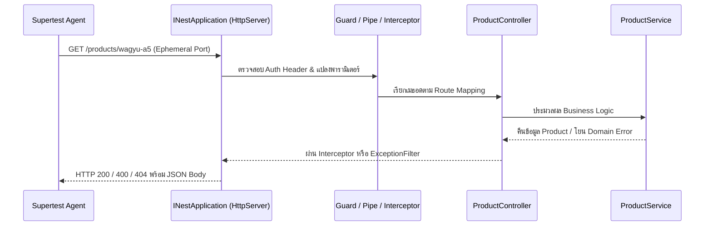

## 1. แนวคิด (Concept)
ในขณะที่ Unit Test ทดสอบคลาสแต่ละตัวแยกจากกัน **Integration / E2E HTTP Testing** ด้วย **Supertest** จะทำการบูตอินสแตนซ์ของแอปพลิเคชัน NestJS (`INestApplication`) ขึ้นมาทำงานจริงบน HTTP Server จำลองในหน่วยความจำ แล้วส่ง HTTP Request จริง (รวมถึง Headers, Query Strings, JSON Body) วิ่งผ่าน Middleware, Guard, Interceptor, Pipe, Controller, Service ไปจนถึง Exception Filter แล้วตรวจสอบ HTTP Response Status Code และ Payload ที่ตอบกลับมา

## 2. หลักการเบื้องหลัง (Under the Hood)


1. **`app = moduleRef.createNestApplication()`:** สร้างอินสแตนซ์แอปพลิเคชันเต็มรูปแบบจาก `TestingModule`
2. **`await app.init()`:** ทำการผูก Routes ทั้งหมดเข้ากับ HTTP Adapter (Express หรือ Fastify) และเรียก Lifecycle Hooks (`onModuleInit`, `onApplicationBootstrap`)
3. **`request(app.getHttpServer())`:** ตัว Supertest จะรับ `http.Server` ของ Node.js ไปเปิดพอร์ตชั่วคราว (Ephemeral Port) เฉพาะตอนส่ง Request โดยที่เราไม่ต้องรัน `app.listen(3000)` ค้างไว้ ช่วยลดปัญหาพอร์ตชนกัน (`EADDRINUSE`) เวลาสั่งรันเทสต์พร้อมกันหลายไฟล์
4. **`await app.close()`:** ปิดการเชื่อมต่อทั้งหมดใน `afterAll` และเรียก `onModuleDestroy` / `onApplicationShutdown` เพื่อป้องกันปัญหา Open Handles ค้างใน Jest

<Callout type="warning" title="ความสอดคล้องของ Global Enhancers ใน main.ts และเทสต์">
ในโปรเจกต์จริง การตั้งค่าอย่าง `app.useGlobalPipes(new ValidationPipe(...))` หรือ `app.setGlobalPrefix('api/v1')` มักเขียนอยู่ในไฟล์ `main.ts` ซึ่งไม่ได้ถูกเรียกเมื่อใช้ `Test.createTestingModule()` ดังนั้นควรแยกฟังก์ชันตั้งค่าออกมาเป็น Helper เช่น `setupNestApp(app)` เพื่อเรียกใช้ร่วมกันทั้งใน `main.ts` และในไฟล์เทสต์ E2E ทุกไฟล์
</Callout>

## 3. ตัวอย่างโค้ด (Smart Butcher Marketplace)

### ตัวอย่างที่ 1 (พื้นฐาน): การทดสอบ REST API ของระบบหมวดหมู่และรายการเนื้อพรีเมียม (`GET` และ `POST`)
ตัวอย่างการบูต `INestApplication` และใช้ Supertest ทดสอบ HTTP Status Code, Response Headers และโครงสร้างข้อมูล JSON:

```typescript filename="test/products-catalog.e2e-spec.ts"
import { Test, TestingModule } from '@nestjs/testing';
import {
  INestApplication,
  Controller,
  Get,
  Post,
  Param,
  Body,
  NotFoundException,
  Module,
} from '@nestjs/common';
import request from 'supertest';

interface CatalogProduct {
  id: string;
  sku: string;
  name: string;
  category: string;
  pricePerKg: number;
}

@Controller('api/v1/products')
class CatalogController {
  private readonly items: CatalogProduct[] = [
    {
      id: 'prod-101',
      sku: 'WAGYU-A5-RIB',
      name: 'Miyazaki A5 Ribeye Steak',
      category: 'Japanese Wagyu',
      pricePerKg: 4900,
    },
  ];

  @Get()
  findAll(): CatalogProduct[] {
    return this.items;
  }

  @Get(':id')
  findOne(@Param('id') id: string): CatalogProduct {
    const found = this.items.find((item) => item.id === id);
    if (!found) {
      throw new NotFoundException(`Product ${id} not found in butcher catalog`);
    }
    return found;
  }

  @Post()
  create(@Body() body: Omit<CatalogProduct, 'id'>): CatalogProduct {
    const created: CatalogProduct = {
      id: `prod-${this.items.length + 101}`,
      ...body,
    };
    this.items.push(created);
    return created;
  }
}

@Module({
  controllers: [CatalogController],
})
class CatalogTestModule {}

describe('Products Catalog API (Supertest Integration)', () => {
  let app: INestApplication;

  beforeAll(async () => {
    const moduleRef: TestingModule = await Test.createTestingModule({
      imports: [CatalogTestModule],
    }).compile();

    app = moduleRef.createNestApplication();
    await app.init();
  });

  afterAll(async () => {
    await app.close();
  });

  it('should return 200 and list of premium beef products on GET /api/v1/products', async () => {
    const response = await request(app.getHttpServer())
      .get('/api/v1/products')
      .expect('Content-Type', /json/)
      .expect(200);

    expect(response.body).toHaveLength(1);
    expect(response.body[0]).toMatchObject({
      sku: 'WAGYU-A5-RIB',
      pricePerKg: 4900,
    });
  });

  it('should return 404 NotFoundException payload when requesting unknown product ID', async () => {
    const response = await request(app.getHttpServer())
      .get('/api/v1/products/prod-999')
      .expect(404);

    expect(response.body).toEqual({
      statusCode: 404,
      message: 'Product prod-999 not found in butcher catalog',
      error: 'Not Found',
    });
  });

  it('should return 201 and newly created dry-aged cut on POST /api/v1/products', async () => {
    const newCut = {
      sku: 'DRYAGED-T-BONE-30D',
      name: '30-Day Dry-Aged Black Angus T-Bone',
      category: 'Dry-Aged Beef',
      pricePerKg: 3100,
    };

    const response = await request(app.getHttpServer())
      .post('/api/v1/products')
      .send(newCut)
      .expect(201);

    expect(response.body).toMatchObject({
      id: expect.any(String),
      sku: 'DRYAGED-T-BONE-30D',
      pricePerKg: 3100,
    });
  });
});
```

### ตัวอย่างที่ 2 (ขั้นสูง): การทดสอบ Custom Exception Filter และ End-to-End Checkout Flow
ตัวอย่างการผูก Global Exception Filter สำหรับแปลง Domain Error ของระบบชำระเงิน (`PaymentGatewayDeclinedError`) ให้กลายเป็นโครงสร้าง HTTP 402 Payment Required มาตรฐานของระบบ Smart Butcher:

```typescript filename="test/checkout-payment-filter.e2e-spec.ts"
import { Test, TestingModule } from '@nestjs/testing';
import {
  INestApplication,
  Controller,
  Post,
  Body,
  Catch,
  ExceptionFilter,
  ArgumentsHost,
  HttpStatus,
  Module,
} from '@nestjs/common';
import { Response, Request } from 'express';
import request from 'supertest';

export class PaymentGatewayDeclinedError extends Error {
  constructor(
    public readonly orderId: string,
    public readonly declineReason: string,
  ) {
    super(`Payment declined for order ${orderId}: ${declineReason}`);
  }
}

@Catch(PaymentGatewayDeclinedError)
export class ButcherPaymentExceptionFilter implements ExceptionFilter {
  catch(exception: PaymentGatewayDeclinedError, host: ArgumentsHost): void {
    const ctx = host.switchToHttp();
    const response = ctx.getResponse<Response>();
    const requestObj = ctx.getRequest<Request>();

    response.status(HttpStatus.PAYMENT_REQUIRED).json({
      statusCode: HttpStatus.PAYMENT_REQUIRED,
      errorCode: 'BUTCHER_PAYMENT_DECLINED',
      orderId: exception.orderId,
      reason: exception.declineReason,
      path: requestObj.url,
    });
  }
}

@Controller('api/v1/payments')
class PaymentController {
  @Post('charge')
  chargeOrder(
    @Body() body: { orderId: string; amount: number; cardToken: string },
  ): { paymentId: string; status: 'PAID' } {
    if (body.cardToken === 'tok_insufficient_funds') {
      throw new PaymentGatewayDeclinedError(body.orderId, 'INSUFFICIENT_CARD_BALANCE');
    }
    return {
      paymentId: 'pay_live_8899',
      status: 'PAID',
    };
  }
}

@Module({
  controllers: [PaymentController],
})
class PaymentTestModule {}

describe('Payment Checkout & Global Exception Filter (Supertest E2E)', () => {
  let app: INestApplication;

  beforeAll(async () => {
    const moduleRef: TestingModule = await Test.createTestingModule({
      imports: [PaymentTestModule],
    }).compile();

    app = moduleRef.createNestApplication();
    app.useGlobalFilters(new ButcherPaymentExceptionFilter());
    await app.init();
  });

  afterAll(async () => {
    await app.close();
  });

  it('should return 201 and PAID status when valid card token is charged', async () => {
    const response = await request(app.getHttpServer())
      .post('/api/v1/payments/charge')
      .send({
        orderId: 'ord-wagyu-77',
        amount: 12500,
        cardToken: 'tok_visa_valid',
      })
      .expect(201);

    expect(response.body).toEqual({
      paymentId: 'pay_live_8899',
      status: 'PAID',
    });
  });

  it('should catch PaymentGatewayDeclinedError and return formatted 402 JSON response', async () => {
    const response = await request(app.getHttpServer())
      .post('/api/v1/payments/charge')
      .send({
        orderId: 'ord-wagyu-78',
        amount: 18900,
        cardToken: 'tok_insufficient_funds',
      })
      .expect(402);

    expect(response.body).toEqual({
      statusCode: 402,
      errorCode: 'BUTCHER_PAYMENT_DECLINED',
      orderId: 'ord-wagyu-78',
      reason: 'INSUFFICIENT_CARD_BALANCE',
      path: '/api/v1/payments/charge',
    });
  });
});
```

## 4. ผิด vs ถูก (Anti-pattern vs Best Practice)

| มิติการเปรียบเทียบ | ❌ ผิด (Anti-pattern) | ✅ ถูก (Best Practice) |
| :--- | :--- | :--- |
| **การบูต `INestApplication`** | สั่ง `app.init()` ใหม่ใน `beforeEach` ทุกเคส ทำให้เสียเวลาบูตระบบซ้ำๆ จนเทสต์ E2E ช้าลง 10 เท่า | บูต `app.init()` เพียงครั้งเดียวใน `beforeAll` และล้างเฉพาะข้อมูลในฐานข้อมูลหรือสถานะ Mock ใน `beforeEach` |
| **การปิดแอปหลังจบเทสต์** | ไม่เขียน `afterAll(async () => await app.close())` ทำให้ Jest แจ้งเตือนว่าไม่สามารถออกจาก Process ได้ | เรียก `await app.close()` ใน `afterAll` เสมอเพื่อคืนทรัพยากร HTTP Server และ Database Connection Pool |

## 5. ควรใช้เมื่อไหร่ และ ไม่ควรใช้เมื่อไหร่
- **ควรใช้เมื่อ:** ทดสอบ HTTP Contract (Route Path, Query Parameters, Status Codes, Headers), การทำงานร่วมกันของ Guard + Pipe + Exception Filter และความถูกต้องของ API ก่อนส่งมอบให้ทีม Frontend
- **ไม่ควรใช้เมื่อ:** ทดสอบฟังก์ชันคำนวณที่มีเคสย่อย 50 รูปแบบ (Combinatorial Logic) เพราะการส่ง HTTP Request ผ่าน Supertest ทั้ง 50 รอบจะช้ากว่าการรัน Unit Test บน Service โดยตรง

## 6. คำถามสัมภาษณ์ (Interview Q&A)
- **Q1: ในการรัน Supertest กับ NestJS ทำไมเราจึงใช้ `await app.init()` แทนที่จะใช้ `await app.listen(3000)`?**
  - *แนวคำตอบ:* `app.init()` ทำการเริ่มต้น Dependency Injection Container, ลงทะเบียน Routes และเรียก Lifecycle Hooks ทั้งหมดโดยไม่ต้องเปิด TCP Socket ผูกติดกับพอร์ตคงที่ (เช่น 3000) เมื่อส่ง `app.getHttpServer()` ให้ Supertest ตัว Supertest จะจัดการเปิดพอร์ตสุ่มชั่วคราว (Port 0 / Ephemeral Port) ของระบบปฏิบัติการให้อัตโนมัติและปิดทันทีหลังจบ Request ทำให้สามารถรันเทสต์หลายไฟล์แบบขนาน (Parallel) ได้โดยไม่เกิดข้อผิดพลาด `EADDRINUSE`
- **Q2: หากใช้ `APP_GUARD` หรือ `APP_PIPE` ผ่าน DI ในโมดูล แตกต่างจากการใช้ `app.useGlobalGuards()` หรือ `app.useGlobalPipes()` ในไฟล์เทสต์อย่างไร?**
  - *แนวคำตอบ:* การลงทะเบียนผ่าน Token `APP_GUARD` หรือ `APP_PIPE` ใน `providers` ของ Module จะทำให้ Guard หรือ Pipe นั้นอยู่ภายใต้ IoC Container จึงสามารถ Inject Dependency อื่นๆ (เช่น `Reflector` หรือ `ConfigService`) เข้าไปใน Constructor ได้ และทำงานทันทีที่ Import โมดูลนั้นใน `Test.createTestingModule()` โดยไม่ต้องเขียน `app.useGlobal...` ซ้ำในทุกไฟล์เทสต์

---
