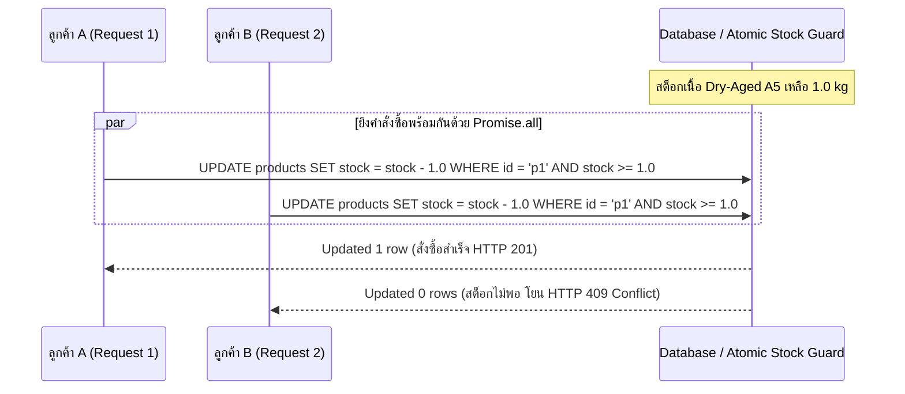

## 1. แนวคิด (Concept)
ในระบบอีคอมเมิร์ซระดับ Enterprise อย่าง Smart Butcher Marketplace เนื้อบ่มดรายเอจแต่ละล็อต (เช่น *60-Day Dry-Aged Ribeye*) มีจำนวนจำกัดเพียงไม่กี่ชิ้นในตู้บ่ม หากลูกค้า VIP สองคนกดสั่งซื้อเนื้อชิ้นสุดท้ายพร้อมกันในเสี้ยววินาทีเดียวกัน (Concurrent Requests) ระบบที่ไม่รัดกุมจะเกิดปัญหา **Race Condition (Lost Update / Overselling)** คืออ่านค่าสต็อกว่าเหลือ 1 ชิ้นพร้อมกัน แล้วตัดสต็อกซ้ำซ้อนจนขายเกินจำนวนที่มีจริง

การทดสอบระดับ Production จึงต้องครอบคลุม 3 มิติสำคัญ:
1. **Test Database Isolation:** การแยกฐานข้อมูลสำหรับเทสต์และการล้างข้อมูล (`TRUNCATE ... CASCADE`) เพื่อให้แต่ละ Test Case เริ่มต้นจากสถานะที่สะอาดเสมอ
2. **External Service Mocking:** การจำลองบริการภายนอก เช่น ระบบตัดบัตรเครดิต (Stripe/Omise) หรือระบบเรียกรถขนส่งควบคุมอุณหภูมิ (Cold-chain Logistics API) ไม่ให้ยิงออกไปยังระบบจริง
3. **Concurrency & Race Condition Testing:** การยิงคำสั่งซื้อพร้อมกันด้วย `Promise.allSettled()` เพื่อพิสูจน์ว่าระบบ Atomic Update หรือ Optimistic/Pessimistic Locking ป้องกันการขายเกินสต็อกได้ 100%

## 2. หลักการเบื้องหลัง (Under the Hood)


เมื่อเราใช้ `Promise.all` หรือ `Promise.allSettled` ยิง Request เข้าไปยัง Service หรือ Supertest พร้อมกันหลายเส้นทาง จะเป็นการจำลองสภาวะ Concurrency ที่ช่วยให้ตรวจจับช่องโหว่ของโค้ดแบบ **Read-Modify-Write** (อ่านค่าด้วย `findUnique` ก่อนแล้วค่อยสั่ง `update`) และพิสูจน์ความถูกต้องของการใช้ Atomic Conditional Update (`updateMany` พร้อมเงื่อนไข `stockKg: { gte: requestedKg }`)

## 3. ตัวอย่างโค้ด (Smart Butcher Marketplace)

### ตัวอย่างที่ 1 (พื้นฐาน): กลยุทธ์การล้างฐานข้อมูลเทสต์และการ Mock External Payment Gateway
ตัวอย่างการสร้าง Helper สำหรับรีเซ็ตสถานะข้อมูลก่อนรันแต่ละเทสต์ และการแทนที่ `ExternalPaymentGateway` ด้วย Test Double เพื่อทดสอบทั้งกรณีตัดเงินสำเร็จและกรณีเครือข่ายธนาคารล่ม:

```typescript filename="src/payments/external-payment-isolation.spec.ts"
import { Test, TestingModule } from '@nestjs/testing';
import { Injectable, ServiceUnavailableException } from '@nestjs/common';

export interface ChargeResult {
  transactionId: string;
  chargedAmount: number;
  status: 'SUCCESS' | 'FAILED';
}

@Injectable()
export class StripePaymentClient {
  async chargeCreditCard(_token: string, _amount: number): Promise<ChargeResult> {
    throw new Error('Real Stripe HTTP call should never be executed in automated tests');
  }
}

@Injectable()
export class ButcherCheckoutService {
  private orderStore = new Map<string, { id: string; amount: number; paid: boolean }>();

  constructor(private readonly stripeClient: StripePaymentClient) {}

  seedTestOrder(id: string, amount: number): void {
    this.orderStore.set(id, { id, amount, paid: false });
  }

  clearDatabase(): void {
    this.orderStore.clear();
  }

  async processOrderPayment(orderId: string, cardToken: string): Promise<ChargeResult> {
    const order = this.orderStore.get(orderId);
    if (!order) {
      throw new Error(`Order ${orderId} not found`);
    }

    try {
      const charge = await this.stripeClient.chargeCreditCard(cardToken, order.amount);
      if (charge.status === 'SUCCESS') {
        order.paid = true;
      }
      return charge;
    } catch {
      throw new ServiceUnavailableException(
        'External payment provider is temporarily unreachable',
      );
    }
  }
}

describe('ButcherCheckoutService (DB Cleanup & External Gateway Mock)', () => {
  let checkoutService: ButcherCheckoutService;
  let mockStripeClient: jest.Mocked<StripePaymentClient>;

  beforeEach(async () => {
    const moduleRef: TestingModule = await Test.createTestingModule({
      providers: [
        ButcherCheckoutService,
        {
          provide: StripePaymentClient,
          useValue: {
            chargeCreditCard: jest.fn(),
          },
        },
      ],
    }).compile();

    checkoutService = moduleRef.get<ButcherCheckoutService>(ButcherCheckoutService);
    mockStripeClient = moduleRef.get(StripePaymentClient);

    // รีเซ็ตข้อมูลและเตรียม Seed ใหม่ให้สะอาดในทุกๆ beforeEach
    checkoutService.clearDatabase();
    checkoutService.seedTestOrder('ord-wagyu-500', 8500);
  });

  it('should mark order as paid when external payment gateway returns SUCCESS', async () => {
    mockStripeClient.chargeCreditCard.mockResolvedValue({
      transactionId: 'ch_mock_991',
      chargedAmount: 8500,
      status: 'SUCCESS',
    });

    const result = await checkoutService.processOrderPayment('ord-wagyu-500', 'tok_visa');

    expect(result.transactionId).toBe('ch_mock_991');
    expect(mockStripeClient.chargeCreditCard).toHaveBeenCalledWith('tok_visa', 8500);
  });

  it('should throw ServiceUnavailableException when external payment gateway times out', async () => {
    mockStripeClient.chargeCreditCard.mockRejectedValue(new Error('ETIMEDOUT'));

    await expect(
      checkoutService.processOrderPayment('ord-wagyu-500', 'tok_visa'),
    ).rejects.toThrow(ServiceUnavailableException);
  });
});
```

### ตัวอย่างที่ 2 (ขั้นสูง): การเขียนเทสต์จำลอง Race Condition เมื่อลูกค้า 5 คนแย่งซื้อเนื้อ Dry-Aged ชิ้นสุดท้ายพร้อมกัน
ตัวอย่างการพิสูจน์การทำงานของระบบตัดสต็อกแบบ Atomic Guard เมื่อมีลูกค้า 5 คนกดสั่งซื้อเนื้อริบอายบ่ม 60 วันที่เหลือในสต็อกเพียงชิ้นเดียวพร้อมกัน จะต้องมีผู้สั่งซื้อสำเร็จเพียง 1 คน และอีก 4 คนต้องได้รับ `ConflictException` โดยสต็อกห้ามติดลบเด็ดขาด:

```typescript filename="src/inventory/race-condition-stock.spec.ts"
import { ConflictException, Injectable } from '@nestjs/common';

export interface InventoryRecord {
  productId: string;
  sku: string;
  availableUnits: number;
  version: number;
}

@Injectable()
export class AtomicButcherInventoryService {
  private readonly stockTable = new Map<string, InventoryRecord>();

  seedInventory(record: InventoryRecord): void {
    this.stockTable.set(record.productId, { ...record });
  }

  getInventory(productId: string): InventoryRecord | undefined {
    return this.stockTable.get(productId);
  }

  /**
   * จำลองการทำงานของ UPDATE products SET available_units = available_units - :qty
   * WHERE product_id = :id AND available_units >= :qty
   */
  async reserveRareCutAtomically(
    productId: string,
    userId: string,
    quantity: number,
  ): Promise<{ reservationId: string; userId: string; remainingUnits: number }> {
    // จำลองความหน่วงของ Network I/O เล็กน้อยเพื่อให้คำสั่งทั้งหมดเข้าคิวพร้อมกัน
    await new Promise((resolve) => setTimeout(resolve, 10));

    const item = this.stockTable.get(productId);
    if (!item || item.availableUnits < quantity) {
      throw new ConflictException(
        `Out of stock: Rare cut ${productId} is no longer available for ${userId}`,
      );
    }

    // Atomic state transition
    item.availableUnits -= quantity;
    item.version += 1;

    return {
      reservationId: `res-${userId}-${item.version}`,
      userId,
      remainingUnits: item.availableUnits,
    };
  }
}

describe('AtomicButcherInventoryService (Concurrency & Race Condition Test)', () => {
  let inventoryService: AtomicButcherInventoryService;

  beforeEach(() => {
    inventoryService = new AtomicButcherInventoryService();
    // มีเนื้อ 60-Day Dry-Aged A5 Chateaubriand เหลือเพียง 1 ชิ้นสุดท้ายในระบบ
    inventoryService.seedInventory({
      productId: 'prod-chateaubriand-last',
      sku: 'DRYAGED-CHAT-60D',
      availableUnits: 1,
      version: 1,
    });
  });

  it('should allow exactly 1 customer to succeed and reject 4 others when 5 customers buy the last wagyu cut concurrently', async () => {
    const concurrentBuyers = ['user-1', 'user-2', 'user-3', 'user-4', 'user-5'];

    // ยิงคำสั่งจองเนื้อพร้อมกันทั้ง 5 คนในเวลาเดียวกัน
    const results = await Promise.allSettled(
      concurrentBuyers.map((buyerId) =>
        inventoryService.reserveRareCutAtomically('prod-chateaubriand-last', buyerId, 1),
      ),
    );

    const fulfilled = results.filter(
      (r): r is PromiseFulfilledResult<{ reservationId: string; userId: string; remainingUnits: number }> =>
        r.status === 'fulfilled',
    );
    const rejected = results.filter(
      (r): r is PromiseRejectedResult => r.status === 'rejected',
    );

    // ต้องมีผู้ซื้อสำเร็จเพียง 1 คนเท่านั้น
    expect(fulfilled).toHaveLength(1);
    expect(fulfilled[0].value.remainingUnits).toBe(0);

    // อีก 4 คนต้องถูกปฏิเสธด้วย ConflictException
    expect(rejected).toHaveLength(4);
    for (const rejection of rejected) {
      expect(rejection.reason).toBeInstanceOf(ConflictException);
    }

    // สต็อกสุทธิในระบบต้องเป็น 0 ห้ามติดลบเด็ดขาด
    const finalStock = inventoryService.getInventory('prod-chateaubriand-last');
    expect(finalStock?.availableUnits).toBe(0);
    expect(finalStock?.version).toBe(2);
  });
});
```

## 4. ผิด vs ถูก (Anti-pattern vs Best Practice)

| มิติการเปรียบเทียบ | ❌ ผิด (Anti-pattern) | ✅ ถูก (Best Practice) |
| :--- | :--- | :--- |
| **การจัดการฐานข้อมูลเทสต์** | ใช้ฐานข้อมูลชุดเดียวกับ Development หรือให้ไฟล์เทสต์เขียนทับข้อมูลกันโดยไม่ล้างตาราง | ใช้ฐานข้อมูลแยกสำหรับเทสต์ (เช่นผ่าน [Docker](/docs/backend/docker) Compose) และล้างข้อมูลก่อนเริ่มแต่ละเคสด้วย `beforeEach` |
| **การทดสอบระบบตัดสต็อก** | ทดสอบเฉพาะการยิง Request ทีละอันแบบเรียงลำดับ (Sequential) จนไม่เห็นบั๊ก Race Condition | ใช้ `Promise.allSettled` ยิง Concurrent Requests พร้อมกันเพื่อพิสูจน์ว่าสต็อกไม่ติดลบ |

## 5. ควรใช้เมื่อไหร่ และ ไม่ควรใช้เมื่อไหร่
- **ควรใช้เมื่อ:** ทดสอบระบบที่มีการแย่งชิงทรัพยากรจำกัด (การตัดสต็อกเนื้อหายาก, การใช้คูปองส่วนลดจำนวนจำกัด, การกดรับงานแล่เนื้อของ Butcher) และระบบที่เชื่อมต่อกับ Third-party API ภายนอก
- **ไม่ควรใช้เมื่อ:** ไม่ควรใช้การทดสอบ Concurrency หนักๆ กับ Endpoint ทั่วไปที่เป็นการอ่านข้อมูลอย่างเดียว (`GET`) ซึ่งไม่ได้มีการเปลี่ยนแปลงสถานะในฐานข้อมูล

## 6. คำถามสัมภาษณ์ (Interview Q&A)
- **Q1: ในการรัน Integration Test ที่ต่อฐานข้อมูล PostgreSQL จริง ทำไมจึงมักแนะนำให้รัน Jest ด้วย `--runInBand` (รันทีละไฟล์) หรือแยก Schema ตาม `JEST_WORKER_ID`?**
  - *แนวคำตอบ:* หาก Jest รันหลาย Worker Process พร้อมกันโดยชี้ไปที่ตารางในฐานข้อมูลเดียวกัน เมื่อ Worker A กำลังรันเทสต์สร้างคำสั่งซื้ออยู่แต่ Worker B รันจบเคสแล้วสั่ง `TRUNCATE TABLE orders CASCADE` จะทำให้ข้อมูลของ Worker A หายไปกลางคันและเกิด Flaky Test ทันที การใช้ `--runInBand` หรือการให้แต่ละ Worker ใช้ Database Schema แยกตาม `process.env.JEST_WORKER_ID` จะช่วยป้องกันการชนกันของข้อมูลได้อย่างสมบูรณ์
- **Q2: ทำไมการเขียนโค้ด `const product = await prisma.product.findUnique(...); if (product.stock >= qty) { await prisma.product.update(...); }` จึงไม่ปลอดภัยต่อ Race Condition แม้จะรันใน Transaction ระดับ `READ COMMITTED`?**
  - *แนวคำตอบ:* เพราะในระดับ Isolation มาตรฐาน (`READ COMMITTED` ของ PostgreSQL) Transaction สองตัวที่เข้ามาพร้อมกันสามารถอ่านค่า `product.stock` ได้เท่ากับ `1` ทั้งคู่ก่อนที่ฝ่ายใดฝ่ายหนึ่งจะทันได้ Commit การอัปเดต วิธีแก้ไขที่ถูกต้องคือการเปลี่ยนไปใช้ Atomic Conditional Update เช่น `prisma.product.updateMany({ where: { id, stockKg: { gte: qty } }, data: { stockKg: { decrement: qty } } })` แล้วตรวจว่า `result.count === 1` หรือใช้ `SELECT ... FOR UPDATE` (Pessimistic Locking)

---
