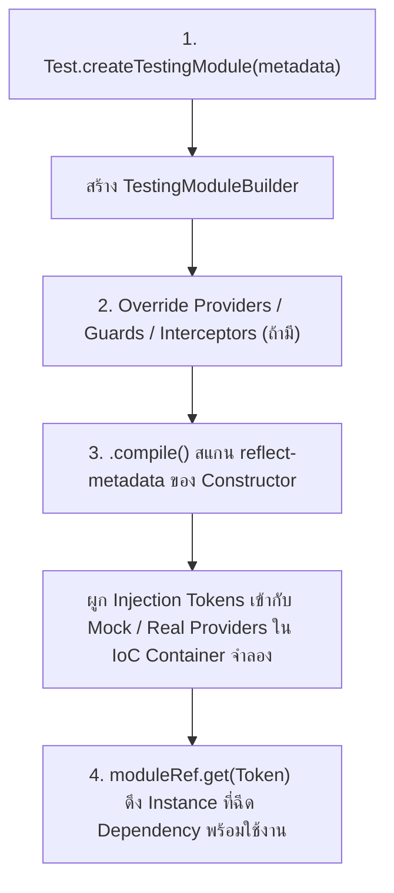

## 1. แนวคิด (Concept)
สถาปัตยกรรมของ [NestJS](/docs/backend/nestjs) ขับเคลื่อนด้วยระบบ **Dependency Injection (DI)** และ **Inversion of Control (IoC) Container** ในการรันแอปพลิเคชันจริง NestJS จะอ่าน Metadata จาก `@Module()` เพื่อสร้างกราฟความสัมพันธ์ของ Providers ทั้งหมด แต่ในการเขียน Unit Test เราไม่ต้องการบูตระบบทั้งก้อน (ซึ่งอาจรวมถึงการเชื่อมต่อฐานข้อมูล PostgreSQL, Redis หรือระบบแจ้งเตือนภายนอก)

แพ็กเกจ `@nestjs/testing` จึงมอบคลาส `Test` และเมธอด `Test.createTestingModule()` เพื่อสร้าง **Isolated Testing Container** ขนาดจิ๋วที่จำลองการทำงานของ IoC Container เฉพาะส่วนที่เราต้องการทดสอบ ช่วยให้เราสามารถสับเปลี่ยน (Swap) Dependency จริงให้กลายเป็น Test Double (เช่น Mock หรือ Stub) ได้อย่างอิสระและมี Type Safety เต็มรูปแบบ

## 2. หลักการเบื้องหลัง (Under the Hood)
เมื่อเรียกใช้งาน `Test.createTestingModule({ controllers, providers, imports }).compile()` กลไกภายในของ NestJS 11 จะทำงานตามลำดับดังนี้:



1. **Metadata Scanning:** ตัว `TestingModuleBuilder` จะอ่าน TypeScript Design-time Metadata (`design:paramtypes`) ที่ถูกสร้างโดย `emitDecoratorMetadata` เพื่อดูว่าคลาสเป้าหมายต้องการ Dependency อะไรบ้างใน Constructor
2. **Token Binding:** แทนที่จะใช้คลาสจริงทั้งหมด เราสามารถกำหนด Custom Provider ในรูปแบบ `{ provide: Token, useValue: mockObject }` หรือใช้เมธอด `.overrideProvider(Token).useValue(mockObject)` เพื่อบังคับให้ IoC Container จ่ายตัวจำลองเข้าไปแทน
3. **Compilation & Instantiation:** คำสั่ง `.compile()` จะทำการ Resolve Dependency Graph ทั้งหมดแบบ Asynchronous และคืนค่าเป็น `TestingModule` ซึ่งเราสามารถเรียก `.get<T>(Token)` เพื่อดึง Singleton Instance หรือ `.resolve<T>(Token)` สำหรับ Request-scoped / Transient Instance ออกมาทดสอบได้ทันที

## 3. ตัวอย่างโค้ด (Smart Butcher Marketplace)

### ตัวอย่างที่ 1 (พื้นฐาน): การสร้าง Testing Module สำหรับตรวจสอบราคาและเกรดเนื้อพรีเมียม
ตัวอย่างการสร้างชุดทดสอบระดับเริ่มต้นสำหรับ `MeatGradingService` โดยประกอบโมดูลทดสอบที่มีทั้งการดึงอินสแตนซ์และการแทนที่ค่าคอนฟิกด้วย `useValue`:

```typescript filename="src/products/meat-grading.service.spec.ts"
import { Test, TestingModule } from '@nestjs/testing';
import { Injectable, Inject } from '@nestjs/common';

export const GRADING_CONFIG_TOKEN = 'GRADING_CONFIG_TOKEN';

export interface GradingConfig {
  minWagyuBmsScore: number;
  maxDryAgeMoistureLossPercent: number;
}

export interface Product {
  id: string;
  sku: string;
  name: string;
  pricePerKg: number;
  bmsScore: number;
  dryAgedDays: number;
}

@Injectable()
export class MeatGradingService {
  constructor(
    @Inject(GRADING_CONFIG_TOKEN) private readonly config: GradingConfig,
  ) {}

  isAuthenticA5Wagyu(product: Product): boolean {
    return product.bmsScore >= this.config.minWagyuBmsScore && product.pricePerKg > 0;
  }

  calculateNetSellableWeightKg(rawWeightKg: number, dryAgedDays: number): number {
    if (rawWeightKg <= 0) {
      throw new Error('Raw weight must be greater than zero');
    }
    const dailyLossRate = 0.004; // สูญเสียความชื้นเฉลี่ย 0.4% ต่อวัน
    const totalLossPercent = Math.min(
      dryAgedDays * dailyLossRate * 100,
      this.config.maxDryAgeMoistureLossPercent,
    );
    const netWeight = rawWeightKg * (1 - totalLossPercent / 100);
    return Number(netWeight.toFixed(3));
  }
}

describe('MeatGradingService (TestingModule Fundamentals)', () => {
  let service: MeatGradingService;

  const mockGradingConfig: GradingConfig = {
    minWagyuBmsScore: 8, // มาตรฐาน A5 ต้องมี BMS ตั้งแต่ 8 ถึง 12
    maxDryAgeMoistureLossPercent: 25,
  };

  beforeEach(async () => {
    const moduleRef: TestingModule = await Test.createTestingModule({
      providers: [
        MeatGradingService,
        {
          provide: GRADING_CONFIG_TOKEN,
          useValue: mockGradingConfig,
        },
      ],
    }).compile();

    service = moduleRef.get<MeatGradingService>(MeatGradingService);
  });

  it('should return true when wagyu product has BMS score of 10 and valid price', () => {
    const miyazakiRibeye: Product = {
      id: 'prod-wagyu-01',
      sku: 'WAGYU-A5-RIB-01',
      name: 'Miyazaki A5 Ribeye',
      pricePerKg: 4800,
      bmsScore: 10,
      dryAgedDays: 0,
    };

    const result = service.isAuthenticA5Wagyu(miyazakiRibeye);

    expect(result).toBe(true);
  });

  it('should calculate net sellable weight after 30 days of dry-aging', () => {
    // 30 วัน * 0.4% = ลดลง 12% จาก 10.0 กก. เหลือ 8.8 กก.
    const netWeight = service.calculateNetSellableWeightKg(10.0, 30);

    expect(netWeight).toBeCloseTo(8.8, 3);
  });
});
```

### ตัวอย่างที่ 2 (ขั้นสูง): การใช้ `.overrideProvider()` และ `.useMocker()` สำหรับโมดูลที่มี Dependency ซับซ้อน
เมื่อโมดูลมีการนำเข้า (Import) โมดูลย่อยอื่นๆ หรือใช้ Provider จำนวนมาก เราสามารถใช้ `.useMocker()` ของ NestJS 11 เพื่อสร้าง Auto-mock ให้กับทุก Token ที่ไม่ได้ระบุไว้โดยอัตโนมัติ และใช้ `.overrideProvider()` เพื่อกำหนดพฤติกรรมเฉพาะจุด:

```typescript filename="src/orders/order-pricing.module.spec.ts"
import { Test, TestingModule } from '@nestjs/testing';
import { Injectable, Module } from '@nestjs/common';

export interface ColdChainFeeCalculator {
  calculateChilledDeliveryFee(weightKg: number, province: string): Promise<number>;
}

export const COLD_CHAIN_CALCULATOR = 'COLD_CHAIN_CALCULATOR';

@Injectable()
export class VipDiscountProvider {
  getDiscountRate(userTier: 'STANDARD' | 'GOLD' | 'BUTCHER_PRO'): number {
    const rates = { STANDARD: 0, GOLD: 0.05, BUTCHER_PRO: 0.12 };
    return rates[userTier];
  }
}

@Injectable()
export class OrderSummaryService {
  constructor(
    private readonly discountProvider: VipDiscountProvider,
    private readonly gradingService: MeatGradingService,
  ) {}

  computeOrderTotal(
    product: Product,
    weightKg: number,
    userTier: 'STANDARD' | 'GOLD' | 'BUTCHER_PRO',
  ): { subtotal: number; discount: number; finalTotal: number } {
    const subtotal = product.pricePerKg * weightKg;
    const discountRate = this.discountProvider.getDiscountRate(userTier);
    const discount = Math.round(subtotal * discountRate);
    return {
      subtotal,
      discount,
      finalTotal: subtotal - discount,
    };
  }
}

@Module({
  providers: [
    VipDiscountProvider,
    MeatGradingService,
    OrderSummaryService,
    {
      provide: GRADING_CONFIG_TOKEN,
      useValue: { minWagyuBmsScore: 8, maxDryAgeMoistureLossPercent: 25 },
    },
  ],
  exports: [OrderSummaryService],
})
export class OrderPricingModule {}

describe('OrderPricingModule with overrideProvider & useMocker', () => {
  let orderSummaryService: OrderSummaryService;

  beforeEach(async () => {
    const moduleRef: TestingModule = await Test.createTestingModule({
      imports: [OrderPricingModule],
    })
      .overrideProvider(VipDiscountProvider)
      .useValue({
        // จำลองโปรโมชันพิเศษลด 20% สำหรับทุก Tier ในช่วงเทศกาลสเต็ก
        getDiscountRate: jest.fn().mockReturnValue(0.2),
      })
      .useMocker((token) => {
        if (token === COLD_CHAIN_CALCULATOR) {
          return {
            calculateChilledDeliveryFee: jest.fn().mockResolvedValue(150),
          };
        }
        return undefined;
      })
      .compile();

    orderSummaryService = moduleRef.get<OrderSummaryService>(OrderSummaryService);
  });

  it('should apply overridden 20% festival discount rate to wagyu order total', () => {
    const kobeStriploin: Product = {
      id: 'prod-kobe-02',
      sku: 'KOBE-A5-STR-02',
      name: 'Kobe A5 Striploin',
      pricePerKg: 6000,
      bmsScore: 11,
      dryAgedDays: 0,
    };

    const summary = orderSummaryService.computeOrderTotal(kobeStriploin, 1.5, 'STANDARD');

    expect(summary.subtotal).toBe(9000);
    expect(summary.discount).toBe(1800);
    expect(summary.finalTotal).toBe(7200);
  });
});
```

## 4. ผิด vs ถูก (Anti-pattern vs Best Practice)

| มิติการเปรียบเทียบ | ❌ ผิด (Anti-pattern) | ✅ ถูก (Best Practice) |
| :--- | :--- | :--- |
| **การ Import Module ใน Unit Test** | สั่ง `imports: [AppModule]` ใน Unit Test ทุกไฟล์ ทำให้ต้องต่อ Database และโหลดทุก Controller จนเทสต์ช้ามาก | ลงทะเบียนเฉพาะคลาสเป้าหมายใน `providers: [TargetService, MockDep]` เพื่อให้คอมไพล์เสร็จในระดับมิลลิวินาที |
| **การจัดการ Scoped Providers** | ใช้ `moduleRef.get()` ดึง Provider ที่ตั้งค่าเป็น `Scope.REQUEST` แล้วเกิดข้อผิดพลาดดึงอินสแตนซ์ไม่ได้ | ใช้ `await moduleRef.resolve(ScopedService)` สำหรับ Request-scoped หรือ Transient-scoped Providers เสมอ |
| **การสร้าง Instance โดยไม่จำเป็น** | บูต `Test.createTestingModule` ใหม่แม้แต่กับ Pure Utility Class ที่ไม่มี Decorator หรือ DI ซับซ้อน | หากคลาสมี Dependency ที่จัดการผ่าน DI ให้ใช้ `Test.createTestingModule` แต่ต้องล้างสถานะ Mock ใน `beforeEach` เสมอ |

## 5. ควรใช้เมื่อไหร่ และ ไม่ควรใช้เมื่อไหร่
- **ควรใช้เมื่อ:** ทดสอบ Service, Controller, Guard หรือ Provider ที่พึ่งพาระบบ Dependency Injection ของ NestJS, มีการใช้ Custom Injection Tokens (`@Inject()`) หรือต้องการทดสอบการทำงานร่วมกันของ Provider ภายใน Module ย่อย
- **ไม่ควรใช้เมื่อ:** ทดสอบ Pure Helper Functions เช่น ฟังก์ชันแปลงหน่วยน้ำหนักกรัมเป็นกิโลกรัม หรือ Domain Logic ที่ไม่มี Dependency ภายนอก ซึ่งสามารถเรียกฟังก์ชันทดสอบด้วย Jest ได้โดยตรงโดยไม่ต้องเสียเวลาสร้าง IoC Container

## 6. คำถามสัมภาษณ์ (Interview Q&A)
- **Q1: ใน `@nestjs/testing` เมธอด `moduleRef.get()` แตกต่างจาก `moduleRef.resolve()` อย่างไร และเมื่อไหร่ที่จำเป็นต้องใช้ `resolve()`?**
  - *แนวคำตอบ:* `moduleRef.get()` เป็นเมธอดแบบ Synchronous ที่ใช้ดึง Singleton Instance ที่ถูกสร้างและเก็บแคชไว้ใน IoC Container ตอนสั่ง `.compile()` ส่วน `moduleRef.resolve()` เป็นเมธอดแบบ Asynchronous ที่จะสร้าง Instance ใหม่จาก Dependency Tree เฉพาะสำหรับ Context นั้นๆ เราจำเป็นต้องใช้ `resolve()` เมื่อ Provider เป้าหมายถูกกำหนดด้วย `@Injectable({ scope: Scope.REQUEST })` หรือ `Scope.TRANSIENT` เพราะอินสแตนซ์เหล่านี้ไม่ได้ถูกสร้างไว้ล่วงหน้าในระดับ Global Container
- **Q2: หากลืมใส่ `await` หน้า `Test.createTestingModule(...).compile()` จะเกิดอะไรขึ้นในขั้นตอนรันเทสต์?**
  - *แนวคำตอบ:* เมธอด `.compile()` คืนค่าเป็น `Promise<TestingModule>` เนื่องจาก NestJS ต้องรองรับ Async Providers (`useFactory: async () => ...`) หากลืม `await` ตัวแปร `moduleRef` จะมีค่าเป็น Promise ที่ยัง Pending อยู่และไม่มีเมธอด `.get()` ทำให้เกิด `TypeError: moduleRef.get is not a function` ทันทีที่รัน `beforeEach`

---
