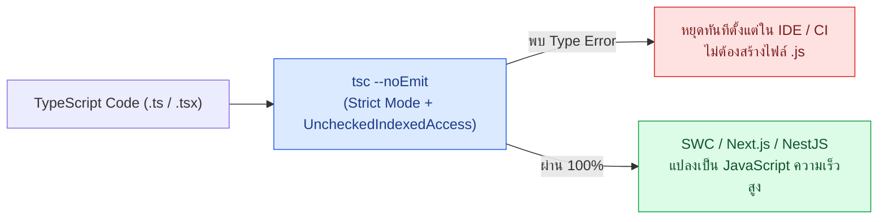
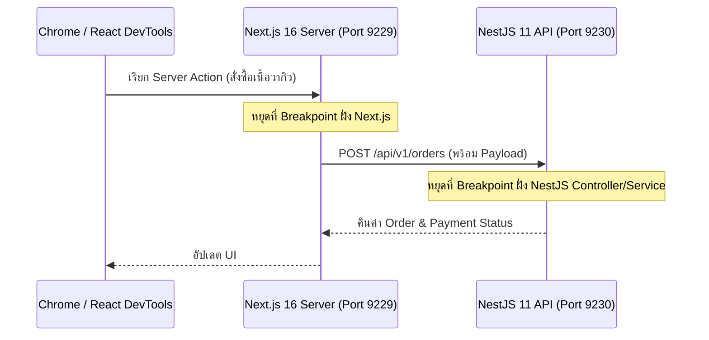
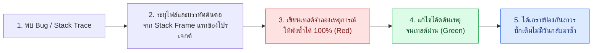

# Debug Type Check

คู่มือเชิงลึกสำหรับการป้องกันและสืบสวนหาต้นตอของบั๊กระดับ Production ด้วย **TypeScript 5.x Strict Mode (`tsc --noEmit`)**, **VS Code Debugger**, **Node.js V8 Inspector (NestJS 11)**, **Next.js 16 Debugging**, **Test-Driven Bug Reproduction**, **Structured JSON Logging (Pino)** และการตรวจสอบช่องโหว่ความปลอดภัยด้วย **npm audit** บนระบบ **Smart Butcher Marketplace**

| หมวดหมู่เนื้อหา | หัวข้อหลัก | เป้าหมายทางวิศวกรรม |
| :--- | :--- | :--- |
| **1. First Line of Defense** | Type Checking ในฐานะปราการด่านแรก (`tsc --noEmit` & Strict Mode) | ดักจับข้อผิดพลาดระดับโครงสร้างข้อมูลก่อนที่โค้ดจะมีโอกาสรัน |
| **2. Test Debugging** | เทคนิคการ Debug ชุดทดสอบ Jest ที่ล้มเหลว (`--runInBand`, VS Code) | หยุดเวลาด้วย Breakpoint เพื่อสำรวจตัวแปรในเทสต์ที่ซับซ้อน |
| **3. Fullstack Inspector** | การ Debug ฝั่ง Backend (NestJS 11) และ Frontend (Next.js 16) | เชื่อมต่อ Debugger ทั้งฝั่ง Server, API และ Client Browser |
| **4. Root Cause Analysis** | ศิลปะการอ่าน Stack Trace และการ Reproduce Bug ด้วยเทสต์นำ | แปลงรายงานบั๊กให้กลายเป็นชุดทดสอบอัตโนมัติที่ป้องกันบั๊กซ้ำถาวร |
| **5. Observability & Security** | การออกแบบ Structured Logging และการตรวจสอบด้วย `npm audit` | ติดตามธุรกรรมด้วย Correlation ID และอุดช่องโหว่ CVE ในแพ็กเกจ |

---

## 1. Type Checking ในฐานะปราการด่านแรก (tsc --noEmit และ Strict Mode)

### แนวคิด (Concept)

ก่อนที่เราจะเสียเวลาเขียน Unit Test เพื่อตรวจว่าฟังก์ชันรับค่า `null` หรือ `undefined` แล้วพังหรือไม่ **TypeScript 5.x Strict Mode** สามารถทำหน้าที่เป็น **"ชุดทดสอบอัตโนมัติระดับคอมไพเลอร์ (Compile-time Proof)"** ที่กวาดตรวจทุกบรรทัดของโปรเจกต์ได้ภายในไม่กี่วินาที

ในระบบ **Smart Butcher Marketplace** การเปิดใช้งานเพียง `"strict": true` ใน `tsconfig.json` ยังไม่เพียงพอสำหรับระบบที่มีการคำนวณเงินและสต็อกเนื้อราคาแพง เราควรเปิดแฟล็กเสริมความรัดกุมระดับสูงสุดควบคู่กับคำสั่ง `tsc --noEmit`:
- **`noUncheckedIndexedAccess: true`**: บังคับให้การดึงค่าจาก Array หรือ Record ด้วยดัชนี (เช่น `order.items[0]`) มีชนิดข้อมูลเป็น `OrderItem | undefined` เสมอ ป้องกันบั๊ก `Cannot read properties of undefined` เมื่ออาร์เรย์ว่างเปล่า
- **`exactOptionalPropertyTypes: true`**: แยกแยะชัดเจนระหว่างการไม่ได้ส่งคีย์เข้ามา กับการส่งค่า `undefined` เข้ามาตรงๆ
- **`noImplicitOverride: true`**: บังคับใส่คีย์เวิร์ด `override` เมื่อคลาสลูกเขียนทับเมธอดของคลาสแม่



### หลักการเบื้องหลัง (Under the Hood)

ทำไมเราต้องรัน `tsc --noEmit` แยกต่างหาก ทั้งที่ Next.js (SWC) หรือ Jest (`@swc/jest`) ก็รันโค้ด TypeScript ได้อยู่แล้ว?
1. **SWC และ esbuild ทำเพียง Type Stripping**: เพื่อความเร็วสูงสุดในการรัน Dev Server และ Test Runner เครื่องมืออย่าง SWC จะทำเพียง **"ลอก (Strip) ส่วนที่เป็น Type Annotation ทิ้งไป"** แบบไฟล์ต่อไฟล์โดยไม่ทำการตรวจสอบความถูกต้องของ Type ข้ามไฟล์เลย!
2. **หน้าที่ของ `tsc --noEmit`**: จึงต้องใช้ TypeScript Compiler (`tsc`) ตัวจริงในการสร้าง Type Graph ทั้งโปรเจกต์เพื่อตรวจสอบความสอดคล้องของอินเทอร์เฟซทั้งหมด โดยใส่ออปชัน `--noEmit` เพื่อสั่งให้ตรวจเช็คอย่างเดียวโดยไม่ต้องเขียนไฟล์ `.js` ลงดิสก์

<Callout type="tip" title="เร่งความเร็ว tsc --noEmit ด้วย incremental: true">
การเปิดออปชัน incremental: true ใน tsconfig.json จะทำให้ TypeScript บันทึกข้อมูลโครงสร้าง Type Graph ของรอบก่อนหน้าไว้ในไฟล์ tsconfig.tsbuildinfo เมื่อรัน tsc --noEmit ครั้งถัดไป คอมไพเลอร์จะตรวจเฉพาะไฟล์ที่เปลี่ยนแปลงและไฟล์ที่ได้รับผลกระทบเท่านั้น ช่วยลดเวลาจากหลักสิบวินาทีเหลือเพียง 1-2 วินาที
</Callout>

### ตัวอย่างโค้ด (Smart Butcher Marketplace)

#### ตัวอย่างที่ 1 (ระดับพื้นฐาน): การตั้งค่า `tsconfig.json` ระดับ Ultra-Strict สำหรับระบบ E-Commerce
ไฟล์ตั้งค่า TypeScript 5.x ที่อุดช่องโหว่ `undefined` และบังคับการตรวจสอบทุกเงื่อนไขอย่างรัดกุม

```json filename="tsconfig.json"
{
  "compilerOptions": {
    "target": "ES2023",
    "module": "NodeNext",
    "moduleResolution": "NodeNext",
    "lib": ["ES2023", "DOM", "DOM.Iterable"],
    "strict": true,
    "noUncheckedIndexedAccess": true,
    "exactOptionalPropertyTypes": true,
    "noImplicitOverride": true,
    "noFallthroughCasesInSwitch": true,
    "forceConsistentCasingInFileNames": true,
    "isolatedModules": true,
    "incremental": true,
    "noEmit": true,
    "skipLibCheck": true
  },
  "include": ["src/**/*.ts", "src/**/*.tsx", "tests/**/*.ts"],
  "exclude": ["node_modules", "dist", ".next"]
}
```

#### ตัวอย่างที่ 2 (ระดับ Production): การใช้ Exhaustive Type Checking (`never`) และป้องกัน `noUncheckedIndexedAccess` ในระบบชำระเงิน
โค้ดประมวลผล `Payment`, `Order`, `OrderItem`, `Product`, `Category` และ `User` ที่ใช้ประโยชน์จาก TypeScript Strict Mode เพื่อรับประกันว่าหากมีการเพิ่มสถานะการชำระเงินใหม่ในอนาคตแล้วลืมเขียนโค้ดรองรับ คอมไพเลอร์จะฟ้อง Error ทันที

```typescript filename="src/domain/strict-payment-Guard.ts"
export interface User {
  id: string;
  email: string;
  role: 'CUSTOMER' | 'BUTCHER' | 'ADMIN';
}

export interface Category {
  id: string;
  name: string;
  minDryAgedDays: number;
}

export interface Product {
  id: string;
  categoryId: string;
  name: string;
  sku: string;
  pricePerKg: number;
  stockKg: number;
}

export interface OrderItem {
  id: string;
  productId: string;
  weightKg: number;
  subtotal: number;
}

export interface Order {
  id: string;
  userId: string;
  items: readonly OrderItem[];
  totalAmount: number;
}

export type PaymentStatus =
  | 'PENDING'
  | 'AUTHORIZED'
  | 'CAPTURED'
  | 'FAILED'
  | 'REFUNDED';

export interface Payment {
  id: string;
  orderId: string;
  amount: number;
  status: PaymentStatus;
}

// ฟังก์ชันช่วยบังคับ Exhaustive Check ใน switch-case
export function assertNever(unexpectedValue: never): never {
  throw new Error(
    `พบสถานะที่ไม่ได้คาดคิดในระบบ: ${JSON.stringify(unexpectedValue)}`,
  );
}

export function describePaymentActionForButcher(
  order: Order,
  payment: Payment,
): string {
  // เนื่องจากเปิด noUncheckedIndexedAccess: true ตัวแปร primaryItem จึงมี Type เป็น OrderItem | undefined
  const primaryItem = order.items[0];
  if (!primaryItem) {
    throw new Error(`คำสั่งซื้อ ${order.id} ไม่มีรายการสินค้าเนื้อ`);
  }

  switch (payment.status) {
    case 'PENDING':
      return `รอการโอนเงินสำหรับรายการแรก (${primaryItem.productId})`;
    case 'AUTHORIZED':
      return `วงเงินอนุมัติแล้ว เตรียมจองเนื้อน้ำหนัก ${String(primaryItem.weightKg)} กก.`;
    case 'CAPTURED':
      return `ตัดเงินสำเร็จ ${String(payment.amount)} บาท เริ่มตัดแต่งเนื้อได้ทันที`;
    case 'FAILED':
      return `การชำระเงินล้มเหลว ยกเลิกการจองเนื้อ`;
    case 'REFUNDED':
      return `คืนเงินให้ลูกค้าเรียบร้อยแล้ว`;
    default:
      // หากใครเพิ่มสถานะใหม่ใน PaymentStatus แล้วลืมใส่ case ด้านบน บรรทัดนี้จะเกิด Compile Error ทันที!
      return assertNever(payment.status);
  }
}
```

### ผิด vs ถูก (Anti-pattern vs Best Practice)

```typescript filename="src/domain/indexed-access.compare.ts"
import type { Order } from './strict-payment-Guard';

// ❌ ผิด (Anti-pattern): ใช้ Non-null assertion (!) บังคับข้ามการตรวจของ TypeScript
export function getFirstItemWeightBad(order: Order): number {
  // ถ้า order.items เป็นอาร์เรย์ว่าง [] จะเกิด Runtime TypeError ทันที!
  return order.items[0]!.weightKg;
}

// ✅ ถูก (Best Practice): ตรวจสอบการมีอยู่ของสมาชิกตัวแรกอย่างชัดเจนตามกฎ noUncheckedIndexedAccess
export function getFirstItemWeightGood(order: Order): number {
  const firstItem = order.items[0];
  if (!firstItem) {
    return 0;
  }
  return firstItem.weightKg;
}
```

### ควรใช้เมื่อไหร่ และ ไม่ควรใช้เมื่อไหร่

- **ควรใช้ `tsc --noEmit` เมื่อ**: รันในขั้นตอน Pre-commit Hook, รันบน GitHub Actions CI และรันก่อนการสั่ง Build ด้วย SWC/Vite ที่ไม่ได้เช็ค Type เอง
- **ไม่ควรใช้**: ห้ามใช้ `@ts-ignore` เพื่อปิดบัง Type Error เด็ดขาด หากจำเป็นต้องทดสอบเคสที่ส่งค่าผิดชนิดในไฟล์เทสต์ ให้ใช้ `@ts-expect-error` พร้อมคำอธิบายแทน เพราะหากวันหนึ่งโค้ดข้างใต้ถูกแก้จนไม่มี Error แล้ว `@ts-expect-error` จะเตือนให้เราลบบรรทัดนั้นออก

### คำถามสัมภาษณ์ (Interview Q&A)

**Q1: ทำไมการเปลี่ยนมาใช้ `@swc/jest` หรือ Vite จึงทำให้ชุดทดสอบรันผ่านแม้เราจะส่งพารามิเตอร์ผิด Type เข้าไปในฟังก์ชัน และต้องแก้ปัญหานี้ใน Pipeline อย่างไร?**
- **แนวคำตอบ**: เพราะ `@swc/jest` และ esbuild เน้นความเร็วในการแปลงโค้ดจึงทำแค่การตัด Type ทิ้ง (Type Stripping) โดยไม่รัน TypeScript Type Checker ดังนั้นใน CI Pipeline และสคริปต์ตรวจสอบก่อนส่งงานจึงต้องมีขั้นตอนการรัน `tsc --noEmit` คู่ขนานกับการรันเทสต์เสมอ

**Q2: ออปชัน `noUncheckedIndexedAccess: true` ใน `tsconfig.json` ช่วยป้องกันบั๊กยอดฮิตใน Production ได้อย่างไร?**
- **แนวคำตอบ**: โดยปกติแม้จะเปิด `strict: true` แล้ว แต่ TypeScript ยังคงอนุมานว่า `items[0]` มีชนิดเป็น `T` เสมอ (ไม่มี `| undefined`) ซึ่งเมื่อเจออาร์เรย์ว่างใน Production จะเกิด `TypeError: Cannot read properties of undefined` ทันที การเปิด `noUncheckedIndexedAccess: true` บังคับให้ทุกการเข้าถึงผ่านดัชนีคืนค่าเป็น `T | undefined` ทำให้นักพัฒนาต้องเขียนเงื่อนไขดักจับก่อนใช้งานเสมอ

---

## 2. เทคนิคการ Debug ชุดทดสอบ Jest ที่ล้มเหลว (--runInBand, VS Code Debugger)

### แนวคิด (Concept)

เมื่อชุดทดสอบ Jest หรือ Vitest ล้มเหลวในลอจิกที่ซับซ้อน (เช่น การคำนวณราคารวมของ `OrderItem` หลายชิ้นพร้อมหักส่วนลดตามลำดับขั้นแล้วตัวเลขคลาดเคลื่อนไป 1 บาท) การใส่ `console.log()` ไปเรื่อยๆ เป็นวิธีที่เสียเวลาและทำให้โค้ดสกปรก

วิธีระดับมืออาชีพคือการเชื่อมต่อ **VS Code Built-in Debugger** เข้ากับกระบวนการรันเทสต์ของ Jest โดยตรงเพื่อ:
- ปัก **Breakpoint (จุดสีแดง)** หรือ **Conditional Breakpoint** (หยุดเฉพาะเมื่อ `item.productId === 'prod-kobe-a5'`)
- สำรวจค่าตัวแปรทั้งหมดในหน้าต่าง **Variables & Watch** แบบสดๆ
- กด **Step Over (`F10`)**, **Step Into (`F11`)** เพื่อเดินดูการทำงานทีละบรรทัด

### หลักการเบื้องหลัง (Under the Hood)

โดยค่าเริ่มต้น Jest จะแตก **Worker Processes (หรือ Worker Threads)** หลายตัวออกมารันไฟล์เทสต์แบบขนานกันเพื่อความเร็ว แต่เมื่อเราต้องการแนบ V8 Debugger เข้าไปวิเคราะห์ทีละบรรทัด การมีหลายโปรเซสทำงานพร้อมกันจะทำให้พอร์ต Inspector ชนกันและเกิด Timeout

ดังนั้นในการ Debug ชุดทดสอบของ Jest เราจึงต้องส่งแฟล็กสำคัญ 2 ตัวเสมอ:
1. **`--runInBand` (หรือ `-i`)**: บังคับให้ Jest รันเทสต์ทั้งหมดใน **Single Process เดียวกัน** (โปรเซสหลักตัวเดียว) ทำให้ VS Code Debugger จับสัญญาณ Breakpoint ได้แม่นยำ 100%
2. **`--watchAll=false` และระบุพาธไฟล์ปัจจุบัน (`${fileBasename}`)**: เพื่อรันเฉพาะไฟล์เทสต์ที่เรากำลังเปิดดูอยู่เพียงไฟล์เดียว

<Callout type="note" title="การป้องกันปัญหา Jest Timeout ขณะหยุดดูค่าที่ Breakpoint">
เวลาที่คุณหยุดโค้ดค้างไว้ที่ Breakpoint เพื่อนั่งอ่านค่าตัวแปรเกิน 5 วินาที Jest อาจตัดจบเทสต์นั้นทันทีเพราะคิดว่าเทสต์ค้าง (Default timeout = 5000ms) ในโหมด Debug คุณสามารถตั้งค่า jest.setTimeout(300000) หรือส่งพารามิเตอร์ --testTimeout=300000 ในไฟล์ launch.json เพื่อมีเวลาตรวจสอบตัวแปรได้อย่างสบายใจ
</Callout>

### ตัวอย่างโค้ด (Smart Butcher Marketplace)

#### ตัวอย่างที่ 1 (ระดับพื้นฐาน): การตั้งค่า `.vscode/launch.json` สำหรับกดปุ่ม Debug ไฟล์เทสต์ Jest ปัจจุบันได้ในคลิกเดียว
ไฟล์ตั้งค่า VS Code Debugger ที่ส่ง `--runInBand` และ `--testTimeout=300000` ให้กับไฟล์เทสต์ที่กำลังเปิดใช้งานอยู่

```json filename=".vscode/launch.json"
{
  "version": "0.2.0",
  "configurations": [
    {
      "name": "Debug Current Jest Test File",
      "type": "node",
      "request": "launch",
      "runtimeArgs": [
        "--inspect-brk",
        "${workspaceRoot}/node_modules/.bin/jest",
        "${fileBasename}",
        "--runInBand",
        "--watchAll=false",
        "--testTimeout=300000"
      ],
      "console": "integratedTerminal",
      "internalConsoleOptions": "neverOpen",
      "skipFiles": ["<node_internals>/**", "**/node_modules/**"]
    }
  ]
}
```

#### ตัวอย่างที่ 2 (ระดับ Production): ชุดทดสอบการจัดสรรสต็อกเนื้อหลายรายการพร้อมการคำนวณภาษีที่ใช้ Breakpoint สืบหาจุดปัดเศษผิดพลาด
โค้ดบริการและเทสต์ที่แสดงจุดวาง Breakpoint เพื่อตรวจสอบสถานะของ `Order`, `OrderItem`, `Product` และ `Payment` ในแต่ละรอบของลูป

```typescript filename="src/services/butcher-tax-allocator.spec.ts"
import type { OrderItem, Product } from '../domain/strict-payment-Guard';

export interface TaxAllocationItemResult {
  orderItemId: string;
  netAmount: number;
  vatAmount: number;
  grossAmount: number;
}

export function allocateOrderVat7Percent(
  items: readonly OrderItem[],
  productsById: ReadonlyMap<string, Product>,
): TaxAllocationItemResult[] {
  return items.map((item): TaxAllocationItemResult => {
    const product = productsById.get(item.productId);
    if (!product) {
      throw new Error(`ไม่พบรหัสเนื้อ ${item.productId}`);
    }

    const netAmount = Math.round(product.pricePerKg * item.weightKg);
    // จุดที่เหมาะแก่การปัก Conditional Breakpoint: item.weightKg === 0.35
    const vatAmount = Math.round(netAmount * 0.07 * 100) / 100;
    const grossAmount = Number((netAmount + vatAmount).toFixed(2));

    return {
      orderItemId: item.id,
      netAmount,
      vatAmount,
      grossAmount,
    };
  });
}

describe('allocateOrderVat7Percent (Debugging with --runInBand)', () => {
  const tenderloin: Product = {
    id: 'prod-tenderloin-chilled',
    categoryId: 'cat-chilled',
    name: 'Australian Grain-Fed Tenderloin',
    sku: 'AUS-TEN-01',
    pricePerKg: 2350,
    stockKg: 10,
  };

  const catalog = new Map<string, Product>([[tenderloin.id, tenderloin]]);

  it('calculates exact VAT 7% and gross amount for custom fractional weights', () => {
    const items: OrderItem[] = [
      {
        id: 'item-01',
        productId: tenderloin.id,
        weightKg: 0.35, // 2350 * 0.35 = 822.5 -> ปัดเป็น 823 บาท
        subtotal: 823,
      },
    ];

    const results = allocateOrderVat7Percent(items, catalog);
    const firstResult = results[0];

    expect(firstResult).toBeDefined();
    expect(firstResult?.netAmount).toBe(823);
    expect(firstResult?.vatAmount).toBe(57.61);
    expect(firstResult?.grossAmount).toBe(880.61);
  });
});
```

### ผิด vs ถูก (Anti-pattern vs Best Practice)

```typescript filename="src/services/test-debugging.compare.ts"
import type { OrderItem } from '../domain/strict-payment-Guard';

// ❌ ผิด (Anti-pattern): โรย console.log เต็มโค้ดจริงเพื่อดูค่าตัวแปรตอนรันเทสต์ แล้วลืมลบทิ้งก่อน Commit
export function sumOrderItemsBad(items: readonly OrderItem[]): number {
  let total = 0;
  for (const item of items) {
    console.log('DEBUG item:', item); // ทำลายความสะอาดของโค้ดและทำให้ CI Log รก
    total += item.subtotal;
  }
  console.log('DEBUG total:', total);
  return total;
}

// ✅ ถูก (Best Practice): รักษาโค้ดให้สะอาด แล้วใช้ VS Code Breakpoint / Logpoint ร่วมกับ --runInBand
export function sumOrderItemsGood(items: readonly OrderItem[]): number {
  return items.reduce((acc, item) => acc + item.subtotal, 0);
}
```

### ควรใช้เมื่อไหร่ และ ไม่ควรใช้เมื่อไหร่

- **ควรใช้ `--runInBand` เมื่อ**: รันเทสต์ผ่าน Debugger ในเครื่อง Local หรือเมื่อรันบน CI Container ที่มีจำนวน vCPU จำกัด (เช่น 1–2 vCPUs) เพื่อลด Overhead ในการสร้าง Worker Processes
- **ไม่ควรใช้**: ไม่ควรใส่คีย์เวิร์ด `debugger;` ค้างไว้ในซอร์สโค้ดแล้ว Commit ขึ้น Git (ESLint กฎ `no-debugger` จะช่วยบล็อกเรื่องนี้ให้อัตโนมัติ) ให้ปัก Breakpoint ผ่าน UI ของ VS Code แทน

### คำถามสัมภาษณ์ (Interview Q&A)

**Q1: Logpoint ใน VS Code Debugger คืออะไร และมีข้อดีเหนือกว่าการเขียน `console.log()` ในโค้ดอย่างไร?**
- **แนวคำตอบ**: Logpoint (จุดสีชมพูรูปสี่เหลี่ยมข้าวหลามตัดในแถบเลขบรรทัดของ VS Code) ช่วยให้เราสั่งพิมพ์ค่าตัวแปรออกทาง Debug Console ได้โดย **ไม่ต้องแก้ไขไฟล์ซอร์สโค้ดแม้แต่ตัวอักษรเดียว** ไม่ต้องรอคอมไพล์ใหม่ และไม่มีความเสี่ยงที่จะเผลอ Commit โค้ด `console.log` หลุดขึ้นไปยัง Git Repository

---

## 3. การ Debug ฝั่ง Backend (NestJS 11 Inspector) และฝั่ง Frontend (Next.js 16 & React DevTools)

### แนวคิด (Concept)

ในสถาปัตยกรรม Fullstack ของ **Smart Butcher Marketplace** คำสั่งซื้อเนื้อหนึ่งรายการวิ่งผ่านทั้ง:
1. **Frontend Client Component (Next.js 16 Browser)**: ผู้ใช้กดเลือกชิ้นเนื้อและกรอกคูปองส่วนลด
2. **Frontend Server Component / Server Action (Next.js 16 Node.js Runtime)**: ตรวจสอบ Session ของ `User` และส่งคำขอไปยัง Backend
3. **Backend API (NestJS 11 Node.js Runtime)**: ตรวจสอบสต็อก `Product`, บันทึก `Order` และสร้างรายการ `Payment`

แทนที่จะต้องเดาว่าข้อมูลเพี้ยนที่จุดไหน เราสามารถตั้งค่า **Compound Launch Configuration** ใน VS Code เพื่อเปิดโหมด Debug ทั้งฝั่ง Next.js 16 และ NestJS 11 ไปพร้อมๆ กันได้ในปุ่มเดียว!



### หลักการเบื้องหลัง (Under the Hood)

- **Node.js V8 Inspector Protocol**: เมื่อรัน NestJS ด้วย `nest start --debug 0.0.0.0:9230 --watch` หรือรัน Next.js ด้วย `NODE_OPTIONS='--inspect=9229' next dev` เอนจิน V8 ของ Node.js จะเปิด WebSocket Server รอรับคำสั่งจาก VS Code Debugger โดยใช้ไฟล์ **Source Maps (`"sourceMap": true` ใน `tsconfig.json`)** ในการแปลงตำแหน่งบรรทัดจากโค้ด JavaScript ที่รันจริงให้ตรงกับบรรทัดในไฟล์ `.ts` / `.tsx` ต้นฉบับอย่างแม่นยำ
- **React DevTools Profiler**: สำหรับปัญหาฝั่ง UI เช่น หน้าเลือกชิ้นเนื้อกระตุกเมื่อเลื่อนดูสินค้า สามารถใช้แท็บ **Profiler** ใน React DevTools บันทึก Flamegraph เพื่อดูว่า Component ใด Re-render โดยไม่จำเป็นและเกิดขึ้นเพราะ Props หรือ State ตัวใดเปลี่ยน

<Callout type="tip" title="แยกพอร์ต Inspector ของ Next.js และ NestJS ไม่ให้ชนกัน">
เนื่องจากค่าเริ่มต้นของ Node.js Inspector คือพอร์ต 9229 เสมอ เมื่อคุณรันทั้ง Next.js 16 และ NestJS 11 พร้อมกันในเครื่องเดียว ให้กำหนดพอร์ตของ Next.js เป็น 9229 และกำหนดพอร์ตของ NestJS เป็น 9230 (--debug 9230) เพื่อให้ VS Code สามารถ Attach เข้าไปจับ Breakpoint ได้ทั้งสองฝั่งพร้อมกัน
</Callout>

### ตัวอย่างโค้ด (Smart Butcher Marketplace)

#### ตัวอย่างที่ 1 (ระดับพื้นฐาน): การตั้งค่า Fullstack Compound Debugger ใน `.vscode/launch.json` สำหรับ Next.js 16 + NestJS 11
การตั้งค่าที่ช่วยให้กด `F5` เพียงครั้งเดียวแล้วสามารถปัก Breakpoint ได้ทั้งใน Next.js Server, Browser Client และ NestJS Backend API

```json filename=".vscode/launch.fullstack.json"
{
  "version": "0.2.0",
  "configurations": [
    {
      "name": "1. Next.js 16: Debug Server",
      "type": "node-terminal",
      "request": "launch",
      "command": "npm run dev:web",
      "env": {
        "NODE_OPTIONS": "--inspect=9229"
      }
    },
    {
      "name": "2. Next.js 16: Debug Chrome Client",
      "type": "chrome",
      "request": "launch",
      "url": "http://localhost:3000",
      "webRoot": "${workspaceFolder}/apps/web"
    },
    {
      "name": "3. NestJS 11: Attach API Inspector",
      "type": "node",
      "request": "attach",
      "port": 9230,
      "restart": true,
      "sourceMaps": true,
      "skipFiles": ["<node_internals>/**", "**/node_modules/**"]
    }
  ],
  "compounds": [
    {
      "name": "Fullstack Debug (Next.js 16 + NestJS 11)",
      "configurations": [
        "1. Next.js 16: Debug Server",
        "2. Next.js 16: Debug Chrome Client",
        "3. NestJS 11: Attach API Inspector"
      ],
      "stopAll": true
    }
  ]
}
```

#### ตัวอย่างที่ 2 (ระดับ Production): NestJS 11 Order Service ที่มีจุดตรวจสอบ State ของธุรกรรมการสั่งซื้อเนื้อพรีเมียม
โค้ดฝั่ง Backend ที่ประสานงานระหว่าง `User`, `Category`, `Product`, `Order`, `OrderItem` และ `Payment` ซึ่งพร้อมให้แนบ V8 Inspector เข้ามาตรวจสอบค่าตัวแปรในทุกขั้นตอน

```typescript filename="src/modules/orders/butcher-order-inspector.service.ts"
import type {
  Category,
  Order,
  OrderItem,
  Payment,
  Product,
  User,
} from '../../domain/strict-payment-Guard';

export interface CreateButcherOrderCommand {
  user: User;
  category: Category;
  product: Product;
  requestedWeightKg: number;
}

export class ButcherOrderInspectorService {
  createVerifiedOrderAndPendingPayment(command: CreateButcherOrderCommand): {
    order: Order;
    payment: Payment;
  } {
    const { user, category, product, requestedWeightKg } = command;

    if (product.categoryId !== category.id) {
      throw new Error(
        `สินค้า ${product.sku} ไม่ได้อยู่ในหมวดหมู่ ${category.name}`,
      );
    }

    if (requestedWeightKg > product.stockKg) {
      throw new Error(
        `สต็อก ${product.name} เหลือเพียง ${String(product.stockKg)} กก. ไม่พอสำหรับ ${String(requestedWeightKg)} กก.`,
      );
    }

    const itemSubtotal = Math.round(product.pricePerKg * requestedWeightKg);
    const orderItem: OrderItem = {
      id: `item-${product.sku}-${String(Date.now())}`,
      productId: product.id,
      weightKg: requestedWeightKg,
      subtotal: itemSubtotal,
    };

    const order: Order = {
      id: `ord-${user.id}-${String(Date.now())}`,
      userId: user.id,
      items: [orderItem],
      totalAmount: itemSubtotal,
    };

    const payment: Payment = {
      id: `pay-${order.id}`,
      orderId: order.id,
      amount: order.totalAmount,
      status: 'PENDING',
    };

    return { order, payment };
  }
}
```

### ผิด vs ถูก (Anti-pattern vs Best Practice)

```json filename="tsconfig.sourcemaps.compare.json"
{
  "// ❌ ผิด (Anti-pattern)": "ปิด sourceMap ทำให้เวลาปัก Breakpoint ในไฟล์ .ts แล้ว VS Code ไม่หยุดตามจุดที่กำหนด",
  "badCompilerOptions": {
    "sourceMap": false
  },

  "// ✅ ถูก (Best Practice)": "เปิด sourceMap และ inlineSources เพื่อให้ V8 Inspector จับคู่บรรทัด TypeScript ได้แม่นยำ",
  "goodCompilerOptions": {
    "sourceMap": true,
    "inlineSources": true
  }
}
```

### ควรใช้เมื่อไหร่ และ ไม่ควรใช้เมื่อไหร่

- **ควรใช้ V8 Inspector (`--inspect`) เมื่อ**: ต้องการตรวจสอบลำดับการทำงานของ Middleware, Guards, Interceptors และ Services ใน NestJS 11 หรือ Server Actions ใน Next.js 16 ในเครื่องพัฒนา (Local Development)
- **ไม่ควรใช้**: **ห้ามเปิดพอร์ต `--inspect=0.0.0.0:9229` ทิ้งไว้บนเซิร์ฟเวอร์ Production เด็ดขาด!** เพราะใครก็ตามที่เข้าถึงพอร์ตนี้ได้จะสามารถรันโค้ดใดๆ ก็ได้บนเซิร์ฟเวอร์ (Remote Code Execution - RCE) และอ่านข้อมูลความลับในหน่วยความจำได้ทั้งหมด

### คำถามสัมภาษณ์ (Interview Q&A)

**Q1: ใน Next.js 16 (App Router) ทำไมเวลาเราใส่ `console.log` หรือปัก Breakpoint บางครั้งจึงไปโผล่ใน Terminal ของ VS Code แต่บางครั้งไปโผล่ใน Chrome DevTools?**
- **แนวคำตอบ**: เพราะ Next.js App Router แบ่งคอมโพเนนต์ออกเป็น **React Server Components (RSC)** ซึ่งทำงานอยู่บน Node.js Runtime ฝั่งเซิร์ฟเวอร์ (ผลลัพธ์จึงออกที่ Terminal และต้องใช้ Node Inspector พอร์ต 9229) กับ **Client Components (`'use client'`)** ซึ่งถูกส่งไปรันในเบราว์เซอร์ของผู้ใช้ (จึงต้องดูที่ Chrome DevTools หรือแนบ Chrome Debugger)

---

## 4. ศิลปะการอ่าน Stack Trace และกระบวนการ Reproduce Bug ด้วยการเขียนเทสต์นำ

### แนวคิด (Concept)

เมื่อเกิดเหตุการณ์ระบบล่มหรือคำนวณราคาผิดพลาด นักพัฒนามือใหม่มักรีบเข้าไปแก้โค้ดตรงจุดที่สงสัยทันทีแล้วลองกดรีเฟรชหน้าเว็บดู วิธีนี้นอกจากจะเสี่ยงเดาผิดจุดแล้ว ยังอาจทำให้บั๊กเดิมกลับมาเกิดซ้ำในอนาคต

วิศวกรระดับ Senior ใช้กระบวนการ **Scientific Debugging & Test-Driven Bug Reproduction** 4 ขั้นตอน:
1. **Analyze Stack Trace**: อ่านข้อความ Error บรรทัดแรกสุด และไล่ดู Call Stack จากบนลงล่าง โดยข้ามเฟรมของไลบรารี (`node_modules`, `node:internal`) เพื่อหา **เฟรมแรกสุดที่เป็นโค้ดของโปรเจกต์เราเอง**
2. **Isolate Minimal Input**: ดึงข้อมูล Input ที่ทำให้พังออกมา (เช่น ออบเจกต์ `Order` และ `Product` ที่มีค่าทศนิยมเจ้าปัญหา)
3. **Write a Failing Test First (Red)**: เขียน Unit Test หรือ Integration Test ที่ส่ง Input นั้นเข้าไป แล้วรันให้เห็นว่า **เทสต์พังด้วย Stack Trace เดียวกันเป๊ะๆ**
4. **Fix the Root Cause & Verify (Green)**: แก้ไขโค้ดจริงจนเทสต์เปลี่ยนเป็นสีเขียว และเก็บเทสต์นั้นไว้ในระบบตลอดไปในฐานะ **Regression Test**



### หลักการเบื้องหลัง (Under the Hood)

โครงสร้างของ **JavaScript/TypeScript Stack Trace** เรียงลำดับตามโครงสร้างข้อมูล **LIFO (Last-In, First-Out)** ของ Call Stack ในหน่วยความจำ V8:
- **บรรทัดที่ 1 (`ErrorName: Message`)**: บอกชนิดของความผิดพลาด เช่น `TypeError`, `RangeError` หรือ Custom Domain Error
- **บรรทัดที่ 2 (`at functionName (file.ts:line:column)`)**: คือ **จุดที่โยน Error ออกมาจริงๆ (Throw Site)**
- **บรรทัดถัดๆ ลงมา**: คือผู้เรียก (Caller) ย้อนหลังกลับไปเรื่อยๆ จนถึงจุดเริ่มต้นของ HTTP Request หรือ Event Loop
- ในยุค ES2022+ เมื่อเราดักจับ Error แล้วต้องการโยน Domain Error ตัวใหม่ที่มีความหมายทางธุรกิจชัดเจนขึ้น เราต้องแนบ **`{ cause: originalError }`** เสมอ เพื่อไม่ให้ Stack Trace ต้นทางสูญหาย!

<Callout type="warning" title="อย่ากลืน Stack Trace เดิมทิ้งเวลาทำ Error Wrapping">
การดัก catch (err) แล้วสั่ง throw new Error('Payment failed') โดยไม่แนบออปชัน cause: err จะทำให้ข้อมูลบรรทัดต้นตอที่แท้จริงหายไปทั้งหมด จงใช้ new Error('Payment failed', { cause: err }) เสมอเพื่อรักษาประวัติ Call Stack ครบทุกระดับชั้น
</Callout>

### ตัวอย่างโค้ด (Smart Butcher Marketplace)

#### ตัวอย่างที่ 1 (ระดับพื้นฐาน): การรักษาห่วงโซ่ Stack Trace ด้วย Error `cause` ในระบบตัดเงิน
ตัวอย่างการห่อหุ้ม Error จากระบบภายนอกโดยไม่สูญเสียร่องรอยต้นตอของปัญหา

```typescript filename="src/services/payment-error-chain.ts"
import type { Order, Payment } from '../domain/strict-payment-Guard';

export class ButcherPaymentProcessingError extends Error {
  readonly orderId: string;

  constructor(message: string, orderId: string, options?: ErrorOptions) {
    super(message, options);
    this.name = 'ButcherPaymentProcessingError';
    this.orderId = orderId;
  }
}

export function parseGatewayAmountStrict(rawGatewayAmount: string): number {
  const parsed = Number(rawGatewayAmount);
  if (Number.isNaN(parsed) || parsed <= 0) {
    throw new RangeError(`ยอดเงินจาก Gateway ไม่ถูกต้อง: "${rawGatewayAmount}"`);
  }
  return parsed;
}

export function buildConfirmedPayment(
  order: Order,
  rawGatewayAmount: string,
): Payment {
  try {
    const verifiedAmount = parseGatewayAmountStrict(rawGatewayAmount);
    return {
      id: `pay-${order.id}`,
      orderId: order.id,
      amount: verifiedAmount,
      status: 'CAPTURED',
    };
  } catch (err: unknown) {
    // แนบ { cause: err } เสมอเพื่อให้ Stack Trace ของ parseGatewayAmountStrict ยังคงอยู่ครบถ้วน!
    throw new ButcherPaymentProcessingError(
      `ไม่สามารถยืนยันการชำระเงินของคำสั่งซื้อ ${order.id}`,
      order.id,
      { cause: err },
    );
  }
}
```

#### ตัวอย่างที่ 2 (ระดับ Production): การ Reproduce Bug เรื่อง Floating-Point Precision ในการหั่นเนื้อสเต็กด้วยการเขียนเทสต์นำ
ใน JavaScript `0.1 + 0.2 === 0.30000000000000004` ทำให้เมื่อลูกค้าสั่งเนื้อ `0.1` กก. และ `0.2` กก. จากสต็อกที่มีอยู่ `0.3` กก. ระบบกลับฟ้องว่าสต็อกไม่พอ! ตัวอย่างนี้แสดงการเขียนเทสต์จำลองบั๊กและวิธีแก้ไขด้วยหน่วยกรัม (Integer Arithmetic)

```typescript filename="src/services/stock-precision-repro.spec.ts"
import type { OrderItem, Product } from '../domain/strict-payment-Guard';

// ฟังก์ชันที่แก้ไขแล้วโดยแปลงกิโลกรัมเป็นกรัม (Integer) ก่อนคำนวณเพื่อขจัดปัญหา IEEE 754 Floating-Point
export function deductStockSafelyInGrams(
  product: Product,
  orderItems: readonly OrderItem[],
): Product {
  const availableGrams = Math.round(product.stockKg * 1000);

  const requestedGrams = orderItems
    .filter((item) => item.productId === product.id)
    .reduce((sumGrams, item) => sumGrams + Math.round(item.weightKg * 1000), 0);

  if (requestedGrams > availableGrams) {
    throw new Error(
      `สต็อกเนื้อ ${product.name} ไม่เพียงพอ (ต้องการ ${String(requestedGrams)} กรัม แต่มีเพียง ${String(availableGrams)} กรัม)`,
    );
  }

  const remainingKg = (availableGrams - requestedGrams) / 1000;
  return {
    ...product,
    stockKg: remainingKg,
  };
}

describe('Regression Test: IEEE 754 Floating-Point Stock Deduction Bug (#BUG-402)', () => {
  const chateaubriand: Product = {
    id: 'prod-chateaubriand',
    categoryId: 'cat-prime',
    name: 'Wagyu Chateaubriand Center Cut',
    sku: 'WGY-CHT-01',
    pricePerKg: 7500,
    stockKg: 0.3, // มีสต็อกพอดี 0.3 กก. (300 กรัม)
  };

  it('allows ordering 0.1kg + 0.2kg when exactly 0.3kg is in stock without floating-point overflow', () => {
    const items: OrderItem[] = [
      { id: 'i-1', productId: chateaubriand.id, weightKg: 0.1, subtotal: 750 },
      { id: 'i-2', productId: chateaubriand.id, weightKg: 0.2, subtotal: 1500 },
    ];

    // ในโค้ดเก่าที่ใช้ 0.1 + 0.2 > 0.3 เทสต์นี้จะพังทันทีเพราะ 0.30000000000000004 > 0.3
    const updatedProduct = deductStockSafelyInGrams(chateaubriand, items);

    expect(updatedProduct.stockKg).toBe(0);
  });
});
```

### ผิด vs ถูก (Anti-pattern vs Best Practice)

```typescript filename="src/services/error-handling.compare.ts"
// ❌ ผิด (Anti-pattern): ดัก catch แล้วโยนข้อความใหม่ลอยๆ ทำให้ไม่รู้ว่าพังที่บรรทัดไหนข้างใน
export async function processOrderBad(fn: () => Promise<void>): Promise<void> {
  try {
    await fn();
  } catch {
    throw new Error('Order processing failed'); // Stack Trace ต้นทางหายสาบสูญ!
  }
}

// ✅ ถูก (Best Practice): ส่งต่อ { cause: error } เพื่อเชื่อมโยง Stack Trace ต้นทางเข้ากับบริบททางธุรกิจ
export async function processOrderGood(
  orderId: string,
  fn: () => Promise<void>,
): Promise<void> {
  try {
    await fn();
  } catch (error: unknown) {
    throw new Error(`Order processing failed for orderId=${orderId}`, {
      cause: error,
    });
  }
}
```

### ควรใช้เมื่อไหร่ และ ไม่ควรใช้เมื่อไหร่

- **ควรเขียน Regression Test นำก่อนแก้บั๊กเสมอเมื่อ**: พบข้อผิดพลาดใน Business Logic, การคำนวณราคา, การแปลงวันที่ หรือ Edge Case ที่หลุดรอดไปยัง Staging/Production
- **ไม่ควรใช้**: ไม่ควรแก้บั๊กด้วยการเดาสุ่มแล้วผลักโค้ดขึ้น Production โดยไม่มีเทสต์ที่พิสูจน์ว่าบั๊กนั้นถูกจำลองและแก้ไขได้จริง

### คำถามสัมภาษณ์ (Interview Q&A)

**Q1: เวลาคุณได้รับแจ้งว่าเกิด `TypeError: Cannot read properties of undefined (reading 'pricePerKg')` บน Production คุณมีขั้นตอนในการอ่าน Stack Trace และตามหาต้นตออย่างไร?**
- **แนวคำตอบ**:
  1. ดูบรรทัดบนสุดของ Stack Frame ของโปรเจกต์เราเพื่อระบุไฟล์และเลขบรรทัดที่พยายามเข้าถึง `.pricePerKg`
  2. ดูว่าออบเจกต์ตัวแม่ (เช่น `product`) มาจากไหน (มาจากผลลัพธ์การค้นหาใน Map/Database หรือมาจาก Request Payload)
  3. เขียน Unit Test ที่จำลองการส่งค่าที่ทำให้ `product` เป็น `undefined` เพื่อยืนยันสมมติฐาน แล้วจึงเพิ่มการตรวจสอบ Guard Clause พร้อม开启 `noUncheckedIndexedAccess` เพื่อป้องกันในจุดอื่นๆ ทั้งระบบ

---

## 5. การออกแบบ Structured Logging และการตรวจสอบช่องโหว่ด้วย npm audit

### แนวคิด (Concept)

บนเซิร์ฟเวอร์ Production เราไม่สามารถแนบ VS Code Debugger เข้าไปหยุดการทำงานของระบบที่มีลูกค้ากำลังสั่งซื้อเนื้อพร้อมกันหลายร้อยคนได้ ดังนั้นเครื่องมือเดียวที่จะบอกเราได้ว่าเกิดอะไรขึ้นคือ **Structured Logging** ควบคู่ไปกับการดูแลความปลอดภัยของ Dependencies ด้วย **`npm audit`**:
1. **Structured JSON Logging (เช่น Pino ใน NestJS 11)**: แทนที่จะพิมพ์ข้อความธรรมดาอย่าง `console.log("Order created")` เราจะบันทึกเป็นออบเจกต์ JSON บรรทัดเดียวที่มีฟิลด์มาตรฐาน เช่น `level`, `timestamp`, `correlationId`, `orderId`, `userId` เพื่อให้ระบบอย่าง Grafana Loki, Datadog หรือ CloudWatch สามารถค้นหาและกรองข้อมูลได้ทันที
2. **Sensitive Data Redaction**: ปิดบังข้อมูลส่วนบุคคล (PII) เช่น อีเมลลูกค้า เบอร์โทรศัพท์ หรือเลขบัตรเครดิตใน Log โดยอัตโนมัติ
3. **Dependency Vulnerability Scanning (`npm audit`)**: ตรวจสอบแพ็กเกจใน `package-lock.json` เทียบกับฐานข้อมูลช่องโหว่สากล (CVE / GitHub Advisory Database)

### หลักการเบื้องหลัง (Under the Hood)

- **ทำไม `console.log` จึงเป็นคอขวดใน Production**: `console.log` ใน Node.js ทำงานแบบ Synchronous เมื่อเขียนออกไปยังปลายทางบางประเภท และสร้างข้อความที่ไม่มีโครงสร้างตายตัว ในขณะที่ไลบรารีอย่าง **Pino** จัดการ Serialization เป็น JSON ด้วยความเร็วสูงและรองรับออปชัน `redact` ที่เดินสำรวจคีย์ในออบเจกต์เพื่อแทนที่ค่าความลับด้วย `"[Redacted]"` ก่อนส่งออกไปยัง Standard Output (`stdout`)
- **กลไกของ `npm audit`**: อ่านต้นไม้ของแพ็กเกจทั้งหมดใน `package-lock.json` (รวมถึง Transitive Dependencies ที่แพ็กเกจอื่นดึงมาอีกทอดหนึ่ง) แล้วส่งรายการชื่อและเลขเวอร์ชันไปตรวจสอบกับ Registry หากพบช่องโหว่ระดับ `high` หรือ `critical` คำสั่ง `npm audit --audit-level=high` จะคืนค่า Exit Code ที่ไม่ใช่ 0 เพื่อหยุด CI Pipeline ทันที

<Callout type="warning" title="ระวังการใช้ npm audit fix --force โดยไม่ตรวจสอบ">
คำสั่ง npm audit fix --force อาจทำการอัปเกรดแพ็กเกจข้าม Major Version (Breaking Change) โดยอัตโนมัติซึ่งอาจทำให้โปรเจกต์พังได้ หากช่องโหว่อยู่ในแพ็กเกจย่อยระดับลึก (Transitive Dependency) ที่ผู้พัฒนายังไม่ออกเวอร์ชันหลักใหม่ แนะนำให้ใช้ฟีเจอร์ overrides ในไฟล์ package.json เพื่อบังคับอัปเกรดเฉพาะแพ็กเกจย่อยตัวที่มีปัญหาอย่างจำเพาะเจาะจง
</Callout>

### ตัวอย่างโค้ด (Smart Butcher Marketplace)

#### ตัวอย่างที่ 1 (ระดับพื้นฐาน): ตัวจัดการ Structured JSON Logger พร้อมระบบ Redaction ข้อมูลความลับและ Correlation ID
โค้ดสร้าง Logger มาตรฐานสำหรับระบบร้านค้าเนื้อพรีเมียมที่ซ่อนข้อมูลอ่อนไหวของ `User` และ `Payment` โดยอัตโนมัติ

```typescript filename="src/observability/structured-butcher-logger.ts"
export type LogLevel = 'info' | 'warn' | 'error';

export interface StructuredLogEntry {
  timestamp: string;
  level: LogLevel;
  correlationId: string;
  service: 'smart-butcher-api';
  event: string;
  context: Record<string, unknown>;
}

const SENSITIVE_KEYS = new Set([
  'password',
  'creditCardNumber',
  'cvv',
  'promptPayQrRaw',
  'email',
]);

export function redactSensitiveFields(
  input: Record<string, unknown>,
): Record<string, unknown> {
  const safeCopy: Record<string, unknown> = {};

  for (const [key, value] of Object.entries(input)) {
    if (SENSITIVE_KEYS.has(key)) {
      safeCopy[key] = '[REDACTED]';
    } else if (
      typeof value === 'object' &&
      value !== null &&
      !Array.isArray(value)
    ) {
      safeCopy[key] = redactSensitiveFields(value as Record<string, unknown>);
    } else {
      safeCopy[key] = value;
    }
  }

  return safeCopy;
}

export function createStructuredLog(
  level: LogLevel,
  correlationId: string,
  event: string,
  context: Record<string, unknown>,
): StructuredLogEntry {
  return {
    timestamp: new Date().toISOString(),
    level,
    correlationId,
    service: 'smart-butcher-api',
    event,
    context: redactSensitiveFields(context),
  };
}
```

#### ตัวอย่างที่ 2 (ระดับ Production): การบันทึก Audit Log ครบวงจรของธุรกรรมสั่งซื้อเนื้อและการตั้งค่า `overrides` ใน `package.json` เพื่อแก้ช่องโหว่ `npm audit`
ตัวอย่างการผูก `correlationId` เข้ากับการทำงานของ `User`, `Product`, `Order` และ `Payment` เพื่อให้สามารถค้นหาเหตุการณ์ทั้งหมดของคำสั่งซื้อเดียวได้ทันที

```typescript filename="src/services/observable-checkout.service.ts"
import type { Order, Payment, Product, User } from '../domain/strict-payment-Guard';
import {
  createStructuredLog,
  type StructuredLogEntry,
} from '../observability/structured-butcher-logger';

export class ObservableCheckoutService {
  private readonly logs: StructuredLogEntry[] = [];

  recordCheckoutTransaction(
    correlationId: string,
    user: User,
    product: Product,
    order: Order,
    payment: Payment,
  ): StructuredLogEntry {
    const entry = createStructuredLog(
      payment.status === 'FAILED' ? 'error' : 'info',
      correlationId,
      'butcher.order.checkout.processed',
      {
        userId: user.id,
        email: user.email, // จะถูกแปลงเป็น "[REDACTED]" โดยอัตโนมัติ!
        productId: product.id,
        sku: product.sku,
        orderId: order.id,
        totalAmount: order.totalAmount,
        paymentId: payment.id,
        paymentStatus: payment.status,
      },
    );

    this.logs.push(entry);
    return entry;
  }

  getLogsByCorrelationId(correlationId: string): readonly StructuredLogEntry[] {
    return this.logs.filter((log) => log.correlationId === correlationId);
  }
}
```

### ผิด vs ถูก (Anti-pattern vs Best Practice)

```typescript filename="src/observability/logging.compare.ts"
import type { Payment, User } from '../domain/strict-payment-Guard';

// ❌ ผิด (Anti-pattern): ใช้ console.log พิมพ์ข้อความปนกับข้อมูลส่วนบุคคลของลูกค้าโดยไม่มี Correlation ID
export function logPaymentBad(user: User, payment: Payment): void {
  console.log(
    'User ' +
      user.email +
      ' paid ' +
      String(payment.amount) +
      ' status=' +
      payment.status,
  );
}

// ✅ ถูก (Best Practice): ใช้ Structured JSON Log ที่มี Correlation ID และปิดบัง PII เสมอ
export function logPaymentGood(
  correlationId: string,
  user: User,
  payment: Payment,
): string {
  const entry = {
    timestamp: new Date().toISOString(),
    level: 'info',
    correlationId,
    event: 'payment.status.recorded',
    userId: user.id,
    orderId: payment.orderId,
    amount: payment.amount,
    status: payment.status,
  };
  return JSON.stringify(entry);
}
```

### ควรใช้เมื่อไหร่ และ ไม่ควรใช้เมื่อไหร่

- **ควรใช้ Structured Logging พร้อม `correlationId` เสมอเมื่อ**: รันระบบบน Staging และ Production เพื่อให้สามารถติดตาม Request หนึ่งตัวที่วิ่งจาก Next.js 16 มายัง NestJS 11 ไปจนถึงฐานข้อมูลได้ครบทุกขั้นตอน
- **ควรรัน `npm audit --omit=dev --audit-level=high` ใน CI เสมอ**: เพื่อตรวจสอบเฉพาะแพ็กเกจที่จะถูกนำขึ้นรันบน Production จริง (`dependencies`) และบล็อกการ Deploy ทันทีหากพบช่องโหว่ระดับรุนแรง
- **ไม่ควรใช้**: ห้ามบันทึกข้อมูลรหัสผ่าน, JWT Token, เลขบัตรเครดิต หรือ QR Payload ดิบลงในระบบ Log เด็ดขาดเพราะเป็นการละเมิดมาตรฐานความปลอดภัยและกฎหมายคุ้มครองข้อมูลส่วนบุคคล (PDPA / GDPR)

### คำถามสัมภาษณ์ (Interview Q&A)

**Q1: `Correlation ID` (หรือ `Request ID` / `Trace ID`) คืออะไร และช่วยชีวิตนักพัฒนาอย่างไรเมื่อต้อง Debug ปัญหาบน Production ที่มีผู้ใช้งานพร้อมกัน 10,000 คน?**
- **แนวคำตอบ**: ในระบบที่มีผู้ใช้งานพร้อมกันจำนวนมาก Log ของลูกค้าทุกคนจะไหลปนกันในเวลาเดียวกันระดับมิลลิวินาที การสร้าง `Correlation ID` (เช่น UUID ที่สร้างตั้งแต่หน้าประตู API Gateway หรือ Next.js Middleware แล้วส่งต่อผ่าน HTTP Header `x-correlation-id` ไปยังทุกบริการ) ช่วยให้นักพัฒนาสามารถกรองดู Log เฉพาะของคำสั่งซื้อที่มีปัญหาเพียงรายการเดียวตั้งแต่ต้นจนจบได้ภายในคลิกเดียว

**Q2: ทำไมใน CI Pipeline เรามักใช้คำสั่ง `npm audit --omit=dev --audit-level=high` แทนการใช้ `npm audit` เปล่าๆ?**
- **แนวคำตอบ**: เพราะ `npm audit` เปล่าๆ จะตรวจสอบรวมถึง `devDependencies` (เช่น เครื่องมือสร้างเอกสารหรือ Linter ที่รันเฉพาะในเครื่องนักพัฒนาแต่ไม่ได้ถูกนำขึ้นเซิร์ฟเวอร์ Production) และจะทำให้ CI พังแม้พบช่องโหว่ระดับ `low` (เช่น Regular Expression DoS ในเครื่องมือ CLI) การระบุ `--omit=dev --audit-level=high` ช่วยให้ทีมโฟกัสแก้ไขช่องโหว่ที่มีความเสี่ยงจริงต่อระบบ Production โดยไม่เกิดอาการล้าจากการแจ้งเตือนที่เกินจริง (Alert Fatigue)

---

## ข้อผิดพลาดที่พบบ่อย (Anti-patterns)

1. **การพึ่งพาเฉพาะ SWC/Vite โดยไม่รัน `tsc --noEmit`**: เข้าใจผิดว่าการที่โปรเจกต์รัน `next dev` หรือรันเทสต์ผ่านแปลว่าไม่มี Type Error ทั้งที่จริงแล้ว SWC เพียงแค่ตัด Type ทิ้งไปเฉยๆ
2. **การแก้บั๊กด้วยการเดาสุ่มโดยไม่เขียน Failing Test นำ**: ทำให้ไม่มั่นใจว่าแก้ไขถูกจุดจริงหรือไม่ และไม่มีเกราะป้องกันหากมีคนเผลอแก้โค้ดกลับมาเป็นแบบเดิมในอนาคต
3. **การกลืน Error ต้นทางในบล็อก `catch`**: ดักจับ Error แล้วโยน `new Error("Something went wrong")` โดยไม่ใส่ `{ cause: err }` ทำให้สูญเสีย Stack Trace บรรทัดต้นตอทั้งหมด
4. **การใช้ `console.log` พิมพ์ออบเจกต์ `User` หรือ `Payment` ทั้งก้อนบน Production**: นอกจากจะค้นหาข้อมูลยากแล้ว ยังทำให้ข้อมูลส่วนบุคคลและความลับทางการเงินรั่วไหลลงไปในระบบจัดเก็บ Log

---

## Checklist สรุป

- [ ] เปิดใช้งาน `"strict": true`, `"noUncheckedIndexedAccess": true` และ `"exactOptionalPropertyTypes": true` ในไฟล์ `tsconfig.json`
- [ ] ตั้งค่าสคริปต์ `"typecheck": "tsc --noEmit"` และบังคับรันในทุก Pull Request
- [ ] สร้างไฟล์ `.vscode/launch.json` ที่มีทั้งโหมด Debug Jest (`--runInBand`) และ Compound Debug สำหรับ Next.js 16 + NestJS 11
- [ ] เมื่อเกิดบั๊กในระบบ ให้เขียน **Failing Unit/Integration Test** เพื่อจำลองบั๊กให้เห็นก่อนลงมือแก้โค้ดเสมอ
- [ ] ใช้ `{ cause: originalError }` ทุกครั้งที่มีการห่อหุ้มและโยน Error ตัวใหม่ในบล็อก `catch`
- [ ] ใช้ **Structured JSON Logging** ที่มี `correlationId` และระบบ `redact` ข้อมูลส่วนบุคคลแทนการใช้ `console.log`
- [ ] เพิ่มขั้นตอน `npm audit --omit=dev --audit-level=high` ในระบบตรวจสอบความปลอดภัยของโปรเจกต์

---

## ลำดับการเรียนที่แนะนำ และ ดูเพิ่มเติมที่

เมื่อคุณเชี่ยวชาญการตรวจสอบชนิดข้อมูลเชิงลึก การใช้ Debugger และการออกแบบระบบ Observability เรียบร้อยแล้ว คุณสามารถทบทวนและเชื่อมโยงความรู้ทั้งหมดในหมวด **TESTING & QUALITY** รวมถึงสถาปัตยกรรม Fullstack ได้ตามลำดับดังนี้:

1. **[ESLint v9 & Prettier v3](/docs/testing/eslint-prettier)**: ป้องกันบั๊กตั้งแต่ระดับ AST ด้วยกฎ `@typescript-eslint` strictTypeChecked
2. **[Git Hooks & CI Pipeline](/docs/testing/git-hooks-ci)**: ผูกคำสั่ง `tsc --noEmit`, `eslint`, ชุดทดสอบ และการตรวจความปลอดภัยเข้ากับ Husky และ GitHub Actions
3. **[Testing Fundamentals](/docs/testing/fundamentals)** และ **[Jest Framework Guide](/docs/testing/jest)**: ทบทวนหลักการออกแบบชุดทดสอบที่มีคุณภาพเพื่อใช้ในการทำ Test-Driven Bug Reproduction
4. **[Backend Testing (NestJS + Supertest)](/docs/testing/backend-testing)**, **[Frontend Testing (RTL)](/docs/testing/frontend-testing)** และ **[E2E Testing (Playwright)](/docs/testing/e2e-playwright)**: ครบเครื่องเรื่องการทดสอบทุกเลเยอร์ของแอปพลิเคชัน
5. **[NestJS Architecture](/docs/backend/nestjs)**, **[Next.js 16 Guide](/docs/nextjs)**, **[Node.js Core](/docs/backend/nodejs)** และ **[Backend Security](/docs/backend/security)**: ต่อยอดสู่การออกแบบระบบ Production ที่มั่นคงและปลอดภัยสูงสุด
