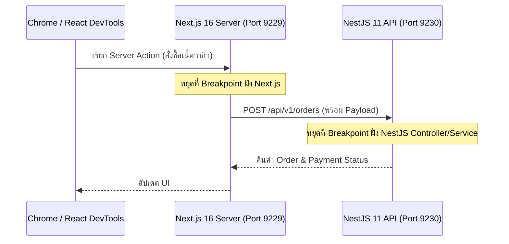

## 1. แนวคิด (Concept)

ในสถาปัตยกรรม Fullstack ของ **Smart Butcher Marketplace** คำสั่งซื้อเนื้อหนึ่งรายการวิ่งผ่านทั้ง:
1. **Frontend Client Component (Next.js 16 Browser)**: ผู้ใช้กดเลือกชิ้นเนื้อและกรอกคูปองส่วนลด
2. **Frontend Server Component / Server Action (Next.js 16 Node.js Runtime)**: ตรวจสอบ Session ของ `User` และส่งคำขอไปยัง Backend
3. **Backend API (NestJS 11 Node.js Runtime)**: ตรวจสอบสต็อก `Product`, บันทึก `Order` และสร้างรายการ `Payment`

แทนที่จะต้องเดาว่าข้อมูลเพี้ยนที่จุดไหน เราสามารถตั้งค่า **Compound Launch Configuration** ใน VS Code เพื่อเปิดโหมด Debug ทั้งฝั่ง Next.js 16 และ NestJS 11 ไปพร้อมๆ กันได้ในปุ่มเดียว!



## 2. หลักการเบื้องหลัง (Under the Hood)

- **Node.js V8 Inspector Protocol**: เมื่อรัน NestJS ด้วย `nest start --debug 0.0.0.0:9230 --watch` หรือรัน Next.js ด้วย `NODE_OPTIONS='--inspect=9229' next dev` เอนจิน V8 ของ Node.js จะเปิด WebSocket Server รอรับคำสั่งจาก VS Code Debugger โดยใช้ไฟล์ **Source Maps (`"sourceMap": true` ใน `tsconfig.json`)** ในการแปลงตำแหน่งบรรทัดจากโค้ด JavaScript ที่รันจริงให้ตรงกับบรรทัดในไฟล์ `.ts` / `.tsx` ต้นฉบับอย่างแม่นยำ
- **React DevTools Profiler**: สำหรับปัญหาฝั่ง UI เช่น หน้าเลือกชิ้นเนื้อกระตุกเมื่อเลื่อนดูสินค้า สามารถใช้แท็บ **Profiler** ใน React DevTools บันทึก Flamegraph เพื่อดูว่า Component ใด Re-render โดยไม่จำเป็นและเกิดขึ้นเพราะ Props หรือ State ตัวใดเปลี่ยน

<Callout type="tip" title="แยกพอร์ต Inspector ของ Next.js และ NestJS ไม่ให้ชนกัน">
เนื่องจากค่าเริ่มต้นของ Node.js Inspector คือพอร์ต 9229 เสมอ เมื่อคุณรันทั้ง Next.js 16 และ NestJS 11 พร้อมกันในเครื่องเดียว ให้กำหนดพอร์ตของ Next.js เป็น 9229 และกำหนดพอร์ตของ NestJS เป็น 9230 (--debug 9230) เพื่อให้ VS Code สามารถ Attach เข้าไปจับ Breakpoint ได้ทั้งสองฝั่งพร้อมกัน
</Callout>

## 3. ตัวอย่างโค้ด (Smart Butcher Marketplace)

### ตัวอย่างที่ 1 (ระดับพื้นฐาน): การตั้งค่า Fullstack Compound Debugger ใน `.vscode/launch.json` สำหรับ Next.js 16 + NestJS 11
การตั้งค่าที่ช่วยให้กด `F5` เพียงครั้งเดียวแล้วสามารถปัก Breakpoint ได้ทั้งใน Next.js Server, Browser Client และ NestJS Backend API

```json filename=".vscode/launch.fullstack.json"
{
  "version": "0.2.0",
  "configurations": [
    {
      "name": "1. Next.js 16: Debug Server",
      "type": "node-terminal",
      "request": "launch",
      "command": "npm run dev:web",
      "env": {
        "NODE_OPTIONS": "--inspect=9229"
      }
    },
    {
      "name": "2. Next.js 16: Debug Chrome Client",
      "type": "chrome",
      "request": "launch",
      "url": "http://localhost:3000",
      "webRoot": "${workspaceFolder}/apps/web"
    },
    {
      "name": "3. NestJS 11: Attach API Inspector",
      "type": "node",
      "request": "attach",
      "port": 9230,
      "restart": true,
      "sourceMaps": true,
      "skipFiles": ["<node_internals>/**", "**/node_modules/**"]
    }
  ],
  "compounds": [
    {
      "name": "Fullstack Debug (Next.js 16 + NestJS 11)",
      "configurations": [
        "1. Next.js 16: Debug Server",
        "2. Next.js 16: Debug Chrome Client",
        "3. NestJS 11: Attach API Inspector"
      ],
      "stopAll": true
    }
  ]
}
```

### ตัวอย่างที่ 2 (ระดับ Production): NestJS 11 Order Service ที่มีจุดตรวจสอบ State ของธุรกรรมการสั่งซื้อเนื้อพรีเมียม
โค้ดฝั่ง Backend ที่ประสานงานระหว่าง `User`, `Category`, `Product`, `Order`, `OrderItem` และ `Payment` ซึ่งพร้อมให้แนบ V8 Inspector เข้ามาตรวจสอบค่าตัวแปรในทุกขั้นตอน

```typescript filename="src/modules/orders/butcher-order-inspector.service.ts"
import type {
  Category,
  Order,
  OrderItem,
  Payment,
  Product,
  User,
} from '../../domain/strict-payment-Guard';

export interface CreateButcherOrderCommand {
  user: User;
  category: Category;
  product: Product;
  requestedWeightKg: number;
}

export class ButcherOrderInspectorService {
  createVerifiedOrderAndPendingPayment(command: CreateButcherOrderCommand): {
    order: Order;
    payment: Payment;
  } {
    const { user, category, product, requestedWeightKg } = command;

    if (product.categoryId !== category.id) {
      throw new Error(
        `สินค้า ${product.sku} ไม่ได้อยู่ในหมวดหมู่ ${category.name}`,
      );
    }

    if (requestedWeightKg > product.stockKg) {
      throw new Error(
        `สต็อก ${product.name} เหลือเพียง ${String(product.stockKg)} กก. ไม่พอสำหรับ ${String(requestedWeightKg)} กก.`,
      );
    }

    const itemSubtotal = Math.round(product.pricePerKg * requestedWeightKg);
    const orderItem: OrderItem = {
      id: `item-${product.sku}-${String(Date.now())}`,
      productId: product.id,
      weightKg: requestedWeightKg,
      subtotal: itemSubtotal,
    };

    const order: Order = {
      id: `ord-${user.id}-${String(Date.now())}`,
      userId: user.id,
      items: [orderItem],
      totalAmount: itemSubtotal,
    };

    const payment: Payment = {
      id: `pay-${order.id}`,
      orderId: order.id,
      amount: order.totalAmount,
      status: 'PENDING',
    };

    return { order, payment };
  }
}
```

## 4. ผิด vs ถูก (Anti-pattern vs Best Practice)

```json filename="tsconfig.sourcemaps.compare.json"
{
  "// ❌ ผิด (Anti-pattern)": "ปิด sourceMap ทำให้เวลาปัก Breakpoint ในไฟล์ .ts แล้ว VS Code ไม่หยุดตามจุดที่กำหนด",
  "badCompilerOptions": {
    "sourceMap": false
  },

  "// ✅ ถูก (Best Practice)": "เปิด sourceMap และ inlineSources เพื่อให้ V8 Inspector จับคู่บรรทัด TypeScript ได้แม่นยำ",
  "goodCompilerOptions": {
    "sourceMap": true,
    "inlineSources": true
  }
}
```

## 5. ควรใช้เมื่อไหร่ และ ไม่ควรใช้เมื่อไหร่

- **ควรใช้ V8 Inspector (`--inspect`) เมื่อ**: ต้องการตรวจสอบลำดับการทำงานของ Middleware, Guards, Interceptors และ Services ใน NestJS 11 หรือ Server Actions ใน Next.js 16 ในเครื่องพัฒนา (Local Development)
- **ไม่ควรใช้**: **ห้ามเปิดพอร์ต `--inspect=0.0.0.0:9229` ทิ้งไว้บนเซิร์ฟเวอร์ Production เด็ดขาด!** เพราะใครก็ตามที่เข้าถึงพอร์ตนี้ได้จะสามารถรันโค้ดใดๆ ก็ได้บนเซิร์ฟเวอร์ (Remote Code Execution - RCE) และอ่านข้อมูลความลับในหน่วยความจำได้ทั้งหมด

## 6. คำถามสัมภาษณ์ (Interview Q&A)

**Q1: ใน Next.js 16 (App Router) ทำไมเวลาเราใส่ `console.log` หรือปัก Breakpoint บางครั้งจึงไปโผล่ใน Terminal ของ VS Code แต่บางครั้งไปโผล่ใน Chrome DevTools?**
- **แนวคำตอบ**: เพราะ Next.js App Router แบ่งคอมโพเนนต์ออกเป็น **React Server Components (RSC)** ซึ่งทำงานอยู่บน Node.js Runtime ฝั่งเซิร์ฟเวอร์ (ผลลัพธ์จึงออกที่ Terminal และต้องใช้ Node Inspector พอร์ต 9229) กับ **Client Components (`'use client'`)** ซึ่งถูกส่งไปรันในเบราว์เซอร์ของผู้ใช้ (จึงต้องดูที่ Chrome DevTools หรือแนบ Chrome Debugger)

---
