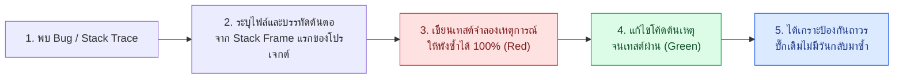

## 1. แนวคิด (Concept)

เมื่อเกิดเหตุการณ์ระบบล่มหรือคำนวณราคาผิดพลาด นักพัฒนามือใหม่มักรีบเข้าไปแก้โค้ดตรงจุดที่สงสัยทันทีแล้วลองกดรีเฟรชหน้าเว็บดู วิธีนี้นอกจากจะเสี่ยงเดาผิดจุดแล้ว ยังอาจทำให้บั๊กเดิมกลับมาเกิดซ้ำในอนาคต

วิศวกรระดับ Senior ใช้กระบวนการ **Scientific Debugging & Test-Driven Bug Reproduction** 4 ขั้นตอน:
1. **Analyze Stack Trace**: อ่านข้อความ Error บรรทัดแรกสุด และไล่ดู Call Stack จากบนลงล่าง โดยข้ามเฟรมของไลบรารี (`node_modules`, `node:internal`) เพื่อหา **เฟรมแรกสุดที่เป็นโค้ดของโปรเจกต์เราเอง**
2. **Isolate Minimal Input**: ดึงข้อมูล Input ที่ทำให้พังออกมา (เช่น ออบเจกต์ `Order` และ `Product` ที่มีค่าทศนิยมเจ้าปัญหา)
3. **Write a Failing Test First (Red)**: เขียน Unit Test หรือ Integration Test ที่ส่ง Input นั้นเข้าไป แล้วรันให้เห็นว่า **เทสต์พังด้วย Stack Trace เดียวกันเป๊ะๆ**
4. **Fix the Root Cause & Verify (Green)**: แก้ไขโค้ดจริงจนเทสต์เปลี่ยนเป็นสีเขียว และเก็บเทสต์นั้นไว้ในระบบตลอดไปในฐานะ **Regression Test**



## 2. หลักการเบื้องหลัง (Under the Hood)

โครงสร้างของ **JavaScript/TypeScript Stack Trace** เรียงลำดับตามโครงสร้างข้อมูล **LIFO (Last-In, First-Out)** ของ Call Stack ในหน่วยความจำ V8:
- **บรรทัดที่ 1 (`ErrorName: Message`)**: บอกชนิดของความผิดพลาด เช่น `TypeError`, `RangeError` หรือ Custom Domain Error
- **บรรทัดที่ 2 (`at functionName (file.ts:line:column)`)**: คือ **จุดที่โยน Error ออกมาจริงๆ (Throw Site)**
- **บรรทัดถัดๆ ลงมา**: คือผู้เรียก (Caller) ย้อนหลังกลับไปเรื่อยๆ จนถึงจุดเริ่มต้นของ HTTP Request หรือ Event Loop
- ในยุค ES2022+ เมื่อเราดักจับ Error แล้วต้องการโยน Domain Error ตัวใหม่ที่มีความหมายทางธุรกิจชัดเจนขึ้น เราต้องแนบ **`{ cause: originalError }`** เสมอ เพื่อไม่ให้ Stack Trace ต้นทางสูญหาย!

<Callout type="warning" title="อย่ากลืน Stack Trace เดิมทิ้งเวลาทำ Error Wrapping">
การดัก catch (err) แล้วสั่ง throw new Error('Payment failed') โดยไม่แนบออปชัน cause: err จะทำให้ข้อมูลบรรทัดต้นตอที่แท้จริงหายไปทั้งหมด จงใช้ new Error('Payment failed', { cause: err }) เสมอเพื่อรักษาประวัติ Call Stack ครบทุกระดับชั้น
</Callout>

## 3. ตัวอย่างโค้ด (Smart Butcher Marketplace)

### ตัวอย่างที่ 1 (ระดับพื้นฐาน): การรักษาห่วงโซ่ Stack Trace ด้วย Error `cause` ในระบบตัดเงิน
ตัวอย่างการห่อหุ้ม Error จากระบบภายนอกโดยไม่สูญเสียร่องรอยต้นตอของปัญหา

```typescript filename="src/services/payment-error-chain.ts"
import type { Order, Payment } from '../domain/strict-payment-Guard';

export class ButcherPaymentProcessingError extends Error {
  readonly orderId: string;

  constructor(message: string, orderId: string, options?: ErrorOptions) {
    super(message, options);
    this.name = 'ButcherPaymentProcessingError';
    this.orderId = orderId;
  }
}

export function parseGatewayAmountStrict(rawGatewayAmount: string): number {
  const parsed = Number(rawGatewayAmount);
  if (Number.isNaN(parsed) || parsed <= 0) {
    throw new RangeError(`ยอดเงินจาก Gateway ไม่ถูกต้อง: "${rawGatewayAmount}"`);
  }
  return parsed;
}

export function buildConfirmedPayment(
  order: Order,
  rawGatewayAmount: string,
): Payment {
  try {
    const verifiedAmount = parseGatewayAmountStrict(rawGatewayAmount);
    return {
      id: `pay-${order.id}`,
      orderId: order.id,
      amount: verifiedAmount,
      status: 'CAPTURED',
    };
  } catch (err: unknown) {
    // แนบ { cause: err } เสมอเพื่อให้ Stack Trace ของ parseGatewayAmountStrict ยังคงอยู่ครบถ้วน!
    throw new ButcherPaymentProcessingError(
      `ไม่สามารถยืนยันการชำระเงินของคำสั่งซื้อ ${order.id}`,
      order.id,
      { cause: err },
    );
  }
}
```

### ตัวอย่างที่ 2 (ระดับ Production): การ Reproduce Bug เรื่อง Floating-Point Precision ในการหั่นเนื้อสเต็กด้วยการเขียนเทสต์นำ
ใน JavaScript `0.1 + 0.2 === 0.30000000000000004` ทำให้เมื่อลูกค้าสั่งเนื้อ `0.1` กก. และ `0.2` กก. จากสต็อกที่มีอยู่ `0.3` กก. ระบบกลับฟ้องว่าสต็อกไม่พอ! ตัวอย่างนี้แสดงการเขียนเทสต์จำลองบั๊กและวิธีแก้ไขด้วยหน่วยกรัม (Integer Arithmetic)

```typescript filename="src/services/stock-precision-repro.spec.ts"
import type { OrderItem, Product } from '../domain/strict-payment-Guard';

// ฟังก์ชันที่แก้ไขแล้วโดยแปลงกิโลกรัมเป็นกรัม (Integer) ก่อนคำนวณเพื่อขจัดปัญหา IEEE 754 Floating-Point
export function deductStockSafelyInGrams(
  product: Product,
  orderItems: readonly OrderItem[],
): Product {
  const availableGrams = Math.round(product.stockKg * 1000);

  const requestedGrams = orderItems
    .filter((item) => item.productId === product.id)
    .reduce((sumGrams, item) => sumGrams + Math.round(item.weightKg * 1000), 0);

  if (requestedGrams > availableGrams) {
    throw new Error(
      `สต็อกเนื้อ ${product.name} ไม่เพียงพอ (ต้องการ ${String(requestedGrams)} กรัม แต่มีเพียง ${String(availableGrams)} กรัม)`,
    );
  }

  const remainingKg = (availableGrams - requestedGrams) / 1000;
  return {
    ...product,
    stockKg: remainingKg,
  };
}

describe('Regression Test: IEEE 754 Floating-Point Stock Deduction Bug (#BUG-402)', () => {
  const chateaubriand: Product = {
    id: 'prod-chateaubriand',
    categoryId: 'cat-prime',
    name: 'Wagyu Chateaubriand Center Cut',
    sku: 'WGY-CHT-01',
    pricePerKg: 7500,
    stockKg: 0.3, // มีสต็อกพอดี 0.3 กก. (300 กรัม)
  };

  it('allows ordering 0.1kg + 0.2kg when exactly 0.3kg is in stock without floating-point overflow', () => {
    const items: OrderItem[] = [
      { id: 'i-1', productId: chateaubriand.id, weightKg: 0.1, subtotal: 750 },
      { id: 'i-2', productId: chateaubriand.id, weightKg: 0.2, subtotal: 1500 },
    ];

    // ในโค้ดเก่าที่ใช้ 0.1 + 0.2 > 0.3 เทสต์นี้จะพังทันทีเพราะ 0.30000000000000004 > 0.3
    const updatedProduct = deductStockSafelyInGrams(chateaubriand, items);

    expect(updatedProduct.stockKg).toBe(0);
  });
});
```

## 4. ผิด vs ถูก (Anti-pattern vs Best Practice)

```typescript filename="src/services/error-handling.compare.ts"
// ❌ ผิด (Anti-pattern): ดัก catch แล้วโยนข้อความใหม่ลอยๆ ทำให้ไม่รู้ว่าพังที่บรรทัดไหนข้างใน
export async function processOrderBad(fn: () => Promise<void>): Promise<void> {
  try {
    await fn();
  } catch {
    throw new Error('Order processing failed'); // Stack Trace ต้นทางหายสาบสูญ!
  }
}

// ✅ ถูก (Best Practice): ส่งต่อ { cause: error } เพื่อเชื่อมโยง Stack Trace ต้นทางเข้ากับบริบททางธุรกิจ
export async function processOrderGood(
  orderId: string,
  fn: () => Promise<void>,
): Promise<void> {
  try {
    await fn();
  } catch (error: unknown) {
    throw new Error(`Order processing failed for orderId=${orderId}`, {
      cause: error,
    });
  }
}
```

## 5. ควรใช้เมื่อไหร่ และ ไม่ควรใช้เมื่อไหร่

- **ควรเขียน Regression Test นำก่อนแก้บั๊กเสมอเมื่อ**: พบข้อผิดพลาดใน Business Logic, การคำนวณราคา, การแปลงวันที่ หรือ Edge Case ที่หลุดรอดไปยัง Staging/Production
- **ไม่ควรใช้**: ไม่ควรแก้บั๊กด้วยการเดาสุ่มแล้วผลักโค้ดขึ้น Production โดยไม่มีเทสต์ที่พิสูจน์ว่าบั๊กนั้นถูกจำลองและแก้ไขได้จริง

## 6. คำถามสัมภาษณ์ (Interview Q&A)

**Q1: เวลาคุณได้รับแจ้งว่าเกิด `TypeError: Cannot read properties of undefined (reading 'pricePerKg')` บน Production คุณมีขั้นตอนในการอ่าน Stack Trace และตามหาต้นตออย่างไร?**
- **แนวคำตอบ**:
  1. ดูบรรทัดบนสุดของ Stack Frame ของโปรเจกต์เราเพื่อระบุไฟล์และเลขบรรทัดที่พยายามเข้าถึง `.pricePerKg`
  2. ดูว่าออบเจกต์ตัวแม่ (เช่น `product`) มาจากไหน (มาจากผลลัพธ์การค้นหาใน Map/Database หรือมาจาก Request Payload)
  3. เขียน Unit Test ที่จำลองการส่งค่าที่ทำให้ `product` เป็น `undefined` เพื่อยืนยันสมมติฐาน แล้วจึงเพิ่มการตรวจสอบ Guard Clause พร้อม开启 `noUncheckedIndexedAccess` เพื่อป้องกันในจุดอื่นๆ ทั้งระบบ

---
