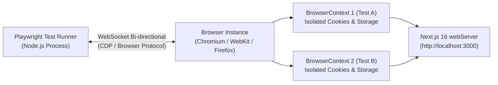
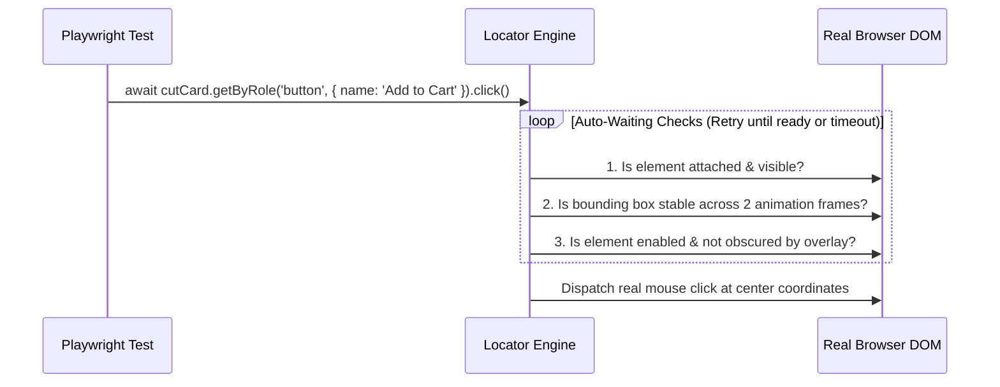
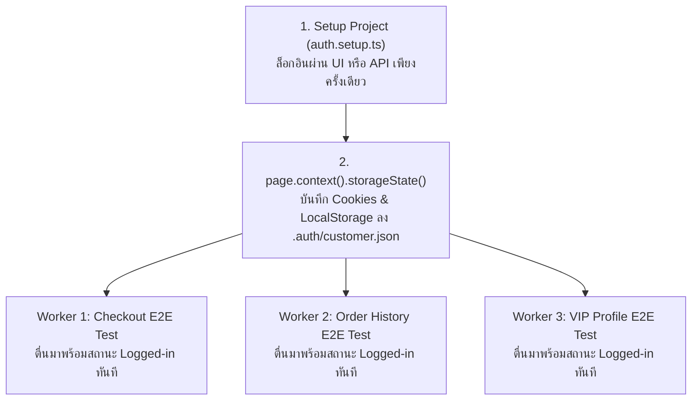
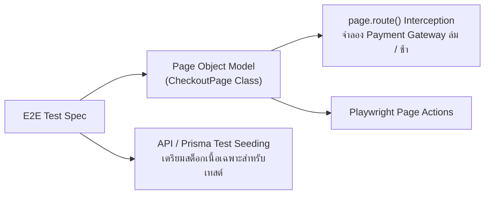

# E2E Testing

(สำหรับแนวคิดพื้นฐานของการทดสอบซอฟต์แวร์ การเขียน Unit Test และการทดสอบระดับ Component สามารถดูเพิ่มเติมได้ที่ [Testing Fundamentals](/docs/testing/fundamentals), [Jest](/docs/testing/jest), [Backend Testing](/docs/testing/backend-testing), และ [Frontend Testing](/docs/testing/frontend-testing))

<Callout type="tip" title="ทำไม Playwright คือมาตรฐานหลักของการทดสอบ E2E ยุคใหม่">
ในขณะที่ Unit Test และ Component Test ยืนยันความถูกต้องของโค้ดแยกตามชิ้นส่วน การทดสอบแบบ End-to-End (E2E) ด้วย Playwright คือการจำลองผู้ใช้งานจริงเปิดเบราว์เซอร์จริง (Chromium, Firefox, WebKit) คลิกสั่งซื้อเนื้อดรายเอจบนหน้าเว็บ Next.js 16 ส่งคำขอผ่านเครือข่ายไปยัง NestJS 11 API บันทึกข้อมูลลงฐานข้อมูล PostgreSQL และแสดงใบเสร็จกลับมาบนหน้าจอ ช่วยมอบความมั่นใจสูงสุดว่าระบบทั้งหมดทำงานสอดประสานกันอย่างสมบูรณ์ไร้รอยต่อ
</Callout>

## สารบัญหัวข้อในหน้านี้

| ลำดับ | หัวข้อหลัก | เครื่องมือและเทคโนโลยีสำคัญ | เป้าหมายการทดสอบ |
| :--- | :--- | :--- | :--- |
| **1** | บทบาทของ E2E Testing และการติดตั้ง Playwright ร่วมกับ Next.js 16 | `@playwright/test`, `webServer` Config | ตั้งค่า Multi-browser Projects และสั่งรันเซิร์ฟเวอร์ Next.js อัตโนมัติ |
| **2** | กลไก Locators, Auto-Waiting และ Web-First Assertions | `getByRole`, `filter()`, `expect(locator)` | ค้นหา Element และรอสถานะ DOM อย่างแม่นยำโดยไร้ `waitForTimeout` |
| **3** | การเขียนเทสต์ Critical User Journey และการแชร์ Login ด้วย `storageState` | `setup` Project, `.auth/customer.json` | ทดสอบเส้นทางสั่งซื้อเนื้อวากิวตั้งแต่ต้นจนจบและล็อกอินเพียงครั้งเดียว |
| **4** | สถาปัตยกรรม Page Object Model (POM), Test Database และ Network Interception | POM Classes, `page.route()`, API Seeding | จัดโครงสร้างโค้ดให้ดูแลรักษาง่าย เตรียมข้อมูลเทสต์ และจำลอง Edge Cases |
| **5** | การ Debug ด้วย Trace Viewer, การรันบน CI และเปรียบเทียบ Playwright vs Cypress | Trace Viewer, Sharding, GitHub Actions | วิเคราะห์จุดพังย้อนหลังแบบ Time-travel และรันเทสต์ขนานความเร็วสูงบน CI |

---

## 1. บทบาทของ E2E Testing และการติดตั้ง Playwright ร่วมกับ Next.js 16

### แนวคิด (Concept)
ในยอดบนสุดของ **Testing Pyramid** คือ **End-to-End (E2E) Testing** ซึ่งทำหน้าที่ตรวจสอบว่าระบบทุกส่วนตั้งแต่ Frontend ([Next.js 16](/docs/nextjs) App Router, `async` Server Components, Server Actions, Middleware), ระบบเครือข่าย, ไปจนถึง Backend ([NestJS 11](/docs/backend/nestjs) และ [Prisma ORM](/docs/backend/prisma-orm)) สามารถทำงานร่วมกันได้จริงบนเอนจินเบราว์เซอร์จริง

สำหรับโปรเจกต์ Next.js 16 ตัว **Playwright** มีบทบาทสำคัญอย่างยิ่ง เพราะเป็นเครื่องมือหลักที่เอกสารทางการของ Next.js แนะนำให้ใช้ทดสอบ `async` Server Components, การเปลี่ยนเส้นทางด้วย `redirect()`, การแคชข้อมูล และการตรวจสอบสิทธิ์ใน `middleware.ts` ที่สภาพแวดล้อม JSDOM ใน Jest ไม่สามารถจำลองได้

### หลักการเบื้องหลัง (Under the Hood)
สถาปัตยกรรมของ Playwright แตกต่างจากเครื่องมือยุคเก่าที่ใช้ HTTP WebDriver หรือรันอยู่ในหน้าต่างเบราว์เซอร์เดียวกัน:



1. **Out-of-Process WebSocket Connection:** Playwright สื่อสารกับเอนจินเบราว์เซอร์โดยตรงผ่าน **Chrome DevTools Protocol (CDP)** บนช่องทาง WebSocket แบบสองทิศทางถาวร (Persistent Bi-directional Pipe) ไม่ต้องเสียเวลาสร้าง HTTP Request ต่อคำสั่งเหมือน Selenium และไม่ถูกจำกัดด้วย Same-Origin Policy ในหน้าต่างเดียวเหมือนรุ่นเก่า
2. **Ultra-fast BrowserContext Isolation:** แทนที่จะเปิดปิดโปรแกรมเบราว์เซอร์ใหม่ทุกครั้งซึ่งกินเวลานานหลายวินาที Playwright จะเปิด Browser Instance เพียงครั้งเดียว แล้วสร้าง **`BrowserContext`** (เทียบเท่าหน้าต่าง Incognito ใหม่เอี่ยมที่แยก Cookies, LocalStorage และ Session ออกจากกัน 100%) สำหรับแต่ละ Test Case โดยใช้เวลาสร้างเพียงไม่กี่มิลลิวินาที
3. **Built-in `webServer` Orchestration:** ในไฟล์ `playwright.config.ts` เราสามารถกำหนดบล็อก `webServer` เพื่อให้ Playwright สั่งบิลด์หรือสตาร์ทเซิร์ฟเวอร์ Next.js 16 (`npm run build && npm run start` หรือ `npm run dev`) และรอจนกว่าพอร์ต `3000` จะพร้อมรับการเชื่อมต่อก่อนเริ่มรันเทสต์ข้อแรกโดยอัตโนมัติ

### ตัวอย่างโค้ด (Smart Butcher Marketplace)

#### ตัวอย่างที่ 1 (พื้นฐาน): การกำหนดค่า `playwright.config.ts` สำหรับ Next.js 16 แบบ Production-grade
การตั้งค่าที่รองรับการรันแบบขนาน (`fullyParallel`), การบันทึก Trace เมื่อเทสต์ล้มเหลว และการบูตเซิร์ฟเวอร์ Next.js 16 อัตโนมัติ:

```typescript filename="playwright.config.ts"
import { defineConfig, devices } from '@playwright/test';

const PORT = process.env.PORT ? Number(process.env.PORT) : 3000;
const BASE_URL = process.env.PLAYWRIGHT_TEST_BASE_URL ?? `http://localhost:${PORT}`;

export default defineConfig({
  testDir: './e2e',
  fullyParallel: true,
  forbidOnly: Boolean(process.env.CI),
  retries: process.env.CI ? 2 : 0,
  workers: process.env.CI ? 2 : undefined,
  reporter: [['html', { open: 'never' }], ['list']],

  use: {
    baseURL: BASE_URL,
    trace: 'on-first-retry',
    screenshot: 'only-on-failure',
    video: 'retain-on-failure',
  },

  projects: [
    {
      name: 'chromium',
      use: { ...devices['Desktop Chrome'] },
    },
    {
      name: 'mobile-safari',
      use: { ...devices['iPhone 14 Pro'] },
    },
  ],

  webServer: {
    command: process.env.CI ? 'npm run start' : 'npm run dev',
    url: BASE_URL,
    reuseExistingServer: !process.env.CI,
    timeout: 120 * 1000,
  },
});
```

#### ตัวอย่างที่ 2 (ขั้นสูง): การเขียนเทสต์ตรวจสอบหน้าแรกของ Smart Butcher Marketplace และการนำทางไปยังแค็ตตาล็อกเนื้อวากิว
ตัวอย่างการเขียนเทสต์แรกเพื่อตรวจว่า `async` Server Component ของหน้าแรกเรนเดอร์ข้อมูลถูกต้อง และสามารถคลิกลิงก์เปลี่ยนหน้าไปยัง `/catalog/wagyu` ได้อย่างสมบูรณ์:

```typescript filename="e2e/catalog-navigation.spec.ts"
import { test as describeTest, expect } from '@playwright/test';

const describe = describeTest.describe;
const it = describeTest;

describe('Smart Butcher Marketplace - Public Catalog Navigation', () => {
  it('should render hero section and navigate to Japanese Wagyu catalog page', async ({
    page,
  }) => {
    await page.goto('/');

    // ยืนยันว่าหัวข้อหลักบนหน้าแรกแสดงผลถูกต้อง
    await expect(
      page.getByRole('heading', {
        name: /Artisanal Dry-Aged & A5 Wagyu Marketplace/i,
      }),
    ).toBeVisible();

    // คลิกลิงก์ไปยังหมวดหมู่เนื้อวากิวญี่ปุ่น
    await page.getByRole('link', { name: 'Explore Japanese Wagyu' }).click();

    // ยืนยันว่า URL เปลี่ยนไปที่ /catalog/wagyu และแสดงรายการสินค้าจาก Server Component
    await expect(page).toHaveURL(/\/catalog\/wagyu$/);
    await expect(
      page.getByRole('heading', { name: 'Certified A5 Wagyu Selection', level: 1 }),
    ).toBeVisible();
  });

  it('should filter catalog cuts by Dry-Aged category via URL search params', async ({
    page,
  }) => {
    await page.goto('/catalog/wagyu?aging=45-days');

    const productCards = page.getByRole('article');
    await expect(productCards.first()).toContainText('45-Day Dry-Aged');
  });
});
```

### ผิด vs ถูก (Anti-pattern vs Best Practice)

| มิติการเปรียบเทียบ | ❌ ผิด (Anti-pattern) | ✅ ถูก (Best Practice) |
| :--- | :--- | :--- |
| **การระบุ URL ในเทสต์** | ฮาร์ดโค้ด `await page.goto('http://localhost:3000/catalog')` ในทุกไฟล์จนเปลี่ยนพอร์ตบน CI ไม่ได้ | กำหนด `baseURL` ใน `playwright.config.ts` แล้วเรียก `await page.goto('/catalog')` ด้วย Relative Path เสมอ |
| **การแชร์สถานะข้ามเทสต์** | สร้างตัวแปร `let sharedPage: Page` ไว้ระดับไฟล์แล้วใช้ร่วมกันทุก `it()` จนเกิดคุกกี้และสถานะปนเปื้อน | รับ `{ page }` จาก Fixture ของแต่ละ `it()` เสมอ เพื่อให้ Playwright สร้าง `BrowserContext` ใหม่ที่แยกขาดจากกันทุกเคส |

### ควรใช้เมื่อไหร่ และ ไม่ควรใช้เมื่อไหร่
- **ควรใช้เมื่อ:** ทดสอบเส้นทางหลักที่สร้างรายได้ให้ธุรกิจ (Critical User Journeys เช่น สมัครสมาชิก -> เลือกเนื้อ -> ชำระเงิน), ทดสอบ `async` Server Components และทดสอบการทำงานข้ามเบราว์เซอร์ (Desktop Chrome และ Mobile Safari)
- **ไม่ควรใช้เมื่อ:** ทดสอบการตรวจสอบรหัสผ่านผิด 20 รูปแบบ หรือทดสอบฟังก์ชันคำนวณตัวเลขย่อยๆ ซึ่งควรทดสอบในระดับ Unit Test หรือ Component Test ที่รันจบในระดับมิลลิวินาที

### คำถามสัมภาษณ์ (Interview Q&A)
- **Q1: กลไก `BrowserContext` ของ Playwright ช่วยให้การรัน E2E Test เร็วกว่าและเสถียรกว่าการเปิด Browser ใหม่ทุกครั้งอย่างไร?**
  - *แนวคำตอบ:* การบูตโปรเซสของเบราว์เซอร์ (เช่น Chromium) ใหม่ตั้งแต่ต้นต้องใช้เวลาโหลด Binary และจองหน่วยความจำระดับหลายร้อยมิลลิวินาทีถึงหลายวินาที แต่ Playwright บูต Browser Process เพียงครั้งเดียวต่อ Worker แล้วสร้าง `BrowserContext` ซึ่งเป็นโปรไฟล์จำลองระดับหน่วยความจำที่แยก Cookies, IndexedDB, LocalStorage และ Cache ออกจากกันอย่างเด็ดขาดโดยใช้เวลาสร้างเพียงหลักสิบมิลลิวินาที ทำให้เทสต์แต่ละข้อไม่กวนกันเลยและรันจบได้เร็วมาก
- **Q2: ตัวเลือก `forbidOnly: Boolean(process.env.CI)` ใน `playwright.config.ts` มีความสำคัญต่อไปป์ไลน์ CI/CD อย่างไร?**
  - *แนวคำตอบ:* ในระหว่างพัฒนาบนเครื่องตัวเอง นักพัฒนามักใส่ `test.only(...)` เพื่อรันเฉพาะเคสที่กำลังแก้ไข หากเผลอ Commit โค้ดที่มี `test.only` ขึ้นไปยัง Git Repository และไม่มี `forbidOnly: true` บน CI ตัว CI จะรันเทสต์เพียงข้อนั้นข้อเดียวแล้วรายงานว่าสีเขียวผ่านทั้งหมด (ข้ามเทสต์อีก 99% ของระบบไปโดยไม่มีใครรู้) การเปิด `forbidOnly` บน CI จะสั่งให้บิลด์ล้มเหลวทันทีที่ตรวจพบ `.only` ในโค้ด

---

## 2. กลไก Locators, Auto-Waiting และ Web-First Assertions

### แนวคิด (Concept)
สาเหตุอันดับหนึ่งที่ทำให้ E2E Test ยุคเก่าเกิดอาการ **Flaky (รันผ่านบ้าง พังบ้างโดยไม่ได้แก้โค้ด)** คือจังหวะเวลาที่หน้าเว็บเรนเดอร์ไม่ทันคำสั่งเทสต์ (เช่น ปุ่มกำลังติด Animation หรือข้อมูล API ยังโหลดไม่เสร็จ)

Playwright แก้ปัญหานี้ที่ระดับแกนกลางด้วย 3 กลไกที่ทำงานประสานกัน:
1. **Resilient Locators:** อ็อบเจกต์ที่เก็บ "วิธีการค้นหา Element บนหน้าจอ" (`page.getByRole`, `page.getByLabel`) โดยยังไม่ดึง DOM จริงจนกว่าจะมีการสั่งกระทำ ทำให้แม้ React 19 จะทำการ Re-render สร้าง DOM Node ใหม่ระหว่างทาง ตัว Locator ก็ยังชี้ไปยัง Element ล่าสุดได้เสมอ (ไม่มีปัญหา `StaleElementReferenceException`)
2. **Actionability Auto-Waiting:** ก่อนที่คำสั่งอย่าง `await locator.click()` จะคลิกจริง Playwright จะตรวจสอบโดยอัตโนมัติว่า Element นั้น **Attached** (อยู่ใน DOM), **Visible** (มองเห็นได้), **Stable** (หยุดขยับจาก Animation แล้ว), **Enabled** (ไม่ได้ถูก `disabled`), และ **Receives Events** (ไม่มี Modal หรือ Overlay อื่นบังอยู่)
3. **Web-First Assertions:** การใช้ `await expect(locator).toBeVisible()` หรือ `toHaveText()` ซึ่งจะทำการ Poll ตรวจสอบเงื่อนไขซ้ำๆ อย่างชาญฉลาดจนกว่าเงื่อนไขจะเป็นจริงหรือครบกำหนด Timeout

### หลักการเบื้องหลัง (Under the Hood)


นอกจากนี้เมื่อต้องการเจาะจงค้นหาปุ่มที่อยู่ในกล่องสินค้าเฉพาะชิ้น เราสามารถนำ Locator มาเชื่อมต่อกัน (**Chaining & Filtering**) ด้วยเมธอด `.filter({ hasText: '...', has: ... })` ได้โดยไม่ต้องเขียน XPath หรือ CSS Selector ที่เปราะบาง

### ตัวอย่างโค้ด (Smart Butcher Marketplace)

#### ตัวอย่างที่ 1 (พื้นฐาน): การใช้ `getByRole`, `getByLabel` และ Web-First Assertions แทนการใช้ Manual Assertions
ตัวอย่างการค้นหาช่องกรอกน้ำหนักเนื้อและตรวจสอบการคำนวณราคาแบบเรียลไทม์ด้วย Web-First Assertions:

```typescript filename="e2e/locators-and-assertions.spec.ts"
import { test as describeTest, expect } from '@playwright/test';

const describe = describeTest.describe;
const it = describeTest;

describe('Butcher Price Calculator - Locators & Web-First Assertions', () => {
  it('should automatically wait for dynamic price recalculation when customer adjusts wagyu weight', async ({
    page,
  }) => {
    await page.goto('/products/miyazaki-a5-ribeye');

    const weightInput = page.getByLabel('Desired Cut Weight (kg)');
    const thicknessSelect = page.getByLabel('Steak Thickness');
    const estimatedPriceBanner = page.getByTestId('estimated-cut-price');

    // กรอกน้ำหนัก 1.5 กก. และเลือกความหนา 3.5 ซม.
    await weightInput.fill('1.5');
    await thicknessSelect.selectOption('3.5cm');

    // Web-First Assertion: จะรอจนกว่าข้อความใน DOM จะเปลี่ยนเป็น ฿7,200 โดยไม่ต้องใส่ sleep
    await expect(estimatedPriceBanner).toHaveText('฿7,200');
    await expect(
      page.getByRole('button', { name: 'Reserve This Cut' }),
    ).toBeEnabled();
  });
});
```

#### ตัวอย่างที่ 2 (ขั้นสูง): การใช้ `.filter()` เพื่อเลือกกดสั่งซื้อเนื้อชิ้นที่ต้องการจากรายการการ์ดหลายใบ
บนหน้าร้านที่มีการ์ดสินค้าหลายใบและทุกใบมีปุ่มชื่อเดียวกันว่า *"Add to Chilled Cart"* เราใช้ `.filter({ has: ... })` เพื่อเจาะจงเฉพาะการ์ดของ *60-Day Dry-Aged Kobe Striploin* อย่างแม่นยำ:

```typescript filename="e2e/locator-filtering-chaining.spec.ts"
import { test as describeTest, expect } from '@playwright/test';

const describe = describeTest.describe;
const it = describeTest;

describe('Catalog Card Filtering & Chained Locators', () => {
  it('should locate the specific 60-Day Dry-Aged Kobe Striploin card and add it to the chilled cart', async ({
    page,
  }) => {
    await page.goto('/catalog/dry-aged');

    // กรองเฉพาะการ์ด article ที่มีหัวข้อ H3 ชื่อ "60-Day Dry-Aged Kobe Striploin"
    const kobeStriploinCard = page
      .getByRole('article')
      .filter({
        has: page.getByRole('heading', {
          name: '60-Day Dry-Aged Kobe Striploin',
          exact: true,
        }),
      });

    // ตรวจสอบข้อมูลภายในของการ์ดใบนั้นก่อนกดปุ่ม
    await expect(kobeStriploinCard).toContainText('BMS 11');
    await expect(kobeStriploinCard).toContainText('฿6,200 / kg');

    // กดปุ่ม Add to Chilled Cart ที่อยู่ภายในการ์ดใบนี้เท่านั้น
    await kobeStriploinCard
      .getByRole('button', { name: 'Add to Chilled Cart' })
      .click();

    // ยืนยันว่าแถบตะกร้าสินค้าด้านบนอัปเดตจำนวนชิ้นเป็น 1 ชิ้น
    const cartBadge = page.getByRole('status', { name: 'Cart item count' });
    await expect(cartBadge).toHaveText('1 item (฿6,200)');
  });
});
```

### ผิด vs ถูก (Anti-pattern vs Best Practice)

| มิติการเปรียบเทียบ | ❌ ผิด (Anti-pattern) | ✅ ถูก (Best Practice) |
| :--- | :--- | :--- |
| **การตรวจสอบข้อความบนหน้าจอ** | ใช้ `expect(await locator.textContent()).toBe('฿7,200')` ซึ่งดึงค่าครั้งเดียวทันทีโดยไม่รอให้ React อัปเดตเสร็จ | ใช้ Web-First Assertion `await expect(locator).toHaveText('฿7,200')` เพื่อให้ Playwright รอและลองใหม่จนกว่าข้อมูลจะพร้อม |
| **การหน่วงเวลารอ API** | ใส่ `await page.waitForTimeout(3000)` กระจายทั่วไฟล์เทสต์ ทำให้เทสต์ช้าและยังพังเมื่อเซิร์ฟเวอร์ใช้เวลา 3.1 วินาที | อาศัย Auto-Waiting ของ Locator และ Web-First Assertions เช่น `await expect(alert).toBeVisible()` |
| **การอ้างอิง Element ด้วย CSS ลึกๆ** | ใช้ `page.locator('div.grid > div:nth-child(2) > button.bg-red-600')` ซึ่งพังทันทีที่แก้ Tailwind Class | ใช้ `page.getByRole('article').filter({ hasText: '...' }).getByRole('button')` |

### ควรใช้เมื่อไหร่ และ ไม่ควรใช้เมื่อไหร่
- **ควรใช้ `getByRole` + `.filter()` เมื่อ:** ต้องการเข้าถึงปุ่มหรือช่องกรอกข้อมูลที่อยู่ภายในรายการซ้ำๆ เช่น การ์ดสินค้าหรือแถวในตารางคำสั่งซื้อ
- **ไม่ควรใช้ `page.waitForTimeout()` เมื่อ:** เขียนเทสต์บน Production CI ทุกกรณี ยกเว้นใช้ชั่วคราวขณะกำลังดีบักบนเครื่องตัวเองเท่านั้น

### คำถามสัมภาษณ์ (Interview Q&A)
- **Q1: คำสั่ง `expect(await page.getByRole('alert').isVisible()).toBe(true)` แตกต่างจาก `await expect(page.getByRole('alert')).toBeVisible()` อย่างไร?**
  - *แนวคำตอบ:* แบบแรกเรียก `await locator.isVisible()` ซึ่งเป็นเมธอดที่ตรวจสอบสถานะ DOM ณ เสี้ยววินาทีนั้นทันทีและคืนค่า `boolean` ออกมาเลยโดย **ไม่มีการรอ (No Auto-waiting)** หากแบนเนอร์แจ้งเตือนกำลังจะแสดงผลในอีก 100ms ข้างหน้าหลัง API ตอบกลับ เทสต์แบบแรกจะพังทันทีด้วยค่า `false` ส่วนแบบที่สองคือ **Web-First Assertion** ที่จะคอย Poll ตรวจสอบซ้ำๆ จนกว่าแบนเนอร์จะแสดงผลขึ้นมาจริงภายในระยะเวลา Timeout (ค่าเริ่มต้น 5000ms) จึงเสถียรกว่ามาก
- **Q2: Playwright จัดการปัญหา `StaleElementReference` ที่มักเกิดขึ้นเมื่อ React Re-render DOM ใหม่อย่างไร?**
  - *แนวคำตอบ:* เพราะ `Locator` ใน Playwright ไม่ได้เก็บตัวแปรอ้างอิงไปยัง DOM Element Handle ในหน่วยความจำตั้งแต่ตอนประกาศตัวแปร แต่เก็บเป็น "สูตรการค้นหา (Selector Recipe)" ทุกครั้งที่เราสั่งกระทำ เช่น `await buttonLocator.click()` หรือ `await expect(buttonLocator).toBeEnabled()` ตัว Playwright จะนำสูตรนั้นไปค้นหา DOM Element ตัวล่าสุดบนหน้าจอใหม่ทุกครั้ง ทำให้แม้ React จะทำลายและสร้าง DOM ใหม่กี่รอบก็ไม่เกิดข้อผิดพลาด

---

## 3. การเขียนเทสต์ Critical User Journey ของระบบร้านค้าและการแชร์ Login ด้วย storageState

### แนวคิด (Concept)
ในระบบร้านค้าอย่าง Smart Butcher Marketplace เส้นทางที่สำคัญที่สุดต่อธุรกิจ (Critical User Journey) คือ:
**ลูกค้าเข้าสู่ระบบ -> ค้นหาเนื้อวากิว -> กำหนดความหนาและน้ำหนัก -> เพิ่มลงตะกร้า -> กรอกที่อยู่จัดส่งรถห้องเย็น -> ชำระเงิน -> ตรวจสอบหน้ายืนยันคำสั่งซื้อ (`Order` & `Payment`)**

หากเรามีเทสต์ 50 ข้อที่ต้องเริ่มต้นจากการกรอกฟอร์ม Login ผ่านหน้า UI ทุกข้อ เราจะต้องเสียเวลาไปกับการรอหน้า Login ซ้ำๆ ถึง 50 รอบ Playwright จึงมอบฟีเจอร์ **`storageState`** ที่ช่วยให้เราสร้าง **Setup Project** เพื่อทำการล็อกอินเพียง **1 ครั้ง** แล้วบันทึก Cookies และ LocalStorage ลงในไฟล์ (เช่น `playwright/.auth/customer.json`) จากนั้นให้เทสต์อีก 50 ข้อโหลดสถานะการล็อกอินนี้เข้าไปใน `BrowserContext` ทันทีตั้งแต่วินาทีแรกที่เปิดหน้าเว็บ!

### หลักการเบื้องหลัง (Under the Hood)


ในไฟล์ `playwright.config.ts` เราจะกำหนด Project ชื่อ `setup` และกำหนดให้ Project หลัก (`chromium`) มี `dependencies: ['setup']` พร้อมระบุ `use: { storageState: 'playwright/.auth/customer.json' }` ทั้งนี้ต้องเพิ่มโฟลเดอร์ `playwright/.auth/` ลงใน `.gitignore` เสมอเพื่อไม่ให้เผลอ Commit Session Token ขึ้น Git

### ตัวอย่างโค้ด (Smart Butcher Marketplace)

#### ตัวอย่างที่ 1 (พื้นฐาน): การเขียน `auth.setup.ts` เพื่อสร้างไฟล์ `storageState` สำหรับลูกค้า VIP
ตัวอย่างการล็อกอินและบันทึกสถานะ Authentication ของลูกค้าเก็บไว้ใช้ซ้ำในเทสต์ทุกไฟล์:

```typescript filename="e2e/auth.setup.ts"
import { test as setup, expect } from '@playwright/test';
import path from 'path';

const customerAuthFile = path.join(__dirname, '../playwright/.auth/customer.json');

setup('should authenticate as VIP customer and persist storageState', async ({ page }) => {
  await page.goto('/login');

  await page.getByLabel('Email Address').fill('vip.chef@smartbutcher.com');
  await page.getByLabel('Password').fill('WagyuMaster#2026');
  await page.getByRole('button', { name: 'Sign In to Butcher Club' }).click();

  // รอจนกว่าจะเปลี่ยนหน้าไปที่หน้าหลักและเห็นชื่อผู้ใช้บนแถบเมนูยืนยันว่าคุกกี้ถูกตั้งค่าเสร็จแล้ว
  await expect(page).toHaveURL('/catalog/wagyu');
  await expect(
    page.getByRole('navigation').getByText('Chef Somchai (VIP)'),
  ).toBeVisible();

  // บันทึก Cookies และ LocalStorage ทั้งหมดลงไฟล์ JSON
  await page.context().storageState({ path: customerAuthFile });
});
```

#### ตัวอย่างที่ 2 (ขั้นสูง): การทดสอบ Critical User Journey สั่งซื้อเนื้อดรายเอจและชำระเงินจนได้รับหมายเลขคำสั่งซื้อ
เมื่อมี `storageState` แล้ว เทสต์นี้จะเริ่มต้นในฐานะลูกค้า VIP ที่ล็อกอินอยู่แล้วทันที และทำการทดสอบตั้งแต่เลือกเนื้อ ปรับความหนา ไปจนถึงการชำระเงินสำเร็จ:

```typescript filename="e2e/critical-checkout-journey.spec.ts"
import { test as describeTest, expect } from '@playwright/test';

const describe = describeTest.describe;
const it = describeTest;

describe('Critical User Journey - End-to-End Wagyu Checkout Flow', () => {
  it('should complete full purchase flow from cut selection to confirmed order receipt', async ({
    page,
  }) => {
    // 1. เปิดหน้าสินค้าโดยตรง (ล็อกอินอยู่แล้วจาก storageState)
    await page.goto('/products/miyazaki-a5-ribeye-45d');

    // 2. กำหนดรูปแบบการตัดแต่งเนื้อ (Custom Butcher Specification)
    await page.getByLabel('Steak Thickness').selectOption('3.5cm');
    await page.getByLabel('Cut Weight (kg)').fill('1.0');
    await page
      .getByRole('checkbox', { name: 'Include Dry-Age Trim Fat for Searing' })
      .check();

    await page.getByRole('button', { name: 'Add to Chilled Cart' }).click();

    // 3. เปิด Drawer ตะกร้าสินค้าและไปที่หน้าชำระเงิน
    const cartDialog = page.getByRole('dialog', { name: 'Your Chilled Butcher Cart' });
    await expect(cartDialog).toBeVisible();
    await expect(cartDialog).toContainText('Miyazaki A5 Ribeye (45-Day Dry-Aged)');
    await cartDialog.getByRole('link', { name: 'Proceed to Cold-Chain Checkout' }).click();

    // 4. กรอกข้อมูลการจัดส่งควบคุมอุณหภูมิและเลือกวิธีชำระเงิน
    await expect(page).toHaveURL('/checkout');
    await page.getByLabel('Delivery Address').fill('88 Sukhumvit Soi 55, Thonglor, Bangkok');
    await page.getByLabel('Delivery Time Slot').selectOption('MORNING_CHILLED_09_12');
    await page.getByRole('radio', { name: 'PromptPay Instant QR' }).check();

    // 5. ยืนยันคำสั่งซื้อและตรวจสอบหน้าใบเสร็จ
    await page.getByRole('button', { name: 'Place Order & Confirm Payment' }).click();

    await expect(page).toHaveURL(/\/orders\/ORD-[A-Z0-9-]+$/);
    await expect(
      page.getByRole('heading', { name: /Order Confirmed & Sent to Master Butcher/i }),
    ).toBeVisible();
    await expect(page.getByTestId('order-payment-status')).toHaveText('PAID');
  });
});
```

### ผิด vs ถูก (Anti-pattern vs Best Practice)

| มิติการเปรียบเทียบ | ❌ ผิด (Anti-pattern) | ✅ ถูก (Best Practice) |
| :--- | :--- | :--- |
| **การล็อกอินซ้ำทุก Test Case** | สั่งกรอกฟอร์ม `/login` ใน `beforeEach` ของทุกไฟล์ ทำให้เสียเวลารอการเข้ารหัสผ่าน (`bcrypt`/`argon2`) ซ้ำๆ นับร้อยครั้ง | ใช้ `auth.setup.ts` สร้าง `storageState` แยกตาม Role (`customer.json`, `butcher.json`, `admin.json`) แล้วโหลดใช้งานทันที |
| **การบันทึก `storageState` ก่อน Redirect เสร็จ** | เรียก `page.context().storageState()` ทันทีหลังคลิกปุ่ม Login โดยไม่รอให้เซิร์ฟเวอร์ตอบกลับ `Set-Cookie` Header | ใช้ `await expect(page).toHaveURL(...)` หรือรอให้ UI ของสมาชิกแสดงผลก่อนสั่งบันทึก `storageState` เสมอ |

### ควรใช้เมื่อไหร่ และ ไม่ควรใช้เมื่อไหร่
- **ควรใช้ `storageState` เมื่อ:** ทดสอบทุกฟีเจอร์หลังการล็อกอิน เช่น หน้าสั่งซื้อ หน้าประวัติคำสั่งซื้อ หรือหน้าจัดการสต็อกของช่างแล่เนื้อ
- **ไม่ควรใช้ `storageState` เมื่อ:** กำลังทดสอบฟีเจอร์ของหน้า Login, Logout, การรีเซ็ตรหัสผ่าน หรือการบล็อกผู้ใช้ที่ยังไม่ได้ล็อกอิน (ในไฟล์นั้นสามารถล้างสถานะได้ด้วยการระบุ `test.use({ storageState: { cookies: [], origins: [] } })`)

### คำถามสัมภาษณ์ (Interview Q&A)
- **Q1: หากระบบของเราเก็บ Access Token ไว้ใน `httpOnly` Cookie ตัวฟีเจอร์ `storageState` ของ Playwright จะสามารถดึงและนำกลับมาใช้ใหม่ได้หรือไม่?**
  - *แนวคำตอบ:* ได้อย่างสมบูรณ์ เพราะ `page.context().storageState()` ไม่ได้อ่านคุกกี้ผ่าน `document.cookie` ในฝั่ง JavaScript ของหน้าเว็บ แต่ดึงข้อมูลคุกกี้ทั้งหมด (รวมถึง `httpOnly`, `secure`, `sameSite` cookies) ออกมาจากระดับ Browser Engine โดยตรงผ่าน DevTools Protocol ทำให้รองรับระบบ Authentication สมัยใหม่ที่ใช้ `httpOnly` Cookie ได้ 100%
- **Q2: หากเทสต์บางข้อทำการกดปุ่ม "Logout" ซึ่งสั่งให้ฝั่งเซิร์ฟเวอร์ยกเลิก (Invalidate) Session ในฐานข้อมูล จะส่งผลกระทบต่อเทสต์ข้ออื่นที่ใช้ไฟล์ `storageState` เดียวกันอย่างไร?**
  - *แนวคำตอบ:* หากใช้ Session-based Authentication หรือ Refresh Token Rotation บนเซิร์ฟเวอร์ การที่เทสต์ข้อหนึ่งสั่ง Logout และทำลาย Session นั้นในฐานข้อมูล จะทำให้เทสต์ข้ออื่นที่รันขนานกันด้วย Session ID เดียวกันหลุดจากระบบทันที (401 Unauthorized) วิธีป้องกันคือสำหรับเทสต์ที่ทดสอบการ Logout หรือการเปลี่ยนรหัสผ่าน ให้สร้าง User และล็อกอินแยกเฉพาะสำหรับเทสต์ข้อนั้นโดยไม่ใช้ Shared `storageState` ร่วมกับเทสต์ทั่วไป

---

## 4. สถาปัตยกรรม Page Object Model (POM), การจัดการ Test Database และ Network Interception

### แนวคิด (Concept)
เมื่อโปรเจกต์เติบโตขึ้นจนมีไฟล์เทสต์ E2E หลายสิบไฟล์ หากเราเขียน Selector อย่าง `page.getByRole('button', { name: 'Add to Chilled Cart' })` ซ้ำๆ กระจายอยู่ใน 30 ไฟล์ วันใดที่ทีม UX เปลี่ยนชื่อปุ่มเป็น *"Reserve Butcher Cut"* เราจะต้องตามไปแก้โค้ดถึง 30 ไฟล์

**Page Object Model (POM)** คือรูปแบบสถาปัตยกรรมที่ห่อหุ้ม Locators และ Actions ของแต่ละหน้าจอไว้ในคลาสเดียว (เช่น `ButcherCatalogPage`, `CheckoutPage`) ทำให้ไฟล์เทสต์อ่านเข้าใจง่ายเหมือนภาษาธุรกิจ และหาก UI เปลี่ยนแปลงก็แก้ไขที่คลาส POM เพียงจุดเดียว

นอกจากนี้ ในระดับ Enterprise เรายังผสาน POM เข้ากับการเตรียมข้อมูลด้วย **Test Database Seeding** และการจำลองสถานการณ์พิเศษด้วย **Network Interception (`page.route()`)**

### หลักการเบื้องหลัง (Under the Hood)


1. **Page Object Encapsulation:** คลาส POM จะรับ `Page` เข้ามาใน Constructor แล้วประกาศ `readonly` properties สำหรับ Locators และเมธอดระดับธุรกิจ เช่น `await catalogPage.selectWagyuCutAndWeight('Miyazaki A5', 1.2)`
2. **Test Database Seeding via API / Prisma:** แทนที่จะเสียเวลาคลิกหน้าเว็บ Admin เพื่อสร้างสินค้าเนื้อวากิวก่อนเริ่มเทสต์ฝั่งลูกค้า เราสามารถใช้ `request` fixture (`APIRequestContext`) ยิงไปยัง Internal Test Seed Endpoint หรือใช้ Prisma สร้างข้อมูลตั้งต้นใน `beforeEach` ได้ภายในไม่กี่มิลลิวินาที
3. **Hybrid Network Interception (`page.route()`):** แม้ใน E2E Test เราจะต่อกับ Backend จริงเป็นหลัก แต่สำหรับสถานการณ์ที่สร้างขึ้นจริงได้ยากมาก เช่น **"ธนาคารปลายทางล่มกะทันหัน (HTTP 503)"** หรือ **"เซนเซอร์ตู้บ่มเนื้อส่งข้อมูลล่าช้า 5 วินาที"** เราสามารถใช้ `await page.route('**/api/v1/payments/**', route => route.fulfill(...))` เพื่อดักจับและจำลองคำตอบเฉพาะเส้นทางนั้นได้อย่างแม่นยำ

### ตัวอย่างโค้ด (Smart Butcher Marketplace)

#### ตัวอย่างที่ 1 (พื้นฐาน): การออกแบบคลาส Page Object Model (`WagyuProductPage`) และการนำไปใช้งานในเทสต์
ตัวอย่างการแยก Locators และขั้นตอนการสั่งตัดเนื้อออกเป็นคลาส POM ที่มี Type Safety ชัดเจน:

```typescript filename="e2e/pages/WagyuProductPage.ts"
import { type Page, type Locator, expect } from '@playwright/test';

export class WagyuProductPage {
  readonly page: Page;
  readonly thicknessSelect: Locator;
  readonly weightInput: Locator;
  readonly reserveButton: Locator;
  readonly cartDrawer: Locator;

  constructor(page: Page) {
    this.page = page;
    this.thicknessSelect = page.getByLabel('Steak Thickness');
    this.weightInput = page.getByLabel('Cut Weight (kg)');
    this.reserveButton = page.getByRole('button', { name: 'Add to Chilled Cart' });
    this.cartDrawer = page.getByRole('dialog', { name: 'Your Chilled Butcher Cart' });
  }

  async gotoProduct(slug: string): Promise<void> {
    await this.page.goto(`/products/${slug}`);
  }

  async customizeAndAddToCart(options: {
    thickness: '2.5cm' | '3.5cm' | '5.0cm';
    weightKg: string;
  }): Promise<void> {
    await this.thicknessSelect.selectOption(options.thickness);
    await this.weightInput.fill(options.weightKg);
    await this.reserveButton.click();
  }

  async expectCartDrawerToContainCut(cutName: string, expectedPrice: string): Promise<void> {
    await expect(this.cartDrawer).toBeVisible();
    await expect(this.cartDrawer).toContainText(cutName);
    await expect(this.cartDrawer).toContainText(expectedPrice);
  }
}
```

#### ตัวอย่างที่ 2 (ขั้นสูง): การใช้ POM ร่วมกับ API Test Seeding และ `page.route()` เพื่อทดสอบกรณีระบบชำระเงินล่ม
ตัวอย่างการเตรียมข้อมูลเนื้อวากิวผ่าน `request` fixture ก่อนเริ่มเทสต์ และใช้ `page.route()` จำลองเหตุการณ์ระบบชำระเงินขัดข้อง (HTTP 503) เพื่อพิสูจน์ว่าหน้าเว็บแสดงแบนเนอร์ให้ลูกค้าลองใหม่โดยที่ตะกร้าสินค้าไม่หาย:

```typescript filename="e2e/checkout-resilience-pom.spec.ts"
import { test as describeTest, expect } from '@playwright/test';
import { WagyuProductPage } from './pages/WagyuProductPage';

const describe = describeTest.describe;
const it = describeTest;

describe('Checkout Resilience with POM, API Seeding & Network Interception', () => {
  beforeEach(async ({ request }) => {
    // เตรียมข้อมูลสต็อกเนื้อวากิวใน Test Database ผ่าน Internal Testing Endpoint
    const seedRes = await request.post('/api/v1/testing/seed-wagyu', {
      data: {
        slug: 'kobe-a5-chateaubriand',
        name: 'Kobe A5 Chateaubriand Tenderloin',
        pricePerKg: 7500,
        stockKg: 5.0,
      },
    });
    expect(seedRes.ok()).toBeTruthy();
  });

  it('should preserve cart items and display retry alert when payment gateway returns 503', async ({
    page,
  }) => {
    const productPage = new WagyuProductPage(page);

    // ดักจับเฉพาะ API ชำระเงินให้จำลองสถานการณ์ Payment Gateway ล่มชั่วคราว (HTTP 503)
    await page.route('**/api/v1/payments/charge', async (route) => {
      await route.fulfill({
        status: 503,
        contentType: 'application/json',
        body: JSON.stringify({
          errorCode: 'GATEWAY_TIMEOUT',
          message: 'Bank payment network is temporarily unavailable. Your card was not charged.',
        }),
      });
    });

    await productPage.gotoProduct('kobe-a5-chateaubriand');
    await productPage.customizeAndAddToCart({
      thickness: '3.5cm',
      weightKg: '1.0',
    });

    await productPage.expectCartDrawerToContainCut(
      'Kobe A5 Chateaubriand Tenderloin',
      '฿7,500',
    );

    await productPage.cartDrawer
      .getByRole('link', { name: 'Proceed to Cold-Chain Checkout' })
      .click();

    await page.getByRole('button', { name: 'Place Order & Confirm Payment' }).click();

    // ยืนยันว่าหน้าเว็บแสดงข้อความแจ้งเตือนอย่างปลอดภัยและลูกค้ายังอยู่ที่หน้า /checkout
    const errorBanner = page.getByRole('alert');
    await expect(errorBanner).toContainText(
      'Bank payment network is temporarily unavailable. Your card was not charged.',
    );
    await expect(page).toHaveURL('/checkout');
  });
});
```

### ผิด vs ถูก (Anti-pattern vs Best Practice)

| มิติการเปรียบเทียบ | ❌ ผิด (Anti-pattern) | ✅ ถูก (Best Practice) |
| :--- | :--- | :--- |
| **การสร้างข้อมูลตั้งต้นผ่าน UI** | ใช้ Playwright เปิดหน้า Admin คลิกสร้างหมวดหมู่และสร้างสินค้าเนื้อทีละช่องใน `beforeEach` ก่อนจะสลับมาเทสต์หน้าลูกค้า | ใช้ `request.post('/api/v1/testing/seed')` หรือ Prisma Seeding เพื่อเตรียมข้อมูลลงฐานข้อมูลโดยตรงในเวลาหลักมิลลิวินาที |
| **การ Mock ทุก API ใน E2E Test** | ใช้ `page.route()` จำลองทุก API ของระบบตัวเองจนไม่ได้ทดสอบว่า NestJS Backend และฐานข้อมูลทำงานจริงหรือไม่ | ปล่อยให้ API ของระบบตัวเองวิ่งทะลุถึง Backend จริง และใช้ `page.route()` เฉพาะการจำลอง Third-party ล่มหรือ Edge Cases เท่านั้น |

### ควรใช้เมื่อไหร่ และ ไม่ควรใช้เมื่อไหร่
- **ควรใช้ Page Object Model เมื่อ:** หน้าจอนั้นถูกอ้างอิงในไฟล์เทสต์มากกว่า 1 ไฟล์ หรือมีขั้นตอนการโต้ตอบที่ซับซ้อนหลายขั้น (เช่น หน้าตารางเลือกชิ้นส่วนเนื้อวัวและหน้า Checkout)
- **ไม่ควรใช้ `page.route()` เมื่อ:** ทดสอบ Happy Path มาตรฐานที่ต้องการพิสูจน์ว่าข้อมูลถูกบันทึกลงฐานข้อมูล PostgreSQL จริง

### คำถามสัมภาษณ์ (Interview Q&A)
- **Q1: ในการออกแบบคลาส Page Object Model (POM) เราควรใส่ `expect(...)` ไว้ในคลาส POM หรือควรใส่ไว้ในไฟล์เทสต์ (`.spec.ts`)?**
  - *แนวคำตอบ:* แนวทางที่ยืดหยุ่นที่สุดคือให้เมธอด Action หลักใน POM (เช่น `customizeAndAddToCart()`) ทำหน้าที่เฉพาะการโต้ตอบกับหน้าจอโดยไม่ผูกมัดกับ Assertion เพื่อให้สามารถนำเมธอดเดียวกันไปใช้ทดสอบได้ทั้งเคสที่สำเร็จและเคสที่เกิด Error ส่วนการทำ Assertion ให้เขียนในไฟล์ `.spec.ts` หรือสร้างเมธอดช่วยตรวจสอบที่ตั้งชื่อขึ้นต้นด้วย `expect...` อย่างชัดเจน (เช่น `expectCartDrawerToContainCut()`) เพื่อให้ผู้ที่อ่านไฟล์ `.spec.ts` มองเห็นทันทีว่าเทสต์ข้อนี้กำลังพิสูจน์อะไร
- **Q2: ข้อควรระวังในการใช้ `page.route()` กับแอปพลิเคชัน Next.js 16 ที่ใช้ Server Components และ Server Actions คืออะไร?**
  - *แนวคำตอบ:* คำสั่ง `page.route()` ของ Playwright ดักจับเฉพาะ Network Requests ที่วิ่งออกจาก **ตัวเบราว์เซอร์ (Client-side Fetch / XHR / Navigation)** เท่านั้น แต่จะไม่สามารถดักจับ `fetch()` ที่เกิดขึ้นภายใน **Server Component หรือ Server Action** ที่ยิงจากโปรเซสของ Node.js Server ไปยัง Backend API โดยตรงได้ หากต้องการจำลองข้อมูลในระดับ Server-to-Server ต้องตั้งค่า Test Backend / MSW บนฝั่ง Node Server หรือใช้ Test Database Seeding แทน

---

## 5. การ Debug ด้วย Trace Viewer, การรันบน CI และเปรียบเทียบ Playwright vs Cypress

### แนวคิด (Concept)
เมื่อชุดทดสอบ E2E ล้มเหลวบนเครื่องเซิร์ฟเวอร์ CI (เช่น GitHub Actions) ที่รันแบบไร้หน้าจอ (Headless Mode) นักพัฒนามักปวดหัวกับคำถามที่ว่า *"ทำไมมันพังบน CI แต่รันบนเครื่องเราผ่านตลอด?"*

Playwright มอบเครื่องมือระดับปฏิวัติวงการที่ชื่อว่า **Playwright Trace Viewer** ซึ่งบันทึกทุกอย่างที่เกิดขึ้นในเทสต์เป็นไฟล์ `.zip` ตั้งแต่:
- **DOM Snapshots (ไม่ใช่แค่รูปภาพนิ่ง):** เราสามารถคลิกเปิด DevTools เพื่อ Inspect HTML/CSS ของหน้าเว็บ ณ เสี้ยววินาทีก่อนและหลังการคลิกแต่ละครั้งได้เหมือนอยู่ในเหตุการณ์จริง!
- **Network Tab:** ดูรายการ HTTP Request/Response Headers และ JSON Body ทุกตัว
- **Console Logs & Action Timeline:** ดูข้อความ Error ใน Console และตำแหน่งพิกัดเมาส์สีแดงที่คลิก

นอกจากนี้ เมื่อจำนวนเทสต์เพิ่มขึ้น เราสามารถแบ่งงานรันขนานข้ามหลายเครื่องบน CI ด้วยฟีเจอร์ **Sharding (`--shard=1/4`)**

### หลักการเบื้องหลัง (Under the Hood)

| มิติการเปรียบเทียบเชิงสถาปัตยกรรม | Playwright | Cypress |
| :--- | :--- | :--- |
| **สถาปัตยกรรมการทำงาน** | Out-of-process ผ่าน WebSocket (CDP / BiDi) ควบคุมเบราว์เซอร์จากภายนอก | In-browser รันโค้ดเทสต์อยู่ใน `iframe` เดียวกับแอปพลิเคชัน |
| **การรองรับเบราว์เซอร์จริง** | Chromium, Firefox และ **WebKit (Safari Engine)** ครบถ้วน | เน้นตระกูล Chromium และ Firefox (การรองรับ WebKit ยังเป็น Experimental) |
| **Multiple Tabs & Multi-Origin** | รองรับหลายแท็บ หลายหน้าต่าง และหลายผู้ใช้พร้อมกันในเทสต์เดียวได้ 100% | มีข้อจำกัดจากสถาปัตยกรรม `iframe` เดียว |
| **ความเร็วและการรันขนาน (Parallelism)** | รันขนานหลาย Worker และแบ่ง `--shard` บน CI ได้ฟรีในตัว بدونค่าใช้จ่ายเพิ่ม | การทำ Parallelization เต็มรูปแบบมักผูกกับบริการ Cloud เสริม |
| **Time-Travel Debugging** | **Trace Viewer** บันทึก DOM Snapshot กลับมาเปิดดูบนเครื่องหรือบนเว็บได้ทันที | มี Interactive Runner ที่ดีบนเครื่องตัวเอง แต่การดูย้อนหลังบน CI ทำได้ยากกว่า |

### ตัวอย่างโค้ด (Smart Butcher Marketplace)

#### ตัวอย่างที่ 1 (พื้นฐาน): คำสั่งการเปิดใช้งาน UI Mode, Trace Viewer และการตรวจสอบ Network Request ในเทสต์
ตัวอย่างการใช้ `page.waitForResponse()` เพื่อตรวจจับ Payload ที่ส่งกลับมาจาก API จริง พร้อมคำสั่ง CLI สำหรับเปิดดู Trace เมื่อเทสต์ล้มเหลว:

```typescript filename="e2e/trace-and-network-verify.spec.ts"
import { test as describeTest, expect } from '@playwright/test';

const describe = describeTest.describe;
const it = describeTest;

describe('Order Submission Network Verification & Trace Debugging', () => {
  it('should send accurate dry-aged cut payload and receive 201 order confirmation from API', async ({
    page,
  }) => {
    await page.goto('/products/miyazaki-a5-ribeye');

    await page.getByLabel('Cut Weight (kg)').fill('0.8');

    // ดักรอตรวจสอบ HTTP Response จริงคู่ไปกับการคลิกปุ่มด้วย Promise.all
    const [response] = await Promise.all([
      page.waitForResponse(
        (res) =>
          res.url().includes('/api/v1/cart/items') &&
          res.request().method() === 'POST',
      ),
      page.getByRole('button', { name: 'Add to Chilled Cart' }).click(),
    ]);

    expect(response.status()).toBe(201);
    const responseBody = (await response.json()) as {
      sku: string;
      weightKg: number;
    };
    expect(responseBody).toMatchObject({
      sku: 'WAGYU-A5-RIB',
      weightKg: 0.8,
    });
  });
});

/*
  คำสั่ง CLI สำคัญสำหรับการ Debug ด้วย Playwright:
  1. รันโหมด Interactive UI พร้อม Time-travel:
     npx playwright test --ui
  2. เปิดดูไฟล์ Trace ที่ดาวน์โหลดมาจาก CI Artifact:
     npx playwright show-trace test-results/trace.zip
*/
```

#### ตัวอย่างที่ 2 (ขั้นสูง): การตั้งค่า GitHub Actions CI Workflow พร้อม Sharding และอัปโหลด Trace Artifact
ตัวอย่างไฟล์ไปป์ไลน์ [GitHub Actions](/docs/testing/git-hooks-ci) ระดับ Production ที่แบ่งรันชุดทดสอบ E2E ของ Smart Butcher ออกเป็น 2 เครื่องขนานกัน (`shard: [1/2, 2/2]`) และเก็บไฟล์ Trace ไว้ให้ดาวน์โหลดเมื่อเทสต์พัง:

```yaml filename=".github/workflows/playwright-e2e.yml"
name: Smart Butcher Playwright E2E Pipeline

on:
  push:
    branches: [main]
  pull_request:
    branches: [main]

jobs:
  e2e-tests:
    timeout-minutes: 30
    runs-on: ubuntu-latest
    strategy:
      fail-fast: false
      matrix:
        shardIndex: [1, 2]
        shardTotal: [2]
    steps:
      - name: Checkout repository
        uses: actions/checkout@v4

      - name: Setup Node.js 22
        uses: actions/setup-node@v4
        with:
          node-version: 22
          cache: 'npm'

      - name: Install dependencies
        run: npm ci

      - name: Install Playwright Chromium & WebKit browsers
        run: npx playwright install --with-deps chromium webkit

      - name: Build Next.js 16 production application
        run: npm run build

      - name: Run Playwright E2E tests (Shard ${{ matrix.shardIndex }}/${{ matrix.shardTotal }})
        run: npx playwright test --shard=${{ matrix.shardIndex }}/${{ matrix.shardTotal }}

      - name: Upload Playwright Trace & HTML Report on failure
        uses: actions/upload-artifact@v4
        if: ${{ !cancelled() }}
        with:
          name: playwright-report-shard-${{ matrix.shardIndex }}
          path: |
            playwright-report/
            test-results/
          retention-days: 7
```

### ผิด vs ถูก (Anti-pattern vs Best Practice)

| มิติการเปรียบเทียบ | ❌ ผิด (Anti-pattern) | ✅ ถูก (Best Practice) |
| :--- | :--- | :--- |
| **การตั้งค่า `trace` บน CI** | ตั้งค่า `trace: 'on'` สำหรับทุกเทสต์ตลอดเวลา ทำให้เสียเวลาบีบอัดไฟล์ `.zip` ทุกข้อจนไปป์ไลน์ CI ช้าลง | ตั้งค่า `trace: 'on-first-retry'` ร่วมกับ `retries: 2` บน CI เพื่อบันทึก Trace เฉพาะเมื่อเทสต์เริ่มมีอาการล้มเหลว |
| **การใช้ `waitForResponse` ผิดลำดับ** | เขียน `await button.click()` ก่อน แล้วค่อยเขียน `await page.waitForResponse(...)` บรรทัดถัดมา ซึ่งหาก API ตอบกลับเร็วมากจะทำให้ดักจับไม่ทันและค้างจน Timeout | ใช้ `await Promise.all([page.waitForResponse(...), button.click()])` เพื่อเริ่มตั้งตัวดักฟังก่อนสั่งคลิกเสมอ |

### ควรใช้เมื่อไหร่ และ ไม่ควรใช้เมื่อไหร่
- **ควรใช้ Trace Viewer เมื่อ:** วิเคราะห์สาเหตุของเทสต์ที่พังบน CI หรือเทสต์ที่มีการเปลี่ยนสถานะ UI และ Network Requests หลายขั้นตอน
- **ควรใช้ Sharding (`--shard`) เมื่อ:** ชุดทดสอบ E2E ทั้งหมดใช้เวลารันบนเครื่องเดียวเกินกว่า 5-8 นาที การแบ่งออกเป็น 2-4 Shards จะช่วยลดเวลารอใน Pull Request ลงตามสัดส่วนทันที

### คำถามสัมภาษณ์ (Interview Q&A)
- **Q1: เหตุใดในการใช้ `page.waitForResponse()` เราจึงต้องใช้รูปแบบ `await Promise.all([page.waitForResponse(...), locator.click()])` แทนที่จะเรียง `await locator.click()` แล้วตามด้วย `await page.waitForResponse(...)`?**
  - *แนวคำตอบ:* หากเราใส่ `await locator.click()` ให้ทำงานเสร็จก่อน ในจังหวะที่เมาส์คลิกและเบราว์เซอร์ส่ง HTTP Request ออกไป หากเซิร์ฟเวอร์ตอบกลับเร็วมาก (เช่นภายในไม่กี่มิลลิวินาทีบน Localhost) เหตุการณ์ Response อาจเกิดขึ้นและจบไปก่อนที่บรรทัด `await page.waitForResponse(...)` จะเริ่มลงทะเบียน Event Listener ทำให้ `waitForResponse` รอเก้อจนเกิด Timeout การใช้ `Promise.all` จะช่วยให้การลงทะเบียนดักฟัง Response เริ่มขึ้นก่อนที่การคลิกจะเกิดขึ้นจริง จึงไม่พลาดเหตุการณ์ 100%
- **Q2: อะไรคือความได้เปรียบทางสถาปัตยกรรมที่สำคัญที่สุดของ Playwright เมื่อเทียบกับ Cypress ในการทดสอบระบบที่มีการเชื่อมต่อกับ Payment Gateway ภายนอกหรือการแชทแบบเรียลไทม์ระหว่างลูกค้ากับช่างแล่เนื้อ?**
  - *แนวคำตอบ:* เนื่องจาก Playwright ทำงานแบบ Out-of-process ผ่าน Browser Debugging Protocol จึงสามารถสร้าง `BrowserContext` สองตัวใน Test Case เดียวกันได้ เช่น ให้ `customerPage` สั่งซื้อเนื้อและส่งข้อความหาช่างแล่เนื้อ แล้วให้ `butcherPage` (อีก Context หนึ่งที่ล็อกอินเป็นช่างแล่เนื้อ) กดรับออร์เดอร์และตอบกลับแบบเรียลไทม์ไปมาในเทสต์ข้อเดียวกันได้ทันที รวมถึงสามารถสลับโดเมนข้ามไปยังหน้าเว็บ 3D Secure ของธนาคารภายนอกแล้วกลับมาที่เว็บหลักได้โดยไม่มีข้อจำกัดเรื่อง `iframe`

---

## ข้อผิดพลาดที่พบบ่อย (Anti-patterns)

1. **Hardcoded Sleeps (`page.waitForTimeout`):**
   - **ปัญหา:** การใส่ `await page.waitForTimeout(5000)` เพื่อรอให้หน้าเว็บโหลดเสร็จ ทำให้เทสต์ช้าโดยไม่จำเป็น และยังพังทันทีเมื่อสภาพแวดล้อม CI ช้ากว่าปกติเพียงเล็กน้อย
   - **วิธีแก้:** ลบ `waitForTimeout` ออกทั้งหมด และใช้ Web-First Assertions (`await expect(locator).toBeVisible()`) ซึ่งจะทำงานต่อทันทีที่ Element พร้อม
2. **Brittle CSS / XPath Selectors (ผูกติดกับโครงสร้าง HTML หรือคลาส Tailwind):**
   - **ปัญหา:** การใช้ `page.locator('div.flex.items-center > button:nth-child(3)')` ซึ่งพังทุกครั้งที่มีการปรับดีไซน์หรือเพิ่มปุ่มใหม่
   - **วิธีแก้:** ใช้ `page.getByRole()`, `page.getByLabel()` และการกรองด้วย `.filter({ hasText: '...' })` ตามหลัก Accessibility
3. **Interdependent Tests (เทสต์ข้อที่ 2 ต้องพึ่งพาผลลัพธ์จากเทสต์ข้อที่ 1):**
   - **ปัญหา:** เทสต์ข้อที่ 1 สร้างคำสั่งซื้อเนื้อวากิว แล้วเทสต์ข้อที่ 2 เข้าไปกดยกเลิกคำสั่งซื้อนั้น เมื่อสั่งรันแบบ `fullyParallel: true` หรือรันเฉพาะข้อที่ 2 เดี่ยวๆ เทสต์จะพังทันที
   - **วิธีแก้:** ทำให้ทุก Test Case มีความเป็นอิสระสมบูรณ์ (Self-contained) โดยเตรียมข้อมูลตั้งต้นของตัวเองใน `beforeEach` ผ่าน API Seeding
4. **Testing Everything Through E2E (สร้าง Ice-Cream Cone Anti-pattern):**
   - **ปัญหา:** เขียนเทสต์ตรวจสอบการกรอกอีเมลผิดรูปแบบ 15 เคสผ่าน Playwright E2E จนไปป์ไลน์ CI ใช้เวลารันนานครึ่งชั่วโมง
   - **วิธีแก้:** ย้ายการทดสอบ Validation Rules ย่อยๆ ลงไปไว้ที่ Unit Test (Jest) และ Component Test (React Testing Library) แล้วสงวน Playwright E2E ไว้สำหรับ Critical User Journeys และ `async` Server Components

---

## Checklist สรุป

ก่อนนำชุดทดสอบ Playwright E2E ของระบบ **Smart Butcher Marketplace** ขึ้นใช้งานจริงบน Production CI/CD ให้ตรวจสอบรายการต่อไปนี้:

- [ ] **Zero `waitForTimeout`:** ไม่มีคำสั่ง `page.waitForTimeout()` หลงเหลืออยู่ในโค้ดเทสต์ ทุกการรอใช้ Web-First Assertions (`await expect(locator)...`)
- [ ] **Auth `storageState` Configured:** มีการใช้ Setup Project เพื่อบันทึกสถานะการล็อกอินลงใน `playwright/.auth/` (และเพิ่มโฟลเดอร์นี้ใน `.gitignore` แล้ว)
- [ ] **Page Object Model (POM):** หน้าจอหลักที่มีการโต้ตอบซับซ้อน (Catalog, Product Customization, Checkout) ถูกแยกเป็นคลาส POM ที่ดูแลรักษาง่าย
- [ ] **Test Isolation & Seeding:** แต่ละเทสต์สามารถรันแยกเดี่ยวๆ หรือรันขนาน (`fullyParallel: true`) ได้โดยไม่กวนข้อมูลกัน
- [ ] **Trace on First Retry:** ตั้งค่า `trace: 'on-first-retry'` และอัปโหลด `playwright-report` เป็น Artifact บน GitHub Actions เพื่อให้ทีมสามารถเปิดดู Trace Viewer ย้อนหลังได้เมื่อเทสต์ล้มเหลว
- [ ] **Cross-Browser & Mobile Coverage:** มีการทดสอบเส้นทางสั่งซื้อหลักทั้งบน Desktop Chromium และ Mobile WebKit (Safari)

---

## ลำดับการเรียนที่แนะนำ และ ดูเพิ่มเติมที่

เมื่อคุณเชี่ยวชาญการเขียนชุดทดสอบ E2E ด้วย Playwright ร่วมกับ Next.js 16 แล้ว คุณได้ก้าวสู่การมีทักษะด้าน Automated Testing ครบทั้ง 3 เลเยอร์ของ Testing Pyramid ขอแนะนำให้ศึกษาต่อในเรื่องการรักษาคุณภาพโค้ดและระบบอัตโนมัติบน CI/CD ดังนี้:

<Callout type="tip" title="ยกระดับไปสู่ระบบ Quality Gate อัตโนมัติเต็มรูปแบบ">
ชุดทดสอบที่ยอดเยี่ยมทั้ง Unit, Integration, Frontend และ E2E จะทรงพลังที่สุดเมื่อถูกผูกเข้ากับระบบตรวจสอบคุณภาพโค้ดอัตโนมัติ (ESLint, Prettier, TypeScript Type-checking) และทำงานอัตโนมัติในทุกๆ Commit และ Pull Request ด้วย Git Hooks และ GitHub Actions CI
</Callout>

- **การรักษาคุณภาพโค้ด, การดีบัก และไปป์ไลน์ CI/CD:**
  - [ESLint & Prettier](/docs/testing/eslint-prettier) — การตั้งค่ากฎตรวจสอบคุณภาพโค้ดและป้องกันการเขียนเทสต์ผิดหลักการ
  - [Git Hooks & CI](/docs/testing/git-hooks-ci) — การใช้ Husky, lint-staged และ GitHub Actions รันชุดทดสอบอัตโนมัติ
  - [Debugging & Type Checking](/docs/testing/debugging-type-checking) — เทคนิคการวิเคราะห์บั๊กเชิงลึกและการตรวจสอบ Type Safety ทั้งระบบ
- **ทบทวนเลเยอร์การทดสอบอื่นๆ ในกลุ่ม TESTING & QUALITY:**
  - [Testing Fundamentals](/docs/testing/fundamentals) — ภาพรวมกลยุทธ์ Testing Pyramid และการเลือกใช้ Test Doubles
  - [Jest](/docs/testing/jest) — พื้นฐาน Test Runner, Matchers และการทำ Mocking
  - [Backend Testing](/docs/testing/backend-testing) — การทดสอบ NestJS 11 และ REST API ด้วย Supertest
  - [Frontend Testing](/docs/testing/frontend-testing) — การทดสอบ React 19 Components, Hooks และ MSW
- **สถาปัตยกรรมระบบที่เชื่อมต่อกับ E2E Testing:**
  - [Next.js](/docs/nextjs) — การทำงานของ App Router, Server Components และ Middleware
  - [Authentication](/docs/backend/authentication) — ระบบยืนยันตัวตน, Cookies และ JWT ที่ใช้ร่วมกับ `storageState`
  - [Docker](/docs/backend/docker) — การรันสภาพแวดล้อมฐานข้อมูลและบริการทั้งหมดสำหรับทดสอบ E2E
