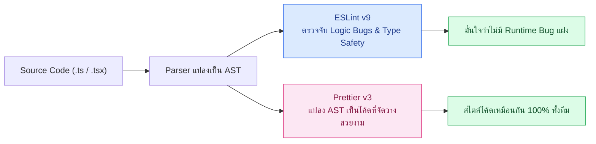
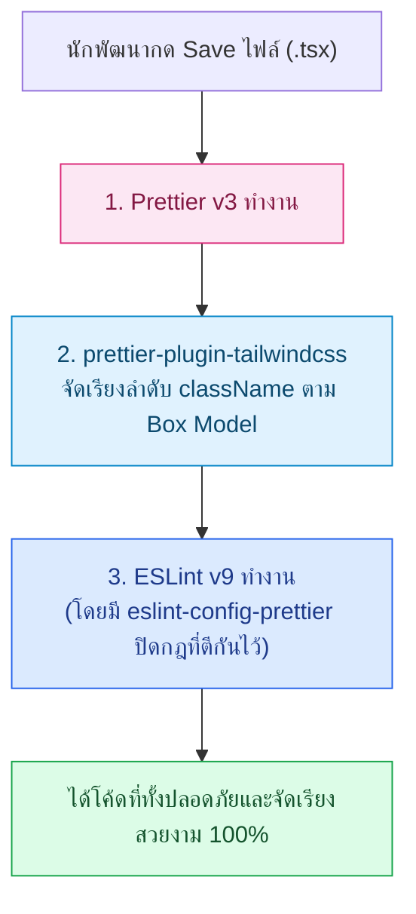

# ESLint Prettier

คู่มือฉบับสมบูรณ์สำหรับการวางโครงสร้าง Static Analysis และ Code Formatting ระดับ Production ด้วย **ESLint v9 (Flat Config)** และ **Prettier v3** สำหรับสถาปัตยกรรม Fullstack (Next.js 16 + NestJS 11 + TypeScript 5.x Strict Mode) บนระบบ **Smart Butcher Marketplace** เพื่อป้องกันบั๊กตั้งแต่ระดับ AST (Abstract Syntax Tree) และยุติข้อถกเถียงเรื่องการจัดหน้าโค้ดในทีมพัฒนา

| หมวดหมู่เนื้อหา | หัวข้อหลัก | เป้าหมายทางวิศวกรรม |
| :--- | :--- | :--- |
| **1. Architecture & Roles** | แยกบทบาทระหว่าง ESLint และ Prettier | แยกการตรวจจับ Logic Bugs ออกจากเรื่อง Code Formatting อย่างเด็ดขาด |
| **2. ESLint v9 Flat Config** | การตั้งค่า `eslint.config.mjs` สำหรับ Next.js 16 และ NestJS 11 | กำหนดขอบเขตการตรวจโค้ดด้วยมาตรฐานใหม่แทนที่ `.eslintrc` เดิม |
| **3. Rules & Strictness** | กฎสำคัญของ `typescript-eslint` และ React Hooks | ป้องกัน Floating Promises, Unsafe `any` และ Stale Closures ใน UI |
| **4. Formatting Pipeline** | การผสาน Prettier, `eslint-config-prettier` และ Tailwind Plugin | ปิดกฎที่ตีกันและเรียงลำดับคลาส Tailwind CSS อัตโนมัติ |
| **5. Developer Experience** | npm Scripts, VS Code Format on Save และมาตรฐานใน Monorepo | ทำให้ทีมพัฒนาทำงานได้รวดเร็วด้วยมาตรฐานเดียวกันทั้งองค์กร |

---

## 1. แยกบทบาทระหว่าง ESLint (Code Quality) และ Prettier (Code Formatting)

### แนวคิด (Concept)

ในทีมพัฒนาซอฟต์แวร์ขนาดใหญ่ ปัญหาคลาสสิกที่ทำให้การทำ Code Review ล่าช้าคือการปะปนกันระหว่าง **"ความถูกต้องทางตรรกะของโค้ด (Code Quality)"** กับ **"ความสวยงามในการจัดวางโค้ด (Code Formatting)"**

เพื่อการดูแลระบบ **Smart Butcher Marketplace** ที่มีทั้งการคำนวณราคาเนื้อวากิวดรายเอจและการตัดสต็อกแบบ Real-time เราต้องแบ่งหน้าที่ของเครื่องมือทั้งสองอย่างชัดเจน:
- **ESLint (Linter — ดูแล Code Quality)**: ทำหน้าที่ตรวจสอบโครงสร้างทางตรรกะและรูปแบบการเขียนโค้ดที่อาจนำไปสู่ Runtime Bug เช่น การลืมใส่ `await` ตอนเรียกฟังก์ชันตัดเงิน (`Payment`), การประกาศตัวแปร `Product` ทิ้งไว้โดยไม่ได้ใช้งาน, การแอบใช้ `any` จนทำลายระบบ Type Safety หรือการลืมใส่ Dependency ใน `useEffect`
- **Prettier (Formatter — ดูแล Code Formatting)**: ทำหน้าที่จัดระเบียบหน้าตาของโค้ดเพียงอย่างเดียว เช่น การเคาะวรรค (Indentation), ความยาวบรรทัดสูงสุด (`printWidth`), การใช้ Single Quote หรือ Double Quote และการเติม Semicolon โดยไม่สนใจว่าโค้ดนั้นจะทำงานถูกหรือผิดตรรกะ



### หลักการเบื้องหลัง (Under the Hood)

ทั้ง ESLint และ Prettier ทำงานอยู่บนโครงสร้างข้อมูลที่เรียกว่า **Abstract Syntax Tree (AST)** แต่มีกลไกภายในต่างกันโดยสิ้นเชิง:

1. **กลไกของ ESLint**: ใช้ Parser (`@typescript-eslint/parser`) แปลงโค้ด TypeScript ให้กลายเป็นโครงสร้างต้นไม้ AST ผูกเข้ากับข้อมูล Type Information จาก TypeScript Compiler (`tsserver` / `ProjectService`) จากนั้นจึงเดินสำรวจโหนดต่างๆ (AST Traversal) ตามกฎที่ตั้งไว้ หากพบโหนดที่ละเมิดกฎ (เช่น โหนด `CallExpression` ที่คืนค่า `Promise<Payment>` แต่ไม่มีโหนด `AwaitExpression` มารับ) ESLint จะรายงานตำแหน่งบรรทัดและคอลัมน์ทันที
2. **กลไกของ Prettier**: อ่านโค้ดต้นฉบับแปลงเป็น AST แล้ว **"โยนการจัดวางช่องว่างและบรรทัดเดิมของนักพัฒนาทิ้งทั้งหมด"** จากนั้นนำ AST มาพิมพ์ใหม่ตั้งแต่ต้น (Re-printing from scratch) ตามค่า `printWidth` ที่กำหนด ทำให้ไม่ว่านักพัฒนาแต่ละคนจะเขียนโค้ดบรรทัดเดียวติดกันยาวเหยียดหรือเคาะบรรทัดแปลกแค่ไหน ผลลัพธ์หลังผ่าน Prettier จะออกมาเหมือนกันทุกตัวอักษร

<Callout type="tip" title="ทำไมไม่ควรให้ ESLint จัด Format โค้ดแทน Prettier?">
ในอดีตนักพัฒนามักใช้กฎจำพวก indent, quotes หรือ semi ของ ESLint ในการจัดหน้าโค้ด แต่กฎเหล่านั้นทำงานแบบแยกส่วนกันและแก้ไขด้วย String Patching ซึ่งมักเกิดความขัดแย้งกันเองเมื่อเจอโค้ดซ้อนกันหลายชั้น ในขณะที่ Prettier คำนวณความยาวบรรทัดจากโครงสร้าง AST ทั้งก้อนในคราวเดียว จึงรวดเร็วและแม่นยำกว่ามาก
</Callout>

### ตัวอย่างโค้ด (Smart Butcher Marketplace)

#### ตัวอย่างที่ 1 (ระดับพื้นฐาน): โค้ดที่มีทั้งปัญหา Formatting และปัญหา Code Quality
ตัวอย่างแรกแสดงโมเดลและฟังก์ชันคำนวณราคาเนื้อพรีเมียมที่เขียนด้วยรูปแบบที่ยุ่งเหยิงและมีบั๊กแฝง

```typescript filename="src/domain/butcher-pricing.ts"
export type UserRole = 'CUSTOMER' | 'BUTCHER' | 'ADMIN';

export interface User {
  id: string;
  email: string;
  fullName: string;
  role: UserRole;
  isVip: boolean;
}

export interface Category {
  id: string;
  name: string;
  slug: string;
  storageTempCelsius: number;
}

export interface Product {
  id: string;
  categoryId: string;
  name: string;
  sku: string;
  pricePerKg: number;
  stockKg: number;
  dryAgedDays: number;
}

// โค้ดด้านล่างนี้ Prettier จะเข้ามาจัดหน้า (เคาะวรรค, ใส่ semicolon)
// ส่วน ESLint จะแจ้งเตือนตัวแปร unusedTaxRate ที่ประกาศทิ้งไว้แต่ไม่ได้นำมาคำนวณจริง!
export function calculateDryAgedPrice(
  product: Product,
  weightKg: number,
  user: User,
): number {
  const unusedTaxRate = 0.07; // ESLint Error: '@typescript-eslint/no-unused-vars'
  const basePrice = product.pricePerKg * weightKg;
  const agingPremium = product.dryAgedDays >= 45 ? basePrice * 0.15 : 0;
  const subtotal = basePrice + agingPremium;

  if (user.isVip) {
    return Math.round(subtotal * 0.9);
  }

  return Math.round(subtotal);
}
```

#### ตัวอย่างที่ 2 (ระดับ Production): การตรวจจับบั๊ก Asynchronous ในระบบสั่งซื้อและชำระเงิน
ตัวอย่างที่สองแสดงให้เห็นคุณค่าที่แท้จริงของ ESLint ในการตรวจจับ **Floating Promise** (การเรียก Async Function โดยลืม `await`) ในขั้นตอนการบันทึก `Order` และ `Payment` ซึ่ง Prettier ไม่สามารถช่วยตรวจจับได้เลย

```typescript filename="src/services/order-checkout.service.ts"
import { Product, User } from '../domain/butcher-pricing';

export interface OrderItem {
  id: string;
  productId: string;
  weightKg: number;
  unitPricePerKg: number;
  subtotal: number;
}

export interface Payment {
  id: string;
  orderId: string;
  amount: number;
  method: 'PROMPTPAY' | 'CREDIT_CARD';
  status: 'PENDING' | 'COMPLETED' | 'FAILED';
  paidAt: Date | null;
}

export interface Order {
  id: string;
  userId: string;
  items: OrderItem[];
  totalAmount: number;
  status: 'DRAFT' | 'CONFIRMED' | 'DISPATCHED';
}

export interface PaymentGatewayPort {
  chargeCustomer(orderId: string, amount: number): Promise<Payment>;
  reserveButcherStock(items: OrderItem[]): Promise<void>;
}

export class OrderCheckoutService {
  constructor(private readonly gateway: PaymentGatewayPort) {}

  async confirmWagyuOrder(
    user: User,
    product: Product,
    weightKg: number,
  ): Promise<{ order: Order; payment: Payment }> {
    if (product.stockKg < weightKg) {
      throw new Error(`สต็อกเนื้อ ${product.name} ไม่เพียงพอ`);
    }

    const subtotal = Math.round(product.pricePerKg * weightKg);
    const item: OrderItem = {
      id: `item-${Date.now()}`,
      productId: product.id,
      weightKg,
      unitPricePerKg: product.pricePerKg,
      subtotal,
    };

    const order: Order = {
      id: `ord-${Date.now()}`,
      userId: user.id,
      items: [item],
      totalAmount: subtotal,
      status: 'CONFIRMED',
    };

    // ต้องใส่ await เสมอ มิฉะนั้น ESLint (@typescript-eslint/no-floating-promises) จะฟ้อง Error ทันที
    await this.gateway.reserveButcherStock(order.items);
    const payment = await this.gateway.chargeCustomer(order.id, order.totalAmount);

    return { order, payment };
  }
}
```

### ผิด vs ถูก (Anti-pattern vs Best Practice)

```typescript filename="src/services/stock-audit.compare.ts"
import { OrderItem, PaymentGatewayPort } from './order-checkout.service';

// ❌ ผิด (Anti-pattern): ใช้ eslint-plugin-prettier รัน Prettier แฝงใน ESLint และลืม await Promise
export async function syncButcherStockBad(
  gateway: PaymentGatewayPort,
  items: OrderItem[],
): Promise<boolean> {
  // ลืม await! หากการตัดสต็อกล้มเหลว ระบบจะยังคงคืนค่า true กลับไปหาลูกค้า
  gateway.reserveButcherStock(items);
  return true;
}

// ✅ ถูก (Best Practice): แยก Prettier รันเฉพาะเรื่อง Format และให้ ESLint บังคับตรวจจับ Promise เต็มรูปแบบ
export async function syncButcherStockGood(
  gateway: PaymentGatewayPort,
  items: OrderItem[],
): Promise<boolean> {
  await gateway.reserveButcherStock(items);
  return true;
}
```

### ควรใช้เมื่อไหร่ และ ไม่ควรใช้เมื่อไหร่

- **ควรใช้ ESLint เมื่อ**: ต้องการบังคับใช้มาตรฐานความปลอดภัยของโค้ด เช่น ห้ามใช้ `any`, บังคับจัดการ `Promise` ทุกตัว, ตรวจสอบลำดับการ Import โมดูล และตรวจสอบกฎของ React Hooks / Next.js
- **ควรใช้ Prettier เมื่อ**: ต้องการจัดรูปแบบไฟล์โค้ดทั้งหมด (`.ts`, `.tsx`, `.json`, `.md`, `.yaml`) ให้เป็นระเบียบเหมือนกันทั้งทีมโดยอัตโนมัติทันทีที่กด Save
- **ไม่ควรใช้**: ไม่ควรติดตั้ง `eslint-plugin-prettier` เพื่อสั่งให้ ESLint รัน Prettier เป็นกฎข้อหนึ่ง เพราะจะทำให้การตรวจ ESLint ช้าลงอย่างมากและเกิดเส้นหยักสีแดงเต็มหน้าจอเพียงเพราะเคาะวรรคผิด ให้ใช้เฉพาะ `eslint-config-prettier` เพื่อปิดกฎที่ซ้ำซ้อนกันก็พอ

### คำถามสัมภาษณ์ (Interview Q&A)

**Q1: ทำไมเราต้องใช้ทั้ง ESLint และ Prettier ร่วมกัน ใช้ตัวใดตัวหนึ่งแทนกันทั้งหมดได้หรือไม่?**
- **แนวคำตอบ**: ไม่ได้ เพราะเครื่องมือทั้งสองแก้คนละปัญหา Prettier เป็น Code Formatter ที่แปลง AST กลับมาเป็นข้อความที่จัดหน้าสวยงามแต่ไม่เข้าใจความหมายเชิงตรรกะหรือชนิดข้อมูล (Type) ในขณะที่ ESLint เป็น Static Code Analysis ที่สามารถเชื่อมกับ TypeScript Type Checker เพื่อตรวจจับบั๊กอันตราย เช่น Unhandled Promise, การอ้างอิงตัวแปรที่เป็น `undefined` หรือการละเมิดกฎของ React Hooks ดังนั้นจึงต้องใช้คู่กันเสมอ

**Q2: การใส่ `eslint-plugin-prettier` ต่างจากการใช้ `eslint-config-prettier` อย่างไร และควรเลือกแนวทางไหนในโปรเจกต์ขนาดใหญ่?**
- **แนวคำตอบ**: `eslint-config-prettier` เป็นเพียงชุดการตั้งค่าที่ทำหน้าที่ **ปิด (turn off)** กฎการจัดหน้าของ ESLint ทุกข้อที่อาจขัดแย้งกับ Prettier ส่วน `eslint-plugin-prettier` คือการนำเอนจินของ Prettier มารันข้างในกระบวนการของ ESLint แล้วแสดงผลเป็น ESLint Error ในโปรเจกต์ระดับ Production ควรใช้เฉพาะ `eslint-config-prettier` แล้วรัน Prettier แยกต่างหาก เพื่อลดภาระ CPU ของ ESLint และแยกแยะชัดเจนระหว่าง Syntax/Logic Error กับเรื่องความสวยงามของโค้ด

---

## 2. การตั้งค่า ESLint Flat Config (eslint.config.mjs) สำหรับ Next.js 16 และ NestJS 11

### แนวคิด (Concept)

ตั้งแต่ **ESLint v9** เป็นต้นมา ระบบการตั้งค่ารูปแบบเก่า (`.eslintrc.json`, `.eslintrc.js`) ได้ถูกประกาศเลิกใช้งาน (Deprecated) และเปลี่ยนมาใช้สถาปัตยกรรมใหม่ที่เรียกว่า **Flat Config (`eslint.config.mjs`)** เป็นค่าเริ่มต้น

จุดเด่นสำคัญของ Flat Config สำหรับโปรเจกต์ Fullstack ที่ใช้ทั้ง **Next.js 16** และ **NestJS 11** คือ:
- **Explicit Imports**: เปลี่ยนจากการอ้างอิงชื่อปลั๊กอินด้วยข้อความลอยๆ (`extends: ["plugin:@typescript-eslint/recommended"]`) มาเป็นการ `import` โมดูล JavaScript มาตรฐานโดยตรง ทำให้เห็นที่มาของกฎชัดเจนและหมดปัญหา Dependency ซ้อนทับกัน (`eslint-patch`)
- **Single Array Cascade**: การตั้งค่าทั้งหมดเป็นเพียง Array ของออบเจกต์เรียงต่อกัน ออบเจกต์ที่อยู่ด้านล่างสามารถเขียนทับ (Override) กฎของออบเจกต์ด้านบนได้ตามรูปแบบไฟล์ (`files: ["**/*.ts"]`)

### หลักการเบื้องหลัง (Under the Hood)

ในระบบ `.eslintrc` แบบเดิม ESLint ต้องเดินค้นหาไฟล์การตั้งค่าตามลำดับโฟลเดอร์ย้อนขึ้นไปเรื่อยๆ (Directory Cascading) และพึ่งพาระบบการโหลดปลั๊กอินผ่าน `require.resolve` ที่ซับซ้อน

แต่ใน **Flat Config (`eslint.config.mjs`)** ESLint จะอ่านไฟล์การตั้งค่าเพียงจุดเดียวที่รากของโปรเจกต์ (Root) แล้วประมวลผลอาร์เรย์ของ Config Objects จากบนลงล่าง:
1. ออบเจกต์ที่มีเฉพาะคีย์ `ignores` ในระดับบนสุดจะทำหน้าที่เป็น **Global Ignores** แทนที่ไฟล์ `.eslintignore` เดิมทั้งหมด
2. การเปิดใช้งาน Type-Checked Rules ใน `typescript-eslint` v8+ ใช้ฟีเจอร์ใหม่ชื่อ `parserOptions: { projectService: true }` ซึ่งเชื่อมต่อกับ API ของ TypeScript Server โดยตรง ช่วยลดการใช้หน่วยความจำ (RAM) และทำงานเร็วกว่าการระบุ `project: "./tsconfig.json"` แบบเดิมอย่างเห็นได้ชัด

<Callout type="note" title="ข้อควรระวังเรื่อง Global Ignores ใน eslint.config.mjs">
หากต้องการให้ ignores มีผลครอบคลุมทั้งโปรเจกต์เหมือนไฟล์ .eslintignore เดิม จะต้องแยกออบเจกต์ที่มีเฉพาะคีย์ ignores ออกมาเป็นออบเจกต์เดี่ยวๆ ตัวแรกสุดของอาร์เรย์ ห้ามใส่ปนกับคีย์ files หรือ rules ในออบเจกต์เดียวกัน เพราะจะกลายเป็นเพียงการยกเว้นเฉพาะกลุ่มกฎนั้นแทน
</Callout>

### ตัวอย่างโค้ด (Smart Butcher Marketplace)

#### ตัวอย่างที่ 1 (ระดับพื้นฐาน): โครงสร้าง `eslint.config.mjs` มาตรฐานสำหรับ TypeScript 5.x และ NestJS 11
การตั้งค่า Flat Config สำหรับฝั่ง Backend API ของระบบร้านค้าเนื้อพรีเมียม ที่เปิดใช้ Type-Checked Rules เต็มรูปแบบ

```javascript filename="eslint.config.mjs"
// @ts-check
import eslint from '@eslint/js';
import tseslint from 'typescript-eslint';
import eslintConfigPrettier from 'eslint-config-prettier';
import globals from 'globals';

export default tseslint.config(
  // 1. Global Ignores (แทนที่ไฟล์ .eslintignore เดิม)
  {
    ignores: [
      '**/dist/**',
      '**/build/**',
      '**/.next/**',
      '**/node_modules/**',
      '**/coverage/**',
    ],
  },

  // 2. กฎพื้นฐานของ JavaScript และ TypeScript Strict Type-Checked
  eslint.configs.recommended,
  ...tseslint.configs.strictTypeChecked,
  ...tseslint.configs.stylisticTypeChecked,

  // 3. ตั้งค่า TypeScript Project Service สำหรับวิเคราะห์ Type เชิงลึก
  {
    languageOptions: {
      globals: {
        ...globals.node,
        ...globals.jest,
      },
      parserOptions: {
        projectService: true,
        tsconfigRootDir: import.meta.dirname,
      },
    },
  },

  // 4. ปรับแต่งกฎเฉพาะสำหรับ NestJS 11 Backend
  {
    files: ['apps/api/**/*.ts', 'src/**/*.ts'],
    rules: {
      '@typescript-eslint/no-extraneous-class': 'off', // อนุญาต Empty Module Class ของ NestJS
      '@typescript-eslint/explicit-function-return-type': [
        'error',
        { allowExpressions: true },
      ],
    },
  },

  // 5. ปิดกฎการจัดหน้าโค้ดทั้งหมดที่อาจตีกับ Prettier (ต้องอยู่ท้ายสุดเสมอ!)
  eslintConfigPrettier,
);
```

#### ตัวอย่างที่ 2 (ระดับ Production): NestJS 11 Service ที่ผ่านมาตรฐาน ESLint Flat Config Strict Type-Checked
โค้ดบริหารจัดการคำสั่งซื้อเนื้อดรายเอจและตรวจสอบอุณหภูมิห้องบ่ม ที่เขียนอย่างรัดกุมตามกฎของ Flat Config ข้างต้นทุกประการ

```typescript filename="src/modules/butcher-inventory/butcher-inventory.service.ts"
import { Category, Product } from '../../domain/butcher-pricing';
import { Order, OrderItem } from '../../services/order-checkout.service';

export interface ColdRoomTelemetry {
  categoryId: string;
  currentTempCelsius: number;
  humidityPercent: number;
  recordedAt: Date;
}

export class ButcherInventoryService {
  private readonly products = new Map<string, Product>();
  private readonly categories = new Map<string, Category>();

  registerCategory(category: Category): void {
    this.categories.set(category.id, category);
  }

  registerProduct(product: Product): void {
    this.products.set(product.id, product);
  }

  validateColdChainSafety(telemetry: ColdRoomTelemetry): {
    isSafe: boolean;
    alertMessage: string | null;
  } {
    const category = this.categories.get(telemetry.categoryId);
    if (!category) {
      throw new Error(`ไม่พบหมวดหมู่เนื้อรหัส ${telemetry.categoryId}`);
    }

    // ตรวจสอบอุณหภูมิห้องบ่มเนื้อไม่ให้สูงเกินเกณฑ์มาตรฐานเกิน 1.5 องศาเซลเซียส
    const maxAllowedTemp = category.storageTempCelsius + 1.5;
    if (telemetry.currentTempCelsius > maxAllowedTemp) {
      return {
        isSafe: false,
        alertMessage: `แจ้งเตือนฉุกเฉิน: หมวดหมู่ ${category.name} อุณหภูมิสูงถึง ${String(telemetry.currentTempCelsius)}°C (เกณฑ์สูงสุด ${String(maxAllowedTemp)}°C)`,
      };
    }

    return {
      isSafe: true,
      alertMessage: null,
    };
  }

  allocateStockForOrder(order: Order): OrderItem[] {
    return order.items.map((item): OrderItem => {
      const product = this.products.get(item.productId);
      if (!product) {
        throw new Error(`ไม่พบข้อมูลเนื้อรหัส ${item.productId}`);
      }

      if (product.stockKg < item.weightKg) {
        throw new Error(
          `เนื้อ ${product.name} คงเหลือ ${String(product.stockKg)} กก. ไม่พอสำหรับออเดอร์ ${String(item.weightKg)} กก.`,
        );
      }

      this.products.set(product.id, {
        ...product,
        stockKg: Number((product.stockKg - item.weightKg).toFixed(3)),
      });

      return item;
    });
  }
}
```

### ผิด vs ถูก (Anti-pattern vs Best Practice)

```javascript filename="eslint.config.compare.mjs"
import tseslint from 'typescript-eslint';
import eslintConfigPrettier from 'eslint-config-prettier';

// ❌ ผิด (Anti-pattern): ใส่ ignores ปนกับ files และวาง eslintConfigPrettier ไว้ด้านบนสุด
export const badConfig = tseslint.config(
  eslintConfigPrettier, // วางตรงนี้จะถูก tseslint ด้านล่างเขียนทับกฎจัดหน้ากลับมาใหม่!
  {
    files: ['src/**/*.ts'],
    ignores: ['dist/**'], // ไม่ใช่ Global ignore!ไฟล์ใน dist ที่ไม่ใช่ .ts จะยังถูกตรวจ
  },
  ...tseslint.configs.recommended,
);

// ✅ ถูก (Best Practice): แยก Global ignores ไว้บนสุด และวาง eslintConfigPrettier ไว้ล่างสุดเสมอ
export const goodConfig = tseslint.config(
  {
    ignores: ['**/dist/**', '**/.next/**', '**/node_modules/**'],
  },
  ...tseslint.configs.strictTypeChecked,
  {
    files: ['src/**/*.ts'],
    rules: {
      '@typescript-eslint/no-unused-vars': 'error',
    },
  },
  eslintConfigPrettier,
);
```

### ควรใช้เมื่อไหร่ และ ไม่ควรใช้เมื่อไหร่

- **ควรใช้ Flat Config (`eslint.config.mjs`) เมื่อ**: เริ่มต้นโปรเจกต์ใหม่ทั้งหมด หรืออัปเกรดเข้าสู่ระบบนิเวศของ Next.js 16, NestJS 11 และ ESLint v9 เพื่อให้สามารถใช้งาน `projectService: true` ของ `typescript-eslint` v8 ได้อย่างเต็มประสิทธิภาพ
- **ไม่ควรใช้**: ไม่ควรสร้างไฟล์ `.eslintrc.json` หรือ `.eslintignore` ขึ้นมาใหม่ในโปรเจกต์ยุคปัจจุบันเด็ดขาด เพราะ ESLint v9 จะไม่อ่านไฟล์เหล่านี้โดยอัตโนมัติอีกต่อไป

### คำถามสัมภาษณ์ (Interview Q&A)

**Q1: `projectService: true` ใน `typescript-eslint` v8 (สำหรับ ESLint v9 Flat Config) ดีกว่าการใช้ `project: './tsconfig.json'` แบบเดิมอย่างไร?**
- **แนวคำตอบ**: `projectService: true` ใช้กลไกเดียวกับที่ VS Code ใช้ในการทำ Auto-complete และแสดงผล Type Error (`tsserver`) ทำให้ไม่ต้องระบุไฟล์ `tsconfig.eslint.json` แยกต่างหากสำหรับไฟล์เทสต์หรือไฟล์ตั้งค่า และยังช่วยจัดการแคชของ AST และ Type Graph ในหน่วยความจำได้มีประสิทธิภาพกว่าเดิมมาก ลดเวลาการรัน Lint ในโปรเจกต์ขนาดใหญ่ลงได้ 20–40%

**Q2: ทำไมในโปรเจกต์ NestJS 11 เมื่อเปิดใช้ `tseslint.configs.strictTypeChecked` จึงมักต้องปิดหรือปรับแต่งกฎ `@typescript-eslint/no-extraneous-class`?**
- **แนวคำตอบ**: เพราะสถาปัตยกรรมของ NestJS อาศัย Decorator `@Module({...})` แปะลงบนคลาสเปล่าๆ (เช่น `export class AppModule {}`) เพื่อนิยามขอบเขต Dependency Injection แต่กฎ `no-extraneous-class` มองว่าคลาสที่ไม่มี Property หรือ Method ข้างในเป็นสิ่งฟุ่มเฟือย จึงต้องตั้งค่าปิดกฎนี้หรือเปิดออปชัน `{ allowWithDecorator: true }` เพื่อให้เข้ากับรูปแบบของ NestJS

---

## 3. กฎสำคัญของ typescript-eslint และ React Hooks ที่ต้องเปิดใช้งาน

### แนวคิด (Concept)

การติดตั้ง ESLint โดยใช้เพียงค่าเริ่มต้น (`recommended` ของ JavaScript ธรรมดา) แทบไม่ต่างอะไรกับการไม่มีเกราะป้องกันในโปรเจกต์ TypeScript และ React ยุคใหม่

ในระบบ **Smart Butcher Marketplace** ที่มีทั้งการจัดการสถานะตะกร้าสินค้าเนื้อพรีเมียมบนฝั่ง Frontend (Next.js 16 / React 19) และการประมวลผลธุรกรรมการเงินฝั่ง Backend เราจำเป็นต้องเปิดใช้งานกฎเหล็ก 2 กลุ่มหลัก:
1. **Type-Aware TypeScript Rules (`@typescript-eslint`)**:
   - `no-floating-promises`: บังคับให้ทุก Promise ต้องมี `await`, `.then/.catch` หรือระบุ `void` อย่างจงใจ
   - `no-misused-promises`: ป้องกันการส่ง Async Function เข้าไปในที่ที่ไม่ได้รอรับ Promise (เช่น ส่งเข้า `Array.prototype.forEach` หรือ Event Handler โดยไม่จัดการ Error)
   - `no-explicit-any` และ `no-unsafe-assignment`: ปิดช่องโหว่ไม่ให้นักพัฒนาแอบใช้ `any`
   - `consistent-type-imports`: บังคับใช้ `import type { ... }` สำหรับการนำเข้าเฉพาะ Type เพื่อช่วยให้ Bundler ตัดโค้ดส่วนเกินออกได้ทันที
2. **React & React Hooks Rules (`eslint-plugin-react-hooks`)**:
   - `react-hooks/rules-of-hooks`: บังคับให้เรียกใช้ Hooks ที่ระดับบนสุดของ Component เท่านั้น ห้ามเรียกใน `if` หรือ `for`
   - `react-hooks/exhaustive-deps`: ตรวจสอบ Dependency Array ของ `useEffect`, `useMemo` และ `useCallback` เพื่อป้องกันปัญหา **Stale Closure** (เช่น ลูกค้าเปลี่ยนน้ำหนักเนื้อในตะกร้าแล้ว แต่ฟังก์ชันกดสั่งซื้อยังคำนวณด้วยน้ำหนักเก่า)

### หลักการเบื้องหลัง (Under the Hood)

- **การตรวจจับ Stale Closure ของ `exhaustive-deps`**: ปลั๊กอินจะวิเคราะห์ Scope ของฟังก์ชัน Callback ที่ส่งเข้าไปใน `useEffect` หรือ `useCallback` โดยดูว่ามีตัวแปรหรือ Props ใดบ้างที่ถูกอ้างอิงภายในฟังก์ชันแต่ไม่ได้ถูกใส่ไว้ใน Dependency Array หากขาดตัวแปรใดไป เมื่อ Component Re-render ฟังก์ชันเดิมจะยังคงจำค่าตัวแปรจาก Render รอบเก่าไว้ใน Closure
- **การตรวจจับ `no-misused-promises`**: อาศัยข้อมูล Contextual Typing จาก TypeScript Compiler เพื่อดูว่าฟังก์ชันปลายทางที่รับ Callback คาดหวัง Return Type เป็น `void` หรือ `Promise<void>` หากปลายทางต้องการ `void` (เช่น `items.forEach(...)`) แต่เราส่ง `async (item) => { ... }` เข้าไป โค้ดจะทำงานแบบขนานโดยไม่มีใครรอและไม่สามารถดักจับ Exception ด้วย `try/catch` ด้านนอกได้เลย

<Callout type="warning" title="อันตรายของการส่ง async function เข้าไปใน Array.forEach">
Array.prototype.forEach ไม่ได้ถูกออกแบบมาให้รอ Promise เมื่อคุณส่ง async function เข้าไปใน forEach ลูปจะยิงคำสั่งทั้งหมดพร้อมกันแล้วจบการทำงานทันทีโดยไม่รอให้เสร็จ และหากเกิด Error ข้างในจะกลายเป็น Unhandled Promise Rejection ทันที ให้ใช้ for...of คู่กับ await หรือใช้ Promise.all(items.map(...)) แทนเสมอ
</Callout>

### ตัวอย่างโค้ด (Smart Butcher Marketplace)

#### ตัวอย่างที่ 1 (ระดับพื้นฐาน): การบังคับใช้ `consistent-type-imports` และการจัดการ Promise อย่างปลอดภัยในบริการชำระเงิน
โค้ดตัวอย่างที่ปฏิบัติตามกฎ `@typescript-eslint/consistent-type-imports`, `@typescript-eslint/no-floating-promises` และ `@typescript-eslint/no-misused-promises` อย่างเคร่งครัด

```typescript filename="src/services/batch-payment-reconciler.ts"
// ใช้ import type ตามกฎ @typescript-eslint/consistent-type-imports
import type { Order, Payment } from './order-checkout.service';

export interface ReconciliationSummary {
  verifiedOrderIds: string[];
  totalVerifiedAmount: number;
  failedOrderIds: string[];
}

export interface BankSettlementClient {
  verifyTransaction(paymentId: string): Promise<boolean>;
}

export class BatchPaymentReconciler {
  constructor(private readonly bankClient: BankSettlementClient) {}

  async reconcileDailyPayments(
    orders: readonly Order[],
    paymentsByOrderId: ReadonlyMap<string, Payment>,
  ): Promise<ReconciliationSummary> {
    const verifiedOrderIds: string[] = [];
    const failedOrderIds: string[] = [];
    let totalVerifiedAmount = 0;

    // ใช้ for...of แทน forEach เพื่อรองรับ await อย่างถูกต้องตามกฎ no-misused-promises
    for (const order of orders) {
      const payment = paymentsByOrderId.get(order.id);
      if (!payment || payment.status !== 'COMPLETED') {
        failedOrderIds.push(order.id);
        continue;
      }

      const isConfirmedByBank = await this.bankClient.verifyTransaction(
        payment.id,
      );

      if (isConfirmedByBank) {
        verifiedOrderIds.push(order.id);
        totalVerifiedAmount += payment.amount;
      } else {
        failedOrderIds.push(order.id);
      }
    }

    return {
      verifiedOrderIds,
      totalVerifiedAmount,
      failedOrderIds,
    };
  }
}
```

#### ตัวอย่างที่ 2 (ระดับ Production): React Component สำหรับเลือกน้ำหนักเนื้อและคำนวณราคาที่ไร้ปัญหา Stale Closure
Component ฝั่ง Next.js 16 ที่ปฏิบัติตามกฎ `react-hooks/rules-of-hooks` และ `react-hooks/exhaustive-deps` อย่างครบถ้วน พร้อมจัดการ Async Event Handler อย่างถูกวิธี

```tsx filename="src/components/butcher/SteakCustomCutConfigurator.tsx"
'use client';

import { useState, useMemo, useCallback } from 'react';
import type { Product, User } from '../../domain/butcher-pricing';
import type { OrderItem } from '../../services/order-checkout.service';

export interface SteakCustomCutConfiguratorProps {
  product: Product;
  currentUser: User;
  onAddItemToOrder: (item: OrderItem) => Promise<void>;
}

export function SteakCustomCutConfigurator({
  product,
  currentUser,
  onAddItemToOrder,
}: SteakCustomCutConfiguratorProps) {
  const [weightKg, setWeightKg] = useState<number>(0.5);
  const [isSubmitting, setIsSubmitting] = useState<boolean>(false);
  const [errorMessage, setErrorMessage] = useState<string | null>(null);

  // ระบุ dependencies ครบทุกตัวตามกฎ react-hooks/exhaustive-deps
  const calculatedSubtotal = useMemo((): number => {
    const rawPrice = product.pricePerKg * weightKg;
    const vipDiscounted = currentUser.isVip ? rawPrice * 0.9 : rawPrice;
    return Math.round(vipDiscounted);
  }, [product.pricePerKg, weightKg, currentUser.isVip]);

  const handleConfirmCut = useCallback(async (): Promise<void> => {
    setErrorMessage(null);
    setIsSubmitting(true);

    try {
      const newOrderItem: OrderItem = {
        id: `cut-${product.id}-${String(Date.now())}`,
        productId: product.id,
        weightKg,
        unitPricePerKg: product.pricePerKg,
        subtotal: calculatedSubtotal,
      };

      await onAddItemToOrder(newOrderItem);
    } catch (error: unknown) {
      const message =
        error instanceof Error ? error.message : 'ไม่สามารถเพิ่มรายการเนื้อได้';
      setErrorMessage(message);
    } finally {
      setIsSubmitting(false);
    }
  }, [product.id, product.pricePerKg, weightKg, calculatedSubtotal, onAddItemToOrder]);

  return (
    <div className="rounded-xl border border-slate-200 bg-white p-6 shadow-sm">
      <h3 className="text-lg font-semibold text-slate-900">{product.name}</h3>
      <p className="mt-1 text-sm text-slate-600">
        บ่มดรายเอจ {product.dryAgedDays} วัน | ราคา {product.pricePerKg.toLocaleString()} บาท/กก.
      </p>

      <div className="mt-4 flex items-center gap-4">
        <label htmlFor="weight-input" className="text-sm font-medium text-slate-700">
          น้ำหนักที่ต้องการ (กก.):
        </label>
        <input
          id="weight-input"
          type="number"
          min={0.3}
          max={product.stockKg}
          step={0.1}
          value={weightKg}
          onChange={(e) => {
            setWeightKg(Number(e.target.value));
          }}
          className="w-28 rounded-md border border-slate-300 px-3 py-1.5 text-right"
        />
      </div>

      <div className="mt-4 flex items-center justify-between border-t border-slate-100 pt-4">
        <span className="text-base font-bold text-emerald-700">
          ราคารวมสุทธิ: {calculatedSubtotal.toLocaleString()} บาท
        </span>

        {/* ใช้ void นำหน้าการเรียก async function ใน onClick เพื่อให้ผ่านกฎ no-misused-promises */}
        <button
          type="button"
          disabled={isSubmitting}
          onClick={() => {
            void handleConfirmCut();
          }}
          className="rounded-lg bg-emerald-600 px-4 py-2 text-sm font-semibold text-white hover:bg-emerald-700 disabled:opacity-50"
        >
          {isSubmitting ? 'กำลังบันทึก...' : 'สั่งตัดเนื้อชิ้นนี้'}
        </button>
      </div>

      {errorMessage ? (
        <p className="mt-3 text-sm font-medium text-red-600" role="alert">
          {errorMessage}
        </p>
      ) : null}
    </div>
  );
}
```

### ผิด vs ถูก (Anti-pattern vs Best Practice)

```tsx filename="src/components/butcher/HooksAndPromises.compare.tsx"
import { useEffect } from 'react';
import type { OrderItem } from '../../services/order-checkout.service';

// ❌ ผิด (Anti-pattern): ปิดคำเตือน exhaustive-deps ด้วย eslint-disable และใช้ async ใน forEach
export function BadOrderSync({
  items,
  discountRate,
  syncItem,
}: {
  items: OrderItem[];
  discountRate: number;
  syncItem: (item: OrderItem, rate: number) => Promise<void>;
}) {
  useEffect(() => {
    // 1. ผิดกฎ no-misused-promises: forEach ไม่รอ async function
    items.forEach(async (item) => {
      await syncItem(item, discountRate);
    });
    // 2. ปิดกฎ exhaustive-deps ทำให้เมื่อ discountRate เปลี่ยน โค้ดยังคงใช้ค่าเก่า (Stale Closure)!
    // eslint-disable-next-line react-hooks/exhaustive-deps
  }, [items]);

  return null;
}

// ✅ ถูก (Best Practice): ระบุ dependency ครบทุกตัว และใช้ Promise.all ร่วมกับ void อย่างชัดเจน
export function GoodOrderSync({
  items,
  discountRate,
  syncItem,
}: {
  items: OrderItem[];
  discountRate: number;
  syncItem: (item: OrderItem, rate: number) => Promise<void>;
}) {
  useEffect(() => {
    async function runSync(): Promise<void> {
      await Promise.all(
        items.map((item) => syncItem(item, discountRate)),
      );
    }

    void runSync();
  }, [items, discountRate, syncItem]);

  return null;
}
```

### ควรใช้เมื่อไหร่ และ ไม่ควรใช้เมื่อไหร่

- **ควรเปิดเป็นระดับ `"error"` เสมอสำหรับ**: `@typescript-eslint/no-floating-promises`, `@typescript-eslint/no-misused-promises`, `@typescript-eslint/no-explicit-any`, `react-hooks/rules-of-hooks` และ `react-hooks/exhaustive-deps`
- **ไม่ควรใช้**: ห้ามใช้คอมเมนต์ `// eslint-disable-next-line react-hooks/exhaustive-deps` เพื่อซ่อนคำเตือนโดยไม่ได้ปรับโครงสร้างโค้ดด้วย `useCallback`, `useMemo` หรือ `useEffectEvent` เพราะจะสร้างบั๊กที่หาสาเหตุยากมากเมื่อ State เปลี่ยนแปลง

### คำถามสัมภาษณ์ (Interview Q&A)

**Q1: ทำไม ESLint กฎ `@typescript-eslint/no-misused-promises` จึงแจ้งเตือนเมื่อเราเขียน `<button onClick={handleSubmitAsync}>` ทั้งที่โค้ดรันได้ปกติ?**
- **แนวคำตอบ**: เพราะ Event Handler `onClick` ของ React DOM มีชนิดข้อมูลของฟังก์ชันตอบกลับเป็น `() => void` ซึ่ง React ไม่ได้ทำการ `await` หรือผูก `.catch()` ให้กับ Promise ที่คืนค่าออกมาจาก `onClick` หากภายใน `handleSubmitAsync` เกิด Exception ที่ไม่ได้ดักจับไว้ จะกลายเป็น Unhandled Promise Rejection ทันที วิธีแก้ไขที่ถูกต้องคือการดัก `try/catch` ภายในฟังก์ชันให้เรียบร้อยแล้วเรียกผ่าน Wrapper `onClick={() => { void handleSubmitAsync(); }}`

**Q2: กฎ `@typescript-eslint/consistent-type-imports` ช่วยเพิ่มประสิทธิภาพการ Build ของทั้ง Next.js และ NestJS ได้อย่างไร?**
- **แนวคำตอบ**: เมื่อเราแยกการนำเข้าด้วย `import type { Product } from './models'` เครื่องมือ Transpiler ยุคใหม่ เช่น SWC หรือ esbuild สามารถลบบรรทัดนั้นทิ้งได้ทันทีแบบไฟล์ต่อไฟล์ (Single-file Transpilation) โดยไม่ต้องเสียเวลาเปิดอ่านไฟล์ปลายทางเพื่อดูว่า `Product` เป็น Interface หรือเป็น Class จริงใน Runtime และยังช่วยป้องกันปัญหา Circular Dependency ระหว่างโมดูลใน NestJS ได้อีกด้วย

---

## 4. การผสาน Prettier, eslint-config-prettier และ prettier-plugin-tailwindcss

### แนวคิด (Concept)

เพื่อให้การจัดรูปแบบโค้ดทำงานร่วมกับ ESLint และ **Tailwind CSS** ได้อย่างสมบูรณ์แบบโดยไม่มีความขัดแย้ง เราต้องประกอบชิ้นส่วน 3 ชิ้นเข้าด้วยกัน:
1. **`prettier`**: เอนจินหลักสำหรับจัดรูปแบบโค้ดทุกภาษาในโปรเจกต์
2. **`eslint-config-prettier`**: ตัวปิดกฎด้าน Formatting ของ ESLint และ `@typescript-eslint` ทุกข้อที่อาจขัดแย้งกับการจัดวางของ Prettier
3. **`prettier-plugin-tailwindcss`**: ปลั๊กอินอย่างเป็นทางการจากทีม Tailwind CSS ที่ทำหน้าที่จัดเรียงลำดับ Utility Classes ในแอตทริบิวต์ `className` ของ React ตามลำดับ CSS Cascade มาตรฐานโดยอัตโนมัติ



### หลักการเบื้องหลัง (Under the Hood)

วิธีที่ `prettier-plugin-tailwindcss` จัดเรียงคลาสไม่ได้เรียงตามตัวอักษร A-Z แต่เรียงตามลำดับการสร้าง CSS Rule ของ Tailwind Compiler:
1. **Layout & Box Model**: `flex`, `grid`, `block`, `hidden`
2. **Positioning & Sizing**: `relative`, `w-full`, `h-12`
3. **Spacing (Margin / Padding)**: `mx-auto`, `p-6`, `gap-4`
4. **Typography & Visuals**: `bg-white`, `text-slate-900`, `font-bold`, `shadow-sm`
5. **Responsive & State Modifiers**: `hover:...`, `focus:...`, `md:...`, `lg:...` จะถูกดันไปอยู่ท้ายสุดเสมอ

นอกจากนี้ สำหรับโค้ดที่ใช้ฟังก์ชันช่วยรวมคลาสอย่าง `clsx`, `cn` หรือ `cva` เราสามารถตั้งค่า `tailwindFunctions: ['clsx', 'cn', 'cva']` ใน `.prettierrc.json` เพื่อให้ปลั๊กอินเข้าไปจัดเรียงคลาสที่อยู่ภายในอาร์กิวเมนต์ของฟังก์ชันเหล่านั้นได้ด้วย

<Callout type="tip" title="กฎสำคัญของการโหลด prettier-plugin-tailwindcss">
หากโปรเจกต์ของคุณมีการใช้ปลั๊กอินของ Prettier หลายตัวร่วมกัน จะต้องวาง prettier-plugin-tailwindcss ไว้เป็นลำดับสุดท้ายในอาร์เรย์ plugins ของไฟล์ .prettierrc.json เสมอ เพื่อให้มันทำงานหลังจากปลั๊กอินตัวอื่นแปลง AST เสร็จเรียบร้อยแล้ว
</Callout>

### ตัวอย่างโค้ด (Smart Butcher Marketplace)

#### ตัวอย่างที่ 1 (ระดับพื้นฐาน): การตั้งค่า `.prettierrc.json` และ `.prettierignore` ระดับ Production
ไฟล์ตั้งค่า Prettier ที่กำหนดมาตรฐานเดียวกันทั้งทีม พร้อมเปิดใช้งานการจัดเรียงคลาส Tailwind CSS ทั้งใน JSX และในฟังก์ชัน `cn()`

```json filename=".prettierrc.json"
{
  "semi": true,
  "singleQuote": true,
  "trailingComma": "all",
  "printWidth": 80,
  "tabWidth": 2,
  "useTabs": false,
  "endOfLine": "lf",
  "arrowParens": "always",
  "plugins": ["prettier-plugin-tailwindcss"],
  "tailwindFunctions": ["clsx", "cn", "cva"]
}
```

#### ตัวอย่างที่ 2 (ระดับ Production): การ์ดแสดงสินค้าเนื้อวากิวและสถานะการชำระเงินที่จัดเรียง Tailwind Classes อย่างเป็นระบบ
ตัวอย่าง Component แสดงข้อมูล `Product`, `Category` และสถานะ `Payment` ที่ใช้ฟังก์ชัน `cn` และถูกจัดเรียงลำดับคลาสตามมาตรฐาน Box Model จนอ่านง่ายและบำรุงรักษาสะดวก

```tsx filename="src/components/butcher/WagyuOrderSummaryCard.tsx"
import type { Category, Product } from '../../domain/butcher-pricing';
import type { Order, Payment } from '../../services/order-checkout.service';

export function cn(...classes: readonly (string | false | null | undefined)[]): string {
  return classes.filter(Boolean).join(' ');
}

export interface WagyuOrderSummaryCardProps {
  order: Order;
  product: Product;
  category: Category;
  payment: Payment;
}

export function WagyuOrderSummaryCard({
  order,
  product,
  category,
  payment,
}: WagyuOrderSummaryCardProps) {
  const isPaid = payment.status === 'COMPLETED';

  return (
    <article className="mx-auto flex max-w-lg flex-col gap-4 rounded-2xl border border-slate-200 bg-white p-6 shadow-md transition-shadow hover:shadow-lg">
      <header className="flex items-start justify-between border-b border-slate-100 pb-4">
        <div>
          <span className="inline-block rounded-full bg-amber-100 px-3 py-0.5 text-xs font-semibold tracking-wide text-amber-900 uppercase">
            {category.name} ({category.storageTempCelsius}°C)
          </span>
          <h2 className="mt-2 text-xl font-bold text-slate-900">
            {product.name}
          </h2>
          <p className="text-xs text-slate-500">รหัสคำสั่งซื้อ: {order.id}</p>
        </div>

        <span
          className={cn(
            'rounded-md px-2.5 py-1 text-xs font-bold',
            isPaid
              ? 'bg-emerald-100 text-emerald-800'
              : 'bg-rose-100 text-rose-800',
          )}
        >
          {payment.status}
        </span>
      </header>

      <div className="flex items-center justify-between text-sm text-slate-700">
        <span>จำนวนรายการตัดแต่ง: {order.items.length} ชิ้น</span>
        <span className="text-lg font-extrabold text-slate-900">
          {order.totalAmount.toLocaleString()} บาท
        </span>
      </div>
    </article>
  );
}
```

### ผิด vs ถูก (Anti-pattern vs Best Practice)

```tsx filename="src/components/butcher/TailwindClassOrder.compare.tsx"
// ❌ ผิด (Anti-pattern): คลาส Tailwind เรียงสะเปะสะปะ ผสมปนเประหว่าง hover, padding, layout และสี
export function UnsortedProductBadge({ label }: { label: string }) {
  return (
    <span className="text-white hover:bg-red-800 p-2 flex bg-red-600 items-center rounded-md text-xs font-bold gap-1">
      {label}
    </span>
  );
}

// ✅ ถูก (Best Practice): จัดเรียงด้วย prettier-plugin-tailwindcss (Layout -> Spacing -> Visuals -> States)
export function SortedProductBadge({ label }: { label: string }) {
  return (
    <span className="flex items-center gap-1 rounded-md bg-red-600 p-2 text-xs font-bold text-white hover:bg-red-800">
      {label}
    </span>
  );
}
```

### ควรใช้เมื่อไหร่ และ ไม่ควรใช้เมื่อไหร่

- **ควรใช้ `endOfLine: "lf"` ใน `.prettierrc.json` เสมอเมื่อ**: ทีมพัฒนามีการใช้ระบบปฏิบัติการผสมกันระหว่าง Windows (`CRLF`) และ macOS / Linux (`LF`) เพื่อป้องกันไม่ให้ Git มองว่าไฟล์ถูกแก้ไขทุกบรรทัดเพียงเพราะอักขระขึ้นบรรทัดใหม่ต่างกัน
- **ไม่ควรใช้**: ไม่ควรให้ Prettier เข้าไปจัดรูปแบบไฟล์ที่สร้างขึ้นอัตโนมัติ เช่น `pnpm-lock.yaml`, `package-lock.json`, โฟลเดอร์ `.next`, `dist` หรือไฟล์ Migration ของฐานข้อมูล ให้ใส่รายชื่อเหล่านี้ไว้ใน `.prettierignore` เสมอ

### คำถามสัมภาษณ์ (Interview Q&A)

**Q1: ทำไมการกำหนด `"endOfLine": "lf"` ใน Prettier จึงมีความสำคัญมากเมื่อทีมทำงานร่วมกันระหว่างเครื่อง Windows และ macOS?**
- **แนวคำตอบ**: เพราะ Windows ใช้รหัสขึ้นบรรทัดใหม่เป็น `CRLF` (`\r\n`) ส่วน macOS และ Linux (รวมถึง CI Runner บน GitHub Actions) ใช้ `LF` (`\n`) หากไม่บังคับค่า `"endOfLine": "lf"` ใน Prettier เมื่อนักพัฒนาฝั่ง Windows กด Save หรือรัน `prettier --check` จะเกิด Error แจ้งเตือนทุกบรรทัดในไฟล์ การบังคับ `lf` คู่กับการตั้งค่า `.gitattributes` (`* text=auto eol=lf`) จะช่วยยุติปัญหานี้ได้อย่างถาวร

**Q2: หากเราสร้าง Utility Function ชื่อ `cn()` สำหรับรวมคลาส Tailwind CSS ทำไมตอนแรก `prettier-plugin-tailwindcss` จึงไม่ยอมเรียงคลาสที่อยู่ใน `cn('p-4 flex')` ให้ และต้องแก้ด้วยการตั้งค่าใด?**
- **แนวคำตอบ**: โดยค่าเริ่มต้นปลั๊กอินจะตรวจสอบเฉพาะแอตทริบิวต์ `class` และ `className` ของ JSX เท่านั้น หากต้องการให้มันเข้าไปจัดเรียงสตริงภายในฟังก์ชันเสริม จะต้องเพิ่ม `"tailwindFunctions": ["cn", "clsx", "cva"]` ลงในไฟล์ `.prettierrc.json`

---

## 5. การตั้งค่า npm Scripts, VS Code Format on Save และมาตรฐานใน Monorepo

### แนวคิด (Concept)

การตั้งค่า ESLint และ Prettier จะไร้ความหมายทันทีหากนักพัฒนาแต่ละคนต้องคอยพิมพ์คำสั่งด้วยตัวเองทุกครั้งก่อนส่งงาน เราจึงต้องผสานเครื่องมือเหล่านี้เข้ากับ **Developer Experience (DX)** ใน 3 ระดับ:
1. **IDE Automation (`.vscode/settings.json`)**: ตั้งค่าให้ VS Code จัด Format ด้วย Prettier และแก้ ESLint Auto-fix ทันทีที่กด `Ctrl + S` (หรือ `Cmd + S`)
2. **Standardized npm Scripts (`package.json`)**: แยกสคริปต์สำหรับตรวจสอบใน CI (`lint`, `format:check` — ห้ามแก้ไฟล์เองแต่ให้พังทันทีถ้าพบข้อผิดพลาด) ออกจากสคริปต์สำหรับแก้ไขอัตโนมัติในเครื่องนักพัฒนา (`lint:fix`, `format`)
3. **Monorepo Root Sharing**: ในโครงสร้าง Monorepo ที่มีทั้ง `apps/web` (Next.js 16), `apps/api` (NestJS 11) และ `packages/domain` เราจะวางการตั้งค่าพื้นฐานไว้ที่ Root แล้วให้แต่ละแอปอ้างอิงร่วมกัน

### หลักการเบื้องหลัง (Under the Hood)

เมื่อนักพัฒนากด Save ไฟล์ใน VS Code ที่ตั้งค่าอย่างถูกต้อง:
1. `editor.formatOnSave: true` ร่วมกับ `editor.defaultFormatter: "esbenp.prettier-vscode"` จะสั่งให้ Prettier Daemon จัดรูปแบบโค้ดในหน่วยความจำ
2. `editor.codeActionsOnSave` ที่มี `"source.fixAll.eslint": "explicit"` จะสั่งให้ ESLint Language Server ทำการแก้ไขปัญหาที่สามารถแก้ไขอัตโนมัติได้ (เช่น เปลี่ยน `import { Product }` เป็น `import type { Product }`)
3. ทั้งสองขั้นตอนนี้ทำงานเสร็จสิ้นภายในเวลาไม่ถึง 100 มิลลิวินาที ทำให้นักพัฒนาเห็นโค้ดที่สะอาดและถูกต้องตามมาตรฐานทันทีโดยไม่ต้องสลับไปเปิด Terminal

<Callout type="note" title="ทำไมใน CI Pipeline ต้องใช้ prettier --check แทน prettier --write?">
บนเซิร์ฟเวอร์ CI (เช่น GitHub Actions) เป้าหมายคือการตรวจสอบว่าโค้ดใน Pull Request ผ่านมาตรฐานหรือไม่ (Gatekeeper) หากเราสั่ง prettier --write บน CI ตัว CI จะแอบแก้ไฟล์ใน Container ชั่วคราวแล้วปล่อยให้ Pipeline ผ่านเป็นสีเขียว ทั้งที่โค้ดจริงบน Git Repository ยังไม่ได้จัดหน้า ดังนั้นบน CI ต้องใช้ prettier --check และ eslint (ไม่มี --fix) เสมอ
</Callout>

### ตัวอย่างโค้ด (Smart Butcher Marketplace)

#### ตัวอย่างที่ 1 (ระดับพื้นฐาน): การตั้งค่า `.vscode/settings.json` และ `.vscode/extensions.json` สำหรับแชร์ทั้งทีม
ไฟล์ตั้งค่า VS Code ที่ควร Commit ขึ้น Git Repository เพื่อให้สมาชิกทุกคนในทีมได้รับประสบการณ์ Format on Save เหมือนกันทันทีที่เปิดโปรเจกต์

```json filename=".vscode/settings.json"
{
  "editor.formatOnSave": true,
  "editor.defaultFormatter": "esbenp.prettier-vscode",
  "editor.codeActionsOnSave": {
    "source.fixAll.eslint": "explicit",
    "source.organizeImports": "never"
  },
  "eslint.useFlatConfig": true,
  "eslint.validate": [
    "javascript",
    "javascriptreact",
    "typescript",
    "typescriptreact"
  ],
  "typescript.tsdk": "node_modules/typescript/lib",
  "files.eol": "\n"
}
```

#### ตัวอย่างที่ 2 (ระดับ Production): การตั้งค่า `package.json` สำหรับระบบ Monorepo ของ Smart Butcher Marketplace
การกำหนด npm scripts มาตรฐานที่แยกชัดเจนระหว่างโหมดตรวจสอบบน CI และโหมดแก้ไขในเครื่อง Local พร้อมรองรับการแคชผลลัพธ์ (`--cache`) เพื่อความเร็วสูงสุด

```json filename="package.json"
{
  "name": "smart-butcher-marketplace",
  "version": "1.0.0",
  "private": true,
  "scripts": {
    "lint": "eslint . --max-warnings 0",
    "lint:fix": "eslint . --fix --cache",
    "format": "prettier --write \"**/*.{ts,tsx,mjs,json,md,yml}\"",
    "format:check": "prettier --check \"**/*.{ts,tsx,mjs,json,md,yml}\"",
    "typecheck": "tsc --noEmit",
    "validate": "npm run typecheck && npm run lint && npm run format:check"
  },
  "devDependencies": {
    "@eslint/js": "^9.15.0",
    "eslint": "^9.15.0",
    "eslint-config-prettier": "^9.1.0",
    "eslint-plugin-react-hooks": "^5.1.0",
    "globals": "^15.12.0",
    "prettier": "^3.4.0",
    "prettier-plugin-tailwindcss": "^0.6.9",
    "typescript": "^5.7.0",
    "typescript-eslint": "^8.15.0"
  }
}
```

### ผิด vs ถูก (Anti-pattern vs Best Practice)

```json filename="package.scripts.compare.json"
{
  "scripts": {
    "// ❌ ผิด (Anti-pattern)": "ปล่อยให้มี Warning ผ่าน CI ได้ และใช้ --write ในสคริปต์ตรวจสอบ",
    "ci:bad": "eslint . && prettier --write .",

    "// ✅ ถูก (Best Practice)": "บังคับ --max-warnings 0 และใช้ --check เพื่อบล็อก PR ที่ไม่ผ่านมาตรฐาน",
    "ci:good": "eslint . --max-warnings 0 && prettier --check \"**/*.{ts,tsx,json,md}\""
  }
}
```

### ควรใช้เมื่อไหร่ และ ไม่ควรใช้เมื่อไหร่

- **ควรใช้ `--max-warnings 0` ในสคริปต์ `lint` เสมอเมื่อ**: รันในขั้นตอน Pre-commit หรือบน CI Pipeline เพราะหากปล่อยให้ Warning ผ่านไปได้ นานวันเข้าหน้าจอ Terminal จะเต็มไปด้วยข้อความสีเหลืองนับร้อยรายการจนไม่มีใครสนใจอ่านอีกต่อไป (Broken Windows Theory)
- **ไม่ควรใช้**: ไม่ควรใส่ `.vscode/settings.json` ไว้ใน `.gitignore` สำหรับการตั้งค่า Formatter และ Linter มาตรฐานของโปรเจกต์ ควรนำขึ้น Git เพื่อให้ทุกคนในทีมใช้กฎชุดเดียวกัน

### คำถามสัมภาษณ์ (Interview Q&A)

**Q1: ทำไมใน `.vscode/settings.json` เมื่อเราเปิด `"source.fixAll.eslint": "explicit"` แล้ว เรามักตั้งค่า `"source.organizeImports": "never"` ควบคู่กัน?**
- **แนวคำตอบ**: เพราะฟีเจอร์ `organizeImports` ในตัวของ VS Code อาจทำการเรียงลำดับหรือลบ Import ด้วยเกณฑ์ที่ขัดแย้งกับกฎของ ESLint (เช่น `@typescript-eslint/consistent-type-imports` หรือ `eslint-plugin-import`) ทำให้เกิดอาการไฟล์กระพริบสลับไปมาตอนกด Save ดังนั้นจึงควรปล่อยให้เป็นหน้าที่ของ ESLint และ Prettier จัดการเพียงช่องทางเดียว

**Q2: ออปชัน `--max-warnings 0` ของ ESLint มีความสำคัญต่อวัฒนธรรมวิศวกรรมของทีมอย่างไร?**
- **แนวคำตอบ**: โดยปกติ ESLint จะคืนค่า Exit Code เป็น `0` (สำเร็จ) หากพบเฉพาะ `warn` และไม่มี `error` ส่งผลให้ CI Pipeline ยังคงเป็นสีเขียว ผลที่ตามมาคือนักพัฒนาจะเพิกเฉยต่อคำเตือนจนสะสมเป็นหนี้ทางเทคนิค (Technical Debt) การใส่ `--max-warnings 0` บังคับให้แม้แต่คำเตือนเดียวก็ทำให้ CI พัง ช่วยรักษาวินัยให้โค้ดสะอาดอยู่เสมอ

---

## ข้อผิดพลาดที่พบบ่อย (Anti-patterns)

1. **การปล่อยให้ ESLint และ Prettier แย่งกันจัดหน้าโค้ด**: ลืมติดตั้งหรือวาง `eslintConfigPrettier` ไว้ผิดลำดับ (ไม่ได้วางไว้ท้ายสุดของ `eslint.config.mjs`) ทำให้พอกด Save แล้ว Prettier เปลี่ยนโค้ดเป็นแบบหนึ่ง แต่ ESLint กลับขีดเส้นแดงฟ้องว่าผิด
2. **การใช้ `// eslint-disable` โดยไม่ระบุชื่อกฎ**: การเขียน `/* eslint-disable */` ที่หัวไฟล์เป็นการปิดการตรวจจับบั๊กทุกชนิดในไฟล์นั้นทั้งหมด หากจำเป็นต้องยกเว้นจริงๆ ต้องระบุชื่อกฎให้ชัดเจน เช่น `// eslint-disable-next-line @typescript-eslint/no-explicit-any -- รองรับ payload จาก legacy webhook`
3. **การไม่เปิดใช้ Type-Checked Rules ในโปรเจกต์ TypeScript**: ใช้เพียง `tseslint.configs.recommended` ธรรมดาซึ่งตรวจได้แค่ระดับ Syntax เบื้องต้น ทำให้พลาดการตรวจจับบั๊กร้ายแรงอย่าง `@typescript-eslint/no-floating-promises` ที่ต้องอาศัยข้อมูล Type จาก Compiler
4. **การไม่กำหนด `endOfLine: "lf"`**: ทำให้ทีมที่ใช้ Windows และ macOS ร่วมกันเกิด Git Diff ท่วมทั้งไฟล์จากอักขระ `CRLF` vs `LF`

---

## Checklist สรุป

- [ ] อัปเกรดเป็น **ESLint v9 Flat Config (`eslint.config.mjs`)** และลบไฟล์ `.eslintrc.*` รวมถึง `.eslintignore` เดิมออกทั้งหมด
- [ ] เปิดใช้งาน `tseslint.configs.strictTypeChecked` พร้อมตั้งค่า `parserOptions: { projectService: true }`
- [ ] เปิดกฎเหล็ก `@typescript-eslint/no-floating-promises`, `@typescript-eslint/no-misused-promises` และ `react-hooks/exhaustive-deps` เป็นระดับ `error`
- [ ] ติดตั้ง `eslint-config-prettier` และวางไว้เป็นออบเจกต์ **ลำดับสุดท้ายเสมอ** ในไฟล์ `eslint.config.mjs`
- [ ] ติดตั้ง `prettier-plugin-tailwindcss` ไว้ท้ายสุดของอาร์เรย์ `plugins` ใน `.prettierrc.json` พร้อมระบุ `tailwindFunctions: ["clsx", "cn", "cva"]`
- [ ] กำหนด `"endOfLine": "lf"` ใน `.prettierrc.json` และตั้งค่า `.vscode/settings.json` ให้ทำ Format on Save อัตโนมัติ
- [ ] ตั้งค่าสคริปต์ `lint` ใน `package.json` ให้มี `--max-warnings 0` เสมอ

---

## ลำดับการเรียนที่แนะนำ และ ดูเพิ่มเติมที่

เมื่อวางรากฐานการตรวจสอบคุณภาพโค้ดและจัดรูปแบบด้วย ESLint v9 และ Prettier v3 เรียบร้อยแล้ว ขั้นตอนต่อไปคือการนำคำสั่งเหล่านี้ไปผูกเข้ากับ Git Hooks และระบบอัตโนมัติบน CI/CD Pipeline:

1. **[Git Hooks & CI Pipeline](/docs/testing/git-hooks-ci)**: นำสคริปต์ `eslint` และ `prettier` ไปผูกกับ Husky, lint-staged และ GitHub Actions เพื่อบล็อกโค้ดที่ไม่ได้มาตรฐานก่อนเข้าสู่ Branch หลัก
2. **[Debugging & Type Checking](/docs/testing/debugging-type-checking)**: เจาะลึกการใช้ `tsc --noEmit` คู่กับ Strict Mode และเทคนิคการ Debug ทั้งฝั่ง Next.js 16 และ NestJS 11
3. **[TypeScript Core Guide](/docs/typescript)**: ทบทวนพื้นฐานระบบ Type เชิงลึกเพื่อเขียนโค้ดให้สอดคล้องกับกฎของ `typescript-eslint`
4. **[Tailwind CSS Architecture](/docs/tailwind)**: เรียนรู้การจัดระเบียบ Utility Classes ให้ทำงานร่วมกับ `prettier-plugin-tailwindcss` ได้อย่างมีประสิทธิภาพ
5. **[Testing Fundamentals](/docs/testing/fundamentals)** และ **[Jest Testing Guide](/docs/testing/jest)**: เชื่อมโยงคุณภาพโค้ดระดับ Static Analysis เข้ากับการเขียนชุดทดสอบอัตโนมัติ
