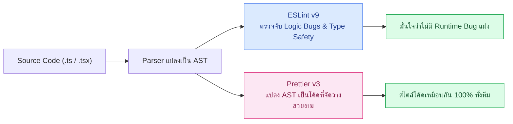

## 1. แนวคิด (Concept)

ในทีมพัฒนาซอฟต์แวร์ขนาดใหญ่ ปัญหาคลาสสิกที่ทำให้การทำ Code Review ล่าช้าคือการปะปนกันระหว่าง **"ความถูกต้องทางตรรกะของโค้ด (Code Quality)"** กับ **"ความสวยงามในการจัดวางโค้ด (Code Formatting)"**

เพื่อการดูแลระบบ **Smart Butcher Marketplace** ที่มีทั้งการคำนวณราคาเนื้อวากิวดรายเอจและการตัดสต็อกแบบ Real-time เราต้องแบ่งหน้าที่ของเครื่องมือทั้งสองอย่างชัดเจน:
- **ESLint (Linter — ดูแล Code Quality)**: ทำหน้าที่ตรวจสอบโครงสร้างทางตรรกะและรูปแบบการเขียนโค้ดที่อาจนำไปสู่ Runtime Bug เช่น การลืมใส่ `await` ตอนเรียกฟังก์ชันตัดเงิน (`Payment`), การประกาศตัวแปร `Product` ทิ้งไว้โดยไม่ได้ใช้งาน, การแอบใช้ `any` จนทำลายระบบ Type Safety หรือการลืมใส่ Dependency ใน `useEffect`
- **Prettier (Formatter — ดูแล Code Formatting)**: ทำหน้าที่จัดระเบียบหน้าตาของโค้ดเพียงอย่างเดียว เช่น การเคาะวรรค (Indentation), ความยาวบรรทัดสูงสุด (`printWidth`), การใช้ Single Quote หรือ Double Quote และการเติม Semicolon โดยไม่สนใจว่าโค้ดนั้นจะทำงานถูกหรือผิดตรรกะ



## 2. หลักการเบื้องหลัง (Under the Hood)

ทั้ง ESLint และ Prettier ทำงานอยู่บนโครงสร้างข้อมูลที่เรียกว่า **Abstract Syntax Tree (AST)** แต่มีกลไกภายในต่างกันโดยสิ้นเชิง:

1. **กลไกของ ESLint**: ใช้ Parser (`@typescript-eslint/parser`) แปลงโค้ด TypeScript ให้กลายเป็นโครงสร้างต้นไม้ AST ผูกเข้ากับข้อมูล Type Information จาก TypeScript Compiler (`tsserver` / `ProjectService`) จากนั้นจึงเดินสำรวจโหนดต่างๆ (AST Traversal) ตามกฎที่ตั้งไว้ หากพบโหนดที่ละเมิดกฎ (เช่น โหนด `CallExpression` ที่คืนค่า `Promise<Payment>` แต่ไม่มีโหนด `AwaitExpression` มารับ) ESLint จะรายงานตำแหน่งบรรทัดและคอลัมน์ทันที
2. **กลไกของ Prettier**: อ่านโค้ดต้นฉบับแปลงเป็น AST แล้ว **"โยนการจัดวางช่องว่างและบรรทัดเดิมของนักพัฒนาทิ้งทั้งหมด"** จากนั้นนำ AST มาพิมพ์ใหม่ตั้งแต่ต้น (Re-printing from scratch) ตามค่า `printWidth` ที่กำหนด ทำให้ไม่ว่านักพัฒนาแต่ละคนจะเขียนโค้ดบรรทัดเดียวติดกันยาวเหยียดหรือเคาะบรรทัดแปลกแค่ไหน ผลลัพธ์หลังผ่าน Prettier จะออกมาเหมือนกันทุกตัวอักษร

<Callout type="tip" title="ทำไมไม่ควรให้ ESLint จัด Format โค้ดแทน Prettier?">
ในอดีตนักพัฒนามักใช้กฎจำพวก indent, quotes หรือ semi ของ ESLint ในการจัดหน้าโค้ด แต่กฎเหล่านั้นทำงานแบบแยกส่วนกันและแก้ไขด้วย String Patching ซึ่งมักเกิดความขัดแย้งกันเองเมื่อเจอโค้ดซ้อนกันหลายชั้น ในขณะที่ Prettier คำนวณความยาวบรรทัดจากโครงสร้าง AST ทั้งก้อนในคราวเดียว จึงรวดเร็วและแม่นยำกว่ามาก
</Callout>

## 3. ตัวอย่างโค้ด (Smart Butcher Marketplace)

### ตัวอย่างที่ 1 (ระดับพื้นฐาน): โค้ดที่มีทั้งปัญหา Formatting และปัญหา Code Quality
ตัวอย่างแรกแสดงโมเดลและฟังก์ชันคำนวณราคาเนื้อพรีเมียมที่เขียนด้วยรูปแบบที่ยุ่งเหยิงและมีบั๊กแฝง

```typescript filename="src/domain/butcher-pricing.ts"
export type UserRole = 'CUSTOMER' | 'BUTCHER' | 'ADMIN';

export interface User {
  id: string;
  email: string;
  fullName: string;
  role: UserRole;
  isVip: boolean;
}

export interface Category {
  id: string;
  name: string;
  slug: string;
  storageTempCelsius: number;
}

export interface Product {
  id: string;
  categoryId: string;
  name: string;
  sku: string;
  pricePerKg: number;
  stockKg: number;
  dryAgedDays: number;
}

// โค้ดด้านล่างนี้ Prettier จะเข้ามาจัดหน้า (เคาะวรรค, ใส่ semicolon)
// ส่วน ESLint จะแจ้งเตือนตัวแปร unusedTaxRate ที่ประกาศทิ้งไว้แต่ไม่ได้นำมาคำนวณจริง!
export function calculateDryAgedPrice(
  product: Product,
  weightKg: number,
  user: User,
): number {
  const unusedTaxRate = 0.07; // ESLint Error: '@typescript-eslint/no-unused-vars'
  const basePrice = product.pricePerKg * weightKg;
  const agingPremium = product.dryAgedDays >= 45 ? basePrice * 0.15 : 0;
  const subtotal = basePrice + agingPremium;

  if (user.isVip) {
    return Math.round(subtotal * 0.9);
  }

  return Math.round(subtotal);
}
```

### ตัวอย่างที่ 2 (ระดับ Production): การตรวจจับบั๊ก Asynchronous ในระบบสั่งซื้อและชำระเงิน
ตัวอย่างที่สองแสดงให้เห็นคุณค่าที่แท้จริงของ ESLint ในการตรวจจับ **Floating Promise** (การเรียก Async Function โดยลืม `await`) ในขั้นตอนการบันทึก `Order` และ `Payment` ซึ่ง Prettier ไม่สามารถช่วยตรวจจับได้เลย

```typescript filename="src/services/order-checkout.service.ts"
import { Product, User } from '../domain/butcher-pricing';

export interface OrderItem {
  id: string;
  productId: string;
  weightKg: number;
  unitPricePerKg: number;
  subtotal: number;
}

export interface Payment {
  id: string;
  orderId: string;
  amount: number;
  method: 'PROMPTPAY' | 'CREDIT_CARD';
  status: 'PENDING' | 'COMPLETED' | 'FAILED';
  paidAt: Date | null;
}

export interface Order {
  id: string;
  userId: string;
  items: OrderItem[];
  totalAmount: number;
  status: 'DRAFT' | 'CONFIRMED' | 'DISPATCHED';
}

export interface PaymentGatewayPort {
  chargeCustomer(orderId: string, amount: number): Promise<Payment>;
  reserveButcherStock(items: OrderItem[]): Promise<void>;
}

export class OrderCheckoutService {
  constructor(private readonly gateway: PaymentGatewayPort) {}

  async confirmWagyuOrder(
    user: User,
    product: Product,
    weightKg: number,
  ): Promise<{ order: Order; payment: Payment }> {
    if (product.stockKg < weightKg) {
      throw new Error(`สต็อกเนื้อ ${product.name} ไม่เพียงพอ`);
    }

    const subtotal = Math.round(product.pricePerKg * weightKg);
    const item: OrderItem = {
      id: `item-${Date.now()}`,
      productId: product.id,
      weightKg,
      unitPricePerKg: product.pricePerKg,
      subtotal,
    };

    const order: Order = {
      id: `ord-${Date.now()}`,
      userId: user.id,
      items: [item],
      totalAmount: subtotal,
      status: 'CONFIRMED',
    };

    // ต้องใส่ await เสมอ มิฉะนั้น ESLint (@typescript-eslint/no-floating-promises) จะฟ้อง Error ทันที
    await this.gateway.reserveButcherStock(order.items);
    const payment = await this.gateway.chargeCustomer(order.id, order.totalAmount);

    return { order, payment };
  }
}
```

## 4. ผิด vs ถูก (Anti-pattern vs Best Practice)

```typescript filename="src/services/stock-audit.compare.ts"
import { OrderItem, PaymentGatewayPort } from './order-checkout.service';

// ❌ ผิด (Anti-pattern): ใช้ eslint-plugin-prettier รัน Prettier แฝงใน ESLint และลืม await Promise
export async function syncButcherStockBad(
  gateway: PaymentGatewayPort,
  items: OrderItem[],
): Promise<boolean> {
  // ลืม await! หากการตัดสต็อกล้มเหลว ระบบจะยังคงคืนค่า true กลับไปหาลูกค้า
  gateway.reserveButcherStock(items);
  return true;
}

// ✅ ถูก (Best Practice): แยก Prettier รันเฉพาะเรื่อง Format และให้ ESLint บังคับตรวจจับ Promise เต็มรูปแบบ
export async function syncButcherStockGood(
  gateway: PaymentGatewayPort,
  items: OrderItem[],
): Promise<boolean> {
  await gateway.reserveButcherStock(items);
  return true;
}
```

## 5. ควรใช้เมื่อไหร่ และ ไม่ควรใช้เมื่อไหร่

- **ควรใช้ ESLint เมื่อ**: ต้องการบังคับใช้มาตรฐานความปลอดภัยของโค้ด เช่น ห้ามใช้ `any`, บังคับจัดการ `Promise` ทุกตัว, ตรวจสอบลำดับการ Import โมดูล และตรวจสอบกฎของ React Hooks / Next.js
- **ควรใช้ Prettier เมื่อ**: ต้องการจัดรูปแบบไฟล์โค้ดทั้งหมด (`.ts`, `.tsx`, `.json`, `.md`, `.yaml`) ให้เป็นระเบียบเหมือนกันทั้งทีมโดยอัตโนมัติทันทีที่กด Save
- **ไม่ควรใช้**: ไม่ควรติดตั้ง `eslint-plugin-prettier` เพื่อสั่งให้ ESLint รัน Prettier เป็นกฎข้อหนึ่ง เพราะจะทำให้การตรวจ ESLint ช้าลงอย่างมากและเกิดเส้นหยักสีแดงเต็มหน้าจอเพียงเพราะเคาะวรรคผิด ให้ใช้เฉพาะ `eslint-config-prettier` เพื่อปิดกฎที่ซ้ำซ้อนกันก็พอ

## 6. คำถามสัมภาษณ์ (Interview Q&A)

**Q1: ทำไมเราต้องใช้ทั้ง ESLint และ Prettier ร่วมกัน ใช้ตัวใดตัวหนึ่งแทนกันทั้งหมดได้หรือไม่?**
- **แนวคำตอบ**: ไม่ได้ เพราะเครื่องมือทั้งสองแก้คนละปัญหา Prettier เป็น Code Formatter ที่แปลง AST กลับมาเป็นข้อความที่จัดหน้าสวยงามแต่ไม่เข้าใจความหมายเชิงตรรกะหรือชนิดข้อมูล (Type) ในขณะที่ ESLint เป็น Static Code Analysis ที่สามารถเชื่อมกับ TypeScript Type Checker เพื่อตรวจจับบั๊กอันตราย เช่น Unhandled Promise, การอ้างอิงตัวแปรที่เป็น `undefined` หรือการละเมิดกฎของ React Hooks ดังนั้นจึงต้องใช้คู่กันเสมอ

**Q2: การใส่ `eslint-plugin-prettier` ต่างจากการใช้ `eslint-config-prettier` อย่างไร และควรเลือกแนวทางไหนในโปรเจกต์ขนาดใหญ่?**
- **แนวคำตอบ**: `eslint-config-prettier` เป็นเพียงชุดการตั้งค่าที่ทำหน้าที่ **ปิด (turn off)** กฎการจัดหน้าของ ESLint ทุกข้อที่อาจขัดแย้งกับ Prettier ส่วน `eslint-plugin-prettier` คือการนำเอนจินของ Prettier มารันข้างในกระบวนการของ ESLint แล้วแสดงผลเป็น ESLint Error ในโปรเจกต์ระดับ Production ควรใช้เฉพาะ `eslint-config-prettier` แล้วรัน Prettier แยกต่างหาก เพื่อลดภาระ CPU ของ ESLint และแยกแยะชัดเจนระหว่าง Syntax/Logic Error กับเรื่องความสวยงามของโค้ด

---
