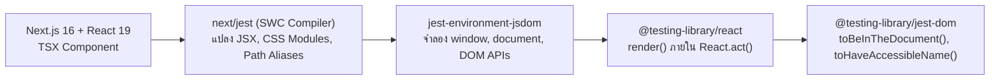
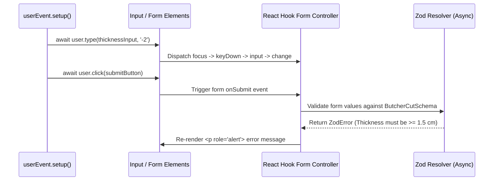
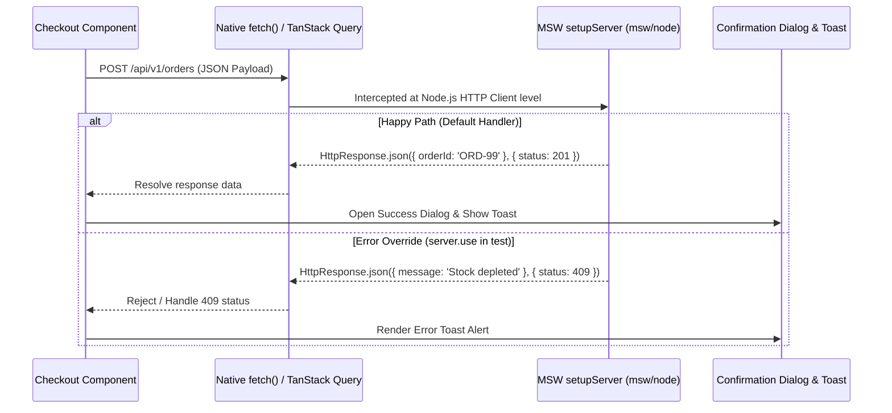
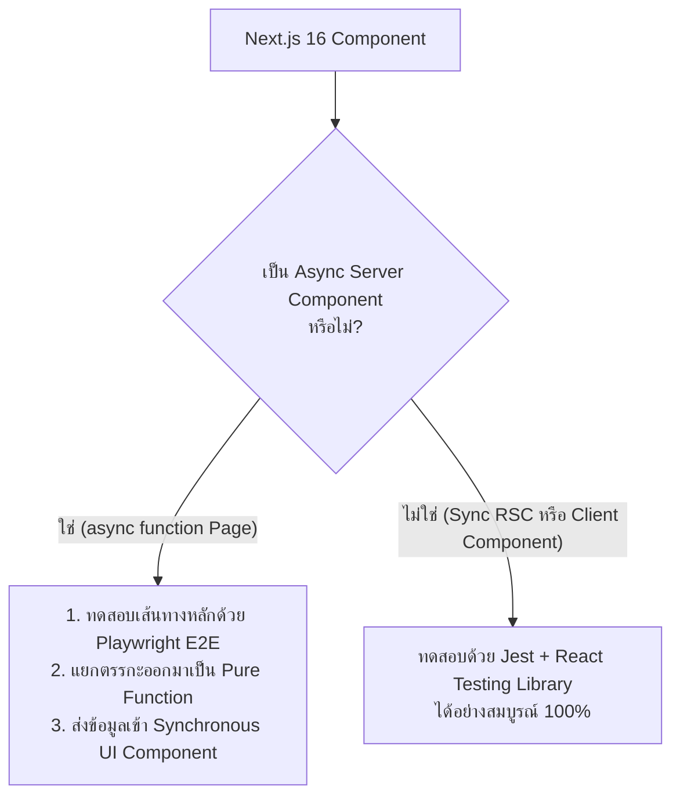

# Frontend Testing

(สำหรับแนวคิดพื้นฐานและเครื่องมือรันเทสต์หลัก สามารถดูเพิ่มเติมได้ที่ [Testing Fundamentals](/docs/testing/fundamentals) และ [Jest](/docs/testing/jest) ส่วนการทดสอบฝั่งเซิร์ฟเวอร์และเบราว์เซอร์จริงดูได้ที่ [Backend Testing](/docs/testing/backend-testing) และ [E2E Testing](/docs/testing/e2e-playwright))

<Callout type="tip" title="ปรัชญาการทดสอบ Frontend สมัยใหม่">
การทดสอบระบบหน้าบ้านในยุค Next.js 16 และ React 19 ไม่ได้วัดคุณค่าจากการเข้าไปตรวจดูค่าตัวแปร State ภายใน Component แต่เป็นการพิสูจน์ว่าเมื่อลูกค้าของร้าน Smart Butcher Marketplace มองเห็นหน้าจอ คลิกเลือกความหนาสเต็ก กรอกฟอร์มชำระเงิน และรับแจ้งเตือนผ่านหน้าเว็บ ระบบสามารถตอบสนองได้อย่างถูกต้องและรองรับการเข้าถึง (Accessibility) ตามมาตรฐานสากล
</Callout>

## สารบัญหัวข้อในหน้านี้

| ลำดับ | หัวข้อหลัก | เครื่องมือและเทคโนโลยีสำคัญ | เป้าหมายการทดสอบ |
| :--- | :--- | :--- | :--- |
| **1** | ปรัชญาของ React Testing Library และการตั้งค่าใน Next.js 16 + React 19 | `next/jest`, `@testing-library/react`, `jest-dom` | ตั้งค่าสภาพแวดล้อม JSDOM, SWC Compiler และ Router Mocks |
| **2** | กลยุทธ์การเลือกใช้ Queries (`getBy`, `queryBy`, `findBy`) และลำดับ A11y | `screen`, `within`, `getByRole` | ค้นหา DOM Elements ตามมุมมองของผู้ใช้งานและ Screen Reader |
| **3** | การจำลองพฤติกรรมผู้ใช้ด้วย `user-event` และทดสอบ React Hook Form + Zod | `@testing-library/user-event`, `zod` | จำลองการพิมพ์ คลิก แท็บ และการตรวจสอบฟอร์มสั่งตัดเนื้อ |
| **4** | การทดสอบ Custom Hooks, TanStack Query v5 และ Zustand Store | `renderHook`, `QueryClientProvider`, `zustand` | ทดสอบ Server State, Client Cart State และการรีเซ็ต Store |
| **5** | การจำลอง API ด้วย MSW (Mock Service Worker) และทดสอบ Toast / Dialog | `msw/node`, `http`, `HttpResponse` | ดักจับ Network Requests ระดับ Node.js และทดสอบ Modal / Toast |
| **6** | ข้อจำกัดการทดสอบ Async Server Components และแนวทางการใช้ E2E ทดแทน | RSC Architecture, Playwright Strategy | แยกแยะขอบเขตการทดสอบระหว่าง Client/Sync RSC กับ Async RSC |

---

## 1. ปรัชญาของ React Testing Library และการตั้งค่าใน Next.js 16 + React 19

### แนวคิด (Concept)
ปรัชญาแกนหลักของ **React Testing Library (RTL)** ที่สร้างโดย Kent C. Dodds คือประโยคอมตะที่ว่า:

> **"The more your tests resemble the way your software is used, the more confidence they can give you."**  
> *(ยิ่งชุดทดสอบของคุณใกล้เคียงกับวิธีที่ผู้ใช้งานจริงใช้ซอฟต์แวร์มากเท่าไหร่ มันก็ยิ่งมอบความมั่นใจให้คุณได้มากเท่านั้น)*

ในอดีต เครื่องมือยุคเก่าอย่าง Enzyme ส่งเสริมให้เราทดสอบ **Implementation Details** เช่น การตรวจว่า `component.state('isAgingModalOpen')` เป็น `true` หรือไม่ ส่งผลให้เมื่อนักพัฒนาเพียงแค่เปลี่ยนชื่อตัวแปร `useState` หรือย้ายสถานะไปไว้ใน Context เทสต์ก็พังทันทีทั้งที่หน้าจอและฟังก์ชันทุกอย่างยังทำงานเหมือนเดิม

React Testing Library แก้ปัญหานี้โดยบังคับให้เราปฏิสัมพันธ์กับ Component ผ่าน **Rendered DOM Nodes** เท่านั้น ผู้ใช้จริงไม่รู้จัก `useState` หรือ `props` แต่ผู้ใช้มองเห็นปุ่มที่มีข้อความว่า *"เพิ่ม Miyazaki A5 ลงตะกร้า"* และเห็นยอดเงินรวมที่เปลี่ยนไปบนหน้าจอ

### หลักการเบื้องหลัง (Under the Hood)
ในการรันชุดทดสอบของ [Next.js 16](/docs/nextjs) และ [React 19](/docs/react) บน Node.js ซึ่งไม่มีเบราว์เซอร์จริง ระบบจะทำงานผ่านสถาปัตยกรรมดังนี้:



1. **`next/jest` (SWC Transformation):** แพ็กเกจ `next/jest` จะโหลดการตั้งค่าจาก `next.config.ts` และใช้ Rust-based SWC Compiler แปลงไฟล์ `.tsx` ด้วยความเร็วสูง พร้อมจัดการ Mock ไฟล์รูปภาพ (`next/image`), ฟอนต์ (`next/font`), CSS Modules และอ่าน Path Aliases (`@/*`) จาก `tsconfig.json` ให้อัตโนมัติ
2. **`jest-environment-jsdom`:** จำลอง Web Standards API (เช่น `document.createElement`, `window.location`, Event Bubbling) บนหน่วยความจำของ Node.js
3. **React 19 `act()` Wrapper:** เมื่อเรียก `render(<Component />)` ตัว `@testing-library/react` (เวอร์ชัน 16+ ที่รองรับ React 19) จะห่อหุ้มการเรนเดอร์และการอัปเดต State ไว้ใน `React.act()` เพื่อให้มั่นใจว่า Effects และ DOM Mutations ทั้งหมดถูกประมวลผลเสร็จสิ้นก่อนส่งต่อไปยังบรรทัด Assertion

### ตัวอย่างโค้ด (Smart Butcher Marketplace)

#### ตัวอย่างที่ 1 (พื้นฐาน): การตั้งค่า `jest.config.ts` และ `jest.setup.ts` สำหรับ Next.js 16 + React 19
การตั้งค่ามาตรฐานระดับ Production ที่รวมการจำลอง `next/navigation` และ `@testing-library/jest-dom`:

```typescript filename="jest.config.ts"
import type { Config } from 'jest';
import nextJest from 'next/jest.js';

const createJestConfig = nextJest({
  // ชี้ไปยังโฟลเดอร์หลักของโปรเจกต์ Next.js 16 เพื่อโหลด next.config.ts และ .env
  dir: './',
});

const config: Config = {
  coverageProvider: 'v8',
  testEnvironment: 'jsdom',
  setupFilesAfterEnv: ['<rootDir>/jest.setup.ts'],
  moduleNameMapper: {
    '^@/(.*)$': '<rootDir>/src/$1',
  },
  clearMocks: true,
};

export default createJestConfig(config);
```

```typescript filename="jest.setup.ts"
import '@testing-library/jest-dom';

// จำลอง next/navigation พื้นฐานสำหรับ App Router ใน Next.js 16
jest.mock('next/navigation', () => ({
  useRouter: () => ({
    push: jest.fn(),
    replace: jest.fn(),
    prefetch: jest.fn(),
    back: jest.fn(),
  }),
  usePathname: () => '/catalog/wagyu',
  useSearchParams: () => new URLSearchParams(),
}));
```

#### ตัวอย่างที่ 2 (ขั้นสูง): การสร้าง Custom Render Utility พร้อม Providers และการทดสอบ `WagyuCutCard`
ในระบบจริง Component มักต้องการ Context Providers (เช่น Theme, Currency หรือ Butcher Cart Context) เราจึงสร้าง `renderWithButcherProviders` และนำไปทดสอบการ์ดแสดงสินค้าเนื้อวากิว:

```tsx filename="src/components/catalog/WagyuCutCard.spec.tsx"
import React, { createContext, useContext, ReactNode } from 'react';
import { render, screen, RenderOptions } from '@testing-library/react';

export interface Product {
  id: string;
  sku: string;
  name: string;
  categoryName: string;
  pricePerKg: number;
  stockKg: number;
  bmsScore: number;
}

interface CurrencyContextValue {
  currencySymbol: string;
  vatRate: number;
}

const CurrencyContext = createContext<CurrencyContextValue>({
  currencySymbol: '฿',
  vatRate: 0.07,
});

export function WagyuCutCard({ product }: { product: Product }) {
  const { currencySymbol, vatRate } = useContext(CurrencyContext);
  const grossPricePerKg = Math.round(product.pricePerKg * (1 + vatRate));
  const isOutOfStock = product.stockKg <= 0;

  return (
    <article aria-label={`Product card for ${product.name}`}>
      <h3>{product.name}</h3>
      <p>Category: {product.categoryName}</p>
      <p>Marbling Grade: BMS {product.bmsScore}</p>
      <p data-testid="gross-price">
        {currencySymbol}
        {grossPricePerKg.toLocaleString()} / kg (incl. VAT)
      </p>
      <button type="button" disabled={isOutOfStock}>
        {isOutOfStock ? 'Sold Out in Aging Vault' : 'Select Cut Weight'}
      </button>
    </article>
  );
}

// Custom Render ที่ห่อหุ้ม Providers ของระบบ Smart Butcher
function renderWithButcherProviders(
  ui: React.ReactElement,
  options?: Omit<RenderOptions, 'wrapper'>,
) {
  function AllProviders({ children }: { children: ReactNode }) {
    return (
      <CurrencyContext.Provider value={{ currencySymbol: '฿', vatRate: 0.07 }}>
        {children}
      </CurrencyContext.Provider>
    );
  }
  return render(ui, { wrapper: AllProviders, ...options });
}

describe('WagyuCutCard Component', () => {
  const sampleMiyazakiProduct: Product = {
    id: 'prod-miyazaki-01',
    sku: 'WAGYU-MIYAZAKI-A5',
    name: 'Miyazaki A5 Striploin',
    categoryName: 'Japanese Wagyu',
    pricePerKg: 5000,
    stockKg: 4.5,
    bmsScore: 11,
  };

  it('should render wagyu product details and VAT-inclusive price per kg', () => {
    renderWithButcherProviders(<WagyuCutCard product={sampleMiyazakiProduct} />);

    expect(
      screen.getByRole('heading', { name: 'Miyazaki A5 Striploin' }),
    ).toBeInTheDocument();
    expect(screen.getByText('Marbling Grade: BMS 11')).toBeInTheDocument();
    // 5000 * 1.07 = 5,350
    expect(screen.getByTestId('gross-price')).toHaveTextContent('฿5,350 / kg (incl. VAT)');
    expect(
      screen.getByRole('button', { name: 'Select Cut Weight' }),
    ).toBeEnabled();
  });

  it('should disable action button and display Sold Out text when stockKg is zero', () => {
    renderWithButcherProviders(
      <WagyuCutCard product={{ ...sampleMiyazakiProduct, stockKg: 0 }} />,
    );

    const button = screen.getByRole('button', { name: 'Sold Out in Aging Vault' });
    expect(button).toBeDisabled();
  });
});
```

### ผิด vs ถูก (Anti-pattern vs Best Practice)

| มิติการเปรียบเทียบ | ❌ ผิด (Anti-pattern) | ✅ ถูก (Best Practice) |
| :--- | :--- | :--- |
| **การตรวจสอบ DOM** | ใช้ `const { container } = render(...); expect(container.querySelector('.btn-primary')).toBeTruthy()` ซึ่งผูกติดกับ CSS Class | ใช้ `screen.getByRole('button', { name: '...' })` และ Matchers จาก `@testing-library/jest-dom` เช่น `toBeInTheDocument()` |
| **การตั้งค่า Babel ซ้อนใน Next.js** | ติดตั้ง `.babelrc` เองโดยไม่จำเป็น ทำให้ไปปิดการทำงานของ Rust SWC Compiler ใน `next/jest` จนรันเทสต์ช้า | ใช้ `next/jest` เพียงอย่างเดียวเพื่อให้ SWC จัดการการแปลงโค้ด TypeScript และ JSX ด้วยความเร็วสูงสุด |

### ควรใช้เมื่อไหร่ และ ไม่ควรใช้เมื่อไหร่
- **ควรใช้เมื่อ:** ทดสอบ Interactive Client Components, การแสดงผลตามเงื่อนไข (Conditional Rendering), ฟอร์มรับข้อมูล และความถูกต้องด้าน Accessibility ของ UI
- **ไม่ควรใช้เมื่อ:** ต้องการตรวจสอบความสวยงามทางสายตาของ CSS Layout, Animation หรือ Responsive Breakpoints (เนื่องจาก JSDOM ไม่มี Layout Engine และไม่คำนวณ Pixel จริง ต้องใช้ Playwright Visual Regression แทน)

### คำถามสัมภาษณ์ (Interview Q&A)
- **Q1: เหตุใดสภาพแวดล้อม `jsdom` ใน Jest จึงไม่สามารถทดสอบ `window.matchMedia` หรือ `IntersectionObserver` ได้ทันทีหากไม่เขียน Mock เพิ่ม?**
  - *แนวคำตอบ:* เพราะ `jsdom` เป็นเพียงการจำลองโครงสร้าง DOM Tree และ HTML Spec บน Node.js แต่ไม่มีเครื่องยนต์เรนเดอร์ภาพ (Layout & Rendering Engine) เหมือน Blink หรือ WebKit ทำให้ไม่มีแนวคิดเรื่องขนาดหน้าจอจริง (Viewport Dimension) หรือตำแหน่งการเลื่อนหน้าจอ (Scroll Intersection) ดังนั้น API ที่พึ่งพามิติทางกายภาพของหน้าจอจึงไม่ได้ถูกสร้างไว้ใน `jsdom` และต้องกำหนด Mock Implementation ในไฟล์ `jest.setup.ts`
- **Q2: ทำไม React Testing Library จึงแนะนำให้ใช้ `screen.getByRole(...)` แทนการ Destructure `const { getByRole } = render(<Comp />)`?**
  - *แนวคำตอบ:* การใช้ `screen` ช่วยให้เราไม่ต้องคอยแก้รายการ Destructure ทุกครั้งที่เพิ่มหรือเปลี่ยนชนิด Query ในเทสต์ และ `screen` จะชี้ไปยัง `document.body` ปัจจุบันเสมอ รวมถึงมีเมธอดช่วยเหลือในการดีบักอย่าง `screen.debug()` และ `screen.logTestingPlaygroundURL()` ที่เรียกใช้ได้ทันที

---

## 2. กลยุทธ์การเลือกใช้ Queries (getBy, queryBy, findBy) และลำดับความสำคัญด้าน A11y

### แนวคิด (Concept)
หัวใจของการค้นหา Elements บนหน้าจอด้วย React Testing Library แบ่งออกเป็น 2 แกนหลัก คือ:
1. **จะรอหรือจะเช็กอย่างไร (Query Variants):** `getBy*`, `queryBy*`, และ `findBy*` (รวมถึงรุ่นพหูพจน์ `getAllBy*`, `queryAllBy*`, `findAllBy*`)
2. **จะค้นหาด้วยคุณลักษณะใด (Accessibility Priority):** ลำดับความสำคัญที่ส่งเสริมให้หน้าเว็บรองรับเทคโนโลยีช่วยเหลือผู้พิการทางสายตา (Screen Readers) ไปในตัว

### หลักการเบื้องหลัง (Under the Hood)

| ประเภทคำสั่ง | เมื่อไม่พบ Element (0 รายการ) | เมื่อพบ 1 รายการ | เมื่อพบมากกว่า 1 รายการ | รองรับ Async / รอ DOM อัปเดต |
| :--- | :--- | :--- | :--- | :--- |
| **`getBy...`** | โยน Error ทันที | คืนค่า `HTMLElement` | โยน Error ทันที | ❌ ไม่รอ (Synchronous) |
| **`queryBy...`** | คืนค่า `null` (ไม่โยน Error) | คืนค่า `HTMLElement` | โยน Error ทันที | ❌ ไม่รอ (Synchronous) |
| **`findBy...`** | โยน Error เมื่อหมดเวลา (Default 1000ms) | คืนค่า `Promise<HTMLElement>` | โยน Error เมื่อหมดเวลา | ✅ รอผ่าน `waitFor` อัตโนมัติ |

สำหรับลำดับความสำคัญในการเลือกใช้ Query (ตามหลัก **Accessibility Tree**):
1. **สิ่งที่ผู้ใช้ทุกคนเข้าถึงได้ (Accessible to Everyone):**
   - `getByRole`: อันดับ 1 เสมอ เช่น `getByRole('button', { name: /checkout/i })`, `getByRole('heading', { level: 2 })`
   - `getByLabelText`: ดีที่สุดสำหรับช่องกรอกข้อมูลในฟอร์ม (`<label>` ที่ผูกกับ `<input>`)
   - `getByPlaceholderText` / `getByText` / `getByDisplayValue`
2. **Semantic Queries:** `getByAltText` (สำหรับรูปภาพเนื้อวากิว), `getByTitle`
3. **ทางเลือกสุดท้าย (Escape Hatch):** `getByTestId` (`data-testid="..."`) ใช้เฉพาะกรณีที่ข้อความเปลี่ยนตลอดเวลาหรือโครงสร้างซับซ้อนจนระบุด้วย Role ไม่ได้

นอกจากนี้เมื่อหน้าจอมีรายการซ้ำกันหลายชิ้น (เช่น ตารางรายการสินค้าหลายแถว) เราจะใช้ฟังก์ชัน **`within(element)`** เพื่อจำกัดขอบเขตการค้นหาให้อยู่เฉพาะในการ์ดหรือแถวที่เราสนใจ

### ตัวอย่างโค้ด (Smart Butcher Marketplace)

#### ตัวอย่างที่ 1 (พื้นฐาน): การใช้ `getByRole`, `queryByText` และ `findByRole` ทดสอบแบนเนอร์และสถานะโหลดข้อมูลตู้บ่มเนื้อ
ตัวอย่างที่แสดงความแตกต่างของการตรวจจับ Element ที่มีอยู่ทันที, Element ที่ต้องไม่ปรากฏบนหน้าจอ (`queryBy`) และ Element ที่ปรากฏขึ้นหลังจากโหลดข้อมูลเสร็จ (`findBy`):

```tsx filename="src/components/vault/DryAgingVaultStatus.spec.tsx"
import React, { useState, useEffect } from 'react';
import { render, screen } from '@testing-library/react';

export interface VaultChamberData {
  chamberId: string;
  temperatureCelsius: number;
  humidityPercent: number;
  hasContaminationAlert: boolean;
}

export function DryAgingVaultStatus({
  fetchChamberStatus,
}: {
  fetchChamberStatus: () => Promise<VaultChamberData>;
}) {
  const [data, setData] = useState<VaultChamberData | null>(null);

  useEffect(() => {
    let mounted = true;
    fetchChamberStatus().then((res) => {
      if (mounted) setData(res);
    });
    return () => {
      mounted = false;
    };
  }, [fetchChamberStatus]);

  return (
    <section aria-labelledby="vault-heading">
      <h2 id="vault-heading">Dry-Aging Vault Telemetry</h2>
      {!data ? (
        <p role="status">Connecting to vault sensors...</p>
      ) : (
        <div>
          <p>Chamber: {data.chamberId}</p>
          <p>Temp: {data.temperatureCelsius}°C | Humidity: {data.humidityPercent}%</p>
          {data.hasContaminationAlert && (
            <div role="alert">CRITICAL: Humidity anomaly detected in aging vault!</div>
          )}
        </div>
      )}
    </section>
  );
}

describe('DryAgingVaultStatus Queries (getBy, queryBy, findBy)', () => {
  it('should display sensor telemetry via findByText and hide alert banner when vault is normal', async () => {
    const mockFetch = jest.fn().mockResolvedValue({
      chamberId: 'VAULT-A5-NORTH',
      temperatureCelsius: 1.2,
      humidityPercent: 80,
      hasContaminationAlert: false,
    });

    render(<DryAgingVaultStatus fetchChamberStatus={mockFetch} />);

    // 1. getByRole: ตรวจหัวข้อที่ปรากฏบนหน้าจอทันทีแบบ Synchronous
    expect(
      screen.getByRole('heading', { name: 'Dry-Aging Vault Telemetry', level: 2 }),
    ).toBeInTheDocument();

    // 2. findByText: รอให้ Promise resolve และ DOM อัปเดตแบบ Asynchronous
    const telemetryText = await screen.findByText('Temp: 1.2°C | Humidity: 80%');
    expect(telemetryText).toBeInTheDocument();

    // 3. queryByRole: ยืนยันว่าไม่มี Alert แสดงขึ้นมา (ต้องใช้ queryBy เพราะคืนค่า null ไม่โยน Error)
    expect(screen.queryByRole('alert')).not.toBeInTheDocument();
  });

  it('should render critical alert role when vault sensor reports contamination anomaly', async () => {
    const mockFetch = jest.fn().mockResolvedValue({
      chamberId: 'VAULT-A5-SOUTH',
      temperatureCelsius: 6.5,
      humidityPercent: 95,
      hasContaminationAlert: true,
    });

    render(<DryAgingVaultStatus fetchChamberStatus={mockFetch} />);

    const alertBanner = await screen.findByRole('alert');
    expect(alertBanner).toHaveTextContent(
      'CRITICAL: Humidity anomaly detected in aging vault!',
    );
  });
});
```

#### ตัวอย่างที่ 2 (ขั้นสูง): การใช้ `within()` ค้นหาปุ่มเฉพาะเจาะจงภายในตารางรายการ `OrderItem` หลายแถว
ในหน้าสรุปคำสั่งซื้อที่มีเนื้อหลายชิ้น ปุ่มในแต่ละแถวจะมีชื่อเหมือนกันว่า *"Remove Cut"* หากใช้ `screen.getByRole('button', { name: 'Remove Cut' })` จะโยน Error เพราะเจอหลายปุ่ม เราจึงใช้ `within(row)` เพื่อเจาะจงแถวของเนื้อที่ต้องการทดสอบ:

```tsx filename="src/components/orders/OrderItemsTable.spec.tsx"
import React from 'react';
import { render, screen, within } from '@testing-library/react';
import userEvent from '@testing-library/user-event';

export interface OrderItem {
  id: string;
  productName: string;
  cutThicknessCm: number;
  weightKg: number;
  subtotal: number;
}

export function OrderItemsTable({
  items,
  onRemoveItem,
}: {
  items: OrderItem[];
  onRemoveItem: (itemId: string) => void;
}) {
  return (
    <table aria-label="Butcher Order Items">
      <thead>
        <tr>
          <th>Cut Name</th>
          <th>Thickness</th>
          <th>Subtotal</th>
          <th>Action</th>
        </tr>
      </thead>
      <tbody>
        {items.map((item) => (
          <tr key={item.id} aria-label={`Order row for ${item.productName}`}>
            <td>{item.productName}</td>
            <td>{item.cutThicknessCm} cm</td>
            <td>฿{item.subtotal.toLocaleString()}</td>
            <td>
              <button type="button" onClick={() => onRemoveItem(item.id)}>
                Remove Cut
              </button>
            </td>
          </tr>
        ))}
      </tbody>
    </table>
  );
}

describe('OrderItemsTable Scoped Queries with within()', () => {
  const sampleItems: OrderItem[] = [
    {
      id: 'item-ribeye-01',
      productName: 'Miyazaki A5 Ribeye',
      cutThicknessCm: 3.5,
      weightKg: 0.5,
      subtotal: 2600,
    },
    {
      id: 'item-tenderloin-02',
      productName: 'Kobe A5 Tenderloin Chateaubriand',
      cutThicknessCm: 4.0,
      weightKg: 0.4,
      subtotal: 3800,
    },
  ];

  it('should scope query to specific table row using within() and trigger remove callback for Kobe Tenderloin', async () => {
    const user = userEvent.setup();
    const handleRemove = jest.fn();

    render(<OrderItemsTable items={sampleItems} onRemoveItem={handleRemove} />);

    // ค้นหาแถวของ Kobe A5 Tenderloin Chateaubriand ด้วย Accessible Name
    const kobeRow = screen.getByRole('row', {
      name: 'Order row for Kobe A5 Tenderloin Chateaubriand',
    });

    // ตรวจสอบราคาและกดปุ่ม Remove Cut เฉพาะที่อยู่ภายในแถว kobeRow เท่านั้น
    expect(within(kobeRow).getByText('฿3,800')).toBeInTheDocument();

    const removeButtonInKobeRow = within(kobeRow).getByRole('button', {
      name: 'Remove Cut',
    });
    await user.click(removeButtonInKobeRow);

    expect(handleRemove).toHaveBeenCalledTimes(1);
    expect(handleRemove).toHaveBeenCalledWith('item-tenderloin-02');
  });
});
```

### ผิด vs ถูก (Anti-pattern vs Best Practice)

| มิติการเปรียบเทียบ | ❌ ผิด (Anti-pattern) | ✅ ถูก (Best Practice) |
| :--- | :--- | :--- |
| **การเช็กว่า Element ไม่มีอยู่** | ใช้ `expect(() => screen.getByText('Error')).toThrow()` ซึ่งอ่านยากและผิดจุดประสงค์ | ใช้ `expect(screen.queryByText('Error')).not.toBeInTheDocument()` เสมอเมื่อตรวจการไม่มีอยู่ของ Element |
| **การรอ Element ปรากฏ** | เขียน `await waitFor(() => expect(screen.getByText('Loaded')).toBeInTheDocument())` ยืดยาว | ใช้ `expect(await screen.findByText('Loaded')).toBeInTheDocument()` ซึ่งกระชับและมีความหมายตรงตัวกว่า |
| **การแปะ `data-testid` พร่ำเพรื่อ** | ใส่ `data-testid="submit-btn"` ให้ปุ่มทุกปุ่มแทนที่จะใช้ข้อความบนปุ่ม ทำให้ไม่รู้เลยว่าปุ่มขาด Accessible Name หรือไม่ | ใช้ `getByRole('button', { name: /.../i })` เป็นหลัก เพื่อบังคับให้ HTML มี Accessibility ที่ถูกต้อง |

### ควรใช้เมื่อไหร่ และ ไม่ควรใช้เมื่อไหร่
- **ควรใช้ `getBy*` เมื่อ:** ค้นหา Element ที่เรนเดอร์อยู่บนหน้าจอตั้งแต่วินาทีแรก
- **ควรใช้ `queryBy*` เมื่อ:** ต้องการยืนยันว่า Element นั้น **ไม่ปรากฏ** อยู่บนหน้าจอ (เช่น Modal ปิดไปแล้ว หรือไม่มีข้อความแจ้งเตือนข้อผิดพลาด)
- **ควรใช้ `findBy*` เมื่อ:** ค้นหา Element ที่จะปรากฏขึ้นหลังจากการดึงข้อมูล API, การคลิกปุ่มเปลี่ยนสถานะ หรือการตรวจสอบฟอร์มแบบ Async

### คำถามสัมภาษณ์ (Interview Q&A)
- **Q1: หากเราใช้ `expect(await screen.findByRole('alert')).not.toBeInTheDocument()` เพื่อเช็กว่าไม่มีข้อความแจ้งเตือน จะเกิดปัญหาอะไรขึ้น?**
  - *แนวคำตอบ:* เมธอด `findByRole` จะพยายามรอจนกว่าจะเจอ Element ที่มี `role="alert"` หากไม่มี Element นั้นปรากฏขึ้นเลย มันจะค้างรอจนครบเวลา Timeout (1000ms) แล้วโยน Error ทันทีก่อนที่จะไปถึง `.not.toBeInTheDocument()` ดังนั้นการเช็กว่า Element ไม่มีอยู่จึงห้ามใช้ `findBy*` เด็ดขาด ต้องใช้ `queryBy*` เท่านั้น
- **Q2: การใช้ `getByRole` ช่วยยกระดับคุณภาพ Accessibility (A11y) ของเว็บไซต์ในระดับ Production ได้อย่างไร?**
  - *แนวคำตอบ:* เพราะ `getByRole` ค้นหาผ่าน Accessibility Tree แบบเดียวกับที่โปรแกรมอ่านหน้าจอ (Screen Reader เช่น NVDA หรือ VoiceOver) ใช้งาน หากนักพัฒนาสร้างปุ่มด้วย `<div onClick={...}>สั่งซื้อ</div>` หรือสร้าง `<input>` โดยไม่ผูก `<label htmlFor="...">` คำสั่ง `getByRole('button')` หรือ `getByLabelText()` จะหาไม่เจอและทำให้เทสต์พังทันที จึงเป็นการบังคับให้นักพัฒนาต้องเขียน Semantic HTML ที่ถูกต้องตั้งแต่วินาทีแรก

---

## 3. การจำลองพฤติกรรมผู้ใช้ด้วย user-event และการทดสอบฟอร์ม React Hook Form + Zod

### แนวคิด (Concept)
ในการจำลองเหตุการณ์ของผู้ใช้ นักพัฒนาจำนวนมากมักสับสนระหว่าง `fireEvent` (ที่ติดมากับ `@testing-library/react`) กับไลบรารี **`@testing-library/user-event` (v14+)**
- **`fireEvent.click(input)`:** เป็นเพียงการสร้าง DOM Event สังเคราะห์ (`new MouseEvent('click')`) แล้วยิงตรงไปยัง Element นั้นตัวเดียวโดยไม่สนใจว่าผู้ใช้จริงทำแบบนั้นได้หรือไม่ (เช่น ยิง `fireEvent.change` ใส่ `<input disabled />` ก็ยังทำงานได้)
- **`await user.click(input)` (`user-event`):** จำลองลำดับพฤติกรรมทั้งหมดที่เกิดขึ้นในเบราว์เซอร์จริง เช่น เมื่อสั่ง `await user.type(input, '3.5')` มันจะทำการเลื่อนเมาส์ (`pointerOver`, `pointerMove`), คลิกเพื่อโฟกัส (`pointerDown`, `focus`, `pointerUp`, `click`), และกดคีย์บอร์ดทีละตัวอักษร (`keyDown`, `keyPress`, `input`, `keyUp`) พร้อมตรวจสอบว่าช่องกรอกนั้นไม่ได้ถูก `disabled` หรือซ่อนอยู่

คุณสมบัตินี้สำคัญอย่างยิ่งในการทดสอบฟอร์มที่ใช้ **[React Hook Form + Zod](/docs/react-hook-form-zod)** เพราะ React Hook Form พึ่งพาเหตุการณ์ `focus`, `blur`, `input` และ `submit` แบบ Asynchronous ในการประมวลผล Zod Schema Validation

### หลักการเบื้องหลัง (Under the Hood)


ใน `@testing-library/user-event` เวอร์ชัน 14 ทุกเมธอดทำงานแบบ Asynchronous (`Promise`) ดังนั้นเราจึงต้องสร้างอินสแตนซ์ด้วย **`const user = userEvent.setup()`** ก่อนการเรียก `render()` และต้องใส่ **`await`** หน้าทุกคำสั่ง (`await user.type()`, `await user.click()`, `await user.selectOptions()`) เสมอ

### ตัวอย่างโค้ด (Smart Butcher Marketplace)

#### ตัวอย่างที่ 1 (พื้นฐาน): การใช้ `userEvent.setup()` ทดสอบตัวเลือกความหนาสเต็กและระดับความสุก
ตัวอย่างการทดสอบ Interactive Component ด้วย `user.selectOptions` และ `user.click` เพื่อตรวจสอบการคำนวณน้ำหนักเนื้อตามความหนาที่ลูกค้าเลือก:

```tsx filename="src/components/butcher/SteakCutSelector.spec.tsx"
import React, { useState } from 'react';
import { render, screen } from '@testing-library/react';
import userEvent from '@testing-library/user-event';

export type CutStyle = 'RIBEYE' | 'T_BONE';

export function SteakCutSelector({
  onConfirmCut,
}: {
  onConfirmCut: (payload: { cutStyle: CutStyle; vacuumSealed: boolean }) => void;
}) {
  const [cutStyle, setCutStyle] = useState<CutStyle>('RIBEYE');
  const [vacuumSealed, setVacuumSealed] = useState<boolean>(false);

  return (
    <div>
      <label htmlFor="cut-style-select">Select Butcher Cut Style</label>
      <select
        id="cut-style-select"
        value={cutStyle}
        onChange={(e) => setCutStyle(e.target.value as CutStyle)}
      >
        <option value="RIBEYE">Ribeye Boneless (350g)</option>
        <option value="T_BONE">Dry-Aged T-Bone (650g)</option>
      </select>

      <label>
        <input
          type="checkbox"
          checked={vacuumSealed}
          onChange={(e) => setVacuumSealed(e.target.checked)}
        />
        Add Medical-Grade Vacuum Sealing
      </label>

      <button
        type="button"
        onClick={() => onConfirmCut({ cutStyle, vacuumSealed })}
      >
        Confirm Butcher Specification
      </button>
    </div>
  );
}

describe('SteakCutSelector User Interaction with user-event', () => {
  it('should allow customer to change cut style, toggle vacuum sealing checkbox, and submit selection', async () => {
    const user = userEvent.setup();
    const handleConfirm = jest.fn();

    render(<SteakCutSelector onConfirmCut={handleConfirm} />);

    const selectElement = screen.getByLabelText('Select Butcher Cut Style');
    const checkboxElement = screen.getByRole('checkbox', {
      name: 'Add Medical-Grade Vacuum Sealing',
    });
    const confirmButton = screen.getByRole('button', {
      name: 'Confirm Butcher Specification',
    });

    // เปลี่ยนตัวเลือกเป็น T_BONE และติ๊กถูกที่ช่อง Vacuum Sealing
    await user.selectOptions(selectElement, 'T_BONE');
    await user.click(checkboxElement);
    await user.click(confirmButton);

    expect(checkboxElement).toBeChecked();
    expect(handleConfirm).toHaveBeenCalledTimes(1);
    expect(handleConfirm).toHaveBeenCalledWith({
      cutStyle: 'T_BONE',
      vacuumSealed: true,
    });
  });
});
```

#### ตัวอย่างที่ 2 (ขั้นสูง): การทดสอบฟอร์มสั่งแล่เนื้อพิเศษที่ใช้ React Hook Form + Zod Schema
ตัวอย่างการทดสอบฟอร์มที่มีกฎตรวจสอบความหนาของสเต็ก (1.5 - 6.0 ซม.) และน้ำหนักสั่งซื้อขั้นต่ำ พร้อมทดสอบทั้งกรณีกรอกข้อมูลผิดพลาด (แสดงข้อความแจ้งเตือนจาก Zod) และกรณีกรอกข้อมูลถูกต้อง:

```tsx filename="src/components/forms/CustomButcherOrderForm.spec.tsx"
import React from 'react';
import { render, screen } from '@testing-library/react';
import userEvent from '@testing-library/user-event';
import { useForm } from 'react-hook-form';
import { z } from 'zod';
import { zodResolver } from '@hookform/resolvers/zod';

export const customButcherOrderSchema = z.object({
  customerName: z.string().min(3, 'Customer name must be at least 3 characters'),
  thicknessCm: z
    .number({ invalid_type_error: 'Thickness is required' })
    .min(1.5, 'Steak thickness must be at least 1.5 cm for proper searing')
    .max(6.0, 'Steak thickness cannot exceed 6.0 cm'),
  weightKg: z
    .number({ invalid_type_error: 'Weight is required' })
    .min(0.3, 'Minimum order weight for A5 Wagyu is 0.3 kg'),
  butcherNotes: z.string().optional(),
});

export type CustomButcherOrderFormValues = z.infer<typeof customButcherOrderSchema>;

export function CustomButcherOrderForm({
  onSubmitOrder,
}: {
  onSubmitOrder: (values: CustomButcherOrderFormValues) => Promise<void> | void;
}) {
  const {
    register,
    handleSubmit,
    formState: { errors, isSubmitting },
  } = useForm<CustomButcherOrderFormValues>({
    resolver: zodResolver(customButcherOrderSchema),
    defaultValues: {
      customerName: '',
      thicknessCm: 2.5,
      weightKg: 0.5,
      butcherNotes: '',
    },
  });

  return (
    <form onSubmit={handleSubmit((data) => onSubmitOrder(data))} noValidate>
      <div>
        <label htmlFor="customerName">Recipient Full Name</label>
        <input id="customerName" type="text" {...register('customerName')} />
        {errors.customerName && <p role="alert">{errors.customerName.message}</p>}
      </div>

      <div>
        <label htmlFor="thicknessCm">Cut Thickness (cm)</label>
        <input
          id="thicknessCm"
          type="number"
          step="0.5"
          {...register('thicknessCm', { valueAsNumber: true })}
        />
        {errors.thicknessCm && <p role="alert">{errors.thicknessCm.message}</p>}
      </div>

      <div>
        <label htmlFor="weightKg">Target Weight (kg)</label>
        <input
          id="weightKg"
          type="number"
          step="0.1"
          {...register('weightKg', { valueAsNumber: true })}
        />
        {errors.weightKg && <p role="alert">{errors.weightKg.message}</p>}
      </div>

      <button type="submit" disabled={isSubmitting}>
        Submit Custom Cut Order
      </button>
    </form>
  );
}

describe('CustomButcherOrderForm (React Hook Form + Zod)', () => {
  it('should display Zod validation alerts and block submission when thickness is below 1.5 cm', async () => {
    const user = userEvent.setup();
    const mockSubmit = jest.fn();

    render(<CustomButcherOrderForm onSubmitOrder={mockSubmit} />);

    const nameInput = screen.getByLabelText('Recipient Full Name');
    const thicknessInput = screen.getByLabelText('Cut Thickness (cm)');
    const submitButton = screen.getByRole('button', { name: 'Submit Custom Cut Order' });

    await user.type(nameInput, 'Al'); // สั้นเกินไป (น้อยกว่า 3 ตัวอักษร)
    await user.clear(thicknessInput);
    await user.type(thicknessInput, '0.8'); // บางเกินไป (ต่ำกว่า 1.5 ซม.)
    await user.click(submitButton);

    // ต้องรอด้วย findAllByRole เนื่องจาก React Hook Form ตรวจสอบ Zod แบบ Asynchronous
    const alerts = await screen.findAllByRole('alert');
    expect(alerts).toHaveLength(2);
    expect(
      screen.getByText('Customer name must be at least 3 characters'),
    ).toBeInTheDocument();
    expect(
      screen.getByText('Steak thickness must be at least 1.5 cm for proper searing'),
    ).toBeInTheDocument();
    expect(mockSubmit).not.toHaveBeenCalled();
  });

  it('should call onSubmitOrder with parsed numeric values when all fields satisfy Zod schema', async () => {
    const user = userEvent.setup();
    const mockSubmit = jest.fn();

    render(<CustomButcherOrderForm onSubmitOrder={mockSubmit} />);

    const nameInput = screen.getByLabelText('Recipient Full Name');
    const thicknessInput = screen.getByLabelText('Cut Thickness (cm)');
    const weightInput = screen.getByLabelText('Target Weight (kg)');
    const submitButton = screen.getByRole('button', { name: 'Submit Custom Cut Order' });

    await user.type(nameInput, 'Chef Somchai');
    await user.clear(thicknessInput);
    await user.type(thicknessInput, '3.5');
    await user.clear(weightInput);
    await user.type(weightInput, '1.2');
    await user.click(submitButton);

    // รอให้การส่งฟอร์มเสร็จสมบูรณ์และตรวจสอบข้อมูลที่ได้จากการแปลงชนิดตัวเลขของ Zod
    expect(mockSubmit).toHaveBeenCalledTimes(1);
    expect(mockSubmit).toHaveBeenCalledWith({
      customerName: 'Chef Somchai',
      thicknessCm: 3.5,
      weightKg: 1.2,
      butcherNotes: '',
    });
  });
});
```

### ผิด vs ถูก (Anti-pattern vs Best Practice)

| มิติการเปรียบเทียบ | ❌ ผิด (Anti-pattern) | ✅ ถูก (Best Practice) |
| :--- | :--- | :--- |
| **การจำลองการพิมพ์ข้อความ** | ใช้ `fireEvent.change(input, { target: { value: '3.5' } })` ซึ่งข้ามการเกิด `focus`, `keyDown` และไม่ตรวจว่าช่องถูก `disabled` อยู่หรือไม่ | ใช้ `const user = userEvent.setup()` ร่วมกับ `await user.clear(input)` และ `await user.type(input, '3.5')` |
| **การตรวจผลลัพธ์ของ React Hook Form** | ใช้ `screen.getByRole('alert')` ทันทีหลังคลิกปุ่ม Submit จนเทสต์พังเพราะ Zod Resolver ยังทำงานไม่เสร็จ | ใช้ `await screen.findByRole('alert')` หรือ `await waitFor(...)` เพื่อรอให้ Async Form Validation ของ RHF อัปเดต State เสร็จสิ้น |

### ควรใช้เมื่อไหร่ และ ไม่ควรใช้เมื่อไหร่
- **ควรใช้ `userEvent` เมื่อ:** ทดสอบทุกการกระทำของผู้ใช้บนหน้าเว็บ เช่น การคลิกปุ่ม การพิมพ์ข้อความ การกดปุ่ม `Tab` เปลี่ยนโฟกัส หรือการกด `Enter` ส่งฟอร์ม
- **ไม่ควรใช้ `userEvent` เมื่อ:** ต้องการจำลองเหตุการณ์ระดับ Browser/Window พิเศษที่ `user-event` ไม่ได้รองรับโดยตรง เช่น `fireEvent.scroll(window)` หรือ Custom Touch/Drag Events เฉพาะทาง ซึ่งกรณีนั้นสามารถใช้ `fireEvent` เสริมได้

### คำถามสัมภาษณ์ (Interview Q&A)
- **Q1: ในการทดสอบ React Hook Form ทำไมในฟังก์ชัน `<form onSubmit={handleSubmit((data) => onSubmitOrder(data))}>` เราจึงไม่ควรเขียนย่อเป็น `handleSubmit(onSubmitOrder)` เวลาตรวจ `expect(onSubmitOrder).toHaveBeenCalledWith(expectedData)`?**
  - *แนวคำตอบ:* เพราะ `handleSubmit` ของ React Hook Form จะส่งอาร์กิวเมนต์ 2 ตัวให้กับ Callback คือ `(data, event)` (ข้อมูลที่ผ่านการ Validate แล้ว และ SyntheticBaseEvent ของฟอร์ม) หากเราส่ง `mockSubmit` เข้าไปตรงๆ เวลาเขียน `expect(mockSubmit).toHaveBeenCalledWith(expectedData)` เทสต์จะล้มเหลวเพราะอาร์กิวเมนต์ตัวที่สองเป็น Event Object การห่อด้วย `(data) => onSubmitOrder(data)` หรือตรวจด้วย `expect(mockSubmit).toHaveBeenCalledWith(expectedData, expect.anything())` จึงเป็นแนวทางที่แม่นยำกว่า
- **Q2: ทำไมการเปลี่ยนค่าใน `<input type="number" defaultValue={2.5} />` ด้วย `await user.type(input, '3.5')` โดยไม่เรียก `await user.clear(input)` ก่อนจึงทำให้ได้ค่าผิดพลาด?**
  - *แนวคำตอบ:* เพราะ `user.type()` จำลองพฤติกรรมของผู้ใช้จริงที่คลิกวางเคอร์เซอร์ต่อท้ายข้อความเดิมแล้วพิมพ์ต่อ ดังนั้นหากมีค่าเริ่มต้น `2.5` อยู่แล้วและพิมพ์ `3.5` ต่อท้าย ค่าในช่องจะกลายเป็น `'2.53.5'` หรือ `'2.535'` จึงต้องสั่ง `await user.clear(input)` เพื่อลบค่าเริ่มต้นออกก่อนพิมพ์ค่าใหม่เสมอ

---

## 4. การทดสอบ Custom Hooks, TanStack Query v5 และ Zustand Store

### แนวคิด (Concept)
ในสถาปัตยกรรม Frontend สมัยใหม่ เรามักแยก Business Logic และ State Management ออกจาก UI Component ไปไว้ใน 3 ส่วนหลัก:
1. **Custom React Hooks:** ฟังก์ชันที่จัดการตรรกะเฉพาะทาง (เช่น `useDryAgeCalculator`)
2. **[TanStack Query v5](/docs/tanstack-query):** การจัดการ Server State, Caching และการดึงข้อมูลแค็ตตาล็อกเนื้อพรีเมียม
3. **[Zustand Store](/docs/zustand):** การจัดการ Client State เช่น ตะกร้าสินค้า (`useButcherCartStore`) และการคำนวณราคารวม

สำหรับการทดสอบ Custom Hooks ที่ไม่ได้ผูกกับ UI ตัวเดียว เราสามารถใช้ฟังก์ชัน **`renderHook()`** จาก `@testing-library/react` เพื่อรัน Hook ภายใต้บริบทของ React และใช้ `act()` เมื่อต้องการเรียกฟังก์ชันที่เปลี่ยนแปลง State

### หลักการเบื้องหลัง (Under the Hood)
- **การตั้งค่า `QueryClient` สำหรับเทสต์ใน TanStack Query v5:** ในโหมดปกติ เมื่อ Query ล้มเหลว TanStack Query จะทำการ Retry อัตโนมัติ 3 ครั้งพร้อมหน่วงเวลาแบบ Exponential Backoff หากเราไม่ปิด `retry: false` ในเทสต์ การทดสอบเคส API Error เพียงข้อเดียวจะทำให้ Jest ค้างรอไปกว่า 7 วินาทีจนเกิด Timeout นอกจากนี้ใน TanStack Query v5 ชื่อตัวเลือก `cacheTime` เดิมถูกเปลี่ยนเป็น **`gcTime`** ซึ่งควรตั้งค่าเป็น `0` หรือ `Infinity` เพื่อป้องกันปัญหา Cache รั่วไหลข้ามเคสทดสอบ
- **การรีเซ็ต Zustand Store:** เนื่องจาก Zustand Store ถูกสร้างเป็น Singleton ในระดับ Module Scope หากเทสต์ข้อที่ 1 เพิ่มเนื้อริบอายลงตะกร้าไปแล้ว และไม่ทำการรีเซ็ตค่าเริ่มต้นใน `beforeEach` เทสต์ข้อที่ 2 จะเห็นเนื้อริบอายค้างอยู่ในตะกร้าทันที (State Pollution)

### ตัวอย่างโค้ด (Smart Butcher Marketplace)

#### ตัวอย่างที่ 1 (พื้นฐาน): การทดสอบ Custom Hook และ Zustand Butcher Cart Store พร้อมการรีเซ็ต State
ตัวอย่างการสร้าง Store ตะกร้าสินค้าด้วย Zustand และการเขียนเทสต์ด้วย `renderHook` และ `act` ที่รับประกันว่าสถานะตะกร้าถูกล้างใหม่ทุกครั้งก่อนเริ่มเทสต์:

```typescript filename="src/stores/useButcherCartStore.spec.ts"
import { create } from 'zustand';
import { renderHook, act } from '@testing-library/react';

export interface CartOrderItem {
  productId: string;
  name: string;
  pricePerKg: number;
  weightKg: number;
}

interface ButcherCartState {
  items: CartOrderItem[];
  isChilledBoxIncluded: boolean;
  addItem: (item: CartOrderItem) => void;
  toggleChilledBox: () => void;
  getTotalAmount: () => number;
  resetCart: () => void;
}

const initialCartState = {
  items: [] as CartOrderItem[],
  isChilledBoxIncluded: true, // ค่าเริ่มต้นมีกล่องเก็บความเย็นราคา 120 บาท
};

export const useButcherCartStore = create<ButcherCartState>((set, get) => ({
  ...initialCartState,
  addItem: (newItem) =>
    set((state) => {
      const existing = state.items.find((i) => i.productId === newItem.productId);
      if (existing) {
        return {
          items: state.items.map((i) =>
            i.productId === newItem.productId
              ? { ...i, weightKg: Number((i.weightKg + newItem.weightKg).toFixed(2)) }
              : i,
          ),
        };
      }
      return { items: [...state.items, newItem] };
    }),
  toggleChilledBox: () =>
    set((state) => ({ isChilledBoxIncluded: !state.isChilledBoxIncluded })),
  getTotalAmount: () => {
    const state = get();
    const meatTotal = state.items.reduce(
      (sum, item) => sum + Math.round(item.pricePerKg * item.weightKg),
      0,
    );
    const boxFee = state.isChilledBoxIncluded && state.items.length > 0 ? 120 : 0;
    return meatTotal + boxFee;
  },
  resetCart: () => set(initialCartState),
}));

describe('useButcherCartStore (Zustand State Management)', () => {
  beforeEach(() => {
    // รีเซ็ต Zustand Store ให้กลับสู่ค่าเริ่มต้นก่อนรันทุก Test Case
    act(() => {
      useButcherCartStore.getState().resetCart();
    });
  });

  it('should add wagyu cut to cart and include 120 THB chilled box fee in total amount', () => {
    const { result } = renderHook(() => useButcherCartStore());

    act(() => {
      result.current.addItem({
        productId: 'prod-kobe-01',
        name: 'Kobe A5 Ribeye',
        pricePerKg: 6000,
        weightKg: 0.5, // 3,000 บาท
      });
    });

    expect(result.current.items).toHaveLength(1);
    // 3,000 + ค่ากล่องเก็บความเย็น 120 = 3,120 บาท
    expect(result.current.getTotalAmount()).toBe(3120);
  });

  it('should start with an empty cart in subsequent test without state pollution and merge duplicate products', () => {
    const { result } = renderHook(() => useButcherCartStore());

    // ยืนยันว่าข้อมูลจากเทสต์ข้อแรกไม่รั่วไหลมาที่เทสต์ข้อนี้
    expect(result.current.items).toHaveLength(0);

    act(() => {
      result.current.addItem({
        productId: 'prod-angus-02',
        name: 'Dry-Aged Black Angus Striploin',
        pricePerKg: 2800,
        weightKg: 0.4,
      });
      result.current.addItem({
        productId: 'prod-angus-02',
        name: 'Dry-Aged Black Angus Striploin',
        pricePerKg: 2800,
        weightKg: 0.6,
      });
      result.current.toggleChilledBox(); // ปิดการเลือกกล่องเก็บความเย็น
    });

    expect(result.current.items).toHaveLength(1);
    expect(result.current.items[0].weightKg).toBe(1.0);
    expect(result.current.getTotalAmount()).toBe(2800);
  });
});
```

#### ตัวอย่างที่ 2 (ขั้นสูง): การทดสอบ Custom Hook ที่ใช้ TanStack Query v5 (`useWagyuInventoryQuery`)
ตัวอย่างการสร้าง `createTestQueryClient` ที่ปิด `retry: false` และตั้งค่า `gcTime: 0` เพื่อทดสอบทั้งกรณีดึงข้อมูลสต็อกเนื้อสำเร็จและกรณีที่เกิด Error:

```tsx filename="src/hooks/useWagyuInventoryQuery.spec.tsx"
import React, { ReactNode } from 'react';
import { renderHook, waitFor } from '@testing-library/react';
import {
  QueryClient,
  QueryClientProvider,
  useQuery,
} from '@tanstack/react-query';

export interface WagyuStockResponse {
  sku: string;
  availableKg: number;
  agingChamber: string;
}

export function useWagyuInventoryQuery(
  sku: string,
  fetcher: (sku: string) => Promise<WagyuStockResponse>,
) {
  return useQuery({
    queryKey: ['wagyu-stock', sku],
    queryFn: () => fetcher(sku),
    enabled: Boolean(sku),
  });
}

function createTestQueryWrapper() {
  const testQueryClient = new QueryClient({
    defaultOptions: {
      queries: {
        retry: false, // ปิดการ Retry เพื่อให้เทสต์เคส Error จบได้ทันที
        gcTime: 0, // ล้าง Garbage Collection ของ Cache ทันทีหลังจบเทสต์
      },
    },
  });

  return function TestQueryWrapper({ children }: { children: ReactNode }) {
    return (
      <QueryClientProvider client={testQueryClient}>
        {children}
      </QueryClientProvider>
    );
  };
}

describe('useWagyuInventoryQuery (TanStack Query v5 Hook)', () => {
  it('should resolve wagyu stock data when fetcher succeeds', async () => {
    const mockFetcher = jest.fn().mockResolvedValue({
      sku: 'WAGYU-A5-CHATEAU',
      availableKg: 3.2,
      agingChamber: 'CHAMBER-01',
    });

    const { result } = renderHook(
      () => useWagyuInventoryQuery('WAGYU-A5-CHATEAU', mockFetcher),
      { wrapper: createTestQueryWrapper() },
    );

    await waitFor(() => expect(result.current.isSuccess).toBe(true));

    expect(result.current.data).toEqual({
      sku: 'WAGYU-A5-CHATEAU',
      availableKg: 3.2,
      agingChamber: 'CHAMBER-01',
    });
    expect(mockFetcher).toHaveBeenCalledWith('WAGYU-A5-CHATEAU');
  });

  it('should transition to isError state immediately without retrying when fetcher rejects', async () => {
    const mockFetcher = jest
      .fn()
      .mockRejectedValue(new Error('Cold storage sensor database offline'));

    const { result } = renderHook(
      () => useWagyuInventoryQuery('WAGYU-A5-CHATEAU', mockFetcher),
      { wrapper: createTestQueryWrapper() },
    );

    await waitFor(() => expect(result.current.isError).toBe(true));

    expect(result.current.error).toBeInstanceOf(Error);
    expect(mockFetcher).toHaveBeenCalledTimes(1); // ยืนยันว่าไม่เกิดการ Retry ซ้ำ
  });
});
```

### ผิด vs ถูก (Anti-pattern vs Best Practice)

| มิติการเปรียบเทียบ | ❌ ผิด (Anti-pattern) | ✅ ถูก (Best Practice) |
| :--- | :--- | :--- |
| **การสร้าง `QueryClient` ในเทสต์** | สร้าง `const queryClient = new QueryClient()` ไว้นอก `describe` ตัวเดียวแล้วใช้ร่วมกันทุกเทสต์ ทำให้ข้อมูล Cache ข้ามไปกวนเคสอื่น | สร้าง `new QueryClient({ defaultOptions: { queries: { retry: false, gcTime: 0 } } })` ใหม่ในทุกๆ Test Case |
| **การอัปเดต State ใน `renderHook`** | เรียก `result.current.addItem(...)` โดยไม่ครอบด้วย `act(() => ...)` จนเกิดคำเตือน `Warning: An update to TestComponent inside a test was not wrapped in act(...)` | ครอบคำสั่งที่เปลี่ยนแปลงค่าใน Hook หรือ Store ด้วย `act(() => { ... })` เสมอ |

### ควรใช้เมื่อไหร่ และ ไม่ควรใช้เมื่อไหร่
- **ควรใช้ `renderHook` เมื่อ:** Custom Hook นั้นเป็น Shared Hook ที่ถูกเรียกใช้ในหลายหน้าจอ หรือมีตรรกะการคำนวณที่ซับซ้อนหลายกิ่งเงื่อนไข
- **ไม่ควรใช้ `renderHook` เมื่อ:** Hook นั้นถูกสร้างขึ้นมาใช้เฉพาะกับ Component เดียวเท่านั้น ในกรณีนี้การทดสอบผ่านการเรนเดอร์ Component จริงด้วย `render(<MyComponent />)` จะให้ความมั่นใจได้ครบถ้วนกว่า

### คำถามสัมภาษณ์ (Interview Q&A)
- **Q1: เหตุใดการลืมตั้งค่า `retry: false` ใน `QueryClient` สำหรับเทสต์จึงทำให้การทดสอบ Error State ของ TanStack Query ล้มเหลวด้วย Timeout?**
  - *แนวคำตอบ:* เพราะค่าเริ่มต้นของ TanStack Query กำหนด `retry: 3` พร้อม Exponential Delay (1000ms -> 2000ms -> 4000ms รวมเวลารอมากกว่า 7 วินาที) ในขณะที่ `waitFor` ของ React Testing Library มีค่า Timeout เริ่มต้นเพียง `1000ms` และ Jest มี Timeout เริ่มต้นที่ `5000ms` ทำให้ `waitFor` หมดเวลาก่อนที่ TanStack Query จะยอมเปลี่ยนสถานะจาก `isLoading` เป็น `isError`
- **Q2: ทำไม Zustand Store จึงเกิดปัญหา State รั่วไหลข้าม Test Cases ในไฟล์เดียวกันได้ แม้เราจะเรียก `renderHook` ใหม่ทุกครั้ง?**
  - *แนวคำตอบ:* เพราะฟังก์ชัน `create()` ของ Zustand เก็บตัวแปร `state` ไว้ใน Closure ระดับ Module (นอก React Component Tree) การ Unmount Component หรือการเรียก `renderHook` ใหม่จึงไม่ได้ทำลายสถานะที่อยู่ในตัวแปรระดับ Module นั้น เราจึงต้องเก็บ `initialState` ไว้และสั่ง `useStore.setState(initialState, true)` หรือเรียก Action `reset()` ใน `beforeEach` เสมอ

---

## 5. การจำลอง API ด้วย MSW (Mock Service Worker) และทดสอบ Toast / Dialog

### แนวคิด (Concept)
แทนที่เราจะใช้ `jest.spyOn(global, 'fetch')` หรือ `jest.mock('axios')` ซึ่งเป็นการผูกชุดทดสอบเข้ากับเครื่องมือดึงข้อมูล (หากวันหน้าทีมเปลี่ยนจาก `axios` เป็น `fetch` เทสต์จะพังทั้งหมด) มาตรฐานระดับ Enterprise ในปัจจุบันคือการใช้ **MSW (Mock Service Worker v2)**

MSW ทำการดักจับ HTTP Requests ในระดับ **Network Interception Layer** ของ Node.js (ผ่าน `@mswjs/interceptors` ร่วมกับ `setupServer` จาก `msw/node`) ทำให้โค้ดใน Component ของเราสามารถเรียกใช้ `fetch()` จริง, TanStack Query จริง และอ่าน `Response` จริงได้ครบทุกขั้นตอน นอกจากนี้เรายังสามารถทดสอบ UI Feedback สำคัญอย่าง [Shadcn Dialog](/docs/shadcn) และ [Toast Notifications](/docs/toast-notify) ที่แสดงผลเมื่อ API ตอบกลับสำเร็จหรือล้มเหลวได้อย่างสมจริง

### หลักการเบื้องหลัง (Under the Hood)


วงจรชีวิตมาตรฐานของ MSW ในไฟล์เทสต์ประกอบด้วย 3 ขั้นตอน:
1. `beforeAll(() => server.listen({ onUnhandledRequest: 'error' }))`: เริ่มดักจับ Network และสั่งให้โยน Error ทันทีหากมีการยิง URL ที่เราลืมกำหนด Handler ไว้
2. `afterEach(() => server.resetHandlers())`: ล้าง Runtime Handler พิเศษที่บาง Test Case สั่ง `server.use(...)` ทับไว้ เพื่อไม่ให้กระทบเทสต์ข้อถัดไป
3. `afterAll(() => server.close())`: ปิด Interceptor เมื่อจบไฟล์เทสต์

### ตัวอย่างโค้ด (Smart Butcher Marketplace)

#### ตัวอย่างที่ 1 (พื้นฐาน): การตั้งค่า MSW v2 (`setupServer`) และการทดสอบดึงรายการเนื้อพรีเมียมพร้อม Override กรณี Server Error 500
ตัวอย่างการใช้ `http.get` และ `HttpResponse.json` ของ MSW v2 เพื่อทดสอบ Component ที่ดึงข้อมูลผ่าน `fetch`:

```tsx filename="src/components/catalog/WagyuCatalogList.msw.spec.tsx"
import React, { useEffect, useState } from 'react';
import { render, screen } from '@testing-library/react';
import { http, HttpResponse } from 'msw';
import { setupServer } from 'msw/node';

export interface CatalogCut {
  id: string;
  name: string;
  pricePerKg: number;
}

export function WagyuCatalogList() {
  const [cuts, setCuts] = useState<CatalogCut[]>([]);
  const [errorMsg, setErrorMsg] = useState<string | null>(null);

  useEffect(() => {
    fetch('https://api.smartbutcher.local/api/v1/cuts')
      .then(async (res) => {
        if (!res.ok) {
          throw new Error('Failed to load dry-aged catalog from server');
        }
        return res.json() as Promise<CatalogCut[]>;
      })
      .then((data) => setCuts(data))
      .catch((err: Error) => setErrorMsg(err.message));
  }, []);

  if (errorMsg) {
    return <div role="alert">{errorMsg}</div>;
  }

  return (
    <ul>
      {cuts.map((cut) => (
        <li key={cut.id}>
          {cut.name} - ฿{cut.pricePerKg.toLocaleString()}/kg
        </li>
      ))}
    </ul>
  );
}

const server = setupServer(
  http.get('https://api.smartbutcher.local/api/v1/cuts', () => {
    return HttpResponse.json<CatalogCut[]>([
      { id: 'c1', name: 'Miyazaki A5 Ribeye', pricePerKg: 4800 },
      { id: 'c2', name: '45-Day Dry-Aged Striploin', pricePerKg: 3500 },
    ]);
  }),
);

describe('WagyuCatalogList with MSW v2 Network Interception', () => {
  beforeAll(() => server.listen({ onUnhandledRequest: 'error' }));
  afterEach(() => server.resetHandlers());
  afterAll(() => server.close());

  it('should render list of wagyu cuts fetched from intercepted HTTP endpoint', async () => {
    render(<WagyuCatalogList />);

    expect(
      await screen.findByText('Miyazaki A5 Ribeye - ฿4,800/kg'),
    ).toBeInTheDocument();
    expect(
      screen.getByText('45-Day Dry-Aged Striploin - ฿3,500/kg'),
    ).toBeInTheDocument();
  });

  it('should display error alert when server responds with 500 Internal Server Error via server.use()', async () => {
    // จำลองให้ Endpoint นี้พังเฉพาะในเคสทดสอบนี้เท่านั้น
    server.use(
      http.get('https://api.smartbutcher.local/api/v1/cuts', () => {
        return new HttpResponse(null, { status: 500 });
      }),
    );

    render(<WagyuCatalogList />);

    const alert = await screen.findByRole('alert');
    expect(alert).toHaveTextContent('Failed to load dry-aged catalog from server');
  });
});
```

#### ตัวอย่างที่ 2 (ขั้นสูง): การทดสอบ Confirmation Dialog และ Toast Notification เมื่อกดยืนยันการชำระเงินสั่งซื้อเนื้อ
ตัวอย่างการทดสอบขั้นตอนที่ลูกค้ากดปุ่ม *"Checkout Order"* -> เปิด Confirmation Modal (`role="dialog"`) -> กดยืนยันการชำระเงิน -> ยิง API ผ่าน MSW -> ปิด Dialog และแสดง Toast แจ้งเตือนสำเร็จ:

```tsx filename="src/components/checkout/QuickWagyuCheckoutModal.spec.tsx"
import React, { useState } from 'react';
import { render, screen, waitForElementToBeRemoved } from '@testing-library/react';
import userEvent from '@testing-library/user-event';
import { http, HttpResponse } from 'msw';
import { setupServer } from 'msw/node';

export function QuickWagyuCheckoutModal({
  orderId,
  totalAmount,
}: {
  orderId: string;
  totalAmount: number;
}) {
  const [isDialogOpen, setIsDialogOpen] = useState(false);
  const [toastMessage, setToastMessage] = useState<string | null>(null);

  async function handleConfirmPayment() {
    const response = await fetch('https://api.smartbutcher.local/api/v1/payments', {
      method: 'POST',
      headers: { 'Content-Type': 'application/json' },
      body: JSON.stringify({ orderId, amount: totalAmount }),
    });

    if (response.ok) {
      const data = (await response.json()) as { receiptNo: string };
      setIsDialogOpen(false);
      setToastMessage(`Payment successful! Receipt: ${data.receiptNo}`);
    } else {
      setToastMessage('Payment declined: Insufficient wagyu stock');
    }
  }

  return (
    <div>
      <button type="button" onClick={() => setIsDialogOpen(true)}>
        Proceed to Wagyu Payment
      </button>

      {isDialogOpen && (
        <div role="dialog" aria-modal="true" aria-labelledby="dialog-title">
          <h2 id="dialog-title">Confirm Chilled Wagyu Order</h2>
          <p>Total to charge: ฿{totalAmount.toLocaleString()}</p>
          <button type="button" onClick={handleConfirmPayment}>
            Confirm & Pay Now
          </button>
          <button type="button" onClick={() => setIsDialogOpen(false)}>
            Cancel
          </button>
        </div>
      )}

      {toastMessage && (
        <div role="status" aria-live="polite">
          {toastMessage}
        </div>
      )}
    </div>
  );
}

const paymentServer = setupServer(
  http.post('https://api.smartbutcher.local/api/v1/payments', async () => {
    return HttpResponse.json({ receiptNo: 'RCP-WAGYU-2026' }, { status: 201 });
  }),
);

describe('QuickWagyuCheckoutModal (Dialog & Toast with MSW)', () => {
  beforeAll(() => paymentServer.listen({ onUnhandledRequest: 'error' }));
  afterEach(() => paymentServer.resetHandlers());
  afterAll(() => paymentServer.close());

  it('should open confirmation dialog, submit payment via MSW, close dialog, and show receipt toast', async () => {
    const user = userEvent.setup();

    render(<QuickWagyuCheckoutModal orderId="ord-77" totalAmount={6400} />);

    // 1. กดปุ่มเปิด Confirmation Dialog
    await user.click(
      screen.getByRole('button', { name: 'Proceed to Wagyu Payment' }),
    );

    const dialog = screen.getByRole('dialog', {
      name: 'Confirm Chilled Wagyu Order',
    });
    expect(dialog).toBeInTheDocument();
    expect(screen.getByText('Total to charge: ฿6,400')).toBeInTheDocument();

    // 2. กดปุ่มยืนยันการชำระเงินใน Dialog
    await user.click(screen.getByRole('button', { name: 'Confirm & Pay Now' }));

    // 3. ตรวจสอบว่า Dialog ปิดลงและแสดงข้อความ Toast สำเร็จพร้อมเลขใบเสร็จ
    expect(
      await screen.findByRole('status'),
    ).toHaveTextContent('Payment successful! Receipt: RCP-WAGYU-2026');
    expect(screen.queryByRole('dialog')).not.toBeInTheDocument();
  });
});
```

### ผิด vs ถูก (Anti-pattern vs Best Practice)

| มิติการเปรียบเทียบ | ❌ ผิด (Anti-pattern) | ✅ ถูก (Best Practice) |
| :--- | :--- | :--- |
| **การจำลอง HTTP Requests** | เขียน `global.fetch = jest.fn()` ในทุกไฟล์เทสต์แล้วต้องคอยจำลอง `{ ok: true, json: async () => ... }` เองซ้ำๆ | ใช้ MSW (`setupServer`) เพื่อจำลอง HTTP Endpoints ตามมาตรฐาน Fetch API จริงและใช้ซ้ำได้ทั้งโปรเจกต์ |
| **การลืม `server.resetHandlers()`** | ใช้ `server.use(...)` จำลอง Error 500 ในเทสต์ข้อที่ 2 แต่ไม่ใส่ `afterEach(() => server.resetHandlers())` ทำให้เทสต์ข้อที่ 3 พังตาม | เรียก `server.resetHandlers()` ใน `afterEach` เสมอเพื่อคืนค่า Default Handlers |

### ควรใช้เมื่อไหร่ และ ไม่ควรใช้เมื่อไหร่
- **ควรใช้ MSW เมื่อ:** ทดสอบ Integration ระดับหน้าจอหรือ Component ที่มีการดึงข้อมูล (`GET`) หรือส่งข้อมูล (`POST`/`PATCH`/`DELETE`) ผ่านเครือข่าย
- **ไม่ควรใช้ MSW เมื่อ:** ทดสอบ Pure Presentational Component ที่รับข้อมูลผ่าน Props อย่างเดียวโดยไม่มีการเรียก API ภายในตัวมันเอง

### คำถามสัมภาษณ์ (Interview Q&A)
- **Q1: การใช้ MSW (`msw/node`) เหนือกว่าการทำ `jest.mock('axios')` หรือการ Mock `window.fetch` อย่างไร?**
  - *แนวคำตอบ:* การทำ `jest.mock('axios')` เป็นการตัดวงจรตั้งแต่ระดับการเรียกฟังก์ชันในโค้ด ทำให้เราไม่ได้ทดสอบว่า URL, HTTP Headers, การ Serialize JSON Body หรือ Custom Fetch Wrapper ของเราทำงานถูกต้องหรือไม่ นอกจากนี้หากทีมเปลี่ยนไลบรารีจาก Axios เป็น Native `fetch` หรือ `ky` เทสต์ทั้งหมดจะพังทันที ในขณะที่ MSW ดักจับที่ระดับ Node.js Network Request (`http.ClientRequest` / `undici`) ทำให้โค้ดแอปพลิเคชันทำงานเหมือนจริงเกือบ 100%
- **Q2: ในการทดสอบ Radix UI / Shadcn Dialog ที่เรนเดอร์ผ่าน React Portal ออกไปนอก `container` ของ Component เราควรใช้ตัวแปรใดในการค้นหา Element ของ Dialog?**
  - *แนวคำตอบ:* ต้องใช้ `screen.getByRole('dialog')` หรือ `await screen.findByRole('dialog')` เสมอ เพราะ React Portal จะเรนเดอร์ HTML ของ Dialog ไปต่อท้ายที่ `document.body` โดยตรง หากเผลอใช้ `container.querySelector(...)` ซึ่งค้นหาเฉพาะภายใน `<div />` ที่ครอบ Component ต้นทาง จะหา Dialog ที่อยู่ใน Portal ไม่เจอ

---

## 6. ข้อจำกัดการทดสอบ Async Server Components และแนวทางการใช้ E2E ทดแทน

### แนวคิด (Concept)
ในสถาปัตยกรรม App Router ของ [Next.js 16](/docs/nextjs) และ [React 19](/docs/react) คอมโพเนนต์ถูกแบ่งออกเป็น **Server Components (RSC)** และ **Client Components (`'use client'`)** โดยที่ Server Components สามารถเขียนเป็นฟังก์ชันแบบ Asynchronous (`export default async function Page()`) เพื่อดึงข้อมูลจากฐานข้อมูลหรือ API บนเซิร์ฟเวอร์ได้โดยตรง

อย่างไรก็ตาม ในการวางกลยุทธ์การทดสอบระดับ Production เราต้องเข้าใจข้อจำกัดทางสถาปัตยกรรมของเครื่องมือ Unit Test (Jest + JSDOM) ต่อ `async` Server Components และเลือกใช้เครื่องมือให้ถูกกับประเภทของ Component

<Callout type="note" title="ข้อจำกัดของ Async Server Components ใน Next.js 16">
สำหรับ `async` Server Components เอกสารทางการของ Next.js แนะนำให้ทดสอบผ่าน E2E Testing (Playwright) แทน Unit Test ด้วย Jest เนื่องจาก `async` Server Components อาศัยกลไกการเรนเดอร์และ Streaming ของรันไทม์ฝั่งเซิร์ฟเวอร์ที่สภาพแวดล้อม JSDOM ไม่ได้จำลองไว้ครบถ้วน ทั้งนี้แนะนำให้ผู้พัฒนาตรวจสอบอัปเดตล่าสุดกับเอกสารทางการของ Next.js Testing (https://nextjs.org/docs/app/building-your-application/testing/jest) อยู่เสมอ
</Callout>

### หลักการเบื้องหลัง (Under the Hood)


เหตุผลเชิงลึกที่ Jest + RTL ไม่เหมาะกับการเรนเดอร์ `async` Server Components ที่มีโครงสร้างซับซ้อนโดยตรง:
1. **React Flight Protocol & Suspense Streaming:** ในเวลาทำงานจริง Next.js Server จะประมวลผล `async` Component แปลงผลลัพธ์เป็น RSC Payload Stream และจัดการ `<Suspense>` ร่วมกับ Server Contexts (`cookies()`, `headers()`) ซึ่ง `render()` ของ `@testing-library/react` บนฝั่ง Client/JSDOM ไม่ได้จำลอง RSC Bundler Pipeline นี้
2. **Nested Async RSCs:** แม้ในบางกรณีเราจะสามารถเรียก `render(await MyAsyncServerComponent())` สำหรับฟังก์ชันชั้นเดียวได้ แต่ทันทีที่ภายใน Component นั้นมี `<ChildAsyncServerComponent />` ซ้อนอยู่ข้างใน ตัว React Client Renderer ใน Jest จะไม่สามารถแกะ Promise ของ Component ลูกได้และทำให้เทสต์พัง

**สถาปัตยกรรมที่แนะนำ (Container / Presentational Split สำหรับ RSC):**
- ให้ `async` Server Component ทำหน้าที่เป็นเพียง **Thin Data-Fetching Shell** (ดึงข้อมูลแล้วส่งต่อเป็น Props) -> ทดสอบด้วย **[Playwright E2E](/docs/testing/e2e-playwright)**
- แยกส่วนแสดงผลและตรรกะการแสดงผลออกมาเป็น **Synchronous Server Component** หรือ **Client Component** ที่รับข้อมูลผ่าน Props -> ทดสอบด้วย **Jest + React Testing Library** ได้อย่างรวดเร็ว 100%

### ตัวอย่างโค้ด (Smart Butcher Marketplace)

#### ตัวอย่างที่ 1 (พื้นฐาน): การทดสอบ Synchronous Server Component ที่ถูกแยกส่วนออกมาจาก Async Page
แทนที่จะพยายามยัดทุกอย่างไว้ใน `async function OrderSummaryPage()` เราแยก `OrderReceiptView` ออกมาเป็น Synchronous Server Component ที่รับข้อมูล `Order` และ `Payment` ผ่าน Props ทำให้สามารถเขียน Unit Test ด้วย Jest + RTL ได้ทันที:

```tsx filename="src/components/orders/OrderReceiptView.spec.tsx"
import React from 'react';
import { render, screen } from '@testing-library/react';

export interface OrderReceiptProps {
  order: {
    id: string;
    customerEmail: string;
    totalAmount: number;
    status: 'PAID' | 'PREPARING_CUT';
  };
  payment: {
    method: 'PROMPTPAY' | 'CREDIT_CARD';
    paidAtIso: string;
  };
}

// Synchronous Server Component (ไม่มี 'use client' และไม่ได้เป็น async function)
export function OrderReceiptView({ order, payment }: OrderReceiptProps) {
  return (
    <section aria-label="Official Butcher Receipt">
      <h1>Smart Butcher Order #{order.id}</h1>
      <p>Customer: {order.customerEmail}</p>
      <p>Order Status: {order.status}</p>
      <p>Payment Method: {payment.method}</p>
      <p data-testid="receipt-total">Total Paid: ฿{order.totalAmount.toLocaleString()}</p>
    </section>
  );
}

describe('OrderReceiptView (Synchronous Server Component Unit Test)', () => {
  it('should render formatted butcher receipt details from props without requiring async RSC runtime', () => {
    render(
      <OrderReceiptView
        order={{
          id: 'ORD-2026-889',
          customerEmail: 'vip@smartbutcher.com',
          totalAmount: 14500,
          status: 'PREPARING_CUT',
        }}
        payment={{
          method: 'PROMPTPAY',
          paidAtIso: '2026-10-17T04:00:00.000Z',
        }}
      />,
    );

    expect(
      screen.getByRole('heading', { name: 'Smart Butcher Order #ORD-2026-889' }),
    ).toBeInTheDocument();
    expect(screen.getByText('Order Status: PREPARING_CUT')).toBeInTheDocument();
    expect(screen.getByTestId('receipt-total')).toHaveTextContent('Total Paid: ฿14,500');
  });
});
```

#### ตัวอย่างที่ 2 (ขั้นสูง): การแยก Data Transformation Logic ออกจาก Async Server Component เพื่อทดสอบคู่กับ Client Component
ตัวอย่างการออกแบบโมดูลสำหรับหน้าแดชบอร์ดของช่างแล่เนื้อ (`ButcherDashboard`) ที่แยกฟังก์ชันคำนวณข้อมูล (` summarizeDailyCutQueue`) และ Client Component (`InteractiveCutQueue`) ออกมาทดสอบด้วย Jest อย่างครบถ้วน:

```tsx filename="src/app/butcher-dashboard/butcher-queue.spec.tsx"
import React, { useState } from 'react';
import { render, screen } from '@testing-library/react';
import userEvent from '@testing-library/user-event';

export interface RawCutTask {
  orderItemId: string;
  sku: string;
  cutName: string;
  weightKg: number;
  isCompleted: boolean;
}

// 1. Pure Domain Logic ที่ถูกเรียกใช้ภายใน Async Server Component
export function summarizeDailyCutQueue(tasks: RawCutTask[]): {
  pendingCount: number;
  totalPendingWeightKg: number;
} {
  const pendingTasks = tasks.filter((t) => !t.isCompleted);
  const totalWeight = pendingTasks.reduce((sum, t) => sum + t.weightKg, 0);
  return {
    pendingCount: pendingTasks.length,
    totalPendingWeightKg: Number(totalWeight.toFixed(2)),
  };
}

// 2. Client Component ที่รับ Initial Data จาก Async Server Component
export function InteractiveCutQueue({ initialTasks }: { initialTasks: RawCutTask[] }) {
  const [tasks, setTasks] = useState<RawCutTask[]>(initialTasks);
  const summary = summarizeDailyCutQueue(tasks);

  function markAsCut(orderItemId: string) {
    setTasks((prev) =>
      prev.map((task) =>
        task.orderItemId === orderItemId ? { ...task, isCompleted: true } : task,
      ),
    );
  }

  return (
    <div>
      <p data-testid="queue-summary">
        Pending Cuts: {summary.pendingCount} ({summary.totalPendingWeightKg} kg)
      </p>
      <ul>
        {tasks.map((task) => (
          <li key={task.orderItemId}>
            <span>
              {task.cutName} ({task.weightKg} kg) -{' '}
              {task.isCompleted ? 'Ready for Cold Pack' : 'Awaiting Butcher'}
            </span>
            {!task.isCompleted && (
              <button type="button" onClick={() => markAsCut(task.orderItemId)}>
                Complete {task.sku}
              </button>
            )}
          </li>
        ))}
      </ul>
    </div>
  );
}

describe('Butcher Queue Logic & Client Component (RSC Testing Strategy)', () => {
  const sampleTasks: RawCutTask[] = [
    {
      orderItemId: 'oi-1',
      sku: 'WAGYU-RIB-01',
      cutName: 'Miyazaki Ribeye 3cm',
      weightKg: 0.45,
      isCompleted: false,
    },
    {
      orderItemId: 'oi-2',
      sku: 'DRYAGED-STRIP-02',
      cutName: '45-Day Dry-Aged Striploin',
      weightKg: 0.55,
      isCompleted: false,
    },
  ];

  it('should accurately calculate pending count and total weight in summarizeDailyCutQueue', () => {
    const result = summarizeDailyCutQueue(sampleTasks);

    expect(result.pendingCount).toBe(2);
    expect(result.totalPendingWeightKg).toBe(1.0);
  });

  it('should update pending weight summary when butcher marks a wagyu cut as completed', async () => {
    const user = userEvent.setup();

    render(<InteractiveCutQueue initialTasks={sampleTasks} />);

    expect(screen.getByTestId('queue-summary')).toHaveTextContent(
      'Pending Cuts: 2 (1 kg)',
    );

    await user.click(screen.getByRole('button', { name: 'Complete WAGYU-RIB-01' }));

    expect(screen.getByTestId('queue-summary')).toHaveTextContent(
      'Pending Cuts: 1 (0.55 kg)',
    );
    expect(
      screen.getByText('Miyazaki Ribeye 3cm (0.45 kg) - Ready for Cold Pack'),
    ).toBeInTheDocument();
  });
});
```

### ผิด vs ถูก (Anti-pattern vs Best Practice)

| มิติการเปรียบเทียบ | ❌ ผิด (Anti-pattern) | ✅ ถูก (Best Practice) |
| :--- | :--- | :--- |
| **การเขียนโค้ดใน `async` Page** | เขียนทั้งคำสั่ง Query ฐานข้อมูล, ตรรกะคำนวณส่วนลด 100 บรรทัด และ JSX ทั้งหมดปนอยู่ใน `async function Page()` เดียวจนทดสอบด้วย Jest ไม่ได้ | แยกตรรกะการคำนวณเป็นฟังก์ชันบริสุทธิ์ แยก UI เป็น Synchronous/Client Component เพื่อเทสต์ด้วย Jest และใช้ Playwright ทดสอบ `async` Page |
| **การฝืน Mock Next.js Server Internals** | พยายามเขียน Mock ซับซ้อนเพื่อจำลอง `headers()`, `cookies()`, และ Streaming Suspense ภายใน Jest จนเทสต์เปราะบาง | ทดสอบการทำงานร่วมกันของ Server Headers, Cookies, Middleware และ `async` RSC ผ่านเบราว์เซอร์จริงด้วย Playwright E2E |

### ควรใช้เมื่อไหร่ และ ไม่ควรใช้เมื่อไหร่
- **ควรใช้ Jest + RTL เมื่อ:** ทดสอบ Client Components (`'use client'`), Synchronous Server Components, Custom Hooks, Zustand Stores และฟังก์ชันคำนวณทางธุรกิจ
- **ควรใช้ Playwright E2E เมื่อ:** ทดสอบ `async` Server Components, Server Actions ที่มีการเรียก `revalidatePath` / `redirect`, Next.js Middleware และการเปลี่ยนหน้าข้าม Routes

### คำถามสัมภาษณ์ (Interview Q&A)
- **Q1: ทำไมเอกสารทางการของ Next.js จึงแนะนำให้ใช้ E2E Testing (Playwright) สำหรับทดสอบ `async` Server Components แทนการรัน Unit Test ด้วย Jest?**
  - *แนวคำตอบ:* เพราะ `async` Server Components ทำงานภายใต้สถาปัตยกรรม React Server Components (RSC) ที่ต้องพึ่งพา Next.js Server Runtime ในการแกะ Promise หลายชั้น, ประมวลผล Server APIs (`cookies`, `headers`, `draftMode`), และสตรีมผลลัพธ์ผ่าน `<Suspense>` มายังฝั่ง Client สภาพแวดล้อม JSDOM ใน Jest จำลองเพียงฝั่งเบราว์เซอร์อย่างง่ายและไม่ได้รัน RSC Server Pipeline เต็มรูปแบบ การทดสอบด้วย Playwright ที่รันเซิร์ฟเวอร์ Next.js จริงจึงให้ผลลัพธ์ที่ถูกต้องตรงตาม Production 100%
- **Q2: เราควรจัดโครงสร้างโค้ดใน Next.js 16 อย่างไรเพื่อให้ยังสามารถเขียน Unit Test ด้วย Jest ได้ครอบคลุมมากกว่า 80% ของโค้ดทั้งหมด แม้โปรเจกต์จะใช้ App Router?**
  - *แนวคำตอบ:* ใช้รูปแบบ **Thin Async Server Shell** คือให้ไฟล์ `page.tsx` ที่เป็น `async` ทำหน้าที่ดึงข้อมูลจาก Data Access Layer เพียงอย่างเดียว จากนั้นส่งข้อมูลที่ได้เข้าไปยัง Synchronous Presentational Components หรือ Interactive Client Components ผ่าน Props วิธีนี้ช่วยให้เราทดสอบ UI และ Interactions ทั้งหมดด้วย Jest + RTL ได้อย่างรวดเร็ว ในขณะที่ใช้ Playwright E2E ทดสอบการเชื่อมต่อในระดับ `page.tsx`

---

## ข้อผิดพลาดที่พบบ่อย (Anti-patterns)

1. **Testing Implementation Details (ยึดติดกับโครงสร้างภายในแทนมุมมองผู้ใช้):**
   - **ปัญหา:** ค้นหา Element ด้วย CSS Class (`container.querySelector('.wagyu-price-red')`) หรือพยายามเข้าถึงตัวแปรภายใน Component
   - **วิธีแก้:** ค้นหาผ่าน Accessibility Roles (`screen.getByRole`, `screen.getByLabelText`) และตรวจสอบสิ่งที่ผู้ใช้มองเห็นบนหน้าจอเท่านั้น
2. **Using `fireEvent` Instead of `userEvent` (ใช้ `fireEvent` แทน `user-event`):**
   - **ปัญหา:** ใช้ `fireEvent.click` หรือ `fireEvent.change` ซึ่งไม่จำลองลำดับเหตุการณ์จริงของเบราว์เซอร์ (`focus`, `keyDown`, `keyUp`, `blur`) ทำให้พลาดบั๊กในฟอร์ม React Hook Form
   - **วิธีแก้:** ใช้ `const user = userEvent.setup()` และเรียก `await user.click(...)`, `await user.type(...)` เสมอ
3. **Multiple Assertions with Side Effects Inside `waitFor` (ใส่คำสั่งคลิกไว้ใน `waitFor`):**
   - **ปัญหา:** เขียน `await waitFor(() => { user.click(btn); expect(...); })` เนื่องจาก `waitFor` อาจรัน Callback ซ้ำหลายรอบจนกว่า Assertion จะผ่าน ทำให้ปุ่มถูกคลิกซ้ำหลายครั้งโดยไม่ตั้งใจ
   - **วิธีแก้:** แยกคำสั่งกระทำ (`await user.click(btn)`) ออกมาไว้นอก `waitFor` เสมอ และใช้ `findBy*` หรือใส่เฉพาะ `expect(...)` ไว้ใน `waitFor`
4. **Shared Zustand / QueryClient State Across Tests (ไม่ล้างสถานะ Store และ Cache):**
   - **ปัญหา:** ใช้ `QueryClient` ตัวเดิมซ้ำทุกเคส หรือไม่รีเซ็ต Zustand Store ใน `beforeEach` ทำให้เทสต์ผ่านเมื่อรันเดี่ยวแต่พังเมื่อรันรวมทั้งไฟล์
   - **วิธีแก้:** สร้าง `QueryClient` ใหม่ต่อหนึ่ง Test Case (ตั้ง `retry: false, gcTime: 0`) และเรียกฟังก์ชันรีเซ็ต Zustand Store ใน `beforeEach` ทุกครั้ง

---

## Checklist สรุป

ก่อนเปิด Pull Request สำหรับฟีเจอร์ฝั่ง Frontend ของระบบ **Smart Butcher Marketplace** ให้ตรวจสอบรายการต่อไปนี้:

- [ ] **A11y-First Queries:** ใช้ `screen.getByRole` และ `screen.getByLabelText` เป็นหลัก ใช้ `getByTestId` เฉพาะกรณีที่หลีกเลี่ยงไม่ได้เท่านั้น
- [ ] **Correct Query Variants:** ใช้ `getBy*` สำหรับ Element ปัจจุบัน, `queryBy*` สำหรับยืนยันว่าไม่มี Element อยู่ (`not.toBeInTheDocument()`), และ `await findBy*` สำหรับรอการอัปเดตแบบ Async
- [ ] **Realistic User Events:** ทุกการจำลองการคลิกและพิมพ์ข้อความใช้ `userEvent.setup()` พร้อมใส่ `await` ครบทุกบรรทัด
- [ ] **Isolated Client & Server State:** มีการรีเซ็ต Zustand Store ใน `beforeEach` และใช้ `QueryClient` ที่ตั้งค่า `retry: false` แยกอิสระในแต่ละเทสต์
- [ ] **MSW Network Hygiene:** มีการตั้งค่า `server.listen()`, `server.resetHandlers()` ใน `afterEach` และ `server.close()` ใน `afterAll` ครบถ้วน
- [ ] **RSC Boundary Separation:** แยก UI และ Business Logic ออกจาก `async` Server Components เพื่อให้ทดสอบด้วย Jest ได้อย่างรวดเร็ว และมีเทสต์ Playwright รองรับในระดับหน้าเพจ

---

## ลำดับการเรียนที่แนะนำ และ ดูเพิ่มเติมที่

เมื่อคุณเข้าใจการทดสอบ Frontend ด้วย React Testing Library, MSW และกลยุทธ์สำหรับ Next.js 16 + React 19 แล้ว ขอแนะนำให้ศึกษาต่อในหัวข้อต่อไปนี้:

<Callout type="tip" title="ก้าวต่อไปสู่การทดสอบ E2E เต็มรูปแบบ">
หลังจากที่เราทดสอบระดับ Component, Custom Hooks, Form Validation และการจำลอง API ด้วย MSW จนมั่นใจแล้ว ขั้นตอนสุดท้ายของ Testing Pyramid คือการนำทุกส่วนมาประกอบเข้ากับเซิร์ฟเวอร์จริงและฐานข้อมูลจริง แล้วทดสอบผ่านเบราว์เซอร์จริงด้วย Playwright
</Callout>

- **การทดสอบ E2E, พื้นฐาน และเครื่องมือคุณภาพโค้ด:**
  - [E2E Testing](/docs/testing/e2e-playwright) — การทดสอบระบบครบวงจรและ `async` Server Components ด้วย Playwright
  - [Testing Fundamentals](/docs/testing/fundamentals) — หลักการ Testing Pyramid และกลยุทธ์การวางสัดส่วนชุดทดสอบ
  - [Jest](/docs/testing/jest) — คู่มือเจาะลึก Matchers, Timers และการจัดการ Mocks ใน Jest
  - [Backend Testing](/docs/testing/backend-testing) — การทดสอบ REST API บน NestJS 11 ด้วย Supertest
  - [ESLint & Prettier](/docs/testing/eslint-prettier) — การใช้ปลั๊กอิน `eslint-plugin-testing-library` และ `eslint-plugin-jest-dom`
  - [Git Hooks & CI](/docs/testing/git-hooks-ci) — การตั้งค่าไปป์ไลน์รันเทสต์อัตโนมัติก่อน Merge โค้ด
  - [Debugging & Type Checking](/docs/testing/debugging-type-checking) — การใช้ `screen.debug()` และการตรวจจับปัญหา TypeScript
- **เทคโนโลยี Frontend ที่เกี่ยวข้องโดยตรง:**
  - [Next.js](/docs/nextjs) — สถาปัตยกรรม App Router, Server Components และ Client Components
  - [React](/docs/react) — พื้นฐาน Hooks, Rendering Lifecycle และ State Management ใน React 19
  - [React Hook Form & Zod](/docs/react-hook-form-zod) — การสร้างฟอร์มและตรวจสอบข้อมูลด้วย Schema Validation
  - [TanStack Query](/docs/tanstack-query) — การจัดการ Server State, Caching และ Mutations
  - [Zustand](/docs/zustand) — การจัดการ Global Client State สำหรับตะกร้าสินค้า
  - [Shadcn UI](/docs/shadcn) — การใช้งาน Accessible Components (Dialog, Select, Form) บนพื้นฐาน Radix UI
  - [Toast & Notifications](/docs/toast-notify) — การออกแบบระบบแจ้งเตือนสถานะการทำงานให้ผู้ใช้ทราบ
