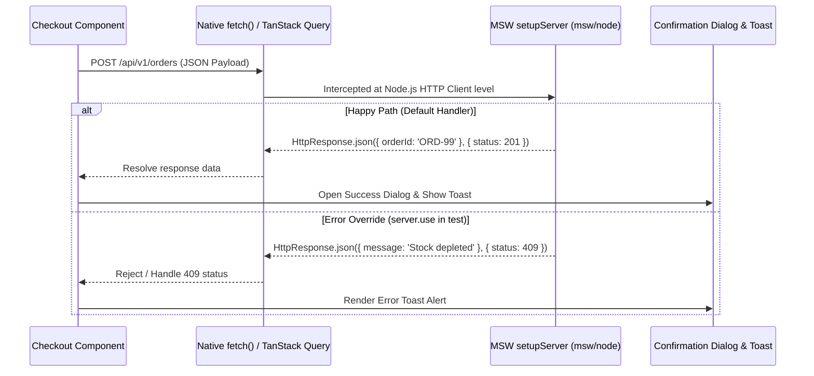

## 1. แนวคิด (Concept)
แทนที่เราจะใช้ `jest.spyOn(global, 'fetch')` หรือ `jest.mock('axios')` ซึ่งเป็นการผูกชุดทดสอบเข้ากับเครื่องมือดึงข้อมูล (หากวันหน้าทีมเปลี่ยนจาก `axios` เป็น `fetch` เทสต์จะพังทั้งหมด) มาตรฐานระดับ Enterprise ในปัจจุบันคือการใช้ **MSW (Mock Service Worker v2)**

MSW ทำการดักจับ HTTP Requests ในระดับ **Network Interception Layer** ของ Node.js (ผ่าน `@mswjs/interceptors` ร่วมกับ `setupServer` จาก `msw/node`) ทำให้โค้ดใน Component ของเราสามารถเรียกใช้ `fetch()` จริง, TanStack Query จริง และอ่าน `Response` จริงได้ครบทุกขั้นตอน นอกจากนี้เรายังสามารถทดสอบ UI Feedback สำคัญอย่าง [Shadcn Dialog](/docs/shadcn) และ [Toast Notifications](/docs/toast-notify) ที่แสดงผลเมื่อ API ตอบกลับสำเร็จหรือล้มเหลวได้อย่างสมจริง

## 2. หลักการเบื้องหลัง (Under the Hood)


วงจรชีวิตมาตรฐานของ MSW ในไฟล์เทสต์ประกอบด้วย 3 ขั้นตอน:
1. `beforeAll(() => server.listen({ onUnhandledRequest: 'error' }))`: เริ่มดักจับ Network และสั่งให้โยน Error ทันทีหากมีการยิง URL ที่เราลืมกำหนด Handler ไว้
2. `afterEach(() => server.resetHandlers())`: ล้าง Runtime Handler พิเศษที่บาง Test Case สั่ง `server.use(...)` ทับไว้ เพื่อไม่ให้กระทบเทสต์ข้อถัดไป
3. `afterAll(() => server.close())`: ปิด Interceptor เมื่อจบไฟล์เทสต์

## 3. ตัวอย่างโค้ด (Smart Butcher Marketplace)

### ตัวอย่างที่ 1 (พื้นฐาน): การตั้งค่า MSW v2 (`setupServer`) และการทดสอบดึงรายการเนื้อพรีเมียมพร้อม Override กรณี Server Error 500
ตัวอย่างการใช้ `http.get` และ `HttpResponse.json` ของ MSW v2 เพื่อทดสอบ Component ที่ดึงข้อมูลผ่าน `fetch`:

```tsx filename="src/components/catalog/WagyuCatalogList.msw.spec.tsx"
import React, { useEffect, useState } from 'react';
import { render, screen } from '@testing-library/react';
import { http, HttpResponse } from 'msw';
import { setupServer } from 'msw/node';

export interface CatalogCut {
  id: string;
  name: string;
  pricePerKg: number;
}

export function WagyuCatalogList() {
  const [cuts, setCuts] = useState<CatalogCut[]>([]);
  const [errorMsg, setErrorMsg] = useState<string | null>(null);

  useEffect(() => {
    fetch('https://api.smartbutcher.local/api/v1/cuts')
      .then(async (res) => {
        if (!res.ok) {
          throw new Error('Failed to load dry-aged catalog from server');
        }
        return res.json() as Promise<CatalogCut[]>;
      })
      .then((data) => setCuts(data))
      .catch((err: Error) => setErrorMsg(err.message));
  }, []);

  if (errorMsg) {
    return <div role="alert">{errorMsg}</div>;
  }

  return (
    <ul>
      {cuts.map((cut) => (
        <li key={cut.id}>
          {cut.name} - ฿{cut.pricePerKg.toLocaleString()}/kg
        </li>
      ))}
    </ul>
  );
}

const server = setupServer(
  http.get('https://api.smartbutcher.local/api/v1/cuts', () => {
    return HttpResponse.json<CatalogCut[]>([
      { id: 'c1', name: 'Miyazaki A5 Ribeye', pricePerKg: 4800 },
      { id: 'c2', name: '45-Day Dry-Aged Striploin', pricePerKg: 3500 },
    ]);
  }),
);

describe('WagyuCatalogList with MSW v2 Network Interception', () => {
  beforeAll(() => server.listen({ onUnhandledRequest: 'error' }));
  afterEach(() => server.resetHandlers());
  afterAll(() => server.close());

  it('should render list of wagyu cuts fetched from intercepted HTTP endpoint', async () => {
    render(<WagyuCatalogList />);

    expect(
      await screen.findByText('Miyazaki A5 Ribeye - ฿4,800/kg'),
    ).toBeInTheDocument();
    expect(
      screen.getByText('45-Day Dry-Aged Striploin - ฿3,500/kg'),
    ).toBeInTheDocument();
  });

  it('should display error alert when server responds with 500 Internal Server Error via server.use()', async () => {
    // จำลองให้ Endpoint นี้พังเฉพาะในเคสทดสอบนี้เท่านั้น
    server.use(
      http.get('https://api.smartbutcher.local/api/v1/cuts', () => {
        return new HttpResponse(null, { status: 500 });
      }),
    );

    render(<WagyuCatalogList />);

    const alert = await screen.findByRole('alert');
    expect(alert).toHaveTextContent('Failed to load dry-aged catalog from server');
  });
});
```

### ตัวอย่างที่ 2 (ขั้นสูง): การทดสอบ Confirmation Dialog และ Toast Notification เมื่อกดยืนยันการชำระเงินสั่งซื้อเนื้อ
ตัวอย่างการทดสอบขั้นตอนที่ลูกค้ากดปุ่ม *"Checkout Order"* -> เปิด Confirmation Modal (`role="dialog"`) -> กดยืนยันการชำระเงิน -> ยิง API ผ่าน MSW -> ปิด Dialog และแสดง Toast แจ้งเตือนสำเร็จ:

```tsx filename="src/components/checkout/QuickWagyuCheckoutModal.spec.tsx"
import React, { useState } from 'react';
import { render, screen, waitForElementToBeRemoved } from '@testing-library/react';
import userEvent from '@testing-library/user-event';
import { http, HttpResponse } from 'msw';
import { setupServer } from 'msw/node';

export function QuickWagyuCheckoutModal({
  orderId,
  totalAmount,
}: {
  orderId: string;
  totalAmount: number;
}) {
  const [isDialogOpen, setIsDialogOpen] = useState(false);
  const [toastMessage, setToastMessage] = useState<string | null>(null);

  async function handleConfirmPayment() {
    const response = await fetch('https://api.smartbutcher.local/api/v1/payments', {
      method: 'POST',
      headers: { 'Content-Type': 'application/json' },
      body: JSON.stringify({ orderId, amount: totalAmount }),
    });

    if (response.ok) {
      const data = (await response.json()) as { receiptNo: string };
      setIsDialogOpen(false);
      setToastMessage(`Payment successful! Receipt: ${data.receiptNo}`);
    } else {
      setToastMessage('Payment declined: Insufficient wagyu stock');
    }
  }

  return (
    <div>
      <button type="button" onClick={() => setIsDialogOpen(true)}>
        Proceed to Wagyu Payment
      </button>

      {isDialogOpen && (
        <div role="dialog" aria-modal="true" aria-labelledby="dialog-title">
          <h2 id="dialog-title">Confirm Chilled Wagyu Order</h2>
          <p>Total to charge: ฿{totalAmount.toLocaleString()}</p>
          <button type="button" onClick={handleConfirmPayment}>
            Confirm & Pay Now
          </button>
          <button type="button" onClick={() => setIsDialogOpen(false)}>
            Cancel
          </button>
        </div>
      )}

      {toastMessage && (
        <div role="status" aria-live="polite">
          {toastMessage}
        </div>
      )}
    </div>
  );
}

const paymentServer = setupServer(
  http.post('https://api.smartbutcher.local/api/v1/payments', async () => {
    return HttpResponse.json({ receiptNo: 'RCP-WAGYU-2026' }, { status: 201 });
  }),
);

describe('QuickWagyuCheckoutModal (Dialog & Toast with MSW)', () => {
  beforeAll(() => paymentServer.listen({ onUnhandledRequest: 'error' }));
  afterEach(() => paymentServer.resetHandlers());
  afterAll(() => paymentServer.close());

  it('should open confirmation dialog, submit payment via MSW, close dialog, and show receipt toast', async () => {
    const user = userEvent.setup();

    render(<QuickWagyuCheckoutModal orderId="ord-77" totalAmount={6400} />);

    // 1. กดปุ่มเปิด Confirmation Dialog
    await user.click(
      screen.getByRole('button', { name: 'Proceed to Wagyu Payment' }),
    );

    const dialog = screen.getByRole('dialog', {
      name: 'Confirm Chilled Wagyu Order',
    });
    expect(dialog).toBeInTheDocument();
    expect(screen.getByText('Total to charge: ฿6,400')).toBeInTheDocument();

    // 2. กดปุ่มยืนยันการชำระเงินใน Dialog
    await user.click(screen.getByRole('button', { name: 'Confirm & Pay Now' }));

    // 3. ตรวจสอบว่า Dialog ปิดลงและแสดงข้อความ Toast สำเร็จพร้อมเลขใบเสร็จ
    expect(
      await screen.findByRole('status'),
    ).toHaveTextContent('Payment successful! Receipt: RCP-WAGYU-2026');
    expect(screen.queryByRole('dialog')).not.toBeInTheDocument();
  });
});
```

## 4. ผิด vs ถูก (Anti-pattern vs Best Practice)

| มิติการเปรียบเทียบ | ❌ ผิด (Anti-pattern) | ✅ ถูก (Best Practice) |
| :--- | :--- | :--- |
| **การจำลอง HTTP Requests** | เขียน `global.fetch = jest.fn()` ในทุกไฟล์เทสต์แล้วต้องคอยจำลอง `{ ok: true, json: async () => ... }` เองซ้ำๆ | ใช้ MSW (`setupServer`) เพื่อจำลอง HTTP Endpoints ตามมาตรฐาน Fetch API จริงและใช้ซ้ำได้ทั้งโปรเจกต์ |
| **การลืม `server.resetHandlers()`** | ใช้ `server.use(...)` จำลอง Error 500 ในเทสต์ข้อที่ 2 แต่ไม่ใส่ `afterEach(() => server.resetHandlers())` ทำให้เทสต์ข้อที่ 3 พังตาม | เรียก `server.resetHandlers()` ใน `afterEach` เสมอเพื่อคืนค่า Default Handlers |

## 5. ควรใช้เมื่อไหร่ และ ไม่ควรใช้เมื่อไหร่
- **ควรใช้ MSW เมื่อ:** ทดสอบ Integration ระดับหน้าจอหรือ Component ที่มีการดึงข้อมูล (`GET`) หรือส่งข้อมูล (`POST`/`PATCH`/`DELETE`) ผ่านเครือข่าย
- **ไม่ควรใช้ MSW เมื่อ:** ทดสอบ Pure Presentational Component ที่รับข้อมูลผ่าน Props อย่างเดียวโดยไม่มีการเรียก API ภายในตัวมันเอง

## 6. คำถามสัมภาษณ์ (Interview Q&A)
- **Q1: การใช้ MSW (`msw/node`) เหนือกว่าการทำ `jest.mock('axios')` หรือการ Mock `window.fetch` อย่างไร?**
  - *แนวคำตอบ:* การทำ `jest.mock('axios')` เป็นการตัดวงจรตั้งแต่ระดับการเรียกฟังก์ชันในโค้ด ทำให้เราไม่ได้ทดสอบว่า URL, HTTP Headers, การ Serialize JSON Body หรือ Custom Fetch Wrapper ของเราทำงานถูกต้องหรือไม่ นอกจากนี้หากทีมเปลี่ยนไลบรารีจาก Axios เป็น Native `fetch` หรือ `ky` เทสต์ทั้งหมดจะพังทันที ในขณะที่ MSW ดักจับที่ระดับ Node.js Network Request (`http.ClientRequest` / `undici`) ทำให้โค้ดแอปพลิเคชันทำงานเหมือนจริงเกือบ 100%
- **Q2: ในการทดสอบ Radix UI / Shadcn Dialog ที่เรนเดอร์ผ่าน React Portal ออกไปนอก `container` ของ Component เราควรใช้ตัวแปรใดในการค้นหา Element ของ Dialog?**
  - *แนวคำตอบ:* ต้องใช้ `screen.getByRole('dialog')` หรือ `await screen.findByRole('dialog')` เสมอ เพราะ React Portal จะเรนเดอร์ HTML ของ Dialog ไปต่อท้ายที่ `document.body` โดยตรง หากเผลอใช้ `container.querySelector(...)` ซึ่งค้นหาเฉพาะภายใน `<div />` ที่ครอบ Component ต้นทาง จะหา Dialog ที่อยู่ใน Portal ไม่เจอ

---
