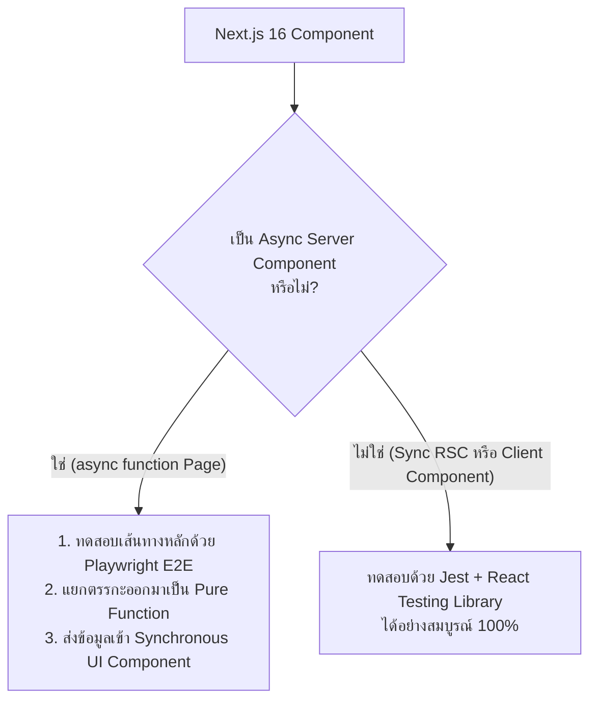

## 1. แนวคิด (Concept)
ในสถาปัตยกรรม App Router ของ [Next.js 16](/docs/nextjs) และ [React 19](/docs/react) คอมโพเนนต์ถูกแบ่งออกเป็น **Server Components (RSC)** และ **Client Components (`'use client'`)** โดยที่ Server Components สามารถเขียนเป็นฟังก์ชันแบบ Asynchronous (`export default async function Page()`) เพื่อดึงข้อมูลจากฐานข้อมูลหรือ API บนเซิร์ฟเวอร์ได้โดยตรง

อย่างไรก็ตาม ในการวางกลยุทธ์การทดสอบระดับ Production เราต้องเข้าใจข้อจำกัดทางสถาปัตยกรรมของเครื่องมือ Unit Test (Jest + JSDOM) ต่อ `async` Server Components และเลือกใช้เครื่องมือให้ถูกกับประเภทของ Component

<Callout type="note" title="ข้อจำกัดของ Async Server Components ใน Next.js 16">
สำหรับ `async` Server Components เอกสารทางการของ Next.js แนะนำให้ทดสอบผ่าน E2E Testing (Playwright) แทน Unit Test ด้วย Jest เนื่องจาก `async` Server Components อาศัยกลไกการเรนเดอร์และ Streaming ของรันไทม์ฝั่งเซิร์ฟเวอร์ที่สภาพแวดล้อม JSDOM ไม่ได้จำลองไว้ครบถ้วน ทั้งนี้แนะนำให้ผู้พัฒนาตรวจสอบอัปเดตล่าสุดกับเอกสารทางการของ Next.js Testing (https://nextjs.org/docs/app/building-your-application/testing/jest) อยู่เสมอ
</Callout>

## 2. หลักการเบื้องหลัง (Under the Hood)


เหตุผลเชิงลึกที่ Jest + RTL ไม่เหมาะกับการเรนเดอร์ `async` Server Components ที่มีโครงสร้างซับซ้อนโดยตรง:
1. **React Flight Protocol & Suspense Streaming:** ในเวลาทำงานจริง Next.js Server จะประมวลผล `async` Component แปลงผลลัพธ์เป็น RSC Payload Stream และจัดการ `<Suspense>` ร่วมกับ Server Contexts (`cookies()`, `headers()`) ซึ่ง `render()` ของ `@testing-library/react` บนฝั่ง Client/JSDOM ไม่ได้จำลอง RSC Bundler Pipeline นี้
2. **Nested Async RSCs:** แม้ในบางกรณีเราจะสามารถเรียก `render(await MyAsyncServerComponent())` สำหรับฟังก์ชันชั้นเดียวได้ แต่ทันทีที่ภายใน Component นั้นมี `<ChildAsyncServerComponent />` ซ้อนอยู่ข้างใน ตัว React Client Renderer ใน Jest จะไม่สามารถแกะ Promise ของ Component ลูกได้และทำให้เทสต์พัง

**สถาปัตยกรรมที่แนะนำ (Container / Presentational Split สำหรับ RSC):**
- ให้ `async` Server Component ทำหน้าที่เป็นเพียง **Thin Data-Fetching Shell** (ดึงข้อมูลแล้วส่งต่อเป็น Props) -> ทดสอบด้วย **[Playwright E2E](/docs/testing/playwright)**
- แยกส่วนแสดงผลและตรรกะการแสดงผลออกมาเป็น **Synchronous Server Component** หรือ **Client Component** ที่รับข้อมูลผ่าน Props -> ทดสอบด้วย **Jest + React Testing Library** ได้อย่างรวดเร็ว 100%

## 3. ตัวอย่างโค้ด (Smart Butcher Marketplace)

### ตัวอย่างที่ 1 (พื้นฐาน): การทดสอบ Synchronous Server Component ที่ถูกแยกส่วนออกมาจาก Async Page
แทนที่จะพยายามยัดทุกอย่างไว้ใน `async function OrderSummaryPage()` เราแยก `OrderReceiptView` ออกมาเป็น Synchronous Server Component ที่รับข้อมูล `Order` และ `Payment` ผ่าน Props ทำให้สามารถเขียน Unit Test ด้วย Jest + RTL ได้ทันที:

```tsx filename="src/components/orders/OrderReceiptView.spec.tsx"
import React from 'react';
import { render, screen } from '@testing-library/react';

export interface OrderReceiptProps {
  order: {
    id: string;
    customerEmail: string;
    totalAmount: number;
    status: 'PAID' | 'PREPARING_CUT';
  };
  payment: {
    method: 'PROMPTPAY' | 'CREDIT_CARD';
    paidAtIso: string;
  };
}

// Synchronous Server Component (ไม่มี 'use client' และไม่ได้เป็น async function)
export function OrderReceiptView({ order, payment }: OrderReceiptProps) {
  return (
    <section aria-label="Official Butcher Receipt">
      <h1>Smart Butcher Order #{order.id}</h1>
      <p>Customer: {order.customerEmail}</p>
      <p>Order Status: {order.status}</p>
      <p>Payment Method: {payment.method}</p>
      <p data-testid="receipt-total">Total Paid: ฿{order.totalAmount.toLocaleString()}</p>
    </section>
  );
}

describe('OrderReceiptView (Synchronous Server Component Unit Test)', () => {
  it('should render formatted butcher receipt details from props without requiring async RSC runtime', () => {
    render(
      <OrderReceiptView
        order={{
          id: 'ORD-2026-889',
          customerEmail: 'vip@smartbutcher.com',
          totalAmount: 14500,
          status: 'PREPARING_CUT',
        }}
        payment={{
          method: 'PROMPTPAY',
          paidAtIso: '2026-10-17T04:00:00.000Z',
        }}
      />,
    );

    expect(
      screen.getByRole('heading', { name: 'Smart Butcher Order #ORD-2026-889' }),
    ).toBeInTheDocument();
    expect(screen.getByText('Order Status: PREPARING_CUT')).toBeInTheDocument();
    expect(screen.getByTestId('receipt-total')).toHaveTextContent('Total Paid: ฿14,500');
  });
});
```

### ตัวอย่างที่ 2 (ขั้นสูง): การแยก Data Transformation Logic ออกจาก Async Server Component เพื่อทดสอบคู่กับ Client Component
ตัวอย่างการออกแบบโมดูลสำหรับหน้าแดชบอร์ดของช่างแล่เนื้อ (`ButcherDashboard`) ที่แยกฟังก์ชันคำนวณข้อมูล (` summarizeDailyCutQueue`) และ Client Component (`InteractiveCutQueue`) ออกมาทดสอบด้วย Jest อย่างครบถ้วน:

```tsx filename="src/app/butcher-dashboard/butcher-queue.spec.tsx"
import React, { useState } from 'react';
import { render, screen } from '@testing-library/react';
import userEvent from '@testing-library/user-event';

export interface RawCutTask {
  orderItemId: string;
  sku: string;
  cutName: string;
  weightKg: number;
  isCompleted: boolean;
}

// 1. Pure Domain Logic ที่ถูกเรียกใช้ภายใน Async Server Component
export function summarizeDailyCutQueue(tasks: RawCutTask[]): {
  pendingCount: number;
  totalPendingWeightKg: number;
} {
  const pendingTasks = tasks.filter((t) => !t.isCompleted);
  const totalWeight = pendingTasks.reduce((sum, t) => sum + t.weightKg, 0);
  return {
    pendingCount: pendingTasks.length,
    totalPendingWeightKg: Number(totalWeight.toFixed(2)),
  };
}

// 2. Client Component ที่รับ Initial Data จาก Async Server Component
export function InteractiveCutQueue({ initialTasks }: { initialTasks: RawCutTask[] }) {
  const [tasks, setTasks] = useState<RawCutTask[]>(initialTasks);
  const summary = summarizeDailyCutQueue(tasks);

  function markAsCut(orderItemId: string) {
    setTasks((prev) =>
      prev.map((task) =>
        task.orderItemId === orderItemId ? { ...task, isCompleted: true } : task,
      ),
    );
  }

  return (
    <div>
      <p data-testid="queue-summary">
        Pending Cuts: {summary.pendingCount} ({summary.totalPendingWeightKg} kg)
      </p>
      <ul>
        {tasks.map((task) => (
          <li key={task.orderItemId}>
            <span>
              {task.cutName} ({task.weightKg} kg) -{' '}
              {task.isCompleted ? 'Ready for Cold Pack' : 'Awaiting Butcher'}
            </span>
            {!task.isCompleted && (
              <button type="button" onClick={() => markAsCut(task.orderItemId)}>
                Complete {task.sku}
              </button>
            )}
          </li>
        ))}
      </ul>
    </div>
  );
}

describe('Butcher Queue Logic & Client Component (RSC Testing Strategy)', () => {
  const sampleTasks: RawCutTask[] = [
    {
      orderItemId: 'oi-1',
      sku: 'WAGYU-RIB-01',
      cutName: 'Miyazaki Ribeye 3cm',
      weightKg: 0.45,
      isCompleted: false,
    },
    {
      orderItemId: 'oi-2',
      sku: 'DRYAGED-STRIP-02',
      cutName: '45-Day Dry-Aged Striploin',
      weightKg: 0.55,
      isCompleted: false,
    },
  ];

  it('should accurately calculate pending count and total weight in summarizeDailyCutQueue', () => {
    const result = summarizeDailyCutQueue(sampleTasks);

    expect(result.pendingCount).toBe(2);
    expect(result.totalPendingWeightKg).toBe(1.0);
  });

  it('should update pending weight summary when butcher marks a wagyu cut as completed', async () => {
    const user = userEvent.setup();

    render(<InteractiveCutQueue initialTasks={sampleTasks} />);

    expect(screen.getByTestId('queue-summary')).toHaveTextContent(
      'Pending Cuts: 2 (1 kg)',
    );

    await user.click(screen.getByRole('button', { name: 'Complete WAGYU-RIB-01' }));

    expect(screen.getByTestId('queue-summary')).toHaveTextContent(
      'Pending Cuts: 1 (0.55 kg)',
    );
    expect(
      screen.getByText('Miyazaki Ribeye 3cm (0.45 kg) - Ready for Cold Pack'),
    ).toBeInTheDocument();
  });
});
```

## 4. ผิด vs ถูก (Anti-pattern vs Best Practice)

| มิติการเปรียบเทียบ | ❌ ผิด (Anti-pattern) | ✅ ถูก (Best Practice) |
| :--- | :--- | :--- |
| **การเขียนโค้ดใน `async` Page** | เขียนทั้งคำสั่ง Query ฐานข้อมูล, ตรรกะคำนวณส่วนลด 100 บรรทัด และ JSX ทั้งหมดปนอยู่ใน `async function Page()` เดียวจนทดสอบด้วย Jest ไม่ได้ | แยกตรรกะการคำนวณเป็นฟังก์ชันบริสุทธิ์ แยก UI เป็น Synchronous/Client Component เพื่อเทสต์ด้วย Jest และใช้ Playwright ทดสอบ `async` Page |
| **การฝืน Mock Next.js Server Internals** | พยายามเขียน Mock ซับซ้อนเพื่อจำลอง `headers()`, `cookies()`, และ Streaming Suspense ภายใน Jest จนเทสต์เปราะบาง | ทดสอบการทำงานร่วมกันของ Server Headers, Cookies, Middleware และ `async` RSC ผ่านเบราว์เซอร์จริงด้วย Playwright E2E |

## 5. ควรใช้เมื่อไหร่ และ ไม่ควรใช้เมื่อไหร่
- **ควรใช้ Jest + RTL เมื่อ:** ทดสอบ Client Components (`'use client'`), Synchronous Server Components, Custom Hooks, Zustand Stores และฟังก์ชันคำนวณทางธุรกิจ
- **ควรใช้ Playwright E2E เมื่อ:** ทดสอบ `async` Server Components, Server Actions ที่มีการเรียก `revalidatePath` / `redirect`, Next.js Middleware และการเปลี่ยนหน้าข้าม Routes

## 6. คำถามสัมภาษณ์ (Interview Q&A)
- **Q1: ทำไมเอกสารทางการของ Next.js จึงแนะนำให้ใช้ E2E Testing (Playwright) สำหรับทดสอบ `async` Server Components แทนการรัน Unit Test ด้วย Jest?**
  - *แนวคำตอบ:* เพราะ `async` Server Components ทำงานภายใต้สถาปัตยกรรม React Server Components (RSC) ที่ต้องพึ่งพา Next.js Server Runtime ในการแกะ Promise หลายชั้น, ประมวลผล Server APIs (`cookies`, `headers`, `draftMode`), และสตรีมผลลัพธ์ผ่าน `<Suspense>` มายังฝั่ง Client สภาพแวดล้อม JSDOM ใน Jest จำลองเพียงฝั่งเบราว์เซอร์อย่างง่ายและไม่ได้รัน RSC Server Pipeline เต็มรูปแบบ การทดสอบด้วย Playwright ที่รันเซิร์ฟเวอร์ Next.js จริงจึงให้ผลลัพธ์ที่ถูกต้องตรงตาม Production 100%
- **Q2: เราควรจัดโครงสร้างโค้ดใน Next.js 16 อย่างไรเพื่อให้ยังสามารถเขียน Unit Test ด้วย Jest ได้ครอบคลุมมากกว่า 80% ของโค้ดทั้งหมด แม้โปรเจกต์จะใช้ App Router?**
  - *แนวคำตอบ:* ใช้รูปแบบ **Thin Async Server Shell** คือให้ไฟล์ `page.tsx` ที่เป็น `async` ทำหน้าที่ดึงข้อมูลจาก Data Access Layer เพียงอย่างเดียว จากนั้นส่งข้อมูลที่ได้เข้าไปยัง Synchronous Presentational Components หรือ Interactive Client Components ผ่าน Props วิธีนี้ช่วยให้เราทดสอบ UI และ Interactions ทั้งหมดด้วย Jest + RTL ได้อย่างรวดเร็ว ในขณะที่ใช้ Playwright E2E ทดสอบการเชื่อมต่อในระดับ `page.tsx`

---
